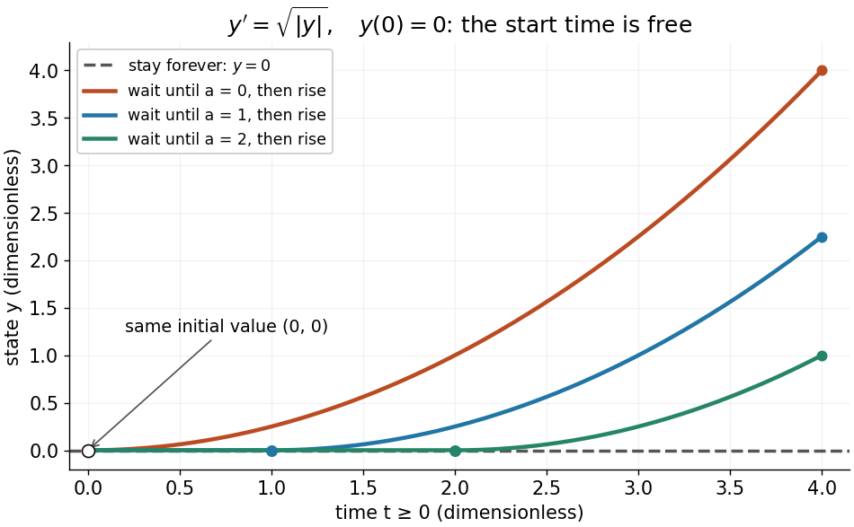

# Initial value problem

↑ **Parent:** [Ordinary differential equation](ordinary-differential-equation.md)  
ⓦ [Wiki](https://en.wikipedia.org/wiki/Initial_value_problem)

An [initial value problem](initial-value-problem.md) combines an [ordinary differential equation](ordinary-differential-equation.md) with an [initial condition](initial-condition.md), for example $y'=f(t,y)$ and $y(t_0)=y_0$. The task is to find a [solution of a differential equation](solution-of-a-differential-equation.md) on an [interval](interval-mathematics.md) containing $t_0$ which has that starting value. For a continuous [linear differential equation](linear-differential-equation.md) $u'=A(t)u$, every prescribed finite [vector](vector.md) $u_0$ determines a unique solution on the coefficient [interval](interval-mathematics.md). A [boundary value problem](boundary-value-problem.md) can instead prescribe values at distinct endpoints.

For the cooling [initial value problem](initial-value-problem.md) $y'=-k(y-T_a)$, $y(t_0)=y_0$, where $k>0$ and $T_a$ are constant, the unique solution is

$$
y(t)=T_a+(y_0-T_a)e^{-k(t-t_0)}.
$$

Take $T_a=20$ degrees Celsius, $y_0=80$ degrees Celsius, $t_0=0$, and $k=0.1$ per minute. Then $y(10)=20+60e^{-1}\approx42.07$ degrees Celsius. Reaching $30$ degrees Celsius requires $60e^{-0.1t}=10$, so $t=10\log6\approx17.92$ minutes. The [time constant](time-constant.md) $1/k=10$ minutes reduces the excess [temperature](temperature.md) by a factor $e^{-1}$; it does not reduce the absolute [temperature](temperature.md) by that factor.

Uniqueness needs assumptions. If $f$ is a [continuous function](continuous-function.md) on an open neighborhood of $(t_0,y_0)$ and satisfies a local [Lipschitz condition](lipschitz-continuity.md) in $y$, uniformly in $t$, the [Picard-Lindelöf theorem](picard-lindelof-theorem.md) gives a unique local solution. Concretely, a finite $L$ bounds $|f(t,u)-f(t,v)|\leq L|u-v|$ in a sufficiently small rectangle. Cooling satisfies this with $L=k$. Local existence does not promise existence for all future time: $y'=y^2$, $y(0)=1$, has $y(t)=1/(1-t)$ on $(-\infty,1)$ and [finite-time blowup](finite-time-blowup.md) at $t=1$.

[Continuity](continuous-function.md) alone is insufficient for uniqueness. Consider the dimensionless [initial value problem](initial-value-problem.md) involving a [square root](square-root.md) and an [absolute value](absolute-value.md):

$$
y'=\sqrt{|y|},\qquad y(0)=0.
$$

Besides $y(t)\equiv0$, each delay $a\geq0$ gives a solution for $t\geq0$:

$$
y_a(t)=\begin{cases}0,&0\leq t\leq a,\\(t-a)^2/4,&t>a.\end{cases}
$$

At $t=4$, delays $a=0,1,2$ give $y=4,9/4,1$, despite identical starting data. These are valid [solutions of a differential equation](solution-of-a-differential-equation.md): for $a>0$, both one-sided [derivatives](derivative.md) at the join are zero; for $a=0$, the right [derivative](derivative.md) at the starting time is zero. After the join, $y_a'=(t-a)/2=\sqrt{|y_a|}$ because $t>a$. Squaring alone would also suggest a parabola before the join, but its negative [derivative](derivative.md) there would violate the equation. Since $y'\geq0$, a forward solution starting from zero stays nonnegative.

**[Figure 4](#image-one-initial-value-permits-infinitely-many-delayed-start-solutions-without-a-lipschitz-condition). One initial value permits infinitely many delayed-start solutions without a Lipschitz condition**.

The right-hand side is a [continuous function](continuous-function.md) but fails the [Lipschitz condition](lipschitz-continuity.md) at zero: for $h>0$, $|\sqrt{|h|}-0|/|h|=1/\sqrt h$ is unbounded. Thus the [Peano existence theorem](peano-existence-theorem.md) still supplies local existence, while the [Picard-Lindelöf theorem](picard-lindelof-theorem.md) does not supply uniqueness. Related waiting-time examples and a sufficient uniqueness condition appear in [MIT 18.034, Lecture 2: Fundamental Principles](https://ocw.mit.edu/courses/18-034-honors-differential-equations-spring-2009/a8c15198f81e85870da85da9792565b9_MIT18_034s09_lec02.pdf).

A brief proof outline explains the mechanism: rewrite the [initial value problem](initial-value-problem.md) as the [integral equation](integral-equation.md) $y(t)=y_0+\int_{t_0}^t f(s,y(s))\,ds$. On a short enough [interval](interval-mathematics.md), the [Lipschitz condition](lipschitz-continuity.md) makes the right-hand side a [contraction mapping](contraction-mapping.md) on a closed set of continuous [functions](function-split.md) near $y_0$. The [contraction mapping theorem](contraction-mapping-theorem.md) gives a unique fixed point; the [fundamental theorem of calculus](fundamental-theorem-of-calculus.md) turns it back into a solution.

**Table of contents**

- [L2 initial condition](l2-initial-condition.md)

## ↑ Ancestors (6)

1. [Ordinary differential equation](ordinary-differential-equation.md)
2. [Differential equation](differential-equation-split.md)
3. [Analysis](analysis-split.md)
4. [Area of mathematics](area-of-mathematics.md)
5. [Mathematics](mathematics-split.md)
6. [Codex Wiki](split.md)

## ← Incoming links (47)

- [Adaptive Euler step doubling for exponential decay](adaptive-euler-step-doubling-for-exponential-decay.md)
- [Adaptive step-size controller](adaptive-step-size-controller.md)
- [Convergence of a numerical method](convergence-of-a-numerical-method.md)
- [Deterministic evolution](deterministic-evolution.md)
- [Direction field](direction-field.md)
- [Euler method](euler-method.md)
- [Finite-dimensional continuation criterion](finite-dimensional-continuation-criterion.md)
- [Fundamental matrix of a linear differential equation](fundamental-matrix-of-a-linear-differential-equation.md)
- [Hyperbolic function](hyperbolic-function.md)
- [Implicit solution](implicit-solution.md)
- [Initial value problem](initial-value-problem.md)
- [Integrating factor](integrating-factor.md)
- [Laplace transform](laplace-transform.md)
- [Linear differential equation](linear-differential-equation.md)
- [Local error estimator](local-error-estimator.md)
- [Newton's law of cooling](newton-s-law-of-cooling.md)
- [Nonlinear ordinary differential equation](nonlinear-ordinary-differential-equation.md)
- [Ordinary differential equation](ordinary-differential-equation.md)
- [Solution](past-exam-of-the-mathematics-course-of-the-university-of-cambridge/2001/iii/paper-57/7/solution.md)
- [Solution](past-exam-of-the-mathematics-course-of-the-university-of-cambridge/2002/iii/paper-60/2/solution.md)
- [Solution](past-exam-of-the-mathematics-course-of-the-university-of-cambridge/2002/iii/paper-60/7/solution.md)
- [Solution](past-exam-of-the-mathematics-course-of-the-university-of-cambridge/2004/ia/paper-2/1b/solution.md)
- [Solution](past-exam-of-the-mathematics-course-of-the-university-of-cambridge/2004/ia/paper-2/2b/solution.md)
- [Solution](past-exam-of-the-mathematics-course-of-the-university-of-cambridge/2005/ia/paper-2/1b/solution.md)
- [Solution](past-exam-of-the-mathematics-course-of-the-university-of-cambridge/2005/iii/paper-60/1/solution.md)
- [Solution](past-exam-of-the-mathematics-course-of-the-university-of-cambridge/2005/iii/paper-72/1/1/solution.md)
- [Solution](past-exam-of-the-mathematics-course-of-the-university-of-cambridge/2006/ia/paper-2/7b/solution.md)
- [Solution](past-exam-of-the-mathematics-course-of-the-university-of-cambridge/2006/iii/paper-56/1/solution.md)
- [Solution](past-exam-of-the-mathematics-course-of-the-university-of-cambridge/2010/iii/paper-68/3/a/solution.md)
- [Solution](past-exam-of-the-mathematics-course-of-the-university-of-cambridge/2013/iii/paper-60/1/solution.md)
- [Solution](past-exam-of-the-mathematics-course-of-the-university-of-cambridge/2014/iii/paper-74/1/a/solution.md)
- [Solution](past-exam-of-the-mathematics-course-of-the-university-of-cambridge/2015/iii/paper-52/4/b/iii/solution.md)
- [Solution](past-exam-of-the-mathematics-course-of-the-university-of-cambridge/2015/iii/paper-68/7/solution.md)
- [Solution](past-exam-of-the-mathematics-course-of-the-university-of-cambridge/2016/ia/paper-2/8a/b/solution.md)
- [Solution](past-exam-of-the-mathematics-course-of-the-university-of-cambridge/2016/ib/paper-1/18d/c/solution.md)
- [Solution](past-exam-of-the-mathematics-course-of-the-university-of-cambridge/2017/iii/paper-336/3/solution.md)
- [Pathline](pathline.md)
- [Picard iteration](picard-iteration.md)
- [Picard-Lindelöf theorem](picard-lindelof-theorem.md)
- [Reciprocal Bernoulli equation with finite-time blowup](reciprocal-bernoulli-equation-with-finite-time-blowup.md)
- [Second-order differential equation](second-order-differential-equation.md)
- [Separable differential equation](separable-differential-equation.md)
- [SIR final removed fraction](sir-final-removed-fraction.md)
- [SIR infection peak](sir-infection-peak.md)
- [SIR model equations](sir-model-equations.md)
- [Streakline](streakline.md)
- [Underdamping](underdamping.md)
