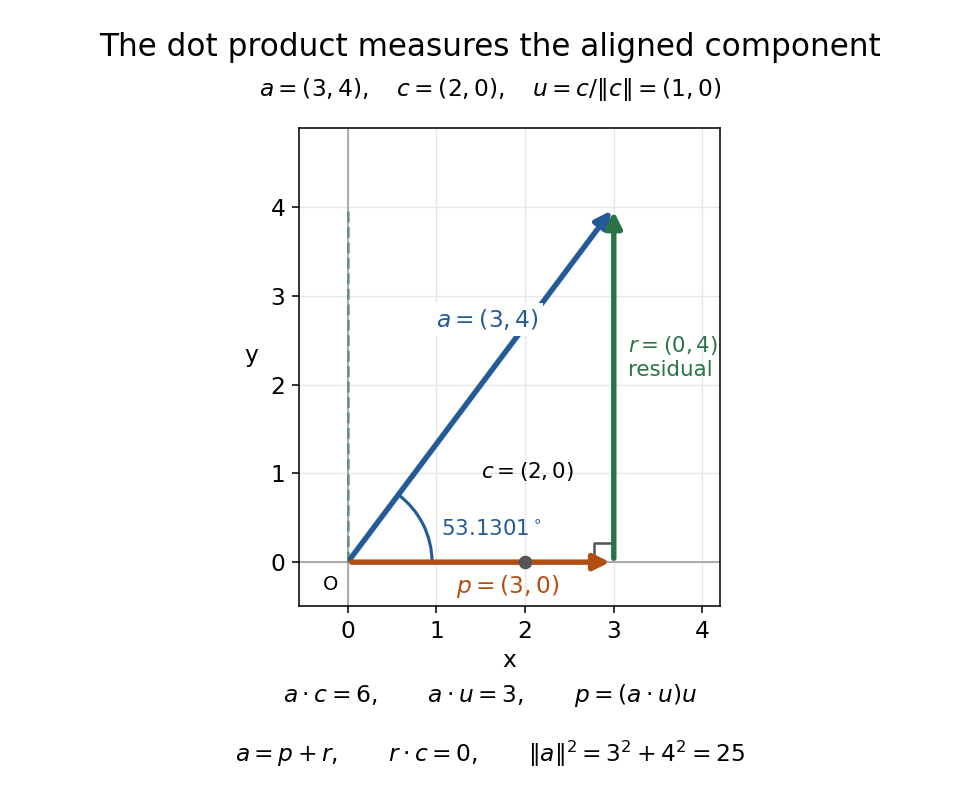
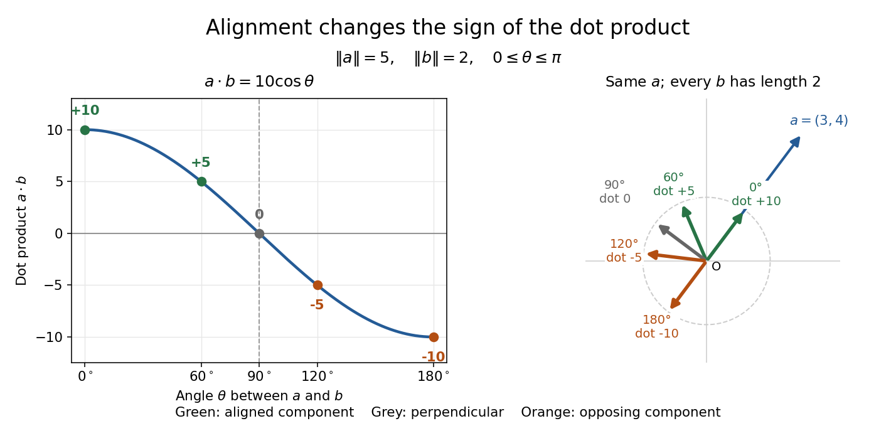

# Inner product

↑ **Parent:** [Linear algebra](linear-algebra.md)  
ⓦ [Wiki](https://en.wikipedia.org/wiki/Inner_product)

An inner product assigns a scalar $\langle u,v\rangle$ to two [vectors](vector-space.md#vector) and supplies their lengths and [orthogonality](#orthogonal-vectors). Using the convention linear in the first argument, it satisfies

$$
\langle au+bv,w\rangle=a\langle u,w\rangle+b\langle v,w\rangle,\qquad
\langle u,v\rangle=\overline{\langle v,u\rangle},\qquad
\langle v,v\rangle>0\quad(v\ne0).
$$

The resulting [norm](normed-vector-space.md#norm) is $\|v\|=\sqrt{\langle v,v\rangle}$. Over the [real numbers](arithmetic.md#real-number), conjugation has no effect and the form is symmetric and [bilinear](multilinear-algebra.md#bilinear-map). Over the [complex numbers](complex-analysis.md#complex-number), it is [sesquilinear](linear-algebra.md#sesquilinear-form); the convention linear in the second argument is also common, so formulas for [coefficients](vector-space.md#coefficient) must match the stated convention.

The Euclidean example is $\langle u,v\rangle=\sum_i u_i\overline{v_i}$. For real $u=(2,1)$ and $v=(1,3)$ this gives $\langle u,v\rangle=5$, while $\|u\|^2=5$ and $\|v\|^2=10$. If $r=(-1,2)$, then $\langle r,u\rangle=0$: perpendicularity becomes an algebraic equation. The [Cauchy-Schwarz inequality](probability-and-statistics.md#cauchy-schwarz-inequality) gives $|\langle u,v\rangle|\leq\|u\|\|v\|$, and in a real [inner product space](#inner-product-space) it makes the angle formula $\cos\theta=\langle u,v\rangle/(\|u\|\|v\|)$ meaningful for nonzero [vectors](vector-space.md#vector).

Different [inner products](inner-product.md) express different measurements. The weighted example $\langle u,v\rangle=4u_1v_1+u_2v_2$ on $\mathbb R^2$ gives $\|(x,y)\|^2=4x^2+y^2$, so its unit-length [vectors](vector-space.md#vector) lie on an ellipse. For [functions](function.md), an [integral](integral.md) such as $\langle f,g\rangle=\int f\overline g$ supplies the geometry of the [L2 space](measure-theory.md#l2-space-is-a-hilbert-space). This lets [orthogonal projection](hilbert-space.md#orthogonal-projection) and [least-squares solutions](inverse-problem.md#least-squares-solution-of-a-linear-inverse-problem) apply to curves as well as coordinate lists.

**Table of contents**

- [Inner product space](#inner-product-space)
- [Generalized parallelogram identity](#generalized-parallelogram-identity)
- [Fischer inner product](#fischer-inner-product)
- [Frobenius inner product](#frobenius-inner-product)
  - [Trace orthogonality of symmetric and antisymmetric matrices](#trace-orthogonality-of-symmetric-and-antisymmetric-matrices)
- [Discrete L2 inner product](#discrete-l2-inner-product)
- [Weighted inner product](#weighted-inner-product)
  - [Weighted norm](#weighted-norm)
  - [Weighted Euclidean inner product](#weighted-euclidean-inner-product)
- [Dot product](#dot-product)
  - [Angle between vectors](#angle-between-vectors)
  - [Scalar projection](#scalar-projection)
  - [Vector projection](#vector-projection)
- [Binary inner product](#binary-inner-product)
- [Orthonormal set](#orthonormal-set)
  - [Orthonormal basis](#orthonormal-basis)
    - [Resolution of the identity](#resolution-of-the-identity)
    - [Resolution of the identity in an orthonormal basis](#resolution-of-the-identity-in-an-orthonormal-basis)
- [Gram matrix](#gram-matrix)
  - [Positive definiteness of a Gram matrix](#positive-definiteness-of-a-gram-matrix)
  - [Unit vectors with a common inner product](#unit-vectors-with-a-common-inner-product)
  - [Gram determinant](#gram-determinant)
  - [Riesz dual basis in an inner product space](#riesz-dual-basis-in-an-inner-product-space)
  - [Gaussian empirical Gram matrix](#gaussian-empirical-gram-matrix)
    - [Gaussian Gram matrix concentration on a fixed subspace](#gaussian-gram-matrix-concentration-on-a-fixed-subspace)
  - [Sparse norm preservation from entrywise Gram control](#sparse-norm-preservation-from-entrywise-gram-control)
- [Pythagorean theorem in an inner-product space](#pythagorean-theorem-in-an-inner-product-space)
- [Orthogonal projection onto a finite-dimensional subspace](#orthogonal-projection-onto-a-finite-dimensional-subspace)
  - [Orthogonal projection residual](#orthogonal-projection-residual)
  - [Orthogonal projection matrix](#orthogonal-projection-matrix)
    - [Orthogonal projection of a circle between planes](#orthogonal-projection-of-a-circle-between-planes)
    - [Transverse projection operator](#transverse-projection-operator)
  - [Least-squares polynomial in an orthogonal-polynomial basis](#least-squares-polynomial-in-an-orthogonal-polynomial-basis)
- [Orthogonal vectors](#orthogonal-vectors)
  - [Orthogonality does not diagonalize a varying potential](#orthogonality-does-not-diagonalize-a-varying-potential)
  - [Orthogonal basis](#orthogonal-basis)
- [Nonorthogonal vectors](#nonorthogonal-vectors)
- [Gram-Schmidt process](#gram-schmidt-process)
  - [Classical Gram-Schmidt](#classical-gram-schmidt)
  - [Modified Gram-Schmidt](#modified-gram-schmidt)
  - [QR decomposition](#qr-decomposition)
    - [Positive-diagonal QR decomposition preserves a complex structure](#positive-diagonal-qr-decomposition-preserves-a-complex-structure)
    - [Thin QR factorization from Cholesky decomposition](#thin-qr-factorization-from-cholesky-decomposition)
    - [Orthogonal coordinate reduction of a subspace](#orthogonal-coordinate-reduction-of-a-subspace)
    - [Linear least-squares problem](#linear-least-squares-problem)
  - [Gram-Schmidt orthogonalization for a symmetric bilinear form](#gram-schmidt-orthogonalization-for-a-symmetric-bilinear-form)

## Inner product space

↑ **Parent:** [Inner product](inner-product.md)  
ⓦ [Wiki](https://en.wikipedia.org/wiki/Inner_product_space)

An inner product space is a real or complex [vector space](vector-space.md) equipped with a positive-definite [inner product](inner-product.md). Over the real numbers the form is symmetric and bilinear; over the complex numbers it is conjugate symmetric and sesquilinear. It defines the [norm](normed-vector-space.md#norm) $\|v\|=\sqrt{\langle v,v\rangle}$. The [Cauchy-Schwarz inequality](probability-and-statistics.md#cauchy-schwarz-inequality) proves the triangle inequality for this norm. A complete inner product space is a [Hilbert space](hilbert-space.md); every finite-dimensional inner product space is complete.

## Generalized parallelogram identity

↑ **Parent:** [Inner product](inner-product.md)

Averaging squared norms of all signed sums of finitely many vectors in an inner-product space cancels every mixed term. This equates the average to the sum of the individual squared norms, distinguishing Hilbert-space geometry from other sequence-space norms.

## Fischer inner product

↑ **Parent:** [Inner product](inner-product.md)

The Fischer inner product on [polynomials](polynomial.md) is $\langle x^\alpha,x^\beta\rangle_F=\alpha!\,\delta_{\alpha\beta}$. Multiplication by $x_i$ is adjoint to differentiation by $x_i$. Therefore multiplication by $|x|^2$ is adjoint to the ordinary [Laplacian](multivariable-calculus.md#laplacian), yielding the [harmonic decomposition of homogeneous polynomials](partial-differential-equation.md#harmonic-decomposition-of-homogeneous-polynomials) by finite-dimensional orthogonality.

## Frobenius inner product

↑ **Parent:** [Inner product](inner-product.md)

For complex [matrices](vector-space.md#matrix), the [inner product](inner-product.md) $\langle A,B\rangle_F=\operatorname{tr}(A^*B)$ is conjugate-linear in its first argument. On real [symmetric matrices](linear-algebra.md#symmetric-matrix) it becomes $\operatorname{tr}(AB)$. In particular $\langle A,xx^T\rangle_F=x^TAx$, identifying [quadratic forms](quadratic-form.md) with linear tests on [matrices](vector-space.md#matrix).

### Trace orthogonality of symmetric and antisymmetric matrices

↑ **Parent:** [Frobenius inner product](#frobenius-inner-product)

Let $S$ be a real [symmetric matrix](linear-algebra.md#symmetric-matrix) and $A$ a real [antisymmetric matrix](linear-algebra.md#skew-symmetric-matrix) of the same size. Invariance of the [trace](linear-algebra.md#matrix-trace) under [transpose](vector-space.md#transpose) and the cyclic [trace](linear-algebra.md#matrix-trace) identity give

$$
\operatorname{tr}(SA)=\operatorname{tr}((SA)^T)=\operatorname{tr}(A^TS^T)=-\operatorname{tr}(AS)=-\operatorname{tr}(SA).
$$

Hence $\operatorname{tr}(SA)=0$. Equivalently these two [matrices](vector-space.md#matrix) are [orthogonal](#orthogonal-vectors) for the [Frobenius inner product](#frobenius-inner-product), since $\langle S,A\rangle_F=\operatorname{tr}(S^TA)=\operatorname{tr}(SA)$. Together with the unique [symmetric and antisymmetric parts of a matrix](linear-algebra.md#symmetric-and-antisymmetric-parts-of-a-matrix), this is an [orthogonal decomposition](hilbert-space.md#orthogonal-decomposition-by-a-closed-subspace) of the real square [matrices](vector-space.md#matrix).

## Discrete L2 inner product

↑ **Parent:** [Inner product](inner-product.md)

The discrete L2 inner product is the cell-volume-weighted [Hermitian inner product](linear-algebra.md#hermitian-inner-product) on a uniform grid. Its associated [norm](normed-vector-space.md#norm) is the [discrete L2 norm](normed-vector-space.md#discrete-l2-norm). It provides the finite-dimensional analogue of spatial [integration by parts](calculus.md#integration-by-parts) and continuous [energy method](numerical-analysis.md#energy-method) identities.

## Weighted inner product

↑ **Parent:** [Inner product](inner-product.md)

For a positive weight $w$, the weighted inner product of [functions](function.md) is $\langle f,g\rangle_w=\int\overline f g w$. It is the usual [inner product](inner-product.md) in the [L2 space](measure-theory.md#l2-space-is-a-hilbert-space) for the measure $w(x)dx$. A [Sturm-Liouville eigenfunction expansion](sturm-liouville-theory.md#sturm-liouville-eigenfunction-expansion) uses this weight to make its [eigenfunctions](linear-operator-theory.md#eigenfunction) [orthogonal](#orthogonal-vectors).

The weight specifies how different locations contribute to a squared error: $\|f-g\|_w^2=\int|f-g|^2w$. More weight makes an error in that region more costly. The [weighted Euclidean inner product](#weighted-euclidean-inner-product) makes the same choice for a finite list of coordinates.

For an explicit real-function example on $[0,1]$, let $w(x)=1+x$ and approximate $f(x)=x$ by a [constant function](function.md#constant-function). The [orthogonal projection onto a finite-dimensional subspace](#orthogonal-projection-onto-a-finite-dimensional-subspace) spanned by the function $1$ gives

$$
c=\frac{\langle x,1\rangle_w}{\langle1,1\rangle_w}
=\frac{\int_0^1x(1+x)\,dx}{\int_0^1(1+x)\,dx}
=\frac{5/6}{3/2}=\frac59.
$$

The best unweighted constant is $1/2$. Giving greater weight to larger $x$ moves the best constant upward, so a weighting choice changes the approximation even though the allowed family of [functions](function.md) is unchanged.

### Weighted norm

↑ **Parent:** [Weighted inner product](#weighted-inner-product)

A positive measurable weight $w$ defines the displayed [norm](normed-vector-space.md#norm) on the [L2 space](measure-theory.md#l2-space-is-a-hilbert-space) for the [measure](measure.md) $w(x)\,dx$, with functions identified when equal almost everywhere. This is the [norm](normed-vector-space.md#norm) induced by the [weighted inner product](#weighted-inner-product). Changing $w$ changes the contribution of each region to approximation error. If $p_0,\ldots,p_N$ are nonzero mutually [orthogonal](#orthogonal-vectors) real functions, completing squares shows that the unique best approximation to real $f$ in their [linear span](vector-space.md#linear-span) has coefficients $a_j=\langle f,p_j\rangle_w/\|p_j\|_w^2$.

### Weighted Euclidean inner product

↑ **Parent:** [Weighted inner product](#weighted-inner-product)

A [symmetric positive-definite matrix](linear-algebra.md#symmetric-positive-definite-matrix) $M$ defines an [inner product](inner-product.md) on real coordinate [vectors](vector-space.md#vector) by

$$
\langle u,v\rangle_M=u^TMv,\qquad \|u\|_M^2=u^TMu.
$$

For diagonal $M$, positive diagonal entries weight the squared coordinate errors. This is the finite-coordinate version of a [weighted inner product](#weighted-inner-product); the positive-definite matrix example appears in [Francis Narcowich, Inner Products and Norms, standard inner products, example 8](https://people.tamu.edu/~f-narcowich/m641/m641_notes/inner_products.html).

For $M=\operatorname{diag}(4,1)$, the squared [norm](normed-vector-space.md#norm) of $(a,b)^T$ is $4a^2+b^2$. A first-coordinate error of one costs as much as a second-coordinate error of two. The [unit sphere](topology.md#unit-sphere) is the [ellipse](euclidean-geometry.md#ellipse) $4a^2+b^2=1$, and [orthogonality](#orthogonal-vectors) means $4u_1v_1+u_2v_2=0$. Thus “closest” and “perpendicular” depend on the chosen [inner product](inner-product.md). The [orthogonal projection residual](#orthogonal-projection-residual) example shows how this changes a best approximation.

## Dot product

↑ **Parent:** [Inner product](inner-product.md)  
ⓦ [Wiki](https://en.wikipedia.org/wiki/Dot_product)

A [dot product](#dot-product) measures how much two [Euclidean vectors](vector-space.md#euclidean-vector) point along each other. This article uses real [Euclidean vectors](vector-space.md#euclidean-vector) in $\mathbb R^n$, with the usual [Cartesian basis](linear-algebra.md#cartesian-basis): multiply matching coordinates and add,

$$
\mathbf a\cdot\mathbf b=\sum_{i=1}^n a_i b_i,\qquad
\|\mathbf a\|=\sqrt{\mathbf a\cdot\mathbf a}.
$$

The result is a [scalar](vector-space.md#scalar), while $\|\mathbf a\|$ is the [Euclidean norm](normed-vector-space.md#euclidean-norm). This real convention has no [complex conjugation](complex-analysis.md#complex-conjugation); for [vectors](vector-space.md#vector) over the [complex numbers](complex-analysis.md#complex-number), use the convention specified in [inner product](inner-product.md).

For two nonzero [Euclidean vectors](vector-space.md#euclidean-vector), the same [dot product](#dot-product) records their [angle](geometry-and-topology.md#angle) $0\leq\theta\leq\pi$ through the [cosine](geometry-and-topology.md#cosine):

$$
\mathbf a\cdot\mathbf b=\|\mathbf a\|\|\mathbf b\|\cos\theta,\qquad
\theta=\arccos\frac{\mathbf a\cdot\mathbf b}{\|\mathbf a\|\|\mathbf b\|}.
$$

Here $\arccos$ is an [inverse trigonometric function](geometry-and-topology.md#inverse-trigonometric-functions). The [Cauchy-Schwarz inequality](probability-and-statistics.md#cauchy-schwarz-inequality) guarantees that the normalized ratio lies in $[-1,1]$. The [zero vector](vector-space.md#zero-vector) has [dot product](#dot-product) zero with every [vector](vector-space.md#vector), but its [angle](geometry-and-topology.md#angle) is undefined: the ratio would divide by zero. To outline the geometric identity, expand $\|\mathbf a-\mathbf b\|^2=\|\mathbf a\|^2+\|\mathbf b\|^2-2\mathbf a\cdot\mathbf b$ and compare with the [law of cosines](euclidean-geometry.md#law-of-cosines).[OpenStax, Calculus Volume 3, §2.3: the dot product and angles](https://openstax.org/books/calculus-volume-3/pages/2-3-the-dot-product)

Take $\mathbf a=(3,4)$ and $\mathbf c=(2,0)$. Their [Euclidean norms](normed-vector-space.md#euclidean-norm) are $5$ and $2$, and

$$
\mathbf a\cdot\mathbf c=3(2)+4(0)=6,\qquad
\cos\theta=\frac{6}{5\cdot2}=\frac35,\qquad
\theta=\arccos(3/5)\approx53.1301^\circ.
$$

The [unit vector](vector-space.md#unit-vector) $\mathbf u=\mathbf c/\|\mathbf c\|=(1,0)$ selects the horizontal direction. The [scalar projection](#scalar-projection) $\mathbf a\cdot\mathbf u=3$ says how far $\mathbf a$ reaches along that direction; its [vector projection](#vector-projection) is $3\mathbf u=(3,0)$. Thus $\mathbf a=(3,0)+(0,4)$ splits into an aligned part and an [orthogonal projection residual](#orthogonal-projection-residual).

**[Figure 1](#image-the-vector-projection-of-3-4-onto-the-horizontal-line-is-3-0-the-orthogonal-projection-residual-is-0-4-and-the-angle-is-53-1301-circ). The vector projection of $(3,4)$ onto the horizontal line is $(3,0)$; the orthogonal projection residual is $(0,4)$ and the angle is $53.1301^\circ$**.

For $\mathbf b=(4,-3)$, the [dot product](#dot-product) $\mathbf a\cdot\mathbf b=12-12=0$ proves [orthogonality](#orthogonal-vectors); both [Euclidean norms](normed-vector-space.md#euclidean-norm) are $5$. For $\mathbf d=(-2,0)$, $\mathbf a\cdot\mathbf d=-6$: the [scalar projection](#scalar-projection) onto $\mathbf d/\|\mathbf d\|=(-1,0)$ is $-3$, because $\mathbf a$ reaches against that chosen direction. Its [angle](geometry-and-topology.md#angle) with $\mathbf d$ is $126.8699^\circ$.

Keeping $\mathbf a=(3,4)$ fixed and choosing $\mathbf b$ of [Euclidean norm](normed-vector-space.md#euclidean-norm) $2$ gives $\mathbf a\cdot\mathbf b=10\cos\theta$. At [angles](geometry-and-topology.md#angle) $0^\circ,60^\circ,90^\circ,120^\circ,180^\circ$, the [dot products](#dot-product) are $10,5,0,-5,-10$. Positive values mean partial alignment, zero means [orthogonality](#orthogonal-vectors), and negative values mean a component against the other direction.

**[Figure 2](#image-with-euclidean-norms-5-and-2-the-dot-product-follows-10-cos-theta-equal-length-arrows-show-positive-zero-and-negative-alignment-with-3-4). With Euclidean norms $5$ and $2$, the dot product follows $10\cos\theta$; equal-length arrows show positive, zero, and negative alignment with $(3,4)$**.

This interpretation explains [work](energy.md#work): for a constant [force](force.md) $\mathbf F$ and a straight [displacement](classical-mechanics.md#displacement) $\mathbf s$, $W=\mathbf F\cdot\mathbf s$ counts the [force](force.md) component along the motion. A sideways [force](force.md) contributes zero [work](energy.md#work), and an opposing [force](force.md) contributes negative [work](energy.md#work).[OpenStax, §2.3: work](https://openstax.org/books/calculus-volume-3/pages/2-3-the-dot-product)

### Angle between vectors

↑ **Parent:** [Dot product](#dot-product)

For nonzero real [vectors](vector-space.md#vector) in a [Euclidean space](normed-vector-space.md#euclidean-norm), their [angle](geometry-and-topology.md#angle) $\theta\in[0,\pi]$ is determined by the displayed [dot product](#dot-product) formula. The [Cauchy-Schwarz inequality](probability-and-statistics.md#cauchy-schwarz-inequality) puts the quotient in $[-1,1]$, so the inverse cosine is defined. Perpendicular [vectors](vector-space.md#vector) have angle $\pi/2$, parallel vectors pointing the same way have angle zero, and those pointing in opposite directions have angle $\pi$. A zero vector has no uniquely defined direction and hence no angle by this definition.

### Scalar projection

↑ **Parent:** [Dot product](#dot-product)  
ⓦ [Wiki](https://en.wikipedia.org/wiki/Scalar_projection)

The [scalar projection](#scalar-projection) of a real [Euclidean vector](vector-space.md#euclidean-vector) $\mathbf a$ onto a nonzero [Euclidean vector](vector-space.md#euclidean-vector) $\mathbf c$ is its signed component along the [unit vector](vector-space.md#unit-vector) $\mathbf c/\|\mathbf c\|$:

$$
\operatorname{comp}_{\mathbf c}\mathbf a=\mathbf a\cdot\frac{\mathbf c}{\|\mathbf c\|}.
$$

For $\mathbf a=(3,4)$, the [scalar projection](#scalar-projection) onto $(2,0)$ is $3$, while that onto $(-2,0)$ is $-3$. Reversing the measuring direction reverses the sign; the [scalar projection](#scalar-projection) is not necessarily a nonnegative length. For nonzero $\mathbf a$, it also equals $\|\mathbf a\|\cos\theta$, using the [angle](geometry-and-topology.md#angle) with $\mathbf c$ and its [cosine](geometry-and-topology.md#cosine). For the [zero vector](vector-space.md#zero-vector) it is zero, even though that [angle](geometry-and-topology.md#angle) is undefined.

### Vector projection

↑ **Parent:** [Dot product](#dot-product)  
ⓦ [Wiki](https://en.wikipedia.org/wiki/Vector_projection)

The [vector projection](#vector-projection) multiplies the [scalar projection](#scalar-projection) by the chosen [unit vector](vector-space.md#unit-vector), giving the [orthogonal projection](hilbert-space.md#orthogonal-projection) onto the [linear span](vector-space.md#linear-span) of a nonzero real [Euclidean vector](vector-space.md#euclidean-vector) $\mathbf c$:

$$
\mathbf p=\operatorname{proj}_{\mathbf c}\mathbf a
=\frac{\mathbf a\cdot\mathbf c}{\mathbf c\cdot\mathbf c}\mathbf c,\qquad
\mathbf r=\mathbf a-\mathbf p,\qquad \mathbf r\cdot\mathbf c=0.
$$

For $\mathbf a=(3,4)$ and $\mathbf c=(2,0)$, this gives $\mathbf p=(6/4)(2,0)=(3,0)$ and $\mathbf r=(0,4)$; the [dot product](#dot-product) $\mathbf r\cdot\mathbf c=0$ checks the [orthogonal projection residual](#orthogonal-projection-residual). Replacing $\mathbf c$ by $(-2,0)$ gives the same $\mathbf p=(-6/4)(-2,0)=(3,0)$: reversing direction changes the [scalar projection](#scalar-projection), but preserves the [vector projection](#vector-projection) onto the line.

For a short proof of the nearest-point property, any [vector](vector-space.md#vector) $\mathbf z$ on this line satisfies $\|\mathbf a-\mathbf z\|^2=\|\mathbf r\|^2+\|\mathbf p-\mathbf z\|^2$ by the [Pythagorean identity](#pythagorean-theorem-in-an-inner-product-space). The second term is uniquely minimized at $\mathbf z=\mathbf p$. This connects a directional measurement to the [orthogonal projection](hilbert-space.md#orthogonal-projection) used in approximation.[Strang, MIT 18.06, Lecture 15: projections onto subspaces](https://ocw.mit.edu/courses/18-06-linear-algebra-spring-2010/resources/lecture-15-projections-onto-subspaces/)

## Binary inner product

↑ **Parent:** [Inner product](inner-product.md)

For $x,y\in\mathbb F_2^n$, the binary inner product is $x\cdot y=\sum_i x_iy_i$ in $\mathbb F_2$. Its value is the parity of the coordinates at which both vectors are one.

## Orthonormal set

↑ **Parent:** [Inner product](inner-product.md)

An [orthonormal set](#orthonormal-set) consists of [vectors](vector-space.md#vector) that have [norm](normed-vector-space.md#norm) one and are pairwise [orthogonal](#orthogonal-vectors). Its [Gram matrix](#gram-matrix) is the [identity matrix](vector-space.md#identity-matrix).

### Orthonormal basis

↑ **Parent:** [Orthonormal set](#orthonormal-set)  
ⓦ [Wiki](https://en.wikipedia.org/wiki/Orthonormal_basis)

An orthonormal basis is a [basis](vector-space.md#basis) whose vectors are pairwise [orthogonal](#orthogonal-vectors) and each have [norm](normed-vector-space.md) one.

#### Resolution of the identity

↑ **Parent:** [Orthonormal basis](#orthonormal-basis)

A complete [orthonormal basis](#orthonormal-basis) in a [Hilbert space](hilbert-space.md) resolves the identity as $\sum_j|j\rangle\langle j|=I$. In infinite [dimension](vector-space.md#dimension-vector-space) the partial sums converge strongly: their [action](lagrangian-mechanics.md#action) on each fixed vector converges in norm. Generalized [position](classical-mechanics.md#position) and [momentum](momentum.md) eigenstates instead give distributional [integral](integral.md) resolutions, such as $\int dx\,|x\rangle\langle x|=I$, with their normalization interpreted through the [Dirac delta function](distribution-theory.md#dirac-delta-function).

#### Resolution of the identity in an orthonormal basis

↑ **Parent:** [Orthonormal basis](#orthonormal-basis)

For a real [orthonormal basis](#orthonormal-basis) $u_1,\ldots,u_n$, each [vector](vector-space.md#vector) has expansion $x=\sum_j u_j(u_j^Tx)$. Since this holds for every $x$, the sum of the rank-one [orthogonal projection matrices](#orthogonal-projection-matrix) $u_ju_j^T$ is the [identity matrix](vector-space.md#identity-matrix). Their pairwise products vanish for distinct basis vectors. For a complex [inner product space](#inner-product-space), replace the [transpose](vector-space.md#transpose) by the [conjugate transpose](linear-operator-theory.md#conjugate-transpose).

## Gram matrix

↑ **Parent:** [Inner product](inner-product.md)  
ⓦ [Wiki](https://en.wikipedia.org/wiki/Gram_matrix)

For vectors $v_1,\ldots,v_n$, the Gram matrix is

$$
G_{ij}=\langle v_i,v_j\rangle.
$$

Two finite vector families with the same Gram matrix are related by an isometry between their spans; in finite dimensions that isometry can be extended to a unitary map after completing orthonormal bases.

### Positive definiteness of a Gram matrix

↑ **Parent:** [Gram matrix](#gram-matrix)

For real [vectors](vector-space.md#vector) $x_i$ in a Euclidean [inner product space](#inner-product-space), their [Gram matrix](#gram-matrix) $G_{ij}=x_i^Tx_j$ satisfies the displayed identity by expanding the squared [norm](normed-vector-space.md#norm). Thus every [Gram matrix](#gram-matrix) is a [positive semidefinite matrix](quadratic-form.md#positive-semidefinite-matrix), and it is a [positive-definite matrix](quadratic-form.md#positive-definite-matrix) exactly when the vector family is [linearly independent](vector-space.md#linear-independence). The complex version replaces transposes by [conjugate transposes](linear-operator-theory.md#conjugate-transpose) and uses $c^*Gc=\|\sum_i c_ix_i\|^2$.

### Unit vectors with a common inner product

↑ **Parent:** [Gram matrix](#gram-matrix)

For $n\geq2$, the [Gram matrix](#gram-matrix) of $n$ unit [vectors](vector-space.md#vector) with common distinct-pair [inner product](inner-product.md) $t$ is $G=(1-t)I+t\mathbf1\mathbf1^T$. Its [eigenvalues](linear-operator-theory.md#eigenvalue) are $1+(n-1)t$ on the all-ones direction and $1-t$ on its orthogonal complement. It is a [positive-definite symmetric matrix](linear-algebra.md#symmetric-positive-definite-matrix) exactly when $-1/(n-1)<t<1$, permitting a linearly independent realization in $\mathbb R^n$. An explicit construction takes the columns of

$$
B=\sqrt{1-t}(I-uu^T)+\sqrt{1+(n-1)t}\,uu^T,
\qquad u=\mathbf1/\sqrt n.
$$

The two orthogonal projections have product zero, so $B^TB=G$; positive [eigenvalues](linear-operator-theory.md#eigenvalue) also make $B$ invertible. At either endpoint the corresponding eigenspace becomes a linear dependence.

### Gram determinant

↑ **Parent:** [Gram matrix](#gram-matrix)

The determinant of a [Gram matrix](#gram-matrix) is nonnegative and vanishes precisely when its vectors are [linearly dependent](vector-space.md#linear-dependence). In Euclidean three-dimensional space, three column vectors form a square [matrix](vector-space.md#matrix) $V$, whose [Gram matrix](#gram-matrix) is $V^TV$. Its determinant is $(\det V)^2=[v_1\cdot(v_2\times v_3)]^2$, the square of the [scalar triple product](multilinear-algebra.md#scalar-triple-product) and of the parallelepiped volume.

### Riesz dual basis in an inner product space

↑ **Parent:** [Gram matrix](#gram-matrix)

For a basis $(u_i)$ of a finite-dimensional [inner product space](#inner-product-space) with conjugate-linear first argument, define $G_{ij}=(u_i,u_j)$ and $\widehat u_k=\sum_l(G^{-1})_{lk}u_l$. Then $(u_i,\widehat u_k)=\delta_{ik}$ and $(\widehat u_j,\widehat u_k)=(G^{-1})_{jk}$. This is the inner-product representation of the [dual basis](dual-space.md#dual-basis); requiring the dual vectors to lie in the given span is essential.

### Gaussian empirical Gram matrix

↑ **Parent:** [Gram matrix](#gram-matrix)

For a matrix $G$ with [independent](random-variable.md#independent-random-variables) standard normal entries, $G^TG/n$ is a [Gaussian empirical Gram matrix](#gaussian-empirical-gram-matrix) and has [expectation](expected-value.md) equal to the identity. With mean known to be zero it is the raw empirical second moment. Subtracting a sample mean would give a different estimator. On any fixed unit vector its [quadratic form](quadratic-form.md) is a chi-squared variable divided by $n$.

#### Gaussian Gram matrix concentration on a fixed subspace

↑ **Parent:** [Gaussian empirical Gram matrix](#gaussian-empirical-gram-matrix)

For $G$ with $n$ [independent](random-variable.md#independent-random-variables) standard Gaussian rows in dimension $k$, combine a constant-radius sphere [metric net](topological-analysis.md#metric-net), the [quadratic form net bound](topological-analysis.md#quadratic-form-net-bound), the [chi-squared concentration inequality](probability-distribution.md#chi-squared-concentration-inequality), and a [union bound](probability-inequality.md#boole-s-inequality). This gives $P(\|G^TG/n-I_k\|_{\mathrm{op}}>1/2)\leq2\exp(k\log B-n/1024)$ for a numerical $B$. Taking $n$ larger than a constant times $k\log p$ gives exponential decay in $k\log p$. The subspace is fixed, so no union over supports is needed.

### Sparse norm preservation from entrywise Gram control

↑ **Parent:** [Gram matrix](#gram-matrix)

If $E=A^TA/d-I$ has [entrywise maximum norm](vector-space.md#entrywise-maximum-norm) at most $t$, every vector $z$ supported on at most $s$ coordinates satisfies $|z^TEz|\leq t\|z\|_1^2\leq st\|z\|_2^2$. Thus the squared norm distortion is at most $st$ on all such sparse vectors. Use the quadratic inequality at $z=0$, where a ratio would be undefined.

## Pythagorean theorem in an inner-product space

↑ **Parent:** [Inner product](inner-product.md)

If $u$ and $v$ are orthogonal, then

$$
\lVert u+v\rVert^2=\lVert u\rVert^2+\lVert v\rVert^2.
$$

## Orthogonal projection onto a finite-dimensional subspace

↑ **Parent:** [Inner product](inner-product.md)

A finite-dimensional [linear subspace](vector-space.md#vector-subspace) $W$ of an [inner product space](#inner-product-space) has a unique closest [vector](vector-space.md#vector) to any given [vector](vector-space.md#vector) $x$. This is its [orthogonal projection](hilbert-space.md#orthogonal-projection) $P_Wx$. If $e_1,\ldots,e_d$ is an [orthogonal basis](#orthogonal-basis) of $W$, compute it one direction at a time:

$$
P_Wx=\sum_{j=1}^d\frac{\langle x,e_j\rangle}{\langle e_j,e_j\rangle}e_j.
$$

The [inner product](inner-product.md) convention here is linear in its first argument, including over the [complex numbers](complex-analysis.md#complex-number). For an [orthonormal basis](#orthonormal-basis), each denominator is one. When $W$ consists only of the [zero vector](vector-space.md#zero-vector), the empty sum gives $P_Wx=0$. The finite-dimensional formula is described in [Francis Narcowich, Inner Products and Norms: minimization problems](https://people.tamu.edu/~f-narcowich/m641/m641_notes/inner_products.html).

Take $W=\operatorname{span}\{(1,2)^T\}$ and $x=(3,1)^T$, using the [dot product](#dot-product). With $e=(1,2)^T$,

$$
\frac{x\cdot e}{e\cdot e}=\frac{3+2}{1+4}=1,\qquad
P_Wx=(1,2)^T,\qquad r=x-P_Wx=(2,-1)^T.
$$

The [orthogonal projection residual](#orthogonal-projection-residual) has $r\cdot e=2-2=0$. To verify the best approximation directly, every candidate in the line is $te$, and

$$
\|x-te\|_2^2=(3-t)^2+(1-2t)^2=5(t-1)^2+5.
$$

The smallest squared [Euclidean norm](normed-vector-space.md#euclidean-norm) error is therefore $5$, attained only at $t=1$. The diagram connects the perpendicular residual to this one-variable [quadratic polynomial](polynomial.md#quadratic-polynomial).

**[Figure 3](#image-the-perpendicular-residual-identifies-the-closest-point-on-a-line-and-the-unique-minimum-of-the-squared-error). The perpendicular residual identifies the closest point on a line and the unique minimum of the squared error**.

The general mechanism is the [Pythagorean theorem in an inner-product space](#pythagorean-theorem-in-an-inner-product-space). For any $w\in W$, the [vectors](vector-space.md#vector) $r=x-P_Wx$ and $P_Wx-w$ are [orthogonal](#orthogonal-vectors), so

$$
\|x-w\|^2=\|x-P_Wx\|^2+\|P_Wx-w\|^2.
$$

Moving away from $P_Wx$ inside $W$ adds a nonnegative squared [norm](normed-vector-space.md#norm), which is zero only when $w=P_Wx$. This proves both optimality and uniqueness.

The useful feature is separation of preparation from evaluation. Construct an [orthonormal basis](#orthonormal-basis) once with the [Gram-Schmidt process](#gram-schmidt-process), then obtain each new best approximation using [inner products](inner-product.md) instead of a fresh [optimization](mathematical-optimization.md) problem. When $W$ is the [column space](vector-space.md#column-space) of a [matrix](vector-space.md#matrix), this gives [linear least squares](probability-and-statistics.md#linear-least-squares); when $W$ is spanned by [orthogonal polynomials](orthogonal-polynomial.md), it gives a [least-squares polynomial in an orthogonal-polynomial basis](#least-squares-polynomial-in-an-orthogonal-polynomial-basis). The ambient [inner product space](#inner-product-space) need not be a [Hilbert space](hilbert-space.md) for this finite-dimensional construction. In an infinite-dimensional target [linear subspace](vector-space.md#vector-subspace), existence requires additional hypotheses, supplied by [orthogonal decomposition by a closed subspace](hilbert-space.md#orthogonal-decomposition-by-a-closed-subspace).

### Orthogonal projection residual

↑ **Parent:** [Orthogonal projection onto a finite-dimensional subspace](#orthogonal-projection-onto-a-finite-dimensional-subspace)

An [orthogonal projection residual](#orthogonal-projection-residual) is the difference $r=x-P_Wx$ between a [vector](vector-space.md#vector) and its [orthogonal projection](hilbert-space.md#orthogonal-projection) onto a [linear subspace](vector-space.md#vector-subspace) $W$. It is [orthogonal](#orthogonal-vectors) to every [vector](vector-space.md#vector) in $W$, so $\langle r,w\rangle=0$ for all $w\in W$. The [Gram-Schmidt process](#gram-schmidt-process) uses such residuals to remove directions already represented by earlier basis [vectors](vector-space.md#vector).

This is an optimality condition as well as a geometric description. No permitted change within $W$ can remove a further [orthogonal](#orthogonal-vectors) component of $r$. In the preceding [dot product](#dot-product) example, $r=(2,-1)^T$ is perpendicular to the line spanned by $(1,2)^T$.

The selected [inner product](inner-product.md) matters. Keep $x=(3,1)^T$ and the same line, but use the [weighted Euclidean inner product](#weighted-euclidean-inner-product) with $M=\operatorname{diag}(4,1)$. The projection coefficient and residual become

$$
t_M=\frac{\langle x,e\rangle_M}{\langle e,e\rangle_M}
=\frac{14}{8}=\frac74,\qquad
P_W^{(M)}x=\left(\frac74,\frac72\right)^T,\qquad
r_M=\left(\frac54,-\frac52\right)^T.
$$

Now $4(r_M)_1e_1+(r_M)_2e_2=5-5=0$, although $r_M\cdot e=-15/4\ne0$. The [orthogonality](#orthogonal-vectors) is with respect to $M$, so it need not look perpendicular in the ordinary drawing. The squared weighted error is

$$
\|x-te\|_M^2=4(3-t)^2+(1-2t)^2
=8\left(t-\frac74\right)^2+\frac{25}{2}.
$$

The weighted optimum reduces the first-coordinate error from $2$ to $5/4$, at the cost of increasing the magnitude of the second-coordinate error from $1$ to $5/2$. The weights express which errors are more costly.

**[Figure 4](#image-changing-the-inner-product-changes-the-closest-point-a-circle-and-a-weighted-error-ellipse-touch-the-same-permitted-line-at-different-points). Changing the inner product changes the closest point: a circle and a weighted error ellipse touch the same permitted line at different points**.

In [linear least squares](probability-and-statistics.md#linear-least-squares), residual [orthogonality](#orthogonal-vectors) to the [column space](vector-space.md#column-space) is expressed by the [normal equations for linear least squares](linear-regression.md#normal-equations-for-linear-least-squares). With a [weighted Euclidean inner product](#weighted-euclidean-inner-product), the corresponding real-matrix equation is $A^TM(x-Ac)=0$. This makes the choice of error measurement part of the mathematical model, rather than merely a plotting convention.

### Orthogonal projection matrix

↑ **Parent:** [Orthogonal projection onto a finite-dimensional subspace](#orthogonal-projection-onto-a-finite-dimensional-subspace)

A [matrix](vector-space.md#matrix) represents a [linear projection](vector-space.md#projection-linear-algebra) when applying it twice has the same effect as applying it once. For an [orthogonal projection](hilbert-space.md#orthogonal-projection) with the standard [Hermitian inner product](linear-algebra.md#hermitian-inner-product) on $\mathbb C^m$, the additional condition is that the [conjugate transpose](linear-operator-theory.md#conjugate-transpose) equals the original [matrix](vector-space.md#matrix):

$$
P^2=P=P^\dagger.
$$

Thus $P$ is both [idempotent](commutative-algebra.md#idempotent) and a [Hermitian matrix](hilbert-space.md#hermitian-operator). Over the [real numbers](arithmetic.md#real-number) this says $P^2=P=P^T$. Its [image of a linear map](vector-space.md#image-of-a-linear-map) is the retained [linear subspace](vector-space.md#vector-subspace), while its [kernel of a linear map](kernel-of-a-linear-map.md) is the [orthogonal complement](hilbert-space.md#orthogonal-complement): [vectors](vector-space.md#vector) in the image are unchanged, and [vectors](vector-space.md#vector) in the kernel become zero.

For a [matrix](vector-space.md#matrix) $A$ with [full column rank](vector-space.md#full-column-rank), projecting onto its [column space](vector-space.md#column-space) gives

$$
P=A(A^\dagger A)^{-1}A^\dagger.
$$

The invertibility of $A^\dagger A$ follows from [linear independence](vector-space.md#linear-independence) of the columns. If those columns are an [orthonormal set](#orthonormal-set), $A^\dagger A=I$ and $P=AA^\dagger$. These formulas and the conditions $P^2=P=P^T$ in the real case are developed in [MIT 18.06SC, Projections onto Subspaces, pp. 1–3](https://www.ocw.mit.edu/courses/18-06sc-linear-algebra-fall-2011/00e9c8f0eafedeab21a3d079a17ed3d8_MIT18_06SCF11_Ses2.2sum.pdf).

For the line spanned by $e=(1,2)^T$,

$$
P=\frac{ee^T}{e^Te}
=\frac15\begin{pmatrix}1&2\\2&4\end{pmatrix},
\qquad
P(3,1)^T=(1,2)^T.
$$

In particular, $Pe=e$ and $P(2,-1)^T=0$. The [eigenvalues](linear-operator-theory.md#eigenvalue) are $1$ on the retained direction and $0$ on the removed direction. This exposes the meaning of an [orthogonal projection](hilbert-space.md#orthogonal-projection) as retaining selected components, rather than stretching them.

Symmetry refers to the specified [inner product](inner-product.md). In the real weighted setting, the formula becomes $P_M=A(A^TMA)^{-1}A^TM$ and satisfies $P_M^2=P_M$ and $P_M^TM=MP_M$. For the preceding weighted line example,

$$
P_M=\frac18\begin{pmatrix}4&2\\8&4\end{pmatrix}.
$$

It is not symmetric under the ordinary [transpose](vector-space.md#transpose), but it is an [orthogonal projection](hilbert-space.md#orthogonal-projection) for the [weighted Euclidean inner product](#weighted-euclidean-inner-product). The matrix criterion $P=P^\dagger$ should therefore be used with the standard [Hermitian inner product](linear-algebra.md#hermitian-inner-product), not silently transferred to a different geometry.

#### Orthogonal projection of a circle between planes

↑ **Parent:** [Orthogonal projection matrix](#orthogonal-projection-matrix)

Under [orthogonal projection](hilbert-space.md#orthogonal-projection) from one plane onto another, a [circle](topology.md#circle) of [radius](topology.md#radius) $R$ becomes an [ellipse](euclidean-geometry.md#ellipse) with semiaxes $R$ and $R|\cos\alpha|$, where $\alpha$ is the [angle](geometry-and-topology.md#angle) between the planes' unit [normal vectors](differential-geometry.md#normal-vector). To prove this, choose one in-plane [unit vector](vector-space.md#unit-vector) parallel to the planes' intersection and the other perpendicular to it. The first vector is unchanged by the projection; the second has projected length $|\cos\alpha|$ and remains perpendicular to the first. Parametrizing the circle in that [orthonormal basis](#orthonormal-basis) therefore gives projected coordinates $(R\cos t,R\cos\alpha\sin t)$. Parallel planes have a circular image, and perpendicular planes give the degenerate case of a line segment. An arbitrary center simply projects to the center of the image.

#### Transverse projection operator

↑ **Parent:** [Orthogonal projection matrix](#orthogonal-projection-matrix)

For a nonnull vector $k$ in a space with a nondegenerate bilinear form, $P_{\mu\nu}=\eta_{\mu\nu}-k_\mu k_\nu/k^2$ projects onto the subspace transverse to $k$. It obeys $P_{\mu\nu}k^\nu=0$ and $P^2=P$.

### Least-squares polynomial in an orthogonal-polynomial basis

↑ **Parent:** [Orthogonal projection onto a finite-dimensional subspace](#orthogonal-projection-onto-a-finite-dimensional-subspace)

For orthogonal polynomials $Q_0,\ldots,Q_n$ under a positive weighted integral inner product, the least-squares approximation to $f$ of degree at most $n$ is

$$
p_n^*=\sum_{k=0}^n\frac{\langle f,Q_k\rangle}{\langle Q_k,Q_k\rangle}Q_k.
$$

Its residual is orthogonal to every polynomial of degree at most $n$.

## Orthogonal vectors

↑ **Parent:** [Inner product](inner-product.md)

Two [vectors](vector-space.md#vector) are orthogonal when their [inner product](inner-product.md) is zero.

For real [Euclidean vectors](vector-space.md#euclidean-vector), the [inner product](inner-product.md) is the [dot product](#dot-product), so $(3,4)$ and $(4,-3)$ are [orthogonal](#orthogonal-vectors): $3(4)+4(-3)=0$. For nonzero [Euclidean vectors](vector-space.md#euclidean-vector), this means their [angle](geometry-and-topology.md#angle) is $90^\circ$. The [zero vector](vector-space.md#zero-vector) is [orthogonal](#orthogonal-vectors) to every [vector](vector-space.md#vector), although it has no direction or defined [angle](geometry-and-topology.md#angle).[Strang, MIT 18.06, Lecture 14: orthogonal vectors and subspaces](https://ocw.mit.edu/courses/18-06-linear-algebra-spring-2010/resources/lecture-14-orthogonal-vectors-and-subspaces/)

In an abstract [inner product space](#inner-product-space), [orthogonality](#orthogonal-vectors) always refers to its chosen [inner product](inner-product.md). For example, the [weighted inner product](#weighted-inner-product) $\langle u,v\rangle_w=4u_1v_1+u_2v_2$ makes $(1,1)$ and $(1,-4)$ [orthogonal](#orthogonal-vectors), since $4-4=0$. Their ordinary [dot product](#dot-product) is $-3$, so their arrows are not perpendicular in the usual [Cartesian coordinate system](linear-algebra.md#cartesian-coordinate-system). The algebraic definition also applies to [functions](function.md), where arrows need not be available.

### Orthogonality does not diagonalize a varying potential

↑ **Parent:** [Orthogonal vectors](#orthogonal-vectors)

In the [Hilbert space](hilbert-space.md) $L^2([0,2\pi])$, choose [orthonormal](#orthonormal-set) functions $\phi_1(x)=\cos x/\sqrt\pi$ and $\phi_2(x)=\sin x/\sqrt\pi$. Their [inner product](inner-product.md) is zero, but for the real [potential energy](energy.md#potential-energy) $V(x)=V_0\sin2x$,

$$
\langle\phi_1,V\phi_2\rangle
=\frac{V_0}{\pi}\int_0^{2\pi}\cos x\sin x\sin2x\,dx
=\frac{V_0}{2\pi}\int_0^{2\pi}\sin^2(2x)\,dx
=\boxed{\frac{V_0}{2}}.
$$

Thus ordinary [orthogonality](#orthogonal-vectors) alone does not remove an off-diagonal [matrix element](vector-space.md#matrix-element) of a spatially varying [potential energy](energy.md#potential-energy). A constant scalar potential does give zero between distinct [orthonormal](#orthonormal-set) states. The example separates these two claims; it is not a model of localized atomic orbitals in a particular crystal.

### Orthogonal basis

↑ **Parent:** [Orthogonal vectors](#orthogonal-vectors)

An [orthogonal basis](#orthogonal-basis) of an inner-product [vector space](vector-space.md) consists of nonzero mutually [orthogonal vectors](#orthogonal-vectors) that span the space. The [orthogonal projection](hilbert-space.md#orthogonal-projection) of $v$ onto a finite-dimensional span is $\sum_i\langle v,u_i\rangle u_i/\langle u_i,u_i\rangle$. Dividing each vector by its norm produces an [orthonormal basis](#orthonormal-basis). For centered random variables, the inner product is [covariance](variance.md#covariance); an orthogonal basis therefore consists of uncorrelated variables, without requiring unit variance.

## Nonorthogonal vectors

↑ **Parent:** [Inner product](inner-product.md)

Two [vectors](vector-space.md#vector) are nonorthogonal when their [inner product](inner-product.md) is nonzero. In the [power method](linear-operator-theory.md#power-method), the starting vector must be nonorthogonal to a dominant [eigenvector](linear-operator-theory.md#eigenvector).

## Gram-Schmidt process

↑ **Parent:** [Inner product](inner-product.md)  
ⓦ [Wiki](https://en.wikipedia.org/wiki/Gram–Schmidt_process)

The [Gram-Schmidt process](#gram-schmidt-process) turns a finite ordered family of [linearly independent](vector-space.md#linear-independence) [vectors](vector-space.md#vector) $v_1,\ldots,v_k$ in an [inner product space](#inner-product-space) over the [real numbers](arithmetic.md#real-number) into an [orthonormal basis](#orthonormal-basis) $q_1,\ldots,q_k$ of their [linear span](vector-space.md#linear-span). It keeps every successive [linear span](vector-space.md#linear-span), so the first $j$ new [vectors](vector-space.md#vector) describe exactly the same directions as the first $j$ inputs. Its idea is geometric: remove the [orthogonal projection](hilbert-space.md#orthogonal-projection) onto directions already found, then divide the remaining [vector](vector-space.md#vector) by its [norm](normed-vector-space.md#norm). This makes a complicated [basis](vector-space.md#basis) easier to use without changing the [vector subspace](vector-space.md#vector-subspace) it describes.[MIT 18.06SC, Orthogonal matrices and Gram-Schmidt, pp. 1–3](https://ocw.mit.edu/courses/18-06sc-linear-algebra-fall-2011/7ac32be444c25e48590f47573833ccc6_MIT18_06SCF11_Ses2.4sum.pdf)

Start with $u_1=v_1$ and $q_1=v_1/\|v_1\|$. At step $j$, use the previously obtained [orthonormal set](#orthonormal-set) to define

$$
u_j=v_j-\sum_{i=1}^{j-1}\langle v_j,q_i\rangle q_i,
\qquad q_j=\frac{u_j}{\|u_j\|},
\qquad \|u_j\|=\sqrt{\langle u_j,u_j\rangle}.
$$

The sum is the [orthogonal projection onto a finite-dimensional subspace](#orthogonal-projection-onto-a-finite-dimensional-subspace) $W_{j-1}=\operatorname{span}(q_1,\ldots,q_{j-1})$, and $u_j$ is the [orthogonal projection residual](#orthogonal-projection-residual). [Linear independence](vector-space.md#linear-independence) ensures $u_j\ne0$: otherwise $v_j$ would already be a [linear combination](vector-space.md#linear-combination) of earlier inputs. If the input family is [linearly dependent](vector-space.md#linear-dependence), use only the retained [orthonormal](#orthonormal-set) [vectors](vector-space.md#vector) in the sum and omit an input whenever its remainder is the [zero vector](vector-space.md#zero-vector); do not divide by zero. The retained outputs still form an [orthonormal basis](#orthonormal-basis) of the original [linear span](vector-space.md#linear-span), but their number can be smaller than $k$.

For a short verification, [orthonormality](#orthonormal-set) makes every earlier [inner product](inner-product.md) vanish:

$$
\langle u_j,q_\ell\rangle
=\langle v_j,q_\ell\rangle-\sum_{i<j}\langle v_j,q_i\rangle\langle q_i,q_\ell\rangle=0
\quad(\ell<j).
$$

Also $u_j$ is $v_j$ minus a [linear combination](vector-space.md#linear-combination) of earlier [vectors](vector-space.md#vector), while $v_j$ is $u_j$ plus that same [linear combination](vector-space.md#linear-combination). These two inclusions, followed by division by a nonzero [norm](normed-vector-space.md#norm), give

$$
\operatorname{span}(q_1,\ldots,q_j)=\operatorname{span}(v_1,\ldots,v_j).
$$

The argument also works in an [inner product space](#inner-product-space) over the [complex numbers](complex-analysis.md#complex-number) with the existing [inner product](inner-product.md) convention, linear in the first argument: the [coefficients](vector-space.md#coefficient) remain $\langle v_j,q_i\rangle$. With the convention linear in the second argument, write $\langle q_i,v_j\rangle$ instead.

For a first picture, take $v_1=(1,1)^T$ and $v_2=(1,0)^T$ in $\mathbb R^2$ with the ordinary [dot product](#dot-product). Then

$$
q_1=\frac{(1,1)^T}{\sqrt2},\qquad
\langle v_2,q_1\rangle q_1=\frac12(1,1)^T,\qquad
u_2=\frac12(1,-1)^T,\qquad
q_2=\frac{(1,-1)^T}{\sqrt2}.
$$

Subtracting the diagonal component leaves an [orthogonal](#orthogonal-vectors) direction; dividing by its [norm](normed-vector-space.md#norm) $1/\sqrt2$ makes its length one. If the second input were $(2,2)^T$ instead, its [orthogonal projection](hilbert-space.md#orthogonal-projection) would be the entire input and $u_2=0$, revealing [linear dependence](vector-space.md#linear-dependence).

**[Figure 5](#image-gram-schmidt-orthogonalization-in-mathbb-r-2-input-vectors-subtraction-of-an-orthogonal-projection-and-an-orthonormal-basis). Gram-Schmidt orthogonalization in $\mathbb R^2$: input vectors, subtraction of an orthogonal projection, and an orthonormal basis**.

For a full three-dimensional calculation, use the ordinary [dot product](#dot-product) and the input [vectors](vector-space.md#vector)

$$
v_1=(1,1,0)^T,\qquad v_2=(1,0,1)^T,\qquad v_3=(0,1,1)^T.
$$

The first two steps give

$$
q_1=\frac{(1,1,0)^T}{\sqrt2},\qquad
\langle v_2,q_1\rangle=\frac1{\sqrt2},\qquad
u_2=(1/2,-1/2,1)^T,
$$

$$
\|u_2\|^2=\frac32,\qquad
q_2=\frac{(1,-1,2)^T}{\sqrt6}.
$$

At the third step, the [inner products](inner-product.md) are $\langle v_3,q_1\rangle=1/\sqrt2$ and $\langle v_3,q_2\rangle=1/\sqrt6$. Consequently

$$
u_3=(0,1,1)^T-\frac12(1,1,0)^T-\frac16(1,-1,2)^T
=\left(-\frac23,\frac23,\frac23\right)^T,
$$

$$
\|u_3\|^2=\frac43,\qquad
q_3=\frac{(-1,1,1)^T}{\sqrt3}.
$$

The three numerator [vectors](vector-space.md#vector) have pairwise [dot products](#dot-product) $0$ and squared [Euclidean norms](normed-vector-space.md#euclidean-norm) $2,6,3$. Thus the displayed outputs are indeed an [orthonormal basis](#orthonormal-basis), and the three nonzero remainders also confirm [linear independence](vector-space.md#linear-independence) of the inputs. Keeping the removed [coefficients](vector-space.md#coefficient) produces the [QR decomposition](#qr-decomposition) below.

An immediate reward is a reusable [orthogonal projection](hilbert-space.md#orthogonal-projection): once an [orthonormal basis](#orthonormal-basis) of a [vector subspace](vector-space.md#vector-subspace) $W$ is known, any [vector](vector-space.md#vector) $b$ has

$$
P_Wb=\sum_i\langle b,q_i\rangle q_i.
$$

For the [linear span](vector-space.md#linear-span) of just the first two inputs in the three-dimensional example, $b=(0,0,1)^T$ gives $P_Wb=(1/3,-1/3,2/3)^T$. Its [orthogonal projection residual](#orthogonal-projection-residual) is $(-1/3,1/3,1/3)^T=q_3/\sqrt3$, visibly in the missing [orthogonal](#orthogonal-vectors) direction. This is the geometry behind the [linear least-squares problem](#linear-least-squares-problem).

The formulas above describe exact arithmetic. With [floating-point arithmetic](floating-point-arithmetic.md), subtracting an [orthogonal projection](hilbert-space.md#orthogonal-projection) nearly equal to the input can leave a small remainder; dividing by its small [norm](normed-vector-space.md#norm) can magnify existing [roundoff error](numerical-analysis.md#round-off-error). The [Classical Gram-Schmidt](#classical-gram-schmidt) and [Modified Gram-Schmidt](#modified-gram-schmidt) arrangements agree in exact arithmetic but can give different rounded results. Exact [linear dependence](vector-space.md#linear-dependence) and a small computed remainder therefore require different judgments in a numerical implementation.[Higham, The Test Matrix Toolbox for Matlab, §8, p. 22](https://nhigham.com/wp-content/uploads/2023/10/high95m.pdf)

### Classical Gram-Schmidt

↑ **Parent:** [Gram-Schmidt process](#gram-schmidt-process)

[Classical Gram-Schmidt](#classical-gram-schmidt) computes all [orthogonal projection](hilbert-space.md#orthogonal-projection) [coefficients](vector-space.md#coefficient) $\langle v_j,q_i\rangle$ from the original input $v_j$, then subtracts their sum as in the displayed [Gram-Schmidt process](#gram-schmidt-process) formula.

### Modified Gram-Schmidt

↑ **Parent:** [Gram-Schmidt process](#gram-schmidt-process)

[Modified Gram-Schmidt](#modified-gram-schmidt) starts with $w=v_j$ and, for each retained [orthonormal](#orthonormal-set) [vector](vector-space.md#vector) $q_i$ in order, replaces $w$ by $w-\langle w,q_i\rangle q_i$. Each [orthogonal projection](hilbert-space.md#orthogonal-projection) [coefficient](vector-space.md#coefficient) uses the current remainder. In exact arithmetic, subtracting earlier [orthogonal](#orthogonal-vectors) directions does not change the [inner product](inner-product.md) with $q_i$, so the final $w$ equals the [Classical Gram-Schmidt](#classical-gram-schmidt) remainder $u_j$; then divide by $\|w\|$ if it is nonzero.

### QR decomposition

↑ **Parent:** [Gram-Schmidt process](#gram-schmidt-process)  
ⓦ [Wiki](https://en.wikipedia.org/wiki/QR_decomposition)

A reduced [QR decomposition](#qr-decomposition) of an $m\times k$ [matrix](vector-space.md#matrix) over the [real numbers](arithmetic.md#real-number) with [full column rank](vector-space.md#full-column-rank), $m\geq k$, writes $A=QR$, where $Q$ is $m\times k$ with [orthonormal](#orthonormal-set) columns and $R$ is a $k\times k$ [upper triangular matrix](linear-algebra.md#upper-triangular-matrix) with positive diagonal. Applying the [Gram-Schmidt process](#gram-schmidt-process) to the columns $v_j$ of $A$ constructs $Q=(q_1\ \cdots\ q_k)$ and records the [coefficients](vector-space.md#coefficient)

$$
r_{ij}=\begin{cases}
\langle v_j,q_i\rangle,&i<j,\\
\|u_j\|,&i=j,\\
0,&i>j.
\end{cases}
\qquad v_j=\sum_{i\leq j}r_{ij}q_i.
$$

This last column identity is exactly the [matrix multiplication](vector-space.md#matrix-multiplication) $A=QR$. The [upper triangular matrix](linear-algebra.md#upper-triangular-matrix) records that the $j$th input uses only the first $j$ new directions, while its positive diagonal records the [norms](normed-vector-space.md#norm) of the nonzero [orthogonal projection residuals](#orthogonal-projection-residual). Since $Q^TQ=I$, one also has $R=Q^TA$; $Q^T$ denotes the [transpose](vector-space.md#transpose) and $I$ the [identity matrix](vector-space.md#identity-matrix). Over the [complex numbers](complex-analysis.md#complex-number), use the [conjugate transpose](linear-operator-theory.md#conjugate-transpose) $Q^*$ in these identities.

For the three-dimensional [Gram-Schmidt process](#gram-schmidt-process) example, the exact [matrices](vector-space.md#matrix) are

$$
A=\begin{pmatrix}1&1&0\\1&0&1\\0&1&1\end{pmatrix},\qquad
Q=\begin{pmatrix}
1/\sqrt2&1/\sqrt6&-1/\sqrt3\\
1/\sqrt2&-1/\sqrt6&1/\sqrt3\\
0&2/\sqrt6&1/\sqrt3
\end{pmatrix},
$$

$$
R=\begin{pmatrix}
\sqrt2&1/\sqrt2&1/\sqrt2\\
0&\sqrt{3/2}&1/\sqrt6\\
0&0&2/\sqrt3
\end{pmatrix}.
$$

For example, the last column reconstructs as

$$
\frac{q_1}{\sqrt2}+\frac{q_2}{\sqrt6}+\frac{2q_3}{\sqrt3}
=\frac12(1,1,0)^T+\frac16(1,-1,2)^T+\frac23(-1,1,1)^T
=(0,1,1)^T.
$$

The diagonal entries are approximately $1.414214,1.224745,1.154701$. Each is a [norm](normed-vector-space.md#norm) of the new direction before it was scaled to length one.

**[Figure 6](#image-the-computed-qr-factorization-input-matrix-a-orthonormal-columns-of-q-and-the-upper-triangular-matrix-r-of-orthogonal-projection-coefficients). The computed QR factorization: input matrix $A$, orthonormal columns of $Q$, and the upper triangular matrix $R$ of orthogonal projection coefficients**.

For a [linear least-squares problem](#linear-least-squares-problem), the [orthogonal projection](hilbert-space.md#orthogonal-projection) of $b$ onto the [column space](vector-space.md#column-space) of $A$ is $QQ^Tb$. Hence the minimizing [coefficients](vector-space.md#coefficient) solve the [linear system](linear-algebra.md#system-of-linear-equations) $Rx=Q^Tb$ by [back substitution](linear-algebra.md#back-substitution). Let $A_2=(v_1\ v_2)$ consist of the first two columns of the example; its reduced factors are $Q_2=(q_1\ q_2)$ and the leading $2\times2$ block $R_2$ of $R$. For $b=(0,0,1)^T$, the [linear system](linear-algebra.md#system-of-linear-equations) $R_2x=Q_2^Tb$ is

$$
\begin{pmatrix}\sqrt2&1/\sqrt2\\0&\sqrt{3/2}\end{pmatrix}
\begin{pmatrix}x_1\\x_2\end{pmatrix}
=\begin{pmatrix}0\\2/\sqrt6\end{pmatrix},
\qquad x_2=\frac23,\quad x_1=-\frac13.
$$

Thus $A_2x=(1/3,-1/3,2/3)^T$, agreeing with the [orthogonal projection](hilbert-space.md#orthogonal-projection) computed above, and the minimum [Euclidean norm](normed-vector-space.md#euclidean-norm) of $A_2x-b$ is $1/\sqrt3$. The [QR decomposition](#qr-decomposition) separates building an [orthonormal basis](#orthonormal-basis) from recovering [coefficients](vector-space.md#coefficient) in the original [basis](vector-space.md#basis).[Strang, MIT 18.065, Lecture 9: Four Ways to Solve Least Squares Problems](https://ocw.mit.edu/courses/18-065-matrix-methods-in-data-analysis-signal-processing-and-machine-learning-spring-2018/resources/lecture-9-four-ways-to-solve-least-squares-problems/)

#### Positive-diagonal QR decomposition preserves a complex structure

↑ **Parent:** [QR decomposition](#qr-decomposition)

Let $K$ be block diagonal with $2\times2$ blocks $J=\begin{pmatrix}0&1\\-1&0\end{pmatrix}$. If a real invertible [matrix](vector-space.md#matrix) $A$ commutes with $K$, its [QR decomposition](#qr-decomposition) $A=BC$, with $B$ orthogonal and $C$ upper triangular with positive diagonal, has both $BK=KB$ and $CK=KC$. Indeed $CKC^{-1}=B^{-1}KB$, so $E=K^{-1}CKC^{-1}$ is orthogonal and upper triangular in $2\times2$ blocks. Orthogonality forces its off-diagonal blocks to vanish. Its diagonal blocks are $J^{-1}C_iJC_i^{-1}$. For $C_i=\begin{pmatrix}a&b\\0&d\end{pmatrix}$ with $a,d>0$, this block is $\begin{pmatrix}d/a&-b/a\\-b/a&(a^2+b^2)/(ad)\end{pmatrix}$. Orthogonality of its columns forces $b=0,d=a$, and hence each block is the identity. Thus $E=I$, proving the claim.

#### Thin QR factorization from Cholesky decomposition

↑ **Parent:** [QR decomposition](#qr-decomposition)

If a real $m$-by-$n$ matrix $A$ has full column rank, with $m\ge n$, then $A^TA$ is [positive-definite](bilinear-form.md#positive-definite-bilinear-form). Its upper-triangular [Cholesky decomposition](quadratic-form.md#cholesky-decomposition) $A^TA=R^TR$, with positive diagonal, is unique. Defining $Q=AR^{-1}$ gives $Q^TQ=I$ and $A=QR$. Any other such factorization yields another Cholesky factor of $A^TA$, so its $R$ and then its $Q$ must agree. This proves existence and uniqueness; it does not assert that forming $A^TA$ is the most numerically stable algorithm.

#### Orthogonal coordinate reduction of a subspace

↑ **Parent:** [QR decomposition](#qr-decomposition)

For a full-column-rank $n\times k$ matrix $V$, extend the thin [QR decomposition](#qr-decomposition) $V=Q_1R_1$ to an [orthogonal matrix](linear-algebra.md#orthogonal-matrix) $Q=(Q_1\ Q_2)$. Then

$$
Q^TV=\begin{pmatrix}R_1\\0\end{pmatrix},
$$

so $Q^T$ maps the column space of $V$ onto the first $k$ coordinate directions. Successive [Householder transformations](linear-algebra.md#householder-transformation) construct the same reduction without first forming a full orthogonal basis.

#### Linear least-squares problem

↑ **Parent:** [QR decomposition](#qr-decomposition)

A linear least-squares problem minimizes $\|Ax-b\|_2$ over $x$. If $A=QR$ has full column rank, orthogonality reduces it to the upper-triangular system formed from the leading block of $R$ and the leading entries of $Q^Tb$.

### Gram-Schmidt orthogonalization for a symmetric bilinear form

↑ **Parent:** [Gram-Schmidt process](#gram-schmidt-process)

For a symmetric bilinear form $B$, the same projection formula

$$
u_k=v_k-\sum_{j<k}\frac{B(v_k,u_j)}{B(u_j,u_j)}u_j
$$

produces a $B$-orthogonal basis whenever the chosen pivots $B(u_j,u_j)$ are nonzero. Reordering the input vectors can avoid a zero pivot when a suitable anisotropic vector remains.

## ↑ Ancestors (5)

1. [Linear algebra](linear-algebra.md)
2. [Algebra](algebra.md)
3. [Area of mathematics](mathematics.md#area-of-mathematics)
4. [Mathematics](mathematics.md)
5. [Codex Wiki](README.md)

## ← Incoming links (510)

- [Adjoint eigenfunction](linear-operator-theory.md#adjoint-eigenfunction)
- [Adjoint in weighted coordinates](hilbert-space.md#adjoint-in-weighted-coordinates)
- [Adjoint operator](hilbert-space.md#adjoint-operator)
- [Adjoint-orbit criterion for maximal-torus conjugacy](lie-theory.md#adjoint-orbit-criterion-for-maximal-torus-conjugacy)
- [Adjoint source-to-far-field operator](physics.md#adjoint-source-to-far-field-operator)
- [Admissible crystallographic Coxeter graph](lie-theory.md#admissible-crystallographic-coxeter-graph)
- [Antiunitary operator](vector-space.md#antiunitary-operator)
- [Arc length](riemannian-geometry.md#arc-length)
- [Atomic orbital](chemistry.md#atomic-orbital)
- [Basis](vector-space.md#basis)
- [Beam splitter scattering matrix](optical-instrument.md#beam-splitter-scattering-matrix)
- [Berry connection](quantum-mechanics.md#berry-connection)
- [Bilinearity](multilinear-algebra.md#bilinearity)
- [Bochner identity for Killing vector fields](killing-vector-field.md#bochner-identity-for-killing-vector-fields)
- [Box norm singular-value identity](additive-combinatorics.md#box-norm-singular-value-identity)
- [Cameron-Martin space of a Gaussian measure](gaussian-process.md#cameron-martin-space-of-a-gaussian-measure)
- [Circular autocorrelation of the binary Golay generator](coding-theory.md#circular-autocorrelation-of-the-binary-golay-generator)
- [Closed subspace of a Hilbert space](hilbert-space.md#closed-subspace-of-a-hilbert-space)
- [Coefficient of determination](linear-regression.md#coefficient-of-determination)
- [Coherence of a normalized matrix](numerical-analysis.md#coherence-of-a-normalized-matrix)
- [Cokernel](linear-algebra.md#cokernel)
- [Compact real form of a complex semisimple Lie algebra](semisimple-lie-algebra.md#compact-real-form-of-a-complex-semisimple-lie-algebra)
- [Compactness criterion from the Killing form](lie-algebra.md#compactness-criterion-from-the-killing-form)
- [Compatible almost complex structure](complex-geometry.md#compatible-almost-complex-structure)
- [Complete reducibility of compact-group representations](representation-theory.md#complete-reducibility-of-compact-group-representations)
- [Complete reducibility of rational GL and SL representations](lie-theory.md#complete-reducibility-of-rational-gl-and-sl-representations)
- [Compression of a linear operator](linear-operator-theory.md#compression-of-a-linear-operator)
- [Computational tradeoffs of the kernel trick](positive-semidefinite-kernel.md#computational-tradeoffs-of-the-kernel-trick)
- [Conjugation Jacobian for a compact Lie group](lie-theory.md#conjugation-jacobian-for-a-compact-lie-group)
- [Coordinate (linear algebra)](vector-space.md#coordinate-linear-algebra)
- [Covector](dual-space.md#covector)
- [Cowling energy principle for a rotating barotropic star](astrophysical-fluid-dynamics.md#cowling-energy-principle-for-a-rotating-barotropic-star)
- [Dirichlet eigenfunctions of the Chebyshev differential operator](numerical-analysis.md#dirichlet-eigenfunctions-of-the-chebyshev-differential-operator)
- [Discrete summation by parts](finite-difference.md#discrete-summation-by-parts)
- [Displacement stability of a symmetric semidiscrete wave equation](finite-difference.md#displacement-stability-of-a-symmetric-semidiscrete-wave-equation)
- [Dissipative vector field](differential-equation.md#dissipative-vector-field)
- [Dominant root-lattice highest weights have zero weight](semisimple-lie-algebra.md#dominant-root-lattice-highest-weights-have-zero-weight)
- [Dot product](#dot-product)
- [Dual lattice](fourier-analysis.md#dual-lattice)
- [Dual pairing](dual-space.md#dual-pairing)
- [Dual space](dual-space.md)
- [Efficient-score projection identity](statistical-inference.md#efficient-score-projection-identity)
- [Euclidean subspace of a Cartan subalgebra](semisimple-lie-algebra.md#euclidean-subspace-of-a-cartan-subalgebra)
- [Euclidean vector](vector-space.md#euclidean-vector)
- [Expander mixing lemma](graph-theory.md#expander-mixing-lemma)
- [Expectation value](quantum-system.md#expectation-value)
- [Exterior square realization of the orthogonal adjoint representation](semisimple-lie-algebra.md#exterior-square-realization-of-the-orthogonal-adjoint-representation)
- [Factorial contrast](design-of-experiments.md#factorial-contrast)
- [Feature map](positive-semidefinite-kernel.md#feature-map)
- [Fermion-number sectors in supersymmetric quantum mechanics](supersymmetric-quantum-mechanics.md#fermion-number-sectors-in-supersymmetric-quantum-mechanics)
- [Fiber metric](vector-bundle.md#fiber-metric)
- [Fidelity of quantum states](quantum-information-theory.md#fidelity-of-quantum-states)
- [First fundamental form](differential-geometry.md#first-fundamental-form)
- [Four-tile mixed-boundary transplantation between a disk and a nonorientable surface](riemannian-geometry.md#four-tile-mixed-boundary-transplantation-between-a-disk-and-a-nonorientable-surface)
- [Fourier coefficient](fourier-series.md#fourier-coefficient)
- [Fourier orthogonality](fourier-series.md#fourier-orthogonality)
- [Free three-mass spring chain](wave-equation.md#free-three-mass-spring-chain)
- [Freudenthal multiplicity formula](semisimple-lie-algebra.md#freudenthal-multiplicity-formula)
- [Frobenius inner product](#frobenius-inner-product)
- [Galerkin orthogonality](finite-element-method.md#galerkin-orthogonality)
- [Gaussian quadrature](numerical-analysis.md#gaussian-quadrature)
- [Gradient superpotential Hamiltonian in supersymmetric quantum mechanics](supersymmetric-quantum-mechanics.md#gradient-superpotential-hamiltonian-in-supersymmetric-quantum-mechanics)
- [Gram-Schmidt process](#gram-schmidt-process)
- [Gupta-Bleuler null-state quotient](relativistic-quantum-field.md#gupta-bleuler-null-state-quotient)
- [Hall inner product of symmetric functions](combinatorics.md#hall-inner-product-of-symmetric-functions)
- [Heine-Borel theorem](topology.md#heine-borel-theorem)
- [Helicity decomposition of a transverse Fourier mode](special-relativity.md#helicity-decomposition-of-a-transverse-fourier-mode)
- [Hermitian conjugation](hilbert-space.md#hermitian-conjugation)
- [Hermitian inner product](linear-algebra.md#hermitian-inner-product)
- [Hermitian quadratic form](hilbert-space.md#hermitian-quadratic-form)
- [Higgs norm identity for a Bogomolny monopole](classical-field-theory-soliton.md#higgs-norm-identity-for-a-bogomolny-monopole)
- [Hilbert space](hilbert-space.md)
- [Hilbert space module over a von Neumann algebra](functional-analysis.md#hilbert-space-module-over-a-von-neumann-algebra)
- [Householder QR example in two dimensions](linear-algebra.md#householder-qr-example-in-two-dimensions)
- [Householder transformation](linear-algebra.md#householder-transformation)
- [Indefinite Hermitian form](linear-algebra.md#indefinite-hermitian-form)
- [Induced metric](riemannian-geometry.md#induced-metric)
- [Inferring a binary from a detector network](gravitational-wave.md#inferring-a-binary-from-a-detector-network)
- [Inner product](inner-product.md)
- [Inner product adapted to an idempotent linear map](vector-space.md#inner-product-adapted-to-an-idempotent-linear-map)
- [Inner product on exterior powers of a cotangent space](tangent-vector.md#inner-product-on-exterior-powers-of-a-cotangent-space)
- [Inner product space](#inner-product-space)
- [Isometric immersion](differential-geometry.md#isometric-immersion)
- [Kernel trick](positive-semidefinite-kernel.md#kernel-trick)
- [Kinetic-energy inner product](hydrodynamic-stability.md#kinetic-energy-inner-product)
- [L2 inner product](measure-theory.md#l2-inner-product)
- [Linear kernel](positive-semidefinite-kernel.md#linear-kernel)
- [Long root](semisimple-lie-algebra.md#long-root)
- [Mass-weighted elastic normal modes](wave-equation.md#mass-weighted-elastic-normal-modes)
- [Matrix and wave mechanics equivalence](quantum-mechanics.md#matrix-and-wave-mechanics-equivalence)
- [Matrix element](vector-space.md#matrix-element)
- [Mean-square completion of trigonometric polynomials](hilbert-space.md#mean-square-completion-of-trigonometric-polynomials)
- [Mean-zero L2 space](measure-theory.md#mean-zero-l2-space)
- [Mean-zero score identity under quadratic-mean differentiability](statistical-model.md#mean-zero-score-identity-under-quadratic-mean-differentiability)
- [Mechanical stiffness matrix](lagrangian-mechanics.md#mechanical-stiffness-matrix)
- [Modified Gram-Schmidt](#modified-gram-schmidt)
- [Modular-addition quantum oracle](quantum-theory.md#modular-addition-quantum-oracle)
- [N-term approximation](hilbert-space.md#n-term-approximation)
- [No-ghost theorem for the critical bosonic string](bosonic-string-theory.md#no-ghost-theorem-for-the-critical-bosonic-string)
- [Nonorthogonal vectors](#nonorthogonal-vectors)
- [Normal and tangential components](differential-geometry.md#normal-and-tangential-components)
- [Normal connection](vector-bundle.md#normal-connection)
- [Normal modes of an equilateral spring triangle](lagrangian-mechanics.md#normal-modes-of-an-equilateral-spring-triangle)
- [Normalized adjacency operator of a bipartite graph](bipartite-graph.md#normalized-adjacency-operator-of-a-bipartite-graph)
- [One-form](differential-form.md#one-form)
- [Orbital overlap](chemistry.md#orbital-overlap)
- [Orthogonal generators of doubly even codes](coding-theory.md#orthogonal-generators-of-doubly-even-codes)
- [Orthogonal polynomial](orthogonal-polynomial.md)
- [Orthogonal polynomial contrast](normal-linear-model.md#orthogonal-polynomial-contrast)
- [Orthogonal projection](hilbert-space.md#orthogonal-projection)
- [Orthogonal projection matrix](#orthogonal-projection-matrix)
- [Orthogonal projection onto a finite-dimensional subspace](#orthogonal-projection-onto-a-finite-dimensional-subspace)
- [Orthogonal projection residual](#orthogonal-projection-residual)
- [Orthogonal representation](representation-theory.md#orthogonal-representation)
- [Orthogonal structure on a real vector bundle](vector-bundle.md#orthogonal-structure-on-a-real-vector-bundle)
- [Orthogonal vectors](#orthogonal-vectors)
- [Orthogonality does not diagonalize a varying potential](#orthogonality-does-not-diagonalize-a-varying-potential)
- [Orthogonality of Sturm-Liouville eigenfunctions](sturm-liouville-theory.md#orthogonality-of-sturm-liouville-eigenfunctions)
- [Orthogonalization of a transplantation matrix](riemannian-geometry.md#orthogonalization-of-a-transplantation-matrix)
- [Orthonormal eigenbasis](linear-operator-theory.md#orthonormal-eigenbasis)
- [Parallel transport preserves a fibre metric](vector-bundle.md#parallel-transport-preserves-a-fibre-metric)
- [Parallelogram law](quadratic-form.md#parallelogram-law)
- [Solution](past-exam-of-the-advanced-quantum-physics-course-of-the-university-of-cambridge/2018.md#section-b/b3/solution)
- [Solution](past-exam-of-the-chemistry-a-course-of-the-university-of-cambridge/2022/paper-1.md#a1/a/solution)
- [Solution](past-exam-of-the-chemistry-a-course-of-the-university-of-cambridge/2022/paper-1.md#a5/c/v/solution)
- [Solution](past-exam-of-the-chemistry-a-course-of-the-university-of-cambridge/2024/paper-1.md#a1/a/iv/solution)
- [Solution](past-exam-of-the-chemistry-a-course-of-the-university-of-cambridge/2025/paper-1.md#a1/a/ii/1/solution)
- [Solution](past-exam-of-the-chemistry-a-course-of-the-university-of-cambridge/2025/paper-1.md#a5/b/solution)
- [Solution](past-exam-of-the-mathematical-and-computational-biology-course-of-the-university-of-cambridge/2025/paper-1.md#3/f/solution)
- [Solution](past-exam-of-the-mathematical-and-computational-biology-course-of-the-university-of-cambridge/2025/paper-1.md#7/a/solution)
- [Solution](past-exam-of-the-mathematical-and-computational-biology-course-of-the-university-of-cambridge/2025/paper-1.md#7/b/solution)
- [Solution](past-exam-of-the-mathematics-course-of-the-university-of-cambridge/2001/ib/paper-3.md#19b/solution)
- [Solution](past-exam-of-the-mathematics-course-of-the-university-of-cambridge/2001/ib/paper-3.md#1a/b/solution)
- [Solution](past-exam-of-the-mathematics-course-of-the-university-of-cambridge/2001/iii/paper-5.md#1/b/solution)
- [Solution](past-exam-of-the-mathematics-course-of-the-university-of-cambridge/2001/iii/paper-5.md#2/b/solution)
- [Solution](past-exam-of-the-mathematics-course-of-the-university-of-cambridge/2001/iii/paper-7.md#5/solution)
- [Solution](past-exam-of-the-mathematics-course-of-the-university-of-cambridge/2001/iii/paper-77.md#4/solution)
- [Solution](past-exam-of-the-mathematics-course-of-the-university-of-cambridge/2001/iii/paper-77.md#7/solution)
- [Solution](past-exam-of-the-mathematics-course-of-the-university-of-cambridge/2002/ib/paper-2.md#17f/i/solution)
- [Solution](past-exam-of-the-mathematics-course-of-the-university-of-cambridge/2002/ib/paper-2.md#17f/solution)
- [Solution](past-exam-of-the-mathematics-course-of-the-university-of-cambridge/2002/ib/paper-2.md#5b/solution)
- [Solution](past-exam-of-the-mathematics-course-of-the-university-of-cambridge/2002/ib/paper-3.md#12a/solution)
- [Solution](past-exam-of-the-mathematics-course-of-the-university-of-cambridge/2002/iii/paper-14.md#5/solution)
- [Solution](past-exam-of-the-mathematics-course-of-the-university-of-cambridge/2002/iii/paper-14.md#6/solution)
- [Solution](past-exam-of-the-mathematics-course-of-the-university-of-cambridge/2002/iii/paper-18.md#1/solution)
- [Solution](past-exam-of-the-mathematics-course-of-the-university-of-cambridge/2002/iii/paper-18.md#3/solution)
- [Solution](past-exam-of-the-mathematics-course-of-the-university-of-cambridge/2002/iii/paper-39.md#4/solution)
- [Solution](past-exam-of-the-mathematics-course-of-the-university-of-cambridge/2002/iii/paper-61.md#7/a/solution)
- [Solution](past-exam-of-the-mathematics-course-of-the-university-of-cambridge/2002/iii/paper-61.md#7/b/solution)
- [Solution](past-exam-of-the-mathematics-course-of-the-university-of-cambridge/2002/iii/paper-67.md#2/solution)
- [Solution](past-exam-of-the-mathematics-course-of-the-university-of-cambridge/2003/ib/paper-2.md#8g/solution)
- [Solution](past-exam-of-the-mathematics-course-of-the-university-of-cambridge/2003/ib/paper-3.md#16b/a/solution)
- [Solution](past-exam-of-the-mathematics-course-of-the-university-of-cambridge/2003/ib/paper-3.md#19g/c/solution)
- [Solution](past-exam-of-the-mathematics-course-of-the-university-of-cambridge/2003/ib/paper-3.md#19g/d/solution)
- [Solution](past-exam-of-the-mathematics-course-of-the-university-of-cambridge/2003/iii/paper-14.md#3/solution)
- [Solution](past-exam-of-the-mathematics-course-of-the-university-of-cambridge/2003/iii/paper-16.md#5/c/solution)
- [Solution](past-exam-of-the-mathematics-course-of-the-university-of-cambridge/2003/iii/paper-17.md#5/solution)
- [Solution](past-exam-of-the-mathematics-course-of-the-university-of-cambridge/2003/iii/paper-44.md#4/solution)
- [Solution](past-exam-of-the-mathematics-course-of-the-university-of-cambridge/2003/iii/paper-45.md#3/solution)
- [Solution](past-exam-of-the-mathematics-course-of-the-university-of-cambridge/2003/iii/paper-47.md#3/solution)
- [Solution](past-exam-of-the-mathematics-course-of-the-university-of-cambridge/2003/iii/paper-51.md#5/solution)
- [Solution](past-exam-of-the-mathematics-course-of-the-university-of-cambridge/2003/iii/paper-51.md#6/solution)
- [Solution](past-exam-of-the-mathematics-course-of-the-university-of-cambridge/2003/iii/paper-59.md#2/a/solution)
- [Solution](past-exam-of-the-mathematics-course-of-the-university-of-cambridge/2003/iii/paper-69.md#7/b/solution)
- [Solution](past-exam-of-the-mathematics-course-of-the-university-of-cambridge/2004/ib/paper-2.md#20a/solution)
- [Solution](past-exam-of-the-mathematics-course-of-the-university-of-cambridge/2004/ib/paper-2.md#9a/solution)
- [Solution](past-exam-of-the-mathematics-course-of-the-university-of-cambridge/2004/ib/paper-4.md#1e/solution)
- [Solution](past-exam-of-the-mathematics-course-of-the-university-of-cambridge/2004/iii/paper-14.md#5/solution)
- [Solution](past-exam-of-the-mathematics-course-of-the-university-of-cambridge/2004/iii/paper-16.md#5/solution)
- [Solution](past-exam-of-the-mathematics-course-of-the-university-of-cambridge/2004/iii/paper-19.md#5/c/solution)
- [Solution](past-exam-of-the-mathematics-course-of-the-university-of-cambridge/2004/iii/paper-3.md#2/a/solution)
- [Solution](past-exam-of-the-mathematics-course-of-the-university-of-cambridge/2004/iii/paper-35.md#1/b/solution)
- [Solution](past-exam-of-the-mathematics-course-of-the-university-of-cambridge/2005/ib/paper-1.md#2a/solution)
- [Solution](past-exam-of-the-mathematics-course-of-the-university-of-cambridge/2005/ib/paper-2.md#18f/b/solution)
- [Solution](past-exam-of-the-mathematics-course-of-the-university-of-cambridge/2005/ib/paper-4.md#10b/i/solution)
- [Solution](past-exam-of-the-mathematics-course-of-the-university-of-cambridge/2005/ib/paper-4.md#1b/solution)
- [Solution](past-exam-of-the-mathematics-course-of-the-university-of-cambridge/2005/ii/paper-2.md#19g/i/solution)
- [Solution](past-exam-of-the-mathematics-course-of-the-university-of-cambridge/2005/iii/paper-15.md#3/solution)
- [Solution](past-exam-of-the-mathematics-course-of-the-university-of-cambridge/2005/iii/paper-59.md#3/solution)
- [Solution](past-exam-of-the-mathematics-course-of-the-university-of-cambridge/2006/ib/paper-4.md#10e/solution)
- [Solution](past-exam-of-the-mathematics-course-of-the-university-of-cambridge/2006/ii/paper-2.md#19f/a/solution)
- [Solution](past-exam-of-the-mathematics-course-of-the-university-of-cambridge/2006/iii/paper-1.md#5/a/solution)
- [Solution](past-exam-of-the-mathematics-course-of-the-university-of-cambridge/2006/iii/paper-1.md#6/c/solution)
- [Solution](past-exam-of-the-mathematics-course-of-the-university-of-cambridge/2006/iii/paper-1.md#6/d/solution)
- [Solution](past-exam-of-the-mathematics-course-of-the-university-of-cambridge/2006/iii/paper-19.md#1/solution)
- [Solution](past-exam-of-the-mathematics-course-of-the-university-of-cambridge/2006/iii/paper-19.md#3/solution)
- [Solution](past-exam-of-the-mathematics-course-of-the-university-of-cambridge/2006/iii/paper-20.md#4/solution)
- [Solution](past-exam-of-the-mathematics-course-of-the-university-of-cambridge/2006/iii/paper-20.md#5/solution)
- [Solution](past-exam-of-the-mathematics-course-of-the-university-of-cambridge/2006/iii/paper-30.md#4/solution)
- [Solution](past-exam-of-the-mathematics-course-of-the-university-of-cambridge/2006/iii/paper-4.md#3/solution)
- [Solution](past-exam-of-the-mathematics-course-of-the-university-of-cambridge/2006/iii/paper-50.md#1/solution)
- [Solution](past-exam-of-the-mathematics-course-of-the-university-of-cambridge/2006/iii/paper-8.md#2/solution)
- [Solution](past-exam-of-the-mathematics-course-of-the-university-of-cambridge/2006/iii/paper-85.md#4/a/solution)
- [Solution](past-exam-of-the-mathematics-course-of-the-university-of-cambridge/2007/ia/paper-1.md#7c/i/solution)
- [Solution](past-exam-of-the-mathematics-course-of-the-university-of-cambridge/2007/ia/paper-1.md#7c/solution)
- [Solution](past-exam-of-the-mathematics-course-of-the-university-of-cambridge/2007/ia/paper-3.md#7d/iv/solution)
- [Solution](past-exam-of-the-mathematics-course-of-the-university-of-cambridge/2007/ib/paper-3.md#12a/solution)
- [Solution](past-exam-of-the-mathematics-course-of-the-university-of-cambridge/2007/ib/paper-3.md#19f/solution)
- [Solution](past-exam-of-the-mathematics-course-of-the-university-of-cambridge/2007/iii/paper-10.md#1/a/solution)
- [Solution](past-exam-of-the-mathematics-course-of-the-university-of-cambridge/2007/iii/paper-19.md#3/solution)
- [Solution](past-exam-of-the-mathematics-course-of-the-university-of-cambridge/2007/iii/paper-65.md#4/b/solution)
- [Solution](past-exam-of-the-mathematics-course-of-the-university-of-cambridge/2007/iii/paper-8.md#4/solution)
- [Solution](past-exam-of-the-mathematics-course-of-the-university-of-cambridge/2008/ia/paper-1.md#8c/solution)
- [Solution](past-exam-of-the-mathematics-course-of-the-university-of-cambridge/2008/ia/paper-3.md#11c/b/i/solution)
- [Solution](past-exam-of-the-mathematics-course-of-the-university-of-cambridge/2008/ia/paper-3.md#11c/b/ii/solution)
- [Solution](past-exam-of-the-mathematics-course-of-the-university-of-cambridge/2008/ia/paper-3.md#2e/solution)
- [Solution](past-exam-of-the-mathematics-course-of-the-university-of-cambridge/2008/ib/paper-4.md#8d/solution)
- [Solution](past-exam-of-the-mathematics-course-of-the-university-of-cambridge/2008/iii/paper-1.md#1/a/solution)
- [Solution](past-exam-of-the-mathematics-course-of-the-university-of-cambridge/2008/iii/paper-1.md#1/c/solution)
- [Solution](past-exam-of-the-mathematics-course-of-the-university-of-cambridge/2008/iii/paper-1.md#3/b/solution)
- [Solution](past-exam-of-the-mathematics-course-of-the-university-of-cambridge/2008/iii/paper-1.md#7/a/solution)
- [Solution](past-exam-of-the-mathematics-course-of-the-university-of-cambridge/2008/iii/paper-1.md#8/d/solution)
- [Solution](past-exam-of-the-mathematics-course-of-the-university-of-cambridge/2008/iii/paper-13.md#2/b/solution)
- [Solution](past-exam-of-the-mathematics-course-of-the-university-of-cambridge/2008/iii/paper-14.md#3/solution)
- [Solution](past-exam-of-the-mathematics-course-of-the-university-of-cambridge/2008/iii/paper-3.md#2/i/solution)
- [Solution](past-exam-of-the-mathematics-course-of-the-university-of-cambridge/2008/iii/paper-3.md#4/ii/solution)
- [Solution](past-exam-of-the-mathematics-course-of-the-university-of-cambridge/2008/iii/paper-55.md#4/solution)
- [Solution](past-exam-of-the-mathematics-course-of-the-university-of-cambridge/2008/iii/paper-57.md#1/a/solution)
- [Solution](past-exam-of-the-mathematics-course-of-the-university-of-cambridge/2008/iii/paper-75.md#6/1/b/solution)
- [Solution](past-exam-of-the-mathematics-course-of-the-university-of-cambridge/2008/iii/paper-80.md#2/b/solution)
- [Solution](past-exam-of-the-mathematics-course-of-the-university-of-cambridge/2009/ib/paper-3.md#16b/solution)
- [Solution](past-exam-of-the-mathematics-course-of-the-university-of-cambridge/2009/ii/paper-3.md#19f/i/solution)
- [Solution](past-exam-of-the-mathematics-course-of-the-university-of-cambridge/2009/ii/paper-4.md#19f/a/solution)
- [Solution](past-exam-of-the-mathematics-course-of-the-university-of-cambridge/2009/ii/paper-4.md#19f/b/solution)
- [Solution](past-exam-of-the-mathematics-course-of-the-university-of-cambridge/2009/iii/paper-17.md#1/a/solution)
- [Solution](past-exam-of-the-mathematics-course-of-the-university-of-cambridge/2009/iii/paper-17.md#4/c/solution)
- [Solution](past-exam-of-the-mathematics-course-of-the-university-of-cambridge/2009/iii/paper-22.md#2/solution)
- [Solution](past-exam-of-the-mathematics-course-of-the-university-of-cambridge/2009/iii/paper-4.md#3/solution)
- [Solution](past-exam-of-the-mathematics-course-of-the-university-of-cambridge/2009/iii/paper-49.md#4/solution)
- [Solution](past-exam-of-the-mathematics-course-of-the-university-of-cambridge/2009/iii/paper-51.md#1/d/solution)
- [Solution](past-exam-of-the-mathematics-course-of-the-university-of-cambridge/2009/iii/paper-6.md#3/i/solution)
- [Solution](past-exam-of-the-mathematics-course-of-the-university-of-cambridge/2009/iii/paper-6.md#4/i/solution)
- [Solution](past-exam-of-the-mathematics-course-of-the-university-of-cambridge/2009/iii/paper-64.md#4/a/solution)
- [Solution](past-exam-of-the-mathematics-course-of-the-university-of-cambridge/2009/iii/paper-7.md#2/b/solution)
- [Solution](past-exam-of-the-mathematics-course-of-the-university-of-cambridge/2009/iii/paper-72.md#4/b/solution)
- [Solution](past-exam-of-the-mathematics-course-of-the-university-of-cambridge/2009/iii/paper-72.md#6/solution)
- [Solution](past-exam-of-the-mathematics-course-of-the-university-of-cambridge/2010/ii/paper-4.md#19f/solution)
- [Solution](past-exam-of-the-mathematics-course-of-the-university-of-cambridge/2010/ii/paper-4.md#24h/ii/solution)
- [Solution](past-exam-of-the-mathematics-course-of-the-university-of-cambridge/2010/iii/paper-1.md#2/solution)
- [Solution](past-exam-of-the-mathematics-course-of-the-university-of-cambridge/2010/iii/paper-1.md#4/c/solution)
- [Solution](past-exam-of-the-mathematics-course-of-the-university-of-cambridge/2010/iii/paper-15.md#5/b/solution)
- [Solution](past-exam-of-the-mathematics-course-of-the-university-of-cambridge/2010/iii/paper-17.md#5/solution)
- [Solution](past-exam-of-the-mathematics-course-of-the-university-of-cambridge/2010/iii/paper-43.md#2/solution)
- [Solution](past-exam-of-the-mathematics-course-of-the-university-of-cambridge/2010/iii/paper-43.md#3/solution)
- [Solution](past-exam-of-the-mathematics-course-of-the-university-of-cambridge/2010/iii/paper-56.md#2/solution)
- [Solution](past-exam-of-the-mathematics-course-of-the-university-of-cambridge/2010/iii/paper-63.md#7/solution)
- [Solution](past-exam-of-the-mathematics-course-of-the-university-of-cambridge/2010/iii/paper-74.md#1/ii/solution)
- [Solution](past-exam-of-the-mathematics-course-of-the-university-of-cambridge/2011/ii/paper-4.md#4g/solution)
- [Solution](past-exam-of-the-mathematics-course-of-the-university-of-cambridge/2012/ia/paper-1.md#5c/solution)
- [Solution](past-exam-of-the-mathematics-course-of-the-university-of-cambridge/2012/ia/paper-1.md#8b/b/i/solution)
- [Solution](past-exam-of-the-mathematics-course-of-the-university-of-cambridge/2012/ia/paper-1.md#8b/b/ii/solution)
- [Solution](past-exam-of-the-mathematics-course-of-the-university-of-cambridge/2012/iii/paper-36.md#1/b/solution)
- [Solution](past-exam-of-the-mathematics-course-of-the-university-of-cambridge/2012/iii/paper-48.md#2/solution)
- [Solution](past-exam-of-the-mathematics-course-of-the-university-of-cambridge/2012/iii/paper-48.md#3/solution)
- [Solution](past-exam-of-the-mathematics-course-of-the-university-of-cambridge/2012/iii/paper-70.md#5/a/solution)
- [Solution](past-exam-of-the-mathematics-course-of-the-university-of-cambridge/2012/iii/paper-70.md#5/b/solution)
- [Solution](past-exam-of-the-mathematics-course-of-the-university-of-cambridge/2012/iii/paper-70.md#6/a/solution)
- [Solution](past-exam-of-the-mathematics-course-of-the-university-of-cambridge/2012/iii/paper-70.md#6/b/2/solution)
- [Solution](past-exam-of-the-mathematics-course-of-the-university-of-cambridge/2012/iii/paper-78.md#4/a/solution)
- [Solution](past-exam-of-the-mathematics-course-of-the-university-of-cambridge/2012/iii/paper-78.md#4/c/i/solution)
- [Solution](past-exam-of-the-mathematics-course-of-the-university-of-cambridge/2013/ib/paper-2.md#1e/solution)
- [Solution](past-exam-of-the-mathematics-course-of-the-university-of-cambridge/2013/iii/paper-1.md#6/solution)
- [Solution](past-exam-of-the-mathematics-course-of-the-university-of-cambridge/2013/iii/paper-16.md#1/solution)
- [Solution](past-exam-of-the-mathematics-course-of-the-university-of-cambridge/2013/iii/paper-16.md#3/solution)
- [Solution](past-exam-of-the-mathematics-course-of-the-university-of-cambridge/2013/iii/paper-35.md#1/b/solution)
- [Solution](past-exam-of-the-mathematics-course-of-the-university-of-cambridge/2013/iii/paper-36.md#2/c/solution)
- [Solution](past-exam-of-the-mathematics-course-of-the-university-of-cambridge/2013/iii/paper-36.md#4/c/solution)
- [Solution](past-exam-of-the-mathematics-course-of-the-university-of-cambridge/2013/iii/paper-44.md#4/solution)
- [Solution](past-exam-of-the-mathematics-course-of-the-university-of-cambridge/2013/iii/paper-5.md#3/solution)
- [Solution](past-exam-of-the-mathematics-course-of-the-university-of-cambridge/2013/iii/paper-6.md#3/a/solution)
- [Solution](past-exam-of-the-mathematics-course-of-the-university-of-cambridge/2013/iii/paper-6.md#3/c/solution)
- [Solution](past-exam-of-the-mathematics-course-of-the-university-of-cambridge/2013/iii/paper-6.md#5/c/solution)
- [Solution](past-exam-of-the-mathematics-course-of-the-university-of-cambridge/2013/iii/paper-66.md#1/a/solution)
- [Solution](past-exam-of-the-mathematics-course-of-the-university-of-cambridge/2013/iii/paper-8.md#1/i/solution)
- [Solution](past-exam-of-the-mathematics-course-of-the-university-of-cambridge/2014/ia/paper-4.md#4c/solution)
- [Solution](past-exam-of-the-mathematics-course-of-the-university-of-cambridge/2014/ib/paper-4.md#1g/solution)
- [Solution](past-exam-of-the-mathematics-course-of-the-university-of-cambridge/2014/iii/paper-15.md#3/solution)
- [Solution](past-exam-of-the-mathematics-course-of-the-university-of-cambridge/2014/iii/paper-15.md#5/solution)
- [Solution](past-exam-of-the-mathematics-course-of-the-university-of-cambridge/2014/iii/paper-17.md#3/solution)
- [Solution](past-exam-of-the-mathematics-course-of-the-university-of-cambridge/2014/iii/paper-5.md#1/d/solution)
- [Solution](past-exam-of-the-mathematics-course-of-the-university-of-cambridge/2014/iii/paper-5.md#1/f/solution)
- [Solution](past-exam-of-the-mathematics-course-of-the-university-of-cambridge/2014/iii/paper-5.md#3/a/iv/solution)
- [Solution](past-exam-of-the-mathematics-course-of-the-university-of-cambridge/2014/iii/paper-5.md#3/b/iii/solution)
- [Solution](past-exam-of-the-mathematics-course-of-the-university-of-cambridge/2014/iii/paper-51.md#2/solution)
- [Solution](past-exam-of-the-mathematics-course-of-the-university-of-cambridge/2014/iii/paper-54.md#4/c/solution)
- [Solution](past-exam-of-the-mathematics-course-of-the-university-of-cambridge/2014/iii/paper-62.md#2/solution)
- [Solution](past-exam-of-the-mathematics-course-of-the-university-of-cambridge/2014/iii/paper-63.md#3/b/i/solution)
- [Solution](past-exam-of-the-mathematics-course-of-the-university-of-cambridge/2014/iii/paper-7.md#4/a/solution)
- [Solution](past-exam-of-the-mathematics-course-of-the-university-of-cambridge/2014/iii/paper-72.md#3/c/solution)
- [Solution](past-exam-of-the-mathematics-course-of-the-university-of-cambridge/2015/ia/paper-1.md#8a/a/i/solution)
- [Solution](past-exam-of-the-mathematics-course-of-the-university-of-cambridge/2015/ia/paper-1.md#8a/a/iv/solution)
- [Solution](past-exam-of-the-mathematics-course-of-the-university-of-cambridge/2015/ii/paper-1.md#19g/a/solution)
- [Solution](past-exam-of-the-mathematics-course-of-the-university-of-cambridge/2015/ii/paper-4.md#19g/solution)
- [Solution](past-exam-of-the-mathematics-course-of-the-university-of-cambridge/2015/iii/paper-17.md#5/solution)
- [Solution](past-exam-of-the-mathematics-course-of-the-university-of-cambridge/2015/iii/paper-2.md#2/solution)
- [Solution](past-exam-of-the-mathematics-course-of-the-university-of-cambridge/2015/iii/paper-2.md#5/solution)
- [Solution](past-exam-of-the-mathematics-course-of-the-university-of-cambridge/2015/iii/paper-28.md#2/solution)
- [Solution](past-exam-of-the-mathematics-course-of-the-university-of-cambridge/2015/iii/paper-43.md#3/solution)
- [Solution](past-exam-of-the-mathematics-course-of-the-university-of-cambridge/2015/iii/paper-44.md#4/solution)
- [Solution](past-exam-of-the-mathematics-course-of-the-university-of-cambridge/2015/iii/paper-5.md#2/5/solution)
- [Solution](past-exam-of-the-mathematics-course-of-the-university-of-cambridge/2015/iii/paper-68.md#5/a/solution)
- [Solution](past-exam-of-the-mathematics-course-of-the-university-of-cambridge/2015/iii/paper-68.md#6/solution)
- [Solution](past-exam-of-the-mathematics-course-of-the-university-of-cambridge/2015/iii/paper-69.md#6/1/b/solution)
- [Solution](past-exam-of-the-mathematics-course-of-the-university-of-cambridge/2015/iii/paper-69.md#6/2/solution)
- [Solution](past-exam-of-the-mathematics-course-of-the-university-of-cambridge/2015/iii/paper-7.md#3/solution)
- [Solution](past-exam-of-the-mathematics-course-of-the-university-of-cambridge/2016/ia/paper-1.md#8c/b/solution)
- [Solution](past-exam-of-the-mathematics-course-of-the-university-of-cambridge/2016/ib/paper-1.md#14a/a/solution)
- [Solution](past-exam-of-the-mathematics-course-of-the-university-of-cambridge/2016/ib/paper-1.md#6d/a/solution)
- [Solution](past-exam-of-the-mathematics-course-of-the-university-of-cambridge/2016/ib/paper-1.md#6d/b/solution)
- [Solution](past-exam-of-the-mathematics-course-of-the-university-of-cambridge/2016/ib/paper-2.md#17b/c/solution)
- [Solution](past-exam-of-the-mathematics-course-of-the-university-of-cambridge/2016/iii/paper-111.md#2/i/solution)
- [Solution](past-exam-of-the-mathematics-course-of-the-university-of-cambridge/2016/iii/paper-111.md#2/ii/solution)
- [Solution](past-exam-of-the-mathematics-course-of-the-university-of-cambridge/2016/iii/paper-205.md#2/solution)
- [Solution](past-exam-of-the-mathematics-course-of-the-university-of-cambridge/2016/iii/paper-302.md#4/solution)
- [Solution](past-exam-of-the-mathematics-course-of-the-university-of-cambridge/2016/iii/paper-313.md#1/solution)
- [Solution](past-exam-of-the-mathematics-course-of-the-university-of-cambridge/2016/iii/paper-335.md#2/b/solution)
- [Solution](past-exam-of-the-mathematics-course-of-the-university-of-cambridge/2016/iii/paper-335.md#3/b/solution)
- [Solution](past-exam-of-the-mathematics-course-of-the-university-of-cambridge/2017/ib/paper-4.md#1f/solution)
- [Solution](past-exam-of-the-mathematics-course-of-the-university-of-cambridge/2017/ii/paper-4.md#18g/b/solution)
- [Solution](past-exam-of-the-mathematics-course-of-the-university-of-cambridge/2017/ii/paper-4.md#21f/ii/solution)
- [Solution](past-exam-of-the-mathematics-course-of-the-university-of-cambridge/2017/ii/paper-4.md#22f/i/solution)
- [Solution](past-exam-of-the-mathematics-course-of-the-university-of-cambridge/2017/iii/paper-106.md#5/solution)
- [Solution](past-exam-of-the-mathematics-course-of-the-university-of-cambridge/2017/iii/paper-115.md#1/d/solution)
- [Solution](past-exam-of-the-mathematics-course-of-the-university-of-cambridge/2017/iii/paper-131.md#2/solution)
- [Solution](past-exam-of-the-mathematics-course-of-the-university-of-cambridge/2017/iii/paper-131.md#4/solution)
- [Solution](past-exam-of-the-mathematics-course-of-the-university-of-cambridge/2017/iii/paper-215.md#2/b/solution)
- [Solution](past-exam-of-the-mathematics-course-of-the-university-of-cambridge/2017/iii/paper-217.md#1/solution)
- [Solution](past-exam-of-the-mathematics-course-of-the-university-of-cambridge/2017/iii/paper-217.md#3/solution)
- [Solution](past-exam-of-the-mathematics-course-of-the-university-of-cambridge/2017/iii/paper-301.md#1/d/solution)
- [Solution](past-exam-of-the-mathematics-course-of-the-university-of-cambridge/2017/iii/paper-302.md#1/solution)
- [Solution](past-exam-of-the-mathematics-course-of-the-university-of-cambridge/2017/iii/paper-302.md#3/solution)
- [Solution](past-exam-of-the-mathematics-course-of-the-university-of-cambridge/2017/iii/paper-312.md#3/i/solution)
- [Solution](past-exam-of-the-mathematics-course-of-the-university-of-cambridge/2017/iii/paper-314.md#3/solution)
- [Solution](past-exam-of-the-mathematics-course-of-the-university-of-cambridge/2017/iii/paper-337.md#1/iii/solution)
- [Solution](past-exam-of-the-mathematics-course-of-the-university-of-cambridge/2017/iii/paper-339.md#1/e/solution)
- [Solution](past-exam-of-the-mathematics-course-of-the-university-of-cambridge/2017/iii/paper-340.md#2/c/solution)
- [Solution](past-exam-of-the-mathematics-course-of-the-university-of-cambridge/2017/iii/paper-340.md#5/a/solution)
- [Solution](past-exam-of-the-mathematics-course-of-the-university-of-cambridge/2017/iii/paper-341.md#4/ii/solution)
- [Solution](past-exam-of-the-mathematics-course-of-the-university-of-cambridge/2017/iii/paper-341.md#6/solution)
- [Solution](past-exam-of-the-mathematics-course-of-the-university-of-cambridge/2017/iii/paper-341.md#7/solution)
- [Solution](past-exam-of-the-mathematics-course-of-the-university-of-cambridge/2018/ia/paper-1.md#7b/b/iii/solution)
- [Solution](past-exam-of-the-mathematics-course-of-the-university-of-cambridge/2018/ib/paper-2.md#19d/solution)
- [Solution](past-exam-of-the-mathematics-course-of-the-university-of-cambridge/2018/ib/paper-3.md#2f/solution)
- [Solution](past-exam-of-the-mathematics-course-of-the-university-of-cambridge/2018/ii/paper-2.md#10d/b/solution)
- [Solution](past-exam-of-the-mathematics-course-of-the-university-of-cambridge/2018/iii/paper-102.md#2/a/solution)
- [Solution](past-exam-of-the-mathematics-course-of-the-university-of-cambridge/2018/iii/paper-102.md#3/b/solution)
- [Solution](past-exam-of-the-mathematics-course-of-the-university-of-cambridge/2018/iii/paper-102.md#5/b/solution)
- [Solution](past-exam-of-the-mathematics-course-of-the-university-of-cambridge/2018/iii/paper-102.md#5/c/solution)
- [Solution](past-exam-of-the-mathematics-course-of-the-university-of-cambridge/2018/iii/paper-105.md#3/b/i/solution)
- [Solution](past-exam-of-the-mathematics-course-of-the-university-of-cambridge/2018/iii/paper-105.md#3/b/ii/solution)
- [Solution](past-exam-of-the-mathematics-course-of-the-university-of-cambridge/2018/iii/paper-140.md#5/b/solution)
- [Solution](past-exam-of-the-mathematics-course-of-the-university-of-cambridge/2018/iii/paper-302.md#2/solution)
- [Solution](past-exam-of-the-mathematics-course-of-the-university-of-cambridge/2018/iii/paper-302.md#4/solution)
- [Solution](past-exam-of-the-mathematics-course-of-the-university-of-cambridge/2018/iii/paper-306.md#2/iii/solution)
- [Solution](past-exam-of-the-mathematics-course-of-the-university-of-cambridge/2018/iii/paper-326.md#2/2/d/solution)
- [Solution](past-exam-of-the-mathematics-course-of-the-university-of-cambridge/2018/iii/paper-340.md#1/a/solution)
- [Solution](past-exam-of-the-mathematics-course-of-the-university-of-cambridge/2018/iii/paper-340.md#2/a/i/solution)
- [Solution](past-exam-of-the-mathematics-course-of-the-university-of-cambridge/2019/ib/paper-3.md#19c/a/solution)
- [Solution](past-exam-of-the-mathematics-course-of-the-university-of-cambridge/2019/iii/paper-324.md#2/b/i/solution)
- [Solution](past-exam-of-the-mathematics-course-of-the-university-of-cambridge/2019/iii/paper-326.md#2/b/solution)
- [Solution](past-exam-of-the-mathematics-course-of-the-university-of-cambridge/2019/iii/paper-331.md#3/c/solution)
- [Solution](past-exam-of-the-mathematics-course-of-the-university-of-cambridge/2019/iii/paper-339.md#2/b/solution)
- [Solution](past-exam-of-the-mathematics-course-of-the-university-of-cambridge/2019/iii/paper-339.md#2/c/i/solution)
- [Solution](past-exam-of-the-mathematics-course-of-the-university-of-cambridge/2019/iii/paper-341.md#6/solution)
- [Solution](past-exam-of-the-mathematics-course-of-the-university-of-cambridge/2021/ib/paper-3.md#17b/b/solution)
- [Solution](past-exam-of-the-mathematics-course-of-the-university-of-cambridge/2021/ii/paper-1.md#10d/b/solution)
- [Solution](past-exam-of-the-mathematics-course-of-the-university-of-cambridge/2021/ii/paper-1.md#22h/c/ii/solution)
- [Solution](past-exam-of-the-mathematics-course-of-the-university-of-cambridge/2021/ii/paper-1.md#26f/a/solution)
- [Solution](past-exam-of-the-mathematics-course-of-the-university-of-cambridge/2021/ii/paper-2.md#11h/a/solution)
- [Solution](past-exam-of-the-mathematics-course-of-the-university-of-cambridge/2021/iii/paper-146.md#2/solution)
- [Solution](past-exam-of-the-mathematics-course-of-the-university-of-cambridge/2021/iii/paper-326.md#4/2/b/solution)
- [Solution](past-exam-of-the-mathematics-course-of-the-university-of-cambridge/2022/ia/paper-1.md#5b/a/i/solution)
- [Solution](past-exam-of-the-mathematics-course-of-the-university-of-cambridge/2022/ia/paper-1.md#7b/a/solution)
- [Solution](past-exam-of-the-mathematics-course-of-the-university-of-cambridge/2022/ii/paper-2.md#15d/b/i/solution)
- [Solution](past-exam-of-the-mathematics-course-of-the-university-of-cambridge/2022/iii/paper-117.md#4/b/solution)
- [Solution](past-exam-of-the-mathematics-course-of-the-university-of-cambridge/2022/iii/paper-117.md#4/c/solution)
- [Solution](past-exam-of-the-mathematics-course-of-the-university-of-cambridge/2022/iii/paper-341.md#section-a/3/a/solution)
- [Solution](past-exam-of-the-mathematics-course-of-the-university-of-cambridge/2023/ia/paper-1.md#8b/solution)
- [Solution](past-exam-of-the-mathematics-course-of-the-university-of-cambridge/2023/ib/paper-3.md#12e/iii/solution)
- [Solution](past-exam-of-the-mathematics-course-of-the-university-of-cambridge/2023/ib/paper-3.md#12e/solution)
- [Solution](past-exam-of-the-mathematics-course-of-the-university-of-cambridge/2023/ib/paper-3.md#9f/solution)
- [Solution](past-exam-of-the-mathematics-course-of-the-university-of-cambridge/2023/ii/paper-1.md#10d/c/solution)
- [Solution](past-exam-of-the-mathematics-course-of-the-university-of-cambridge/2023/ii/paper-1.md#30k/d/solution)
- [Solution](past-exam-of-the-mathematics-course-of-the-university-of-cambridge/2023/ii/paper-2.md#39c/a/solution)
- [Solution](past-exam-of-the-mathematics-course-of-the-university-of-cambridge/2023/ii/paper-4.md#19h/solution)
- [Solution](past-exam-of-the-mathematics-course-of-the-university-of-cambridge/2023/iii/paper-109.md#1/i/solution)
- [Solution](past-exam-of-the-mathematics-course-of-the-university-of-cambridge/2023/iii/paper-335.md#3/iii/solution)
- [Solution](past-exam-of-the-mathematics-course-of-the-university-of-cambridge/2023/iii/paper-339.md#2/c/solution)
- [Solution](past-exam-of-the-mathematics-course-of-the-university-of-cambridge/2023/iii/paper-341.md#1/b/solution)
- [Solution](past-exam-of-the-mathematics-course-of-the-university-of-cambridge/2023/iii/paper-341.md#1/c/solution)
- [Solution](past-exam-of-the-mathematics-course-of-the-university-of-cambridge/2023/iii/paper-341.md#4/a/solution)
- [Solution](past-exam-of-the-mathematics-course-of-the-university-of-cambridge/2023/iii/paper-344.md#2/e/solution)
- [Solution](past-exam-of-the-mathematics-course-of-the-university-of-cambridge/2024/ia/paper-1.md#5a/b/solution)
- [Solution](past-exam-of-the-mathematics-course-of-the-university-of-cambridge/2024/ib/paper-3.md#9g/b/solution)
- [Solution](past-exam-of-the-mathematics-course-of-the-university-of-cambridge/2024/ib/paper-3.md#9g/c/solution)
- [Solution](past-exam-of-the-mathematics-course-of-the-university-of-cambridge/2024/ii/paper-1.md#34b/a/solution)
- [Solution](past-exam-of-the-mathematics-course-of-the-university-of-cambridge/2024/ii/paper-2.md#15e/c/iii/solution)
- [Solution](past-exam-of-the-mathematics-course-of-the-university-of-cambridge/2024/iii/paper-146.md#1/a/solution)
- [Solution](past-exam-of-the-mathematics-course-of-the-university-of-cambridge/2024/iii/paper-146.md#1/d/solution)
- [Solution](past-exam-of-the-mathematics-course-of-the-university-of-cambridge/2024/iii/paper-303.md#3/a/i/solution)
- [Solution](past-exam-of-the-mathematics-course-of-the-university-of-cambridge/2024/iii/paper-316.md#1/v/solution)
- [Solution](past-exam-of-the-mathematics-course-of-the-university-of-cambridge/2025/ib/paper-1.md#4c/solution)
- [Solution](past-exam-of-the-mathematics-course-of-the-university-of-cambridge/2025/iii/paper-111.md#1/a/solution)
- [Solution](past-exam-of-the-mathematics-course-of-the-university-of-cambridge/2025/iii/paper-316.md#2/i/solution)
- [Solution](past-exam-of-the-mathematics-course-of-the-university-of-cambridge/2026/ii/paper-4.md#19f/a/solution)
- [Solution](past-exam-of-the-mathematics-course-of-the-university-of-cambridge/2026/iii/paper-105.md#2/d/solution)
- [Solution](past-exam-of-the-mathematics-course-of-the-university-of-cambridge/2026/iii/paper-131.md#3/a/solution)
- [Solution](past-exam-of-the-mathematics-course-of-the-year-1-of-the-natural-sciences-course-of-the-university-of-cambridge/2001/paper-1.md#3/b/solution)
- [Solution](past-exam-of-the-mathematics-course-of-the-year-1-of-the-natural-sciences-course-of-the-university-of-cambridge/2002/paper-1.md#6/b/solution)
- [Solution](past-exam-of-the-mathematics-course-of-the-year-1-of-the-natural-sciences-course-of-the-university-of-cambridge/2009/paper-1.md#13/b/solution)
- [Solution](past-exam-of-the-mathematics-course-of-the-year-1-of-the-natural-sciences-course-of-the-university-of-cambridge/2009/paper-1.md#15/b/solution)
- [Solution](past-exam-of-the-mathematics-course-of-the-year-1-of-the-natural-sciences-course-of-the-university-of-cambridge/2022/paper-2.md#18/a/ii/solution)
- [Solution](past-exam-of-the-mathematics-course-of-the-year-1-of-the-natural-sciences-course-of-the-university-of-cambridge/2022/paper-2.md#18/a/iii/solution)
- [Solution](past-exam-of-the-mathematics-course-of-the-year-1-of-the-natural-sciences-course-of-the-university-of-cambridge/2023/paper-1.md#17/a/solution)
- [Solution](past-exam-of-the-mathematics-course-of-the-year-1-of-the-natural-sciences-course-of-the-university-of-cambridge/2024/paper-2.md#18/a/solution)
- [Solution](past-exam-of-the-mathematics-course-of-the-year-1-of-the-natural-sciences-course-of-the-university-of-cambridge/2024/paper-2.md#18/b/i/solution)
- [Solution](past-exam-of-the-mathematics-course-of-the-year-2-of-the-natural-sciences-course-of-the-university-of-cambridge/2001/paper-2.md#7/solution)
- [Solution](past-exam-of-the-mathematics-course-of-the-year-2-of-the-natural-sciences-course-of-the-university-of-cambridge/2004/paper-1.md#4/a/solution)
- [Solution](past-exam-of-the-mathematics-course-of-the-year-2-of-the-natural-sciences-course-of-the-university-of-cambridge/2004/paper-1.md#5/solution)
- [Solution](past-exam-of-the-mathematics-course-of-the-year-2-of-the-natural-sciences-course-of-the-university-of-cambridge/2005/paper-1.md#4/solution)
- [Solution](past-exam-of-the-mathematics-course-of-the-year-2-of-the-natural-sciences-course-of-the-university-of-cambridge/2008/paper-1.md#6/solution)
- [Solution](past-exam-of-the-mathematics-course-of-the-year-2-of-the-natural-sciences-course-of-the-university-of-cambridge/2012/paper-1.md#6/ii/solution)
- [Solution](past-exam-of-the-mathematics-course-of-the-year-2-of-the-natural-sciences-course-of-the-university-of-cambridge/2013/paper-1.md#10/iii/solution)
- [Solution](past-exam-of-the-mathematics-course-of-the-year-2-of-the-natural-sciences-course-of-the-university-of-cambridge/2016/paper-2.md#1/a/solution)
- [Solution](past-exam-of-the-mathematics-course-of-the-year-2-of-the-natural-sciences-course-of-the-university-of-cambridge/2019/paper-1.md#5/a/solution)
- [Solution](past-exam-of-the-mathematics-course-of-the-year-2-of-the-natural-sciences-course-of-the-university-of-cambridge/2021/paper-1.md#6/a/solution)
- [Solution](past-exam-of-the-mathematics-course-of-the-year-2-of-the-natural-sciences-course-of-the-university-of-cambridge/2021/paper-1.md#6/b/solution)
- [Solution](past-exam-of-the-mathematics-course-of-the-year-2-of-the-natural-sciences-course-of-the-university-of-cambridge/2021/paper-2.md#1/a/i/solution)
- [Solution](past-exam-of-the-mathematics-course-of-the-year-2-of-the-natural-sciences-course-of-the-university-of-cambridge/2022/paper-2.md#2/b/solution)
- [Solution](past-exam-of-the-mathematics-course-of-the-year-2-of-the-natural-sciences-course-of-the-university-of-cambridge/2024/paper-1.md#2/a/solution)
- [Solution](past-exam-of-the-mathematics-course-of-the-year-2-of-the-natural-sciences-course-of-the-university-of-cambridge/2024/paper-2.md#1/c/solution)
- [Solution](past-exam-of-the-mathematics-course-of-the-year-2-of-the-natural-sciences-course-of-the-university-of-cambridge/2025/paper-2.md#1/a/solution)
- [Solution](past-exam-of-the-physics-a-course-of-the-university-of-cambridge/2012/paper-1.md#section-b/b8/solution)
- [Solution](past-exam-of-the-physics-a-course-of-the-university-of-cambridge/2015/paper-1.md#section-b/b8/solution)
- [Solution](past-exam-of-the-physics-a-course-of-the-university-of-cambridge/2019/paper-1.md#section-c/c11/c/solution)
- [Solution](past-exam-of-the-physics-a-course-of-the-university-of-cambridge/2022/paper-1.md#section-d/d9/solution)
- [Solution](past-exam-of-the-physics-b-course-of-the-university-of-cambridge/2010/paper-2a.md#section-d/d14/solution)
- [Solution](past-exam-of-the-physics-b-course-of-the-university-of-cambridge/2010/paper-2a.md#section-d/d17/d/solution)
- [Solution](past-exam-of-the-physics-b-course-of-the-university-of-cambridge/2011/paper-2.md#section-c/c13/solution)
- [Solution](past-exam-of-the-physics-b-course-of-the-university-of-cambridge/2013/paper-1.md#section-c/c12/solution)
- [Solution](past-exam-of-the-physics-b-course-of-the-university-of-cambridge/2018/paper-2.md#section-b/b9/solution)
- [Solution](past-exam-of-the-physics-of-the-earth-as-a-planet-course-of-the-university-of-cambridge/2015/paper-1.md#1/b/i/solution)
- [Solution](past-exam-of-the-quantum-condensed-matter-course-of-the-university-of-cambridge/2016.md#3/solution)
- [Solution](past-exam-of-the-relativity-course-of-the-university-of-cambridge/2015/paper-1.md#1/c/solution)
- [Solution](past-exam-of-the-relativity-course-of-the-university-of-cambridge/2015/paper-1.md#2/c/solution)
- [Pauli decomposition of a qubit-environment isometry](quantum-circuit.md#pauli-decomposition-of-a-qubit-environment-isometry)
- [Pearson correlation coefficient](variance.md#pearson-correlation-coefficient)
- [Perfect discrimination of pure states requires orthogonality](quantum-measurement.md#perfect-discrimination-of-pure-states-requires-orthogonality)
- [Photonic entanglement-swapping experiment](foundations-of-quantum-mechanics.md#photonic-entanglement-swapping-experiment)
- [Planar rotation](linear-algebra.md#planar-rotation)
- [Polarization CHSH count model](foundations-of-quantum-mechanics.md#polarization-chsh-count-model)
- [Polynomial kernel](positive-semidefinite-kernel.md#polynomial-kernel)
- [Positive-definite bilinear form](bilinear-form.md#positive-definite-bilinear-form)
- [Positive-definite matrix](quadratic-form.md#positive-definite-matrix)
- [Positive diagonal symmetrization of a matrix](linear-algebra.md#positive-diagonal-symmetrization-of-a-matrix)
- [Positive semidefinite Hermitian form](linear-algebra.md#positive-semidefinite-hermitian-form)
- [Power iteration convergence for a diagonalizable matrix](numerical-linear-algebra.md#power-iteration-convergence-for-a-diagonalizable-matrix)
- [Power iteration failure cases](numerical-linear-algebra.md#power-iteration-failure-cases)
- [Preconditioned proximal point algorithm](convex-optimization.md#preconditioned-proximal-point-algorithm)
- [Principal component score](statistical-learning.md#principal-component-score)
- [Probability amplitude](wave-function.md#probability-amplitude)
- [Pythagorean theorem](euclidean-geometry.md#pythagorean-theorem)
- [Quantum theory](quantum-theory.md)
- [Quark-model constituent bookkeeping](physics.md#quark-model-constituent-bookkeeping)
- [Qubit fidelity along a Bloch meridian](quantum-information-theory.md#qubit-fidelity-along-a-bloch-meridian)
- [Relativistic normalization of a one-particle state](quantum-field-theory.md#relativistic-normalization-of-a-one-particle-state)
- [Representation theory](representation-theory.md)
- [Riemannian geometry](riemannian-geometry.md)
- [Riemannian manifold](riemannian-geometry.md#riemannian-manifold)
- [Riemannian metric](riemannian-metric.md)
- [Riemannian orthonormal frame](riemannian-metric.md#riemannian-orthonormal-frame)
- [Right-invariant Riemannian metric](lie-theory.md#right-invariant-riemannian-metric)
- [Robertson uncertainty principle](quantum-theory.md#robertson-uncertainty-principle)
- [Sample correlation coefficient](variance.md#sample-correlation-coefficient)
- [Separation from a closed convex cone](convex-set.md#separation-from-a-closed-convex-cone)
- [Seven-triangle Dirichlet transplantation](riemannian-geometry.md#seven-triangle-dirichlet-transplantation)
- [Shape operator](second-fundamental-form.md#shape-operator)
- [Short root](semisimple-lie-algebra.md#short-root)
- [Signature of the intersection form from harmonic duality](homology.md#signature-of-the-intersection-form-from-harmonic-duality)
- [Similarity and the coordinate metric](linear-algebra.md#similarity-and-the-coordinate-metric)
- [Singular-system Tikhonov filter](inverse-problem.md#singular-system-tikhonov-filter)
- [Sobolev domains of powers of an elliptic Dirichlet operator](distribution-theory.md#sobolev-domains-of-powers-of-an-elliptic-dirichlet-operator)
- [Sphere center from three tetrahedron face distances](euclidean-geometry.md#sphere-center-from-three-tetrahedron-face-distances)
- [Spin measurement in the yz plane](angular-momentum-operator.md#spin-measurement-in-the-yz-plane)
- [Spin orbital](tensor-product-of-quantum-systems.md#spin-orbital)
- [Split semisimple Lie algebra](semisimple-lie-algebra.md#split-semisimple-lie-algebra)
- [Sudden approximation](quantum-mechanics.md#sudden-approximation)
- [Symmetric matrix](linear-algebra.md#symmetric-matrix)
- [Symmetric positive-definite preconditioning](numerical-linear-algebra.md#symmetric-positive-definite-preconditioning)
- [Symmetric traceless SU(3) tensor representation](topological-group.md#symmetric-traceless-su-3-tensor-representation)
- [Symmetry obstruction in a polynomial Rayleigh-Ritz trial space](linear-operator-theory.md#symmetry-obstruction-in-a-polynomial-rayleigh-ritz-trial-space)
- [Test-function seminorm](additive-combinatorics.md#test-function-seminorm)
- [Theorema Egregium](differential-geometry.md#theorema-egregium)
- [Three coupled pendulums with equal end masses](wave.md#three-coupled-pendulums-with-equal-end-masses)
- [Trace-class duality](compact-operator.md#trace-class-duality)
- [Trace dual of a fractional ideal](algebraic-number-theory.md#trace-dual-of-a-fractional-ideal)
- [Trace normalization of su(2)](lie-algebra.md#trace-normalization-of-su-2)
- [Transpose of a linear map](dual-space.md#transpose-of-a-linear-map)
- [Two-dimensional matrix for phase amplitude amplification](quantum-theory.md#two-dimensional-matrix-for-phase-amplitude-amplification)
- [Two-level sudden quench](quantum-mechanics.md#two-level-sudden-quench)
- [Two-out-of-three property for unitary structures](symplectic-geometry.md#two-out-of-three-property-for-unitary-structures)
- [Underdetermined minimum-norm example](matrix-inverse.md#underdetermined-minimum-norm-example)
- [Unit vectors with a common inner product](#unit-vectors-with-a-common-inner-product)
- [Unitary highest-weight termination](angular-momentum-operator.md#unitary-highest-weight-termination)
- [Unitary highest-weight Virasoro module](bosonic-string-theory.md#unitary-highest-weight-virasoro-module)
- [Unitary operator](vector-space.md#unitary-operator)
- [Unitary time evolution](quantum-system.md#unitary-time-evolution)
- [Vector](vector-space.md#vector)
- [Weighted Euclidean inner product](#weighted-euclidean-inner-product)
- [Weighted inner product](#weighted-inner-product)
