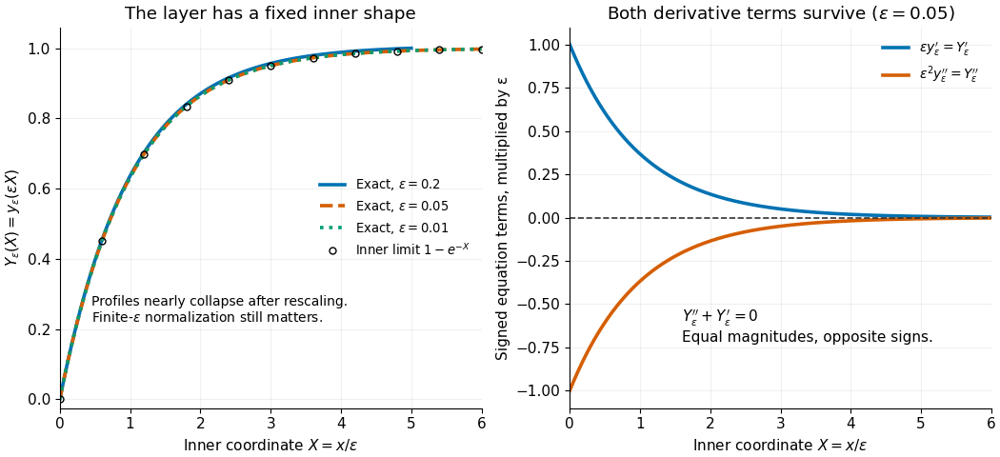

# Inner variable

↑ **Parent:** [Inner expansion](inner-expansion.md)

An [inner variable](inner-variable.md) is a stretched coordinate such as $\xi=(x-x_0)/\delta(\epsilon)$ that remains order one inside a thin region of width $\delta(\epsilon)$. Its scale is chosen by a [dominant balance](dominant-balance.md), rather than by the size of a coefficient alone.

For the [singular perturbation](singular-perturbation-split.md) problem $\epsilon y''+y'=0$ with $y(0)=0$, $y(1)=1$, set $X=x/\epsilon$ and $Y_\epsilon(X)=y_\epsilon(\epsilon X)$. The [chain rule](chain-rule.md) gives

$$
\frac{d}{dx}=\epsilon^{-1}\frac{d}{dX},\qquad
\epsilon y_\epsilon''+y_\epsilon'=\epsilon^{-1}(Y_\epsilon''+Y_\epsilon').
$$

Thus both [derivative](derivative.md) terms survive in the inner [differential equation](differential-equation-split.md) $Y_\epsilon''+Y_\epsilon'=0$. The exact domain is $0\leq X\leq1/\epsilon$, with

$$
Y_\epsilon(X)=\frac{1-e^{-X}}{1-e^{-1/\epsilon}},\qquad
Y_0(X)=1-e^{-X}.
$$

For bounded $X$, $Y_\epsilon\to Y_0$ as $\epsilon\to0^+$: the [inner expansion](inner-expansion.md) has a nonconstant limiting profile even though the [outer solution](outer-expansion.md) is constant. The finite-$\epsilon$ profiles nearly collapse onto $Y_0$ after rescaling, with their remaining difference coming from the normalization at the distant right endpoint.

**[Figure 2](#image-inner-rescaling-reveals-the-common-profile-and-derivative-balance). Inner rescaling reveals the common profile and derivative balance**. Left: the exact normalized profiles nearly coincide as functions of the [inner variable](inner-variable.md) $X=x/\epsilon$; the $\epsilon=0.2$ curve ends at $X=5$, its actual right boundary. Right: multiplication of the original [differential equation](differential-equation-split.md) by $\epsilon$ gives the signed terms $\epsilon y'=Y'$ and $\epsilon^2y''=Y''$, which cancel exactly.

## ↑ Ancestors (9)

1. [Inner expansion](inner-expansion.md)
2. [Matched asymptotic expansion](matched-asymptotic-expansion.md)
3. [Singular perturbation](singular-perturbation-split.md)
4. [Ordinary differential equation](ordinary-differential-equation.md)
5. [Differential equation](differential-equation-split.md)
6. [Analysis](analysis-split.md)
7. [Area of mathematics](area-of-mathematics.md)
8. [Mathematics](mathematics-split.md)
9. [Codex Wiki](split.md)

## ← Incoming links (10)

- [Boundary layer](boundary-layer.md)
- [Inner variable](inner-variable.md)
- [Lorentzian contribution from shrinking regularization](lorentzian-contribution-from-shrinking-regularization.md)
- [Matched asymptotic expansion](matched-asymptotic-expansion.md)
- [Neutral-mode critical-layer matching](neutral-mode-critical-layer-matching.md)
- [Solution](past-exam-of-the-mathematics-course-of-the-university-of-cambridge/2005/iii/paper-79/3/a/solution.md)
- [Solution](past-exam-of-the-mathematics-course-of-the-university-of-cambridge/2009/iii/paper-76/3/solution.md)
- [Solution](past-exam-of-the-mathematics-course-of-the-university-of-cambridge/2018/iii/paper-336/2/i/solution.md)
- [Solution](past-exam-of-the-mathematics-course-of-the-university-of-cambridge/2021/iii/paper-336/2/a/solution.md)
- [Singular perturbation](singular-perturbation-split.md)
