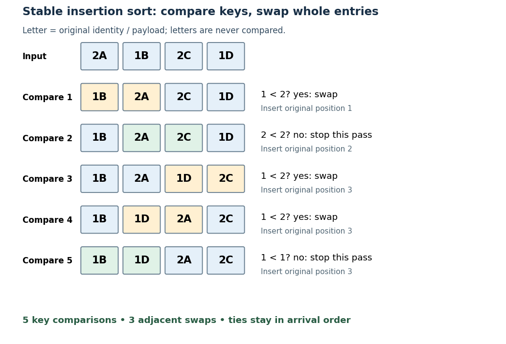

# Insertion sort

↑ **Parent:** [Sorting algorithm](sorting-algorithm.md)  
ⓦ [Wiki](https://en.wikipedia.org/wiki/Insertion_sort)

[Insertion sort](insertion-sort.md) grows a sorted prefix of an [array](array-data-structure.md) one entry at a time. In the adjacent-swap version, start with position $i=1$, compare its current [sort key](sort-key.md) with the preceding [sort key](sort-key.md), and swap the complete [sorting records](sorting-record.md) only when the right [sort key](sort-key.md) is strictly smaller. Continue leftward until no swap is needed or the entry reaches position zero; then process original position $i+1$. A tie stops the pass. This is the strict comparison and exchange rule in the authored implementation.[Insertion.java by Robert Sedgewick and others](insertion-java-by-robert-sedgewick-and-others.md)

Take $A=(2_A,1_B,2_C,1_D)$, where the subscript labels a complete [sorting record](sorting-record.md) and comparisons inspect only its [sort key](sort-key.md). Starting from index zero, the complete key-comparison trace is:

| Comparison | Right [sort key](sort-key.md) smaller than left? | Action | [Array](array-data-structure.md) after the action |
| --- | --- | --- | --- |
| 1, insert position $1$ | $1_B<2_A$: yes | Swap positions $0,1$. | $(1_B,2_A,2_C,1_D)$ |
| 2, insert position $2$ | $2_C<2_A$: no | Stop this pass on a tie. | $(1_B,2_A,2_C,1_D)$ |
| 3, insert position $3$ | $1_D<2_C$: yes | Swap positions $2,3$. | $(1_B,2_A,1_D,2_C)$ |
| 4, continue leftward | $1_D<2_A$: yes | Swap positions $1,2$. | $(1_B,1_D,2_A,2_C)$ |
| 5, continue leftward | $1_D<1_B$: no | Stop this pass on a tie. | $(1_B,1_D,2_A,2_C)$ |

**[Figure 66](#sorting-stable-insertion-compare-swap-trace). Insertion sort: five sort key comparisons and three complete-entry swaps**. Each row after the [input](input-computer-science.md) shows the state after one comparison. Orange cells mark an adjacent swap; green cells mark a stopping tie. Identity letters are not compared. Both equal-key groups retain their [input](input-computer-science.md) order, demonstrating [stable sorting](stable-sorting.md).

The [loop invariant](loop-invariant.md) is that, before pass $i$, positions $0,\ldots,i-1$ satisfy [sortedness](sortedness.md) and contain precisely the entries originally in that prefix. Moving the next entry left through strictly larger [sort keys](sort-key.md) extends that prefix, and every swap retains [sorting permutation preservation](sorting-permutation-preservation.md). Equal-key entries never cross, giving [stable sorting](stable-sorting.md). Each leftward step decreases the position, and each completed pass increases the prefix length, so the [algorithm](algorithm.md) terminates.

With constant-cost key comparisons and swaps, reverse-ordered distinct [sort keys](sort-key.md) cause $1+2+\cdots+(n-1)=n(n-1)/2$ comparisons and swaps. Thus worst-case [time complexity](time-complexity.md) is $O(n^2)$ in [Big O notation](big-o-notation.md). An already sorted [array](array-data-structure.md) needs only $n-1$ key comparisons for $n\geq1$ and no swaps. The adjacent-swap version uses constant auxiliary [space complexity](space-complexity.md). Small or nearly sorted [arrays](array-data-structure.md) can therefore make [insertion sort](insertion-sort.md) useful despite its quadratic worst case.

## ↑ Ancestors (4)

1. [Sorting algorithm](sorting-algorithm.md)
2. [Algorithm](algorithm.md)
3. [Computer science](computer-science-split.md)
4. [Codex Wiki](split.md)

## ← Incoming links (2)

- [Comparison sort](comparison-sort.md)
- [Insertion sort](insertion-sort.md)
