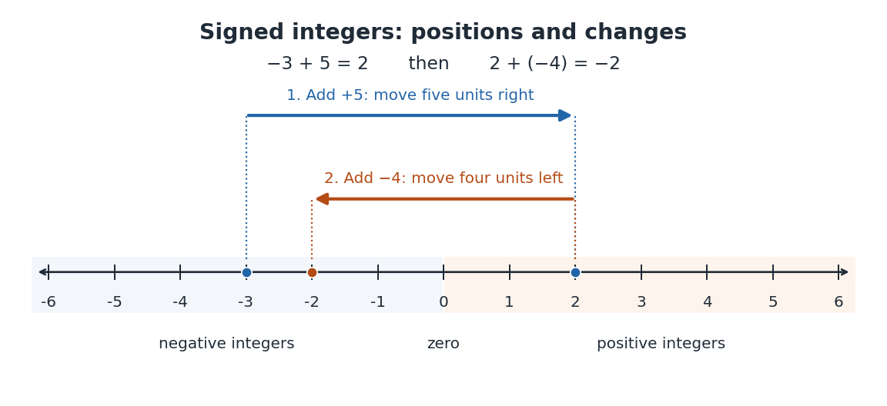
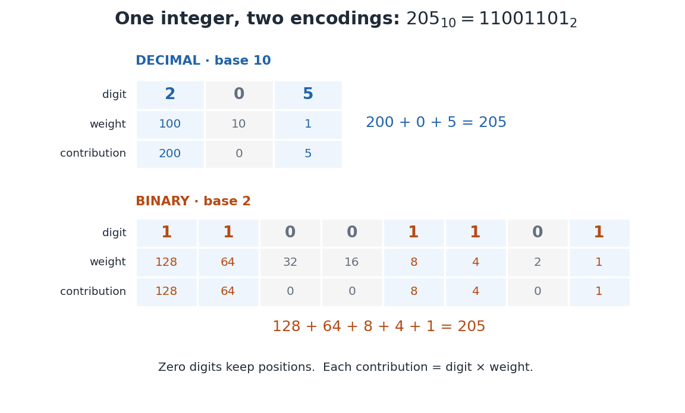
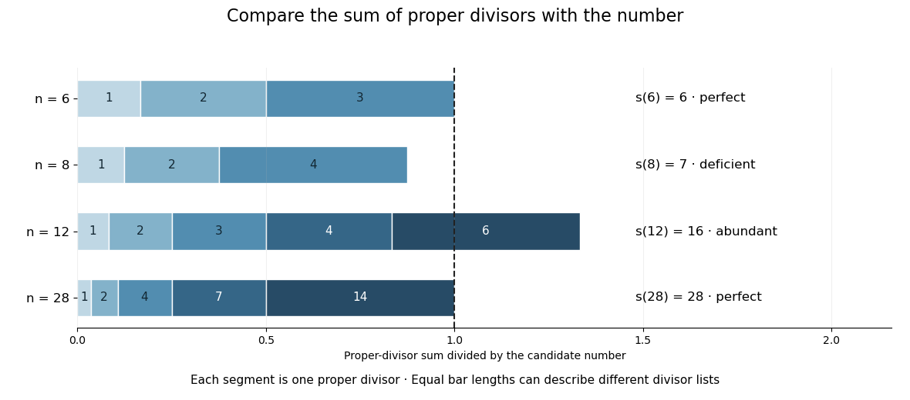
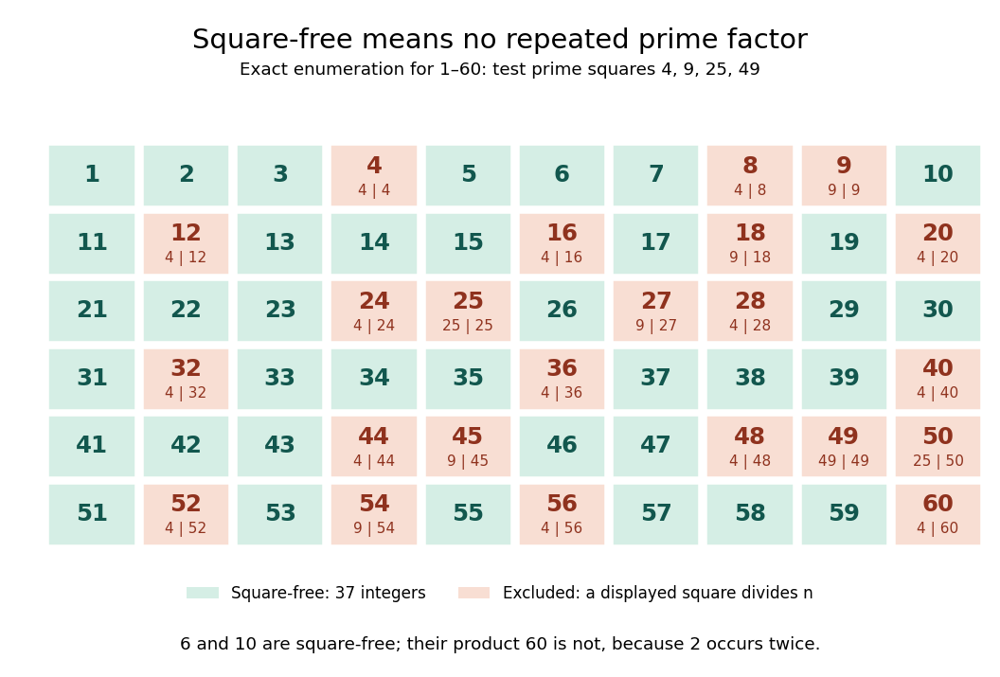

# Integer

↑ **Parent:** [Number theory](number-theory.md)  
ⓦ [Wiki](https://en.wikipedia.org/wiki/Integer)

An integer is a whole number, positive, negative, or zero. The [set](set.md) of all integers is

$$
\mathbb Z=\{\ldots,-3,-2,-1,0,1,2,3,\ldots\}.
$$

The [positive integers](#positive-integer) are $1,2,3,\ldots$; the negative [integers](integer.md) are their opposites $-1,-2,-3,\ldots$. Zero is neither positive nor negative. The [nonnegative integers](arithmetic.md#natural-number) include zero and all the [positive integers](#positive-integer). On a [number line](arithmetic.md#number-line), consecutive [integers](integer.md) are one unit apart, negative [integers](integer.md) lie to the left of zero, and [positive integers](#positive-integer) lie to its right. [Prealgebra 2e, §3.1: Locate Positive and Negative Numbers on the Number Line; Opposite Notation; Integers](mathematics-bibliography.md#prealgebra-2e-by-lynn-marecek-and-others/3-1-introduction-to-integers)

The [integers](integer.md) let counting describe changes in both directions. If a counter starts at $-3$ and increases by five, it reaches $2$: $-3+5=2$. Decreasing that result by four gives $2+(-4)=-2$. In [addition](arithmetic.md#addition) on the [number line](arithmetic.md#number-line), the sign of the added [integer](integer.md) chooses the direction and its [absolute value](real-analysis.md#absolute-value) gives the distance. The [additive inverse](arithmetic.md#additive-inverse) $-a$ reverses the change made by $a$.

**[Figure 1](#image-signed-integers-and-addition-on-a-number-line). Signed integers and addition on a number line**. Starting at $-3$, a change of $+5$ ends at $2$. A subsequent change of $-4$ ends at $-2$. The arrows indicate changes; the labelled points indicate [integers](integer.md). Zero separates the negative and positive sides.

The [integers](integer.md) have [closure under a binary operation](algebraic-operation.md#closure-under-a-binary-operation) for [addition](arithmetic.md#addition), [subtraction](arithmetic.md#subtraction) and [multiplication](arithmetic.md#multiplication): whenever $a,b\in\mathbb Z$, the results $a+b$, $a-b$ and $ab$ are still [integers](integer.md). Together these operations give the [integers](integer.md) their [ring](commutative-algebra.md#ring) structure.[§7.1, p. 166, Definition 7.1; p. 167, Example 7.1: the integers with their usual addition and multiplication](mathematics-bibliography.md#a-computational-introduction-to-number-theory-and-algebra-by-victor-shoup) For instance, $-3+5=2$, $-3-5=-8$, and $(-3)\cdot5=-15$. General [division](arithmetic.md#division-mathematics) has no such closure: $1/2$ is a [rational number](number-theory.md#rational-number) but not an [integer](integer.md). Some divisions are exact, such as $(-6)/3=-2$; [division](arithmetic.md#division-mathematics) by zero is undefined. [Euclidean division](#euclidean-division) instead produces an integer [quotient](arithmetic.md#quotient) and a [remainder](#remainder), so $7=3\cdot2+1$ retains the information that ordinary [division](arithmetic.md#division-mathematics) puts into the [fraction](number-theory.md#fraction) $7/3$.

An [integer](integer.md) is the value, whereas its written [numeral](arithmetic.md#numeral) is an encoding. The [decimal representation](#decimal-representation) $205_{10}$ and the [binary representation](arithmetic.md#binary-number) $11001101_2$ name the same [integer](integer.md). Changing [positional notation](#positional-notation) changes how that value is displayed and how calculations are organized; it does not change the value itself.

**Table of contents**

- [Cube-free part](#cube-free-part)
- [Hilbert number](#hilbert-number)
  - [Squarefree Hilbert number](#squarefree-hilbert-number)
- [Cubefree integer](#cubefree-integer)
- [Roman numeral](#roman-numeral)
- [Repdigit](#repdigit)
  - [Repunit](#repunit)
- [Euclidean division](#euclidean-division)
  - [Remainder](#remainder)
  - [Long division](#long-division)
- [Integer interval](#integer-interval)
- [Positional notation](#positional-notation)
  - [Digit sum](#digit-sum)
  - [Scientific notation](#scientific-notation)
  - [Golden ratio base](#golden-ratio-base)
    - [Phigital number](#phigital-number)
  - [Bouncy number](#bouncy-number)
  - [Factorial number system](#factorial-number-system)
    - [Factoradic indexing](#factoradic-indexing)
  - [Palindromic number](#palindromic-number)
    - [Binary palindrome](#binary-palindrome)
    - [Decimal palindrome](#decimal-palindrome)
    - [Lychrel number](#lychrel-number)
  - [Numerical digit](#numerical-digit)
    - [Decimal digit](#decimal-digit)
    - [Balanced number](#balanced-number)
    - [Step number](#step-number)
    - [Digital root](#digital-root)
    - [Pandigital number](#pandigital-number)
      - [Pandigital prime](#pandigital-prime)
  - [Radix](#radix)
  - [Place value](#place-value)
  - [Decimal expansion](#decimal-expansion)
  - [Hereditary base representation](#hereditary-base-representation)
    - [Goodstein sequence](#goodstein-sequence)
      - [Goodstein's theorem](#goodstein-s-theorem)
      - [Ordinal rank of a Goodstein term](#ordinal-rank-of-a-goodstein-term)
      - [Goodstein function](#goodstein-function)
  - [Base-p expansion](#base-p-expansion)
  - [Binary numeral system](#binary-numeral-system)
    - [Binary digit](#binary-digit)
      - [Most significant bit](#most-significant-bit)
      - [Least significant bit](#least-significant-bit)
  - [Decimal](#decimal)
    - [Decimal representation](#decimal-representation)
      - [Terminating decimal](#terminating-decimal)
- [Positive integer](#positive-integer)
  - [Alexandrian integer](#alexandrian-integer)
  - [Sqube](#sqube)
  - [Reversible number](#reversible-number)
  - [Progressive number](#progressive-number)
  - [Power of two](#power-of-two)
  - [Mersenne number](#mersenne-number)
    - [Mersenne prime](#mersenne-prime)
  - [Perfect number](#perfect-number)
    - [Euclid-Euler theorem](#euclid-euler-theorem)
      - [Testing the prime condition in the Euclid construction](#testing-the-prime-condition-in-the-euclid-construction)
  - [Deficient number](#deficient-number)
  - [Abundant number](#abundant-number)
- [Parity (mathematics)](#parity-mathematics)
  - [Opposite parity](#opposite-parity)
  - [Odd integer](#odd-integer)
  - [Even number](#even-number)
  - [Odd number](#odd-number)
- [Square-free integer](#square-free-integer)
  - [Squarefree part](#squarefree-part)
  - [Squarefree counting function](#squarefree-counting-function)
- [Powerful number](#powerful-number)
  - [Powerful-squarefree coprime decomposition](#powerful-squarefree-coprime-decomposition)
  - [Achilles number](#achilles-number)
    - [Strong Achilles number](#strong-achilles-number)
- [Square number](#square-number)
  - [Square part of an integer](#square-part-of-an-integer)
  - [Perfect square test](#perfect-square-test)

## Cube-free part

↑ **Parent:** [Integer](integer.md)

## Hilbert number

↑ **Parent:** [Integer](integer.md)

A Hilbert number is a [positive integer](#positive-integer) congruent to $1$ modulo $4$. The Hilbert numbers form a multiplicative set: a product of two of them is again congruent to $1$ modulo $4$.

### Squarefree Hilbert number

↑ **Parent:** [Hilbert number](#hilbert-number)

In the multiplicative set of [Hilbert numbers](#hilbert-number), a squarefree Hilbert number is one divisible by no square $h^2$ of a [Hilbert number](#hilbert-number) $h>1$. This is weaker than being a [squarefree integer](#square-free-integer): $9$ is a squarefree Hilbert number because its square divisor $9=3^2$ has $3$ outside the [Hilbert numbers](#hilbert-number).

## Cubefree integer

↑ **Parent:** [Integer](integer.md)

A cubefree integer is a [positive integer](#positive-integer) divisible by no cube of a [prime](prime-number.md). Equivalently, every [prime exponent](number-theory.md#p-adic-valuation) in its [prime factorization](prime-number.md#fundamental-theorem-of-arithmetic) is at most two.

## Roman numeral

↑ **Parent:** [Integer](integer.md)

## Repdigit

↑ **Parent:** [Integer](integer.md)  
ⓦ [Wiki](https://en.wikipedia.org/wiki/Repdigit)

A [repdigit](#repdigit) is a positive integer whose base-$b$ expansion repeats one nonzero digit $d$. For $b\ge2$, $1\le d<b$ and $n\ge1$, the [finite geometric series](sequence-and-series.md#finite-geometric-series) gives $R_n=d(1+b+\cdots+b^{n-1})=d(b^n-1)/(b-1)$. For example, $5(10^n-1)/9$ has $n$ decimal digits, all equal to five.

Every [prime number](prime-number.md) not dividing $b$ divides infinitely many such [repdigits](#repdigit). If it divides $d$, every length works. Otherwise, if it does not divide $b-1$, the [Fermat little theorem](number-theory.md#fermat-little-theorem) gives divisibility for lengths that are multiples of $p-1$, and division by $b-1$ is justified by its [modular inverse](number-theory.md#modular-multiplicative-inverse). If $p\mid b-1$, the sum is congruent to $dn$ modulo $p$, so lengths divisible by $p$ work instead. A prime dividing $b$ but not $d$ divides none, since $R_n\equiv d\pmod p$. This distinction prevents invalid cancellation of the geometric-sum denominator.

### Repunit

↑ **Parent:** [Repdigit](#repdigit)

A [repdigit](#repdigit) whose digits are all 1 in a specified [positional notation](#positional-notation) of base $b$. Its value is the [geometric series](sequence-and-series.md#geometric-series) $R_b(k)=1+b+\cdots+b^{k-1}=(b^k-1)/(b-1)$. In base ten, appending one digit gives $R_{10}(k+1)=10R_{10}(k)+1$, so its [remainder](#remainder) [modulo](modular-arithmetic.md#modulo-operation) $n$ can be computed by a [recurrence relation](sequence-and-series.md#recurrence-relation) without constructing the full [integer](integer.md).

## Euclidean division

↑ **Parent:** [Integer](integer.md)  
ⓦ [Wiki](https://en.wikipedia.org/wiki/Euclidean_division)

For an [integer](integer.md) $a$ and positive [integer](integer.md) $b$, Euclidean division writes $a=bq+r$ with unique integer quotient $q$ and remainder $0\le r<b$. For $a\ge0$, repeated quotient-and-remainder steps yield the digits of a [base-p expansion](#base-p-expansion) when $b=p$. The uniqueness follows because the difference of two permitted remainders cannot be a nonzero multiple of $b$.

### Remainder

↑ **Parent:** [Euclidean division](#euclidean-division)  
ⓦ [Wiki](https://en.wikipedia.org/wiki/Remainder)

For an [integer](integer.md) $a$ and positive [integer](integer.md) $b$, the remainder in [Euclidean division](#euclidean-division) is the unique [integer](integer.md) $r$ in $0\leq r<b$ for which $a=bq+r$ with an [integer](integer.md) $q$. It is not the full [quotient](arithmetic.md#quotient) $a/b$.

### Long division

↑ **Parent:** [Euclidean division](#euclidean-division)  
ⓦ [Wiki](https://en.wikipedia.org/wiki/Long_division)

Repeated [division with remainder](#euclidean-division) that determines successive digits of a [quotient](arithmetic.md#quotient). To generate the fractional digits in base $b$, multiply the current [remainder](#remainder) by $b$, divide by the [denominator](number-theory.md#denominator), and keep the resulting [remainder](#remainder) for the next step.

## Integer interval

↑ **Parent:** [Integer](integer.md)

A finite [integer interval](#integer-interval) is a set $\{a,a+1,\ldots,b\}$ with [integers](integer.md) $a\leq b$. Its length is $b-a+1$. Infinite [integer intervals](#integer-interval) can also be defined by allowing one or both endpoints to be infinite; a bounded-gaps condition on words always quantifies over finite [integer intervals](#integer-interval).

## Positional notation

↑ **Parent:** [Integer](integer.md)  
ⓦ [Wiki](https://en.wikipedia.org/wiki/Positional_notation)

In positional notation, a [numeral digit](#numerical-digit) contributes its value multiplied by a weight determined by its position. Fix an [integer](integer.md) [radix](#radix) $b\geq2$. A finite string of [numeral digits](#numerical-digit) $d_nd_{n-1}\cdots d_0$, with $0\leq d_j<b$, represents the [nonnegative integer](arithmetic.md#natural-number)

$$
(d_nd_{n-1}\cdots d_0)_b=\sum_{j=0}^n d_jb^j.
$$

The rightmost position has weight $b^0=1$; each move left multiplies the weight by $b$. This weight is the [place value](#place-value). For a nonzero [integer](integer.md), the canonical string has $d_n\ne0$. Zero is written with the single [numeral digit](#numerical-digit) $0$. Leading zeros are permitted in a fixed-width display but omitted in the canonical form: $00205_{10}=205_{10}$. A negative [integer](integer.md) is written with a separate minus sign and the [positional notation](#positional-notation) for its [absolute value](real-analysis.md#absolute-value); the minus sign is not a [numeral digit](#numerical-digit).[§3.3, pp. 55–56: base-B digit vectors, separate sign and nonzero highest digit](mathematics-bibliography.md#a-computational-introduction-to-number-theory-and-algebra-by-victor-shoup)

For example,

$$
205_{10}=2\cdot10^2+0\cdot10^1+5\cdot10^0=200+0+5.
$$

The zero is essential inside this string: $25_{10}=25$, not $205$. It records that the tens position contributes nothing while keeping the hundreds and units in their proper positions. The same [integer](integer.md) has [binary representation](arithmetic.md#binary-number)

$$
11001101_2=2^7+2^6+2^3+2^2+2^0=128+64+8+4+1=205_{10}.
$$

**[Figure 2](#image-one-integer-two-encodings-205-10-11001101-2). One integer, two encodings: $205_{10}=11001101_2$**. Each [numeral digit](#numerical-digit) is multiplied by its [place value](#place-value). Decimal uses the weights $100,10,1$; binary uses $128,64,32,16,8,4,2,1$. Zero digits preserve positions without contributing to the total. Both rows sum to $205$.

**Repeated [Euclidean division](#euclidean-division) constructs the representation exactly.** Set $N_0=N$. At each step write

$$
N_j=bN_{j+1}+d_j,\qquad 0\leq d_j<b.
$$

Keep the [remainder](#remainder) $d_j$ and continue with the integer [quotient](arithmetic.md#quotient) $N_{j+1}$. A positive [quotient](arithmetic.md#quotient) strictly decreases, so eventually it is zero. Substituting the successive [equations](algebra.md#equation) back into the first gives $N=d_0+bd_1+b^2d_2+\cdots$: the [numeral digits](#numerical-digit) are obtained from right to left. The [remainder](#remainder) modulo $b$ uniquely fixes $d_0$, and then the [quotient](arithmetic.md#quotient) uniquely fixes the remaining string by the same reasoning. This proves existence and uniqueness once leading zeros are excluded. The needed unique [quotient](arithmetic.md#quotient) and [remainder](#remainder) are precisely the conclusion of the [Euclidean division](#euclidean-division) theorem.[§1.1, p. 3, Theorem 1.4: division with remainder](mathematics-bibliography.md#a-computational-introduction-to-number-theory-and-algebra-by-victor-shoup)

This finite expansion concerns [nonnegative integers](arithmetic.md#natural-number). Extending [positional notation](#positional-notation) to fractional positions uses weights $b^{-1},b^{-2},\ldots$ to the right of a point; an arbitrary [real number](arithmetic.md#real-number) need not have a finite digit string. In particular, the [decimal representation](#decimal-representation) $0.1$ represents $1/10$, while the base-two string $0.1_2$ represents $1/2$. The [radix](#radix) is part of the interpretation.

The benefit is compact arithmetic: $k$ positions can encode every [nonnegative integer](arithmetic.md#natural-number) below $b^k$. To see the upper endpoint, fill all positions with $b-1$; the [finite geometric series](sequence-and-series.md#finite-geometric-series) gives $(b-1)(1+b+\cdots+b^{k-1})=b^k-1$. Carrying in [addition](arithmetic.md#addition) exchanges $b$ units of one [place value](#place-value) for one unit of the next. Thus a short string stores a large count and also supplies an [algorithm](algorithm.md) for computing with it.

### Digit sum

↑ **Parent:** [Positional notation](#positional-notation)

The digit sum of a [nonnegative integer](arithmetic.md#natural-number) in a given base is the sum of its [numerical digits](#numerical-digit). In base $b$, replacing each power $b^j$ by $1$ shows that the [integer](integer.md) and its digit sum are congruent [modulo](modular-arithmetic.md#modulo-operation) $b-1$.

### Scientific notation

↑ **Parent:** [Positional notation](#positional-notation)

### Golden ratio base

↑ **Parent:** [Positional notation](#positional-notation)

#### Phigital number

↑ **Parent:** [Golden ratio base](#golden-ratio-base)

### Bouncy number

↑ **Parent:** [Positional notation](#positional-notation)

A [positive integer](#positive-integer) whose sequence of [numerical digits](#numerical-digit) is neither weakly increasing nor weakly decreasing from left to right. Equivalently, one adjacent pair strictly rises and another strictly falls. Numbers in both monotone families have all digits equal, so their overlap consists of the [repdigits](#repdigit).

### Factorial number system

↑ **Parent:** [Positional notation](#positional-notation)

A mixed-radix [positional notation](#positional-notation) using [factorials](combinatorics.md#factorial) as place values: $n=\sum_{i\ge1} a_i i!$ with $0\le a_i\le i$. For [lexicographic order](extremal-set-theory.md#lexicographic-order) on [permutations](combinatorics.md#permutation), division by $(k-1)!$ selects the next symbol when $k$ symbols remain; the [remainder](#remainder) gives the rank within that block.

#### Factoradic indexing

↑ **Parent:** [Factorial number system](#factorial-number-system)

### Palindromic number

↑ **Parent:** [Positional notation](#positional-notation)

A [nonnegative integer](arithmetic.md#natural-number) whose [positional notation](#positional-notation) reads the same forwards and backwards, with no leading zeros. This property depends on the base: $585$ is a [palindromic number](#palindromic-number) in both [decimal representation](#decimal-representation) and [binary representation](arithmetic.md#binary-number), since $585=(1001001001)_2$.

#### Binary palindrome

↑ **Parent:** [Palindromic number](#palindromic-number)

A [palindromic number](#palindromic-number) in [binary representation](arithmetic.md#binary-number), with no leading zeros. Every positive [binary palindrome](#binary-palindrome) is an [odd number](#odd-number), because its first and last [numerical digits](#numerical-digit) must both be one.

#### Decimal palindrome

↑ **Parent:** [Palindromic number](#palindromic-number)

A [palindromic number](#palindromic-number) in [decimal representation](#decimal-representation), with no leading zeros.

#### Lychrel number

↑ **Parent:** [Palindromic number](#palindromic-number)

A [positive integer](#positive-integer) whose repeated reverse-and-add process never reaches a [palindromic number](#palindromic-number) in the chosen base. Each step adds the current number to the number obtained by reversing its [numerical digits](#numerical-digit). Failure to find a [palindromic number](#palindromic-number) after a fixed iteration limit establishes only a candidate, not a proof that the process never succeeds.

### Numerical digit

↑ **Parent:** [Positional notation](#positional-notation)  
ⓦ [Wiki](https://en.wikipedia.org/wiki/Numerical_digit)

A [numerical digit](#numerical-digit) is one symbol in a [positional notation](#positional-notation) string, denoting an [integer](integer.md) from zero through one less than the [radix](#radix).

#### Decimal digit

↑ **Parent:** [Numerical digit](#numerical-digit)

One of the ten [numerical digits](#numerical-digit) $0,1,\ldots,9$ used in [decimal representation](#decimal-representation).

#### Balanced number

↑ **Parent:** [Numerical digit](#numerical-digit)

A [positive integer](#positive-integer) whose first $\lceil k/2\rceil$ decimal [numerical digits](#numerical-digit) have the same sum as its last $\lceil k/2\rceil$ digits, where $k$ is the number of digits. For odd $k$, the shared middle digit cancels from the equality. Counts and value sums can therefore be assembled from two half-length [digit dynamic programming](mathematical-optimization.md#digit-dynamic-programming) tables indexed by [base-p digit sum](number-theory.md#base-p-digit-sum).

#### Step number

↑ **Parent:** [Numerical digit](#numerical-digit)

A [positive integer](#positive-integer) whose adjacent decimal [numerical digits](#numerical-digit) differ by exactly 1. Its digits form a walk on the [path graph](graph-theory.md#path-graph) $0-1-\cdots-9$, with a nonzero starting digit. Counting [pandigital numbers](#pandigital-number) of this type can use [digit dynamic programming](mathematical-optimization.md#digit-dynamic-programming) with the final digit and a [bit mask](programming-language.md#bit-mask) of visited digits as the state.

#### Digital root

↑ **Parent:** [Numerical digit](#numerical-digit)

Repeatedly sum the [numerical digits](#numerical-digit) of a [nonnegative integer](arithmetic.md#natural-number) in base $b$ until a single [numerical digit](#numerical-digit) remains. For $n>0$, the result is $1+((n-1)\bmod(b-1))$, while the result for zero is zero. This follows because $b\equiv1\pmod{b-1}$, so summing [numerical digits](#numerical-digit) preserves the [integer congruence](modular-arithmetic.md#integer-congruence) class [modulo](modular-arithmetic.md#modulo-operation) $b-1$.

#### Pandigital number

↑ **Parent:** [Numerical digit](#numerical-digit)

A number whose representation contains every [numerical digit](#numerical-digit) from a specified alphabet. The convention must specify the base, whether zero is required, and whether repetitions are allowed. In many counting problems, “0-to-9 pandigital” means that all ten decimal [numerical digits](#numerical-digit) occur exactly once; other problems require only that each occur at least once.

##### Pandigital prime

↑ **Parent:** [Pandigital number](#pandigital-number)

A [prime number](prime-number.md) that is also a [pandigital number](#pandigital-number) for the specified base and digit set.

### Radix

↑ **Parent:** [Positional notation](#positional-notation)  
ⓦ [Wiki](https://en.wikipedia.org/wiki/Radix)

The [radix](#radix) is the base of [positional notation](#positional-notation). In the ordinary integer-base case it is an [integer](integer.md) $b\geq2$, and successive [place values](#place-value) differ by a factor of $b$.

### Place value

↑ **Parent:** [Positional notation](#positional-notation)

The [place value](#place-value) is the weight of a position in [positional notation](#positional-notation). A [numeral digit](#numerical-digit) $d_j$ at that position contributes $d_jb^j$ to the represented [number](arithmetic.md#number).

### Decimal expansion

↑ **Parent:** [Positional notation](#positional-notation)

A nonnegative integer's [decimal expansion](#decimal-expansion) uses digits $0\leq a_i\leq9$. Testing divisibility reduces this polynomial in ten modulo the divisor: for example $10\equiv-1\pmod{11}$ makes divisibility by eleven equivalent to vanishing of the alternating digit sum.

### Hereditary base representation

↑ **Parent:** [Positional notation](#positional-notation)

A [hereditary base representation](#hereditary-base-representation) expands not only the number in base $b$, but also every exponent recursively in that same base. Changing the base at every depth defines the Goodstein base-change operation; replacing it by omega defines an [ordinal rank of a Goodstein term](#ordinal-rank-of-a-goodstein-term).

#### Goodstein sequence

↑ **Parent:** [Hereditary base representation](#hereditary-base-representation)

Start at base two. At each nonzero step, change every base occurrence in the [hereditary base representation](#hereditary-base-representation) to the next base and subtract one. Although the natural-number terms can grow, their [ordinal ranks of a Goodstein term](#ordinal-rank-of-a-goodstein-term) decrease strictly. Keep zero fixed once it is reached.

<h5 id="goodstein-s-theorem">Goodstein's theorem</h5>

↑ **Parent:** [Goodstein sequence](#goodstein-sequence)  
ⓦ [Wiki](https://en.wikipedia.org/wiki/Goodstein's_theorem)

Every [Goodstein sequence](#goodstein-sequence) reaches zero. Before zero, the [ordinal rank of a Goodstein term](#ordinal-rank-of-a-goodstein-term) of each step is strictly smaller than the preceding one. An infinite [sequence](sequence-and-series.md#sequence) would contradict [well-foundedness](set-theory.md#well-founded-relation) of the [ordinals](ordinal.md) below [epsilon zero](ordinal.md#epsilon-zero).

##### Ordinal rank of a Goodstein term

↑ **Parent:** [Goodstein sequence](#goodstein-sequence)

Replacing every base occurrence by omega in a [hereditary base representation](#hereditary-base-representation) gives a [Cantor normal form](ordinal.md#cantor-normal-form) below [epsilon zero](ordinal.md#epsilon-zero). Hereditary base change preserves this [ordinal](ordinal.md) expression, and subtraction of one lowers it strictly. The [ordinal](ordinal.md) is a termination measure even when the natural-number value increases.

##### Goodstein function

↑ **Parent:** [Goodstein sequence](#goodstein-sequence)

The [Goodstein function](#goodstein-function) records the least step at which the [Goodstein sequence](#goodstein-sequence) from a given initial number reaches zero. With the initial step numbered zero, its values on $0,1,2,3$ are $0,1,3,5$. [Goodstein's theorem](#goodstein-s-theorem) makes this effective termination-time [function](function.md) total.

### Base-p expansion

↑ **Parent:** [Positional notation](#positional-notation)

For an integer base $p\ge2$, a nonnegative [integer](integer.md) has a finite positional representation with digits $k_i\in\{0,\ldots,p-1\}$. Repeated [Euclidean division](#euclidean-division) gives the digits uniquely; appending zero high-place digits has no effect. The base need not be prime for uniqueness, but a prime base is useful in [Lucas theorem](binomial-coefficient.md#lucas-s-theorem) and modular [binomial coefficients](binomial-coefficient.md).

### Binary numeral system

↑ **Parent:** [Positional notation](#positional-notation)  
ⓦ [Wiki](https://en.wikipedia.org/wiki/Binary_numeral_system)

The binary numeral system is [positional notation](#positional-notation) with [radix](#radix) two. Each [binary digit](#binary-digit) is zero or one, and its [place value](#place-value) is a [power of two](#power-of-two). A one includes that weight in the sum; a zero skips it. The [binary representation](arithmetic.md#binary-number) $11001101_2$ therefore selects $128,64,8,4,1$ and represents the [integer](integer.md) $205$.

To obtain those [binary digits](#binary-digit) from $205$, repeatedly use [Euclidean division](#euclidean-division) by two:

$$
\begin{aligned}
205&=2\cdot102+1,&102&=2\cdot51+0,\\
51&=2\cdot25+1,&25&=2\cdot12+1,\\
12&=2\cdot6+0,&6&=2\cdot3+0,\\
3&=2\cdot1+1,&1&=2\cdot0+1.
\end{aligned}
$$

The [remainders](#remainder), in the order produced, are $1,0,1,1,0,0,1,1$. **Read them in reverse order to get $11001101_2$.** The final zero is the [quotient](arithmetic.md#quotient) that stops the conversion, not an additional leading [binary digit](#binary-digit). Starting with zero itself needs the special single-digit representation $0_2$.

A useful independent check reads the [binary digits](#binary-digit) from left to right. Start with $v=0$ and, for each [binary digit](#binary-digit) $d$, replace $v$ by $2v+d$. For $11001101_2$, the intermediate values are $1,3,6,12,25,51,102,205$. This reconstructs the [integer](integer.md) without reversing a list and explains why appending a zero on the right doubles the value.

Binary is well suited to computation because each [binary digit](#binary-digit) has just two possibilities. A stored [bit](information-theory.md#bit) can encode either possibility; groups of [bits](information-theory.md#bit) encode larger [integers](integer.md). Practical integer arithmetic can use a [radix](#radix) that is itself a [power of two](#power-of-two), grouping several [binary digits](#binary-digit) into each stored [numeral digit](#numerical-digit).[§3.3, p. 56: choice of a power-of-two base for stored integer digits](mathematics-bibliography.md#a-computational-introduction-to-number-theory-and-algebra-by-victor-shoup) A displayed negative [integer](integer.md), such as $-11001101_2=-205_{10}$, uses a separate sign. A computer's particular signed storage convention is an additional encoding choice, so the displayed sign should not be confused with an extra binary place.

#### Binary digit

↑ **Parent:** [Binary numeral system](#binary-numeral-system)

A [binary digit](#binary-digit) is a zero or one in the base-two positional representation of an [integer](integer.md). The sum $s_2(n)=\sum_jb_j$ determines the [Thue–Morse sequence](sequence-and-series.md#thue-morse-sequence) and is the [Hamming weight](coding-theory.md#hamming-weight) of the binary representation.

##### Most significant bit

↑ **Parent:** [Binary digit](#binary-digit)

##### Least significant bit

↑ **Parent:** [Binary digit](#binary-digit)

### Decimal

↑ **Parent:** [Positional notation](#positional-notation)  
ⓦ [Wiki](https://en.wikipedia.org/wiki/Decimal)

The decimal numeral system is [positional notation](#positional-notation) in base ten.

#### Decimal representation

↑ **Parent:** [Decimal](#decimal)

A decimal representation is [positional notation](#positional-notation) with [radix](#radix) ten and [numeral digits](#numerical-digit) zero through nine. For an [integer](integer.md), the nonnegative part is a finite [decimal expansion](#decimal-expansion); a negative [integer](integer.md) has a separate minus sign. For example, $205=2\cdot100+0\cdot10+5$, whereas $250=2\cdot100+5\cdot10+0$. The [numeral digits](#numerical-digit) alone do not determine the value: their positions do.

Fractional positions extend the same [place value](#place-value) rule to the right of the decimal point, with successive weights $1/10,1/100,1/1000,\ldots$. [Prealgebra 2e, §5.1, Name Decimals, Tables 5.1–5.2 and Figure 5.2: whole-number and fractional place values](mathematics-bibliography.md#prealgebra-2e-by-lynn-marecek-and-others/5-1-decimals) For example,

$$
205.375=205+\frac3{10}+\frac7{100}+\frac5{1000}=205+\frac38.
$$

The matching [binary representation](arithmetic.md#binary-number) is $11001101.011_2$, since its fractional part is $0\cdot2^{-1}+1\cdot2^{-2}+1\cdot2^{-3}=3/8$. These representations terminate in both bases; finiteness in one [radix](#radix) does not imply finiteness in another.

Leading zeros in the integer part and trailing zeros in the fractional part leave the value unchanged: $00205.3750=205.375$. A zero appended to the right of an integer string has a different effect: $2050=10\cdot205$. Keeping the decimal point fixed prevents confusing these two operations.

Every [integer](integer.md) has a finite [decimal expansion](#decimal-expansion), but a noninteger [rational number](number-theory.md#rational-number) may need infinitely many fractional [numeral digits](#numerical-digit), as in $1/3=0.333\ldots$. A [terminating decimal](#terminating-decimal) has a zero tail by convention. Infinite decimal strings have a further ambiguity that finite canonical integer strings do not: $0.999\ldots=1$, because the [geometric series](sequence-and-series.md#geometric-series) $\sum_{j=1}^{\infty}9\cdot10^{-j}$ sums to one. An infinite decimal tail denotes a [limit](calculus.md#limit-of-a-function), not a sufficiently long rounded approximation.

##### Terminating decimal

↑ **Parent:** [Decimal representation](#decimal-representation)

A [decimal representation](#decimal-representation) with only finitely many nonzero fractional digits. A [reduced fraction](number-theory.md#reduced-fraction) has this property exactly when its [denominator](number-theory.md#denominator) has no [prime factors](prime-number.md#prime-factor) other than two and five. The zero tail is distinguished from the genuine repeating block measured by [decimal period from multiplicative order](number-theory.md#decimal-period-from-multiplicative-order).

## Positive integer

↑ **Parent:** [Integer](integer.md)

A positive integer is an [integer](integer.md) greater than zero.

### Alexandrian integer

↑ **Parent:** [Positive integer](#positive-integer)

A [positive integer](#positive-integer) $A=pqr$ with nonzero [integers](integer.md) $p,q,r$ satisfying $1/A=1/p+1/q+1/r$. Equivalently, $pq+pr+qr=1$. A useful parametrization is $A=n(n+d)(n+e)$ for [positive integers](#positive-integer) $n,d,e$ with $de=n^2+1$, coming from the signed triple $(n,-n-d,-n-e)$.

### Sqube

↑ **Parent:** [Positive integer](#positive-integer)

A number $p^2q^3$ for distinct [prime numbers](prime-number.md) $p,q$. The ordering of the two [primes](prime-number.md) matters because their exponents differ. [Unique prime factorization](prime-number.md#fundamental-theorem-of-arithmetic) identifies the ordered pair from the resulting [integer](integer.md).

### Reversible number

↑ **Parent:** [Positive integer](#positive-integer)

A [positive integer](#positive-integer) whose sum with its digit reversal has only odd [numerical digits](#numerical-digit), with leading zeros forbidden in both the original and reversed representations. For example, $36+63=99$. Studying the [arithmetic carries](arithmetic.md#carry-arithmetic) of mirrored digit pairs allows whole lengths to be counted without enumerating all [integers](integer.md) of that length.

### Progressive number

↑ **Parent:** [Positive integer](#positive-integer)

A [positive integer](#positive-integer) $n$ for which some division $n=dq+r$ with [integers](integer.md) $d,q,r>0$ and $r<d$ has $d,q,r$ as consecutive terms of a [geometric progression](sequence-and-series.md#geometric-progression) in some order. Writing a reduced [common ratio](sequence-and-series.md#common-ratio) as $a/b$ with $a>b>0$ and $\gcd(a,b)=1$, the three terms have the form $tb^2,tab,ta^2$ for a [positive integer](#positive-integer) $t$.

### Power of two

↑ **Parent:** [Positive integer](#positive-integer)

In this [positive integer](#positive-integer) context, a [power of two](#power-of-two) is $2^k$ for a [nonnegative integer](arithmetic.md#natural-number) $k$, giving $1,2,4,8,\ldots$. Allowing negative or real [exponents](arithmetic.md#exponent) gives a broader meaning of [exponentiation](arithmetic.md#exponentiation), which is not intended in the integer divisibility criteria here.

### Mersenne number

↑ **Parent:** [Positive integer](#positive-integer)

A [Mersenne number](#mersenne-number) has the form $M_k=2^k-1$ for a [positive integer](#positive-integer) $k$. Its [binary representation](arithmetic.md#binary-number) consists of $k$ ones. For example, $M_4=15$ is composite, while $M_5=31$ is [prime](prime-number.md). If $k=ab$ with $a,b>1$, the [finite geometric series](sequence-and-series.md#finite-geometric-series) factorization

$$
2^{ab}-1=(2^a-1)(1+2^a+\cdots+2^{a(b-1)})
$$

has two factors greater than one. Consequently a [Mersenne prime](#mersenne-prime) requires a [prime](prime-number.md) exponent, but $M_{11}=23\cdot89$ shows that this condition alone is insufficient.

#### Mersenne prime

↑ **Parent:** [Mersenne number](#mersenne-number)  
ⓦ [Wiki](https://en.wikipedia.org/wiki/Mersenne_prime)

A [Mersenne prime](#mersenne-prime) is a [Mersenne number](#mersenne-number) that is a [prime number](prime-number.md). It is the prime factor required by the [Euclid-Euler theorem](#euclid-euler-theorem); $3,7,31,127$ generate $6,28,496,8128$. The family is named after [Marin Mersenne](mathematics.md#marin-mersenne).

### Perfect number

↑ **Parent:** [Positive integer](#positive-integer)  
ⓦ [Wiki](https://en.wikipedia.org/wiki/Perfect_number)

A [perfect number](#perfect-number) is a [positive integer](#positive-integer) equal to the [sum](arithmetic.md#sum) of all its positive [proper divisors](divisibility.md#proper-divisor). The divisor itself is excluded: including it gives the equivalent condition $\sigma(n)=2n$ for the [sum-of-divisors function](arithmetic-function.md#sum-of-divisors-function). The smallest examples are **$6=1+2+3$** and **$28=1+2+4+7+14$**.

For comparison, $8$ has [proper divisors](divisibility.md#proper-divisor) $1,2,4$, whose [sum](arithmetic.md#sum) is $7$: it is a [deficient number](#deficient-number). The [proper divisors](divisibility.md#proper-divisor) of $12$ are $1,2,3,4,6$, whose [sum](arithmetic.md#sum) is $16$: it is an [abundant number](#abundant-number). The [proper-divisor sum](arithmetic-function.md#proper-divisor-sum) classifies these examples with the same rule, and gives $s(1)=0$, so one is not a [perfect number](#perfect-number).

**[Figure 3](#image-proper-divisors-balance-a-perfect-number-fall-short-of-a-deficient-number-or-exceed-an-abundant-number). Proper divisors balance a perfect number, fall short of a deficient number, or exceed an abundant number**. Original exact [proper-divisor sums](arithmetic-function.md#proper-divisor-sum) for $6,8,12,28$. Each bar is normalized by its candidate number, and its segments are labelled with the actual [proper divisors](divisibility.md#proper-divisor). The dashed line at one marks equality with the candidate. These are finite arithmetic calculations, not empirical data.

The interesting question is how such balances can be constructed without testing every smaller [integer](integer.md) as a possible [divisor](divisibility.md#divisor). The [Euclid-Euler theorem](#euclid-euler-theorem) answers it for [even integers](#even-number): a [Mersenne prime](#mersenne-prime) $2^p-1$ gives $2^{p-1}(2^p-1)$, and every even [perfect number](#perfect-number) arises this way. For $p=2,3,5,7$, this produces $6,28,496,8128$. The connection links divisor sums to [primality testing](theoretical-computer-science.md#primality-testing) for a particular family, while keeping the necessary hypotheses visible.[§1, Theorem 1.1 and Example 1.2, pp. 1–2](mathematics-bibliography.md#perfect-numbers-and-mersenne-primes-by-keith-conrad)

[Euclid](mathematics.md#euclid)'s [Elements](euclidean-geometry.md#euclid-s-elements) already gives the construction in Book IX, Proposition 36: add a succession of [powers of two](#power-of-two), and if their [sum](arithmetic.md#sum) is [prime](prime-number.md), multiply by the final [power of two](#power-of-two). The modern [finite geometric series](sequence-and-series.md#finite-geometric-series) $1+2+\cdots+2^{p-1}=2^p-1$ makes the same pattern transparent. This original statement supplies the forward construction, rather than the converse classification of all even [perfect numbers](#perfect-number).[Book IX, Proposition 36: statement and concluding proof](mathematics-bibliography.md#euclid-s-elements-by-euclid/book-ix-proposition-36)

#### Euclid-Euler theorem

↑ **Parent:** [Perfect number](#perfect-number)  
ⓦ [Wiki](https://en.wikipedia.org/wiki/Euclid–Euler_theorem)

An [even integer](#even-number) $n>0$ is a [perfect number](#perfect-number) **if and only if**

$$
\boxed{n=2^{p-1}(2^p-1)\quad\text{with }2^p-1\text{ prime}.}
$$

This forces $p$ to be a [prime number](prime-number.md), as shown under [Mersenne number](#mersenne-number). It does not say that every [prime](prime-number.md) exponent works, nor classify possible [odd integers](#odd-integer).[Theorem 1.1, pp. 1–2: even-number equivalence and proof](mathematics-bibliography.md#perfect-numbers-and-mersenne-primes-by-keith-conrad)

For the forward direction, put $q=2^p-1$ and use [coprimality](divisibility.md#coprime-integers) of $q$ and $2^{p-1}$. [Multiplicativity](arithmetic-function.md#multiplicativity-of-an-arithmetic-function) of the [sum-of-divisors function](arithmetic-function.md#sum-of-divisors-function) and the [finite geometric series](sequence-and-series.md#finite-geometric-series) give

$$
\sigma(2^{p-1}q)=\sigma(2^{p-1})\sigma(q)=(2^p-1)(q+1)=q2^p=2n.
$$

The [prime number](prime-number.md) hypothesis makes $\sigma(q)=q+1$; replacing it with a [composite number](number-theory.md#composite-number) changes this factor.

For a short converse outline, write $n=2^a m$ with $a\geq1$ and $m$ an [odd integer](#odd-integer). The condition $\sigma(n)=2n$ gives

$$
\sigma(m)=m+t,\qquad t=\frac{m}{2^{a+1}-1}.
$$

Here $t$ is a positive [integer](integer.md) and a [proper divisor](divisibility.md#proper-divisor) of $m$. If $t>1$, the distinct [divisors](divisibility.md#divisor) $1,t,m$ alone exceed the required [sum](arithmetic.md#sum) $m+t$. Thus $t=1$ and $\sigma(m)=m+1$, forcing $m$ to be [prime](prime-number.md) and $m=2^{a+1}-1$.

##### Testing the prime condition in the Euclid construction

↑ **Parent:** [Euclid-Euler theorem](#euclid-euler-theorem)

The [prime](prime-number.md) exponents $2,3,5,7,13$ give [Mersenne primes](#mersenne-prime) and therefore [perfect numbers](#perfect-number). But $p=11$ gives $2^{11}-1=2047=23\cdot89$. The resulting candidate $N=2^{10}\cdot2047=2096128$ has

$$
\sigma(N)=(1+2+\cdots+2^{10})(1+23)(1+89)=2047\cdot24\cdot90=4421520,
$$

so $s(N)=2325392>N$. It is an [abundant number](#abundant-number), not a [perfect number](#perfect-number). Checking only that the exponent is [prime](prime-number.md) would miss this obstruction.

**[Figure 4](#image-a-prime-exponent-gives-a-candidate-the-mersenne-factor-must-also-be-prime). A prime exponent gives a candidate; the Mersenne factor must also be prime**. Original exact computations for $p=2,3,5,7,11,13$. The upper table lists $M_p=2^p-1$ and the constructed candidate $N$. The lower bars show $s(N)/N$; equality at one identifies [perfect numbers](#perfect-number). The composite factor at $p=11$ makes the candidate [abundant](#abundant-number).

### Deficient number

↑ **Parent:** [Positive integer](#positive-integer)  
ⓦ [Wiki](https://en.wikipedia.org/wiki/Deficient_number)

A [positive integer](#positive-integer) whose [proper-divisor sum](arithmetic-function.md#proper-divisor-sum) is smaller than itself; equivalently, its [sum-of-divisors function](arithmetic-function.md#sum-of-divisors-function) satisfies $\sigma(n)<2n$. For example, $s(8)=7<8$; also $s(1)=0<1$.

### Abundant number

↑ **Parent:** [Positive integer](#positive-integer)  
ⓦ [Wiki](https://en.wikipedia.org/wiki/Abundant_number)

A [positive integer](#positive-integer) whose [proper-divisor sum](arithmetic-function.md#proper-divisor-sum) exceeds itself; equivalently, its [sum-of-divisors function](arithmetic-function.md#sum-of-divisors-function) satisfies $\sigma(n)>2n$. For example, $s(12)=16>12$.

## Parity (mathematics)

↑ **Parent:** [Integer](integer.md)  
ⓦ [Wiki](https://en.wikipedia.org/wiki/Parity_(mathematics))

The parity of an [integer](integer.md) records whether it is divisible by two.

### Opposite parity

↑ **Parent:** [Parity (mathematics)](#parity-mathematics)

Two [integers](integer.md) have [opposite parity](#opposite-parity) when one is an [even number](#even-number) and the other is an [odd number](#odd-number). Their [sum](arithmetic.md#sum) is then an [odd number](#odd-number).

### Odd integer

↑ **Parent:** [Parity (mathematics)](#parity-mathematics)

An odd integer is not divisible by two; equivalently, it has the form $2k+1$.

### Even number

↑ **Parent:** [Parity (mathematics)](#parity-mathematics)

An integer is even when it is divisible by two.

### Odd number

↑ **Parent:** [Parity (mathematics)](#parity-mathematics)

An integer is odd when it is not divisible by two.

## Square-free integer

↑ **Parent:** [Integer](integer.md)  
ⓦ [Wiki](https://en.wikipedia.org/wiki/Square-free_integer)

A [positive integer](#positive-integer) $n$ is **square-free** when no [square number](#square-number) greater than one is a [divisor](divisibility.md#divisor) of $n$. It suffices to exclude squares of [prime numbers](prime-number.md); equivalently, every [prime valuation](number-theory.md#prime-valuation) is zero or one:

$$
n\text{ is square-free}\quad\Longleftrightarrow\quad
p^2\nmid n\text{ for every prime }p
\quad\Longleftrightarrow\quad v_p(n)\in\{0,1\}\text{ for every prime }p.
$$

Thus the [prime factorization](prime-number.md#fundamental-theorem-of-arithmetic) of a [square-free integer](#square-free-integer) is a [product](arithmetic.md#product-of-numbers) of distinct [prime factors](prime-number.md#prime-factor), with no repetitions. One is included: its [prime factorization](prime-number.md#fundamental-theorem-of-arithmetic) is an [empty product](arithmetic.md#empty-product) and all its [prime valuations](number-theory.md#prime-valuation) are zero. These equivalent tests are stated in Grinberg's notes. [Darij Grinberg, MIT 18.781, Floor and arithmetic functions, Definition 2.1.2 and footnote 6](https://darijgrinberg.gitlab.io/floor.pdf)

For signed [integers](integer.md), extend the definition by requiring $|n|$ to be a [square-free integer](#square-free-integer), where $|n|$ denotes [absolute value](real-analysis.md#absolute-value). Hence $-30$ and both $1,-1$ qualify. Zero does not: every [prime number](prime-number.md) has its square as a [divisor](divisibility.md#divisor) of zero. The [Möbius function](arithmetic-function.md#mobius-function) and [radical of an integer](arithmetic-function.md#radical-of-an-integer) below use their existing [positive integer](#positive-integer) domains, so apply them to $|n|$ when handling a negative [integer](integer.md).

For example, $30=2\cdot3\cdot5$ is a [square-free integer](#square-free-integer), whereas $12=2^2\cdot3$ is not, because $4\mid12$ and $v_2(12)=2$. Being a [composite number](number-theory.md#composite-number) causes no problem: $6,10,15$ are all [square-free integers](#square-free-integer). A [square-free integer](#square-free-integer) need not be [coprime](divisibility.md#coprime-integers) to another [integer](integer.md): $6$ and $10$ are both [square-free integers](#square-free-integer) but have [greatest common divisor](divisibility.md#greatest-common-divisor) two. In fact the only signed [integers](integer.md) [coprime](divisibility.md#coprime-integers) to every [integer](integer.md) are $1,-1$, since $\gcd(n,n)=|n|$.

**[Figure 5](#image-exact-square-free-integer-classification-of-the-integers-from-one-to-sixty). Exact square-free integer classification of the integers from one to sixty**. Green cells are [square-free integers](#square-free-integer); each red cell displays a [prime number](prime-number.md) square that divides its label, choosing the smallest such [prime number](prime-number.md). Only $4,9,25,49$ need testing in this range. There are $37$ green cells. This original finite arithmetic diagram is an exact enumeration, not a measurement or an assertion about a limiting frequency.

For [positive integers](#positive-integer) $a,b$, the useful [product](arithmetic.md#product-of-numbers) criterion is

$$
ab\text{ is square-free}\quad\Longleftrightarrow\quad
a,b\text{ are square-free and }\gcd(a,b)=1.
$$

The proof outline is just [addition](arithmetic.md#addition) of [prime valuations](number-theory.md#prime-valuation): $v_p(ab)=v_p(a)+v_p(b)$ can stay at most one only if neither input repeats a [prime factor](prime-number.md#prime-factor) and no [prime factor](prime-number.md#prime-factor) occurs in both. Thus $6\cdot5=30$ is a [square-free integer](#square-free-integer), but $6\cdot10=60$ is not. An equivalent characterization is that **every** factorization $n=ab$ into [positive integers](#positive-integer) has [coprime](divisibility.md#coprime-integers) factors. If $p^2\mid n$, the factorization $n=p(n/p)$ supplies two factors sharing $p$; conversely, a shared [prime factor](prime-number.md#prime-factor) forces its square to divide $n$. For $30$, the unordered factor pairs $(1,30),(2,15),(3,10),(5,6)$ all have [greatest common divisor](divisibility.md#greatest-common-divisor) one; for $12$, the pair $(2,6)$ fails.

Two existing [arithmetic functions](arithmetic-function.md) turn the definition into practical tests:

$$
\operatorname{rad}(n)=n\quad\Longleftrightarrow\quad n\text{ is square-free},\qquad
\mu(n)^2=\begin{cases}1&n\text{ is square-free},\\0&\text{otherwise},\end{cases}\qquad n>0.
$$

The [radical of an integer](arithmetic-function.md#radical-of-an-integer) keeps one copy of each [prime factor](prime-number.md#prime-factor), so it changes precisely the [integers](integer.md) with a repeated [prime factor](prime-number.md#prime-factor). Its definition is given in Evertse's exercise sheet. [Jan-Hendrik Evertse, Diophantine approximation, Homework IV, Exercise 20](https://pub.math.leidenuniv.nl/~evertsejh/dio12-ex4.pdf) The [Möbius function](arithmetic-function.md#mobius-function) assigns $(-1)^r$ to a [square-free integer](#square-free-integer) with $r$ distinct [prime factors](prime-number.md#prime-factor) and zero otherwise; squaring forgets the sign. Consequently $\sum_{n=1}^{60}\mu(n)^2=37$ counts exactly the green cells. This connects a restriction on repeated [prime factors](prime-number.md#prime-factor) with weighted counting and [inclusion-exclusion](combinatorics.md#inclusion-exclusion-principle). [Darij Grinberg, MIT 18.781, Definition 2.1.2: the Möbius function](https://darijgrinberg.gitlab.io/floor.pdf)

### Squarefree part

↑ **Parent:** [Square-free integer](#square-free-integer)

The squarefree part of a [positive integer](#positive-integer) $n$ is the unique [squarefree integer](#square-free-integer) $s$ such that $n=s t^2$ for a [positive integer](#positive-integer) $t$. For example, the squarefree part of $72=2^3 3^2$ is $2$. It retains precisely the [primes](prime-number.md) with odd [prime exponents](number-theory.md#p-adic-valuation); the [radical of an integer](arithmetic-function.md#radical-of-an-integer) instead retains every distinct [prime factor](prime-number.md#prime-factor).

### Squarefree counting function

↑ **Parent:** [Square-free integer](#square-free-integer)

The squarefree counting function is $Q(x)=\#\{n\le x:n\text{ is squarefree}\}$. The [Möbius function](arithmetic-function.md#mobius-function) gives $Q(x)=\sum_{d\le\sqrt{x}}\mu(d)\lfloor x/d^2\rfloor$, because $\sum_{d^2\mid n}\mu(d)$ is the indicator of a [square-free integer](#square-free-integer).

## Powerful number

↑ **Parent:** [Integer](integer.md)  
ⓦ [Wiki](https://en.wikipedia.org/wiki/Powerful_number)

A positive integer is squarefull when every [prime](prime-number.md) dividing it also divides it to at least the second power. Thus $n$ is not squarefull as soon as some prime $p$ satisfies $p\mid n$ but $p^2\nmid n$.

### Powerful-squarefree coprime decomposition

↑ **Parent:** [Powerful number](#powerful-number)

Every positive integer has a unique factorization $n=as$ with $a$ [powerful](#powerful-number), $s$ [squarefree](#square-free-integer), and $\gcd(a,s)=1$: assign each prime power of exponent at least two to $a$, and each prime of exponent one to $s$. In general $s$ differs from the [squarefree part](#squarefree-part), which instead retains every prime of odd exponent.

### Achilles number

↑ **Parent:** [Powerful number](#powerful-number)

A [powerful number](#powerful-number) that is not a [perfect power](number-theory.md#perfect-power). If $n=\prod_i p_i^{e_i}$ is its [prime factorization](prime-number.md#fundamental-theorem-of-arithmetic), the conditions are $e_i\ge2$ for every $i$ and $\gcd(e_1,\ldots,e_k)=1$.

#### Strong Achilles number

↑ **Parent:** [Achilles number](#achilles-number)

An [integer](integer.md) $n$ for which both $n$ and its [Euler totient](number-theory.md#euler-totient-function) $\varphi(n)$ are [Achilles numbers](#achilles-number).

## Square number

↑ **Parent:** [Integer](integer.md)  
ⓦ [Wiki](https://en.wikipedia.org/wiki/Square_number)

A square number is an [integer](integer.md) of the form $n^2$ for some integer $n$. Consecutive nonnegative squares differ by $(n+1)^2-n^2=2n+1$.

### Square part of an integer

↑ **Parent:** [Square number](#square-number)

The square part of a positive [integer](integer.md) $n=\prod_p p^{e_p}$ is its largest square divisor, $\prod_p p^{2\lfloor e_p/2\rfloor}$. Dividing $n$ by its square part leaves the [squarefree part](#squarefree-part).

### Perfect square test

↑ **Parent:** [Square number](#square-number)

For a [nonnegative integer](arithmetic.md#natural-number) $n$, compute its [integer square root](algebra.md#integer-square-root) $r=\lfloor\sqrt n\rfloor$ and accept exactly when $r^2=n$. An approximate [square root](algebra.md#square-root) must be corrected with exact [integer](integer.md) comparisons before this equality is tested. This procedure distinguishes a squareness test from merely approximating a [square root](algebra.md#square-root).

## ↑ Ancestors (4)

1. [Number theory](number-theory.md)
2. [Area of mathematics](mathematics.md#area-of-mathematics)
3. [Mathematics](mathematics.md)
4. [Codex Wiki](README.md)

## ← Incoming links (863)

- [2-adic absolute value](non-archimedean-analysis.md#2-adic-absolute-value)
- [Abelian group](group.md#abelian-group)
- [Abelian groups as integer modules](module-theory.md#abelian-groups-as-integer-modules)
- [Abelian plane subgroup of the Heisenberg group modulo four](lie-algebra.md#abelian-plane-subgroup-of-the-heisenberg-group-modulo-four)
- [Absolutely normal number](number-theory.md#absolutely-normal-number)
- [Abstract syntax tree](programming-language.md#abstract-syntax-tree)
- [Abstract syntax tree precedence example](programming-language.md#abstract-syntax-tree-precedence-example)
- [Additive combinatorics](additive-combinatorics.md)
- [Additive energy](additive-combinatorics.md#additive-energy)
- [Additive function bounded on an interval is linear](analysis.md#additive-function-bounded-on-an-interval-is-linear)
- [Additive group of integers](group.md#additive-group-of-integers)
- [Additive indexing category for chain complexes](category-theory.md#additive-indexing-category-for-chain-complexes)
- [Alexandrian integer](#alexandrian-integer)
- [Algebra](algebra.md)
- [Algebraic integer](algebraic-number-theory.md#algebraic-integer)
- [Algebraic number theory](algebraic-number-theory.md)
- [Algebraic structure](algebra.md#algebraic-structure)
- [Algebraic topology](algebraic-topology.md)
- [Algorithm termination](algorithm.md#algorithm-termination)
- [Aliasing of discrete Fourier modes](discrete-fourier-transform.md#aliasing-of-discrete-fourier-modes)
- [All solutions of a linear Diophantine equation](number-theory.md#all-solutions-of-a-linear-diophantine-equation)
- [Alternating dyadic colouring excludes symmetric weighted pair sums](real-analysis.md#alternating-dyadic-colouring-excludes-symmetric-weighted-pair-sums)
- [Amicable pair](arithmetic-function.md#amicable-pair)
- [Analytic number theory](analytic-number-theory.md)
- [Arbitrary-precision arithmetic](arithmetic.md#arbitrary-precision-arithmetic)
- [Archimedean ordered group](partially-ordered-group.md#archimedean-ordered-group)
- [Archimedean property](arithmetic.md#archimedean-property)
- [Arcsine quantiles and moments](continuous-probability-distribution.md#arcsine-quantiles-and-moments)
- [Argument (complex analysis)](complex-analysis.md#argument-complex-analysis)
- [Arithmetic](arithmetic.md)
- [Arithmetic progression](arithmetic.md#arithmetic-progression)
- [Arithmetic series](arithmetic.md#arithmetic-series)
- [Arithmetic work of the Dirichlet hyperbola method](arithmetic-function.md#arithmetic-work-of-the-dirichlet-hyperbola-method)
- [Array index](data-structure.md#array-index)
- [Atomic basis of a crystal](physical-chemistry.md#atomic-basis-of-a-crystal)
- [Atomic mass](chemical-substance.md#atomic-mass)
- [Auxiliary-value height argument for the Fredholm series](diophantine-approximation.md#auxiliary-value-height-argument-for-the-fredholm-series)
- [Base-p digit sum](number-theory.md#base-p-digit-sum)
- [Base-p expansion](#base-p-expansion)
- [Basel problem](analytic-number-theory.md#basel-problem)
- [Basis intensities and phase ambiguity](physical-chemistry.md#basis-intensities-and-phase-ambiguity)
- [Benford law](discrete-probability-distribution.md#benford-law)
- [Benford law from logarithmic uniformity](discrete-probability-distribution.md#benford-law-from-logarithmic-uniformity)
- [Bernoulli corrections for polynomial sums](bernoulli-number.md#bernoulli-corrections-for-polynomial-sums)
- [Bernoulli power substitution](differential-equation.md#bernoulli-power-substitution)
- [Bernstein polynomial](functional-analysis.md#bernstein-polynomial)
- [Bézout coefficient](algebra.md#bezout-coefficient)
- [Bézout's identity](algebra.md#bezout-s-identity)
- [Biased random walk](random-walk.md#biased-random-walk)
- [Big theta notation](real-analysis.md#big-theta-notation)
- [Bijection](function.md#bijection)
- [Binary array sum by recursion](algorithm.md#binary-array-sum-by-recursion)
- [Binary digit](#binary-digit)
- [Binary numeral system](#binary-numeral-system)
- [Binary operation](algebraic-operation.md#binary-operation)
- [Binary powering multiplication count](number-theory.md#binary-powering-multiplication-count)
- [Bipartite Szemerédi regularity lemma](probabilistic-combinatorics.md#bipartite-szemeredi-regularity-lemma)
- [Birthday problem](probability-and-statistics.md#birthday-problem)
- [Bit cost of modular exponentiation](number-theory.md#bit-cost-of-modular-exponentiation)
- [Bit length](arithmetic.md#bit-length)
- [Bitboard](programming-language.md#bitboard)
- [Bitset](data-structure.md#bitset)
- [Bolzano-Weierstrass theorem](sequence-and-series.md#bolzano-weierstrass-theorem)
- [Borsuk-Ulam theorem](algebraic-topology.md#borsuk-ulam-theorem)
- [Bounded monotone sequences have no universal convergence rate](sequence-and-series.md#bounded-monotone-sequences-have-no-universal-convergence-rate)
- [Bounded queue with encapsulation](computer-science.md#bounded-queue-with-encapsulation)
- [Brauer progression theorem](ramsey-theory.md#brauer-progression-theorem)
- [Buffer cache access trace](file-system.md#buffer-cache-access-trace)
- [Buffer cache state model](file-system.md#buffer-cache-state-model)
- [Cache line](computer-science.md#cache-line)
- [Cancellation in an exponential sum](analytic-number-theory.md#cancellation-in-an-exponential-sum)
- [Capability (computer security)](operating-system.md#capability-computer-security)
- [Capture-recapture model](statistical-modelling.md#capture-recapture-model)
- [Cardano triplet](number-theory.md#cardano-triplet)
- [Carmichael function](number-theory.md#carmichael-function)
- [Carmichael number](number-theory.md#carmichael-number)
- [Carry (arithmetic)](arithmetic.md#carry-arithmetic)
- [Cartan integer](semisimple-lie-algebra.md#cartan-integer)
- [Cauchy sequence](sequence-and-series.md#cauchy-sequence)
- [Cayley graphs of the integers](geometric-group-theory.md#cayley-graphs-of-the-integers)
- [Ceiling count for fixed-size batches](calculus.md#ceiling-count-for-fixed-size-batches)
- [Ceiling function](calculus.md#ceiling-function)
- [Character large sieve](analytic-number-theory.md#character-large-sieve)
- [Character of a Weyl-vector multiple](semisimple-lie-algebra.md#character-of-a-weyl-vector-multiple)
- [Characteristic-function derivatives from finite absolute moments](characteristic-function.md#characteristic-function-derivatives-from-finite-absolute-moments)
- [Charge lattice inference from oil drops](electric-charge.md#charge-lattice-inference-from-oil-drops)
- [Chebyshev function](arithmetic-function.md#chebyshev-function)
- [Chern-Simons number of a gauge field](geometry-and-topology.md#chern-simons-number-of-a-gauge-field)
- [Chinese remainder theorem](mathematics.md#chinese-remainder-theorem)
- [Chromatic number](graph-coloring.md#chromatic-number)
- [Chromatic polynomial](graph-coloring.md#chromatic-polynomial)
- [Chromatic polynomial after attaching a leaf](graph-coloring.md#chromatic-polynomial-after-attaching-a-leaf)
- [Circular buffer indices](data-structure.md#circular-buffer-indices)
- [Closed subgroup](topological-group.md#closed-subgroup)
- [Comb tooth index ambiguity](laser.md#comb-tooth-index-ambiguity)
- [Commutative algebra](commutative-algebra.md)
- [Commutative ring](commutative-algebra.md#commutative-ring)
- [Compilation arithmetic example](programming-language.md#compilation-arithmetic-example)
- [Complement rule of probability](probability-theory.md#complement-rule-of-probability)
- [Complementary factorial congruence](modular-arithmetic.md#complementary-factorial-congruence)
- [Composite number](number-theory.md#composite-number)
- [Composite Simpson's rule](numerical-integration.md#composite-simpson-s-rule)
- [Computed three-by-three LU decomposition](numerical-linear-algebra.md#computed-three-by-three-lu-decomposition)
- [Congruence of squares](number-theory.md#congruence-of-squares)
- [Constant folding](programming-language.md#constant-folding)
- [Constructive interference intensity](physical-optics.md#constructive-interference-intensity)
- [Continuous unitary character](topological-group.md#continuous-unitary-character)
- [Convergence from fixed-length series blocks](sequence-and-series.md#convergence-from-fixed-length-series-blocks)
- [Conway Game of Life](computer-science.md#conway-game-of-life)
- [Coprime integers](divisibility.md#coprime-integers)
- [Coresilience](number-theory.md#coresilience)
- [Corner in an integer grid](additive-combinatorics.md#corner-in-an-integer-grid)
- [Correct operations through an abstraction function](computer-science.md#correct-operations-through-an-abstraction-function)
- [Countability from vanishing averages of distinct sequences](cardinal-number.md#countability-from-vanishing-averages-of-distinct-sequences)
- [Countability of integer polynomial rings](cardinal-number.md#countability-of-integer-polynomial-rings)
- [Countable set](cardinal-number.md#countable-set)
- [Counting sort](algorithm.md#counting-sort)
- [Counting sort prefix ranges](algorithm.md#counting-sort-prefix-ranges)
- [Counting terms of an arithmetic progression](arithmetic.md#counting-terms-of-an-arithmetic-progression)
- [Crystal structure](physical-chemistry.md#crystal-structure)
- [Cycle lemma](combinatorics.md#cycle-lemma)
- [Cycle lemma with increments at most one](combinatorics.md#cycle-lemma-with-increments-at-most-one)
- [Cyclic convolution](fourier-analysis.md#cyclic-convolution)
- [Cyclic group](group.md#cyclic-group)
- [Cyclic logarithmic coloring](ramsey-theory.md#cyclic-logarithmic-coloring)
- [Cyclicity of a product of two finite cyclic groups](group-theory.md#cyclicity-of-a-product-of-two-finite-cyclic-groups)
- [De Moivre's theorem](analysis.md#de-moivre-s-theorem)
- [Decimal period from multiplicative order](number-theory.md#decimal-period-from-multiplicative-order)
- [Decimal representation](#decimal-representation)
- [Decimal significand](discrete-probability-distribution.md#decimal-significand)
- [Decimal trailing-zero pairing function](computability-theory.md#decimal-trailing-zero-pairing-function)
- [Decisive number](number-theory.md#decisive-number)
- [Defect of a block](modular-representation-theory.md#defect-of-a-block)
- [Density of the irrational numbers](algebra.md#density-of-the-irrational-numbers)
- [Destructive interference intensity](physical-optics.md#destructive-interference-intensity)
- [Deterministic finite automaton](foundations-of-mathematics.md#deterministic-finite-automaton)
- [Difference set](additive-combinatorics.md#difference-set)
- [Diffraction order](physical-optics.md#diffraction-order)
- [Digit dynamic programming](mathematical-optimization.md#digit-dynamic-programming)
- [Digit sum](#digit-sum)
- [Dirichlet's approximation theorem](diophantine-approximation.md#dirichlet-s-approximation-theorem)
- [Discrete additive subgroup of a real vector space](topological-group.md#discrete-additive-subgroup-of-a-real-vector-space)
- [Discrete convolution](fourier-analysis.md#discrete-convolution)
- [Discrete Fourier transform](discrete-fourier-transform.md)
- [Discrete random variable](random-variable.md#discrete-random-variable)
- [Discrete-time Markov chain](markov-chain.md#discrete-time-markov-chain)
- [Discrete-time signal](electrical-engineering.md#discrete-time-signal)
- [Discrete uniform moments on an integer interval](discrete-probability-distribution.md#discrete-uniform-moments-on-an-integer-interval)
- [Distance to the nearest integer](diophantine-approximation.md#distance-to-the-nearest-integer)
- [Divide-and-conquer algorithm](algorithm.md#divide-and-conquer-algorithm)
- [Divide-and-conquer combination cost](algorithm.md#divide-and-conquer-combination-cost)
- [Divide-and-conquer product ledger](algorithm.md#divide-and-conquer-product-ledger)
- [Divisibility](divisibility.md)
- [Divisibility chain inside a finite-sums set](ramsey-theory.md#divisibility-chain-inside-a-finite-sums-set)
- [Divisor](divisibility.md#divisor)
- [Dominant weight multiplicity formula for sl3](semisimple-lie-algebra.md#dominant-weight-multiplicity-formula-for-sl3)
- [Doubling constant](additive-combinatorics.md#doubling-constant)
- [Dynamic programming](mathematical-optimization.md#dynamic-programming)
- [Elementary charge](electric-charge.md#elementary-charge)
- [Endomorphism](algebra.md#endomorphism)
- [Endomorphism of a finite cyclic group](algebra.md#endomorphism-of-a-finite-cyclic-group)
- [Entire function](holomorphic-function.md#entire-function)
- [Equation](algebra.md#equation)
- [Equivalence class](set-theory.md#equivalence-class)
- [Equivalence of finite word metrics](geometric-group-theory.md#equivalence-of-finite-word-metrics)
- [Equivalence relation](set-theory.md#equivalence-relation)
- [Euclid-Euler theorem](#euclid-euler-theorem)
- [Euclid game](game-theory.md#euclid-game)
- [Euclid's formula for Pythagorean triples](euclidean-geometry.md#euclid-s-formula-for-pythagorean-triples)
- [Euclid's lemma](number-theory.md#euclid-s-lemma)
- [Euclid's theorem](prime-number.md#euclid-s-theorem)
- [Euclidean algorithm](number-theory.md#euclidean-algorithm)
- [Euclidean division](#euclidean-division)
- [Euler characteristic with different coefficient fields](homology.md#euler-characteristic-with-different-coefficient-fields)
- [Euler evaluation of even zeta values](bernoulli-number.md#euler-evaluation-of-even-zeta-values)
- [Euler's theorem](number-theory.md#euler-s-theorem)
- [Euler totient function](number-theory.md#euler-totient-function)
- [Even Dirichlet character](algebraic-number-theory.md#even-dirichlet-character)
- [Eventually periodic sequence](sequence-and-series.md#eventually-periodic-sequence)
- [Exclusive or](theoretical-computer-science.md#exclusive-or)
- [Exponent](arithmetic.md#exponent)
- [Exponent vector](number-theory.md#exponent-vector)
- [Exponentiation by squaring](number-theory.md#exponentiation-by-squaring)
- [Extended Euclidean algorithm](number-theory.md#extended-euclidean-algorithm)
- [Fabry–Pérot transmission from multiple reflections](optical-instrument.md#fabry-perot-transmission-from-multiple-reflections)
- [Factor base](number-theory.md#factor-base)
- [Factorial](combinatorics.md#factorial)
- [Factorial cosine iterated limit detects rationality](sequence-and-series.md#factorial-cosine-iterated-limit-detects-rationality)
- [Factorial recursion and returning frames](algorithm.md#factorial-recursion-and-returning-frames)
- [Factorization](algebra.md#factorization)
- [Factorization tree](prime-number.md#factorization-tree)
- [Feasible region](mathematical-optimization.md#feasible-region)
- [Fermat last theorem](number-theory.md#fermat-last-theorem)
- [Fermat little theorem](number-theory.md#fermat-little-theorem)
- [Fermat number product identity](number-theory.md#fermat-number-product-identity)
- [Fermat witness](number-theory.md#fermat-witness)
- [Fermi momentum](quantum-ideal-gas-statistics.md#fermi-momentum)
- [Fibonacci fast doubling](sequence-and-series.md#fibonacci-fast-doubling)
- [Field](algebra.md#field)
- [Field norm](algebraic-number-theory.md#field-norm)
- [Figurate number](arithmetic.md#figurate-number)
- [File descriptor](operating-system.md#file-descriptor)
- [Finite field](algebra.md#finite-field)
- [Finite-interval Parseval identities](fourier-analysis.md#finite-interval-parseval-identities)
- [Finite Ramsey theorem](ramsey-theory.md#finite-ramsey-theorem)
- [Finite sl2 lowest-weight ladder](semisimple-lie-algebra.md#finite-sl2-lowest-weight-ladder)
- [Finite-state machine](foundations-of-mathematics.md#finite-state-machine)
- [Finite-window lock-in response](electrical-circuit.md#finite-window-lock-in-response)
- [First moment method](probability-inequality.md#first-moment-method)
- [Five-state barrier example for simulated annealing](mathematical-optimization.md#five-state-barrier-example-for-simulated-annealing)
- [Floating-point arithmetic](floating-point-arithmetic.md)
- [Floor and ceiling functions](calculus.md#floor-and-ceiling-functions)
- [Floor division](calculus.md#floor-division)
- [Floor-division grouping](calculus.md#floor-division-grouping)
- [Floor function](calculus.md#floor-function)
- [Floor sum](calculus.md#floor-sum)
- [Formal pseudodifferential composition rule](analysis.md#formal-pseudodifferential-composition-rule)
- [Formal pseudodifferential operator](analysis.md#formal-pseudodifferential-operator)
- [Formal specification](algorithm.md#formal-specification)
- [Formal verification](algorithm.md#formal-verification)
- [Forward difference operator](finite-difference.md#forward-difference-operator)
- [Foundations of mathematics](foundations-of-mathematics.md)
- [Fourier orthogonality](fourier-series.md#fourier-orthogonality)
- [Fourier partial sum](fourier-series.md#fourier-partial-sum)
- [Fourier series](fourier-series.md)
- [Fourier sine coefficient](fourier-series.md#fourier-sine-coefficient)
- [Fraction](number-theory.md#fraction)
- [Fractional crystal coordinate](physical-chemistry.md#fractional-crystal-coordinate)
- [Fractional part](calculus.md#fractional-part)
- [FRACTRAN](programming-language.md#fractran)
- [Free module](module-theory.md#free-module)
- [Free monoid](algebraic-operation.md#free-monoid)
- [Freiman 2-isomorphism](additive-combinatorics.md#freiman-2-isomorphism)
- [Frobenius number](number-theory.md#frobenius-number)
- [Function type](programming-language.md#function-type)
- [Fundamental domain](group-action.md#fundamental-domain)
- [Fundamental group](algebraic-topology.md#fundamental-group)
- [Fundamental theorem of arithmetic](prime-number.md#fundamental-theorem-of-arithmetic)
- [G2 dimension polynomial](semisimple-lie-algebra.md#g2-dimension-polynomial)
- [Galton-Watson process](galton-watson-process.md)
- [Gamma function](complex-analysis.md#gamma-function)
- [Gamma function recurrence](complex-analysis.md#gamma-function-recurrence)
- [Gaussian binomial coefficient](binomial-coefficient.md#gaussian-binomial-coefficient)
- [Gaussian binomial coefficient recurrence](binomial-coefficient.md#gaussian-binomial-coefficient-recurrence)
- [Gaussian Johnson–Lindenstrauss transform](metric-embedding.md#gaussian-johnson-lindenstrauss-transform)
- [Gaussian sum truncation bound](fourier-analysis.md#gaussian-sum-truncation-bound)
- [Gaussian variational bound for a radial harmonic oscillator](quantum-harmonic-oscillator.md#gaussian-variational-bound-for-a-radial-harmonic-oscillator)
- [Generalized pentagonal number](arithmetic.md#generalized-pentagonal-number)
- [Generalized pigeonhole principle](combinatorics.md#generalized-pigeonhole-principle)
- [Generator of a group](group.md#generator-of-a-group)
- [Geometric distribution](discrete-probability-distribution.md#geometric-distribution)
- [Geometric scale factor](euclidean-geometry.md#geometric-scale-factor)
- [Geometric success deadline](discrete-probability-distribution.md#geometric-success-deadline)
- [Golomb sequence](sequence-and-series.md#golomb-sequence)
- [Grayscale](computer-graphics.md#grayscale)
- [Great Picard theorem](holomorphic-function.md#great-picard-theorem)
- [Greatest common divisor](divisibility.md#greatest-common-divisor)
- [Group](group.md)
- [Group isomorphism](algebra.md#group-isomorphism)
- [Grundy number](game-theory.md#grundy-number)
- [Half-size cyclic Freiman model with a sharp difference-set bound](additive-combinatorics.md#half-size-cyclic-freiman-model-with-a-sharp-difference-set-bound)
- [Half-size prime cyclic Freiman model](additive-combinatorics.md#half-size-prime-cyclic-freiman-model)
- [Hall allocation model](matching-graph-theory.md#hall-allocation-model)
- [Harmonic series](sequence-and-series.md#harmonic-series)
- [Hash collision](computer-science.md#hash-collision)
- [Hash function](computer-science.md#hash-function)
- [Hash table](data-structure.md#hash-table)
- [High ample twist is very ample](sheaf-of-modules.md#high-ample-twist-is-very-ample)
- [High-energy Roth theorem](additive-combinatorics.md#high-energy-roth-theorem)
- [Hockey-stick identity](binomial-coefficient.md#hockey-stick-identity)
- [Hölder-Taylor remainder bound](sobolev-space.md#holder-taylor-remainder-bound)
- [Homomorphism](algebra.md#homomorphism)
- [Hypergeometric distribution](discrete-probability-distribution.md#hypergeometric-distribution)
- [Identity element](algebraic-operation.md#identity-element)
- [Inclusion-exclusion principle](combinatorics.md#inclusion-exclusion-principle)
- [Increasing and decreasing approximations to a common limit](sequence-and-series.md#increasing-and-decreasing-approximations-to-a-common-limit)
- [Independence number](graph-theory.md#independence-number)
- [Independent permissive gates in an ion channel](membrane-potential.md#independent-permissive-gates-in-an-ion-channel)
- [Independent repetition of a polynomial identity test](algorithm.md#independent-repetition-of-a-polynomial-identity-test)
- [Infimum](real-analysis.md#infimum)
- [Infinite cyclic group](group.md#infinite-cyclic-group)
- [Integer](integer.md)
- [Integer arithmetic](arithmetic.md#integer-arithmetic)
- [Integer-coefficient polynomial approximation](uniform-approximation.md#integer-coefficient-polynomial-approximation)
- [Integer count in a closed interval](calculus.md#integer-count-in-a-closed-interval)
- [Integer cube](arithmetic.md#integer-cube)
- [Integer determinant and sublattice index](linear-algebra.md#integer-determinant-and-sublattice-index)
- [Integer division](arithmetic.md#integer-division)
- [Integer factorization](number-theory.md#integer-factorization)
- [Integer-frequency zeros of a scaling function](fourier-analysis.md#integer-frequency-zeros-of-a-scaling-function)
- [Integer interval](#integer-interval)
- [Integer inverse criterion for a unimodular matrix](linear-algebra.md#integer-inverse-criterion-for-a-unimodular-matrix)
- [Integer lattice](geometry-and-topology.md#integer-lattice)
- [Integer linear combination](vector-space.md#integer-linear-combination)
- [Integer matrix](vector-space.md#integer-matrix)
- [Integer-mode expansion with parallel D-brane endpoints](bosonic-string-theory.md#integer-mode-expansion-with-parallel-d-brane-endpoints)
- [Integer multiple](divisibility.md#integer-multiple)
- [Integer overflow](programming-language.md#integer-overflow)
- [Integer power sum](bernoulli-number.md#integer-power-sum)
- [Integer restrictions on a convex feasible region](convex-set.md#integer-restrictions-on-a-convex-feasible-region)
- [Integer root](polynomial.md#integer-root)
- [Integral basis of an odd biquadratic field containing square root of two](algebraic-number-theory.md#integral-basis-of-an-odd-biquadratic-field-containing-square-root-of-two)
- [Integral domain](commutative-algebra.md#integral-domain)
- [Integrated circuit cost per good die](electrical-circuit.md#integrated-circuit-cost-per-good-die)
- [Inverse Ackermann function](computability-theory.md#inverse-ackermann-function)
- [Inverse function theorem](multivariable-calculus.md#inverse-function-theorem)
- [Irrational logarithm criterion](calculus.md#irrational-logarithm-criterion)
- [Irrationality criterion for factorial series](sequence-and-series.md#irrationality-criterion-for-factorial-series)
- [Irrationality of e](calculus.md#irrationality-of-e)
- [Isomorphism](algebra.md#isomorphism)
- [Joint coprimality](divisibility.md#joint-coprimality)
- [K-core of a graph](graph-theory.md#k-core-of-a-graph)
- [Karatsuba carry handling](algorithm.md#karatsuba-carry-handling)
- [Karatsuba digit-operation cost](algorithm.md#karatsuba-digit-operation-cost)
- [Karatsuba multiplication](algorithm.md#karatsuba-multiplication)
- [Karatsuba operand splitting](algorithm.md#karatsuba-operand-splitting)
- [Karatsuba practical crossover](algorithm.md#karatsuba-practical-crossover)
- [Karatsuba recursion termination](algorithm.md#karatsuba-recursion-termination)
- [Karatsuba three-product identity](algorithm.md#karatsuba-three-product-identity)
- [Kernel (operating system)](operating-system.md#kernel-operating-system)
- [Korselt criterion](number-theory.md#korselt-criterion)
- [Kronecker substitution](polynomial.md#kronecker-substitution)
- [Kummer's theorem](number-theory.md#kummer-s-theorem)
- [Lagrange's four-square theorem](number-theory.md#lagrange-s-four-square-theorem)
- [Laplace transform of a Laguerre polynomial](linear-operator-theory.md#laplace-transform-of-a-laguerre-polynomial)
- [Largest prime factor](number-theory.md#largest-prime-factor)
- [Lattice plane](physical-chemistry.md#lattice-plane)
- [Lattice point](quantum-scattering.md#lattice-point)
- [Lattice-point count for quadratic reciprocity](number-theory.md#lattice-point-count-for-quadratic-reciprocity)
- [Lattice translation](quantum-scattering.md#lattice-translation)
- [Leading-residue obstruction to partition regularity](ramsey-theory.md#leading-residue-obstruction-to-partition-regularity)
- [Least common multiple](divisibility.md#least-common-multiple)
- [Least nonnegative residue](modular-arithmetic.md#least-nonnegative-residue)
- [Least-significant-digit radix sort](algorithm.md#least-significant-digit-radix-sort)
- [Left bit shift](programming-language.md#left-bit-shift)
- [Legendre prime-counting formula](number-theory.md#legendre-prime-counting-formula)
- [Legendre symbol](quadratic-residue.md#legendre-symbol)
- [Lehmer prime-counting algorithm](number-theory.md#lehmer-prime-counting-algorithm)
- [Life oscillator](computer-science.md#life-oscillator)
- [Limit directions of a closed subgroup](lie-theory.md#limit-directions-of-a-closed-subgroup)
- [Lincoln-Petersen estimator](statistical-modelling.md#lincoln-petersen-estimator)
- [Linear congruence](modular-arithmetic.md#linear-congruence)
- [Linear phase](additive-combinatorics.md#linear-phase)
- [Linear probing](data-structure.md#linear-probing)
- [Linear probing cluster](data-structure.md#linear-probing-cluster)
- [Literal value](programming-language.md#literal-value)
- [Load factor of a hash table](data-structure.md#load-factor-of-a-hash-table)
- [Lock-in harmonic rejection](electrical-circuit.md#lock-in-harmonic-rejection)
- [Lock-in quadratures](electrical-circuit.md#lock-in-quadratures)
- [Loop variant](algorithm.md#loop-variant)
- [Lossy block averaging](data-compression.md#lossy-block-averaging)
- [Lucas's theorem](binomial-coefficient.md#lucas-s-theorem)
- [Mahler expansion of continuous p-adic functions](measure.md#mahler-expansion-of-continuous-p-adic-functions)
- [Mantel theorem](extremal-graph-theory.md#mantel-theorem)
- [Maslov index](symplectic-geometry.md#maslov-index)
- [Mass number](chemical-substance.md#mass-number)
- [Mathematical induction](foundations-of-mathematics.md#mathematical-induction)
- [Mathematical proof](foundations-of-mathematics.md#mathematical-proof)
- [Matrix-chain dynamic programming](algorithm.md#matrix-chain-dynamic-programming)
- [Matrix exponentiation](vector-space.md#matrix-exponentiation)
- [Matrix power](vector-space.md#matrix-power)
- [Maximum of independent exponential random variables](extreme-value-theory.md#maximum-of-independent-exponential-random-variables)
- [Memoization arithmetic and stack costs](algorithm.md#memoization-arithmetic-and-stack-costs)
- [Memoized Fibonacci evaluation](algorithm.md#memoized-fibonacci-evaluation)
- [Memory-mapped file offset translation](virtual-memory.md#memory-mapped-file-offset-translation)
- [Memorylessness of the geometric distribution](discrete-probability-distribution.md#memorylessness-of-the-geometric-distribution)
- [Möbius inversion formula](arithmetic-function.md#mobius-inversion-formula)
- [Mode locking](laser.md#mode-locking)
- [Modular arithmetic](modular-arithmetic.md)
- [Modular congruence](modular-arithmetic.md#modular-congruence)
- [Modular exponentiation](number-theory.md#modular-exponentiation)
- [Modular inversion](number-theory.md#modular-inversion)
- [Modular inversion converges to a p-adic inverse](number-theory.md#modular-inversion-converges-to-a-p-adic-inverse)
- [Modular multiplication](modular-arithmetic.md#modular-multiplication)
- [Modular multiplicative inverse](number-theory.md#modular-multiplicative-inverse)
- [Module (mathematics)](module-theory.md#module-mathematics)
- [Module theory](module-theory.md)
- [Modulo operation](modular-arithmetic.md#modulo-operation)
- [Modulo-sixteen obstruction for the negative unit descent class](normalization-of-an-algebraic-curve.md#modulo-sixteen-obstruction-for-the-negative-unit-descent-class)
- [Modulus in modular arithmetic](modular-arithmetic.md#modulus-in-modular-arithmetic)
- [Monochromatic set](ramsey-theory.md#monochromatic-set)
- [Monoid](algebraic-operation.md#monoid)
- [Multinomial distribution](discrete-probability-distribution.md#multinomial-distribution)
- [Multiplicativity of the Legendre symbol](quadratic-residue.md#multiplicativity-of-the-legendre-symbol)
- [Multiplicity of a root](polynomial.md#multiplicity-of-a-root)
- [Multivariate hypergeometric distribution](discrete-probability-distribution.md#multivariate-hypergeometric-distribution)
- [Natural density](number-theory.md#natural-density)
- [Negative binomial distribution](discrete-probability-distribution.md#negative-binomial-distribution)
- [Negative binomial stopping argument](discrete-probability-distribution.md#negative-binomial-stopping-argument)
- [Negative Pell equation](diophantine-approximation.md#negative-pell-equation)
- [Newton's identities](polynomial.md#newton-s-identities)
- [Nim-sum](game-theory.md#nim-sum)
- [Nontrivial square root of unity modulo an integer](number-theory.md#nontrivial-square-root-of-unity-modulo-an-integer)
- [Normal number](number-theory.md#normal-number)
- [Normality and equidistribution under integer multiplication](number-theory.md#normality-and-equidistribution-under-integer-multiplication)
- [Normalized angle integration on the circle](topological-group.md#normalized-angle-integration-on-the-circle)
- [North-east lattice path recurrence](combinatorics.md#north-east-lattice-path-recurrence)
- [Number](arithmetic.md#number)
- [Number of empirical types](information-theory.md#number-of-empirical-types)
- [Number-theoretic sieve](algorithm.md#number-theoretic-sieve)
- [Number theory](number-theory.md)
- [Numeral](arithmetic.md#numeral)
- [Numerical digit](#numerical-digit)
- [Odd Dirichlet character](algebraic-number-theory.md#odd-dirichlet-character)
- [Odd part of a positive integer](number-theory.md#odd-part-of-a-positive-integer)
- [Operating system](operating-system.md)
- [Opposite parity](#opposite-parity)
- [Optical frequency measurement with a comb](laser.md#optical-frequency-measurement-with-a-comb)
- [Order as the exact period of modular exponentiation](number-theory.md#order-as-the-exact-period-of-modular-exponentiation)
- [Order of an element of a finite cyclic group](group.md#order-of-an-element-of-a-finite-cyclic-group)
- [Ordinarily nowhere-dense sets need not be completely Ramsey](ramsey-theory.md#ordinarily-nowhere-dense-sets-need-not-be-completely-ramsey)
- [Orthogonal polynomial](orthogonal-polynomial.md)
- [Orthogonality of complex exponentials](fourier-analysis.md#orthogonality-of-complex-exponentials)
- [Overlap in the union bound](probability-inequality.md#overlap-in-the-union-bound)
- [p-adic absolute value](non-archimedean-analysis.md#p-adic-absolute-value)
- [p-adic integer](number-theory.md#p-adic-integer)
- [P-adic valuation](number-theory.md#p-adic-valuation)
- [Pairwise coprimality](divisibility.md#pairwise-coprimality)
- [Parity (mathematics)](#parity-mathematics)
- [Partial correctness](algorithm.md#partial-correctness)
- [Partial fraction telescoping](arithmetic.md#partial-fraction-telescoping)
- [Particle number](physics.md#particle-number)
- [Partition of an integer](representation-theory-of-the-symmetric-group.md#partition-of-an-integer)
- [Pascal's rule](binomial-coefficient.md#pascal-s-rule)
- [Solution](past-exam-of-the-mathematical-and-computational-biology-course-of-the-university-of-cambridge/2024/paper-2.md#a1/a/solution)
- [Solution](past-exam-of-the-mathematical-and-computational-biology-course-of-the-university-of-cambridge/2025/paper-1.md#1/b/solution)
- [Solution](past-exam-of-the-mathematical-and-computational-biology-course-of-the-university-of-cambridge/2025/paper-1.md#1/d/solution)
- [Solution](past-exam-of-the-mathematical-and-computational-biology-course-of-the-university-of-cambridge/2025/paper-1.md#4/b/solution)
- [Solution](past-exam-of-the-mathematical-and-computational-biology-course-of-the-university-of-cambridge/2025/paper-1.md#4/f/solution)
- [Solution](past-exam-of-the-mathematics-course-of-the-university-of-cambridge/2001/ia/paper-4.md#2e/solution)
- [Solution](past-exam-of-the-mathematics-course-of-the-university-of-cambridge/2001/ia/paper-4.md#7e/b/solution)
- [Solution](past-exam-of-the-mathematics-course-of-the-university-of-cambridge/2001/iii/paper-19.md#1/i/solution)
- [Solution](past-exam-of-the-mathematics-course-of-the-university-of-cambridge/2001/iii/paper-20.md#1/solution)
- [Solution](past-exam-of-the-mathematics-course-of-the-university-of-cambridge/2001/iii/paper-20.md#2/solution)
- [Solution](past-exam-of-the-mathematics-course-of-the-university-of-cambridge/2001/iii/paper-20.md#3/i/solution)
- [Solution](past-exam-of-the-mathematics-course-of-the-university-of-cambridge/2001/iii/paper-20.md#4/i/solution)
- [Solution](past-exam-of-the-mathematics-course-of-the-university-of-cambridge/2001/iii/paper-20.md#4/ii/solution)
- [Solution](past-exam-of-the-mathematics-course-of-the-university-of-cambridge/2001/iii/paper-20.md#5/solution)
- [Solution](past-exam-of-the-mathematics-course-of-the-university-of-cambridge/2001/iii/paper-20.md#6/i/solution)
- [Solution](past-exam-of-the-mathematics-course-of-the-university-of-cambridge/2001/iii/paper-20.md#6/ii/solution)
- [Solution](past-exam-of-the-mathematics-course-of-the-university-of-cambridge/2001/iii/paper-20.md#7/solution)
- [Solution](past-exam-of-the-mathematics-course-of-the-university-of-cambridge/2002/ia/paper-1.md#3c/solution)
- [Solution](past-exam-of-the-mathematics-course-of-the-university-of-cambridge/2002/ia/paper-1.md#5b/b/solution)
- [Solution](past-exam-of-the-mathematics-course-of-the-university-of-cambridge/2002/iii/paper-10.md#2/solution)
- [Solution](past-exam-of-the-mathematics-course-of-the-university-of-cambridge/2002/iii/paper-11.md#1/i/solution)
- [Solution](past-exam-of-the-mathematics-course-of-the-university-of-cambridge/2002/iii/paper-11.md#1/ii/solution)
- [Solution](past-exam-of-the-mathematics-course-of-the-university-of-cambridge/2002/iii/paper-11.md#3/i/solution)
- [Solution](past-exam-of-the-mathematics-course-of-the-university-of-cambridge/2002/iii/paper-34.md#1/solution)
- [Solution](past-exam-of-the-mathematics-course-of-the-university-of-cambridge/2002/iii/paper-34.md#2/solution)
- [Solution](past-exam-of-the-mathematics-course-of-the-university-of-cambridge/2002/iii/paper-34.md#5/solution)
- [Solution](past-exam-of-the-mathematics-course-of-the-university-of-cambridge/2002/iii/paper-9.md#1/solution)
- [Solution](past-exam-of-the-mathematics-course-of-the-university-of-cambridge/2002/iii/paper-9.md#4/solution)
- [Solution](past-exam-of-the-mathematics-course-of-the-university-of-cambridge/2003/ia/paper-4.md#1c/ii/solution)
- [Solution](past-exam-of-the-mathematics-course-of-the-university-of-cambridge/2003/ia/paper-4.md#2c/i/solution)
- [Solution](past-exam-of-the-mathematics-course-of-the-university-of-cambridge/2003/ia/paper-4.md#2c/iii/solution)
- [Solution](past-exam-of-the-mathematics-course-of-the-university-of-cambridge/2003/ia/paper-4.md#7c/solution)
- [Solution](past-exam-of-the-mathematics-course-of-the-university-of-cambridge/2003/iii/paper-22.md#1/solution)
- [Solution](past-exam-of-the-mathematics-course-of-the-university-of-cambridge/2003/iii/paper-22.md#3/solution)
- [Solution](past-exam-of-the-mathematics-course-of-the-university-of-cambridge/2003/iii/paper-22.md#4/solution)
- [Solution](past-exam-of-the-mathematics-course-of-the-university-of-cambridge/2003/iii/paper-22.md#5/solution)
- [Solution](past-exam-of-the-mathematics-course-of-the-university-of-cambridge/2003/iii/paper-26.md#1/b/solution)
- [Solution](past-exam-of-the-mathematics-course-of-the-university-of-cambridge/2003/iii/paper-37.md#2/solution)
- [Solution](past-exam-of-the-mathematics-course-of-the-university-of-cambridge/2004/ia/paper-4.md#1e/a/solution)
- [Solution](past-exam-of-the-mathematics-course-of-the-university-of-cambridge/2004/ia/paper-4.md#1e/b/solution)
- [Solution](past-exam-of-the-mathematics-course-of-the-university-of-cambridge/2004/ia/paper-4.md#2e/solution)
- [Solution](past-exam-of-the-mathematics-course-of-the-university-of-cambridge/2004/ia/paper-4.md#5e/solution)
- [Solution](past-exam-of-the-mathematics-course-of-the-university-of-cambridge/2004/ia/paper-4.md#6e/solution)
- [Solution](past-exam-of-the-mathematics-course-of-the-university-of-cambridge/2004/ia/paper-4.md#7e/solution)
- [Solution](past-exam-of-the-mathematics-course-of-the-university-of-cambridge/2004/ia/paper-4.md#8e/solution)
- [Solution](past-exam-of-the-mathematics-course-of-the-university-of-cambridge/2004/iii/paper-12.md#1/solution)
- [Solution](past-exam-of-the-mathematics-course-of-the-university-of-cambridge/2004/iii/paper-12.md#3/solution)
- [Solution](past-exam-of-the-mathematics-course-of-the-university-of-cambridge/2004/iii/paper-12.md#4/solution)
- [Solution](past-exam-of-the-mathematics-course-of-the-university-of-cambridge/2004/iii/paper-20.md#1/i/solution)
- [Solution](past-exam-of-the-mathematics-course-of-the-university-of-cambridge/2004/iii/paper-33.md#2/solution)
- [Solution](past-exam-of-the-mathematics-course-of-the-university-of-cambridge/2004/iii/paper-33.md#3/solution)
- [Solution](past-exam-of-the-mathematics-course-of-the-university-of-cambridge/2004/iii/paper-45.md#4/solution)
- [Solution](past-exam-of-the-mathematics-course-of-the-university-of-cambridge/2004/iii/paper-71.md#1/b/solution)
- [Solution](past-exam-of-the-mathematics-course-of-the-university-of-cambridge/2004/iii/paper-71.md#1/c/solution)
- [Solution](past-exam-of-the-mathematics-course-of-the-university-of-cambridge/2004/iii/paper-71.md#3/b/solution)
- [Solution](past-exam-of-the-mathematics-course-of-the-university-of-cambridge/2004/iii/paper-71.md#4/2/b/solution)
- [Solution](past-exam-of-the-mathematics-course-of-the-university-of-cambridge/2004/iii/paper-71.md#5/solution)
- [Solution](past-exam-of-the-mathematics-course-of-the-university-of-cambridge/2004/iii/paper-8.md#2/i/solution)
- [Solution](past-exam-of-the-mathematics-course-of-the-university-of-cambridge/2004/iii/paper-8.md#2/ii/solution)
- [Solution](past-exam-of-the-mathematics-course-of-the-university-of-cambridge/2005/ia/paper-4.md#2e/solution)
- [Solution](past-exam-of-the-mathematics-course-of-the-university-of-cambridge/2005/ii/paper-2.md#11f/ii/solution)
- [Solution](past-exam-of-the-mathematics-course-of-the-university-of-cambridge/2005/ii/paper-2.md#2f/ii/solution)
- [Solution](past-exam-of-the-mathematics-course-of-the-university-of-cambridge/2005/ii/paper-2.md#8a/solution)
- [Solution](past-exam-of-the-mathematics-course-of-the-university-of-cambridge/2005/iii/paper-28.md#2/ii/solution)
- [Solution](past-exam-of-the-mathematics-course-of-the-university-of-cambridge/2005/iii/paper-28.md#3/ii/solution)
- [Solution](past-exam-of-the-mathematics-course-of-the-university-of-cambridge/2005/iii/paper-28.md#5/solution)
- [Solution](past-exam-of-the-mathematics-course-of-the-university-of-cambridge/2005/iii/paper-28.md#6/solution)
- [Solution](past-exam-of-the-mathematics-course-of-the-university-of-cambridge/2005/iii/paper-28.md#7/ii/solution)
- [Solution](past-exam-of-the-mathematics-course-of-the-university-of-cambridge/2005/iii/paper-29.md#1/solution)
- [Solution](past-exam-of-the-mathematics-course-of-the-university-of-cambridge/2005/iii/paper-29.md#2/solution)
- [Solution](past-exam-of-the-mathematics-course-of-the-university-of-cambridge/2005/iii/paper-29.md#3/solution)
- [Solution](past-exam-of-the-mathematics-course-of-the-university-of-cambridge/2005/iii/paper-29.md#4/solution)
- [Solution](past-exam-of-the-mathematics-course-of-the-university-of-cambridge/2005/iii/paper-29.md#5/solution)
- [Solution](past-exam-of-the-mathematics-course-of-the-university-of-cambridge/2005/iii/paper-29.md#6/solution)
- [Solution](past-exam-of-the-mathematics-course-of-the-university-of-cambridge/2005/iii/paper-31.md#2/i/solution)
- [Solution](past-exam-of-the-mathematics-course-of-the-university-of-cambridge/2005/iii/paper-31.md#5/ii/solution)
- [Solution](past-exam-of-the-mathematics-course-of-the-university-of-cambridge/2005/iii/paper-40.md#1/solution)
- [Solution](past-exam-of-the-mathematics-course-of-the-university-of-cambridge/2005/iii/paper-40.md#2/solution)
- [Solution](past-exam-of-the-mathematics-course-of-the-university-of-cambridge/2005/iii/paper-40.md#5/solution)
- [Solution](past-exam-of-the-mathematics-course-of-the-university-of-cambridge/2005/iii/paper-54.md#1/solution)
- [Solution](past-exam-of-the-mathematics-course-of-the-university-of-cambridge/2005/iii/paper-54.md#2/solution)
- [Solution](past-exam-of-the-mathematics-course-of-the-university-of-cambridge/2005/iii/paper-54.md#3/solution)
- [Solution](past-exam-of-the-mathematics-course-of-the-university-of-cambridge/2005/iii/paper-54.md#4/a/solution)
- [Solution](past-exam-of-the-mathematics-course-of-the-university-of-cambridge/2005/iii/paper-6.md#1/ii/solution)
- [Solution](past-exam-of-the-mathematics-course-of-the-university-of-cambridge/2005/iii/paper-66.md#3/i/solution)
- [Solution](past-exam-of-the-mathematics-course-of-the-university-of-cambridge/2005/iii/paper-66.md#3/iii/solution)
- [Solution](past-exam-of-the-mathematics-course-of-the-university-of-cambridge/2005/iii/paper-68.md#3/b/solution)
- [Solution](past-exam-of-the-mathematics-course-of-the-university-of-cambridge/2006/ib/paper-2.md#16b/solution)
- [Solution](past-exam-of-the-mathematics-course-of-the-university-of-cambridge/2006/ib/paper-2.md#20c/a/solution)
- [Solution](past-exam-of-the-mathematics-course-of-the-university-of-cambridge/2006/ib/paper-2.md#2e/i/solution)
- [Solution](past-exam-of-the-mathematics-course-of-the-university-of-cambridge/2006/ib/paper-2.md#2e/iii/solution)
- [Solution](past-exam-of-the-mathematics-course-of-the-university-of-cambridge/2006/ii/paper-1.md#18h/solution)
- [Solution](past-exam-of-the-mathematics-course-of-the-university-of-cambridge/2006/ii/paper-1.md#20g/solution)
- [Solution](past-exam-of-the-mathematics-course-of-the-university-of-cambridge/2006/ii/paper-1.md#8e/solution)
- [Solution](past-exam-of-the-mathematics-course-of-the-university-of-cambridge/2006/iii/paper-29.md#1/i/solution)
- [Solution](past-exam-of-the-mathematics-course-of-the-university-of-cambridge/2006/iii/paper-29.md#3/i/solution)
- [Solution](past-exam-of-the-mathematics-course-of-the-university-of-cambridge/2006/iii/paper-29.md#3/ii/solution)
- [Solution](past-exam-of-the-mathematics-course-of-the-university-of-cambridge/2006/iii/paper-56.md#1/solution)
- [Solution](past-exam-of-the-mathematics-course-of-the-university-of-cambridge/2006/iii/paper-56.md#3/solution)
- [Solution](past-exam-of-the-mathematics-course-of-the-university-of-cambridge/2007/ia/paper-4.md#1e/i/solution)
- [Solution](past-exam-of-the-mathematics-course-of-the-university-of-cambridge/2007/ia/paper-4.md#1e/ii/solution)
- [Solution](past-exam-of-the-mathematics-course-of-the-university-of-cambridge/2007/ia/paper-4.md#6e/solution)
- [Solution](past-exam-of-the-mathematics-course-of-the-university-of-cambridge/2007/ia/paper-4.md#7e/solution)
- [Solution](past-exam-of-the-mathematics-course-of-the-university-of-cambridge/2007/ia/paper-4.md#8e/i/solution)
- [Solution](past-exam-of-the-mathematics-course-of-the-university-of-cambridge/2007/ia/paper-4.md#8e/ii/solution)
- [Solution](past-exam-of-the-mathematics-course-of-the-university-of-cambridge/2007/ib/paper-2.md#2g/solution)
- [Solution](past-exam-of-the-mathematics-course-of-the-university-of-cambridge/2007/iii/paper-14.md#2/solution)
- [Solution](past-exam-of-the-mathematics-course-of-the-university-of-cambridge/2007/iii/paper-14.md#3/solution)
- [Solution](past-exam-of-the-mathematics-course-of-the-university-of-cambridge/2007/iii/paper-27.md#1/ii/solution)
- [Solution](past-exam-of-the-mathematics-course-of-the-university-of-cambridge/2007/iii/paper-27.md#2/ii/solution)
- [Solution](past-exam-of-the-mathematics-course-of-the-university-of-cambridge/2007/iii/paper-27.md#3/a/solution)
- [Solution](past-exam-of-the-mathematics-course-of-the-university-of-cambridge/2007/iii/paper-27.md#3/b/solution)
- [Solution](past-exam-of-the-mathematics-course-of-the-university-of-cambridge/2007/iii/paper-88.md#2/i/solution)
- [Solution](past-exam-of-the-mathematics-course-of-the-university-of-cambridge/2007/iii/paper-88.md#2/ii/solution)
- [Solution](past-exam-of-the-mathematics-course-of-the-university-of-cambridge/2007/iii/paper-88.md#2/iii/solution)
- [Solution](past-exam-of-the-mathematics-course-of-the-university-of-cambridge/2007/iii/paper-88.md#3/i/solution)
- [Solution](past-exam-of-the-mathematics-course-of-the-university-of-cambridge/2007/iii/paper-88.md#3/ii/solution)
- [Solution](past-exam-of-the-mathematics-course-of-the-university-of-cambridge/2008/ia/paper-4.md#2d/b/solution)
- [Solution](past-exam-of-the-mathematics-course-of-the-university-of-cambridge/2008/ia/paper-4.md#5d/a/solution)
- [Solution](past-exam-of-the-mathematics-course-of-the-university-of-cambridge/2008/ia/paper-4.md#6d/a/solution)
- [Solution](past-exam-of-the-mathematics-course-of-the-university-of-cambridge/2008/ia/paper-4.md#8d/solution)
- [Solution](past-exam-of-the-mathematics-course-of-the-university-of-cambridge/2008/ii/paper-1.md#1h/solution)
- [Solution](past-exam-of-the-mathematics-course-of-the-university-of-cambridge/2008/ii/paper-1.md#20g/a/solution)
- [Solution](past-exam-of-the-mathematics-course-of-the-university-of-cambridge/2008/ii/paper-1.md#37b/solution)
- [Solution](past-exam-of-the-mathematics-course-of-the-university-of-cambridge/2008/iii/paper-3.md#1/b/i/solution)
- [Solution](past-exam-of-the-mathematics-course-of-the-university-of-cambridge/2008/iii/paper-3.md#1/c/i/solution)
- [Solution](past-exam-of-the-mathematics-course-of-the-university-of-cambridge/2008/iii/paper-3.md#4/iii/solution)
- [Solution](past-exam-of-the-mathematics-course-of-the-university-of-cambridge/2008/iii/paper-33.md#2/solution)
- [Solution](past-exam-of-the-mathematics-course-of-the-university-of-cambridge/2008/iii/paper-33.md#3/solution)
- [Solution](past-exam-of-the-mathematics-course-of-the-university-of-cambridge/2008/iii/paper-33.md#4/solution)
- [Solution](past-exam-of-the-mathematics-course-of-the-university-of-cambridge/2009/ib/paper-4.md#9h/solution)
- [Solution](past-exam-of-the-mathematics-course-of-the-university-of-cambridge/2009/iii/paper-13.md#2/solution)
- [Solution](past-exam-of-the-mathematics-course-of-the-university-of-cambridge/2009/iii/paper-13.md#3/solution)
- [Solution](past-exam-of-the-mathematics-course-of-the-university-of-cambridge/2009/iii/paper-13.md#4/solution)
- [Solution](past-exam-of-the-mathematics-course-of-the-university-of-cambridge/2009/iii/paper-6.md#4/i/solution)
- [Solution](past-exam-of-the-mathematics-course-of-the-university-of-cambridge/2009/iii/paper-6.md#4/ii/solution)
- [Solution](past-exam-of-the-mathematics-course-of-the-university-of-cambridge/2010/ia/paper-4.md#1e/b/solution)
- [Solution](past-exam-of-the-mathematics-course-of-the-university-of-cambridge/2010/ia/paper-4.md#2e/b/solution)
- [Solution](past-exam-of-the-mathematics-course-of-the-university-of-cambridge/2010/ia/paper-4.md#6e/solution)
- [Solution](past-exam-of-the-mathematics-course-of-the-university-of-cambridge/2010/ii/paper-3.md#11g/i/solution)
- [Solution](past-exam-of-the-mathematics-course-of-the-university-of-cambridge/2010/ii/paper-3.md#12f/i/solution)
- [Solution](past-exam-of-the-mathematics-course-of-the-university-of-cambridge/2010/ii/paper-3.md#17f/solution)
- [Solution](past-exam-of-the-mathematics-course-of-the-university-of-cambridge/2010/ii/paper-3.md#19f/solution)
- [Solution](past-exam-of-the-mathematics-course-of-the-university-of-cambridge/2010/ii/paper-3.md#1g/i/solution)
- [Solution](past-exam-of-the-mathematics-course-of-the-university-of-cambridge/2010/ii/paper-3.md#1g/ii/solution)
- [Solution](past-exam-of-the-mathematics-course-of-the-university-of-cambridge/2010/iii/paper-1.md#5/a/solution)
- [Solution](past-exam-of-the-mathematics-course-of-the-university-of-cambridge/2010/iii/paper-1.md#5/b/solution)
- [Solution](past-exam-of-the-mathematics-course-of-the-university-of-cambridge/2010/iii/paper-9.md#2/solution)
- [Solution](past-exam-of-the-mathematics-course-of-the-university-of-cambridge/2011/ii/paper-4.md#11i/i/solution)
- [Solution](past-exam-of-the-mathematics-course-of-the-university-of-cambridge/2011/ii/paper-4.md#11i/ii/solution)
- [Solution](past-exam-of-the-mathematics-course-of-the-university-of-cambridge/2011/ii/paper-4.md#12g/solution)
- [Solution](past-exam-of-the-mathematics-course-of-the-university-of-cambridge/2011/ii/paper-4.md#1i/i/solution)
- [Solution](past-exam-of-the-mathematics-course-of-the-university-of-cambridge/2011/ii/paper-4.md#1i/ii/solution)
- [Solution](past-exam-of-the-mathematics-course-of-the-university-of-cambridge/2011/ii/paper-4.md#20f/i/solution)
- [Solution](past-exam-of-the-mathematics-course-of-the-university-of-cambridge/2011/ii/paper-4.md#20f/ii/solution)
- [Solution](past-exam-of-the-mathematics-course-of-the-university-of-cambridge/2011/ii/paper-4.md#20f/iii/solution)
- [Solution](past-exam-of-the-mathematics-course-of-the-university-of-cambridge/2011/ii/paper-4.md#21h/solution)
- [Solution](past-exam-of-the-mathematics-course-of-the-university-of-cambridge/2011/ii/paper-4.md#2f/a/solution)
- [Solution](past-exam-of-the-mathematics-course-of-the-university-of-cambridge/2012/ia/paper-4.md#5d/solution)
- [Solution](past-exam-of-the-mathematics-course-of-the-university-of-cambridge/2012/ia/paper-4.md#6d/solution)
- [Solution](past-exam-of-the-mathematics-course-of-the-university-of-cambridge/2012/ia/paper-4.md#7d/ii/solution)
- [Solution](past-exam-of-the-mathematics-course-of-the-university-of-cambridge/2012/ia/paper-4.md#7d/iii/solution)
- [Solution](past-exam-of-the-mathematics-course-of-the-university-of-cambridge/2012/ia/paper-4.md#7d/iv/solution)
- [Solution](past-exam-of-the-mathematics-course-of-the-university-of-cambridge/2012/iii/paper-70.md#2/b/solution)
- [Solution](past-exam-of-the-mathematics-course-of-the-university-of-cambridge/2012/iii/paper-70.md#2/c/solution)
- [Solution](past-exam-of-the-mathematics-course-of-the-university-of-cambridge/2012/iii/paper-70.md#3/b/solution)
- [Solution](past-exam-of-the-mathematics-course-of-the-university-of-cambridge/2012/iii/paper-70.md#6/a/solution)
- [Solution](past-exam-of-the-mathematics-course-of-the-university-of-cambridge/2013/iii/paper-23.md#1/a/solution)
- [Solution](past-exam-of-the-mathematics-course-of-the-university-of-cambridge/2013/iii/paper-23.md#1/e/solution)
- [Solution](past-exam-of-the-mathematics-course-of-the-university-of-cambridge/2013/iii/paper-23.md#2/b/solution)
- [Solution](past-exam-of-the-mathematics-course-of-the-university-of-cambridge/2013/iii/paper-23.md#5/b/solution)
- [Solution](past-exam-of-the-mathematics-course-of-the-university-of-cambridge/2013/iii/paper-23.md#5/c/solution)
- [Solution](past-exam-of-the-mathematics-course-of-the-university-of-cambridge/2013/iii/paper-23.md#5/d/ii/solution)
- [Solution](past-exam-of-the-mathematics-course-of-the-university-of-cambridge/2013/iii/paper-23.md#5/d/solution)
- [Solution](past-exam-of-the-mathematics-course-of-the-university-of-cambridge/2014/ia/paper-3.md#1d/solution)
- [Solution](past-exam-of-the-mathematics-course-of-the-university-of-cambridge/2014/ia/paper-4.md#1e/solution)
- [Solution](past-exam-of-the-mathematics-course-of-the-university-of-cambridge/2014/ia/paper-4.md#2e/solution)
- [Solution](past-exam-of-the-mathematics-course-of-the-university-of-cambridge/2014/ia/paper-4.md#6e/i/solution)
- [Solution](past-exam-of-the-mathematics-course-of-the-university-of-cambridge/2014/ia/paper-4.md#6e/iv/solution)
- [Solution](past-exam-of-the-mathematics-course-of-the-university-of-cambridge/2014/iii/paper-2.md#4/solution)
- [Solution](past-exam-of-the-mathematics-course-of-the-university-of-cambridge/2014/iii/paper-4.md#1/solution)
- [Solution](past-exam-of-the-mathematics-course-of-the-university-of-cambridge/2014/iii/paper-79.md#1/i/solution)
- [Solution](past-exam-of-the-mathematics-course-of-the-university-of-cambridge/2014/iii/paper-79.md#1/ii/solution)
- [Solution](past-exam-of-the-mathematics-course-of-the-university-of-cambridge/2014/iii/paper-79.md#2/solution)
- [Solution](past-exam-of-the-mathematics-course-of-the-university-of-cambridge/2014/iii/paper-79.md#4/solution)
- [Solution](past-exam-of-the-mathematics-course-of-the-university-of-cambridge/2015/ia/paper-4.md#1e/a/solution)
- [Solution](past-exam-of-the-mathematics-course-of-the-university-of-cambridge/2015/ia/paper-4.md#2e/solution)
- [Solution](past-exam-of-the-mathematics-course-of-the-university-of-cambridge/2015/ia/paper-4.md#5e/ii/solution)
- [Solution](past-exam-of-the-mathematics-course-of-the-university-of-cambridge/2015/ia/paper-4.md#6e/i/solution)
- [Solution](past-exam-of-the-mathematics-course-of-the-university-of-cambridge/2015/ia/paper-4.md#6e/iii/solution)
- [Solution](past-exam-of-the-mathematics-course-of-the-university-of-cambridge/2015/ia/paper-4.md#8e/b/ii/solution)
- [Solution](past-exam-of-the-mathematics-course-of-the-university-of-cambridge/2015/ia/paper-4.md#8e/b/solution)
- [Solution](past-exam-of-the-mathematics-course-of-the-university-of-cambridge/2015/iii/paper-2.md#5/solution)
- [Solution](past-exam-of-the-mathematics-course-of-the-university-of-cambridge/2015/iii/paper-27.md#2/a/solution)
- [Solution](past-exam-of-the-mathematics-course-of-the-university-of-cambridge/2015/iii/paper-27.md#2/c/solution)
- [Solution](past-exam-of-the-mathematics-course-of-the-university-of-cambridge/2016/ia/paper-1.md#4f/solution)
- [Solution](past-exam-of-the-mathematics-course-of-the-university-of-cambridge/2016/iii/paper-102.md#5/solution)
- [Solution](past-exam-of-the-mathematics-course-of-the-university-of-cambridge/2016/iii/paper-120.md#4/solution)
- [Solution](past-exam-of-the-mathematics-course-of-the-university-of-cambridge/2016/iii/paper-120.md#6/solution)
- [Solution](past-exam-of-the-mathematics-course-of-the-university-of-cambridge/2017/ia/paper-4.md#1d/a/solution)
- [Solution](past-exam-of-the-mathematics-course-of-the-university-of-cambridge/2017/ia/paper-4.md#5d/a/solution)
- [Solution](past-exam-of-the-mathematics-course-of-the-university-of-cambridge/2017/ia/paper-4.md#5d/b/solution)
- [Solution](past-exam-of-the-mathematics-course-of-the-university-of-cambridge/2017/ia/paper-4.md#6d/c/solution)
- [Solution](past-exam-of-the-mathematics-course-of-the-university-of-cambridge/2017/ia/paper-4.md#6d/d/solution)
- [Solution](past-exam-of-the-mathematics-course-of-the-university-of-cambridge/2017/ib/paper-4.md#1f/solution)
- [Solution](past-exam-of-the-mathematics-course-of-the-university-of-cambridge/2017/ib/paper-4.md#5a/ii/solution)
- [Solution](past-exam-of-the-mathematics-course-of-the-university-of-cambridge/2017/ii/paper-2.md#17g/a/solution)
- [Solution](past-exam-of-the-mathematics-course-of-the-university-of-cambridge/2017/ii/paper-2.md#17g/b/solution)
- [Solution](past-exam-of-the-mathematics-course-of-the-university-of-cambridge/2017/ii/paper-2.md#18h/a/solution)
- [Solution](past-exam-of-the-mathematics-course-of-the-university-of-cambridge/2017/ii/paper-2.md#18h/b/solution)
- [Solution](past-exam-of-the-mathematics-course-of-the-university-of-cambridge/2017/ii/paper-2.md#1g/solution)
- [Solution](past-exam-of-the-mathematics-course-of-the-university-of-cambridge/2017/ii/paper-2.md#27j/d/solution)
- [Solution](past-exam-of-the-mathematics-course-of-the-university-of-cambridge/2017/ii/paper-2.md#28k/a/solution)
- [Solution](past-exam-of-the-mathematics-course-of-the-university-of-cambridge/2017/ii/paper-2.md#29e/i/solution)
- [Solution](past-exam-of-the-mathematics-course-of-the-university-of-cambridge/2017/ii/paper-2.md#3g/solution)
- [Solution](past-exam-of-the-mathematics-course-of-the-university-of-cambridge/2017/ii/paper-3.md#10g/b/solution)
- [Solution](past-exam-of-the-mathematics-course-of-the-university-of-cambridge/2017/ii/paper-3.md#10g/c/solution)
- [Solution](past-exam-of-the-mathematics-course-of-the-university-of-cambridge/2017/ii/paper-3.md#10g/d/solution)
- [Solution](past-exam-of-the-mathematics-course-of-the-university-of-cambridge/2017/ii/paper-3.md#17g/a/solution)
- [Solution](past-exam-of-the-mathematics-course-of-the-university-of-cambridge/2017/ii/paper-3.md#17g/b/solution)
- [Solution](past-exam-of-the-mathematics-course-of-the-university-of-cambridge/2017/ii/paper-3.md#18i/solution)
- [Solution](past-exam-of-the-mathematics-course-of-the-university-of-cambridge/2017/ii/paper-3.md#33c/solution)
- [Solution](past-exam-of-the-mathematics-course-of-the-university-of-cambridge/2017/ii/paper-3.md#7e/solution)
- [Solution](past-exam-of-the-mathematics-course-of-the-university-of-cambridge/2017/ii/paper-4.md#10g/a/solution)
- [Solution](past-exam-of-the-mathematics-course-of-the-university-of-cambridge/2017/ii/paper-4.md#10g/c/solution)
- [Solution](past-exam-of-the-mathematics-course-of-the-university-of-cambridge/2017/ii/paper-4.md#11f/b/solution)
- [Solution](past-exam-of-the-mathematics-course-of-the-university-of-cambridge/2017/ii/paper-4.md#19h/a/solution)
- [Solution](past-exam-of-the-mathematics-course-of-the-university-of-cambridge/2017/ii/paper-4.md#1g/solution)
- [Solution](past-exam-of-the-mathematics-course-of-the-university-of-cambridge/2017/iii/paper-103.md#2/b/ii/solution)
- [Solution](past-exam-of-the-mathematics-course-of-the-university-of-cambridge/2017/iii/paper-103.md#2/c/solution)
- [Solution](past-exam-of-the-mathematics-course-of-the-university-of-cambridge/2017/iii/paper-103.md#6/d/solution)
- [Solution](past-exam-of-the-mathematics-course-of-the-university-of-cambridge/2017/iii/paper-114.md#1/solution)
- [Solution](past-exam-of-the-mathematics-course-of-the-university-of-cambridge/2017/iii/paper-114.md#2/solution)
- [Solution](past-exam-of-the-mathematics-course-of-the-university-of-cambridge/2017/iii/paper-129.md#1/solution)
- [Solution](past-exam-of-the-mathematics-course-of-the-university-of-cambridge/2017/iii/paper-129.md#2/solution)
- [Solution](past-exam-of-the-mathematics-course-of-the-university-of-cambridge/2017/iii/paper-130.md#4/i/solution)
- [Solution](past-exam-of-the-mathematics-course-of-the-university-of-cambridge/2017/iii/paper-134.md#1/ii/solution)
- [Solution](past-exam-of-the-mathematics-course-of-the-university-of-cambridge/2017/iii/paper-137.md#2/solution)
- [Solution](past-exam-of-the-mathematics-course-of-the-university-of-cambridge/2017/iii/paper-340.md#1/a/solution)
- [Solution](past-exam-of-the-mathematics-course-of-the-university-of-cambridge/2017/iii/paper-340.md#1/b/solution)
- [Solution](past-exam-of-the-mathematics-course-of-the-university-of-cambridge/2017/iii/paper-340.md#1/c/solution)
- [Solution](past-exam-of-the-mathematics-course-of-the-university-of-cambridge/2017/iii/paper-340.md#1/d/solution)
- [Solution](past-exam-of-the-mathematics-course-of-the-university-of-cambridge/2017/iii/paper-340.md#2/b/solution)
- [Solution](past-exam-of-the-mathematics-course-of-the-university-of-cambridge/2017/iii/paper-340.md#5/c/solution)
- [Solution](past-exam-of-the-mathematics-course-of-the-university-of-cambridge/2018/ia/paper-1.md#1c/i/solution)
- [Solution](past-exam-of-the-mathematics-course-of-the-university-of-cambridge/2018/ii/paper-4.md#20g/b/solution)
- [Solution](past-exam-of-the-mathematics-course-of-the-university-of-cambridge/2018/ii/paper-4.md#2f/solution)
- [Solution](past-exam-of-the-mathematics-course-of-the-university-of-cambridge/2019/ii/paper-3.md#1i/solution)
- [Solution](past-exam-of-the-mathematics-course-of-the-university-of-cambridge/2019/ii/paper-4.md#2h/solution)
- [Solution](past-exam-of-the-mathematics-course-of-the-university-of-cambridge/2019/iii/paper-147.md#2/solution)
- [Solution](past-exam-of-the-mathematics-course-of-the-university-of-cambridge/2019/iii/paper-324.md#2/b/iii/solution)
- [Solution](past-exam-of-the-mathematics-course-of-the-university-of-cambridge/2021/ia/paper-4.md#7e/b/ii/solution)
- [Solution](past-exam-of-the-mathematics-course-of-the-university-of-cambridge/2021/ia/paper-4.md#7e/c/solution)
- [Solution](past-exam-of-the-mathematics-course-of-the-university-of-cambridge/2021/iii/paper-123.md#2/solution)
- [Solution](past-exam-of-the-mathematics-course-of-the-university-of-cambridge/2021/iii/paper-151.md#4/c/ii/solution)
- [Solution](past-exam-of-the-mathematics-course-of-the-university-of-cambridge/2021/iii/paper-220.md#1/c/solution)
- [Solution](past-exam-of-the-mathematics-course-of-the-university-of-cambridge/2022/ii/paper-2.md#21i/solution)
- [Solution](past-exam-of-the-mathematics-course-of-the-university-of-cambridge/2023/ii/paper-2.md#37a/a/solution)
- [Solution](past-exam-of-the-mathematics-course-of-the-university-of-cambridge/2023/ii/paper-3.md#10d/b/solution)
- [Solution](past-exam-of-the-mathematics-course-of-the-university-of-cambridge/2023/ii/paper-3.md#1g/b/solution)
- [Solution](past-exam-of-the-mathematics-course-of-the-university-of-cambridge/2023/ii/paper-3.md#1g/c/solution)
- [Solution](past-exam-of-the-mathematics-course-of-the-university-of-cambridge/2023/ii/paper-3.md#34d/solution)
- [Solution](past-exam-of-the-mathematics-course-of-the-university-of-cambridge/2023/iii/paper-101.md#1/a/i/solution)
- [Solution](past-exam-of-the-mathematics-course-of-the-university-of-cambridge/2023/iii/paper-133.md#1/a/solution)
- [Solution](past-exam-of-the-mathematics-course-of-the-university-of-cambridge/2024/iii/paper-305.md#3/ii/solution)
- [Solution](past-exam-of-the-mathematics-course-of-the-university-of-cambridge/2026/iii/paper-166.md#1/a/solution)
- [Solution](past-exam-of-the-mathematics-course-of-the-university-of-cambridge/2026/iii/paper-166.md#2/b/solution)
- [Solution](past-exam-of-the-mathematics-course-of-the-university-of-cambridge/2026/iii/paper-166.md#3/c/solution)
- [Solution](past-exam-of-the-mathematics-course-of-the-year-1-of-the-natural-sciences-course-of-the-university-of-cambridge/2003/paper-1.md#6/solution)
- [Solution](past-exam-of-the-mathematics-course-of-the-year-1-of-the-natural-sciences-course-of-the-university-of-cambridge/2007/paper-2.md#section-b/3/a/solution)
- [Solution](past-exam-of-the-mathematics-course-of-the-year-1-of-the-natural-sciences-course-of-the-university-of-cambridge/2009/paper-1.md#14/a/solution)
- [Solution](past-exam-of-the-mathematics-course-of-the-year-1-of-the-natural-sciences-course-of-the-university-of-cambridge/2009/paper-1.md#16/a/solution)
- [Solution](past-exam-of-the-mathematics-course-of-the-year-1-of-the-natural-sciences-course-of-the-university-of-cambridge/2009/paper-2.md#10/solution)
- [Solution](past-exam-of-the-mathematics-course-of-the-year-2-of-the-natural-sciences-course-of-the-university-of-cambridge/2003/paper-2.md#1/solution)
- [Solution](past-exam-of-the-mathematics-course-of-the-year-2-of-the-natural-sciences-course-of-the-university-of-cambridge/2003/paper-2.md#5/solution)
- [Solution](past-exam-of-the-mathematics-course-of-the-year-2-of-the-natural-sciences-course-of-the-university-of-cambridge/2007/paper-1.md#2/ii/solution)
- [Solution](past-exam-of-the-mathematics-course-of-the-year-2-of-the-natural-sciences-course-of-the-university-of-cambridge/2007/paper-2.md#1/solution)
- [Solution](past-exam-of-the-mathematics-course-of-the-year-2-of-the-natural-sciences-course-of-the-university-of-cambridge/2010/paper-2.md#2/solution)
- [Solution](past-exam-of-the-mathematics-course-of-the-year-2-of-the-natural-sciences-course-of-the-university-of-cambridge/2011/paper-2.md#3/solution)
- [Solution](past-exam-of-the-mathematics-course-of-the-year-2-of-the-natural-sciences-course-of-the-university-of-cambridge/2011/paper-2.md#8/solution)
- [Solution](past-exam-of-the-mathematics-course-of-the-year-2-of-the-natural-sciences-course-of-the-university-of-cambridge/2020/paper-1.md#2/a/ii/solution)
- [Solution](past-exam-of-the-mathematics-course-of-the-year-2-of-the-natural-sciences-course-of-the-university-of-cambridge/2020/paper-1.md#3/a/solution)
- [Solution](past-exam-of-the-theoretical-physics-ii-course-of-the-university-of-cambridge/2019.md#2/c/solution)
- [Pentagonal number](arithmetic.md#pentagonal-number)
- [Perfect cube](number-theory.md#perfect-cube)
- [Perfect number](#perfect-number)
- [Perfect square test](#perfect-square-test)
- [Perfection quotient](arithmetic-function.md#perfection-quotient)
- [Periodic extension](function.md#periodic-extension)
- [Periodic extension of a finite sequence](discrete-fourier-transform.md#periodic-extension-of-a-finite-sequence)
- [Periodic phase change of a scaling function](fourier-analysis.md#periodic-phase-change-of-a-scaling-function)
- [Periodic sequence](sequence-and-series.md#periodic-sequence)
- [Permanent (mathematics)](linear-algebra.md#permanent-mathematics)
- [Pigeonhole principle](combinatorics.md#pigeonhole-principle)
- [Pointwise convergence](sequence-and-series.md#pointwise-convergence)
- [Poisson process](poisson-process.md)
- [Poisson summation formula](fourier-analysis.md#poisson-summation-formula)
- [Polar form of a complex number](complex-analysis.md#polar-form-of-a-complex-number)
- [Polygonal number](arithmetic.md#polygonal-number)
- [Polynomial division](polynomial.md#polynomial-division)
- [Polynomial identity testing](algorithm.md#polynomial-identity-testing)
- [Positional notation](#positional-notation)
- [Positive integer](#positive-integer)
- [Positive lacunary trigonometric series](uniform-approximation.md#positive-lacunary-trigonometric-series)
- [Postcondition](algorithm.md#postcondition)
- [Power series solutions of the Hermite differential equation](analysis.md#power-series-solutions-of-the-hermite-differential-equation)
- [Prefix maximum correctness example](algorithm.md#prefix-maximum-correctness-example)
- [Prefix sum](arithmetic.md#prefix-sum)
- [Prime counting](number-theory.md#prime-counting)
- [Prime factor](prime-number.md#prime-factor)
- [Prime field](algebra.md#prime-field)
- [Prime number](prime-number.md)
- [Prime-proof number](theoretical-computer-science.md#prime-proof-number)
- [Prime-support equivalence relation](set-theory.md#prime-support-equivalence-relation)
- [Prime valuation](number-theory.md#prime-valuation)
- [Primitive lattice translation vector](quantum-scattering.md#primitive-lattice-translation-vector)
- [Programming language](programming-language.md)
- [Progressive number](#progressive-number)
- [Proof of Korselt criterion](number-theory.md#proof-of-korselt-criterion)
- [Pythagorean triple](euclidean-geometry.md#pythagorean-triple)
- [Quadratic nonresidue](quadratic-residue.md#quadratic-nonresidue)
- [Quadratic residue](quadratic-residue.md)
- [Quantization (signal processing)](computer-science.md#quantization-signal-processing)
- [Quotient set](set-theory.md#quotient-set)
- [Radical of an integer](arithmetic-function.md#radical-of-an-integer)
- [Radix](#radix)
- [Radix sort key encoding](algorithm.md#radix-sort-key-encoding)
- [Radix sort suffix invariant](algorithm.md#radix-sort-suffix-invariant)
- [Ramsey number](ramsey-theory.md#ramsey-number)
- [Random walk](random-walk.md)
- [Rational arithmetic](number-theory.md#rational-arithmetic)
- [Rational homogeneity of an additive function](analysis.md#rational-homogeneity-of-an-additive-function)
- [Rational matrix](vector-space.md#rational-matrix)
- [Recursive process](algorithm.md#recursive-process)
- [Reduced fraction](number-theory.md#reduced-fraction)
- [Remainder](#remainder)
- [Remainder of a geometric series](sequence-and-series.md#remainder-of-a-geometric-series)
- [Repeated eigenvalues in the Cayley-Hamilton theorem](cayley-hamilton-theorem.md#repeated-eigenvalues-in-the-cayley-hamilton-theorem)
- [Repunit](#repunit)
- [Residue](analysis.md#residue)
- [Residue class](modular-arithmetic.md#residue-class)
- [Resilience of a denominator](number-theory.md#resilience-of-a-denominator)
- [Reversible number](#reversible-number)
- [Riemannian distance on a circular cylinder](riemannian-geometry.md#riemannian-distance-on-a-circular-cylinder)
- [Ring](commutative-algebra.md#ring)
- [Ring of integers of Q of square root two](algebraic-number-theory.md#ring-of-integers-of-q-of-square-root-two)
- [Robbins bounds for Stirling's formula](real-analysis.md#robbins-bounds-for-stirling-s-formula)
- [Rodrigues formula for Legendre polynomials](linear-ordinary-differential-equation.md#rodrigues-formula-for-legendre-polynomials)
- [Rounded Bernstein polynomial](functional-analysis.md#rounded-bernstein-polynomial)
- [S-smooth number](number-theory.md#s-smooth-number)
- [Sample depth](computer-graphics.md#sample-depth)
- [Sampling a discrete uniform distribution](discrete-probability-distribution.md#sampling-a-discrete-uniform-distribution)
- [Schinzel-Tijdeman exponent theorem](number-theory.md#schinzel-tijdeman-exponent-theorem)
- [Semigroup](algebraic-operation.md#semigroup)
- [Semistandard Young tableau](representation-theory-of-the-symmetric-group.md#semistandard-young-tableau)
- [Separate chaining](data-structure.md#separate-chaining)
- [Sequence](sequence-and-series.md#sequence)
- [Set without natural density](number-theory.md#set-without-natural-density)
- [Sieve of Eratosthenes](prime-number.md#sieve-of-eratosthenes)
- [Simple random walk](random-walk.md#simple-random-walk)
- [Simple random walk on the integer line](random-walk.md#simple-random-walk-on-the-integer-line)
- [Simple type](programming-language.md#simple-type)
- [Simultaneous empirical distribution confidence band](probability-distribution.md#simultaneous-empirical-distribution-confidence-band)
- [Sine](geometry-and-topology.md#sine)
- [Slowly varying function](real-analysis.md#slowly-varying-function)
- [Smith normal form](algebra.md#smith-normal-form)
- [Solution set](set.md#solution-set)
- [Sorted array](data-structure.md#sorted-array)
- [Sparse peaks can determine a limit superior](sequence-and-series.md#sparse-peaks-can-determine-a-limit-superior)
- [Spatial locality](computer-science.md#spatial-locality)
- [Spatial sampling of a wave](wave-equation.md#spatial-sampling-of-a-wave)
- [Spin-orbit resonance](planetary-science.md#spin-orbit-resonance)
- [Square-free integer](#square-free-integer)
- [Square lamina](euclidean-geometry.md#square-lamina)
- [Square number](#square-number)
- [Square part of an integer](#square-part-of-an-integer)
- [Squarefree divisor](divisibility.md#squarefree-divisor)
- [Sqube](#sqube)
- [Stable record placement in counting sort](algorithm.md#stable-record-placement-in-counting-sort)
- [Stars and bars (combinatorics)](combinatorics.md#stars-and-bars-combinatorics)
- [Stirling formula](real-analysis.md#stirling-formula)
- [Strong Achilles number](#strong-achilles-number)
- [Strong induction](foundations-of-mathematics.md#strong-induction)
- [Strong induction for factorization existence](foundations-of-mathematics.md#strong-induction-for-factorization-existence)
- [Sturmian word](foundations-of-mathematics.md#sturmian-word)
- [Subadditivity of the base-p digit sum](number-theory.md#subadditivity-of-the-base-p-digit-sum)
- [Subgroups generated by circle rotations](topological-group.md#subgroups-generated-by-circle-rotations)
- [Subnormal number](floating-point-arithmetic.md#subnormal-number)
- [Success-count and waiting-time duality](discrete-probability-distribution.md#success-count-and-waiting-time-duality)
- [Sudoku](theoretical-computer-science.md#sudoku)
- [Sum map from words to homothetic copies](ramsey-theory.md#sum-map-from-words-to-homothetic-copies)
- [Sum of reduced residues](number-theory.md#sum-of-reduced-residues)
- [Sum of two squares](number-theory.md#sum-of-two-squares)
- [Summation loop verification](algorithm.md#summation-loop-verification)
- [Summatory totient function](number-theory.md#summatory-totient-function)
- [Sumset](additive-combinatorics.md#sumset)
- [Symmetric Hermite integral obstruction](diophantine-approximation.md#symmetric-hermite-integral-obstruction)
- [Symmetry enlargement under group translates](group-action.md#symmetry-enlargement-under-group-translates)
- [Tail probability](probability-theory.md#tail-probability)
- [Tail-sum formula](expected-value.md#tail-sum-formula)
- [Taylor expansion from a periodic derivative equation](calculus.md#taylor-expansion-from-a-periodic-derivative-equation)
- [Tetration](arithmetic.md#tetration)
- [Thue–Morse sequence](sequence-and-series.md#thue-morse-sequence)
- [Torsion element of a module](module-theory.md#torsion-element-of-a-module)
- [Torsion-free module](module-theory.md#torsion-free-module)
- [Torsion module](module-theory.md#torsion-module)
- [Torsion submodule](module-theory.md#torsion-submodule)
- [Total correctness](algorithm.md#total-correctness)
- [Total number of prime factors](arithmetic-function.md#total-number-of-prime-factors)
- [Totient divisor-sum identity](number-theory.md#totient-divisor-sum-identity)
- [Trial division](prime-number.md#trial-division)
- [Truncation toward zero](calculus.md#truncation-toward-zero)
- [Turán graph](extremal-graph-theory.md#turan-graph)
- [Turán's theorem](extremal-graph-theory.md#turan-s-theorem)
- [Two-generator Frobenius theorem](number-theory.md#two-generator-frobenius-theorem)
- [Type class](information-theory.md#type-class)
- [Type system](programming-language.md#type-system)
- [Ulam sequence](sequence-and-series.md#ulam-sequence)
- [Ultrametric space](non-archimedean-analysis.md#ultrametric-space)
- [Uniform convergence](sequence-and-series.md#uniform-convergence)
- [Uniformly continuous function](calculus.md#uniformly-continuous-function)
- [Uniformly small functions with nonvanishing total variation](real-analysis.md#uniformly-small-functions-with-nonvanishing-total-variation)
- [Unimodular matrix](linear-algebra.md#unimodular-matrix)
- [Union by rank](data-structure.md#union-by-rank)
- [Unit from norm one or minus one](algebraic-number-theory.md#unit-from-norm-one-or-minus-one)
- [Unit modulo n](modular-arithmetic.md#unit-modulo-n)
- [Units of Q of square root two](algebraic-number-theory.md#units-of-q-of-square-root-two)
- [Unreduced rational representation](computer-science.md#unreduced-rational-representation)
- [Variance form of the large sieve](analytic-number-theory.md#variance-form-of-the-large-sieve)
- [Von Mangoldt function](arithmetic-function.md#von-mangoldt-function)
- [Waveguide cutoff frequency](electromagnetic-wave.md#waveguide-cutoff-frequency)
- [Well-founded progress in recursion](algorithm.md#well-founded-progress-in-recursion)
- [Wilson's theorem](modular-arithmetic.md#wilson-s-theorem)
- [Winding number](complex-analysis.md#winding-number)
- [Word length](geometric-group-theory.md#word-length)
- [Word metric balls in the integer lattice](geometric-group-theory.md#word-metric-balls-in-the-integer-lattice)
- [Working set](virtual-memory.md#working-set)
- [Young tableau](representation-theory-of-the-symmetric-group.md#young-tableau)
- [Zeta series truncation error](bernoulli-number.md#zeta-series-truncation-error)
