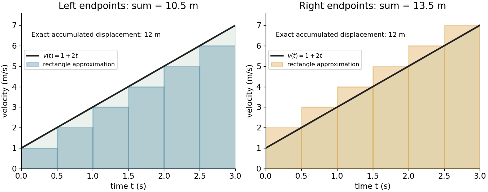

# Integral

↑ **Parent:** [Calculus](calculus-split.md)  
ⓦ [Wiki](https://en.wikipedia.org/wiki/Integral)

An integral adds up contributions of a [function](function-split.md) across a [domain of integration](domain-of-integration.md). For a [continuous function](continuous-function.md) $f$ on $[a,b]$, the [Riemann integral](riemann-integral.md) is the common [limit](limit-of-a-function.md) of its [Riemann sums](riemann-sum.md) as the largest subinterval width tends to zero:

$$
\int_a^b f(x)\,dx
=\lim_{\max_i\Delta x_i\to0}\sum_i f(\xi_i)\Delta x_i,
\qquad \xi_i\in[x_{i-1},x_i],\quad \Delta x_i=x_i-x_{i-1}.
$$

Each product combines a value with the width over which it acts. When $f$ is nonnegative, the result is the [area](surface-area.md) beneath its graph; values below the horizontal axis contribute with the opposite sign. The [signed area under a graph](signed-area-under-a-graph.md) can therefore vanish even when the graph encloses nonzero geometric [area](surface-area.md).

For a [velocity](velocity.md) $v(t)=1+2t$ on $0\le t\le3$, use $n$ equal time steps. The left and right [Riemann sums](riemann-sum.md) are

$$
L_n=12-\frac9n,\qquad R_n=12+\frac9n.
$$

Because the [function](function-split.md) is increasing, they bound the [integral](integral-split.md). With six steps they give $10.5$ and $13.5$; with sixty steps they give $11.85$ and $12.15$. Both approach the same total, $12$. This is accumulation made exact by refining finite measurements.

**[Figure 1](#image-left-and-right-riemann-sums-bracket-the-accumulated-displacement-of-a-particle-with-velocity-1-plus-2t). Left and right Riemann sums bracket the accumulated displacement of a particle with velocity 1 + 2t**.

An [integral](integral-split.md) retains units: [velocity](velocity.md) times time gives [displacement](displacement.md), and a [probability density function](probability-density-function.md) integrated over an [interval](interval-mathematics.md) gives a [probability](probability.md). Weighting a [density](density.md) by a [function](function-split.md) gives its [expectation](expected-value-split.md). The same operation serves different subjects because it expresses a common pattern, **value multiplied by extent, then accumulated**.

The [fundamental theorem of calculus](fundamental-theorem-of-calculus.md) often evaluates a [definite integral](definite-integral.md) by finding an [antiderivative](antiderivative.md), but a finite sum or a numerical approximation is still useful when no convenient [antiderivative](antiderivative.md) is available. An [indefinite integral](antiderivative.md) denotes a family of [antiderivatives](antiderivative.md); a [definite integral](definite-integral.md) denotes an accumulated value between specified endpoints. More general constructions, including [Lebesgue integration](lebesgue-integration.md), extend the class of [functions](function-split.md) and [domains](domain-mathematical-analysis.md) that can be handled.

**Table of contents**

- [Power rule for integration](power-rule-for-integration.md)
- [Boundary integral](boundary-integral.md)
- [Sophomore's dream](sophomore-s-dream.md)
- [Comparison test for integrals](comparison-test-for-integrals.md)
- [Domain of integration](domain-of-integration.md)
- [Integration by substitution](integration-by-substitution.md)
  - [Trigonometric substitution](trigonometric-substitution.md)
- [Average value of a function](average-value-of-a-function.md)
- [Linearity of integration](linearity-of-integration.md)
- [Signed area under a graph](signed-area-under-a-graph.md)
  - [Total geometric area under a graph](total-geometric-area-under-a-graph.md)
- [Definite integral](definite-integral.md)
  - [Integration limit](integration-limit.md)
  - [Distance traveled from velocity](distance-traveled-from-velocity.md)
- [Wallis integrals](wallis-integrals.md)
- [Dipole line-integral identity](dipole-line-integral-identity.md)
- [Integrand](integrand.md)
- [Multiple integral](multiple-integral.md)
  - [Triple integral](triple-integral.md)
  - [Volume element](volume-element.md)
  - [Iterated integral](iterated-integral.md)
    - [Order of integration](order-of-integration.md)
  - [Odd-integrand cancellation by reflection](odd-integrand-cancellation-by-reflection.md)
- [Integral representation](integral-representation.md)
  - [Trigonometric integral](trigonometric-integral.md)
    - [Cosine integral](cosine-integral.md)
    - [Sine integral](sine-integral.md)
- [Lebesgue integration](lebesgue-integration.md)
  - [Prékopa–Leindler inequality](prekopa-leindler-inequality.md)
  - [Absolute continuity of the Lebesgue integral](absolute-continuity-of-the-lebesgue-integral.md)
- [Time integral](time-integral.md)
- [Double integral](double-integral.md)
- [Monotonicity of the Lebesgue integral](monotonicity-of-the-lebesgue-integral.md)
- [Antiderivative](antiderivative.md)
  - [Complex antiderivative](complex-antiderivative.md)
  - [Constant of integration](constant-of-integration.md)
    - [Antiderivatives on disconnected domains](antiderivatives-on-disconnected-domains.md)
  - [Additive constant](additive-constant.md)
- [Gaussian integral](gaussian-integral.md)
  - [Ordered Gaussian response integral](ordered-gaussian-response-integral.md)
  - [Gaussian integral with an inverse-square term](gaussian-integral-with-an-inverse-square-term.md)
  - [Gaussian moment recurrence](gaussian-moment-recurrence.md)
    - [Odd Gaussian moments on a half-line](odd-gaussian-moments-on-a-half-line.md)
    - [Full-line Gaussian moment recurrence](full-line-gaussian-moment-recurrence.md)
  - [Polar-coordinate proof of the Gaussian integral](polar-coordinate-proof-of-the-gaussian-integral.md)
  - [Linear-source multivariate Gaussian integral](linear-source-multivariate-gaussian-integral.md)
  - [Dawson function](dawson-function.md)
    - [Gaussian drift primitives](gaussian-drift-primitives.md)
  - [Error function](error-function.md)
    - [Error function and the normal distribution](error-function-and-the-normal-distribution.md)
    - [Inverse error function](inverse-error-function.md)
    - [Error-function diffusion front](error-function-diffusion-front.md)
    - [Quadrant asymptotics of the error function](quadrant-asymptotics-of-the-error-function.md)
    - [Complementary error function](complementary-error-function.md)
      - [Complementary error function tail bound](complementary-error-function-tail-bound.md)
      - [Faddeeva function](faddeeva-function.md)
        - [Gaussian pole integral](gaussian-pole-integral.md)

## ↑ Ancestors (6)

1. [Calculus](calculus-split.md)
2. [Real analysis](real-analysis-split.md)
3. [Analysis](analysis-split.md)
4. [Area of mathematics](area-of-mathematics.md)
5. [Mathematics](mathematics-split.md)
6. [Codex Wiki](split.md)

## ← Incoming links (1271)

- [A divergent factorial series can approximate a convergent integral](a-divergent-factorial-series-can-approximate-a-convergent-integral.md)
- [Abel inversion of stellar acoustic travel times](abel-inversion-of-stellar-acoustic-travel-times.md)
- [Absolutely continuous representative along free characteristics](absolutely-continuous-representative-along-free-characteristics.md)
- [Actuator saturation](actuator-saturation.md)
- [Adiabatic compression](adiabatic-compression.md)
- [Airy disk derivation](airy-disk-derivation.md)
- [Airy disk normalization and encircled energy](airy-disk-normalization-and-encircled-energy.md)
- [An antisymmetric kernel with unequal iterated integrals](an-antisymmetric-kernel-with-unequal-iterated-integrals.md)
- [An integrable perturbation cannot repair nonintegrability](an-integrable-perturbation-cannot-repair-nonintegrability.md)
- [Angular circulation obstruction to a cylindrical potential](angular-circulation-obstruction-to-a-cylindrical-potential.md)
- [Angular interference integral for two point scatterers](angular-interference-integral-for-two-point-scatterers.md)
- [Arc length](arc-length.md)
- [Archimedes' principle](archimedes-principle.md)
- [Area and length of a cycloid arch](area-and-length-of-a-cycloid-arch.md)
- [Area norm of the Poisson extension in the unit disk](area-norm-of-the-poisson-extension-in-the-unit-disk.md)
- [Asymptotic expansion](asymptotic-expansion-split.md)
- [Asymptotic sequence](asymptotic-sequence.md)
- [Atkinson efficiency advantage from extended expansion](atkinson-efficiency-advantage-from-extended-expansion.md)
- [Average value of a function](average-value-of-a-function.md)
- [Bayesian model evidence](bayesian-model-evidence.md)
- [BCS dimensionless coupling](bcs-dimensionless-coupling.md)
- [Bernoulli corrections for polynomial sums](bernoulli-corrections-for-polynomial-sums.md)
- [Bernoulli number](bernoulli-number-split.md)
- [Bézier curve](bezier-curve.md)
- [Biomass yield identity for a depletion front](biomass-yield-identity-for-a-depletion-front.md)
- [Black-body radiation](black-body-radiation.md)
- [Bobylev identity](bobylev-identity.md)
- [Boltzmann H functional](boltzmann-h-functional.md)
- [Boundary bias of a kernel density estimator](boundary-bias-of-a-kernel-density-estimator.md)
- [Boundary integral](boundary-integral.md)
- [Boyle's law](boyle-s-law.md)
- [Bromwich integral of an inverse square root](bromwich-integral-of-an-inverse-square-root.md)
- [Buffer capacity](buffer-capacity.md)
- [Calculus](calculus-split.md)
- [Calibrated radiant-flux measurement](calibrated-radiant-flux-measurement.md)
- [Capacitor energy](capacitor-energy.md)
- [Capillary closure of a falling hollow thread](capillary-closure-of-a-falling-hollow-thread.md)
- [Capillary tensile force of a slender thread](capillary-tensile-force-of-a-slender-thread.md)
- [Cauchy principal value](cauchy-principal-value.md)
- [Change of variables formula](change-of-variables-formula.md)
- [Characteristic equations for a transport equation](characteristic-equations-for-a-transport-equation.md)
- [Circle log-mean of a holomorphic function](circle-log-mean-of-a-holomorphic-function.md)
- [Compact group](compact-group.md)
- [Complementary error function tail bound](complementary-error-function-tail-bound.md)
- [Completion of a normed space](completion-of-a-normed-space.md)
- [Complex analysis](complex-analysis-split.md)
- [Composite Simpson's rule](composite-simpson-s-rule.md)
- [Compounding limit for e](compounding-limit-for-e.md)
- [Conditional monotone convergence theorem](conditional-monotone-convergence-theorem.md)
- [Confocal optical sectioning](confocal-optical-sectioning.md)
- [Continuity of parameter integrals on compact rectangles](continuity-of-parameter-integrals-on-compact-rectangles.md)
- [Convolution](convolution.md)
- [Convolution kernel](convolution-kernel.md)
- [Convolution theorem](convolution-theorem.md)
- [Convolution theorem for Laplace transforms](convolution-theorem-for-laplace-transforms.md)
- [Cosine integral for a symmetric stable exponent](cosine-integral-for-a-symmetric-stable-exponent.md)
- [Cosmological look-back time](cosmological-look-back-time.md)
- [Countable sets have zero probability under a density](countable-sets-have-zero-probability-under-a-density.md)
- [Counting measure](counting-measure.md)
- [Cubic exactness of Simpson's rule](cubic-exactness-of-simpson-s-rule.md)
- [Cumulative hazard function](cumulative-hazard-function.md)
- [Debye T-cubed test](debye-t-cubed-test.md)
- [Decay of a nonnegative uniformly continuous integrable function](decay-of-a-nonnegative-uniformly-continuous-integrable-function.md)
- [Definite integral](definite-integral.md)
- [Derivative of an Abel integral](derivative-of-an-abel-integral.md)
- [Descent lemma](descent-lemma.md)
- [Differentiating a principal-value integral across a fixed simple pole](differentiating-a-principal-value-integral-across-a-fixed-simple-pole.md)
- [Diffraction-limited resolution](diffraction-limited-resolution.md)
- [Dirac measure](dirac-measure.md)
- [Dirichlet spectral representation for the linear dispersive Stokes equation](dirichlet-spectral-representation-for-the-linear-dispersive-stokes-equation.md)
- [Discrete Fourier transform](discrete-fourier-transform-split.md)
- [Discrete-jump model of Barkhausen noise](discrete-jump-model-of-barkhausen-noise.md)
- [Domain of integration](domain-of-integration.md)
- [Drude current relaxation](drude-current-relaxation.md)
- [Dyadic slope martingale](dyadic-slope-martingale.md)
- [Dyadic slope-tail criterion for absolute continuity](dyadic-slope-tail-criterion-for-absolute-continuity.md)
- [Effusive beam speed distribution](effusive-beam-speed-distribution.md)
- [Electric field energy density](electric-field-energy-density.md)
- [Electromagnetic radiation](electromagnetic-radiation-split.md)
- [Elliptic integral of the second kind](elliptic-integral-of-the-second-kind.md)
- [Endpoint mixture identity for a monotone weighted integral](endpoint-mixture-identity-for-a-monotone-weighted-integral.md)
- [Endpoint position compatibility for the Euler elastica](endpoint-position-compatibility-for-the-euler-elastica.md)
- [Energy estimate](energy-estimate.md)
- [Energy per wavelength of a transverse string wave](energy-per-wavelength-of-a-transverse-string-wave.md)
- [Entropy density of a photon gas](entropy-density-of-a-photon-gas.md)
- [Equal radiant power under visual weighting](equal-radiant-power-under-visual-weighting.md)
- [Equality in Hölder's inequality](equality-in-holder-s-inequality.md)
- [Equality in Minkowski inequality](equality-in-minkowski-inequality.md)
- [Error bound for composite Simpson's rule](error-bound-for-composite-simpson-s-rule.md)
- [Error function](error-function.md)
- [Etendue](etendue.md)
- [Etendue concentration limit](etendue-concentration-limit.md)
- [Euler-Maclaurin formula](euler-maclaurin-formula.md)
- [Exchange contribution to the second virial coefficient](exchange-contribution-to-the-second-virial-coefficient.md)
- [Expectation-maximization algorithm](expectation-maximization-algorithm.md)
- [Expected value of a capped nonnegative random variable](expected-value-of-a-capped-nonnegative-random-variable.md)
- [Exposure-averaged light curve](exposure-averaged-light-curve.md)
- [Faraday rotation in a glass-rod experiment](faraday-rotation-in-a-glass-rod-experiment.md)
- [Faraday's ice pail experiment](faraday-s-ice-pail-experiment.md)
- [Finite element degree of freedom](finite-element-degree-of-freedom.md)
- [Finite element mesh](finite-element-mesh.md)
- [Finite heat bath](finite-heat-bath.md)
- [Finite-horizon extension of a boundary transform](finite-horizon-extension-of-a-boundary-transform.md)
- [Finite iterated integrals without joint integrability](finite-iterated-integrals-without-joint-integrability.md)
- [Finite samples do not certify quadrature accuracy](finite-samples-do-not-certify-quadrature-accuracy.md)
- [First integral for a variational integrand independent of the function value](first-integral-for-a-variational-integrand-independent-of-the-function-value.md)
- [First-order excitation in a linearly expanding infinite well](first-order-excitation-in-a-linearly-expanding-infinite-well.md)
- [Fluorescence emission spectrum](fluorescence-emission-spectrum.md)
- [Flux around a removable point singularity](flux-around-a-removable-point-singularity.md)
- [Förster distance](forster-distance.md)
- [Fourier analysis](fourier-analysis-split.md)
- [Fourier inversion theorem](fourier-inversion-theorem.md)
- [Fourier nonexpansion for Maxwell molecules](fourier-nonexpansion-for-maxwell-molecules.md)
- [Fourier orthogonality](fourier-orthogonality.md)
- [Fourier sine coefficient](fourier-sine-coefficient.md)
- [Fourier transform of a polynomial multiple](fourier-transform-of-a-polynomial-multiple.md)
- [Fourier transform of an inverse power of one plus x squared](fourier-transform-of-an-inverse-power-of-one-plus-x-squared.md)
- [Franck-Hertz energy-loss model](franck-hertz-energy-loss-model.md)
- [Freezing of linear growth under a positive cosmological constant](freezing-of-linear-growth-under-a-positive-cosmological-constant.md)
- [Frequency modulation](frequency-modulation.md)
- [Fresnel convolution of free-particle time slices](fresnel-convolution-of-free-particle-time-slices.md)
- [Fresnel diffraction phase curvature](fresnel-diffraction-phase-curvature.md)
- [Fresnel slit propagation](fresnel-slit-propagation.md)
- [FRET efficiency](fret-efficiency.md)
- [Functional analysis](functional-analysis-split.md)
- [Fundamental strip of a Mellin transform](fundamental-strip-of-a-mellin-transform.md)
- [Fundamental theorem of calculus](fundamental-theorem-of-calculus.md)
- [Galerkin orthogonality](galerkin-orthogonality.md)
- [Gamma function](gamma-function.md)
- [Gamma impulse solution for linearly increasing diffusivity](gamma-impulse-solution-for-linearly-increasing-diffusivity.md)
- [Gauss collocation coefficient construction](gauss-collocation-coefficient-construction.md)
- [Gauss-Legendre quadrature](gauss-legendre-quadrature.md)
- [Gaussian beam](gaussian-beam.md)
- [Gaussian diffusion of a smooth initial profile](gaussian-diffusion-of-a-smooth-initial-profile.md)
- [Gaussian initial data for the heat equation](gaussian-initial-data-for-the-heat-equation.md)
- [Gaussian Poisson summation identity](gaussian-poisson-summation-identity.md)
- [Gaussian quadrature](gaussian-quadrature.md)
- [Geometric tail bound from a uniform escape probability](geometric-tail-bound-from-a-uniform-escape-probability.md)
- [Global bifurcation](global-bifurcation.md)
- [Gravitational binding-energy lower bound for a spherical star](gravitational-binding-energy-lower-bound-for-a-spherical-star.md)
- [Gravity deflection of an atomic beam](gravity-deflection-of-an-atomic-beam.md)
- [Green-Kubo formula for diffusion](green-kubo-formula-for-diffusion.md)
- [Green theorem](green-theorem.md)
- [H-theorem](h-theorem.md)
- [Haar wavelet](haar-wavelet.md)
- [Half-line Fourier transform](half-line-fourier-transform.md)
- [Half-wave rectifier](half-wave-rectifier.md)
- [Hard-sphere gas](hard-sphere-gas.md)
- [Hardy's integral inequality](hardy-s-integral-inequality.md)
- [Hardy's integral inequality for an interval indicator](hardy-s-integral-inequality-for-an-interval-indicator.md)
- [Harmonic series](harmonic-series.md)
- [Heat bath relaxation with finite capacity](heat-bath-relaxation-with-finite-capacity.md)
- [Heat kernel with constant absorption](heat-kernel-with-constant-absorption.md)
- [Heat-pump calorimetry](heat-pump-calorimetry.md)
- [Hilbert space](hilbert-space-split.md)
- [Hölder's inequality](holder-s-inequality.md)
- [Hölder-Taylor remainder bound](holder-taylor-remainder-bound.md)
- [Horizontally integrated plume concentration](horizontally-integrated-plume-concentration.md)
- [Hyperbolic characteristic flow for an inverted oscillator](hyperbolic-characteristic-flow-for-an-inverted-oscillator.md)
- [Hyperbolic function](hyperbolic-function.md)
- [Imaginary-part regularization at a zero Mellin exponent](imaginary-part-regularization-at-a-zero-mellin-exponent.md)
- [Impulse](impulse.md)
- [Incoherent two-source Airy profile](incoherent-two-source-airy-profile.md)
- [Inductor](inductor.md)
- [Infinite-well ground-state uncertainty product](infinite-well-ground-state-uncertainty-product.md)
- [Inner product](inner-product-split.md)
- [Integrability threshold for exponential powers of a Gaussian](integrability-threshold-for-exponential-powers-of-a-gaussian.md)
- [Integrable Volterra solution for normalized velocity relaxation](integrable-volterra-solution-for-normalized-velocity-relaxation.md)
- [Integral](integral-split.md)
- [Integral fluctuation theorem](integral-fluctuation-theorem.md)
- [Integral mean bound for an odd square-root transform](integral-mean-bound-for-an-odd-square-root-transform.md)
- [Integral representation](integral-representation.md)
- [Integrand](integrand.md)
- [Integrated zero count](integrated-zero-count.md)
- [Integrating factor](integrating-factor.md)
- [Integration by parts](integration-by-parts.md)
- [Interference (wave propagation)](interference-wave-propagation.md)
- [Internal energy of an ideal gas](internal-energy-of-an-ideal-gas.md)
- [Inverse hyperbolic sine](inverse-hyperbolic-sine.md)
- [Ionospheric virtual height](ionospheric-virtual-height.md)
- [Isoperimetric constraint](isoperimetric-constraint.md)
- [Isothermal ideal-gas work](isothermal-ideal-gas-work.md)
- [Iterated integral](iterated-integral.md)
- [Itô integrand of a finite sum of Gaussian exponentials](ito-integrand-of-a-finite-sum-of-gaussian-exponentials.md)
- [Jump response of a localized analyzing function](jump-response-of-a-localized-analyzing-function.md)
- [Kac chaos](kac-chaos.md)
- [Kernel density estimation](kernel-density-estimation.md)
- [Kernel for density estimation](kernel-for-density-estimation.md)
- [Kinetic theory](kinetic-theory-split.md)
- [Kullback-Leibler divergence](kullback-leibler-divergence.md)
- [L1 bound for a Volterra power-kernel integral](l1-bound-for-a-volterra-power-kernel-integral.md)
- [L1 convolution bound](l1-convolution-bound.md)
- [Laplace transform](laplace-transform.md)
- [Lattice gas](lattice-gas.md)
- [Leading high-temperature density kernel](leading-high-temperature-density-kernel.md)
- [Lebesgue integral](lebesgue-integral.md)
- [Legendre least-squares projections of a cubic](legendre-least-squares-projections-of-a-cubic.md)
- [Leibniz integral rule](leibniz-integral-rule.md)
- [Linear Stark effect in the first excited hydrogen eigenspace](linear-stark-effect-in-the-first-excited-hydrogen-eigenspace.md)
- [Linearity of integration](linearity-of-integration.md)
- [Local density of states](local-density-of-states.md)
- [Local subtraction with a sharp momentum cutoff](local-subtraction-with-a-sharp-momentum-cutoff.md)
- [Lock-in harmonic rejection](lock-in-harmonic-rejection.md)
- [Lock-in quadratures](lock-in-quadratures.md)
- [Log-radius slope of the circle log-mean](log-radius-slope-of-the-circle-log-mean.md)
- [Logarithm](logarithm.md)
- [Logarithmic expansion of Ramanujan's function](logarithmic-expansion-of-ramanujan-s-function.md)
- [Logarithmic quadratic parameter integral](logarithmic-quadratic-parameter-integral.md)
- [Long-path projection of a magnetic correlation](long-path-projection-of-a-magnetic-correlation.md)
- [Lorentzian resonance approximation](lorentzian-resonance-approximation.md)
- [Lp norm](lp-norm.md)
- [Lunar phase](lunar-phase.md)
- [Matched cutoff estimate for a narrow Lorentzian integral](matched-cutoff-estimate-for-a-narrow-lorentzian-integral.md)
- [Mayer f-function](mayer-f-function.md)
- [Mean value theorem](mean-value-theorem.md)
- [Mean-zero score identity under quadratic-mean differentiability](mean-zero-score-identity-under-quadratic-mean-differentiability.md)
- [Measurable-factor rule for conditional expectation](measurable-factor-rule-for-conditional-expectation.md)
- [Measure theory](measure-theory-split.md)
- [Meissner screening current](meissner-screening-current.md)
- [Mellin transform in logarithmic coordinates](mellin-transform-in-logarithmic-coordinates.md)
- [Mellin transform of an interval indicator](mellin-transform-of-an-interval-indicator.md)
- [Meromorphic continuation](meromorphic-continuation.md)
- [Midpoint quadrature rule](midpoint-quadrature-rule.md)
- [Mixing calorimetry](mixing-calorimetry.md)
- [Molecular orbital](molecular-orbital.md)
- [Molecular orbital theory](molecular-orbital-theory.md)
- [Moment differentiation of the Fourier transform](moment-differentiation-of-the-fourier-transform.md)
- [Moment of inertia](moment-of-inertia.md)
- [Moments of a marked Poisson integral](moments-of-a-marked-poisson-integral.md)
- [Momentum-space contact-interaction Hamiltonian](momentum-space-contact-interaction-hamiltonian.md)
- [Momentum-space integral](momentum-space-integral.md)
- [Monotonicity energy estimate for a semilinear Dirichlet problem](monotonicity-energy-estimate-for-a-semilinear-dirichlet-problem.md)
- [Morera gluing lemma across a straight line](morera-gluing-lemma-across-a-straight-line.md)
- [Moving Gumbel cutoff in an inverse-power tail](moving-gumbel-cutoff-in-an-inverse-power-tail.md)
- [Multiple integral](multiple-integral.md)
- [Natural logarithm](natural-logarithm.md)
- [Nested-disk subtraction for paraboloid volumes](nested-disk-subtraction-for-paraboloid-volumes.md)
- [Net radiative heat exchange](net-radiative-heat-exchange.md)
- [Neumann heat kernel on an interval](neumann-heat-kernel-on-an-interval.md)
- [Newton's first law](newton-s-first-law.md)
- [NMR monitoring of chain polymerization](nmr-monitoring-of-chain-polymerization.md)
- [Nonunique weights in a closed Bessel integral representation](nonunique-weights-in-a-closed-bessel-integral-representation.md)
- [Normal distribution](normal-distribution.md)
- [Normalization of a probability distribution](normalization-of-a-probability-distribution.md)
- [Normalized angle integration on the circle](normalized-angle-integration-on-the-circle.md)
- [Normalized velocity-reset collision operator](normalized-velocity-reset-collision-operator.md)
- [Normed vector space](normed-vector-space-split.md)
- [Nuclear magnetic resonance](nuclear-magnetic-resonance-split.md)
- [Number size distribution](number-size-distribution.md)
- [Numerical analysis](numerical-analysis-split.md)
- [Numerical integration](numerical-integration-split.md)
- [Odd pair of Gaussian profiles under diffusion](odd-pair-of-gaussian-profiles-under-diffusion.md)
- [Odd radial perturbations preserve timelike-geodesic periods](odd-radial-perturbations-preserve-timelike-geodesic-periods.md)
- [On-axis magnetic field of a circular current loop](on-axis-magnetic-field-of-a-circular-current-loop.md)
- [Optimal truncation](optimal-truncation.md)
- [Ordered-cone substitution by products and ratios](ordered-cone-substitution-by-products-and-ratios.md)
- [Orientation selectivity](orientation-selectivity.md)
- [Orthogonal polynomial](orthogonal-polynomial-split.md)
- [Orthogonality of integer Fourier modes](orthogonality-of-integer-fourier-modes.md)
- [Orthogonality of integer translates](orthogonality-of-integer-translates.md)
- [Orthonormal wavelet](orthonormal-wavelet.md)
- [Outgoing radiation pulse](outgoing-radiation-pulse.md)
- [Parameter-shift remainder bound for a logarithmic Laplace integral](parameter-shift-remainder-bound-for-a-logarithmic-laplace-integral.md)
- [Solution](past-exam-of-the-advanced-fluid-dynamics-course-of-the-university-of-oxford/2025/1/c/solution.md)
- [Solution](past-exam-of-the-advanced-fluid-dynamics-course-of-the-university-of-oxford/2025/2/b/solution.md)
- [Solution](past-exam-of-the-advanced-quantum-physics-course-of-the-university-of-cambridge/2015/paper-1/3/solution.md)
- [Solution](past-exam-of-the-algebra-analysis-and-differential-equations-1-course-of-the-university-of-oxford/2011/6/solution.md)
- [Solution](past-exam-of-the-algebra-analysis-and-differential-equations-2-course-of-the-university-of-oxford/2012/4/b/i/solution.md)
- [Solution](past-exam-of-the-algebra-analysis-and-differential-equations-2-course-of-the-university-of-oxford/2012/5/a/solution.md)
- [Solution](past-exam-of-the-algebra-analysis-and-differential-equations-2-course-of-the-university-of-oxford/2012/6/b/solution.md)
- [Solution](past-exam-of-the-algebra-analysis-and-differential-equations-2-course-of-the-university-of-oxford/2012/7/c/solution.md)
- [Solution](past-exam-of-the-algebra-analysis-and-differential-equations-2-course-of-the-university-of-oxford/2012/8/a/solution.md)
- [Solution](past-exam-of-the-algebra-analysis-and-differential-equations-2-course-of-the-university-of-oxford/2012/8/b/solution.md)
- [Solution](past-exam-of-the-algebra-and-analysis-ii-for-mathematics-and-philosophy-course-of-the-university-of-oxford/2013/4/b/solution.md)
- [Solution](past-exam-of-the-algebra-and-analysis-ii-for-mathematics-and-philosophy-course-of-the-university-of-oxford/2013/4/c/solution.md)
- [Solution](past-exam-of-the-algebra-and-analysis-ii-for-mathematics-and-philosophy-course-of-the-university-of-oxford/2013/4/d/solution.md)
- [Solution](past-exam-of-the-algebra-and-analysis-ii-for-mathematics-and-philosophy-course-of-the-university-of-oxford/2013/4/e/solution.md)
- [Solution](past-exam-of-the-analysis-course-of-the-university-of-oxford/2011/3/b/solution.md)
- [Solution](past-exam-of-the-analytic-number-theory-and-elliptic-curves-course-of-the-university-of-oxford/2007/a/2/solution.md)
- [Solution](past-exam-of-the-analytic-number-theory-and-elliptic-curves-course-of-the-university-of-oxford/2007/a/4/solution.md)
- [Solution](past-exam-of-the-applied-complex-variables-course-of-the-university-of-oxford/2011/2/b/solution.md)
- [Solution](past-exam-of-the-applied-complex-variables-course-of-the-university-of-oxford/2011/3/a/solution.md)
- [Solution](past-exam-of-the-applied-complex-variables-course-of-the-university-of-oxford/2011/3/b/iii/solution.md)
- [Solution](past-exam-of-the-astrophysical-fluid-dynamics-course-of-the-university-of-cambridge/2012/paper-1/4/solution.md)
- [Solution](past-exam-of-the-atomic-and-laser-physics-course-of-the-university-of-oxford/2022/3/d/solution.md)
- [Solution](past-exam-of-the-atomic-and-optical-physics-course-of-the-university-of-cambridge/2012/paper-1/1/solution.md)
- [Solution](past-exam-of-the-biological-physics-course-of-the-university-of-oxford/2019/1/b/i/solution.md)
- [Solution](past-exam-of-the-calculus-of-variations-course-of-the-university-of-oxford/2009/1/a/ii/solution.md)
- [Solution](past-exam-of-the-calculus-of-variations-course-of-the-university-of-oxford/2009/3/a/ii/solution.md)
- [Solution](past-exam-of-the-calculus-of-variations-course-of-the-university-of-oxford/2009/3/b/ii/solution.md)
- [Solution](past-exam-of-the-calculus-of-variations-course-of-the-university-of-oxford/2011/1/a/solution.md)
- [Solution](past-exam-of-the-calculus-of-variations-course-of-the-university-of-oxford/2011/3/a/solution.md)
- [Solution](past-exam-of-the-calculus-of-variations-course-of-the-university-of-oxford/2011/3/b/i/solution.md)
- [Solution](past-exam-of-the-chemistry-course-of-the-year-3-of-the-natural-sciences-course-of-the-university-of-cambridge/2022/paper-3/47/d/solution.md)
- [Solution](past-exam-of-the-chemistry-course-of-the-year-3-of-the-natural-sciences-course-of-the-university-of-cambridge/2022/paper-3/48/b/solution.md)
- [Solution](past-exam-of-the-complex-analysis-conformal-maps-and-geometry-course-of-the-university-of-oxford/2023/1/b/iii/solution.md)
- [Solution](past-exam-of-the-computer-science-course-of-the-university-of-oxford/2015/probability-and-computing/1/a/solution.md)
- [Solution](past-exam-of-the-condensed-matter-physics-course-of-the-university-of-oxford/2018/2/b/solution.md)
- [Solution](past-exam-of-the-condensed-matter-physics-major-option-course-of-the-university-of-oxford/2018/2/b/solution.md)
- [Solution](past-exam-of-the-continuous-martingales-and-stochastic-calculus-course-of-the-university-of-oxford/2023/2/a/i/solution.md)
- [Solution](past-exam-of-the-cosmology-course-of-the-university-of-oxford/2025/1/d/solution.md)
- [Solution](past-exam-of-the-cosmology-course-of-the-university-of-oxford/2025/1/e/solution.md)
- [Solution](past-exam-of-the-differential-equations-1-course-of-the-university-of-oxford/2021/2/b/i/solution.md)
- [Solution](past-exam-of-the-differential-equations-1-course-of-the-university-of-oxford/2021/2/c/ii/solution.md)
- [Solution](past-exam-of-the-differential-equations-2-course-of-the-university-of-oxford/2014/1/b/solution.md)
- [Solution](past-exam-of-the-differential-equations-2-course-of-the-university-of-oxford/2015/3/c/ii/solution.md)
- [Solution](past-exam-of-the-differential-equations-2-course-of-the-university-of-oxford/2021/1/a/ii/solution.md)
- [Solution](past-exam-of-the-differential-equations-2-course-of-the-university-of-oxford/2021/1/b/i/solution.md)
- [Solution](past-exam-of-the-differential-equations-2-course-of-the-university-of-oxford/2023/1/b/ii/solution.md)
- [Solution](past-exam-of-the-differential-equations-2-course-of-the-university-of-oxford/2023/2/b/ii/solution.md)
- [Solution](past-exam-of-the-differential-equations-and-applications-course-of-the-university-of-oxford/2007/a/3/solution.md)
- [Solution](past-exam-of-the-differential-equations-and-applications-course-of-the-university-of-oxford/2007/b/8/solution.md)
- [Solution](past-exam-of-the-differential-equations-and-applications-course-of-the-university-of-oxford/2011/a/1/a/i/solution.md)
- [Solution](past-exam-of-the-elasticity-and-plasticity-course-of-the-university-of-oxford/2011/1/i/solution.md)
- [Solution](past-exam-of-the-fixed-point-methods-for-nonlinear-partial-differential-equations-course-of-the-university-of-oxford/2023/3/d/solution.md)
- [Solution](past-exam-of-the-formation-of-structure-in-the-universe-course-of-the-university-of-cambridge/2013/paper-1/2/solution.md)
- [Solution](past-exam-of-the-formation-of-structure-in-the-universe-course-of-the-university-of-cambridge/2014/paper-1/1/solution.md)
- [Solution](past-exam-of-the-fourier-analysis-course-of-the-university-of-oxford/2023/1/a/ii/solution.md)
- [Solution](past-exam-of-the-fourier-analysis-course-of-the-university-of-oxford/2023/1/b/i/solution.md)
- [Solution](past-exam-of-the-fourier-analysis-course-of-the-university-of-oxford/2023/2/a/ii/solution.md)
- [Solution](past-exam-of-the-fourier-analysis-course-of-the-university-of-oxford/2023/3/b/i/solution.md)
- [Solution](past-exam-of-the-functional-analytic-methods-for-partial-differential-equations-course-of-the-university-of-oxford/2023/1/a/i/solution.md)
- [Solution](past-exam-of-the-functional-analytic-methods-for-partial-differential-equations-course-of-the-university-of-oxford/2023/1/c/i/solution.md)
- [Solution](past-exam-of-the-functional-analytic-methods-for-partial-differential-equations-course-of-the-university-of-oxford/2023/2/b/iii/solution.md)
- [Solution](past-exam-of-the-history-of-mathematics-course-of-the-university-of-oxford/2023/4/solution.md)
- [Solution](past-exam-of-the-history-of-mathematics-course-of-the-university-of-oxford/2023/7/solution.md)
- [Solution](past-exam-of-the-history-of-mathematics-course-of-the-university-of-oxford/2023/9/solution.md)
- [Solution](past-exam-of-the-integration-course-of-the-university-of-oxford/2014/1/a/solution.md)
- [Solution](past-exam-of-the-integration-course-of-the-university-of-oxford/2014/1/b/solution.md)
- [Solution](past-exam-of-the-integration-course-of-the-university-of-oxford/2014/2/b/ii/solution.md)
- [Solution](past-exam-of-the-integration-course-of-the-university-of-oxford/2014/3/a/solution.md)
- [Solution](past-exam-of-the-integration-course-of-the-university-of-oxford/2014/3/c/ii/solution.md)
- [Solution](past-exam-of-the-integration-course-of-the-university-of-oxford/2015/2/a/solution.md)
- [Solution](past-exam-of-the-integration-course-of-the-university-of-oxford/2015/2/b/solution.md)
- [Solution](past-exam-of-the-integration-course-of-the-university-of-oxford/2015/2/c/solution.md)
- [Solution](past-exam-of-the-integration-course-of-the-university-of-oxford/2015/3/a/solution.md)
- [Solution](past-exam-of-the-integration-course-of-the-university-of-oxford/2015/3/b/solution.md)
- [Solution](past-exam-of-the-kinetic-theory-course-of-the-university-of-oxford/2023/1/e/solution.md)
- [Solution](past-exam-of-the-kinetic-theory-course-of-the-university-of-oxford/2023/3/d/solution.md)
- [Solution](past-exam-of-the-kinetic-theory-course-of-the-university-of-oxford/2024/2/d/solution.md)
- [Solution](past-exam-of-the-kinetic-theory-course-of-the-university-of-oxford/2025/3/b/solution.md)
- [Solution](past-exam-of-the-kinetic-theory-course-of-the-university-of-oxford/2025/3/e/solution.md)
- [Solution](past-exam-of-the-laser-science-and-quantum-information-processing-course-of-the-university-of-oxford/2022/1/c/solution.md)
- [Solution](past-exam-of-the-mathematical-and-computational-biology-course-of-the-university-of-cambridge/2024/paper-1/a1/a/solution.md)
- [Solution](past-exam-of-the-mathematical-mechanical-biology-course-of-the-university-of-oxford/2023/2/b/ii/solution.md)
- [Solution](past-exam-of-the-mathematical-methods-ii-course-of-the-university-of-oxford/2019-resit/4/ii/solution.md)
- [Solution](past-exam-of-the-mathematical-methods-ii-course-of-the-university-of-oxford/2021-resit/1/b/solution.md)
- [Solution](past-exam-of-the-mathematical-methods-ii-course-of-the-university-of-oxford/2021/5/solution.md)
- [Solution](past-exam-of-the-mathematical-methods-ii-course-of-the-university-of-oxford/2021/9/iii/solution.md)
- [Solution](past-exam-of-the-mathematical-methods-ii-course-of-the-university-of-oxford/2022/10/b/solution.md)
- [Solution](past-exam-of-the-mathematical-methods-ii-course-of-the-university-of-oxford/2022/6/solution.md)
- [Solution](past-exam-of-the-mathematical-methods-ii-course-of-the-university-of-oxford/2022/9/b/i/solution.md)
- [Solution](past-exam-of-the-mathematical-models-of-financial-derivatives-course-of-the-university-of-oxford/2017/1/d/solution.md)
- [Solution](past-exam-of-the-mathematical-models-of-financial-derivatives-course-of-the-university-of-oxford/2023/1/b/solution.md)
- [Solution](past-exam-of-the-mathematical-physiology-course-of-the-university-of-oxford/2023/2/e/solution.md)
- [Solution](past-exam-of-the-mathematical-physiology-course-of-the-university-of-oxford/2023/2/f/solution.md)
- [Solution](past-exam-of-the-mathematics-and-the-environment-and-mathematical-physiology-course-of-the-university-of-oxford/2008/a/2/v/solution.md)
- [Solution](past-exam-of-the-mathematics-and-the-environment-and-mathematical-physiology-course-of-the-university-of-oxford/2009/a/2/i/solution.md)
- [Solution](past-exam-of-the-mathematics-and-the-environment-and-mathematical-physiology-course-of-the-university-of-oxford/2009/a/2/iv/solution.md)
- [Solution](past-exam-of-the-mathematics-course-of-the-university-of-cambridge/2001/ib/paper-1/10a/solution.md)
- [Solution](past-exam-of-the-mathematics-course-of-the-university-of-cambridge/2001/ib/paper-1/16e/solution.md)
- [Solution](past-exam-of-the-mathematics-course-of-the-university-of-cambridge/2001/iii/paper-32/1/solution.md)
- [Solution](past-exam-of-the-mathematics-course-of-the-university-of-cambridge/2001/iii/paper-35/1/solution.md)
- [Solution](past-exam-of-the-mathematics-course-of-the-university-of-cambridge/2001/iii/paper-35/3/solution.md)
- [Solution](past-exam-of-the-mathematics-course-of-the-university-of-cambridge/2002/ia/paper-1/11c/solution.md)
- [Solution](past-exam-of-the-mathematics-course-of-the-university-of-cambridge/2002/ia/paper-1/12c/solution.md)
- [Solution](past-exam-of-the-mathematics-course-of-the-university-of-cambridge/2002/ia/paper-3/10a/solution.md)
- [Solution](past-exam-of-the-mathematics-course-of-the-university-of-cambridge/2002/ia/paper-3/12a/c/solution.md)
- [Solution](past-exam-of-the-mathematics-course-of-the-university-of-cambridge/2002/ib/paper-4/11a/solution.md)
- [Solution](past-exam-of-the-mathematics-course-of-the-university-of-cambridge/2002/ib/paper-4/17b/a/solution.md)
- [Solution](past-exam-of-the-mathematics-course-of-the-university-of-cambridge/2002/ib/paper-4/17b/b/solution.md)
- [Solution](past-exam-of-the-mathematics-course-of-the-university-of-cambridge/2002/iii/paper-40/2/a/i/solution.md)
- [Solution](past-exam-of-the-mathematics-course-of-the-university-of-cambridge/2002/iii/paper-40/2/a/ii/solution.md)
- [Solution](past-exam-of-the-mathematics-course-of-the-university-of-cambridge/2002/iii/paper-40/2/a/iii/solution.md)
- [Solution](past-exam-of-the-mathematics-course-of-the-university-of-cambridge/2002/iii/paper-40/2/b/ii/solution.md)
- [Solution](past-exam-of-the-mathematics-course-of-the-university-of-cambridge/2002/iii/paper-46/1/ii/solution.md)
- [Solution](past-exam-of-the-mathematics-course-of-the-university-of-cambridge/2002/iii/paper-46/2/iii/solution.md)
- [Solution](past-exam-of-the-mathematics-course-of-the-university-of-cambridge/2002/iii/paper-47/3/solution.md)
- [Solution](past-exam-of-the-mathematics-course-of-the-university-of-cambridge/2002/iii/paper-47/4/solution.md)
- [Solution](past-exam-of-the-mathematics-course-of-the-university-of-cambridge/2002/iii/paper-48/1/a/solution.md)
- [Solution](past-exam-of-the-mathematics-course-of-the-university-of-cambridge/2002/iii/paper-48/1/b/solution.md)
- [Solution](past-exam-of-the-mathematics-course-of-the-university-of-cambridge/2002/iii/paper-48/2/a/solution.md)
- [Solution](past-exam-of-the-mathematics-course-of-the-university-of-cambridge/2002/iii/paper-48/2/c/solution.md)
- [Solution](past-exam-of-the-mathematics-course-of-the-university-of-cambridge/2002/iii/paper-56/1/c/solution.md)
- [Solution](past-exam-of-the-mathematics-course-of-the-university-of-cambridge/2002/iii/paper-66/3/solution.md)
- [Solution](past-exam-of-the-mathematics-course-of-the-university-of-cambridge/2002/iii/paper-66/4/a/solution.md)
- [Solution](past-exam-of-the-mathematics-course-of-the-university-of-cambridge/2003/ib/paper-3/18c/solution.md)
- [Solution](past-exam-of-the-mathematics-course-of-the-university-of-cambridge/2003/ib/paper-3/1f/solution.md)
- [Solution](past-exam-of-the-mathematics-course-of-the-university-of-cambridge/2003/ib/paper-3/8c/solution.md)
- [Solution](past-exam-of-the-mathematics-course-of-the-university-of-cambridge/2003/iii/paper-31/1/solution.md)
- [Solution](past-exam-of-the-mathematics-course-of-the-university-of-cambridge/2003/iii/paper-31/3/solution.md)
- [Solution](past-exam-of-the-mathematics-course-of-the-university-of-cambridge/2003/iii/paper-55/1/solution.md)
- [Solution](past-exam-of-the-mathematics-course-of-the-university-of-cambridge/2004/ia/paper-2/1b/solution.md)
- [Solution](past-exam-of-the-mathematics-course-of-the-university-of-cambridge/2004/ib/paper-2/18b/solution.md)
- [Solution](past-exam-of-the-mathematics-course-of-the-university-of-cambridge/2004/ib/paper-2/7b/solution.md)
- [Solution](past-exam-of-the-mathematics-course-of-the-university-of-cambridge/2004/ib/paper-2/9a/solution.md)
- [Solution](past-exam-of-the-mathematics-course-of-the-university-of-cambridge/2004/iii/paper-28/5/a/solution.md)
- [Solution](past-exam-of-the-mathematics-course-of-the-university-of-cambridge/2004/iii/paper-28/5/b/solution.md)
- [Solution](past-exam-of-the-mathematics-course-of-the-university-of-cambridge/2004/iii/paper-40/4/iii/solution.md)
- [Solution](past-exam-of-the-mathematics-course-of-the-university-of-cambridge/2004/iii/paper-40/4/iv/solution.md)
- [Solution](past-exam-of-the-mathematics-course-of-the-university-of-cambridge/2004/iii/paper-40/4/v/solution.md)
- [Solution](past-exam-of-the-mathematics-course-of-the-university-of-cambridge/2004/iii/paper-47/3/solution.md)
- [Solution](past-exam-of-the-mathematics-course-of-the-university-of-cambridge/2004/iii/paper-47/4/solution.md)
- [Solution](past-exam-of-the-mathematics-course-of-the-university-of-cambridge/2004/iii/paper-59/4/c/solution.md)
- [Solution](past-exam-of-the-mathematics-course-of-the-university-of-cambridge/2004/iii/paper-59/5/a/solution.md)
- [Solution](past-exam-of-the-mathematics-course-of-the-university-of-cambridge/2004/iii/paper-59/6/b/solution.md)
- [Solution](past-exam-of-the-mathematics-course-of-the-university-of-cambridge/2005/ia/paper-3/3a/solution.md)
- [Solution](past-exam-of-the-mathematics-course-of-the-university-of-cambridge/2005/ia/paper-3/9a/solution.md)
- [Solution](past-exam-of-the-mathematics-course-of-the-university-of-cambridge/2005/ib/paper-2/11c/solution.md)
- [Solution](past-exam-of-the-mathematics-course-of-the-university-of-cambridge/2005/ib/paper-2/14f/solution.md)
- [Solution](past-exam-of-the-mathematics-course-of-the-university-of-cambridge/2005/ib/paper-2/16g/solution.md)
- [Solution](past-exam-of-the-mathematics-course-of-the-university-of-cambridge/2005/ib/paper-2/5e/solution.md)
- [Solution](past-exam-of-the-mathematics-course-of-the-university-of-cambridge/2005/ib/paper-2/6h/solution.md)
- [Solution](past-exam-of-the-mathematics-course-of-the-university-of-cambridge/2005/ii/paper-1/20g/solution.md)
- [Solution](past-exam-of-the-mathematics-course-of-the-university-of-cambridge/2005/ii/paper-1/26i/a/solution.md)
- [Solution](past-exam-of-the-mathematics-course-of-the-university-of-cambridge/2005/ii/paper-1/30a/solution.md)
- [Solution](past-exam-of-the-mathematics-course-of-the-university-of-cambridge/2005/ii/paper-1/31d/a/solution.md)
- [Solution](past-exam-of-the-mathematics-course-of-the-university-of-cambridge/2005/ii/paper-1/33b/solution.md)
- [Solution](past-exam-of-the-mathematics-course-of-the-university-of-cambridge/2005/ii/paper-1/35c/solution.md)
- [Solution](past-exam-of-the-mathematics-course-of-the-university-of-cambridge/2005/ii/paper-1/36e/solution.md)
- [Solution](past-exam-of-the-mathematics-course-of-the-university-of-cambridge/2005/ii/paper-1/5i/solution.md)
- [Solution](past-exam-of-the-mathematics-course-of-the-university-of-cambridge/2005/iii/paper-5/1/solution.md)
- [Solution](past-exam-of-the-mathematics-course-of-the-university-of-cambridge/2006/ib/paper-1/11f/solution.md)
- [Solution](past-exam-of-the-mathematics-course-of-the-university-of-cambridge/2006/ib/paper-1/13d/solution.md)
- [Solution](past-exam-of-the-mathematics-course-of-the-university-of-cambridge/2006/ib/paper-1/16g/solution.md)
- [Solution](past-exam-of-the-mathematics-course-of-the-university-of-cambridge/2006/ib/paper-1/17a/solution.md)
- [Solution](past-exam-of-the-mathematics-course-of-the-university-of-cambridge/2006/ib/paper-1/2h/solution.md)
- [Solution](past-exam-of-the-mathematics-course-of-the-university-of-cambridge/2006/ib/paper-2/16b/solution.md)
- [Solution](past-exam-of-the-mathematics-course-of-the-university-of-cambridge/2006/ib/paper-2/17g/solution.md)
- [Solution](past-exam-of-the-mathematics-course-of-the-university-of-cambridge/2006/ib/paper-2/18d/a/solution.md)
- [Solution](past-exam-of-the-mathematics-course-of-the-university-of-cambridge/2006/ib/paper-2/18d/b/solution.md)
- [Solution](past-exam-of-the-mathematics-course-of-the-university-of-cambridge/2006/ib/paper-2/3f/solution.md)
- [Solution](past-exam-of-the-mathematics-course-of-the-university-of-cambridge/2006/iii/paper-68/1/b/solution.md)
- [Solution](past-exam-of-the-mathematics-course-of-the-university-of-cambridge/2006/iii/paper-69/1/a/solution.md)
- [Solution](past-exam-of-the-mathematics-course-of-the-university-of-cambridge/2006/iii/paper-69/1/c/solution.md)
- [Solution](past-exam-of-the-mathematics-course-of-the-university-of-cambridge/2006/iii/paper-71/1/solution.md)
- [Solution](past-exam-of-the-mathematics-course-of-the-university-of-cambridge/2006/iii/paper-71/3/b/solution.md)
- [Solution](past-exam-of-the-mathematics-course-of-the-university-of-cambridge/2006/iii/paper-75/2/solution.md)
- [Solution](past-exam-of-the-mathematics-course-of-the-university-of-cambridge/2006/iii/paper-75/3/solution.md)
- [Solution](past-exam-of-the-mathematics-course-of-the-university-of-cambridge/2006/iii/paper-83/2/solution.md)
- [Solution](past-exam-of-the-mathematics-course-of-the-university-of-cambridge/2006/iii/paper-83/3/i/solution.md)
- [Solution](past-exam-of-the-mathematics-course-of-the-university-of-cambridge/2006/iii/paper-83/3/ii/solution.md)
- [Solution](past-exam-of-the-mathematics-course-of-the-university-of-cambridge/2006/iii/paper-83/3/solution.md)
- [Solution](past-exam-of-the-mathematics-course-of-the-university-of-cambridge/2006/iii/paper-83/4/solution.md)
- [Solution](past-exam-of-the-mathematics-course-of-the-university-of-cambridge/2006/iii/paper-86/1/a/solution.md)
- [Solution](past-exam-of-the-mathematics-course-of-the-university-of-cambridge/2006/iii/paper-86/1/b/solution.md)
- [Solution](past-exam-of-the-mathematics-course-of-the-university-of-cambridge/2006/iii/paper-86/2/a/solution.md)
- [Solution](past-exam-of-the-mathematics-course-of-the-university-of-cambridge/2007/ib/paper-4/13h/solution.md)
- [Solution](past-exam-of-the-mathematics-course-of-the-university-of-cambridge/2007/ib/paper-4/15f/i/solution.md)
- [Solution](past-exam-of-the-mathematics-course-of-the-university-of-cambridge/2007/ib/paper-4/15f/ii/solution.md)
- [Solution](past-exam-of-the-mathematics-course-of-the-university-of-cambridge/2007/ib/paper-4/7e/solution.md)
- [Solution](past-exam-of-the-mathematics-course-of-the-university-of-cambridge/2007/ib/paper-4/8f/solution.md)
- [Solution](past-exam-of-the-mathematics-course-of-the-university-of-cambridge/2008/ia/paper-1/4e/solution.md)
- [Solution](past-exam-of-the-mathematics-course-of-the-university-of-cambridge/2008/ii/paper-3/1h/solution.md)
- [Solution](past-exam-of-the-mathematics-course-of-the-university-of-cambridge/2008/iii/paper-74/2/solution.md)
- [Solution](past-exam-of-the-mathematics-course-of-the-university-of-cambridge/2008/iii/paper-74/3/ii/solution.md)
- [Solution](past-exam-of-the-mathematics-course-of-the-university-of-cambridge/2008/iii/paper-86/4/solution.md)
- [Solution](past-exam-of-the-mathematics-course-of-the-university-of-cambridge/2008/iii/paper-86/5/solution.md)
- [Solution](past-exam-of-the-mathematics-course-of-the-university-of-cambridge/2009/ib/paper-1/13d/solution.md)
- [Solution](past-exam-of-the-mathematics-course-of-the-university-of-cambridge/2009/ib/paper-1/14b/solution.md)
- [Solution](past-exam-of-the-mathematics-course-of-the-university-of-cambridge/2009/ib/paper-1/15b/solution.md)
- [Solution](past-exam-of-the-mathematics-course-of-the-university-of-cambridge/2009/ib/paper-1/16a/c/solution.md)
- [Solution](past-exam-of-the-mathematics-course-of-the-university-of-cambridge/2009/ii/paper-2/10d/a/solution.md)
- [Solution](past-exam-of-the-mathematics-course-of-the-university-of-cambridge/2009/ii/paper-2/10d/b/solution.md)
- [Solution](past-exam-of-the-mathematics-course-of-the-university-of-cambridge/2009/ii/paper-2/14c/ii/solution.md)
- [Solution](past-exam-of-the-mathematics-course-of-the-university-of-cambridge/2009/ii/paper-2/20h/i/solution.md)
- [Solution](past-exam-of-the-mathematics-course-of-the-university-of-cambridge/2009/ii/paper-2/25h/c/solution.md)
- [Solution](past-exam-of-the-mathematics-course-of-the-university-of-cambridge/2009/ii/paper-2/27j/b/solution.md)
- [Solution](past-exam-of-the-mathematics-course-of-the-university-of-cambridge/2009/ii/paper-2/28i/solution.md)
- [Solution](past-exam-of-the-mathematics-course-of-the-university-of-cambridge/2009/iii/paper-17/2/c/solution.md)
- [Solution](past-exam-of-the-mathematics-course-of-the-university-of-cambridge/2009/iii/paper-62/1/solution.md)
- [Solution](past-exam-of-the-mathematics-course-of-the-university-of-cambridge/2009/iii/paper-65/2/ii/solution.md)
- [Solution](past-exam-of-the-mathematics-course-of-the-university-of-cambridge/2009/iii/paper-69/1/solution.md)
- [Solution](past-exam-of-the-mathematics-course-of-the-university-of-cambridge/2009/iii/paper-69/6/a/solution.md)
- [Solution](past-exam-of-the-mathematics-course-of-the-university-of-cambridge/2009/iii/paper-71/1/b/solution.md)
- [Solution](past-exam-of-the-mathematics-course-of-the-university-of-cambridge/2009/iii/paper-71/1/c/solution.md)
- [Solution](past-exam-of-the-mathematics-course-of-the-university-of-cambridge/2009/iii/paper-71/1/d/solution.md)
- [Solution](past-exam-of-the-mathematics-course-of-the-university-of-cambridge/2009/iii/paper-71/2/solution.md)
- [Solution](past-exam-of-the-mathematics-course-of-the-university-of-cambridge/2009/iii/paper-71/3/solution.md)
- [Solution](past-exam-of-the-mathematics-course-of-the-university-of-cambridge/2010/ii/paper-2/2f/b/i/solution.md)
- [Solution](past-exam-of-the-mathematics-course-of-the-university-of-cambridge/2010/ii/paper-3/19f/solution.md)
- [Solution](past-exam-of-the-mathematics-course-of-the-university-of-cambridge/2010/ii/paper-3/25i/solution.md)
- [Solution](past-exam-of-the-mathematics-course-of-the-university-of-cambridge/2010/ii/paper-3/2f/i/solution.md)
- [Solution](past-exam-of-the-mathematics-course-of-the-university-of-cambridge/2010/ii/paper-3/38a/solution.md)
- [Solution](past-exam-of-the-mathematics-course-of-the-university-of-cambridge/2010/ii/paper-3/8e/solution.md)
- [Solution](past-exam-of-the-mathematics-course-of-the-university-of-cambridge/2010/iii/paper-68/1/b/ii/solution.md)
- [Solution](past-exam-of-the-mathematics-course-of-the-university-of-cambridge/2010/iii/paper-68/1/b/solution.md)
- [Solution](past-exam-of-the-mathematics-course-of-the-university-of-cambridge/2010/iii/paper-68/3/a/solution.md)
- [Solution](past-exam-of-the-mathematics-course-of-the-university-of-cambridge/2010/iii/paper-68/4/a/i/solution.md)
- [Solution](past-exam-of-the-mathematics-course-of-the-university-of-cambridge/2010/iii/paper-68/4/a/ii/solution.md)
- [Solution](past-exam-of-the-mathematics-course-of-the-university-of-cambridge/2010/iii/paper-70/1/a/solution.md)
- [Solution](past-exam-of-the-mathematics-course-of-the-university-of-cambridge/2010/iii/paper-70/1/b/solution.md)
- [Solution](past-exam-of-the-mathematics-course-of-the-university-of-cambridge/2010/iii/paper-70/2/a/solution.md)
- [Solution](past-exam-of-the-mathematics-course-of-the-university-of-cambridge/2010/iii/paper-70/2/c/solution.md)
- [Solution](past-exam-of-the-mathematics-course-of-the-university-of-cambridge/2010/iii/paper-70/3/a/solution.md)
- [Solution](past-exam-of-the-mathematics-course-of-the-university-of-cambridge/2010/iii/paper-70/4/a/solution.md)
- [Solution](past-exam-of-the-mathematics-course-of-the-university-of-cambridge/2010/iii/paper-70/4/b/solution.md)
- [Solution](past-exam-of-the-mathematics-course-of-the-university-of-cambridge/2012/iii/paper-36/1/b/solution.md)
- [Solution](past-exam-of-the-mathematics-course-of-the-university-of-cambridge/2012/iii/paper-51/1/solution.md)
- [Solution](past-exam-of-the-mathematics-course-of-the-university-of-cambridge/2012/iii/paper-51/4/solution.md)
- [Solution](past-exam-of-the-mathematics-course-of-the-university-of-cambridge/2012/iii/paper-59/2/solution.md)
- [Solution](past-exam-of-the-mathematics-course-of-the-university-of-cambridge/2012/iii/paper-7/1/c/solution.md)
- [Solution](past-exam-of-the-mathematics-course-of-the-university-of-cambridge/2012/iii/paper-7/1/f/solution.md)
- [Solution](past-exam-of-the-mathematics-course-of-the-university-of-cambridge/2012/iii/paper-7/2/d/solution.md)
- [Solution](past-exam-of-the-mathematics-course-of-the-university-of-cambridge/2012/iii/paper-7/2/e/solution.md)
- [Solution](past-exam-of-the-mathematics-course-of-the-university-of-cambridge/2012/iii/paper-82/2/solution.md)
- [Solution](past-exam-of-the-mathematics-course-of-the-university-of-cambridge/2013/iii/paper-37/1/ii/solution.md)
- [Solution](past-exam-of-the-mathematics-course-of-the-university-of-cambridge/2013/iii/paper-37/2/b/solution.md)
- [Solution](past-exam-of-the-mathematics-course-of-the-university-of-cambridge/2013/iii/paper-39/2/b/solution.md)
- [Solution](past-exam-of-the-mathematics-course-of-the-university-of-cambridge/2013/iii/paper-48/3/c/solution.md)
- [Solution](past-exam-of-the-mathematics-course-of-the-university-of-cambridge/2013/iii/paper-6/1/b/solution.md)
- [Solution](past-exam-of-the-mathematics-course-of-the-university-of-cambridge/2013/iii/paper-6/2/a/solution.md)
- [Solution](past-exam-of-the-mathematics-course-of-the-university-of-cambridge/2013/iii/paper-6/2/c/solution.md)
- [Solution](past-exam-of-the-mathematics-course-of-the-university-of-cambridge/2013/iii/paper-6/2/d/solution.md)
- [Solution](past-exam-of-the-mathematics-course-of-the-university-of-cambridge/2013/iii/paper-6/3/a/solution.md)
- [Solution](past-exam-of-the-mathematics-course-of-the-university-of-cambridge/2013/iii/paper-6/3/b/solution.md)
- [Solution](past-exam-of-the-mathematics-course-of-the-university-of-cambridge/2013/iii/paper-6/4/a/solution.md)
- [Solution](past-exam-of-the-mathematics-course-of-the-university-of-cambridge/2013/iii/paper-6/4/b/solution.md)
- [Solution](past-exam-of-the-mathematics-course-of-the-university-of-cambridge/2013/iii/paper-6/4/c/solution.md)
- [Solution](past-exam-of-the-mathematics-course-of-the-university-of-cambridge/2013/iii/paper-6/4/d/solution.md)
- [Solution](past-exam-of-the-mathematics-course-of-the-university-of-cambridge/2013/iii/paper-6/4/e/solution.md)
- [Solution](past-exam-of-the-mathematics-course-of-the-university-of-cambridge/2013/iii/paper-6/5/b/solution.md)
- [Solution](past-exam-of-the-mathematics-course-of-the-university-of-cambridge/2013/iii/paper-6/5/d/solution.md)
- [Solution](past-exam-of-the-mathematics-course-of-the-university-of-cambridge/2013/iii/paper-6/5/e/solution.md)
- [Solution](past-exam-of-the-mathematics-course-of-the-university-of-cambridge/2014/ib/paper-4/1g/solution.md)
- [Solution](past-exam-of-the-mathematics-course-of-the-university-of-cambridge/2014/ib/paper-4/8c/solution.md)
- [Solution](past-exam-of-the-mathematics-course-of-the-university-of-cambridge/2014/iii/paper-7/1/a/solution.md)
- [Solution](past-exam-of-the-mathematics-course-of-the-university-of-cambridge/2014/iii/paper-7/1/b/solution.md)
- [Solution](past-exam-of-the-mathematics-course-of-the-university-of-cambridge/2014/iii/paper-7/1/c/solution.md)
- [Solution](past-exam-of-the-mathematics-course-of-the-university-of-cambridge/2014/iii/paper-7/2/a/solution.md)
- [Solution](past-exam-of-the-mathematics-course-of-the-university-of-cambridge/2014/iii/paper-7/3/b/solution.md)
- [Solution](past-exam-of-the-mathematics-course-of-the-university-of-cambridge/2014/iii/paper-7/3/c/solution.md)
- [Solution](past-exam-of-the-mathematics-course-of-the-university-of-cambridge/2014/iii/paper-7/3/d/solution.md)
- [Solution](past-exam-of-the-mathematics-course-of-the-university-of-cambridge/2014/iii/paper-7/4/b/solution.md)
- [Solution](past-exam-of-the-mathematics-course-of-the-university-of-cambridge/2014/iii/paper-7/4/c/solution.md)
- [Solution](past-exam-of-the-mathematics-course-of-the-university-of-cambridge/2014/iii/paper-7/4/d/solution.md)
- [Solution](past-exam-of-the-mathematics-course-of-the-university-of-cambridge/2014/iii/paper-7/4/e/solution.md)
- [Solution](past-exam-of-the-mathematics-course-of-the-university-of-cambridge/2015/iii/paper-50/2/solution.md)
- [Solution](past-exam-of-the-mathematics-course-of-the-university-of-cambridge/2016/ia/paper-2/4f/solution.md)
- [Solution](past-exam-of-the-mathematics-course-of-the-university-of-cambridge/2016/ia/paper-2/6a/b/solution.md)
- [Solution](past-exam-of-the-mathematics-course-of-the-university-of-cambridge/2016/iii/paper-328/1/ii/solution.md)
- [Solution](past-exam-of-the-mathematics-course-of-the-university-of-cambridge/2016/iii/paper-336/1/a/solution.md)
- [Solution](past-exam-of-the-mathematics-course-of-the-university-of-cambridge/2016/iii/paper-336/2/a/iii/solution.md)
- [Solution](past-exam-of-the-mathematics-course-of-the-university-of-cambridge/2017/ib/paper-1/14b/b/solution.md)
- [Solution](past-exam-of-the-mathematics-course-of-the-university-of-cambridge/2017/ib/paper-1/4d/solution.md)
- [Solution](past-exam-of-the-mathematics-course-of-the-university-of-cambridge/2017/ii/paper-1/13e/solution.md)
- [Solution](past-exam-of-the-mathematics-course-of-the-university-of-cambridge/2017/ii/paper-1/6b/solution.md)
- [Solution](past-exam-of-the-mathematics-course-of-the-university-of-cambridge/2017/ii/paper-1/8e/solution.md)
- [Solution](past-exam-of-the-mathematics-course-of-the-university-of-cambridge/2017/ii/paper-2/12e/solution.md)
- [Solution](past-exam-of-the-mathematics-course-of-the-university-of-cambridge/2017/ii/paper-2/13e/solution.md)
- [Solution](past-exam-of-the-mathematics-course-of-the-university-of-cambridge/2017/ii/paper-2/21f/solution.md)
- [Solution](past-exam-of-the-mathematics-course-of-the-university-of-cambridge/2017/ii/paper-2/24j/a/solution.md)
- [Solution](past-exam-of-the-mathematics-course-of-the-university-of-cambridge/2017/ii/paper-2/24j/c/solution.md)
- [Solution](past-exam-of-the-mathematics-course-of-the-university-of-cambridge/2017/ii/paper-2/24j/d/solution.md)
- [Solution](past-exam-of-the-mathematics-course-of-the-university-of-cambridge/2017/ii/paper-2/25k/b/solution.md)
- [Solution](past-exam-of-the-mathematics-course-of-the-university-of-cambridge/2017/ii/paper-2/29e/i/solution.md)
- [Solution](past-exam-of-the-mathematics-course-of-the-university-of-cambridge/2017/ii/paper-2/34d/b/ii/solution.md)
- [Solution](past-exam-of-the-mathematics-course-of-the-university-of-cambridge/2017/ii/paper-3/20f/i/solution.md)
- [Solution](past-exam-of-the-mathematics-course-of-the-university-of-cambridge/2017/ii/paper-3/24j/a/solution.md)
- [Solution](past-exam-of-the-mathematics-course-of-the-university-of-cambridge/2017/ii/paper-3/26k/a/solution.md)
- [Solution](past-exam-of-the-mathematics-course-of-the-university-of-cambridge/2017/ii/paper-3/26k/b/solution.md)
- [Solution](past-exam-of-the-mathematics-course-of-the-university-of-cambridge/2017/ii/paper-3/29e/solution.md)
- [Solution](past-exam-of-the-mathematics-course-of-the-university-of-cambridge/2017/ii/paper-3/31a/solution.md)
- [Solution](past-exam-of-the-mathematics-course-of-the-university-of-cambridge/2017/iii/paper-201/3/c/solution.md)
- [Solution](past-exam-of-the-mathematics-course-of-the-university-of-cambridge/2017/iii/paper-201/3/d/solution.md)
- [Solution](past-exam-of-the-mathematics-course-of-the-university-of-cambridge/2017/iii/paper-216/1/b/solution.md)
- [Solution](past-exam-of-the-mathematics-course-of-the-university-of-cambridge/2017/iii/paper-311/4/solution.md)
- [Solution](past-exam-of-the-mathematics-course-of-the-university-of-cambridge/2017/iii/paper-320/1/b/solution.md)
- [Solution](past-exam-of-the-mathematics-course-of-the-university-of-cambridge/2017/iii/paper-320/2/solution.md)
- [Solution](past-exam-of-the-mathematics-course-of-the-university-of-cambridge/2017/iii/paper-320/3/b/solution.md)
- [Solution](past-exam-of-the-mathematics-course-of-the-university-of-cambridge/2017/iii/paper-320/4/solution.md)
- [Solution](past-exam-of-the-mathematics-course-of-the-university-of-cambridge/2017/iii/paper-329/2/c/solution.md)
- [Solution](past-exam-of-the-mathematics-course-of-the-university-of-cambridge/2017/iii/paper-329/3/b/solution.md)
- [Solution](past-exam-of-the-mathematics-course-of-the-university-of-cambridge/2017/iii/paper-331/2/a/solution.md)
- [Solution](past-exam-of-the-mathematics-course-of-the-university-of-cambridge/2017/iii/paper-336/2/a/ii/solution.md)
- [Solution](past-exam-of-the-mathematics-course-of-the-university-of-cambridge/2017/iii/paper-336/2/a/iii/solution.md)
- [Solution](past-exam-of-the-mathematics-course-of-the-university-of-cambridge/2017/iii/paper-336/3/solution.md)
- [Solution](past-exam-of-the-mathematics-course-of-the-university-of-cambridge/2017/iii/paper-340/2/c/solution.md)
- [Solution](past-exam-of-the-mathematics-course-of-the-university-of-cambridge/2017/iii/paper-341/1/i/solution.md)
- [Solution](past-exam-of-the-mathematics-course-of-the-university-of-cambridge/2017/iii/paper-341/5/iii/solution.md)
- [Solution](past-exam-of-the-mathematics-course-of-the-university-of-cambridge/2017/iii/paper-343/1/iii/solution.md)
- [Solution](past-exam-of-the-mathematics-course-of-the-university-of-cambridge/2017/iii/paper-343/2/i/solution.md)
- [Solution](past-exam-of-the-mathematics-course-of-the-university-of-cambridge/2017/iii/paper-343/2/ii/solution.md)
- [Solution](past-exam-of-the-mathematics-course-of-the-university-of-cambridge/2017/iii/paper-343/2/iv/solution.md)
- [Solution](past-exam-of-the-mathematics-course-of-the-university-of-cambridge/2017/iii/paper-343/3/iii/solution.md)
- [Solution](past-exam-of-the-mathematics-course-of-the-university-of-cambridge/2017/iii/paper-345/2/solution.md)
- [Solution](past-exam-of-the-mathematics-course-of-the-university-of-cambridge/2018/ib/paper-2/3f/solution.md)
- [Solution](past-exam-of-the-mathematics-course-of-the-university-of-cambridge/2018/iii/paper-210/3/solution.md)
- [Solution](past-exam-of-the-mathematics-course-of-the-university-of-cambridge/2018/iii/paper-304/1/solution.md)
- [Solution](past-exam-of-the-mathematics-course-of-the-university-of-cambridge/2018/iii/paper-308/3/solution.md)
- [Solution](past-exam-of-the-mathematics-course-of-the-university-of-cambridge/2019/ia/paper-2/3f/a/solution.md)
- [Solution](past-exam-of-the-mathematics-course-of-the-university-of-cambridge/2019/ib/paper-3/19c/a/solution.md)
- [Solution](past-exam-of-the-mathematics-course-of-the-university-of-cambridge/2021/ib/paper-2/14a/a/solution.md)
- [Solution](past-exam-of-the-mathematics-course-of-the-university-of-cambridge/2021/ib/paper-3/6c/ii/solution.md)
- [Solution](past-exam-of-the-mathematics-course-of-the-university-of-cambridge/2021/ib/paper-4/10f/a/solution.md)
- [Solution](past-exam-of-the-mathematics-course-of-the-university-of-cambridge/2021/ib/paper-4/12b/solution.md)
- [Solution](past-exam-of-the-mathematics-course-of-the-university-of-cambridge/2021/ii/paper-1/29j/b/solution.md)
- [Solution](past-exam-of-the-mathematics-course-of-the-university-of-cambridge/2021/iii/paper-347/1/a/solution.md)
- [Solution](past-exam-of-the-mathematics-course-of-the-university-of-cambridge/2022/ii/paper-2/34e/solution.md)
- [Solution](past-exam-of-the-mathematics-course-of-the-university-of-cambridge/2023/ia/paper-1/12e/a/solution.md)
- [Solution](past-exam-of-the-mathematics-course-of-the-university-of-cambridge/2023/ia/paper-2/1a/solution.md)
- [Solution](past-exam-of-the-mathematics-course-of-the-university-of-cambridge/2023/ia/paper-3/10b/solution.md)
- [Solution](past-exam-of-the-mathematics-course-of-the-university-of-cambridge/2023/ia/paper-3/8d/solution.md)
- [Solution](past-exam-of-the-mathematics-course-of-the-university-of-cambridge/2023/ib/paper-1/12g/c/solution.md)
- [Solution](past-exam-of-the-mathematics-course-of-the-university-of-cambridge/2023/ib/paper-1/13a/b/solution.md)
- [Solution](past-exam-of-the-mathematics-course-of-the-university-of-cambridge/2023/ib/paper-1/14d/d/solution.md)
- [Solution](past-exam-of-the-mathematics-course-of-the-university-of-cambridge/2023/ib/paper-1/9e/solution.md)
- [Solution](past-exam-of-the-mathematics-course-of-the-university-of-cambridge/2023/ib/paper-2/13c/a/solution.md)
- [Solution](past-exam-of-the-mathematics-course-of-the-university-of-cambridge/2023/ib/paper-2/1e/solution.md)
- [Solution](past-exam-of-the-mathematics-course-of-the-university-of-cambridge/2023/ib/paper-3/10e/a/solution.md)
- [Solution](past-exam-of-the-mathematics-course-of-the-university-of-cambridge/2023/ib/paper-3/5a/solution.md)
- [Solution](past-exam-of-the-mathematics-course-of-the-university-of-cambridge/2024/ia/paper-1/12d/a/i/solution.md)
- [Solution](past-exam-of-the-mathematics-course-of-the-university-of-cambridge/2024/ia/paper-1/12d/b/i/solution.md)
- [Solution](past-exam-of-the-mathematics-course-of-the-university-of-cambridge/2024/ia/paper-1/12d/b/ii/solution.md)
- [Solution](past-exam-of-the-mathematics-course-of-the-university-of-cambridge/2024/ia/paper-3/11b/iii/solution.md)
- [Solution](past-exam-of-the-mathematics-course-of-the-university-of-cambridge/2024/ia/paper-3/11b/iv/solution.md)
- [Solution](past-exam-of-the-mathematics-course-of-the-university-of-cambridge/2024/ib/paper-1/14a/iii/solution.md)
- [Solution](past-exam-of-the-mathematics-course-of-the-university-of-cambridge/2024/ib/paper-1/15c/solution.md)
- [Solution](past-exam-of-the-mathematics-course-of-the-university-of-cambridge/2024/ib/paper-2/12b/solution.md)
- [Solution](past-exam-of-the-mathematics-course-of-the-university-of-cambridge/2024/ib/paper-3/10e/a/i/solution.md)
- [Solution](past-exam-of-the-mathematics-course-of-the-university-of-cambridge/2024/ib/paper-3/10e/a/ii/solution.md)
- [Solution](past-exam-of-the-mathematics-course-of-the-university-of-cambridge/2024/ib/paper-3/10e/b/i/solution.md)
- [Solution](past-exam-of-the-mathematics-course-of-the-university-of-cambridge/2024/ib/paper-3/17a/solution.md)
- [Solution](past-exam-of-the-mathematics-course-of-the-university-of-cambridge/2024/ib/paper-3/3b/solution.md)
- [Solution](past-exam-of-the-mathematics-course-of-the-university-of-cambridge/2024/ib/paper-4/15a/iv/solution.md)
- [Solution](past-exam-of-the-mathematics-course-of-the-university-of-cambridge/2024/ib/paper-4/18h/a/solution.md)
- [Solution](past-exam-of-the-mathematics-course-of-the-university-of-cambridge/2024/ib/paper-4/3f/solution.md)
- [Solution](past-exam-of-the-mathematics-course-of-the-university-of-cambridge/2024/ii/paper-1/20f/solution.md)
- [Solution](past-exam-of-the-mathematics-course-of-the-university-of-cambridge/2024/ii/paper-1/23g/b/solution.md)
- [Solution](past-exam-of-the-mathematics-course-of-the-university-of-cambridge/2024/ii/paper-1/28k/a/solution.md)
- [Solution](past-exam-of-the-mathematics-course-of-the-university-of-cambridge/2024/ii/paper-1/28k/b/solution.md)
- [Solution](past-exam-of-the-mathematics-course-of-the-university-of-cambridge/2024/ii/paper-1/28k/c/solution.md)
- [Solution](past-exam-of-the-mathematics-course-of-the-university-of-cambridge/2024/ii/paper-1/36b/b/solution.md)
- [Solution](past-exam-of-the-mathematics-course-of-the-university-of-cambridge/2024/ii/paper-1/7d/a/solution.md)
- [Solution](past-exam-of-the-mathematics-course-of-the-university-of-cambridge/2024/ii/paper-2/13d/d/solution.md)
- [Solution](past-exam-of-the-mathematics-course-of-the-university-of-cambridge/2024/ii/paper-2/1f/solution.md)
- [Solution](past-exam-of-the-mathematics-course-of-the-university-of-cambridge/2024/ii/paper-2/20f/solution.md)
- [Solution](past-exam-of-the-mathematics-course-of-the-university-of-cambridge/2024/ii/paper-2/23g/solution.md)
- [Solution](past-exam-of-the-mathematics-course-of-the-university-of-cambridge/2024/ii/paper-2/28k/b/ii/solution.md)
- [Solution](past-exam-of-the-mathematics-course-of-the-university-of-cambridge/2024/ii/paper-2/7d/a/solution.md)
- [Solution](past-exam-of-the-mathematics-course-of-the-university-of-cambridge/2024/ii/paper-3/18h/c/solution.md)
- [Solution](past-exam-of-the-mathematics-course-of-the-university-of-cambridge/2024/ii/paper-3/22g/solution.md)
- [Solution](past-exam-of-the-mathematics-course-of-the-university-of-cambridge/2024/ii/paper-3/2g/solution.md)
- [Solution](past-exam-of-the-mathematics-course-of-the-university-of-cambridge/2024/ii/paper-3/31a/a/solution.md)
- [Solution](past-exam-of-the-mathematics-course-of-the-university-of-cambridge/2024/ii/paper-3/35b/c/solution.md)
- [Solution](past-exam-of-the-mathematics-course-of-the-university-of-cambridge/2024/ii/paper-4/20f/solution.md)
- [Solution](past-exam-of-the-mathematics-course-of-the-university-of-cambridge/2024/ii/paper-4/31c/d/solution.md)
- [Solution](past-exam-of-the-mathematics-course-of-the-university-of-cambridge/2024/iii/paper-303/3/b/ii/solution.md)
- [Solution](past-exam-of-the-mathematics-course-of-the-university-of-cambridge/2024/iii/paper-349/1/solution.md)
- [Solution](past-exam-of-the-mathematics-course-of-the-university-of-cambridge/2025/ia/paper-1/4e/a/solution.md)
- [Solution](past-exam-of-the-mathematics-course-of-the-university-of-cambridge/2025/ia/paper-3/11a/iii/solution.md)
- [Solution](past-exam-of-the-mathematics-course-of-the-university-of-cambridge/2025/ia/paper-3/12a/solution.md)
- [Solution](past-exam-of-the-mathematics-course-of-the-university-of-cambridge/2025/ia/paper-3/3a/solution.md)
- [Solution](past-exam-of-the-mathematics-course-of-the-university-of-cambridge/2025/ia/paper-3/4a/ii/solution.md)
- [Solution](past-exam-of-the-mathematics-course-of-the-university-of-cambridge/2025/ia/paper-3/4a/iii/solution.md)
- [Solution](past-exam-of-the-mathematics-course-of-the-university-of-cambridge/2025/ia/paper-3/9a/b/solution.md)
- [Solution](past-exam-of-the-mathematics-course-of-the-university-of-cambridge/2025/ia/paper-4/3b/solution.md)
- [Solution](past-exam-of-the-mathematics-course-of-the-university-of-cambridge/2025/ib/paper-1/3/3-1g/solution.md)
- [Solution](past-exam-of-the-mathematics-course-of-the-university-of-cambridge/2025/ib/paper-2/12/12-2a/a/solution.md)
- [Solution](past-exam-of-the-mathematics-course-of-the-university-of-cambridge/2025/ib/paper-2/1e/a/solution.md)
- [Solution](past-exam-of-the-mathematics-course-of-the-university-of-cambridge/2025/ib/paper-2/1e/b/solution.md)
- [Solution](past-exam-of-the-mathematics-course-of-the-university-of-cambridge/2025/ib/paper-2/9e/solution.md)
- [Solution](past-exam-of-the-mathematics-course-of-the-university-of-cambridge/2025/ib/paper-3/10e/a/ii/solution.md)
- [Solution](past-exam-of-the-mathematics-course-of-the-university-of-cambridge/2025/ib/paper-3/12f/solution.md)
- [Solution](past-exam-of-the-mathematics-course-of-the-university-of-cambridge/2025/ib/paper-3/14d/solution.md)
- [Solution](past-exam-of-the-mathematics-course-of-the-university-of-cambridge/2025/ib/paper-3/17b/a/solution.md)
- [Solution](past-exam-of-the-mathematics-course-of-the-university-of-cambridge/2025/ib/paper-3/4c/solution.md)
- [Solution](past-exam-of-the-mathematics-course-of-the-university-of-cambridge/2025/ib/paper-4/12a/a/solution.md)
- [Solution](past-exam-of-the-mathematics-course-of-the-university-of-cambridge/2025/ii/paper-1/14e/a/solution.md)
- [Solution](past-exam-of-the-mathematics-course-of-the-university-of-cambridge/2025/ii/paper-1/14e/c/solution.md)
- [Solution](past-exam-of-the-mathematics-course-of-the-university-of-cambridge/2025/ii/paper-1/20g/d/solution.md)
- [Solution](past-exam-of-the-mathematics-course-of-the-university-of-cambridge/2025/ii/paper-1/20g/e/solution.md)
- [Solution](past-exam-of-the-mathematics-course-of-the-university-of-cambridge/2025/ii/paper-1/35b/a/solution.md)
- [Solution](past-exam-of-the-mathematics-course-of-the-university-of-cambridge/2025/ii/paper-1/35b/b/solution.md)
- [Solution](past-exam-of-the-mathematics-course-of-the-university-of-cambridge/2025/ii/paper-1/36c/a/solution.md)
- [Solution](past-exam-of-the-mathematics-course-of-the-university-of-cambridge/2025/ii/paper-1/39d/c/ii/solution.md)
- [Solution](past-exam-of-the-mathematics-course-of-the-university-of-cambridge/2025/ii/paper-2/7e/a/solution.md)
- [Solution](past-exam-of-the-mathematics-course-of-the-university-of-cambridge/2025/ii/paper-2/7e/b/solution.md)
- [Solution](past-exam-of-the-mathematics-course-of-the-university-of-cambridge/2025/iii/paper-352/1/b/solution.md)
- [Solution](past-exam-of-the-mathematics-course-of-the-university-of-cambridge/2026/ia/paper-1/12e/d/solution.md)
- [Solution](past-exam-of-the-mathematics-course-of-the-university-of-cambridge/2026/ia/paper-2/1c/solution.md)
- [Solution](past-exam-of-the-mathematics-course-of-the-university-of-cambridge/2026/ia/paper-2/2c/b/solution.md)
- [Solution](past-exam-of-the-mathematics-course-of-the-university-of-cambridge/2026/ia/paper-2/7c/b/solution.md)
- [Solution](past-exam-of-the-mathematics-course-of-the-university-of-cambridge/2026/ia/paper-3/10a/d/solution.md)
- [Solution](past-exam-of-the-mathematics-course-of-the-university-of-cambridge/2026/ia/paper-3/12a/d/iii/solution.md)
- [Solution](past-exam-of-the-mathematics-course-of-the-university-of-cambridge/2026/ia/paper-3/4a/solution.md)
- [Solution](past-exam-of-the-mathematics-course-of-the-university-of-cambridge/2026/ia/paper-3/9a/c/i/solution.md)
- [Solution](past-exam-of-the-mathematics-course-of-the-university-of-cambridge/2026/ib/paper-1/10g/d/i/solution.md)
- [Solution](past-exam-of-the-mathematics-course-of-the-university-of-cambridge/2026/ib/paper-1/14d/a/solution.md)
- [Solution](past-exam-of-the-mathematics-course-of-the-university-of-cambridge/2026/ib/paper-1/1g/a/solution.md)
- [Solution](past-exam-of-the-mathematics-course-of-the-university-of-cambridge/2026/ib/paper-1/4b/solution.md)
- [Solution](past-exam-of-the-mathematics-course-of-the-university-of-cambridge/2026/ib/paper-3/14a/solution.md)
- [Solution](past-exam-of-the-mathematics-course-of-the-university-of-cambridge/2026/ib/paper-3/3c/solution.md)
- [Solution](past-exam-of-the-mathematics-course-of-the-university-of-cambridge/2026/ib/paper-4/13b/solution.md)
- [Solution](past-exam-of-the-mathematics-course-of-the-university-of-cambridge/2026/ib/paper-4/16a/solution.md)
- [Solution](past-exam-of-the-mathematics-course-of-the-university-of-cambridge/2026/ib/paper-4/9e/solution.md)
- [Solution](past-exam-of-the-mathematics-course-of-the-university-of-cambridge/2026/ii/paper-1/20g/b/solution.md)
- [Solution](past-exam-of-the-mathematics-course-of-the-university-of-cambridge/2026/ii/paper-1/33b/a/solution.md)
- [Solution](past-exam-of-the-mathematics-course-of-the-university-of-cambridge/2026/ii/paper-1/35e/a/solution.md)
- [Solution](past-exam-of-the-mathematics-course-of-the-university-of-cambridge/2026/ii/paper-1/7d/solution.md)
- [Solution](past-exam-of-the-mathematics-course-of-the-university-of-cambridge/2026/ii/paper-2/20g/c/i/solution.md)
- [Solution](past-exam-of-the-mathematics-course-of-the-university-of-cambridge/2026/ii/paper-2/20g/d/solution.md)
- [Solution](past-exam-of-the-mathematics-course-of-the-university-of-cambridge/2026/ii/paper-2/33b/b/solution.md)
- [Solution](past-exam-of-the-mathematics-course-of-the-university-of-cambridge/2026/ii/paper-2/37e/b/iii/solution.md)
- [Solution](past-exam-of-the-mathematics-course-of-the-university-of-cambridge/2026/ii/paper-2/41b/d/solution.md)
- [Solution](past-exam-of-the-mathematics-course-of-the-university-of-cambridge/2026/ii/paper-3/21i/d/solution.md)
- [Solution](past-exam-of-the-mathematics-course-of-the-university-of-cambridge/2026/ii/paper-3/22h/d/solution.md)
- [Solution](past-exam-of-the-mathematics-course-of-the-university-of-cambridge/2026/ii/paper-3/26l/d/solution.md)
- [Solution](past-exam-of-the-mathematics-course-of-the-university-of-cambridge/2026/ii/paper-3/30d/a/solution.md)
- [Solution](past-exam-of-the-mathematics-course-of-the-university-of-cambridge/2026/ii/paper-3/35e/b/solution.md)
- [Solution](past-exam-of-the-mathematics-course-of-the-university-of-cambridge/2026/ii/paper-4/19f/b/ii/solution.md)
- [Solution](past-exam-of-the-mathematics-course-of-the-university-of-cambridge/2026/ii/paper-4/27k/b/solution.md)
- [Solution](past-exam-of-the-mathematics-course-of-the-university-of-cambridge/2026/ii/paper-4/31d/b/ii/solution.md)
- [Solution](past-exam-of-the-mathematics-course-of-the-university-of-cambridge/2026/ii/paper-4/7d/solution.md)
- [Solution](past-exam-of-the-mathematics-course-of-the-university-of-cambridge/2026/ii/paper-4/9d/a/solution.md)
- [Solution](past-exam-of-the-mathematics-course-of-the-university-of-cambridge/2026/iii/paper-316/3/a/solution.md)
- [Solution](past-exam-of-the-mathematics-course-of-the-university-of-oxford/2015/prelims/mathematics-ii/7/a/solution.md)
- [Solution](past-exam-of-the-mathematics-course-of-the-university-of-oxford/2015/prelims/mathematics-v-resit/question-2/a/i/solution.md)
- [Solution](past-exam-of-the-mathematics-course-of-the-university-of-oxford/2015/prelims/mathematics-v-resit/question-2/a/iii/solution.md)
- [Solution](past-exam-of-the-mathematics-course-of-the-university-of-oxford/2015/prelims/mathematics-v-resit/question-2/b/solution.md)
- [Solution](past-exam-of-the-mathematics-course-of-the-university-of-oxford/2015/prelims/mathematics-v-resit/question-3/c/solution.md)
- [Solution](past-exam-of-the-mathematics-course-of-the-university-of-oxford/2015/prelims/mathematics-v-resit/question-4/c/solution.md)
- [Solution](past-exam-of-the-mathematics-course-of-the-university-of-oxford/2015/prelims/mathematics-v-resit/question-5/c/solution.md)
- [Solution](past-exam-of-the-mathematics-course-of-the-university-of-oxford/2015/prelims/mathematics-v-resit/question-6/b/solution.md)
- [Solution](past-exam-of-the-mathematics-course-of-the-university-of-oxford/2015/prelims/mathematics-v-resit/question-6/c/solution.md)
- [Solution](past-exam-of-the-mathematics-course-of-the-university-of-oxford/2015/prelims/mathematics-v-resit/question-7/b/i/solution.md)
- [Solution](past-exam-of-the-mathematics-course-of-the-university-of-oxford/2015/prelims/mathematics-v-resit/question-7/b/iii/solution.md)
- [Solution](past-exam-of-the-mathematics-course-of-the-university-of-oxford/2015/prelims/mathematics-v/4/a/i/solution.md)
- [Solution](past-exam-of-the-mathematics-course-of-the-university-of-oxford/2015/prelims/mathematics-v/4/b/i/solution.md)
- [Solution](past-exam-of-the-mathematics-course-of-the-university-of-oxford/2015/prelims/mathematics-v/5/c/solution.md)
- [Solution](past-exam-of-the-mathematics-course-of-the-university-of-oxford/2017/prelims/mathematics-ii/7/b/solution.md)
- [Solution](past-exam-of-the-mathematics-course-of-the-university-of-oxford/2017/prelims/mathematics-iv-resit/3/c/solution.md)
- [Solution](past-exam-of-the-mathematics-course-of-the-university-of-oxford/2017/prelims/mathematics-iv-resit/6/a/solution.md)
- [Solution](past-exam-of-the-mathematics-course-of-the-university-of-oxford/2017/prelims/mathematics-v-resit/question-4/a/solution.md)
- [Solution](past-exam-of-the-mathematics-course-of-the-university-of-oxford/2017/prelims/mathematics-v-resit/question-4/b/solution.md)
- [Solution](past-exam-of-the-mathematics-course-of-the-university-of-oxford/2017/prelims/mathematics-v-resit/question-5/b/solution.md)
- [Solution](past-exam-of-the-mathematics-course-of-the-university-of-oxford/2017/prelims/mathematics-v/1/b/solution.md)
- [Solution](past-exam-of-the-mathematics-course-of-the-university-of-oxford/2017/prelims/mathematics-v/1/c/solution.md)
- [Solution](past-exam-of-the-mathematics-course-of-the-university-of-oxford/2017/prelims/mathematics-v/2/c/solution.md)
- [Solution](past-exam-of-the-mathematics-course-of-the-university-of-oxford/2017/prelims/mathematics-v/4/a/ii/solution.md)
- [Solution](past-exam-of-the-mathematics-course-of-the-university-of-oxford/2017/prelims/mathematics-v/4/b/solution.md)
- [Solution](past-exam-of-the-mathematics-course-of-the-university-of-oxford/2017/prelims/mathematics-v/4/c/solution.md)
- [Solution](past-exam-of-the-mathematics-course-of-the-university-of-oxford/2021/prelims/mathematics-iv/6/b/solution.md)
- [Solution](past-exam-of-the-mathematics-course-of-the-university-of-oxford/2021/prelims/mathematics-iv/6/c/solution.md)
- [Solution](past-exam-of-the-mathematics-course-of-the-university-of-oxford/2021/prelims/mathematics-v-resit/question-1/a/i/solution.md)
- [Solution](past-exam-of-the-mathematics-course-of-the-university-of-oxford/2021/prelims/mathematics-v-resit/question-1/a/ii/solution.md)
- [Solution](past-exam-of-the-mathematics-course-of-the-university-of-oxford/2021/prelims/mathematics-v-resit/question-1/b/solution.md)
- [Solution](past-exam-of-the-mathematics-course-of-the-university-of-oxford/2021/prelims/mathematics-v-resit/question-3/b/i/solution.md)
- [Solution](past-exam-of-the-mathematics-course-of-the-university-of-oxford/2021/prelims/mathematics-v-resit/question-5/a/solution.md)
- [Solution](past-exam-of-the-mathematics-course-of-the-university-of-oxford/2021/prelims/mathematics-v-resit/question-6/a/solution.md)
- [Solution](past-exam-of-the-mathematics-course-of-the-university-of-oxford/2021/prelims/mathematics-v-resit/question-6/b/solution.md)
- [Solution](past-exam-of-the-mathematics-course-of-the-university-of-oxford/2021/prelims/mathematics-v/2/a/ii/solution.md)
- [Solution](past-exam-of-the-mathematics-course-of-the-university-of-oxford/2021/prelims/mathematics-v/2/a/iii/solution.md)
- [Solution](past-exam-of-the-mathematics-course-of-the-university-of-oxford/2021/prelims/mathematics-v/2/b/ii/solution.md)
- [Solution](past-exam-of-the-mathematics-course-of-the-university-of-oxford/2021/prelims/mathematics-v/4/b/solution.md)
- [Solution](past-exam-of-the-mathematics-course-of-the-university-of-oxford/2021/prelims/mathematics-v/5/a/i/solution.md)
- [Solution](past-exam-of-the-mathematics-course-of-the-university-of-oxford/2021/prelims/mathematics-v/5/a/ii/solution.md)
- [Solution](past-exam-of-the-mathematics-course-of-the-university-of-oxford/2021/prelims/mathematics-v/5/a/solution.md)
- [Solution](past-exam-of-the-mathematics-course-of-the-university-of-oxford/undated/prelims/mathematics-iii-resit/2/b/ii/solution.md)
- [Solution](past-exam-of-the-mathematics-course-of-the-university-of-oxford/undated/prelims/mathematics-iii-resit/5/c/i/solution.md)
- [Solution](past-exam-of-the-mathematics-course-of-the-university-of-oxford/undated/prelims/mathematics-iii-resit/5/c/ii/solution.md)
- [Solution](past-exam-of-the-mathematics-course-of-the-university-of-oxford/undated/prelims/mathematics-iii-resit/6/a/ii/solution.md)
- [Solution](past-exam-of-the-mathematics-course-of-the-university-of-oxford/undated/prelims/mathematics-iii-resit/9/b/i/solution.md)
- [Solution](past-exam-of-the-mathematics-course-of-the-year-1-of-the-natural-sciences-course-of-the-university-of-cambridge/2002/paper-2/2/a/solution.md)
- [Solution](past-exam-of-the-mathematics-course-of-the-year-1-of-the-natural-sciences-course-of-the-university-of-cambridge/2002/paper-2/2/b/solution.md)
- [Solution](past-exam-of-the-mathematics-course-of-the-year-1-of-the-natural-sciences-course-of-the-university-of-cambridge/2002/paper-2/3/a/solution.md)
- [Solution](past-exam-of-the-mathematics-course-of-the-year-1-of-the-natural-sciences-course-of-the-university-of-cambridge/2002/paper-2/3/b/solution.md)
- [Solution](past-exam-of-the-mathematics-course-of-the-year-1-of-the-natural-sciences-course-of-the-university-of-cambridge/2002/paper-2/6/solution.md)
- [Solution](past-exam-of-the-mathematics-course-of-the-year-1-of-the-natural-sciences-course-of-the-university-of-cambridge/2003/paper-1/10/a/i/solution.md)
- [Solution](past-exam-of-the-mathematics-course-of-the-year-1-of-the-natural-sciences-course-of-the-university-of-cambridge/2003/paper-1/3/c/solution.md)
- [Solution](past-exam-of-the-mathematics-course-of-the-year-1-of-the-natural-sciences-course-of-the-university-of-cambridge/2003/paper-1/4/i/solution.md)
- [Solution](past-exam-of-the-mathematics-course-of-the-year-1-of-the-natural-sciences-course-of-the-university-of-cambridge/2003/paper-1/7/iii/solution.md)
- [Solution](past-exam-of-the-mathematics-course-of-the-year-1-of-the-natural-sciences-course-of-the-university-of-cambridge/2003/paper-2/2/solution.md)
- [Solution](past-exam-of-the-mathematics-course-of-the-year-1-of-the-natural-sciences-course-of-the-university-of-cambridge/2006/paper-2/5/c/solution.md)
- [Solution](past-exam-of-the-mathematics-course-of-the-year-1-of-the-natural-sciences-course-of-the-university-of-cambridge/2007/paper-1/section-a/3/b/solution.md)
- [Solution](past-exam-of-the-mathematics-course-of-the-year-1-of-the-natural-sciences-course-of-the-university-of-cambridge/2007/paper-1/section-b/10/b/i/solution.md)
- [Solution](past-exam-of-the-mathematics-course-of-the-year-1-of-the-natural-sciences-course-of-the-university-of-cambridge/2007/paper-1/section-b/10/b/iii/solution.md)
- [Solution](past-exam-of-the-mathematics-course-of-the-year-1-of-the-natural-sciences-course-of-the-university-of-cambridge/2007/paper-1/section-b/7/i/solution.md)
- [Solution](past-exam-of-the-mathematics-course-of-the-year-1-of-the-natural-sciences-course-of-the-university-of-cambridge/2007/paper-1/section-b/9/a/solution.md)
- [Solution](past-exam-of-the-mathematics-course-of-the-year-1-of-the-natural-sciences-course-of-the-university-of-cambridge/2007/paper-2/section-a/2/a/solution.md)
- [Solution](past-exam-of-the-mathematics-course-of-the-year-1-of-the-natural-sciences-course-of-the-university-of-cambridge/2007/paper-2/section-b/6/d/solution.md)
- [Solution](past-exam-of-the-mathematics-course-of-the-year-1-of-the-natural-sciences-course-of-the-university-of-cambridge/2007/paper-2/section-b/8/solution.md)
- [Solution](past-exam-of-the-mathematics-course-of-the-year-1-of-the-natural-sciences-course-of-the-university-of-cambridge/2009/paper-1/16/d/solution.md)
- [Solution](past-exam-of-the-mathematics-course-of-the-year-1-of-the-natural-sciences-course-of-the-university-of-cambridge/2009/paper-2/19/b/solution.md)
- [Solution](past-exam-of-the-mathematics-course-of-the-year-1-of-the-natural-sciences-course-of-the-university-of-cambridge/2009/paper-2/2/i/solution.md)
- [Solution](past-exam-of-the-mathematics-course-of-the-year-1-of-the-natural-sciences-course-of-the-university-of-cambridge/2010/paper-2/18/a/solution.md)
- [Solution](past-exam-of-the-mathematics-course-of-the-year-1-of-the-natural-sciences-course-of-the-university-of-cambridge/2010/paper-2/18/b/solution.md)
- [Solution](past-exam-of-the-mathematics-course-of-the-year-1-of-the-natural-sciences-course-of-the-university-of-cambridge/2011/paper-2/11/a/i/solution.md)
- [Solution](past-exam-of-the-mathematics-course-of-the-year-1-of-the-natural-sciences-course-of-the-university-of-cambridge/2011/paper-2/11/b/i/solution.md)
- [Solution](past-exam-of-the-mathematics-course-of-the-year-1-of-the-natural-sciences-course-of-the-university-of-cambridge/2011/paper-2/16/a/solution.md)
- [Solution](past-exam-of-the-mathematics-course-of-the-year-1-of-the-natural-sciences-course-of-the-university-of-cambridge/2011/paper-2/18/a/solution.md)
- [Solution](past-exam-of-the-mathematics-course-of-the-year-1-of-the-natural-sciences-course-of-the-university-of-cambridge/2011/paper-2/18/c/solution.md)
- [Solution](past-exam-of-the-mathematics-course-of-the-year-1-of-the-natural-sciences-course-of-the-university-of-cambridge/2011/paper-2/20/c/solution.md)
- [Solution](past-exam-of-the-mathematics-course-of-the-year-1-of-the-natural-sciences-course-of-the-university-of-cambridge/2012/paper-2/12/a/solution.md)
- [Solution](past-exam-of-the-mathematics-course-of-the-year-1-of-the-natural-sciences-course-of-the-university-of-cambridge/2012/paper-2/12/b/solution.md)
- [Solution](past-exam-of-the-mathematics-course-of-the-year-1-of-the-natural-sciences-course-of-the-university-of-cambridge/2012/paper-2/12/c/solution.md)
- [Solution](past-exam-of-the-mathematics-course-of-the-year-1-of-the-natural-sciences-course-of-the-university-of-cambridge/2012/paper-2/2/solution.md)
- [Solution](past-exam-of-the-mathematics-course-of-the-year-1-of-the-natural-sciences-course-of-the-university-of-cambridge/2012/paper-2/20/a/solution.md)
- [Solution](past-exam-of-the-mathematics-course-of-the-year-1-of-the-natural-sciences-course-of-the-university-of-cambridge/2012/paper-2/20/c/solution.md)
- [Solution](past-exam-of-the-mathematics-course-of-the-year-1-of-the-natural-sciences-course-of-the-university-of-cambridge/2013/paper-2/11/a/solution.md)
- [Solution](past-exam-of-the-mathematics-course-of-the-year-1-of-the-natural-sciences-course-of-the-university-of-cambridge/2013/paper-2/13/c/ii/solution.md)
- [Solution](past-exam-of-the-mathematics-course-of-the-year-1-of-the-natural-sciences-course-of-the-university-of-cambridge/2013/paper-2/16/a/iv/solution.md)
- [Solution](past-exam-of-the-mathematics-course-of-the-year-1-of-the-natural-sciences-course-of-the-university-of-cambridge/2013/paper-2/20/b/solution.md)
- [Solution](past-exam-of-the-mathematics-course-of-the-year-1-of-the-natural-sciences-course-of-the-university-of-cambridge/2014/paper-2/13/a/ii/solution.md)
- [Solution](past-exam-of-the-mathematics-course-of-the-year-1-of-the-natural-sciences-course-of-the-university-of-cambridge/2014/paper-2/16/a/ii/solution.md)
- [Solution](past-exam-of-the-mathematics-course-of-the-year-1-of-the-natural-sciences-course-of-the-university-of-cambridge/2014/paper-2/20/a/solution.md)
- [Solution](past-exam-of-the-mathematics-course-of-the-year-1-of-the-natural-sciences-course-of-the-university-of-cambridge/2014/paper-2/20/b/solution.md)
- [Solution](past-exam-of-the-mathematics-course-of-the-year-1-of-the-natural-sciences-course-of-the-university-of-cambridge/2014/paper-2/20/c/solution.md)
- [Solution](past-exam-of-the-mathematics-course-of-the-year-1-of-the-natural-sciences-course-of-the-university-of-cambridge/2017/paper-1/16/c/ii/solution.md)
- [Solution](past-exam-of-the-mathematics-course-of-the-year-1-of-the-natural-sciences-course-of-the-university-of-cambridge/2017/paper-1/16/c/iii/solution.md)
- [Solution](past-exam-of-the-mathematics-course-of-the-year-1-of-the-natural-sciences-course-of-the-university-of-cambridge/2017/paper-1/19/d/ii/solution.md)
- [Solution](past-exam-of-the-mathematics-course-of-the-year-1-of-the-natural-sciences-course-of-the-university-of-cambridge/2018/paper-1/12/a/iii/solution.md)
- [Solution](past-exam-of-the-mathematics-course-of-the-year-1-of-the-natural-sciences-course-of-the-university-of-cambridge/2018/paper-1/20/b/solution.md)
- [Solution](past-exam-of-the-mathematics-course-of-the-year-1-of-the-natural-sciences-course-of-the-university-of-cambridge/2018/paper-2/18/b/solution.md)
- [Solution](past-exam-of-the-mathematics-course-of-the-year-1-of-the-natural-sciences-course-of-the-university-of-cambridge/2018/paper-2/18/c/solution.md)
- [Solution](past-exam-of-the-mathematics-course-of-the-year-1-of-the-natural-sciences-course-of-the-university-of-cambridge/2018/paper-2/18/d/solution.md)
- [Solution](past-exam-of-the-mathematics-course-of-the-year-1-of-the-natural-sciences-course-of-the-university-of-cambridge/2019/paper-2/14/c/ii/solution.md)
- [Solution](past-exam-of-the-mathematics-course-of-the-year-1-of-the-natural-sciences-course-of-the-university-of-cambridge/2019/paper-2/18/b/solution.md)
- [Solution](past-exam-of-the-mathematics-course-of-the-year-1-of-the-natural-sciences-course-of-the-university-of-cambridge/2019/paper-2/18/c/solution.md)
- [Solution](past-exam-of-the-mathematics-course-of-the-year-1-of-the-natural-sciences-course-of-the-university-of-cambridge/2021/paper-2/16/b/solution.md)
- [Solution](past-exam-of-the-mathematics-course-of-the-year-1-of-the-natural-sciences-course-of-the-university-of-cambridge/2021/paper-2/18/a/solution.md)
- [Solution](past-exam-of-the-mathematics-course-of-the-year-1-of-the-natural-sciences-course-of-the-university-of-cambridge/2021/paper-2/20/a/solution.md)
- [Solution](past-exam-of-the-mathematics-course-of-the-year-1-of-the-natural-sciences-course-of-the-university-of-cambridge/2021/paper-2/4/solution.md)
- [Solution](past-exam-of-the-mathematics-course-of-the-year-1-of-the-natural-sciences-course-of-the-university-of-cambridge/2022/paper-1/12/a/i/solution.md)
- [Solution](past-exam-of-the-mathematics-course-of-the-year-1-of-the-natural-sciences-course-of-the-university-of-cambridge/2022/paper-1/12/a/iii/solution.md)
- [Solution](past-exam-of-the-mathematics-course-of-the-year-1-of-the-natural-sciences-course-of-the-university-of-cambridge/2022/paper-1/16/a/solution.md)
- [Solution](past-exam-of-the-mathematics-course-of-the-year-1-of-the-natural-sciences-course-of-the-university-of-cambridge/2022/paper-1/16/c/solution.md)
- [Solution](past-exam-of-the-mathematics-course-of-the-year-1-of-the-natural-sciences-course-of-the-university-of-cambridge/2022/paper-1/16/e/solution.md)
- [Solution](past-exam-of-the-mathematics-course-of-the-year-1-of-the-natural-sciences-course-of-the-university-of-cambridge/2022/paper-1/20/a/solution.md)
- [Solution](past-exam-of-the-mathematics-course-of-the-year-1-of-the-natural-sciences-course-of-the-university-of-cambridge/2022/paper-1/20/b/solution.md)
- [Solution](past-exam-of-the-mathematics-course-of-the-year-1-of-the-natural-sciences-course-of-the-university-of-cambridge/2022/paper-1/8/solution.md)
- [Solution](past-exam-of-the-mathematics-course-of-the-year-1-of-the-natural-sciences-course-of-the-university-of-cambridge/2022/paper-2/16/b/ii/solution.md)
- [Solution](past-exam-of-the-mathematics-course-of-the-year-1-of-the-natural-sciences-course-of-the-university-of-cambridge/2022/paper-2/9/solution.md)
- [Solution](past-exam-of-the-mathematics-course-of-the-year-1-of-the-natural-sciences-course-of-the-university-of-cambridge/2023/paper-1/16/c/solution.md)
- [Solution](past-exam-of-the-mathematics-course-of-the-year-1-of-the-natural-sciences-course-of-the-university-of-cambridge/2023/paper-1/17/b/solution.md)
- [Solution](past-exam-of-the-mathematics-course-of-the-year-1-of-the-natural-sciences-course-of-the-university-of-cambridge/2023/paper-2/13/a/i/solution.md)
- [Solution](past-exam-of-the-mathematics-course-of-the-year-1-of-the-natural-sciences-course-of-the-university-of-cambridge/2023/paper-2/19/a/solution.md)
- [Solution](past-exam-of-the-mathematics-course-of-the-year-1-of-the-natural-sciences-course-of-the-university-of-cambridge/2023/paper-2/19/b/iii/solution.md)
- [Solution](past-exam-of-the-mathematics-course-of-the-year-1-of-the-natural-sciences-course-of-the-university-of-cambridge/2023/paper-2/5/solution.md)
- [Solution](past-exam-of-the-mathematics-course-of-the-year-1-of-the-natural-sciences-course-of-the-university-of-cambridge/2024/paper-1/17/c/solution.md)
- [Solution](past-exam-of-the-mathematics-course-of-the-year-1-of-the-natural-sciences-course-of-the-university-of-cambridge/2024/paper-1/20/a/solution.md)
- [Solution](past-exam-of-the-mathematics-course-of-the-year-1-of-the-natural-sciences-course-of-the-university-of-cambridge/2024/paper-1/20/b/i/solution.md)
- [Solution](past-exam-of-the-mathematics-course-of-the-year-1-of-the-natural-sciences-course-of-the-university-of-cambridge/2024/paper-1/20/c/ii/solution.md)
- [Solution](past-exam-of-the-mathematics-course-of-the-year-1-of-the-natural-sciences-course-of-the-university-of-cambridge/2024/paper-1/20/c/iv/solution.md)
- [Solution](past-exam-of-the-mathematics-course-of-the-year-1-of-the-natural-sciences-course-of-the-university-of-cambridge/2024/paper-2/14/b/iii/solution.md)
- [Solution](past-exam-of-the-mathematics-course-of-the-year-1-of-the-natural-sciences-course-of-the-university-of-cambridge/2024/paper-2/14/c/solution.md)
- [Solution](past-exam-of-the-mathematics-course-of-the-year-1-of-the-natural-sciences-course-of-the-university-of-cambridge/2024/paper-2/18/a/solution.md)
- [Solution](past-exam-of-the-mathematics-course-of-the-year-1-of-the-natural-sciences-course-of-the-university-of-cambridge/2024/paper-2/18/b/iii/solution.md)
- [Solution](past-exam-of-the-mathematics-course-of-the-year-1-of-the-natural-sciences-course-of-the-university-of-cambridge/2024/paper-2/4/b/solution.md)
- [Solution](past-exam-of-the-mathematics-course-of-the-year-1-of-the-natural-sciences-course-of-the-university-of-cambridge/2025/paper-1/13/d/solution.md)
- [Solution](past-exam-of-the-mathematics-course-of-the-year-1-of-the-natural-sciences-course-of-the-university-of-cambridge/2025/paper-1/14/a/i/solution.md)
- [Solution](past-exam-of-the-mathematics-course-of-the-year-1-of-the-natural-sciences-course-of-the-university-of-cambridge/2025/paper-1/18/a/i/solution.md)
- [Solution](past-exam-of-the-mathematics-course-of-the-year-1-of-the-natural-sciences-course-of-the-university-of-cambridge/2025/paper-2/15/b/ii/solution.md)
- [Solution](past-exam-of-the-mathematics-course-of-the-year-1-of-the-natural-sciences-course-of-the-university-of-cambridge/2025/paper-2/20/b/solution.md)
- [Solution](past-exam-of-the-mathematics-course-of-the-year-1-of-the-natural-sciences-course-of-the-university-of-cambridge/2025/paper-2/7/solution.md)
- [Solution](past-exam-of-the-mathematics-course-of-the-year-2-of-the-natural-sciences-course-of-the-university-of-cambridge/2001/paper-1/3/solution.md)
- [Solution](past-exam-of-the-mathematics-course-of-the-year-2-of-the-natural-sciences-course-of-the-university-of-cambridge/2001/paper-1/8/solution.md)
- [Solution](past-exam-of-the-mathematics-course-of-the-year-2-of-the-natural-sciences-course-of-the-university-of-cambridge/2001/paper-2/4/solution.md)
- [Solution](past-exam-of-the-mathematics-course-of-the-year-2-of-the-natural-sciences-course-of-the-university-of-cambridge/2002/paper-1/10/a/solution.md)
- [Solution](past-exam-of-the-mathematics-course-of-the-year-2-of-the-natural-sciences-course-of-the-university-of-cambridge/2002/paper-1/10/b/solution.md)
- [Solution](past-exam-of-the-mathematics-course-of-the-year-2-of-the-natural-sciences-course-of-the-university-of-cambridge/2002/paper-1/3/solution.md)
- [Solution](past-exam-of-the-mathematics-course-of-the-year-2-of-the-natural-sciences-course-of-the-university-of-cambridge/2002/paper-1/8/c/solution.md)
- [Solution](past-exam-of-the-mathematics-course-of-the-year-2-of-the-natural-sciences-course-of-the-university-of-cambridge/2002/paper-2/3/solution.md)
- [Solution](past-exam-of-the-mathematics-course-of-the-year-2-of-the-natural-sciences-course-of-the-university-of-cambridge/2002/paper-2/5/a/solution.md)
- [Solution](past-exam-of-the-mathematics-course-of-the-year-2-of-the-natural-sciences-course-of-the-university-of-cambridge/2003/paper-1/3/solution.md)
- [Solution](past-exam-of-the-mathematics-course-of-the-year-2-of-the-natural-sciences-course-of-the-university-of-cambridge/2003/paper-1/8/solution.md)
- [Solution](past-exam-of-the-mathematics-course-of-the-year-2-of-the-natural-sciences-course-of-the-university-of-cambridge/2003/paper-2/2/solution.md)
- [Solution](past-exam-of-the-mathematics-course-of-the-year-2-of-the-natural-sciences-course-of-the-university-of-cambridge/2003/paper-2/3/solution.md)
- [Solution](past-exam-of-the-mathematics-course-of-the-year-2-of-the-natural-sciences-course-of-the-university-of-cambridge/2007/paper-1/8/solution.md)
- [Solution](past-exam-of-the-mathematics-course-of-the-year-2-of-the-natural-sciences-course-of-the-university-of-cambridge/2007/paper-1/9/solution.md)
- [Solution](past-exam-of-the-mathematics-course-of-the-year-2-of-the-natural-sciences-course-of-the-university-of-cambridge/2010/paper-1/3/solution.md)
- [Solution](past-exam-of-the-mathematics-course-of-the-year-2-of-the-natural-sciences-course-of-the-university-of-cambridge/2010/paper-2/4/solution.md)
- [Solution](past-exam-of-the-mathematics-course-of-the-year-2-of-the-natural-sciences-course-of-the-university-of-cambridge/2011/paper-2/5/solution.md)
- [Solution](past-exam-of-the-mathematics-course-of-the-year-2-of-the-natural-sciences-course-of-the-university-of-cambridge/2012/paper-1/3/solution.md)
- [Solution](past-exam-of-the-mathematics-course-of-the-year-2-of-the-natural-sciences-course-of-the-university-of-cambridge/2012/paper-1/4/solution.md)
- [Solution](past-exam-of-the-mathematics-course-of-the-year-2-of-the-natural-sciences-course-of-the-university-of-cambridge/2013/paper-1/3/iii/solution.md)
- [Solution](past-exam-of-the-mathematics-course-of-the-year-2-of-the-natural-sciences-course-of-the-university-of-cambridge/2014/paper-1/10/ii/solution.md)
- [Solution](past-exam-of-the-mathematics-course-of-the-year-2-of-the-natural-sciences-course-of-the-university-of-cambridge/2014/paper-1/4/ii/solution.md)
- [Solution](past-exam-of-the-mathematics-course-of-the-year-2-of-the-natural-sciences-course-of-the-university-of-cambridge/2014/paper-1/4/iii/solution.md)
- [Solution](past-exam-of-the-mathematics-course-of-the-year-2-of-the-natural-sciences-course-of-the-university-of-cambridge/2014/paper-1/4/iv/solution.md)
- [Solution](past-exam-of-the-mathematics-course-of-the-year-2-of-the-natural-sciences-course-of-the-university-of-cambridge/2014/paper-1/9/i/solution.md)
- [Solution](past-exam-of-the-mathematics-course-of-the-year-2-of-the-natural-sciences-course-of-the-university-of-cambridge/2015/paper-1/3/b/ii/solution.md)
- [Solution](past-exam-of-the-mathematics-course-of-the-year-2-of-the-natural-sciences-course-of-the-university-of-cambridge/2015/paper-1/4/b/solution.md)
- [Solution](past-exam-of-the-mathematics-course-of-the-year-2-of-the-natural-sciences-course-of-the-university-of-cambridge/2015/paper-1/4/d/solution.md)
- [Solution](past-exam-of-the-mathematics-course-of-the-year-2-of-the-natural-sciences-course-of-the-university-of-cambridge/2015/paper-1/9/a/solution.md)
- [Solution](past-exam-of-the-mathematics-course-of-the-year-2-of-the-natural-sciences-course-of-the-university-of-cambridge/2015/paper-1/9/b/solution.md)
- [Solution](past-exam-of-the-mathematics-course-of-the-year-2-of-the-natural-sciences-course-of-the-university-of-cambridge/2016/paper-1/1/c/solution.md)
- [Solution](past-exam-of-the-mathematics-course-of-the-year-2-of-the-natural-sciences-course-of-the-university-of-cambridge/2016/paper-1/10/a/iii/solution.md)
- [Solution](past-exam-of-the-mathematics-course-of-the-year-2-of-the-natural-sciences-course-of-the-university-of-cambridge/2016/paper-1/2/b/solution.md)
- [Solution](past-exam-of-the-mathematics-course-of-the-year-2-of-the-natural-sciences-course-of-the-university-of-cambridge/2016/paper-1/3/a/solution.md)
- [Solution](past-exam-of-the-mathematics-course-of-the-year-2-of-the-natural-sciences-course-of-the-university-of-cambridge/2020/paper-1/5/solution.md)
- [Solution](past-exam-of-the-mathematics-course-of-the-year-2-of-the-natural-sciences-course-of-the-university-of-cambridge/2020/paper-1/6/a/ii/solution.md)
- [Solution](past-exam-of-the-mathematics-course-of-the-year-2-of-the-natural-sciences-course-of-the-university-of-cambridge/2020/paper-1/7/a/solution.md)
- [Solution](past-exam-of-the-mathematics-course-of-the-year-2-of-the-natural-sciences-course-of-the-university-of-cambridge/2020/paper-1/7/d/solution.md)
- [Solution](past-exam-of-the-mathematics-course-of-the-year-2-of-the-natural-sciences-course-of-the-university-of-cambridge/2020/paper-1/8/a/ii/solution.md)
- [Solution](past-exam-of-the-mathematics-course-of-the-year-2-of-the-natural-sciences-course-of-the-university-of-cambridge/2020/paper-1/8/b/ii/solution.md)
- [Solution](past-exam-of-the-mathematics-course-of-the-year-2-of-the-natural-sciences-course-of-the-university-of-cambridge/2020/paper-1/8/b/iii/solution.md)
- [Solution](past-exam-of-the-mathematics-course-of-the-year-2-of-the-natural-sciences-course-of-the-university-of-cambridge/2020/paper-1/8/b/iv/solution.md)
- [Solution](past-exam-of-the-mathematics-course-of-the-year-2-of-the-natural-sciences-course-of-the-university-of-cambridge/2022/paper-1/4/a/solution.md)
- [Solution](past-exam-of-the-mathematics-course-of-the-year-2-of-the-natural-sciences-course-of-the-university-of-cambridge/2023/paper-1/10/c/solution.md)
- [Solution](past-exam-of-the-mathematics-course-of-the-year-2-of-the-natural-sciences-course-of-the-university-of-cambridge/2023/paper-1/3/b/ii/solution.md)
- [Solution](past-exam-of-the-mathematics-course-of-the-year-2-of-the-natural-sciences-course-of-the-university-of-cambridge/2023/paper-1/4/b/solution.md)
- [Solution](past-exam-of-the-mathematics-course-of-the-year-2-of-the-natural-sciences-course-of-the-university-of-cambridge/2024/paper-1/10/a/solution.md)
- [Solution](past-exam-of-the-mathematics-course-of-the-year-2-of-the-natural-sciences-course-of-the-university-of-cambridge/2024/paper-1/4/b/solution.md)
- [Solution](past-exam-of-the-mathematics-course-of-the-year-2-of-the-natural-sciences-course-of-the-university-of-cambridge/2024/paper-1/4/d/solution.md)
- [Solution](past-exam-of-the-mathematics-course-of-the-year-2-of-the-natural-sciences-course-of-the-university-of-cambridge/2024/paper-1/8/d/solution.md)
- [Solution](past-exam-of-the-mathematics-course-of-the-year-2-of-the-natural-sciences-course-of-the-university-of-cambridge/2024/paper-1/9/c/solution.md)
- [Solution](past-exam-of-the-mathematics-course-of-the-year-2-of-the-natural-sciences-course-of-the-university-of-cambridge/2024/paper-1/9/e/solution.md)
- [Solution](past-exam-of-the-mathematics-course-of-the-year-2-of-the-natural-sciences-course-of-the-university-of-cambridge/2025/paper-1/3/c/solution.md)
- [Solution](past-exam-of-the-mathematics-course-of-the-year-2-of-the-natural-sciences-course-of-the-university-of-cambridge/2025/paper-1/4/a/solution.md)
- [Solution](past-exam-of-the-mathematics-course-of-the-year-2-of-the-natural-sciences-course-of-the-university-of-cambridge/2025/paper-1/4/b/solution.md)
- [Solution](past-exam-of-the-mathematics-course-of-the-year-2-of-the-natural-sciences-course-of-the-university-of-cambridge/2025/paper-1/4/d/solution.md)
- [Solution](past-exam-of-the-mathematics-course-of-the-year-2-of-the-natural-sciences-course-of-the-university-of-cambridge/2025/paper-2/1/c/solution.md)
- [Solution](past-exam-of-the-methods-of-applied-functional-analysis-course-of-the-university-of-oxford/2009/a/1/a/solution.md)
- [Solution](past-exam-of-the-methods-of-applied-functional-analysis-course-of-the-university-of-oxford/2009/a/1/b/solution.md)
- [Solution](past-exam-of-the-methods-of-applied-functional-analysis-course-of-the-university-of-oxford/2009/a/2/solution.md)
- [Solution](past-exam-of-the-methods-of-applied-functional-analysis-course-of-the-university-of-oxford/2009/b/5/b/solution.md)
- [Solution](past-exam-of-the-methods-of-applied-functional-analysis-course-of-the-university-of-oxford/2009/b/6/b/solution.md)
- [Solution](past-exam-of-the-metric-spaces-and-complex-analysis-course-of-the-university-of-oxford/2015/4/c/solution.md)
- [Solution](past-exam-of-the-metric-spaces-and-complex-analysis-course-of-the-university-of-oxford/2015/5/c/ii/solution.md)
- [Solution](past-exam-of-the-metric-spaces-and-complex-analysis-course-of-the-university-of-oxford/2021/4/c/solution.md)
- [Solution](past-exam-of-the-metric-spaces-and-complex-analysis-course-of-the-university-of-oxford/2021/5/b/solution.md)
- [Solution](past-exam-of-the-metric-spaces-and-complex-analysis-course-of-the-university-of-oxford/2021/6/c/i/solution.md)
- [Solution](past-exam-of-the-numerical-analysis-course-of-the-university-of-oxford/2015/1/b/i/solution.md)
- [Solution](past-exam-of-the-numerical-analysis-course-of-the-university-of-oxford/2015/1/b/ii/solution.md)
- [Solution](past-exam-of-the-numerical-analysis-course-of-the-university-of-oxford/2015/1/c/ii/solution.md)
- [Solution](past-exam-of-the-numerical-analysis-course-of-the-university-of-oxford/2017/1/c/solution.md)
- [Solution](past-exam-of-the-numerical-analysis-course-of-the-university-of-oxford/2017/3/b/i/solution.md)
- [Solution](past-exam-of-the-numerical-analysis-course-of-the-university-of-oxford/2017/3/b/ii/solution.md)
- [Solution](past-exam-of-the-numerical-analysis-course-of-the-university-of-oxford/2017/3/b/iii/solution.md)
- [Solution](past-exam-of-the-numerical-solutions-of-partial-differential-equations-course-of-the-university-of-oxford/2023/1/a/solution.md)
- [Solution](past-exam-of-the-options-i-course-of-the-university-of-oxford/2004/d/d1/solution.md)
- [Solution](past-exam-of-the-options-i-course-of-the-university-of-oxford/2004/h/h1/solution.md)
- [Solution](past-exam-of-the-options-i-course-of-the-university-of-oxford/2011/d/2/solution.md)
- [Solution](past-exam-of-the-options-i-course-of-the-university-of-oxford/2011/p/2/a/solution.md)
- [Solution](past-exam-of-the-options-i-course-of-the-university-of-oxford/2013/d/1/solution.md)
- [Solution](past-exam-of-the-options-i-course-of-the-university-of-oxford/2013/d/2/solution.md)
- [Solution](past-exam-of-the-options-i-course-of-the-university-of-oxford/2013/j/1/b/solution.md)
- [Solution](past-exam-of-the-options-i-course-of-the-university-of-oxford/2013/p/1/c/solution.md)
- [Solution](past-exam-of-the-options-i-for-mathematics-and-philosophy-course-of-the-university-of-oxford/2013/d/1/solution.md)
- [Solution](past-exam-of-the-options-i-for-mathematics-and-philosophy-course-of-the-university-of-oxford/2013/d/2/solution.md)
- [Solution](past-exam-of-the-options-i-for-mathematics-and-philosophy-course-of-the-university-of-oxford/2013/j/1/b/solution.md)
- [Solution](past-exam-of-the-options-ii-course-of-the-university-of-oxford/2005/d/3/i/solution.md)
- [Solution](past-exam-of-the-options-ii-course-of-the-university-of-oxford/2005/d/3/ii/solution.md)
- [Solution](past-exam-of-the-options-ii-course-of-the-university-of-oxford/2005/d/3/iii/solution.md)
- [Solution](past-exam-of-the-options-ii-course-of-the-university-of-oxford/2005/d/4/i/solution.md)
- [Solution](past-exam-of-the-options-ii-course-of-the-university-of-oxford/2005/d/4/ii/solution.md)
- [Solution](past-exam-of-the-options-ii-course-of-the-university-of-oxford/2005/d/4/iii/solution.md)
- [Solution](past-exam-of-the-options-ii-course-of-the-university-of-oxford/2005/g/2/ii/solution.md)
- [Solution](past-exam-of-the-options-ii-course-of-the-university-of-oxford/2005/j/2/solution.md)
- [Solution](past-exam-of-the-options-ii-course-of-the-university-of-oxford/2011/d/d3/b/ii/solution.md)
- [Solution](past-exam-of-the-options-ii-course-of-the-university-of-oxford/2011/d/d4/b/solution.md)
- [Solution](past-exam-of-the-options-ii-course-of-the-university-of-oxford/2011/d/d4/c/solution.md)
- [Solution](past-exam-of-the-options-ii-course-of-the-university-of-oxford/2011/d/d4/d/solution.md)
- [Solution](past-exam-of-the-options-ii-course-of-the-university-of-oxford/2011/j/j2/solution.md)
- [Solution](past-exam-of-the-options-ii-course-of-the-university-of-oxford/2012/d/d3/a/solution.md)
- [Solution](past-exam-of-the-options-ii-course-of-the-university-of-oxford/2012/d/d3/b/solution.md)
- [Solution](past-exam-of-the-options-ii-course-of-the-university-of-oxford/2012/d/d3/solution.md)
- [Solution](past-exam-of-the-options-ii-course-of-the-university-of-oxford/2012/d/d4/solution.md)
- [Solution](past-exam-of-the-options-ii-course-of-the-university-of-oxford/2012/g/g2/solution.md)
- [Solution](past-exam-of-the-options-ii-course-of-the-university-of-oxford/2012/h/h2/c/solution.md)
- [Solution](past-exam-of-the-options-ii-course-of-the-university-of-oxford/2012/j/j2/b/solution.md)
- [Solution](past-exam-of-the-options-ii-course-of-the-university-of-oxford/2013/d3/a/solution.md)
- [Solution](past-exam-of-the-options-ii-course-of-the-university-of-oxford/2013/d3/b/solution.md)
- [Solution](past-exam-of-the-options-ii-course-of-the-university-of-oxford/2013/d3/c/solution.md)
- [Solution](past-exam-of-the-options-ii-course-of-the-university-of-oxford/2013/d3/solution.md)
- [Solution](past-exam-of-the-options-ii-course-of-the-university-of-oxford/2013/d4/d/ii/solution.md)
- [Solution](past-exam-of-the-options-ii-course-of-the-university-of-oxford/2013/d4/e/ii/solution.md)
- [Solution](past-exam-of-the-options-ii-course-of-the-university-of-oxford/2013/k3/solution.md)
- [Solution](past-exam-of-the-options-ii-course-of-the-university-of-oxford/2013/p3/a/solution.md)
- [Solution](past-exam-of-the-options-ii-for-mathematics-and-philosophy-course-of-the-university-of-oxford/2013/d3/a/solution.md)
- [Solution](past-exam-of-the-options-ii-for-mathematics-and-philosophy-course-of-the-university-of-oxford/2013/d3/b/solution.md)
- [Solution](past-exam-of-the-options-ii-for-mathematics-and-philosophy-course-of-the-university-of-oxford/2013/d3/c/solution.md)
- [Solution](past-exam-of-the-options-ii-for-mathematics-and-philosophy-course-of-the-university-of-oxford/2013/d3/solution.md)
- [Solution](past-exam-of-the-options-ii-for-mathematics-and-philosophy-course-of-the-university-of-oxford/2013/d4/d/ii/solution.md)
- [Solution](past-exam-of-the-options-ii-for-mathematics-and-philosophy-course-of-the-university-of-oxford/2013/d4/e/ii/solution.md)
- [Solution](past-exam-of-the-perturbation-methods-and-applied-complex-variables-course-of-the-university-of-oxford/2007/a/1/solution.md)
- [Solution](past-exam-of-the-perturbation-methods-and-applied-complex-variables-course-of-the-university-of-oxford/2007/a/2/solution.md)
- [Solution](past-exam-of-the-perturbation-methods-and-applied-complex-variables-course-of-the-university-of-oxford/2007/a/3/solution.md)
- [Solution](past-exam-of-the-perturbation-methods-and-applied-complex-variables-course-of-the-university-of-oxford/2007/a/4/solution.md)
- [Solution](past-exam-of-the-perturbation-methods-and-applied-complex-variables-course-of-the-university-of-oxford/2007/b/7/a/solution.md)
- [Solution](past-exam-of-the-perturbation-methods-and-applied-complex-variables-course-of-the-university-of-oxford/2007/b/8/solution.md)
- [Solution](past-exam-of-the-physics-1-paper-of-the-university-of-oxford/2014-resit/1/a/solution.md)
- [Solution](past-exam-of-the-physics-1-paper-of-the-university-of-oxford/2017/6/a/solution.md)
- [Solution](past-exam-of-the-physics-1-paper-of-the-university-of-oxford/2018/7/solution.md)
- [Solution](past-exam-of-the-physics-2-paper-of-the-university-of-oxford/2019-resit/3/solution.md)
- [Solution](past-exam-of-the-physics-2-paper-of-the-university-of-oxford/2019/3/b/solution.md)
- [Solution](past-exam-of-the-physics-2-paper-of-the-university-of-oxford/2021-resit/10/b/solution.md)
- [Solution](past-exam-of-the-physics-2-paper-of-the-university-of-oxford/2022/7/i/solution.md)
- [Solution](past-exam-of-the-physics-a-course-of-the-university-of-cambridge/2013/paper-2/section-d/d12/solution.md)
- [Solution](past-exam-of-the-physics-a-course-of-the-university-of-cambridge/2013/paper-2/section-d/d13/a/solution.md)
- [Solution](past-exam-of-the-physics-a-course-of-the-university-of-cambridge/2015/paper-2/section-b/b8/solution.md)
- [Solution](past-exam-of-the-physics-a-course-of-the-university-of-cambridge/2018/paper-1/section-b/b7/b/solution.md)
- [Solution](past-exam-of-the-physics-a-course-of-the-university-of-cambridge/2018/paper-1/section-b/b7/d/solution.md)
- [Solution](past-exam-of-the-physics-a-course-of-the-university-of-cambridge/2018/paper-1/section-b/b8/d/solution.md)
- [Solution](past-exam-of-the-physics-a-course-of-the-university-of-cambridge/2018/paper-1/section-b/b9/c/solution.md)
- [Solution](past-exam-of-the-physics-a-course-of-the-university-of-cambridge/2021/paper-2/section-b/b7/b/solution.md)
- [Solution](past-exam-of-the-physics-a-course-of-the-university-of-cambridge/2021/paper-2/section-d/d9/b/solution.md)
- [Solution](past-exam-of-the-physics-a-course-of-the-university-of-cambridge/2022/paper-2/section-c/c8/f/solution.md)
- [Solution](past-exam-of-the-physics-b-course-of-the-university-of-cambridge/2010/paper-2a/section-d/d17/a/solution.md)
- [Solution](past-exam-of-the-physics-b-course-of-the-university-of-cambridge/2010/paper-2a/section-d/d17/c/solution.md)
- [Solution](past-exam-of-the-physics-b-course-of-the-university-of-cambridge/2011/paper-2/section-b/b6/solution.md)
- [Solution](past-exam-of-the-physics-b-course-of-the-university-of-cambridge/2017/paper-2/section-a/a5/solution.md)
- [Solution](past-exam-of-the-physics-b-course-of-the-university-of-cambridge/2017/paper-2/section-b/b6/a/solution.md)
- [Solution](past-exam-of-the-physics-b-course-of-the-university-of-cambridge/2017/paper-2/section-b/b6/d/solution.md)
- [Solution](past-exam-of-the-physics-b-course-of-the-university-of-cambridge/2017/paper-2/section-c/c13/solution.md)
- [Solution](past-exam-of-the-physics-b-course-of-the-university-of-cambridge/2018/paper-2/section-b/b6/b/solution.md)
- [Solution](past-exam-of-the-physics-b-course-of-the-university-of-cambridge/2018/paper-2/section-c/c11/solution.md)
- [Solution](past-exam-of-the-physics-b-course-of-the-university-of-cambridge/2018/paper-2/section-c/c13/solution.md)
- [Solution](past-exam-of-the-physics-b-course-of-the-university-of-cambridge/2019/paper-2/section-b/b8/c/solution.md)
- [Solution](past-exam-of-the-physics-b-course-of-the-university-of-cambridge/2021/paper-2/section-b/b6/b/solution.md)
- [Solution](past-exam-of-the-physics-b-course-of-the-university-of-cambridge/2021/paper-2/section-c/c9/d/solution.md)
- [Solution](past-exam-of-the-physics-b-course-of-the-university-of-cambridge/2022/paper-2/section-b/b7/c/solution.md)
- [Solution](past-exam-of-the-physics-b-course-of-the-university-of-cambridge/2022/paper-2/section-c/c9/c/solution.md)
- [Solution](past-exam-of-the-physics-course-of-the-year-1-of-the-natural-sciences-course-of-the-university-of-cambridge/2015/paper-1/section-b/b7/solution.md)
- [Solution](past-exam-of-the-physics-course-of-the-year-1-of-the-natural-sciences-course-of-the-university-of-cambridge/2015/paper-1/section-e/e15/b/solution.md)
- [Solution](past-exam-of-the-physics-course-of-the-year-1-of-the-natural-sciences-course-of-the-university-of-cambridge/2015/paper-1/section-e/e15/d/solution.md)
- [Solution](past-exam-of-the-physics-course-of-the-year-1-of-the-natural-sciences-course-of-the-university-of-cambridge/2024/paper-1/section-b/9/a/solution.md)
- [Solution](past-exam-of-the-physics-of-atmospheres-and-oceans-course-of-the-university-of-oxford/2018/2/a/solution.md)
- [Solution](past-exam-of-the-physics-of-atmospheres-and-oceans-course-of-the-university-of-oxford/2019/1/c/solution.md)
- [Solution](past-exam-of-the-physics-of-atmospheres-and-oceans-course-of-the-university-of-oxford/2021/3/e/solution.md)
- [Solution](past-exam-of-the-physics-of-atmospheres-and-oceans-course-of-the-university-of-oxford/2022/2/c/solution.md)
- [Solution](past-exam-of-the-physics-of-atmospheres-and-oceans-course-of-the-university-of-oxford/2022/2/e/solution.md)
- [Solution](past-exam-of-the-physics-of-the-earth-as-a-planet-course-of-the-university-of-cambridge/2013/paper-1/1/b/solution.md)
- [Solution](past-exam-of-the-physics-of-the-earth-as-a-planet-course-of-the-university-of-cambridge/2013/paper-1/1/e/solution.md)
- [Solution](past-exam-of-the-probability-course-of-the-university-of-oxford/2021/2/b/solution.md)
- [Solution](past-exam-of-the-probability-course-of-the-university-of-oxford/2021/2/d/solution.md)
- [Solution](past-exam-of-the-probability-course-of-the-university-of-oxford/2023/1/b/solution.md)
- [Solution](past-exam-of-the-probability-measure-and-martingales-course-of-the-university-of-oxford/2023/2/b/iv/solution.md)
- [Solution](past-exam-of-the-probability-statistics-and-options-i-course-of-the-university-of-oxford/2011/d/2/solution.md)
- [Solution](past-exam-of-the-probability-statistics-and-options-i-course-of-the-university-of-oxford/2011/m/3/b/ii/solution.md)
- [Solution](past-exam-of-the-probability-statistics-and-options-i-course-of-the-university-of-oxford/2011/p/2/a/solution.md)
- [Solution](past-exam-of-the-probability-statistics-and-options-ii-course-of-the-university-of-oxford/2007/d/3/ii/solution.md)
- [Solution](past-exam-of-the-quantum-field-theory-course-of-the-university-of-oxford/2025/1/c/solution.md)
- [Solution](past-exam-of-the-quantum-matter-course-of-the-university-of-oxford/2023/2/e/solution.md)
- [Solution](past-exam-of-the-quantum-mechanics-quantum-theory-and-quantum-computers-course-of-the-university-of-oxford/2010/a/1/solution.md)
- [Solution](past-exam-of-the-quantum-mechanics-quantum-theory-and-quantum-computers-course-of-the-university-of-oxford/2010/a/2/solution.md)
- [Solution](past-exam-of-the-quantum-mechanics-quantum-theory-and-quantum-computers-course-of-the-university-of-oxford/2010/b/4/solution.md)
- [Solution](past-exam-of-the-quantum-mechanics-quantum-theory-and-quantum-computers-course-of-the-university-of-oxford/2010/b/5/solution.md)
- [Solution](past-exam-of-the-quantum-physics-course-of-the-university-of-oxford/2016/1/solution.md)
- [Solution](past-exam-of-the-quantum-physics-course-of-the-university-of-oxford/2016/4/solution.md)
- [Solution](past-exam-of-the-quantum-physics-course-of-the-university-of-oxford/2016/8/c/solution.md)
- [Solution](past-exam-of-the-quantum-physics-course-of-the-university-of-oxford/2016/9/c/solution.md)
- [Solution](past-exam-of-the-quantum-theory-and-quantum-computers-course-of-the-university-of-oxford/2010/1/solution.md)
- [Solution](past-exam-of-the-quantum-theory-and-quantum-computers-course-of-the-university-of-oxford/2010/2/solution.md)
- [Solution](past-exam-of-the-radiative-processes-and-high-energy-astrophysics-course-of-the-university-of-oxford/2024/2/d/solution.md)
- [Solution](past-exam-of-the-relativity-course-of-the-university-of-cambridge/2013/paper-1/4/solution.md)
- [Solution](past-exam-of-the-short-options-course-of-the-university-of-oxford/2015/5/c/solution.md)
- [Solution](past-exam-of-the-short-options-paper-of-the-physics-prelims-of-the-university-of-oxford/2019/s1/3/e/solution.md)
- [Solution](past-exam-of-the-short-options-paper-of-the-physics-prelims-of-the-university-of-oxford/2019/s3/1/b/solution.md)
- [Solution](past-exam-of-the-short-options-paper-of-the-physics-prelims-of-the-university-of-oxford/2019/s3/3/e/solution.md)
- [Solution](past-exam-of-the-short-options-paper-shared-by-parts-a-and-b-of-the-physics-course-of-the-university-of-oxford/2019/s1/3/e/solution.md)
- [Solution](past-exam-of-the-short-options-paper-shared-by-prelims-and-parts-a-and-b-of-the-physics-course-of-the-university-of-oxford/2012/s1/3/c/solution.md)
- [Solution](past-exam-of-the-short-options-paper-shared-by-prelims-and-parts-a-and-b-of-the-physics-course-of-the-university-of-oxford/2015/s1/1/2/solution.md)
- [Solution](past-exam-of-the-short-options-paper-shared-by-prelims-and-parts-a-and-b-of-the-physics-course-of-the-university-of-oxford/2015/s1/1/3/solution.md)
- [Solution](past-exam-of-the-short-options-paper-shared-by-prelims-and-parts-a-and-b-of-the-physics-course-of-the-university-of-oxford/2015/s1/3/b/solution.md)
- [Solution](past-exam-of-the-short-options-paper-shared-by-prelims-and-parts-a-and-b-of-the-physics-course-of-the-university-of-oxford/2016/s1/3/a/solution.md)
- [Solution](past-exam-of-the-short-options-paper-shared-by-prelims-and-parts-a-and-b-of-the-physics-course-of-the-university-of-oxford/2016/s1/3/b/1/solution.md)
- [Solution](past-exam-of-the-short-options-paper-shared-by-prelims-and-parts-a-and-b-of-the-physics-course-of-the-university-of-oxford/2016/s1/3/b/2/solution.md)
- [Solution](past-exam-of-the-short-options-paper-shared-by-prelims-and-parts-a-and-b-of-the-physics-course-of-the-university-of-oxford/2016/s27/4/solution.md)
- [Solution](past-exam-of-the-short-options-paper-shared-by-prelims-and-parts-a-and-b-of-the-physics-course-of-the-university-of-oxford/2016/s3/1/3/solution.md)
- [Solution](past-exam-of-the-short-options-paper-shared-by-prelims-and-parts-a-and-b-of-the-physics-course-of-the-university-of-oxford/2017/s1/2/3/solution.md)
- [Solution](past-exam-of-the-short-options-paper-shared-by-prelims-and-parts-a-and-b-of-the-physics-course-of-the-university-of-oxford/2017/s1/3/2/solution.md)
- [Solution](past-exam-of-the-short-options-paper-shared-by-prelims-and-parts-a-and-b-of-the-physics-course-of-the-university-of-oxford/2017/s1/3/3/solution.md)
- [Solution](past-exam-of-the-short-options-paper-shared-by-prelims-and-parts-a-and-b-of-the-physics-course-of-the-university-of-oxford/2017/s18/1/5/solution.md)
- [Solution](past-exam-of-the-short-options-paper-shared-by-prelims-and-parts-a-and-b-of-the-physics-course-of-the-university-of-oxford/2017/s19/2/c/solution.md)
- [Solution](past-exam-of-the-short-options-paper-shared-by-prelims-and-parts-a-and-b-of-the-physics-course-of-the-university-of-oxford/2017/s19/3/e/solution.md)
- [Solution](past-exam-of-the-short-options-paper-shared-by-prelims-and-parts-a-and-b-of-the-physics-course-of-the-university-of-oxford/2017/s25/1/3/solution.md)
- [Solution](past-exam-of-the-short-options-paper-shared-by-prelims-and-parts-a-and-b-of-the-physics-course-of-the-university-of-oxford/2017/s25/3/3/solution.md)
- [Solution](past-exam-of-the-short-options-paper-shared-by-prelims-and-parts-a-and-b-of-the-physics-course-of-the-university-of-oxford/2017/s27/1/solution.md)
- [Solution](past-exam-of-the-short-options-paper-shared-by-prelims-and-parts-a-and-b-of-the-physics-course-of-the-university-of-oxford/2017/s7/3/e/solution.md)
- [Solution](past-exam-of-the-short-options-paper-shared-by-prelims-and-parts-a-and-b-of-the-physics-course-of-the-university-of-oxford/2018/s1/1/solution.md)
- [Solution](past-exam-of-the-short-options-paper-shared-by-prelims-and-parts-a-and-b-of-the-physics-course-of-the-university-of-oxford/2018/s1/2/a/solution.md)
- [Solution](past-exam-of-the-short-options-paper-shared-by-prelims-and-parts-a-and-b-of-the-physics-course-of-the-university-of-oxford/2018/s1/2/b/solution.md)
- [Solution](past-exam-of-the-short-options-paper-shared-by-prelims-and-parts-a-and-b-of-the-physics-course-of-the-university-of-oxford/2018/s16/3/solution.md)
- [Solution](past-exam-of-the-short-options-paper-shared-by-prelims-and-parts-a-and-b-of-the-physics-course-of-the-university-of-oxford/2018/s18/1/d/i/solution.md)
- [Solution](past-exam-of-the-short-options-paper-shared-by-prelims-and-parts-a-and-b-of-the-physics-course-of-the-university-of-oxford/2018/s18/1/d/ii/solution.md)
- [Solution](past-exam-of-the-short-options-paper-shared-by-prelims-and-parts-a-and-b-of-the-physics-course-of-the-university-of-oxford/2018/s18/1/d/iv/solution.md)
- [Solution](past-exam-of-the-short-options-paper-shared-by-prelims-and-parts-a-and-b-of-the-physics-course-of-the-university-of-oxford/2018/s18/2/c/solution.md)
- [Solution](past-exam-of-the-short-options-paper-shared-by-prelims-and-parts-a-and-b-of-the-physics-course-of-the-university-of-oxford/2018/s18/2/d/solution.md)
- [Solution](past-exam-of-the-short-options-paper-shared-by-prelims-and-parts-a-and-b-of-the-physics-course-of-the-university-of-oxford/2018/s18/2/e/solution.md)
- [Solution](past-exam-of-the-short-options-paper-shared-by-prelims-and-parts-a-and-b-of-the-physics-course-of-the-university-of-oxford/2018/s3/2/c/solution.md)
- [Solution](past-exam-of-the-short-options-paper-shared-by-prelims-and-parts-a-and-b-of-the-physics-course-of-the-university-of-oxford/2018/s3/3/d/solution.md)
- [Solution](past-exam-of-the-soft-condensed-matter-course-of-the-university-of-cambridge/2019/section-a/2/solution.md)
- [Solution](past-exam-of-the-solid-mechanics-course-of-the-university-of-oxford/2010/2/c/solution.md)
- [Solution](past-exam-of-the-solid-mechanics-course-of-the-university-of-oxford/2023/1/d/i/solution.md)
- [Solution](past-exam-of-the-solid-mechanics-course-of-the-university-of-oxford/2023/2/d/ii/solution.md)
- [Solution](past-exam-of-the-statistics-course-of-the-university-of-oxford/2017/2/a/solution.md)
- [Solution](past-exam-of-the-stochastic-differential-equations-and-brownian-motion-in-complex-analysis-course-of-the-university-of-oxford/2007/a/2/c/solution.md)
- [Solution](past-exam-of-the-stochastic-differential-equations-and-brownian-motion-in-complex-analysis-course-of-the-university-of-oxford/2007/a/4/c/solution.md)
- [Solution](past-exam-of-the-stochastic-differential-equations-and-brownian-motion-in-complex-analysis-course-of-the-university-of-oxford/2007/b/6/solution.md)
- [Solution](past-exam-of-the-stochastic-modelling-of-biological-processes-course-of-the-university-of-oxford/2023/3/b/solution.md)
- [Solution](past-exam-of-the-stochastic-modelling-of-biological-processes-course-of-the-university-of-oxford/2023/3/c/ii/solution.md)
- [Solution](past-exam-of-the-systems-biology-course-of-the-university-of-cambridge/2024/paper-4/section-i/1-2/solution.md)
- [Solution](past-exam-of-the-theoretical-mechanics-course-of-the-university-of-oxford/2007/a/2/solution.md)
- [Solution](past-exam-of-the-theoretical-mechanics-course-of-the-university-of-oxford/2011/b/5/a/i/solution.md)
- [Solution](past-exam-of-the-theoretical-mechanics-course-of-the-university-of-oxford/2011/b/5/a/ii/solution.md)
- [Solution](past-exam-of-the-theoretical-physics-i-course-of-the-university-of-cambridge/2012/paper-1/1/d/solution.md)
- [Solution](past-exam-of-the-theoretical-physics-i-course-of-the-university-of-cambridge/2012/paper-1/5/solution.md)
- [Solution](past-exam-of-the-theoretical-physics-ii-course-of-the-university-of-cambridge/2012/paper-1/5/a/solution.md)
- [Solution](past-exam-of-the-theoretical-physics-ii-course-of-the-university-of-cambridge/2012/paper-1/5/b/solution.md)
- [Solution](past-exam-of-the-theoretical-physics-ii-course-of-the-university-of-cambridge/2014/paper-1/1/c/solution.md)
- [Solution](past-exam-of-the-theoretical-physics-ii-course-of-the-university-of-cambridge/2014/paper-1/2/a/solution.md)
- [Solution](past-exam-of-the-theoretical-physics-ii-course-of-the-university-of-cambridge/2014/paper-1/2/d/solution.md)
- [Solution](past-exam-of-the-theoretical-physics-ii-course-of-the-university-of-cambridge/2014/paper-1/5/a/solution.md)
- [Solution](past-exam-of-the-theoretical-physics-ii-course-of-the-university-of-cambridge/2019/2/d/solution.md)
- [Solution](past-exam-of-the-thermal-and-statistical-physics-course-of-the-university-of-cambridge/2015/paper-1/2/c/solution.md)
- [Solution](past-exam-of-the-thermal-and-statistical-physics-course-of-the-university-of-cambridge/2018/section-a/a1/a/solution.md)
- [Solution](past-exam-of-the-thermal-and-statistical-physics-course-of-the-university-of-cambridge/2018/section-b/b2/solution.md)
- [Solution](past-exam-of-the-thermal-and-statistical-physics-course-of-the-university-of-cambridge/2018/section-b/b3/solution.md)
- [Solution](past-exam-of-the-thermal-and-statistical-physics-course-of-the-university-of-cambridge/2019/section-a/3/solution.md)
- [Solution](past-exam-of-the-thermal-and-statistical-physics-course-of-the-university-of-cambridge/2019/section-b/4/solution.md)
- [Solution](past-exam-of-the-thermal-and-statistical-physics-course-of-the-university-of-cambridge/2019/section-b/6/solution.md)
- [Solution](past-exam-of-the-thermal-and-statistical-physics-course-of-the-university-of-cambridge/2021/section-b/5/b/solution.md)
- [Solution](past-exam-of-the-thermal-and-statistical-physics-course-of-the-university-of-cambridge/2021/section-b/5/c/solution.md)
- [Solution](past-exam-of-the-topics-in-applied-mathematics-course-of-the-university-of-oxford/2008/a/3/e/ii/solution.md)
- [Solution](past-exam-of-the-topics-in-applied-mathematics-course-of-the-university-of-oxford/2008/a/3/e/iii/solution.md)
- [Solution](past-exam-of-the-topics-in-fluid-mechanics-course-of-the-university-of-oxford/2008/1/solution.md)
- [Solution](past-exam-of-the-viscous-flow-course-of-the-university-of-oxford/2023/1/a/i/solution.md)
- [Solution](past-exam-of-the-viscous-flow-course-of-the-university-of-oxford/2023/1/b/iii/solution.md)
- [Solution](past-exam-of-the-viscous-flow-course-of-the-university-of-oxford/2023/1/b/iv/solution.md)
- [Solution](past-exam-of-the-viscous-flow-course-of-the-university-of-oxford/2023/2/c/ii/solution.md)
- [Solution](past-exam-of-the-viscous-flow-course-of-the-university-of-oxford/2023/3/b/solution.md)
- [Solution](past-exam-of-the-viscous-flow-course-of-the-university-of-oxford/2023/3/c/solution.md)
- [Solution](past-exam-of-the-year-1-of-the-computer-science-course-of-the-university-of-oxford/2014/discrete-mathematics-continuous-mathematics-and-probability/9/a/iii/solution.md)
- [Solution](past-exam-of-the-year-1-of-the-computer-science-course-of-the-university-of-oxford/2015/discrete-mathematics-continuous-mathematics-and-probability-resit/9/b/iv/solution.md)
- [Solution](past-exam-of-the-year-1-of-the-computer-science-course-of-the-university-of-oxford/2015/discrete-mathematics-continuous-mathematics-and-probability/9/c/iii/solution.md)
- [Solution](past-exam-of-the-year-1-of-the-computer-science-course-of-the-university-of-oxford/2016/discrete-mathematics-continuous-mathematics-and-probability-resit/5/a/solution.md)
- [Solution](past-exam-of-the-year-1-of-the-computer-science-course-of-the-university-of-oxford/2016/discrete-mathematics-continuous-mathematics-and-probability-resit/9/a/i/solution.md)
- [Solution](past-exam-of-the-year-1-of-the-computer-science-course-of-the-university-of-oxford/2016/discrete-mathematics-continuous-mathematics-and-probability-resit/9/a/iii/solution.md)
- [Solution](past-exam-of-the-year-1-of-the-computer-science-course-of-the-university-of-oxford/2019/discrete-mathematics-continuous-mathematics-and-probability-resit/7/a/i/solution.md)
- [Solution](past-exam-of-the-year-1-of-the-computer-science-course-of-the-university-of-oxford/2019/discrete-mathematics-continuous-mathematics-and-probability/4/c/i/solution.md)
- [Solution](past-exam-of-the-year-1-of-the-computer-science-course-of-the-university-of-oxford/2021/discrete-mathematics-continuous-mathematics-and-probability/6/b/iv/solution.md)
- [Solution](past-exam-of-the-year-1-of-the-computer-science-course-of-the-university-of-oxford/2021/discrete-mathematics-continuous-mathematics-and-probability/8/b/iii/solution.md)
- [Solution](past-exam-of-the-year-1-of-the-computer-science-course-of-the-university-of-oxford/2023/discrete-mathematics-probability-and-continuous-mathematics/9/a/ii/solution.md)
- [Solution](past-exam-of-the-year-2-of-the-earth-sciences-geology-course-of-the-university-of-oxford/2024/paper-3/7/a/solution.md)
- [Solution](past-exam-of-the-year-2-of-the-earth-sciences-geology-course-of-the-university-of-oxford/2024/paper-3/7/c/i/solution.md)
- [Solution](past-exam-of-the-year-2-of-the-earth-sciences-geology-course-of-the-university-of-oxford/2025/paper-3/7/a/solution.md)
- [Peano kernel of the third forward difference](peano-kernel-of-the-third-forward-difference.md)
- [Period average](period-average.md)
- [Periodic upwind finite volume advection](periodic-upwind-finite-volume-advection.md)
- [Phase matching in second-harmonic generation](phase-matching-in-second-harmonic-generation.md)
- [Photometry (optics)](photometry-optics.md)
- [Photon gas](photon-gas.md)
- [Photopic luminous efficiency function](photopic-luminous-efficiency-function.md)
- [Picard iteration](picard-iteration.md)
- [PID controller](pid-controller.md)
- [Planar lamina](planar-lamina.md)
- [Planar Poiseuille flow with equal wall slip](planar-poiseuille-flow-with-equal-wall-slip.md)
- [Point-evaluation kernel is not closed in the integral norm](point-evaluation-kernel-is-not-closed-in-the-integral-norm.md)
- [Point spread function](point-spread-function-split.md)
- [Point spread function normalization](point-spread-function-normalization.md)
- [Pointwise convergence](pointwise-convergence.md)
- [Polar-coordinate proof of the Gaussian integral](polar-coordinate-proof-of-the-gaussian-integral.md)
- [Polynomial interpolation](polynomial-interpolation.md)
- [Porous-medium transformation of V-channel spreading](porous-medium-transformation-of-v-channel-spreading.md)
- [Power-complement integral recurrence](power-complement-integral-recurrence.md)
- [Power-coordinate reduction of a singular Sturm-Liouville quotient](power-coordinate-reduction-of-a-singular-sturm-liouville-quotient.md)
- [Power-law distribution](power-law-distribution.md)
- [Pressure-driven flux through a parabolic lubrication gap](pressure-driven-flux-through-a-parabolic-lubrication-gap.md)
- [Pressure-linear grey opacity](pressure-linear-grey-opacity.md)
- [Probability density](probability-density.md)
- [Probability density of a product of random variables](probability-density-of-a-product-of-random-variables.md)
- [Probability distribution](probability-distribution-split.md)
- [Product of independent uniform random variables](product-of-independent-uniform-random-variables.md)
- [Projection of a spherical power-law emissivity](projection-of-a-spherical-power-law-emissivity.md)
- [Quadratic-mean to L1 density derivative](quadratic-mean-to-l1-density-derivative.md)
- [Quadrature rule](quadrature-rule.md)
- [Quantum escape of a current-biased Josephson junction](quantum-escape-of-a-current-biased-josephson-junction.md)
- [Quasistatic process](quasistatic-process.md)
- [Radial sine-power kernel integrability](radial-sine-power-kernel-integrability.md)
- [Radiant flux through an oriented surface](radiant-flux-through-an-oriented-surface.md)
- [Radiation pattern](radiation-pattern.md)
- [Rank-one gain on bounded continuous functions](rank-one-gain-on-bounded-continuous-functions.md)
- [Rational lower bound for the natural logarithm](rational-lower-bound-for-the-natural-logarithm.md)
- [Reachable set](reachable-set.md)
- [Real analysis](real-analysis-split.md)
- [Real bounded Fourier modes of the Klein-Gordon equation](real-bounded-fourier-modes-of-the-klein-gordon-equation.md)
- [Rectangular duct flow](rectangular-duct-flow.md)
- [Rectangular function](rectangular-function.md)
- [Region of absolute convergence of a Laplace transform](region-of-absolute-convergence-of-a-laplace-transform.md)
- [Relative entropy nonnegativity](relative-entropy-nonnegativity.md)
- [Relativistic matter-wave velocities](relativistic-matter-wave-velocities.md)
- [Removing a singular axis in a flux integral](removing-a-singular-axis-in-a-flux-integral.md)
- [Residue theorem](residue-theorem.md)
- [Resolution of the identity](resolution-of-the-identity.md)
- [Ridge-push force in a plate model](ridge-push-force-in-a-plate-model.md)
- [Right Riemann sum](right-riemann-sum.md)
- [Rigid-body kinetic energy about the centre of mass](rigid-body-kinetic-energy-about-the-centre-of-mass.md)
- [Rocket equation](rocket-equation.md)
- [Runge-Kutta method](runge-kutta-method-split.md)
- [Sample-path area identity for Little's law](sample-path-area-identity-for-little-s-law.md)
- [Scalar diffraction theory](scalar-diffraction-theory.md)
- [Scaled lower incomplete gamma integral](scaled-lower-incomplete-gamma-integral.md)
- [Scaling property of the Mellin transform](scaling-property-of-the-mellin-transform.md)
- [Schauder solution of a small Hammerstein integral equation](schauder-solution-of-a-small-hammerstein-integral-equation.md)
- [Second-difference analyzing function](second-difference-analyzing-function.md)
- [Second virial coefficient](second-virial-coefficient.md)
- [Seebeck effect](seebeck-effect.md)
- [Self-inductance](self-inductance.md)
- [Sensible heat](sensible-heat.md)
- [Separable differential equation](separable-differential-equation.md)
- [Separable integrand](separable-integrand.md)
- [Shared face flux cancellation](shared-face-flux-cancellation.md)
- [Sharp constant in Hardy's integral inequality](sharp-constant-in-hardy-s-integral-inequality.md)
- [Sharp one-panel trapezoidal error bound](sharp-one-panel-trapezoidal-error-bound.md)
- [Sharp Peano-kernel constant for the three-point endpoint first derivative](sharp-peano-kernel-constant-for-the-three-point-endpoint-first-derivative.md)
- [Signed area under a graph](signed-area-under-a-graph.md)
- [Signed spatial filter model of a simple cell](signed-spatial-filter-model-of-a-simple-cell.md)
- [Simpson's rule](simpson-s-rule.md)
- [Sine integral with an exponential denominator](sine-integral-with-an-exponential-denominator.md)
- [Single-electron superconducting tunneling](single-electron-superconducting-tunneling.md)
- [Single-slit diffraction](single-slit-diffraction.md)
- [Singular continuous distribution](singular-continuous-distribution.md)
- [Singular endpoints in higher-order variational problems](singular-endpoints-in-higher-order-variational-problems.md)
- [Singular integral operator](singular-integral-operator.md)
- [Small-planet transit weighting](small-planet-transit-weighting.md)
- [Smoothing bandwidth](smoothing-bandwidth.md)
- [Solar neutrino detection](solar-neutrino-detection.md)
- [Solar rotational mode splitting](solar-rotational-mode-splitting.md)
- [Speed](speed.md)
- [Spherical Abel deprojection](spherical-abel-deprojection.md)
- [Spike obstruction to density-power differentiability](spike-obstruction-to-density-power-differentiability.md)
- [Square-integrable function](square-integrable-function.md)
- [Stäckel potential](stackel-potential.md)
- [Stark effect of the hydrogen ground state](stark-effect-of-the-hydrogen-ground-state.md)
- [State function](state-function.md)
- [Statistical functional](statistical-functional.md)
- [Steady-state tracking error](steady-state-tracking-error.md)
- [Stefan–Boltzmann law](stefan-boltzmann-law.md)
- [Stellar velocity moment](stellar-velocity-moment.md)
- [Stern-Gerlach discrete and classical profiles](stern-gerlach-discrete-and-classical-profiles.md)
- [Sturm-Liouville formulation with Bessel order as eigenvalue](sturm-liouville-formulation-with-bessel-order-as-eigenvalue.md)
- [Symmetric trapezoidal exactness for odd functions](symmetric-trapezoidal-exactness-for-odd-functions.md)
- [Tail probability](tail-probability.md)
- [Tail-sum formula](tail-sum-formula.md)
- [Tangential circulation work versus particle work](tangential-circulation-work-versus-particle-work.md)
- [Thermocouple](thermocouple.md)
- [Thermomechanical effect](thermomechanical-effect.md)
- [Thermopile series voltage](thermopile-series-voltage.md)
- [Three-dimensional free-electron density of states](three-dimensional-free-electron-density-of-states.md)
- [Translation invariance of an integral over one period](translation-invariance-of-an-integral-over-one-period.md)
- [Trapezoidal rule](trapezoidal-rule.md)
- [Trigonometric substitution](trigonometric-substitution.md)
- [Twin paradox with finite acceleration](twin-paradox-with-finite-acceleration.md)
- [Twin paradox with fixed reunion events](twin-paradox-with-fixed-reunion-events.md)
- [Two-mode Bose gas on a ring](two-mode-bose-gas-on-a-ring.md)
- [Two reversible ideal-gas paths between the same states](two-reversible-ideal-gas-paths-between-the-same-states.md)
- [Uniform-alternative binomial Bayes factor](uniform-alternative-binomial-bayes-factor.md)
- [Uniform convergence preserves integrals on a compact interval](uniform-convergence-preserves-integrals-on-a-compact-interval.md)
- [Uniformly magnetized cylinder](uniformly-magnetized-cylinder.md)
- [Uniqueness of a self-decomposition remainder](uniqueness-of-a-self-decomposition-remainder.md)
- [Vanishing moment](vanishing-moment.md)
- [Vanishing moments and Fourier zeros](vanishing-moments-and-fourier-zeros.md)
- [Velocity](velocity.md)
- [Velocity-ellipsoid alignment in a Stäckel potential](velocity-ellipsoid-alignment-in-a-stackel-potential.md)
- [Verdet constant](verdet-constant.md)
- [Vertex form of a quadratic](vertex-form-of-a-quadratic.md)
- [Volumetric heat generation rate](volumetric-heat-generation-rate.md)
- [Vortex line](vortex-line.md)
- [Wave function](wave-function-split.md)
- [Wavefunction normalization](wavefunction-normalization.md)
- [Wavelet polynomial annihilation](wavelet-polynomial-annihilation.md)
- [Weak-star limit of periodic rescalings](weak-star-limit-of-periodic-rescalings.md)
- [Weak surface-shear perturbation of stagnation flow](weak-surface-shear-perturbation-of-stagnation-flow.md)
- [Weighted arithmetic mean](weighted-arithmetic-mean.md)
- [Weighted Hilbert structure of velocity-reset relaxation](weighted-hilbert-structure-of-velocity-reset-relaxation.md)
- [Window function](window-function.md)
- [World line](world-line.md)
- [Wrapped hyperbolic cosine curve](wrapped-hyperbolic-cosine-curve.md)
- [Zeta series truncation error](zeta-series-truncation-error.md)
