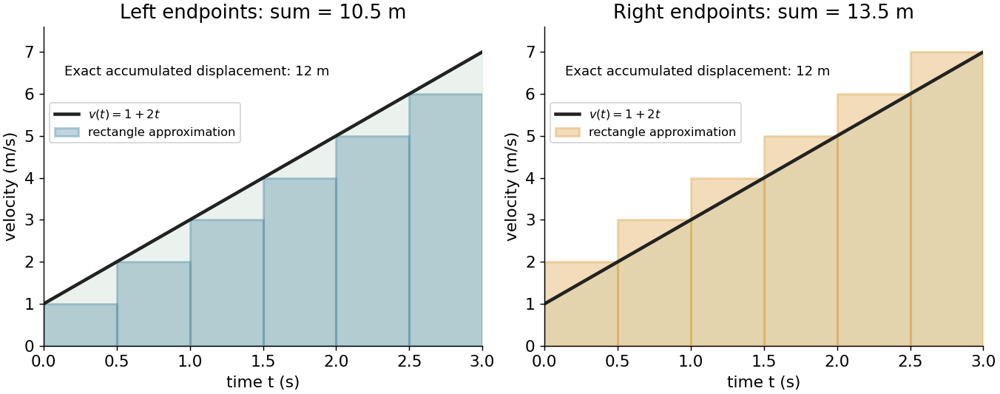
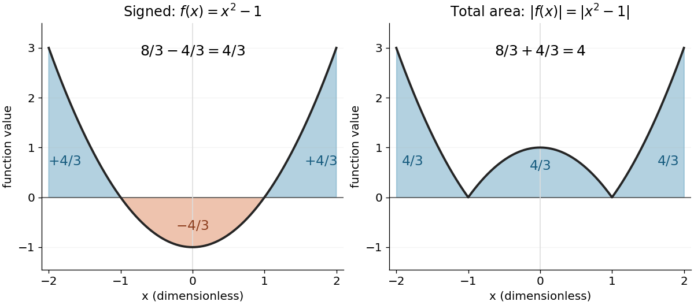
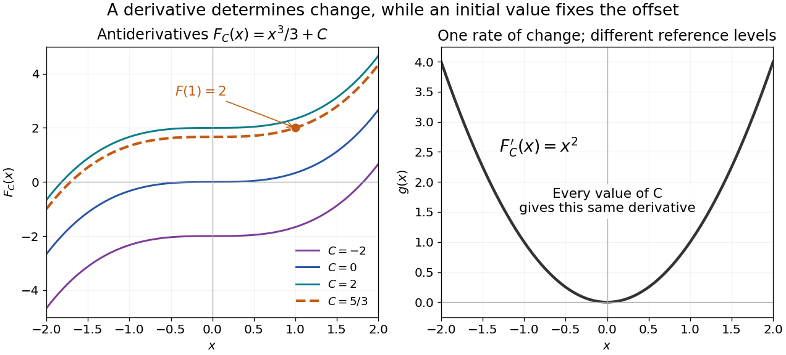
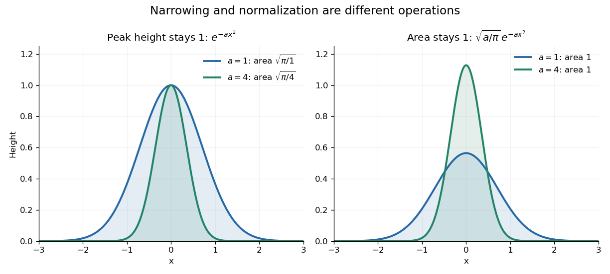
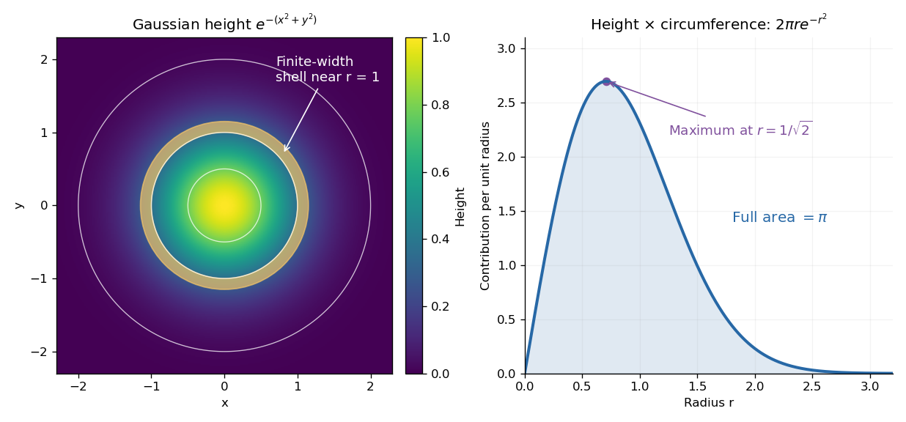

# Integral

↑ **Parent:** [Calculus](calculus.md)  
ⓦ [Wiki](https://en.wikipedia.org/wiki/Integral)

An integral adds up contributions of a [function](function.md) across a [domain of integration](#domain-of-integration). For a [continuous function](calculus.md#continuous-function) $f$ on $[a,b]$, the [Riemann integral](real-analysis.md#riemann-integral) is the common [limit](calculus.md#limit-of-a-function) of its [Riemann sums](real-analysis.md#riemann-sum) as the largest subinterval width tends to zero:

$$
\int_a^b f(x)\,dx
=\lim_{\max_i\Delta x_i\to0}\sum_i f(\xi_i)\Delta x_i,
\qquad \xi_i\in[x_{i-1},x_i],\quad \Delta x_i=x_i-x_{i-1}.
$$

Each product combines a value with the width over which it acts. When $f$ is nonnegative, the result is the [area](differential-geometry.md#surface-area) beneath its graph; values below the horizontal axis contribute with the opposite sign. The [signed area under a graph](#signed-area-under-a-graph) can therefore vanish even when the graph encloses nonzero geometric [area](differential-geometry.md#surface-area).

For a [velocity](classical-mechanics.md#velocity) $v(t)=1+2t$ on $0\le t\le3$, use $n$ equal time steps. The left and right [Riemann sums](real-analysis.md#riemann-sum) are

$$
L_n=12-\frac9n,\qquad R_n=12+\frac9n.
$$

Because the [function](function.md) is increasing, they bound the [integral](integral.md). With six steps they give $10.5$ and $13.5$; with sixty steps they give $11.85$ and $12.15$. Both approach the same total, $12$. This is accumulation made exact by refining finite measurements.

**[Figure 1](#image-left-and-right-riemann-sums-bracket-the-accumulated-displacement-of-a-particle-with-velocity-1-plus-2t). Left and right Riemann sums bracket the accumulated displacement of a particle with velocity 1 + 2t**.

An [integral](integral.md) retains units: [velocity](classical-mechanics.md#velocity) times time gives [displacement](classical-mechanics.md#displacement), and a [probability density function](continuous-probability-distribution.md#probability-density-function) integrated over an [interval](real-analysis.md#interval-mathematics) gives a [probability](probability-theory.md#probability). Weighting a [density](fluid-mechanics.md#density) by a [function](function.md) gives its [expectation](expected-value.md). The same operation serves different subjects because it expresses a common pattern, **value multiplied by extent, then accumulated**.

The [fundamental theorem of calculus](calculus.md#fundamental-theorem-of-calculus) often evaluates a [definite integral](#definite-integral) by finding an [antiderivative](#antiderivative), but a finite sum or a numerical approximation is still useful when no convenient [antiderivative](#antiderivative) is available. An [indefinite integral](#antiderivative) denotes a family of [antiderivatives](#antiderivative); a [definite integral](#definite-integral) denotes an accumulated value between specified endpoints. More general constructions, including [Lebesgue integration](#lebesgue-integration), extend the class of [functions](function.md) and [domains](topology.md#domain-mathematical-analysis) that can be handled.

**Table of contents**

- [Domain of integration](#domain-of-integration)
- [Integration by substitution](#integration-by-substitution)
  - [Trigonometric substitution](#trigonometric-substitution)
- [Average value of a function](#average-value-of-a-function)
- [Linearity of integration](#linearity-of-integration)
- [Signed area under a graph](#signed-area-under-a-graph)
  - [Total geometric area under a graph](#total-geometric-area-under-a-graph)
- [Definite integral](#definite-integral)
  - [Integration limit](#integration-limit)
  - [Distance traveled from velocity](#distance-traveled-from-velocity)
- [Wallis integrals](#wallis-integrals)
- [Dipole line-integral identity](#dipole-line-integral-identity)
- [Integrand](#integrand)
- [Multiple integral](#multiple-integral)
  - [Triple integral](#triple-integral)
  - [Volume element](#volume-element)
  - [Iterated integral](#iterated-integral)
  - [Odd-integrand cancellation by reflection](#odd-integrand-cancellation-by-reflection)
- [Integral representation](#integral-representation)
  - [Trigonometric integral](#trigonometric-integral)
    - [Cosine integral](#cosine-integral)
    - [Sine integral](#sine-integral)
- [Lebesgue integration](#lebesgue-integration)
  - [Prékopa–Leindler inequality](#prekopa-leindler-inequality)
  - [Absolute continuity of the Lebesgue integral](#absolute-continuity-of-the-lebesgue-integral)
- [Time integral](#time-integral)
- [Double integral](#double-integral)
- [Monotonicity of the Lebesgue integral](#monotonicity-of-the-lebesgue-integral)
- [Antiderivative](#antiderivative)
  - [Constant of integration](#constant-of-integration)
    - [Antiderivatives on disconnected domains](#antiderivatives-on-disconnected-domains)
  - [Additive constant](#additive-constant)
- [Gaussian integral](#gaussian-integral)
  - [Gaussian integral with an inverse-square term](#gaussian-integral-with-an-inverse-square-term)
  - [Gaussian moment recurrence](#gaussian-moment-recurrence)
    - [Odd Gaussian moments on a half-line](#odd-gaussian-moments-on-a-half-line)
    - [Full-line Gaussian moment recurrence](#full-line-gaussian-moment-recurrence)
  - [Polar-coordinate proof of the Gaussian integral](#polar-coordinate-proof-of-the-gaussian-integral)
  - [Linear-source multivariate Gaussian integral](#linear-source-multivariate-gaussian-integral)
  - [Dawson function](#dawson-function)
    - [Gaussian drift primitives](#gaussian-drift-primitives)
  - [Error function](#error-function)
    - [Error function and the normal distribution](#error-function-and-the-normal-distribution)
    - [Inverse error function](#inverse-error-function)
    - [Error-function diffusion front](#error-function-diffusion-front)
    - [Quadrant asymptotics of the error function](#quadrant-asymptotics-of-the-error-function)
    - [Complementary error function](#complementary-error-function)
      - [Complementary error function tail bound](#complementary-error-function-tail-bound)
      - [Faddeeva function](#faddeeva-function)
        - [Gaussian pole integral](#gaussian-pole-integral)

## Domain of integration

↑ **Parent:** [Integral](integral.md)

The domain of integration is the set $D$ over which an [integral](integral.md) is taken. For a [multiple integral](#multiple-integral), inequalities or parameter ranges specify which points belong to $D$; a [change of variables](multivariable-calculus.md#change-of-variables-formula) transforms both these bounds and the integration element through its [Jacobian determinant](multivariable-calculus.md#jacobian-determinant). For example, a polar region $c\leq r\leq1+\cos\phi$ exists only at angles where $1+\cos\phi\geq c$.

## Integration by substitution

↑ **Parent:** [Integral](integral.md)

If $F'=f$ and $g$ is differentiable, the [chain rule](calculus.md#chain-rule) gives $(F\circ g)'(x)=f(g(x))g'(x)$. Taking [antiderivatives](#antiderivative) gives the substitution rule

$$
\boxed{\int f(g(x))g'(x)\,dx=F(g(x))+C.}
$$

Writing $u=g(x)$ and $du=g'(x)\,dx$ records this [chain rule](calculus.md#chain-rule) in reverse. For a [continuous function](calculus.md#continuous-function) $f$ and continuously differentiable $g$, the [fundamental theorem of calculus](calculus.md#fundamental-theorem-of-calculus) gives the corresponding [definite integral](#definite-integral) identity

$$
\int_a^b f(g(x))g'(x)\,dx=\int_{g(a)}^{g(b)}f(u)\,du.
$$

The order of the transformed endpoints determines the sign. For example, $\int_0^1 2x\cos(x^2)\,dx=\int_0^1\cos u\,du=\sin1$. If the substitution is used in the opposite direction by solving $x$ as a function of $u$, one must restrict to a suitable inverse branch; the [tangent half-angle substitution](geometry-and-topology.md#tangent-half-angle-substitution) illustrates why separate branches can be necessary even when the original integrand is smooth. The general [change of variables formula](multivariable-calculus.md#change-of-variables-formula) extends substitution to higher dimensions.

### Trigonometric substitution

↑ **Parent:** [Integration by substitution](#integration-by-substitution)  
ⓦ [Wiki](https://en.wikipedia.org/wiki/Trigonometric_substitution)

A [trigonometric substitution](#trigonometric-substitution) is [integration by substitution](#integration-by-substitution) using a [trigonometric function](geometry-and-topology.md#trigonometric-function) to simplify an integrand, especially a square root. For example, $x=a\sin u$, with $a>0$ and $-\pi/2\le u\le\pi/2$, changes $\sqrt{a^2-x^2}$ to $a\cos u$ and $dx$ to $a\cos u\,du$. The interval restriction fixes the sign of the square root. Similarly $x=a\tan u$ simplifies $\sqrt{a^2+x^2}$. The transformed [integral](integral.md) must include the differential and, for a [definite integral](#definite-integral), the new limits.

## Average value of a function

↑ **Parent:** [Integral](integral.md)

For an [integrable function](measure-theory.md#lebesgue-integrable-function) on an [interval](real-analysis.md#interval-mathematics) $I$ of positive finite length, its average value is the [integral](integral.md) divided by that length:

$$
\overline f_I=\frac1{|I|}\int_I f(x)\,dx.
$$

If $f$ is constant on equal-length subintervals, this is their values' [arithmetic mean](arithmetic.md#arithmetic-mean); unequal lengths require a [weighted mean](arithmetic.md#weighted-arithmetic-mean). For example, values $2$ and $6$ on two equal halves give average value $4$, whereas value $2$ on the first quarter and $6$ on the remaining three quarters give $5$. The [integral](integral.md) measures total contribution; the [average value of a function](#average-value-of-a-function) divides out the interval length.

For the [function](function.md) $f(x)=2x$ on $[0,1]$, the [average value of a function](#average-value-of-a-function) is $\int_0^1 2x\,dx=1$. Replacing it by the constant $1$ preserves its [integral](integral.md) on this interval. This is why the [Haar projection](fourier-analysis.md#haar-projection) uses [cell averages](#average-value-of-a-function) to obtain a coarser description while retaining each cell's total contribution.

## Linearity of integration

↑ **Parent:** [Integral](integral.md)

For [integrable](measure-theory.md#integrability) [real-valued functions](function.md#real-valued-function) $f,g$ on a [measure space](measure.md#measure-space) $(X,\mu)$ and fixed [real numbers](arithmetic.md#real-number) $a,b$, their [linear combination](vector-space.md#linear-combination) $af+bg$ is [integrable](measure-theory.md#integrability), and the [Lebesgue integral](measure-theory.md#lebesgue-integral) satisfies

$$
\int_X(af+bg)\,d\mu=a\int_X f\,d\mu+b\int_X g\,d\mu.
$$

The same rule applies to any finite [summation](arithmetic.md#summation): $\int_X\sum_{j=1}^n a_jf_j\,d\mu=\sum_{j=1}^n a_j\int_X f_j\,d\mu$ for [integrable](measure-theory.md#integrability) [functions](function.md) $f_j$ and fixed [scalars](vector-space.md#scalar) $a_j$. Finite signed values matter: [integrability](measure-theory.md#integrability) ensures all these [integrals](integral.md) are finite, so no undefined $\infty-\infty$ occurs.

This is the [distributive property](algebraic-operation.md#distributive-property) of finite [summation](arithmetic.md#summation) carried into [integration](integral.md): a fixed factor can be pulled out, and a finite sum can be integrated term by term. For [simple functions](measure-theory.md#simple-function), distribute the finite sums of value times [measure](measure.md); approximation extends additivity to nonnegative [measurable functions](measure-theory.md#measurable-function), and splitting into a [positive part](function.md#positive-part-of-a-real-valued-function) and [negative part](function.md#negative-part-of-a-real-valued-function) gives the [integrable](measure-theory.md#integrability) signed case. See [Lecture 12: Lebesgue Integrable Functions, the Lebesgue Integral and the Dominated Convergence Theorem](mathematics-bibliography.md#18-102-introduction-to-functional-analysis-spring-2021-lecture-notes-by-andrew-lin/lecture-12-lebesgue-integrable-functions-the-lebesgue-integral-and-the-dominated-convergence-theorem) (Proposition 122: linearity for integrable functions). For example, $\int_0^1(2x-3)\,dx=2\int_0^1x\,dx-3\int_0^1 1\,dx=-2$. With a [probability measure](probability-space.md#probability-measure), [linearity of integration](#linearity-of-integration) gives [linearity of expectation](expected-value.md#linearity-of-expectation).

## Signed area under a graph

↑ **Parent:** [Integral](integral.md)

For $a<b$ and a [real-valued function](function.md#real-valued-function) $f$ with a finite [Riemann integral](real-analysis.md#riemann-integral) or [Lebesgue integral](measure-theory.md#lebesgue-integral) on $[a,b]$, the [signed area under a graph](#signed-area-under-a-graph) is its [definite integral](#definite-integral): geometric [area](differential-geometry.md#surface-area) above the horizontal axis contributes positively, and geometric [area](differential-geometry.md#surface-area) below it contributes negatively. If these two nonnegative [areas](differential-geometry.md#surface-area) are $A_+$ and $A_-$, then

$$
\int_a^b f(x)\,dx=A_+-A_-,\qquad
\int_a^b |f(x)|\,dx=A_++A_-.
$$

The second expression is the [total geometric area under a graph](#total-geometric-area-under-a-graph). Taking the [absolute value](real-analysis.md#absolute-value) of the first expression does not usually give the second: cancellation has already removed information about how much [area](differential-geometry.md#surface-area) lies on each side.[5.2 The Definite Integral](mathematics-bibliography.md#calculus-volume-1-by-gilbert-strang-and-others/5-2-the-definite-integral)

For an exact example, take the [polynomial function](polynomial.md#polynomial-function) $f(x)=x^2-1$ on $[-2,2]$. Its [polynomial roots](polynomial.md#root-of-a-polynomial) are $-1$ and $1$: it is negative between them and positive on the two outer [intervals](real-analysis.md#interval-mathematics). An [antiderivative](#antiderivative) is $F(x)=x^3/3-x$, so the [fundamental theorem of calculus](calculus.md#fundamental-theorem-of-calculus) gives

$$
\int_{-2}^{-1}(x^2-1)\,dx=\frac43,\qquad
\int_{-1}^{1}(x^2-1)\,dx=-\frac43,\qquad
\int_{1}^{2}(x^2-1)\,dx=\frac43.
$$

Thus $A_+=8/3$ and $A_-=4/3$. The [signed area under a graph](#signed-area-under-a-graph) is $4/3$, whereas the [total geometric area under a graph](#total-geometric-area-under-a-graph) is $4$. To compute the latter with [antiderivatives](#antiderivative), split at each sign-changing [polynomial root](polynomial.md#root-of-a-polynomial) and reverse the sign of the negative contribution.

**[Figure 2](#signed-polynomial-area-and-absolute-area). The polynomial x squared minus one has signed integral 4/3 and total geometric area 4 on the interval from minus two to two**.

Cancellation is useful information when the [integrand](#integrand) represents a signed contribution. For the [polynomial function](polynomial.md#polynomial-function) $f(x)=x$ on $[-1,1]$, the two triangular [areas](differential-geometry.md#surface-area) give $\int_{-1}^1x\,dx=0$, although $\int_{-1}^1|x|\,dx=1$. Zero [net signed area](#signed-area-under-a-graph) therefore means balanced positive and negative contributions, rather than an empty region.

The short algebraic justification uses the [positive part](function.md#positive-part-of-a-real-valued-function) $f_+=\max(f,0)$ and [negative part](function.md#negative-part-of-a-real-valued-function) $f_-=\max(-f,0)$: $f=f_+-f_-$ and $|f|=f_++f_-$. Their [integrals](integral.md) give $A_+$ and $A_-$, and [linearity of integration](#linearity-of-integration) gives the difference and sum formulas. For [Lebesgue integration](#lebesgue-integration), require both contributions to be finite to avoid the undefined subtraction $\infty-\infty$.[Definitions 120–121 and Proposition 122](mathematics-bibliography.md#18-102-introduction-to-functional-analysis-spring-2021-lecture-notes-by-andrew-lin/lecture-12-lebesgue-integrable-functions-the-lebesgue-integral-and-the-dominated-convergence-theorem)

### Total geometric area under a graph

↑ **Parent:** [Signed area under a graph](#signed-area-under-a-graph)

## Definite integral

↑ **Parent:** [Integral](integral.md)

A [definite integral](#definite-integral) accumulates an [integrand](#integrand) between specified endpoints, retaining the sign of each contribution. For a [real-valued function](function.md#real-valued-function) on a finite [real interval](real-analysis.md#interval-mathematics), a finite [definite integral](#definite-integral) is a [scalar](vector-space.md#scalar); an [indefinite integral](#antiderivative) describes a family of [antiderivatives](#antiderivative). The lower and upper limits of integration $a,b$ specify where accumulation starts and ends. The integration variable is a placeholder: $\int_a^b f(x)\,dx=\int_a^b f(u)\,du$.

This is useful whenever a varying rate must be converted into a total change. For motion along a [straight line](euclidean-geometry.md#straight-line) with [continuous](calculus.md#continuous-function) [velocity](classical-mechanics.md#velocity) $v(t)$ and [position](classical-mechanics.md#position) $s(t)$ satisfying $s'(t)=v(t)$, the [fundamental theorem of calculus](calculus.md#fundamental-theorem-of-calculus) gives [displacement](classical-mechanics.md#displacement), while accumulating [speed](classical-mechanics.md#speed) gives the [distance traveled from velocity](#distance-traveled-from-velocity):

$$
s(b)-s(a)=\int_a^b v(t)\,dt,\qquad
D=\int_a^b |v(t)|\,dt,\qquad a<b.
$$

Negative [velocity](classical-mechanics.md#velocity) reduces [displacement](classical-mechanics.md#displacement) while adding to the [distance traveled from velocity](#distance-traveled-from-velocity). The [physical dimension](mathematical-physics.md#physical-dimension) of a [definite integral](#definite-integral) is the product of the [integrand](#integrand)'s [physical dimension](mathematical-physics.md#physical-dimension) and the integration variable's [physical dimension](mathematical-physics.md#physical-dimension): here $(\mathrm{m}/\mathrm{s})\mathrm{s}=\mathrm{m}$. An [area](differential-geometry.md#surface-area) on a rate graph need not be a spatial [area](differential-geometry.md#surface-area).[Theorem 5.6 and the displacement and total-distance discussion](mathematics-bibliography.md#calculus-volume-1-by-gilbert-strang-and-others/5-4-integration-formulas-and-the-net-change-theorem)

As an explicitly synthetic motion model, let $v(t)=(2\,\mathrm{m}\,\mathrm{s}^{-2})t-2\,\mathrm{m}\,\mathrm{s}^{-1}$ for $0\le t\le3\,\mathrm{s}$, with $s(0)=0$. Using numerical values in seconds and metres, an [antiderivative](#antiderivative) gives $s(t)=t^2-2t$. The [velocity](classical-mechanics.md#velocity) changes sign at $t=1$: the model first moves $1$ m in the negative direction, then $4$ m in the positive direction. Its [displacement](classical-mechanics.md#displacement) is $-1+4=3$ m, and its [distance traveled from velocity](#distance-traveled-from-velocity) is $1+4=5$ m. The initial [position](classical-mechanics.md#position) fixes the [constant of integration](#constant-of-integration), but does not change either accumulated quantity.

**[Figure 3](#variable-velocity-displacement-and-distance). Synthetic variable velocity model with displacement 3 metres and distance traveled 5 metres over three seconds**.

Orientation matters independently of whether the [integrand](#integrand) is positive or negative. For a [function](function.md) [integrable](measure-theory.md#integrability) on the [interval](real-analysis.md#interval-mathematics) containing the endpoints, use the conventions

$$
\int_a^a f(x)\,dx=0,\qquad
\int_b^a f(x)\,dx=-\int_a^b f(x)\,dx,\qquad
\int_a^c f(x)\,dx=\int_a^b f(x)\,dx+\int_b^c f(x)\,dx.
$$

For the preceding [velocity](classical-mechanics.md#velocity) model, accumulation from $3$ seconds back to $0$ seconds gives $-3$ m. Reversing the bounds of the [speed](classical-mechanics.md#speed) [integral](integral.md) gives $-5$ m, which is an oriented [integral](integral.md), not a negative [distance traveled from velocity](#distance-traveled-from-velocity); physical elapsed-time totals use the earlier endpoint first. The splitting rule holds even when $b$ is outside the [interval](real-analysis.md#interval-mathematics) between $a$ and $c$, provided [integrability](measure-theory.md#integrability) holds on the [interval](real-analysis.md#interval-mathematics) containing all three endpoints.[5.2 The Definite Integral](mathematics-bibliography.md#calculus-volume-1-by-gilbert-strang-and-others/5-2-the-definite-integral)

Existence needs hypotheses. For a [bounded function](function.md#bounded-function) $f$ on $[a,b]$ with $a<b$, a finite [Riemann integral](real-analysis.md#riemann-integral) exists when every tagged [Riemann sum](real-analysis.md#riemann-sum) approaches the same value as the largest cell width tends to zero:

$$
\int_a^b f(x)\,dx=\lim_{\max_i(x_i-x_{i-1})\to0}
\sum_{i=1}^n f(\xi_i)(x_i-x_{i-1}),\qquad
a=x_0<\cdots<x_n=b,\quad \xi_i\in[x_{i-1},x_i].
$$

The [limit](calculus.md#limit-of-a-function) must be independent of both the [partition of an interval](real-analysis.md#partition-of-an-interval) and the tags. Merely making the number of cells large can leave a wide cell unresolved. On a finite [closed interval](real-analysis.md#closed-real-interval), every [continuous function](calculus.md#continuous-function), and every [bounded function](function.md#bounded-function) that is [continuous](calculus.md#continuous-function) except at finitely many points, is [Riemann integrable](real-analysis.md#riemann-integrable-function).[Lemma 5.2.7 and Theorem 5.2.9](mathematics-bibliography.md#basic-analysis-introduction-to-real-analysis-volume-i-by-jiri-lebl/5-2-properties-of-the-integral) Boundedness alone is insufficient: the [Dirichlet function](real-analysis.md#dirichlet-function) on $[0,1]$ is $1$ on the [rational numbers](number-theory.md#rational-number) and $0$ on the [irrational numbers](algebra.md#irrational-number). Tags can all be chosen rational or all irrational, giving [Riemann sums](real-analysis.md#riemann-sum) of $1$ or $0$ at arbitrarily small cell widths.[Example 5.1.4](mathematics-bibliography.md#basic-analysis-introduction-to-real-analysis-volume-i-by-jiri-lebl/5-1-the-riemann-integral)

For a finite signed [Lebesgue integral](measure-theory.md#lebesgue-integral), the condition is instead that $f$ be a [measurable function](measure-theory.md#measurable-function) for [Lebesgue measure](measure-theory.md#lebesgue-measure) and $\int_{[a,b]}|f|\,dx<\infty$. A [measurable function](measure-theory.md#measurable-function) for [Lebesgue measure](measure-theory.md#lebesgue-measure) that is also a [bounded function](function.md#bounded-function) on a finite [interval](real-analysis.md#interval-mathematics) satisfies this condition since $|f|\le M$ gives $\int|f|\le M(b-a)$. The [Dirichlet function](real-analysis.md#dirichlet-function) therefore has [Lebesgue integral](measure-theory.md#lebesgue-integral) zero: the [rational numbers](number-theory.md#rational-number) form a [null set](measure-theory.md#null-set), so it equals zero [Lebesgue almost everywhere](measure-theory.md#almost-everywhere). The [Riemann integral](real-analysis.md#riemann-integral) and [Lebesgue integral](measure-theory.md#lebesgue-integral) agree for the [continuous functions](calculus.md#continuous-function) used in the diagrams.[Definition 120, Proposition 123(2), Remark 124 and Theorem 126](mathematics-bibliography.md#18-102-introduction-to-functional-analysis-spring-2021-lecture-notes-by-andrew-lin/lecture-12-lebesgue-integrable-functions-the-lebesgue-integral-and-the-dominated-convergence-theorem) An unbounded [integrand](#integrand) or infinite endpoint requires further analysis, for example the [limits](calculus.md#limit-of-a-function) defining an [improper integral](real-analysis.md#improper-integral); the notation alone does not establish convergence.

### Integration limit

↑ **Parent:** [Definite integral](#definite-integral)

The lower and upper integration limits $a,b$ specify the ordered endpoints of a [definite integral](#definite-integral) $\int_a^b f(x)\,dx$. Interchanging the [integration limits](#integration-limit) reverses its sign: $\int_b^a f(x)\,dx=-\int_a^b f(x)\,dx$.

### Distance traveled from velocity

↑ **Parent:** [Definite integral](#definite-integral)

## Wallis integrals

↑ **Parent:** [Integral](integral.md)

The [Wallis integrals](#wallis-integrals) are $I_n=\int_0^{\pi/2}\sin^n x\,dx$ for integers $n\geq0$. [Integration by parts](calculus.md#integration-by-parts) gives $nI_n=(n-1)I_{n-2}$ for $n\geq2$, with $I_0=\pi/2$, $I_1=1$. Hence

$$
I_{2n}=\frac{(2n)!}{2^{2n}(n!)^2}\frac\pi2,\qquad
I_{2n+1}=\frac{2^{2n}(n!)^2}{(2n+1)!}.
$$

Because $0<\sin x<1$ in the integration interval, $0<I_n<I_{n-1}$ for $n\geq1$. Combining this with the recurrence gives $2n/(2n+1)<I_{2n+1}/I_{2n}<1$, proving that the ratio tends to one and yielding the [Wallis product](topology.md#wallis-product).

## Dipole line-integral identity

↑ **Parent:** [Integral](integral.md)

Here $r=|\mathbf r|$, $\mathbf P_c=\mathbf r-c\mathbf r_0$ and $P_c=|\mathbf P_c|$. The identity holds where the segment of source points $t\mathbf r_0$, $0\leq t\leq c$, avoids the observation point and the denominator is nonzero. Differentiating the right side with respect to $c$ gives the integrand and its value at $c=0$ is zero. Dotting with a [current dipole](electric-charge.md#current-dipole) moment evaluates a continuous line of dipole [electric potentials](electric-field.md#electric-potential).

## Integrand

↑ **Parent:** [Integral](integral.md)

In $\int_a^b f(x)\,dx$, the [function](function.md) $f$ is the [integrand](#integrand). It is distinct from the integration variable, the bounds and the resulting [integral](integral.md). In [contour integration](complex-analysis.md#contour-integration), the transformed [integrand](#integrand) includes the parametrization derivative.

## Multiple integral

↑ **Parent:** [Integral](integral.md)  
ⓦ [Wiki](https://en.wikipedia.org/wiki/Multiple_integral)

A multiple integral accumulates a [function](function.md) over a region with several coordinates. The [Fubini theorem](measure-theory.md#fubini-s-theorem) and [Tonelli theorem](measure-theory.md#tonelli-theorem) give conditions under which it equals successive one-dimensional [integrals](integral.md). A [change of variables formula](multivariable-calculus.md#change-of-variables-formula) expresses it in new coordinates using the absolute [Jacobian determinant](multivariable-calculus.md#jacobian-determinant).

### Triple integral

↑ **Parent:** [Multiple integral](#multiple-integral)

A triple integral is a [multiple integral](#multiple-integral) over a three-dimensional region. For a [mass density](fluid-mechanics.md#density) $\rho$, $\iiint_D\rho\,dV$ gives the total mass, while $\iiint_D1\,dV$ gives its [volume](geometry-and-topology.md#volume). Iterated one-dimensional integration is justified by [Fubini's theorem](measure-theory.md#fubini-s-theorem) under absolute integrability, and a [change of variables](multivariable-calculus.md#change-of-variables-formula) includes the absolute [Jacobian determinant](multivariable-calculus.md#jacobian-determinant) in the volume element.

### Volume element

↑ **Parent:** [Multiple integral](#multiple-integral)  
ⓦ [Wiki](https://en.wikipedia.org/wiki/Volume_element)

Under a smooth locally invertible coordinate map $\Phi$ into Euclidean space, the positive [volume element](#volume-element) in a [multiple integral](#multiple-integral) is multiplied by the absolute [Jacobian determinant](multivariable-calculus.md#jacobian-determinant). In three-dimensional [spherical coordinates](multivariable-calculus.md#spherical-coordinate-system), $dV=r^2\sin\theta\,dr\,d\theta\,d\varphi$; in [cylindrical coordinates](multivariable-calculus.md#cylindrical-coordinate-system), $dV=r\,dr\,d\theta\,dz$. The absolute value distinguishes positive integration measure from a signed orientation convention.

### Iterated integral

↑ **Parent:** [Multiple integral](#multiple-integral)

An [iterated integral](#iterated-integral) performs successive one-variable [integrals](integral.md). In the displayed expression, $y$ is held fixed during the inner [integration](integral.md) over $x$, and the result is then integrated over $y$. The inner bounds may depend on that fixed outer variable. By contrast, an inner bound depending on an already integrated variable does not specify such a nested operation without further interpretation. For example, the [triangle](euclidean-geometry.md#triangle) $0\leq y\leq1$, $2y\leq x\leq2$ gives $\int_0^1\int_{2y}^2f(x,y)\,dx\,dy$, or, in the other order, $\int_0^2\int_0^{x/2}f(x,y)\,dy\,dx$. [Fubini's theorem](measure-theory.md#fubini-s-theorem) and [Tonelli's theorem](measure-theory.md#tonelli-theorem) supply conditions under which these iterated expressions equal the same [multiple integral](#multiple-integral).

### Odd-integrand cancellation by reflection

↑ **Parent:** [Multiple integral](#multiple-integral)

If a region is invariant under one coordinate reflection and an integrable function changes sign under that reflection, its [multiple integral](#multiple-integral) is zero. Apply the [change of variables formula](multivariable-calculus.md#change-of-variables-formula) to the reflection, whose absolute [Jacobian determinant](multivariable-calculus.md#jacobian-determinant) is one: the integral equals its negative. This applies to odd coordinate powers in symmetric volumes and to the off-diagonal entries of an [inertia tensor](rigid-body-dynamics.md#inertia-tensor) when the [mass density](fluid-mechanics.md#density) shares the coordinate-reflection symmetries.

## Integral representation

↑ **Parent:** [Integral](integral.md)

An integral representation expresses a [function](function.md) through an [integral](integral.md) of specified data and an [integral kernel](functional-analysis.md#integral-kernel). [Green-function representations](green-s-function.md#green-function-representation) solve [differential equations](differential-equation.md) this way, while the [Bromwich inversion formula](integral-transform.md#bromwich-inversion-formula) reconstructs a function from its [Laplace transform](integral-transform.md#laplace-transform).

### Trigonometric integral

↑ **Parent:** [Integral representation](#integral-representation)  
ⓦ [Wiki](https://en.wikipedia.org/wiki/Trigonometric_integral)

The sine and cosine integrals accumulate $\sin t/t$ and $\cos t/t$, with different normalizations at zero and infinity. They arise in [oscillatory integrals](distribution-theory.md#oscillatory-integral), [Fourier transforms](fourier-transform.md) of singular kernels and [Fourier series](fourier-series.md) of logarithmic profiles.

#### Cosine integral

↑ **Parent:** [Trigonometric integral](#trigonometric-integral)

For real $x>0$, its small-argument expansion is $\operatorname{Ci}(x)=\gamma_E+\log x+O(x^2)$. Integrating $\operatorname{Ci}'(x)=\cos x/x$ separates the logarithm from the regular correction. Its conventional constant is the [Euler--Mascheroni constant](complex-analysis.md#euler-s-constant); the primary series normalization is [https://dlmf.nist.gov/6.6.E6](https://dlmf.nist.gov/6.6.E6) .

#### Sine integral

↑ **Parent:** [Trigonometric integral](#trigonometric-integral)

For real $x>0$, the sine integral approaches $\pi/2$. Exponential damping gives $\int_0^\infty e^{-at}\sin t/t\,dt=\arctan(1/a)$, so the limiting constant follows by letting $a\downarrow0$. [Integration by parts](calculus.md#integration-by-parts) of the tail gives $\operatorname{Si}(x)=\pi/2-\cos x/x-\sin x/x^2+O(x^{-3})$.

## Lebesgue integration

↑ **Parent:** [Integral](integral.md)  
ⓦ [Wiki](https://en.wikipedia.org/wiki/Lebesgue_integration)

Lebesgue integration constructs an integral from the measure of level sets or from approximation by simple functions. It is linear on integrable functions and is stable under the principal convergence theorems of [measure theory](measure-theory.md).

<h3 id="prekopa-leindler-inequality">Prékopa–Leindler inequality</h3>

↑ **Parent:** [Lebesgue integration](#lebesgue-integration)  
ⓦ [Wiki](https://en.wikipedia.org/wiki/Prékopa–Leindler_inequality)

If $0<\theta<1$ and nonnegative [measurable functions](measure-theory.md#measurable-function) satisfy $h((1-\theta)x+\theta y)\geq f(x)^{1-\theta}g(y)^\theta$ for all $x,y\in\mathbb R^n$, then their [Lebesgue integrals](measure-theory.md#lebesgue-integral) obey

$$
\int h\geq\left(\int f\right)^{1-\theta}\left(\int g\right)^\theta.
$$

The [quantile derivative identity](probability-distribution.md#quantile-derivative-identity) and [monotone substitution inequality](multivariable-calculus.md#monotone-substitution-inequality) prove the one-dimensional case; [Tonelli theorem](measure-theory.md#tonelli-theorem) extends it by induction. It implies the [Brunn–Minkowski inequality](geometry-and-topology.md#brunn-minkowski-theorem).

### Absolute continuity of the Lebesgue integral

↑ **Parent:** [Lebesgue integration](#lebesgue-integration)

If $f\in L^1$, then for every $\varepsilon>0$ there is $\delta>0$ such that $\int_E|f|<\varepsilon$ whenever the measure of $E$ is below $\delta$. In particular, integrals over a sequence of shrinking measurable sets tend to zero.

## Time integral

↑ **Parent:** [Integral](integral.md)

A time integral accumulates an integrand over a time coordinate. In perturbation theory it commonly sums the effect of an interaction over all possible vertex times.

## Double integral

↑ **Parent:** [Integral](integral.md)

A double integral integrates a function over a two-dimensional region. A [change of variables formula](multivariable-calculus.md#change-of-variables-formula) can replace the region and area element using a [Jacobian determinant](multivariable-calculus.md#jacobian-determinant).

It is a [multiple integral](#multiple-integral) with two integration variables.

## Monotonicity of the Lebesgue integral

↑ **Parent:** [Integral](integral.md)

If measurable functions satisfy $f\leq g$ almost everywhere, then

$$
\int f\,d\mu\leq\int g\,d\mu
$$

whenever the two sides are defined.

## Antiderivative

↑ **Parent:** [Integral](integral.md)  
ⓦ [Wiki](https://en.wikipedia.org/wiki/Antiderivative)

An antiderivative recovers a [function](function.md) from its local rate of change. For a [real-valued function](function.md#real-valued-function) $g$ on an [open subset](topology.md#open-set) $U$ of the [real line](real-analysis.md#real-line), a [differentiable function](analysis.md#differentiable-function) $F$ is an antiderivative when

$$
\boxed{F'(x)=g(x)\qquad(x\in U).}
$$

For example, $g(x)=x^2$ has the antiderivatives $F_C(x)=x^3/3+C$ for every real [additive constant](#additive-constant) $C$. Their [derivatives](calculus.md#derivative) agree, while their values can differ. On an [interval](real-analysis.md#interval-mathematics), the [constant of integration](#constant-of-integration) describes the entire freedom in the answer. [OpenStax Calculus 1, §4.10: antiderivatives and their families](https://openstax.org/books/calculus-volume-1/pages/4-10-antiderivatives)

**[Figure 4](#image-a-family-of-antiderivatives-has-one-common-derivative-and-an-initial-value-selects-one-member). A family of antiderivatives has one common derivative, and an initial value selects one member**.

The indefinite-integral notation $\int g(x)\,dx=F(x)+C$ records this family on an [interval](real-analysis.md#interval-mathematics). For the illustrated family, the extra condition $F(1)=2$ selects $C=5/3$. Thus reversing [differentiation](calculus.md#differentiation) requires both a rate and a reference value if a unique [function](function.md) is wanted.

The [fundamental theorem of calculus](calculus.md#fundamental-theorem-of-calculus) supplies a construction when $g$ is [continuous](calculus.md#continuous-function) on an [interval](real-analysis.md#interval-mathematics) $I$. Choose $x_0\in I$ and set $F(x)=\int_{x_0}^x g(t)\,dt$; then $F'=g$. [Integrability](measure-theory.md#integrability) alone does not guarantee a classical antiderivative. The [Heaviside step function](integral-transform.md#heaviside-step-function) is [Riemann integrable](real-analysis.md#riemann-integrable-function) on bounded [intervals](real-analysis.md#interval-mathematics), but cannot be a [derivative](calculus.md#derivative) throughout an [interval](real-analysis.md#interval-mathematics) containing its jump: [Darboux theorem for derivatives](calculus.md#darboux-s-theorem-analysis) requires every intermediate value. [Lebl, Basic Analysis I, §4.2.5: the intermediate-value property of derivatives](https://www.jirka.org/ra/html/sec_mvt.html)

### Constant of integration

↑ **Parent:** [Antiderivative](#antiderivative)

On a connected open [interval](real-analysis.md#interval-mathematics), if $F'=g$, every [antiderivative](#antiderivative) of $g$ has the form $F+C$, where $C$ is a [constant function](function.md#constant-function). Indeed, two solutions satisfy $(G-F)'=0$: the [zero derivative on a connected open set](multivariable-calculus.md#zero-derivative-on-a-connected-open-set) principle makes their difference constant. In one dimension, the [mean value theorem](calculus.md#mean-value-theorem) proves this on any closed subinterval. [Lebl, Basic Analysis I, Proposition 4.2.6: zero derivative on an interval](https://www.jirka.org/ra/html/sec_mvt.html)

An [initial condition](differential-equation.md#initial-condition) or [boundary condition](differential-equation.md#boundary-condition) can determine $C$. If a particular [antiderivative](#antiderivative) is $F_0$ and $F(x_0)=y_0$, then

$$
\boxed{C=y_0-F_0(x_0).}
$$

For $g(x)=x^2$, $F_0(x)=x^3/3$ and $F(1)=2$, this gives $C=5/3$. Without that reference value, choosing $C=0$ simply selects one member of the family.

The freedom has a physical meaning in a simple kinematic model. A [velocity](classical-mechanics.md#velocity) $v(t)=at$, with constant [acceleration](classical-mechanics.md#acceleration) $a$, determines [position](classical-mechanics.md#position) only as $x(t)=at^2/2+C$. The [initial condition](differential-equation.md#initial-condition) $x(0)=x_0$ selects $C=x_0$; changing the starting [position](classical-mechanics.md#position) does not change the prescribed [velocity](classical-mechanics.md#velocity).

For the [differential equation](differential-equation.md) $T'=-B/r^2$ on $r>0$, the [antiderivative](#antiderivative) is $T=B/r+C$. The [boundary condition](differential-equation.md#boundary-condition) $T(R_s)=T_s$ gives $C=T_s-B/R_s$. Discarding the [constant of integration](#constant-of-integration) therefore needs a specified condition or an approximation that quantifies its effect. On a domain with several [connected components](geometry-and-topology.md#connected-component), the freedom is larger: [antiderivatives on disconnected domains](#antiderivatives-on-disconnected-domains) require a separate constant on each component.

#### Antiderivatives on disconnected domains

↑ **Parent:** [Constant of integration](#constant-of-integration)

Let $U$ be an [open subset](topology.md#open-set) of the [real line](real-analysis.md#real-line), and let $F,G$ be [antiderivatives](#antiderivative) of the same [function](function.md) on $U$. Each [connected component](geometry-and-topology.md#connected-component) $I_j$ is an open [interval](real-analysis.md#interval-mathematics). On that component, $(G-F)'=0$, so the [mean value theorem](calculus.md#mean-value-theorem) gives $G-F=C_j$. The constants on different components are independent: there is no subinterval inside $U$ joining them. Conversely, adding any chosen constant on each component preserves the [derivative](calculus.md#derivative) everywhere on $U$.

For example, the domain of $g(x)=1/x$ is $U=\mathbb R\setminus\{0\}$. Every [antiderivative](#antiderivative) on this domain has the form

$$
F(x)=
\begin{cases}
\log|x|+C_-,&x<0,\\
\log|x|+C_+,&x>0,
\end{cases}
$$

with arbitrary real $C_-,C_+$. The [logarithm](calculus.md#logarithm) of the [absolute value](real-analysis.md#absolute-value) differentiates to $1/x$ on each side. The function with $C_-=2$ and $C_+=-1$ is therefore a valid [antiderivative](#antiderivative), although it cannot be written as $\log|x|+C$ with one global constant.

**[Figure 5](#image-two-disconnected-intervals-allow-independent-constants-while-the-derivative-stays-the-same). Two disconnected intervals allow independent constants while the derivative stays the same**.

An [initial condition](differential-equation.md#initial-condition) at $x=1$ fixes $C_+$ and leaves $C_-$ free. Fixing both constants requires one reference value in each [connected component](geometry-and-topology.md#connected-component), or additional conditions that couple the components. The [locally constant function](calculus.md#locally-constant-function) $F(x)-\log|x|$ captures this remaining freedom.

### Additive constant

↑ **Parent:** [Antiderivative](#antiderivative)

A constant added to a [function](function.md) changes its reference level without changing its [derivative](calculus.md#derivative):

$$
\frac{d}{dx}\bigl(F(x)+C\bigr)=F'(x).
$$

Geometrically, it is a vertical [translation](geometry-and-topology.md#translation-geometry) of the graph. For $F(x)=x^3/3$, changing $C$ moves every plotted value by the same amount while preserving every tangent slope. This is the geometric reason that [antiderivatives](#antiderivative) form a family.

When $F$ represents a [physical quantity](physics.md#physical-quantity), the [physical dimension](mathematical-physics.md#physical-dimension) of $C$ must match that of $F$. When [position](classical-mechanics.md#position) is obtained from [velocity](classical-mechanics.md#velocity), $C$ is a position offset. An unknown starting position remains unknown even when the rate of change is known exactly.

When describing the family of [antiderivatives](#antiderivative) on an [interval](real-analysis.md#interval-mathematics), the arbitrary additive constant is the [constant of integration](#constant-of-integration). On a disconnected open domain, the corresponding freedom is a [locally constant function](calculus.md#locally-constant-function), as in [antiderivatives on disconnected domains](#antiderivatives-on-disconnected-domains), rather than necessarily one constant on the whole domain.

## Gaussian integral

↑ **Parent:** [Integral](integral.md)  
ⓦ [Wiki](https://en.wikipedia.org/wiki/Gaussian_integral)

The [Gaussian integral](#gaussian-integral) gives the exact area under a [Gaussian function](calculus.md#gaussian-function). For a positive [real number](arithmetic.md#real-number) $a$,

$$
\boxed{I(a)=\int_{-\infty}^{\infty}e^{-ax^2}\,dx=\sqrt{\frac\pi a}.}
$$

This is a finite [improper integral](real-analysis.md#improper-integral) over the whole [real line](real-analysis.md#real-line). For example, $I(1)=\sqrt\pi\approx1.772454$ and $I(4)=\sqrt\pi/2\approx0.886227$. Increasing $a$ from one to four narrows the curve and halves its area, while its height at zero stays one. The [change of variables](multivariable-calculus.md#change-of-variables-formula) $u=\sqrt a\,x$ explains the factor $a^{-1/2}$.

**[Figure 6](#image-narrower-gaussian-curves-have-less-area-unless-their-height-is-adjusted). Narrower Gaussian curves have less area unless their height is adjusted**. Left: the full-line areas of $e^{-x^2}$ and $e^{-4x^2}$ are $\sqrt\pi$ and $\sqrt\pi/2$. Right: multiplication by $\sqrt{a/\pi}$ makes both areas one. Shading shows the plotted finite interval; the stated areas refer to the whole [real line](real-analysis.md#real-line).

The useful consequence is an exact normalization. For $a>0$ and any real center $\mu$,

$$
p_a(x)=\sqrt{\frac a\pi}\,e^{-a(x-\mu)^2},\qquad
\int_{\mathbb R}p_a(x)\,dx=1.
$$

This is a [probability density function](continuous-probability-distribution.md#probability-density-function) for a [normal distribution](probability-distribution.md#normal-distribution) with [expected value](expected-value.md) $\mu$ and [variance](variance.md) $1/(2a)$. A narrower [probability density function](continuous-probability-distribution.md#probability-density-function) must be taller to keep total [probability](probability-theory.md#probability) one. In the usual notation $a=1/(2\sigma^2)$, the prefactor is $1/(\sigma\sqrt{2\pi})$, where $\sigma$ is the [standard deviation](variance.md#standard-deviation).

The same area calculation makes the one-dimensional [heat kernel](diffusion-equation.md#heat-kernel)

$$
K(x,t)=\frac1{\sqrt{4\pi Dt}}e^{-x^2/(4Dt)},\qquad D>0,\quad t>0,
$$

integrate to one in $x$, with $D$ the [diffusion coefficient](brownian-motion.md#diffusion-coefficient). A spreading [Gaussian function](calculus.md#gaussian-function) can therefore preserve total mass while its height falls. This links the [Gaussian integral](#gaussian-integral) with both the [normal distribution](probability-distribution.md#normal-distribution) and the [diffusion equation](diffusion-equation.md).

Finite intervals lead to the [error function](#error-function), rather than this single constant:

$$
\operatorname{erf}(z)=\frac2{\sqrt\pi}\int_0^z e^{-u^2}\,du,\qquad
\int_{-R}^{R}e^{-ax^2}\,dx
=\sqrt{\frac\pi a}\operatorname{erf}(\sqrt a\,R),\quad R\ge0.
$$

The complementary tail is described by the [complementary error function](#complementary-error-function). These definitions and their real-axis limits are given in the NIST reference. [NIST Digital Library of Mathematical Functions, §7.2, equations 7.2.1–7.2.4](mathematics-bibliography.md#nist-digital-library-of-mathematical-functions/7-2-definitions)

The [polar-coordinate proof of the Gaussian integral](#polar-coordinate-proof-of-the-gaussian-integral) explains why $\pi$ appears in an integral of a function defined on a line: squaring its area creates a rotationally symmetric integral on a plane. Substitution $t=x^2$ also gives $\Gamma(1/2)=2\int_0^\infty e^{-x^2}\,dx=\sqrt\pi$, connecting the result with the [gamma function](complex-analysis.md#gamma-function).

### Gaussian integral with an inverse-square term

↑ **Parent:** [Gaussian integral](#gaussian-integral)

For $a,b>0$, the integrand is even and integrable at zero and infinity. On the positive half-axis the [change of variables](multivariable-calculus.md#change-of-variables-formula) $u=\sqrt a\,x-\sqrt b/x$ maps $(0,\infty)$ bijectively onto $\mathbb R$ and satisfies $ax^2+b/x^2=u^2+2\sqrt{ab}$. Solving the quadratic for the positive root gives

$$
\frac{dx}{du}=\frac1{2\sqrt a}\left(1+\frac u{\sqrt{u^2+4\sqrt{ab}}}\right).
$$

After doubling this half-axis integral, the odd part of the transformed integrand integrates to zero and the remaining [Gaussian integral](#gaussian-integral) yields the formula. The reciprocal substitution $x=1/t$ also gives

$$
\int_{-\infty}^{\infty}x^{-2}e^{-(ax^2+b/x^2)/2}dx=\sqrt{2\pi/b}\,e^{-\sqrt{ab}}.
$$

The positive parameters ensure that the substitutions and improper integrals are valid; the second identity can also be recovered by differentiating the first in $b$ under the integral sign.

### Gaussian moment recurrence

↑ **Parent:** [Gaussian integral](#gaussian-integral)

For integers $n\geq2$, [integration by parts](calculus.md#integration-by-parts) gives

$$
I_n=\left[-\frac12x^{n-1}e^{-x^2}\right]_0^\infty+\frac{n-1}{2}I_{n-2}=\frac{n-1}{2}I_{n-2}.
$$

The boundary term vanishes because $n-1>0$ at zero and [Gaussian decay dominates every power](calculus.md#gaussian-decay-dominates-every-power) at infinity. The initial values are $I_0=\sqrt\pi/2$, the half-line [Gaussian integral](#gaussian-integral), and $I_1=1/2$ by the [substitution rule](#integration-by-substitution) $t=x^2$. More generally, for real $n>-1$, that substitution gives $I_n=\tfrac12\Gamma((n+1)/2)$, linking the recurrence to the [Gamma function](complex-analysis.md#gamma-function).

#### Odd Gaussian moments on a half-line

↑ **Parent:** [Gaussian moment recurrence](#gaussian-moment-recurrence)

For $\alpha>0$ and a nonnegative integer $m$, substitute $u=\alpha x^2$. Then $x^{2m+1}dx=u^mdu/(2\alpha^{m+1})$, so the integral reduces to the [gamma function](complex-analysis.md#gamma-function) value $\Gamma(m+1)=m!$. This proves the formula. The corresponding whole-line integral is zero by odd symmetry, and both integrals converge absolutely. A half-line integral of an odd function need not vanish.

#### Full-line Gaussian moment recurrence

↑ **Parent:** [Gaussian moment recurrence](#gaussian-moment-recurrence)

For integer $n\geq2$, [integration by parts](calculus.md#integration-by-parts) gives $J_n=(n-1)J_{n-2}/2$. The boundary term $-x^{n-1}e^{-x^2}/2$ vanishes at both infinities because [Gaussian decay dominates every power](calculus.md#gaussian-decay-dominates-every-power). The full-line initial values are $J_0=\sqrt\pi$ and $J_1=0$, the latter by odd symmetry. Hence

$$
J_{2m}=\frac{(2m-1)!!}{2^m}\sqrt\pi,\qquad J_{2m+1}=0.
$$

Unlike the half-line [Gaussian moment recurrence](#gaussian-moment-recurrence), full-line odd moments vanish and even moments are twice their half-line values. The [domain of integration](#domain-of-integration) must be retained when transferring a recurrence between the two settings.

### Polar-coordinate proof of the Gaussian integral

↑ **Parent:** [Gaussian integral](#gaussian-integral)

Put $I=I(1)$. The nonnegative [integrand](#integrand) allows [Tonelli's theorem](measure-theory.md#tonelli-theorem) to write the square as a [double integral](#double-integral):

$$
I^2=\int_{\mathbb R^2}e^{-(x^2+y^2)}\,dx\,dy.
$$

In [polar coordinates](multivariable-calculus.md#polar-coordinates), $x=r\cos\theta$, $y=r\sin\theta$, and the [Jacobian determinant](multivariable-calculus.md#jacobian-determinant) supplies the area factor $r$:

$$
I^2=\int_0^{2\pi}\int_0^\infty e^{-r^2}r\,dr\,d\theta
=2\pi\left[-\frac12e^{-r^2}\right]_0^\infty
=\pi.
$$

Since $I>0$, take the positive [square root](algebra.md#square-root) to get $I=\sqrt\pi$. The computation proves finiteness as well as the value. For an explicit limiting argument, first integrate over disks of radius $R$; their integrals are $\pi(1-e^{-R^2})$, which increase to $\pi$ as $R\to\infty$. [Strang and Herman, Calculus Volume 3, §5.3: the polar area element](https://openstax.org/books/calculus-volume-3/pages/5-3-double-integrals-in-polar-coordinates)

**[Figure 7](#image-gaussian-height-times-the-circumference-of-a-ring-gives-its-radial-contribution). Gaussian height times the circumference of a ring gives its radial contribution**. Left: $e^{-(x^2+y^2)}$ is constant around each circle; the marked annulus illustrates a finite-width shell. Right: the radial contribution $2\pi r e^{-r^2}$ includes the circumference factor and integrates to $\pi$. The shell in the picture has finite width; $2\pi r\,dr$ is the infinitesimal area element.

The geometric surprise is that radial shells get longer as $r$ increases, even while the [Gaussian function](calculus.md#gaussian-function) gets smaller. Its central height is largest at zero, but the radial contribution $2\pi r e^{-r^2}$ vanishes there and peaks at $r=1/\sqrt2$. Differentiating gives $2\pi e^{-r^2}(1-2r^2)$, which changes sign at that radius. Keeping the [Jacobian determinant](multivariable-calculus.md#jacobian-determinant) is what makes the one-dimensional [integral](integral.md) and the plane geometry agree.

### Linear-source multivariate Gaussian integral

↑ **Parent:** [Gaussian integral](#gaussian-integral)

For real symmetric positive-definite $A$, complete the square with $v=u-A^{-1}b$. Orthogonal diagonalization reduces the remaining integral to the product of one-dimensional [Gaussian integrals](#gaussian-integral), proving the displayed expression. Positivity ensures convergence and the positive determinant square root. Replacing matrices by regulated field kernels gives the [Gaussian functional integral](quantum-field-theory.md#gaussian-functional-integral); an oscillatory Minkowski integral instead requires a causal convergence prescription.

### Dawson function

↑ **Parent:** [Gaussian integral](#gaussian-integral)  
ⓦ [Wiki](https://en.wikipedia.org/wiki/Dawson_function)

The Dawson function obeys $F_D'+2zF_D=1$ by [differentiation](calculus.md#differentiation). Its large-real-argument [asymptotic expansion](asymptotic-expansion.md) begins $F_D(z)=1/(2z)+1/(4z^3)+O(z^{-5})$. This inverse-power behavior contrasts with the separate exponentially growing factors in its definition.

#### Gaussian drift primitives

↑ **Parent:** [Dawson function](#dawson-function)

Define $E_0(z)=\int_0^z e^{-t^2}\int_0^t e^{u^2}\,du\,dt$ and $E_1(z)=\int_0^z e^{-t^2}\int_0^t e^{u^2}\operatorname{erf}u\,du\,dt$. They satisfy $(D^2+2zD)E_0=1$ and $(D^2+2zD)E_1=\operatorname{erf}z$. The first is an [even function](calculus.md#even-function), the second an [odd function](calculus.md#odd-function), and their real tails are respectively $\frac12\log|z|+C_1+o(1)$ and $\operatorname{sgn}z[\frac12\log|z|+C_2+o(1)]$. Their derivatives have inverse-linear tails, explaining the logarithmic matching constants in a [singular perturbation](singular-perturbation.md).

### Error function

↑ **Parent:** [Gaussian integral](#gaussian-integral)  
ⓦ [Wiki](https://en.wikipedia.org/wiki/Error_function)

The error function records the signed area under a [Gaussian function](calculus.md#gaussian-function) between zero and a variable endpoint:

$$
\boxed{\operatorname{erf}(x)=\frac{2}{\sqrt\pi}\int_0^x e^{-t^2}\,dt.}
$$

For a negative [real number](arithmetic.md#real-number) $x$, reversing the [integration limits](#integration-limit) makes this [integral](integral.md) negative. The normalization uses the [Gaussian integral](#gaussian-integral): the full area of $e^{-t^2}$ is $\sqrt\pi$, so its positive half contributes one after multiplication by $2/\sqrt\pi$. The same definition extends to a [complex number](complex-analysis.md#complex-number) $z$ along any path from zero to $z$, giving an [entire function](holomorphic-function.md#entire-function).[§7.2(i), equation 7.2.1, entire-function statement and real-axis limits in 7.2.4](mathematics-bibliography.md#nist-digital-library-of-mathematical-functions/7-2-definitions)

For example, $\operatorname{erf}(0)=0$, $\operatorname{erf}(1)\approx0.842701$, and $\operatorname{erf}(-1)\approx-0.842701$. A finite positive endpoint captures only part of the positive [Gaussian integral](#gaussian-integral); $\operatorname{erf}(x)$ approaches one as $x\to+\infty$ but never reaches it at a finite real $x$.

**[Figure 8](#image-the-error-function-turns-signed-gaussian-area-into-a-bounded-increasing-curve). The error function turns signed Gaussian area into a bounded increasing curve**. Original computed real-axis curves. Blue shading represents integration from zero to $1$; orange shading represents the reversed integral from zero to $-1$. The right panel displays their signed values after normalization, not a probability density.

The useful idea is to name a recurring [integral](integral.md) once instead of carrying it through every calculation. The [error function and the normal distribution](#error-function-and-the-normal-distribution) express [probabilities](probability-theory.md#probability) and [quantiles](probability-distribution.md#quantile-function) through this area, while an [error-function diffusion front](#error-function-diffusion-front) describes how [diffusion](thermodynamics.md#diffusion) smooths a sharp jump. The [complementary error function](#complementary-error-function) retains the small area left in the tail.

The [fundamental theorem of calculus](calculus.md#fundamental-theorem-of-calculus) gives

$$
\operatorname{erf}'(x)=\frac{2}{\sqrt\pi}e^{-x^2}>0.
$$

Thus the real-axis [error function](#error-function) is [strictly increasing](calculus.md#strictly-increasing-function), with values in $(-1,1)$. Its [integrand](#integrand) is an [even function](calculus.md#even-function), so the [error function](#error-function) is an [odd function](calculus.md#odd-function), $\operatorname{erf}(-x)=-\operatorname{erf}(x)$. The derivative also gives $\operatorname{erf}''(x)=-4xe^{-x^2}/\sqrt\pi$: the curve is [concave](real-analysis.md#concave-function) for $x>0$ and [convex](real-analysis.md#convex-function) for $x<0$. These real-axis properties do not imply boundedness throughout the [complex plane](complex-analysis.md#complex-plane); the existing [quadrant asymptotics of the error function](#quadrant-asymptotics-of-the-error-function) describe a different behavior in other directions.

#### Error function and the normal distribution

↑ **Parent:** [Error function](#error-function)

For a [standard normal random variable](probability-distribution.md#standard-normal-random-variable) $Z$, its [standard normal distribution function](probability-distribution.md#standard-normal-distribution-function) is

$$
\Phi(z)=\frac{1}{\sqrt{2\pi}}\int_{-\infty}^{z}e^{-u^2/2}\,du
=\frac12\left[1+\operatorname{erf}\!\left(\frac{z}{\sqrt2}\right)\right].
$$

The [change of variables](multivariable-calculus.md#change-of-variables-formula) $t=u/\sqrt2$ and the [symmetric distribution](probability-distribution.md#symmetric-distribution) of the [standard normal random variable](probability-distribution.md#standard-normal-random-variable) give the second expression. For $X\sim N(\mu,\sigma^2)$ with $\sigma>0$, [standardization of a normal random variable](probability-distribution.md#standardization-of-a-normal-random-variable) then gives

$$
\mathbb P(X\le x)=\frac12\left[1+\operatorname{erf}\!\left(\frac{x-\mu}{\sigma\sqrt2}\right)\right],\qquad
\mathbb P(|X-\mu|\le a\sigma)=\operatorname{erf}\!\left(\frac{a}{\sqrt2}\right),\quad a\ge0.
$$

In particular, the intervals within one, two, and three [standard deviations](variance.md#standard-deviation) have calculated [probabilities](probability-theory.md#probability) about $0.682689$, $0.954500$, and $0.997300$. These values depend on a [normal distribution](probability-distribution.md#normal-distribution); they are not universal coverage guarantees for an arbitrary [random variable](random-variable.md). This is the direct connection between a [Gaussian function](calculus.md#gaussian-function) area and the familiar central intervals.

For a small upper-tail [probability](probability-theory.md#probability), use the [complementary error function](#complementary-error-function) directly:

$$
\boxed{\mathbb P(Z>z)=\frac12\operatorname{erfc}\!\left(\frac{z}{\sqrt2}\right).}
$$

Computing this as $1-\Phi(z)$ instead can lose the tail to [catastrophic cancellation](floating-point-arithmetic.md#catastrophic-cancellation). The [Gaussian tail bound](probability-and-statistics.md#gaussian-tail-bound) gives another useful estimate without requiring an exact [error function](#error-function) value.

#### Inverse error function

↑ **Parent:** [Error function](#error-function)

Because the real [error function](#error-function) is [strictly increasing](calculus.md#strictly-increasing-function) from $-1$ to $1$, its real [inverse function](function.md#inverse-function) maps $(-1,1)$ onto the [real line](real-analysis.md#real-line). For $0<q<1$, the [standard normal quantile](probability-distribution.md#standard-normal-quantile) is therefore

$$
\Phi^{-1}(q)=\sqrt2\,\operatorname{erf}^{-1}(2q-1).
$$

More generally, the $q$-[quantile](probability-distribution.md#quantile-function) of a [normal distribution](probability-distribution.md#normal-distribution) with [expected value](expected-value.md) $\mu$ and positive [standard deviation](variance.md#standard-deviation) $\sigma$ is $\mu+\sigma\sqrt2\,\operatorname{erf}^{-1}(2q-1)$. This reverses the area calculation: instead of asking how much [probability](probability-theory.md#probability) lies below an endpoint, a [quantile](probability-distribution.md#quantile-function) asks which endpoint encloses a specified [probability](probability-theory.md#probability). The domain restriction matters; $q=0$ and $q=1$ correspond to infinite endpoints, rather than finite real values of the [inverse error function](#inverse-error-function).

#### Error-function diffusion front

↑ **Parent:** [Error function](#error-function)

Consider the one-dimensional [diffusion equation](diffusion-equation.md) on the whole [real line](real-analysis.md#real-line),

$$
\frac{\partial u}{\partial t}=D\frac{\partial^2u}{\partial x^2},\qquad D>0,
$$

with initial value one for $x<0$ and zero for $x>0$. This is an idealized [Heaviside step function](integral-transform.md#heaviside-step-function) profile, not a measured material or an apparatus specification. The [heat kernel](diffusion-equation.md#heat-kernel) gives a [convolution](fourier-analysis.md#convolution) with the initial profile:

$$
u(x,t)=\int_{-\infty}^{0}\frac{e^{-(x-y)^2/(4Dt)}}{\sqrt{4\pi Dt}}\,dy
=\frac12\operatorname{erfc}\!\left(\frac{x}{2\sqrt{Dt}}\right),\qquad t>0.
$$

The [change of variables](multivariable-calculus.md#change-of-variables-formula) $s=(x-y)/(2\sqrt{Dt})$ turns the [convolution](fourier-analysis.md#convolution) into a [Gaussian integral](#gaussian-integral) tail. The resulting [similarity variable](partial-differential-equation.md#similarity-variable) $\eta=x/(2\sqrt{Dt})$ shows that the transition width grows like $\sqrt{Dt}$: multiplying elapsed time by four doubles every fixed-profile distance from the original interface.

**[Figure 9](#image-diffusion-smooths-a-step-while-preserving-its-similarity-profile). Diffusion smooths a step while preserving its similarity profile**. Exact model curves for a unit jump with stipulated $D=1$ in consistent length and time units. Left: the transition broadens at $t=0.04$, $0.25$, and $1$. Right: plotting each against $x/(2\sqrt{Dt})$ collapses all three onto the same curve. No experimental measurements are plotted.

At every positive time, $u(0,t)=1/2$, while $u(x,t)\to1$ as $x\to-\infty$ and $u(x,t)\to0$ as $x\to+\infty$. For every fixed $x\ne0$, the limit as $t\to0^+$ returns the specified initial value. The value assigned at the single initial discontinuity does not change this [convolution](fourier-analysis.md#convolution). The [error function](#error-function) therefore explains smoothing without pretending that a discontinuous initial profile remains sharp.

Direct [differentiation](calculus.md#differentiation) checks the [partial differential equation](partial-differential-equation.md). Writing $\eta=x/(2\sqrt{Dt})$ gives

$$
u_t=\frac{\eta e^{-\eta^2}}{2\sqrt\pi\,t},\qquad
D u_{xx}=\frac{\eta e^{-\eta^2}}{2\sqrt\pi\,t}.
$$

The model assumes constant [diffusion coefficient](brownian-motion.md#diffusion-coefficient), no [advection](fluid-mechanics.md#advection), and no finite-domain boundary effects. For an interpretation as [heat conduction](heat.md#thermal-conduction), the [heat equation](diffusion-equation.md#heat-equation) applies to a normalized [temperature](temperature.md) difference under its own material assumptions.

#### Quadrant asymptotics of the error function

↑ **Parent:** [Error function](#error-function)

For $z=re^{i\theta}$ with fixed $0\le\theta\le\pi/2$, a horizontal tail gives $f(z)=\sqrt\pi/2-e^{-z^2}(2z)^{-1}[1+O(z^{-2})]$. The constant dominates through $\theta=\pi/4$; above that angle the exponential endpoint dominates. At the boundary angle its modulus is only $O(r^{-1})$, so the constant remains leading. On the imaginary axis the integral is purely imaginary and grows as $ie^{r^2}/(2r)$. The approximation is not a determination of exponentially subdominant constants in that growing sector.

#### Complementary error function

↑ **Parent:** [Error function](#error-function)

The complementary error function describes the [Gaussian integral](#gaussian-integral) area remaining beyond the endpoint. For a real $x$,

$$
\operatorname{erfc}(x)=1-\operatorname{erf}(x)=\frac{2}{\sqrt\pi}\int_x^\infty e^{-t^2}\,dt.
$$

It is an [entire function](holomorphic-function.md#entire-function) for complex arguments when defined by $1-\operatorname{erf}(z)$. On the [real line](real-analysis.md#real-line) it decreases from two to zero, with $\operatorname{erfc}(0)=1$ and $\operatorname{erfc}(-x)=2-\operatorname{erfc}(x)$.[§7.2(i), equation 7.2.2 and the entire-function statement](mathematics-bibliography.md#nist-digital-library-of-mathematical-functions/7-2-definitions)

For example, $\operatorname{erfc}(1)\approx0.157299$ is a sizeable tail, whereas $\operatorname{erfc}(8)\approx1.12243\times10^{-29}$ is extremely small. In the tested [floating-point arithmetic](floating-point-arithmetic.md), a direct evaluation of $1-\operatorname{erf}(8)$ gives zero because the computed [error function](#error-function) has already rounded to one. Evaluating the [complementary error function](#complementary-error-function) directly preserves this tail. It is the useful quantity in an upper-tail [normal distribution](probability-distribution.md#normal-distribution) [probability](probability-theory.md#probability) and in the decaying side of an [error-function diffusion front](#error-function-diffusion-front).

For large positive real $x$, the leading [asymptotic expansion](asymptotic-expansion.md) is

$$
\operatorname{erfc}(x)\sim\frac{e^{-x^2}}{\sqrt\pi x},\qquad x\to+\infty.
$$

The first corrections are $1-1/(2x^2)+3/(4x^4)-\cdots$ multiplying the leading term. This is an [asymptotic expansion](asymptotic-expansion.md), not an assertion that summing arbitrarily many terms converges at a fixed $x$.[§7.12(i), equation 7.12.1 and its real-axis remainder statement](mathematics-bibliography.md#nist-digital-library-of-mathematical-functions/7-12-asymptotic-expansions) The [complementary error function tail bound](#complementary-error-function-tail-bound) provides finite-$x$ inequalities instead.

##### Complementary error function tail bound

↑ **Parent:** [Complementary error function](#complementary-error-function)

For every real $x>0$,

$$
\frac{e^{-x^2}}{\sqrt\pi(x+1/(2x))}<\operatorname{erfc}(x)<\frac{e^{-x^2}}{\sqrt\pi x}.
$$

For a short proof, put $I(x)=\int_x^\infty e^{-t^2}\,dt$. [Integration by parts](calculus.md#integration-by-parts) gives

$$
I(x)=\frac{e^{-x^2}}{2x}-\frac12\int_x^\infty\frac{e^{-t^2}}{t^2}\,dt.
$$

The last [integral](integral.md) is positive and strictly smaller than $I(x)/x^2$. Using these two inequalities gives the upper and lower bounds after multiplication by $2/\sqrt\pi$. Dividing both bounds by $e^{-x^2}/(\sqrt\pi x)$ also proves the leading [asymptotic equivalence](real-analysis.md#asymptotic-equivalence) by the [squeeze theorem](calculus.md#squeeze-theorem). For small positive $x$, the bounds remain true but can be loose; they are especially useful when the [Gaussian integral](#gaussian-integral) tail is already small.

##### Faddeeva function

↑ **Parent:** [Complementary error function](#complementary-error-function)  
ⓦ [Wiki](https://en.wikipedia.org/wiki/Faddeeva_function)

The Faddeeva function is an [entire function](holomorphic-function.md#entire-function) built from the [complementary error function](#complementary-error-function). Its integral representation for $\operatorname{Im}z>0$ is $w(z)=(i\pi)^{-1}\int_{-\infty}^{\infty}e^{-t^2}/(t-z)\,dt$, as normalized in [NIST's integral representation](https://dlmf.nist.gov/7.7#E2). Its reflection identity is $w(-z)=2e^{-z^2}-w(z)$, directly from the [odd function](calculus.md#odd-function) property of the [error function](#error-function).

###### Gaussian pole integral

↑ **Parent:** [Faddeeva function](#faddeeva-function)

For a pole off the real axis, substitution $s=2t$ into the [Faddeeva function](#faddeeva-function) integral gives $G(a)=i\pi w(a/2)$ when $\operatorname{Im}a>0$, and $G(a)=-i\pi w(-a/2)$ when $\operatorname{Im}a<0$. The difference of boundary values is the [residue theorem](analysis.md#residue-theorem) jump $2\pi i e^{-a^2/4}$. In particular, for a lower-half-plane pole, $G(a)+2\pi i e^{-a^2/4}=i\pi w(a/2)$, which packages a crossed residue and a nearby saddle into one smooth expression.

## ↑ Ancestors (6)

1. [Calculus](calculus.md)
2. [Real analysis](real-analysis.md)
3. [Analysis](analysis.md)
4. [Area of mathematics](mathematics.md#area-of-mathematics)
5. [Mathematics](mathematics.md)
6. [Codex Wiki](README.md)

## ← Incoming links (903)

- [A divergent factorial series can approximate a convergent integral](asymptotic-expansion.md#a-divergent-factorial-series-can-approximate-a-convergent-integral)
- [Abel inversion of stellar acoustic travel times](astrophysical-fluid-dynamics.md#abel-inversion-of-stellar-acoustic-travel-times)
- [Absolutely continuous representative along free characteristics](transport-equation.md#absolutely-continuous-representative-along-free-characteristics)
- [Actuator saturation](control-theory.md#actuator-saturation)
- [Adiabatic compression](first-law-of-thermodynamics.md#adiabatic-compression)
- [Airy disk derivation](point-spread-function.md#airy-disk-derivation)
- [Airy disk normalization and encircled energy](point-spread-function.md#airy-disk-normalization-and-encircled-energy)
- [Angular interference integral for two point scatterers](quantum-scattering.md#angular-interference-integral-for-two-point-scatterers)
- [Arc length](riemannian-geometry.md#arc-length)
- [Archimedes' principle](fluid-mechanics.md#archimedes-principle)
- [Area and length of a cycloid arch](topology.md#area-and-length-of-a-cycloid-arch)
- [Area norm of the Poisson extension in the unit disk](partial-differential-equation.md#area-norm-of-the-poisson-extension-in-the-unit-disk)
- [Asymptotic expansion](asymptotic-expansion.md)
- [Asymptotic sequence](asymptotic-expansion.md#asymptotic-sequence)
- [Atkinson efficiency advantage from extended expansion](thermodynamics.md#atkinson-efficiency-advantage-from-extended-expansion)
- [Average value of a function](#average-value-of-a-function)
- [Bayesian model evidence](bayesian-statistics.md#bayesian-model-evidence)
- [BCS dimensionless coupling](fermi-liquid.md#bcs-dimensionless-coupling)
- [Bernoulli corrections for polynomial sums](bernoulli-number.md#bernoulli-corrections-for-polynomial-sums)
- [Bernoulli number](bernoulli-number.md)
- [Bézier curve](computer-aided-geometric-design.md#bezier-curve)
- [Black-body radiation](statistical-physics.md#black-body-radiation)
- [Bobylev identity](boltzmann-equation.md#bobylev-identity)
- [Boltzmann H functional](boltzmann-equation.md#boltzmann-h-functional)
- [Boundary bias of a kernel density estimator](nonparametric-statistics.md#boundary-bias-of-a-kernel-density-estimator)
- [Boyle's law](second-law-of-thermodynamics.md#boyle-s-law)
- [Buffer capacity](acid-base-chemistry.md#buffer-capacity)
- [Calculus](calculus.md)
- [Calibrated radiant-flux measurement](radiometry.md#calibrated-radiant-flux-measurement)
- [Capacitor energy](electromagnetism.md#capacitor-energy)
- [Capillary closure of a falling hollow thread](viscous-fluid-flow.md#capillary-closure-of-a-falling-hollow-thread)
- [Capillary tensile force of a slender thread](viscous-fluid-flow.md#capillary-tensile-force-of-a-slender-thread)
- [Cauchy principal value](complex-analysis.md#cauchy-principal-value)
- [Change of variables formula](multivariable-calculus.md#change-of-variables-formula)
- [Characteristic equations for a transport equation](transport-equation.md#characteristic-equations-for-a-transport-equation)
- [Circle log-mean of a holomorphic function](holomorphic-function.md#circle-log-mean-of-a-holomorphic-function)
- [Compact group](topological-group.md#compact-group)
- [Complementary error function tail bound](#complementary-error-function-tail-bound)
- [Completion of a normed space](normed-vector-space.md#completion-of-a-normed-space)
- [Complex analysis](complex-analysis.md)
- [Composite Simpson's rule](numerical-integration.md#composite-simpson-s-rule)
- [Compounding limit for e](calculus.md#compounding-limit-for-e)
- [Confocal optical sectioning](fluorescence.md#confocal-optical-sectioning)
- [Convolution](fourier-analysis.md#convolution)
- [Convolution kernel](fourier-analysis.md#convolution-kernel)
- [Convolution theorem](fourier-analysis.md#convolution-theorem)
- [Convolution theorem for Laplace transforms](integral-transform.md#convolution-theorem-for-laplace-transforms)
- [Cosine integral for a symmetric stable exponent](probability-distribution.md#cosine-integral-for-a-symmetric-stable-exponent)
- [Cosmological look-back time](cosmology.md#cosmological-look-back-time)
- [Counting measure](measure.md#counting-measure)
- [Cubic exactness of Simpson's rule](numerical-integration.md#cubic-exactness-of-simpson-s-rule)
- [Cumulative hazard function](survival-analysis.md#cumulative-hazard-function)
- [Debye T-cubed test](heat.md#debye-t-cubed-test)
- [Decay of a nonnegative uniformly continuous integrable function](calculus.md#decay-of-a-nonnegative-uniformly-continuous-integrable-function)
- [Definite integral](#definite-integral)
- [Derivative of an Abel integral](analysis.md#derivative-of-an-abel-integral)
- [Descent lemma](gradient-descent.md#descent-lemma)
- [Differentiating a principal-value integral across a fixed simple pole](complex-analysis.md#differentiating-a-principal-value-integral-across-a-fixed-simple-pole)
- [Diffraction-limited resolution](point-spread-function.md#diffraction-limited-resolution)
- [Dirac measure](measure.md#dirac-measure)
- [Dirichlet spectral representation for the linear dispersive Stokes equation](boundary-value-problem.md#dirichlet-spectral-representation-for-the-linear-dispersive-stokes-equation)
- [Discrete Fourier transform](discrete-fourier-transform.md)
- [Discrete-jump model of Barkhausen noise](electromagnetism.md#discrete-jump-model-of-barkhausen-noise)
- [Domain of integration](#domain-of-integration)
- [Drude current relaxation](electric-charge.md#drude-current-relaxation)
- [Dyadic slope martingale](martingale.md#dyadic-slope-martingale)
- [Dyadic slope-tail criterion for absolute continuity](sobolev-space.md#dyadic-slope-tail-criterion-for-absolute-continuity)
- [Effusive beam speed distribution](physics.md#effusive-beam-speed-distribution)
- [Electromagnetic radiation](electromagnetic-radiation.md)
- [Elliptic integral of the second kind](complex-analysis.md#elliptic-integral-of-the-second-kind)
- [Energy estimate](partial-differential-equation.md#energy-estimate)
- [Entropy density of a photon gas](statistical-physics.md#entropy-density-of-a-photon-gas)
- [Equal radiant power under visual weighting](optics.md#equal-radiant-power-under-visual-weighting)
- [Equality in Hölder's inequality](real-analysis.md#equality-in-holder-s-inequality)
- [Equality in Minkowski inequality](real-analysis.md#equality-in-minkowski-inequality)
- [Error bound for composite Simpson's rule](numerical-integration.md#error-bound-for-composite-simpson-s-rule)
- [Error function](#error-function)
- [Etendue](geometrical-optics.md#etendue)
- [Etendue concentration limit](geometrical-optics.md#etendue-concentration-limit)
- [Euler-Maclaurin formula](arithmetic.md#euler-maclaurin-formula)
- [Exchange contribution to the second virial coefficient](statistical-physics.md#exchange-contribution-to-the-second-virial-coefficient)
- [Expectation-maximization algorithm](latent-variable.md#expectation-maximization-algorithm)
- [Expected value of a capped nonnegative random variable](expected-value.md#expected-value-of-a-capped-nonnegative-random-variable)
- [Exposure-averaged light curve](astrophysics.md#exposure-averaged-light-curve)
- [Faraday rotation in a glass-rod experiment](electromagnetic-wave.md#faraday-rotation-in-a-glass-rod-experiment)
- [Faraday's ice pail experiment](electrostatics.md#faraday-s-ice-pail-experiment)
- [Finite element mesh](finite-element-method.md#finite-element-mesh)
- [Finite heat bath](thermal-equilibrium.md#finite-heat-bath)
- [Finite-horizon extension of a boundary transform](boundary-value-problem.md#finite-horizon-extension-of-a-boundary-transform)
- [Finite samples do not certify quadrature accuracy](numerical-integration.md#finite-samples-do-not-certify-quadrature-accuracy)
- [First-order excitation in a linearly expanding infinite well](quantum-mechanics.md#first-order-excitation-in-a-linearly-expanding-infinite-well)
- [Fluorescence emission spectrum](fluorescence.md#fluorescence-emission-spectrum)
- [Förster distance](biology.md#forster-distance)
- [Fourier analysis](fourier-analysis.md)
- [Fourier inversion theorem](fourier-analysis.md#fourier-inversion-theorem)
- [Fourier nonexpansion for Maxwell molecules](boltzmann-equation.md#fourier-nonexpansion-for-maxwell-molecules)
- [Fourier orthogonality](fourier-series.md#fourier-orthogonality)
- [Fourier sine coefficient](fourier-series.md#fourier-sine-coefficient)
- [Fourier transform of a polynomial multiple](fourier-transform.md#fourier-transform-of-a-polynomial-multiple)
- [Franck-Hertz energy-loss model](energy-eigenvalue.md#franck-hertz-energy-loss-model)
- [Freezing of linear growth under a positive cosmological constant](linear-cosmological-density-perturbation.md#freezing-of-linear-growth-under-a-positive-cosmological-constant)
- [Frequency modulation](electrical-engineering.md#frequency-modulation)
- [Fresnel convolution of free-particle time slices](quantum-system.md#fresnel-convolution-of-free-particle-time-slices)
- [Fresnel diffraction phase curvature](physical-optics.md#fresnel-diffraction-phase-curvature)
- [Fresnel slit propagation](physical-optics.md#fresnel-slit-propagation)
- [FRET efficiency](biology.md#fret-efficiency)
- [Functional analysis](functional-analysis.md)
- [Fundamental strip of a Mellin transform](integral-transform.md#fundamental-strip-of-a-mellin-transform)
- [Fundamental theorem of calculus](calculus.md#fundamental-theorem-of-calculus)
- [Galerkin orthogonality](finite-element-method.md#galerkin-orthogonality)
- [Gamma function](complex-analysis.md#gamma-function)
- [Gamma impulse solution for linearly increasing diffusivity](diffusion-equation.md#gamma-impulse-solution-for-linearly-increasing-diffusivity)
- [Gauss collocation coefficient construction](runge-kutta-method.md#gauss-collocation-coefficient-construction)
- [Gauss-Legendre quadrature](numerical-analysis.md#gauss-legendre-quadrature)
- [Gaussian beam](physical-optics.md#gaussian-beam)
- [Gaussian diffusion of a smooth initial profile](multivariable-calculus.md#gaussian-diffusion-of-a-smooth-initial-profile)
- [Gaussian initial data for the heat equation](diffusion-equation.md#gaussian-initial-data-for-the-heat-equation)
- [Gaussian Poisson summation identity](fourier-analysis.md#gaussian-poisson-summation-identity)
- [Gaussian quadrature](numerical-analysis.md#gaussian-quadrature)
- [Geometric tail bound from a uniform escape probability](martingale.md#geometric-tail-bound-from-a-uniform-escape-probability)
- [Global bifurcation](bifurcation-theory.md#global-bifurcation)
- [Gravity deflection of an atomic beam](physics.md#gravity-deflection-of-an-atomic-beam)
- [Green theorem](multivariable-calculus.md#green-theorem)
- [H-theorem](boltzmann-equation.md#h-theorem)
- [Haar wavelet](fourier-analysis.md#haar-wavelet)
- [Half-wave rectifier](electrical-circuit.md#half-wave-rectifier)
- [Hard-sphere gas](statistical-physics.md#hard-sphere-gas)
- [Hardy's integral inequality](real-analysis.md#hardy-s-integral-inequality)
- [Hardy's integral inequality for an interval indicator](real-analysis.md#hardy-s-integral-inequality-for-an-interval-indicator)
- [Harmonic series](sequence-and-series.md#harmonic-series)
- [Heat bath relaxation with finite capacity](thermal-equilibrium.md#heat-bath-relaxation-with-finite-capacity)
- [Heat-pump calorimetry](thermodynamics.md#heat-pump-calorimetry)
- [Hilbert space](hilbert-space.md)
- [Hölder's inequality](real-analysis.md#holder-s-inequality)
- [Hölder-Taylor remainder bound](sobolev-space.md#holder-taylor-remainder-bound)
- [Horizontally integrated plume concentration](scalar-transport.md#horizontally-integrated-plume-concentration)
- [Hyperbolic characteristic flow for an inverted oscillator](kinetic-theory.md#hyperbolic-characteristic-flow-for-an-inverted-oscillator)
- [Hyperbolic function](calculus.md#hyperbolic-function)
- [Imaginary-part regularization at a zero Mellin exponent](integral-transform.md#imaginary-part-regularization-at-a-zero-mellin-exponent)
- [Impulse](classical-mechanics.md#impulse)
- [Incoherent two-source Airy profile](point-spread-function.md#incoherent-two-source-airy-profile)
- [Inductor](electromagnetism.md#inductor)
- [Infinite-well ground-state uncertainty product](quantum-mechanics.md#infinite-well-ground-state-uncertainty-product)
- [Inner product](inner-product.md)
- [Integrable Volterra solution for normalized velocity relaxation](boltzmann-equation.md#integrable-volterra-solution-for-normalized-velocity-relaxation)
- [Integral](integral.md)
- [Integral fluctuation theorem](stochastic-thermodynamics.md#integral-fluctuation-theorem)
- [Integral representation](#integral-representation)
- [Integrand](#integrand)
- [Integrated zero count](holomorphic-function.md#integrated-zero-count)
- [Integrating factor](linear-ordinary-differential-equation.md#integrating-factor)
- [Integration by parts](calculus.md#integration-by-parts)
- [Interference (wave propagation)](physical-optics.md#interference-wave-propagation)
- [Internal energy of an ideal gas](ideal-gas.md#internal-energy-of-an-ideal-gas)
- [Ionospheric virtual height](geophysics.md#ionospheric-virtual-height)
- [Isoperimetric constraint](analysis.md#isoperimetric-constraint)
- [Isothermal ideal-gas work](second-law-of-thermodynamics.md#isothermal-ideal-gas-work)
- [Iterated integral](#iterated-integral)
- [Jump response of a localized analyzing function](fourier-analysis.md#jump-response-of-a-localized-analyzing-function)
- [Kac chaos](kinetic-theory.md#kac-chaos)
- [Kernel density estimation](nonparametric-statistics.md#kernel-density-estimation)
- [Kernel for density estimation](nonparametric-statistics.md#kernel-for-density-estimation)
- [Kinetic theory](kinetic-theory.md)
- [Kullback-Leibler divergence](f-divergence.md#kullback-leibler-divergence)
- [Laplace transform](integral-transform.md#laplace-transform)
- [Lattice gas](statistical-physics.md#lattice-gas)
- [Leading high-temperature density kernel](density-matrix.md#leading-high-temperature-density-kernel)
- [Lebesgue integral](measure-theory.md#lebesgue-integral)
- [Legendre least-squares projections of a cubic](orthogonal-polynomial.md#legendre-least-squares-projections-of-a-cubic)
- [Leibniz integral rule](analysis.md#leibniz-integral-rule)
- [Linear Stark effect in the first excited hydrogen eigenspace](mathematical-physics.md#linear-stark-effect-in-the-first-excited-hydrogen-eigenspace)
- [Linearity of integration](#linearity-of-integration)
- [Local density of states](quantum-ideal-gas-statistics.md#local-density-of-states)
- [Local subtraction with a sharp momentum cutoff](perturbative-quantum-field-theory.md#local-subtraction-with-a-sharp-momentum-cutoff)
- [Lock-in harmonic rejection](electrical-circuit.md#lock-in-harmonic-rejection)
- [Lock-in quadratures](electrical-circuit.md#lock-in-quadratures)
- [Log-radius slope of the circle log-mean](holomorphic-function.md#log-radius-slope-of-the-circle-log-mean)
- [Logarithm](calculus.md#logarithm)
- [Logarithmic expansion of Ramanujan's function](integral-transform.md#logarithmic-expansion-of-ramanujan-s-function)
- [Logarithmic quadratic parameter integral](analysis.md#logarithmic-quadratic-parameter-integral)
- [Long-path projection of a magnetic correlation](electromagnetic-wave.md#long-path-projection-of-a-magnetic-correlation)
- [Lp norm](real-analysis.md#lp-norm)
- [Lunar phase](planetary-science.md#lunar-phase)
- [Mayer f-function](statistical-physics.md#mayer-f-function)
- [Mean value theorem](calculus.md#mean-value-theorem)
- [Mean-zero score identity under quadratic-mean differentiability](statistical-model.md#mean-zero-score-identity-under-quadratic-mean-differentiability)
- [Measure theory](measure-theory.md)
- [Meissner screening current](magnetic-field.md#meissner-screening-current)
- [Mellin transform in logarithmic coordinates](integral-transform.md#mellin-transform-in-logarithmic-coordinates)
- [Mellin transform of an interval indicator](integral-transform.md#mellin-transform-of-an-interval-indicator)
- [Meromorphic continuation](holomorphic-function.md#meromorphic-continuation)
- [Midpoint quadrature rule](numerical-analysis.md#midpoint-quadrature-rule)
- [Mixing calorimetry](calorimetry.md#mixing-calorimetry)
- [Molecular orbital](chemistry.md#molecular-orbital)
- [Molecular orbital theory](chemistry.md#molecular-orbital-theory)
- [Moment differentiation of the Fourier transform](fourier-transform.md#moment-differentiation-of-the-fourier-transform)
- [Moment of inertia](rigid-body-dynamics.md#moment-of-inertia)
- [Moments of a marked Poisson integral](poisson-point-process.md#moments-of-a-marked-poisson-integral)
- [Moving Gumbel cutoff in an inverse-power tail](extreme-value-theory.md#moving-gumbel-cutoff-in-an-inverse-power-tail)
- [Multiple integral](#multiple-integral)
- [Natural logarithm](calculus.md#natural-logarithm)
- [Net radiative heat exchange](heat.md#net-radiative-heat-exchange)
- [Neumann heat kernel on an interval](diffusion-equation.md#neumann-heat-kernel-on-an-interval)
- [Newton's first law](force.md#newton-s-first-law)
- [NMR monitoring of chain polymerization](polymer.md#nmr-monitoring-of-chain-polymerization)
- [Normal distribution](probability-distribution.md#normal-distribution)
- [Normalization of a probability distribution](probability-distribution.md#normalization-of-a-probability-distribution)
- [Normalized angle integration on the circle](topological-group.md#normalized-angle-integration-on-the-circle)
- [Normalized velocity-reset collision operator](boltzmann-equation.md#normalized-velocity-reset-collision-operator)
- [Normed vector space](normed-vector-space.md)
- [Nuclear magnetic resonance](nuclear-magnetic-resonance.md)
- [Numerical analysis](numerical-analysis.md)
- [Numerical integration](numerical-integration.md)
- [Odd pair of Gaussian profiles under diffusion](diffusion-equation.md#odd-pair-of-gaussian-profiles-under-diffusion)
- [Odd radial perturbations preserve timelike-geodesic periods](general-relativity.md#odd-radial-perturbations-preserve-timelike-geodesic-periods)
- [On-axis magnetic field of a circular current loop](electromagnetism.md#on-axis-magnetic-field-of-a-circular-current-loop)
- [Optimal truncation](asymptotic-expansion.md#optimal-truncation)
- [Ordered-cone substitution by products and ratios](multivariable-calculus.md#ordered-cone-substitution-by-products-and-ratios)
- [Orientation selectivity](neuroscience.md#orientation-selectivity)
- [Orthogonal polynomial](orthogonal-polynomial.md)
- [Orthogonality of integer Fourier modes](fourier-series.md#orthogonality-of-integer-fourier-modes)
- [Orthogonality of integer translates](fourier-analysis.md#orthogonality-of-integer-translates)
- [Orthonormal wavelet](fourier-analysis.md#orthonormal-wavelet)
- [Outgoing radiation pulse](electromagnetic-radiation.md#outgoing-radiation-pulse)
- [Parameter-shift remainder bound for a logarithmic Laplace integral](analysis.md#parameter-shift-remainder-bound-for-a-logarithmic-laplace-integral)
- [Solution](past-exam-of-the-advanced-quantum-physics-course-of-the-university-of-cambridge/2015/paper-1.md#3/solution)
- [Solution](past-exam-of-the-astrophysical-fluid-dynamics-course-of-the-university-of-cambridge/2012/paper-1.md#4/solution)
- [Solution](past-exam-of-the-atomic-and-optical-physics-course-of-the-university-of-cambridge/2012/paper-1.md#1/solution)
- [Solution](past-exam-of-the-chemistry-course-of-the-year-3-of-the-natural-sciences-course-of-the-university-of-cambridge/2022/paper-3.md#47/d/solution)
- [Solution](past-exam-of-the-chemistry-course-of-the-year-3-of-the-natural-sciences-course-of-the-university-of-cambridge/2022/paper-3.md#48/b/solution)
- [Solution](past-exam-of-the-formation-of-structure-in-the-universe-course-of-the-university-of-cambridge/2013/paper-1.md#2/solution)
- [Solution](past-exam-of-the-formation-of-structure-in-the-universe-course-of-the-university-of-cambridge/2014/paper-1.md#1/solution)
- [Solution](past-exam-of-the-mathematical-and-computational-biology-course-of-the-university-of-cambridge/2024/paper-1.md#a1/a/solution)
- [Solution](past-exam-of-the-mathematics-course-of-the-university-of-cambridge/2001/ib/paper-1.md#10a/solution)
- [Solution](past-exam-of-the-mathematics-course-of-the-university-of-cambridge/2001/ib/paper-1.md#16e/solution)
- [Solution](past-exam-of-the-mathematics-course-of-the-university-of-cambridge/2001/iii/paper-32.md#1/solution)
- [Solution](past-exam-of-the-mathematics-course-of-the-university-of-cambridge/2001/iii/paper-35.md#1/solution)
- [Solution](past-exam-of-the-mathematics-course-of-the-university-of-cambridge/2001/iii/paper-35.md#3/solution)
- [Solution](past-exam-of-the-mathematics-course-of-the-university-of-cambridge/2002/ia/paper-1.md#11c/solution)
- [Solution](past-exam-of-the-mathematics-course-of-the-university-of-cambridge/2002/ia/paper-1.md#12c/solution)
- [Solution](past-exam-of-the-mathematics-course-of-the-university-of-cambridge/2002/ia/paper-3.md#10a/solution)
- [Solution](past-exam-of-the-mathematics-course-of-the-university-of-cambridge/2002/ia/paper-3.md#12a/c/solution)
- [Solution](past-exam-of-the-mathematics-course-of-the-university-of-cambridge/2002/ib/paper-4.md#11a/solution)
- [Solution](past-exam-of-the-mathematics-course-of-the-university-of-cambridge/2002/ib/paper-4.md#17b/a/solution)
- [Solution](past-exam-of-the-mathematics-course-of-the-university-of-cambridge/2002/ib/paper-4.md#17b/b/solution)
- [Solution](past-exam-of-the-mathematics-course-of-the-university-of-cambridge/2002/iii/paper-40.md#2/a/i/solution)
- [Solution](past-exam-of-the-mathematics-course-of-the-university-of-cambridge/2002/iii/paper-40.md#2/a/ii/solution)
- [Solution](past-exam-of-the-mathematics-course-of-the-university-of-cambridge/2002/iii/paper-40.md#2/a/iii/solution)
- [Solution](past-exam-of-the-mathematics-course-of-the-university-of-cambridge/2002/iii/paper-40.md#2/b/ii/solution)
- [Solution](past-exam-of-the-mathematics-course-of-the-university-of-cambridge/2002/iii/paper-46.md#1/ii/solution)
- [Solution](past-exam-of-the-mathematics-course-of-the-university-of-cambridge/2002/iii/paper-46.md#2/iii/solution)
- [Solution](past-exam-of-the-mathematics-course-of-the-university-of-cambridge/2002/iii/paper-47.md#3/solution)
- [Solution](past-exam-of-the-mathematics-course-of-the-university-of-cambridge/2002/iii/paper-47.md#4/solution)
- [Solution](past-exam-of-the-mathematics-course-of-the-university-of-cambridge/2002/iii/paper-48.md#1/a/solution)
- [Solution](past-exam-of-the-mathematics-course-of-the-university-of-cambridge/2002/iii/paper-48.md#1/b/solution)
- [Solution](past-exam-of-the-mathematics-course-of-the-university-of-cambridge/2002/iii/paper-48.md#2/a/solution)
- [Solution](past-exam-of-the-mathematics-course-of-the-university-of-cambridge/2002/iii/paper-48.md#2/c/solution)
- [Solution](past-exam-of-the-mathematics-course-of-the-university-of-cambridge/2002/iii/paper-56.md#1/c/solution)
- [Solution](past-exam-of-the-mathematics-course-of-the-university-of-cambridge/2002/iii/paper-66.md#3/solution)
- [Solution](past-exam-of-the-mathematics-course-of-the-university-of-cambridge/2002/iii/paper-66.md#4/a/solution)
- [Solution](past-exam-of-the-mathematics-course-of-the-university-of-cambridge/2003/ib/paper-3.md#18c/solution)
- [Solution](past-exam-of-the-mathematics-course-of-the-university-of-cambridge/2003/ib/paper-3.md#1f/solution)
- [Solution](past-exam-of-the-mathematics-course-of-the-university-of-cambridge/2003/ib/paper-3.md#8c/solution)
- [Solution](past-exam-of-the-mathematics-course-of-the-university-of-cambridge/2003/iii/paper-31.md#1/solution)
- [Solution](past-exam-of-the-mathematics-course-of-the-university-of-cambridge/2003/iii/paper-31.md#3/solution)
- [Solution](past-exam-of-the-mathematics-course-of-the-university-of-cambridge/2003/iii/paper-55.md#1/solution)
- [Solution](past-exam-of-the-mathematics-course-of-the-university-of-cambridge/2004/ia/paper-2.md#1b/solution)
- [Solution](past-exam-of-the-mathematics-course-of-the-university-of-cambridge/2004/ib/paper-2.md#18b/solution)
- [Solution](past-exam-of-the-mathematics-course-of-the-university-of-cambridge/2004/ib/paper-2.md#7b/solution)
- [Solution](past-exam-of-the-mathematics-course-of-the-university-of-cambridge/2004/ib/paper-2.md#9a/solution)
- [Solution](past-exam-of-the-mathematics-course-of-the-university-of-cambridge/2004/iii/paper-28.md#5/a/solution)
- [Solution](past-exam-of-the-mathematics-course-of-the-university-of-cambridge/2004/iii/paper-28.md#5/b/solution)
- [Solution](past-exam-of-the-mathematics-course-of-the-university-of-cambridge/2004/iii/paper-40.md#4/iii/solution)
- [Solution](past-exam-of-the-mathematics-course-of-the-university-of-cambridge/2004/iii/paper-40.md#4/iv/solution)
- [Solution](past-exam-of-the-mathematics-course-of-the-university-of-cambridge/2004/iii/paper-40.md#4/v/solution)
- [Solution](past-exam-of-the-mathematics-course-of-the-university-of-cambridge/2004/iii/paper-47.md#3/solution)
- [Solution](past-exam-of-the-mathematics-course-of-the-university-of-cambridge/2004/iii/paper-47.md#4/solution)
- [Solution](past-exam-of-the-mathematics-course-of-the-university-of-cambridge/2004/iii/paper-59.md#4/c/solution)
- [Solution](past-exam-of-the-mathematics-course-of-the-university-of-cambridge/2004/iii/paper-59.md#5/a/solution)
- [Solution](past-exam-of-the-mathematics-course-of-the-university-of-cambridge/2004/iii/paper-59.md#6/b/solution)
- [Solution](past-exam-of-the-mathematics-course-of-the-university-of-cambridge/2005/ia/paper-3.md#3a/solution)
- [Solution](past-exam-of-the-mathematics-course-of-the-university-of-cambridge/2005/ia/paper-3.md#9a/solution)
- [Solution](past-exam-of-the-mathematics-course-of-the-university-of-cambridge/2005/ib/paper-2.md#11c/solution)
- [Solution](past-exam-of-the-mathematics-course-of-the-university-of-cambridge/2005/ib/paper-2.md#14f/solution)
- [Solution](past-exam-of-the-mathematics-course-of-the-university-of-cambridge/2005/ib/paper-2.md#16g/solution)
- [Solution](past-exam-of-the-mathematics-course-of-the-university-of-cambridge/2005/ib/paper-2.md#5e/solution)
- [Solution](past-exam-of-the-mathematics-course-of-the-university-of-cambridge/2005/ib/paper-2.md#6h/solution)
- [Solution](past-exam-of-the-mathematics-course-of-the-university-of-cambridge/2005/ii/paper-1.md#20g/solution)
- [Solution](past-exam-of-the-mathematics-course-of-the-university-of-cambridge/2005/ii/paper-1.md#26i/a/solution)
- [Solution](past-exam-of-the-mathematics-course-of-the-university-of-cambridge/2005/ii/paper-1.md#30a/solution)
- [Solution](past-exam-of-the-mathematics-course-of-the-university-of-cambridge/2005/ii/paper-1.md#31d/a/solution)
- [Solution](past-exam-of-the-mathematics-course-of-the-university-of-cambridge/2005/ii/paper-1.md#33b/solution)
- [Solution](past-exam-of-the-mathematics-course-of-the-university-of-cambridge/2005/ii/paper-1.md#35c/solution)
- [Solution](past-exam-of-the-mathematics-course-of-the-university-of-cambridge/2005/ii/paper-1.md#36e/solution)
- [Solution](past-exam-of-the-mathematics-course-of-the-university-of-cambridge/2005/ii/paper-1.md#5i/solution)
- [Solution](past-exam-of-the-mathematics-course-of-the-university-of-cambridge/2005/iii/paper-5.md#1/solution)
- [Solution](past-exam-of-the-mathematics-course-of-the-university-of-cambridge/2006/ib/paper-1.md#11f/solution)
- [Solution](past-exam-of-the-mathematics-course-of-the-university-of-cambridge/2006/ib/paper-1.md#13d/solution)
- [Solution](past-exam-of-the-mathematics-course-of-the-university-of-cambridge/2006/ib/paper-1.md#16g/solution)
- [Solution](past-exam-of-the-mathematics-course-of-the-university-of-cambridge/2006/ib/paper-1.md#17a/solution)
- [Solution](past-exam-of-the-mathematics-course-of-the-university-of-cambridge/2006/ib/paper-1.md#2h/solution)
- [Solution](past-exam-of-the-mathematics-course-of-the-university-of-cambridge/2006/ib/paper-2.md#16b/solution)
- [Solution](past-exam-of-the-mathematics-course-of-the-university-of-cambridge/2006/ib/paper-2.md#17g/solution)
- [Solution](past-exam-of-the-mathematics-course-of-the-university-of-cambridge/2006/ib/paper-2.md#18d/a/solution)
- [Solution](past-exam-of-the-mathematics-course-of-the-university-of-cambridge/2006/ib/paper-2.md#18d/b/solution)
- [Solution](past-exam-of-the-mathematics-course-of-the-university-of-cambridge/2006/ib/paper-2.md#3f/solution)
- [Solution](past-exam-of-the-mathematics-course-of-the-university-of-cambridge/2006/iii/paper-68.md#1/b/solution)
- [Solution](past-exam-of-the-mathematics-course-of-the-university-of-cambridge/2006/iii/paper-69.md#1/a/solution)
- [Solution](past-exam-of-the-mathematics-course-of-the-university-of-cambridge/2006/iii/paper-69.md#1/c/solution)
- [Solution](past-exam-of-the-mathematics-course-of-the-university-of-cambridge/2006/iii/paper-71.md#1/solution)
- [Solution](past-exam-of-the-mathematics-course-of-the-university-of-cambridge/2006/iii/paper-71.md#3/b/solution)
- [Solution](past-exam-of-the-mathematics-course-of-the-university-of-cambridge/2006/iii/paper-75.md#2/solution)
- [Solution](past-exam-of-the-mathematics-course-of-the-university-of-cambridge/2006/iii/paper-75.md#3/solution)
- [Solution](past-exam-of-the-mathematics-course-of-the-university-of-cambridge/2006/iii/paper-83.md#2/solution)
- [Solution](past-exam-of-the-mathematics-course-of-the-university-of-cambridge/2006/iii/paper-83.md#3/i/solution)
- [Solution](past-exam-of-the-mathematics-course-of-the-university-of-cambridge/2006/iii/paper-83.md#3/ii/solution)
- [Solution](past-exam-of-the-mathematics-course-of-the-university-of-cambridge/2006/iii/paper-83.md#3/solution)
- [Solution](past-exam-of-the-mathematics-course-of-the-university-of-cambridge/2006/iii/paper-83.md#4/solution)
- [Solution](past-exam-of-the-mathematics-course-of-the-university-of-cambridge/2006/iii/paper-86.md#1/a/solution)
- [Solution](past-exam-of-the-mathematics-course-of-the-university-of-cambridge/2006/iii/paper-86.md#1/b/solution)
- [Solution](past-exam-of-the-mathematics-course-of-the-university-of-cambridge/2006/iii/paper-86.md#2/a/solution)
- [Solution](past-exam-of-the-mathematics-course-of-the-university-of-cambridge/2007/ib/paper-4.md#13h/solution)
- [Solution](past-exam-of-the-mathematics-course-of-the-university-of-cambridge/2007/ib/paper-4.md#15f/i/solution)
- [Solution](past-exam-of-the-mathematics-course-of-the-university-of-cambridge/2007/ib/paper-4.md#15f/ii/solution)
- [Solution](past-exam-of-the-mathematics-course-of-the-university-of-cambridge/2007/ib/paper-4.md#7e/solution)
- [Solution](past-exam-of-the-mathematics-course-of-the-university-of-cambridge/2007/ib/paper-4.md#8f/solution)
- [Solution](past-exam-of-the-mathematics-course-of-the-university-of-cambridge/2008/ia/paper-1.md#4e/solution)
- [Solution](past-exam-of-the-mathematics-course-of-the-university-of-cambridge/2008/ii/paper-3.md#1h/solution)
- [Solution](past-exam-of-the-mathematics-course-of-the-university-of-cambridge/2008/iii/paper-74.md#2/solution)
- [Solution](past-exam-of-the-mathematics-course-of-the-university-of-cambridge/2008/iii/paper-74.md#3/ii/solution)
- [Solution](past-exam-of-the-mathematics-course-of-the-university-of-cambridge/2008/iii/paper-86.md#4/solution)
- [Solution](past-exam-of-the-mathematics-course-of-the-university-of-cambridge/2008/iii/paper-86.md#5/solution)
- [Solution](past-exam-of-the-mathematics-course-of-the-university-of-cambridge/2009/ib/paper-1.md#13d/solution)
- [Solution](past-exam-of-the-mathematics-course-of-the-university-of-cambridge/2009/ib/paper-1.md#14b/solution)
- [Solution](past-exam-of-the-mathematics-course-of-the-university-of-cambridge/2009/ib/paper-1.md#15b/solution)
- [Solution](past-exam-of-the-mathematics-course-of-the-university-of-cambridge/2009/ib/paper-1.md#16a/c/solution)
- [Solution](past-exam-of-the-mathematics-course-of-the-university-of-cambridge/2009/ii/paper-2.md#10d/a/solution)
- [Solution](past-exam-of-the-mathematics-course-of-the-university-of-cambridge/2009/ii/paper-2.md#10d/b/solution)
- [Solution](past-exam-of-the-mathematics-course-of-the-university-of-cambridge/2009/ii/paper-2.md#14c/ii/solution)
- [Solution](past-exam-of-the-mathematics-course-of-the-university-of-cambridge/2009/ii/paper-2.md#20h/i/solution)
- [Solution](past-exam-of-the-mathematics-course-of-the-university-of-cambridge/2009/ii/paper-2.md#25h/c/solution)
- [Solution](past-exam-of-the-mathematics-course-of-the-university-of-cambridge/2009/ii/paper-2.md#27j/b/solution)
- [Solution](past-exam-of-the-mathematics-course-of-the-university-of-cambridge/2009/ii/paper-2.md#28i/solution)
- [Solution](past-exam-of-the-mathematics-course-of-the-university-of-cambridge/2009/iii/paper-17.md#2/c/solution)
- [Solution](past-exam-of-the-mathematics-course-of-the-university-of-cambridge/2009/iii/paper-62.md#1/solution)
- [Solution](past-exam-of-the-mathematics-course-of-the-university-of-cambridge/2009/iii/paper-65.md#2/ii/solution)
- [Solution](past-exam-of-the-mathematics-course-of-the-university-of-cambridge/2009/iii/paper-69.md#1/solution)
- [Solution](past-exam-of-the-mathematics-course-of-the-university-of-cambridge/2009/iii/paper-69.md#6/a/solution)
- [Solution](past-exam-of-the-mathematics-course-of-the-university-of-cambridge/2009/iii/paper-71.md#1/b/solution)
- [Solution](past-exam-of-the-mathematics-course-of-the-university-of-cambridge/2009/iii/paper-71.md#1/c/solution)
- [Solution](past-exam-of-the-mathematics-course-of-the-university-of-cambridge/2009/iii/paper-71.md#1/d/solution)
- [Solution](past-exam-of-the-mathematics-course-of-the-university-of-cambridge/2009/iii/paper-71.md#2/solution)
- [Solution](past-exam-of-the-mathematics-course-of-the-university-of-cambridge/2009/iii/paper-71.md#3/solution)
- [Solution](past-exam-of-the-mathematics-course-of-the-university-of-cambridge/2010/ii/paper-2.md#2f/b/i/solution)
- [Solution](past-exam-of-the-mathematics-course-of-the-university-of-cambridge/2010/ii/paper-3.md#19f/solution)
- [Solution](past-exam-of-the-mathematics-course-of-the-university-of-cambridge/2010/ii/paper-3.md#25i/solution)
- [Solution](past-exam-of-the-mathematics-course-of-the-university-of-cambridge/2010/ii/paper-3.md#2f/i/solution)
- [Solution](past-exam-of-the-mathematics-course-of-the-university-of-cambridge/2010/ii/paper-3.md#38a/solution)
- [Solution](past-exam-of-the-mathematics-course-of-the-university-of-cambridge/2010/ii/paper-3.md#8e/solution)
- [Solution](past-exam-of-the-mathematics-course-of-the-university-of-cambridge/2010/iii/paper-68.md#1/b/ii/solution)
- [Solution](past-exam-of-the-mathematics-course-of-the-university-of-cambridge/2010/iii/paper-68.md#1/b/solution)
- [Solution](past-exam-of-the-mathematics-course-of-the-university-of-cambridge/2010/iii/paper-68.md#3/a/solution)
- [Solution](past-exam-of-the-mathematics-course-of-the-university-of-cambridge/2010/iii/paper-68.md#4/a/i/solution)
- [Solution](past-exam-of-the-mathematics-course-of-the-university-of-cambridge/2010/iii/paper-68.md#4/a/ii/solution)
- [Solution](past-exam-of-the-mathematics-course-of-the-university-of-cambridge/2010/iii/paper-70.md#1/a/solution)
- [Solution](past-exam-of-the-mathematics-course-of-the-university-of-cambridge/2010/iii/paper-70.md#1/b/solution)
- [Solution](past-exam-of-the-mathematics-course-of-the-university-of-cambridge/2010/iii/paper-70.md#2/a/solution)
- [Solution](past-exam-of-the-mathematics-course-of-the-university-of-cambridge/2010/iii/paper-70.md#2/c/solution)
- [Solution](past-exam-of-the-mathematics-course-of-the-university-of-cambridge/2010/iii/paper-70.md#3/a/solution)
- [Solution](past-exam-of-the-mathematics-course-of-the-university-of-cambridge/2010/iii/paper-70.md#4/a/solution)
- [Solution](past-exam-of-the-mathematics-course-of-the-university-of-cambridge/2010/iii/paper-70.md#4/b/solution)
- [Solution](past-exam-of-the-mathematics-course-of-the-university-of-cambridge/2012/iii/paper-36.md#1/b/solution)
- [Solution](past-exam-of-the-mathematics-course-of-the-university-of-cambridge/2012/iii/paper-51.md#1/solution)
- [Solution](past-exam-of-the-mathematics-course-of-the-university-of-cambridge/2012/iii/paper-51.md#4/solution)
- [Solution](past-exam-of-the-mathematics-course-of-the-university-of-cambridge/2012/iii/paper-59.md#2/solution)
- [Solution](past-exam-of-the-mathematics-course-of-the-university-of-cambridge/2012/iii/paper-7.md#1/c/solution)
- [Solution](past-exam-of-the-mathematics-course-of-the-university-of-cambridge/2012/iii/paper-7.md#1/f/solution)
- [Solution](past-exam-of-the-mathematics-course-of-the-university-of-cambridge/2012/iii/paper-7.md#2/d/solution)
- [Solution](past-exam-of-the-mathematics-course-of-the-university-of-cambridge/2012/iii/paper-7.md#2/e/solution)
- [Solution](past-exam-of-the-mathematics-course-of-the-university-of-cambridge/2012/iii/paper-82.md#2/solution)
- [Solution](past-exam-of-the-mathematics-course-of-the-university-of-cambridge/2013/iii/paper-37.md#1/ii/solution)
- [Solution](past-exam-of-the-mathematics-course-of-the-university-of-cambridge/2013/iii/paper-37.md#2/b/solution)
- [Solution](past-exam-of-the-mathematics-course-of-the-university-of-cambridge/2013/iii/paper-39.md#2/b/solution)
- [Solution](past-exam-of-the-mathematics-course-of-the-university-of-cambridge/2013/iii/paper-48.md#3/c/solution)
- [Solution](past-exam-of-the-mathematics-course-of-the-university-of-cambridge/2013/iii/paper-6.md#1/b/solution)
- [Solution](past-exam-of-the-mathematics-course-of-the-university-of-cambridge/2013/iii/paper-6.md#2/a/solution)
- [Solution](past-exam-of-the-mathematics-course-of-the-university-of-cambridge/2013/iii/paper-6.md#2/c/solution)
- [Solution](past-exam-of-the-mathematics-course-of-the-university-of-cambridge/2013/iii/paper-6.md#2/d/solution)
- [Solution](past-exam-of-the-mathematics-course-of-the-university-of-cambridge/2013/iii/paper-6.md#3/a/solution)
- [Solution](past-exam-of-the-mathematics-course-of-the-university-of-cambridge/2013/iii/paper-6.md#3/b/solution)
- [Solution](past-exam-of-the-mathematics-course-of-the-university-of-cambridge/2013/iii/paper-6.md#4/a/solution)
- [Solution](past-exam-of-the-mathematics-course-of-the-university-of-cambridge/2013/iii/paper-6.md#4/b/solution)
- [Solution](past-exam-of-the-mathematics-course-of-the-university-of-cambridge/2013/iii/paper-6.md#4/c/solution)
- [Solution](past-exam-of-the-mathematics-course-of-the-university-of-cambridge/2013/iii/paper-6.md#4/d/solution)
- [Solution](past-exam-of-the-mathematics-course-of-the-university-of-cambridge/2013/iii/paper-6.md#4/e/solution)
- [Solution](past-exam-of-the-mathematics-course-of-the-university-of-cambridge/2013/iii/paper-6.md#5/b/solution)
- [Solution](past-exam-of-the-mathematics-course-of-the-university-of-cambridge/2013/iii/paper-6.md#5/d/solution)
- [Solution](past-exam-of-the-mathematics-course-of-the-university-of-cambridge/2013/iii/paper-6.md#5/e/solution)
- [Solution](past-exam-of-the-mathematics-course-of-the-university-of-cambridge/2014/ib/paper-4.md#1g/solution)
- [Solution](past-exam-of-the-mathematics-course-of-the-university-of-cambridge/2014/ib/paper-4.md#8c/solution)
- [Solution](past-exam-of-the-mathematics-course-of-the-university-of-cambridge/2014/iii/paper-7.md#1/a/solution)
- [Solution](past-exam-of-the-mathematics-course-of-the-university-of-cambridge/2014/iii/paper-7.md#1/b/solution)
- [Solution](past-exam-of-the-mathematics-course-of-the-university-of-cambridge/2014/iii/paper-7.md#1/c/solution)
- [Solution](past-exam-of-the-mathematics-course-of-the-university-of-cambridge/2014/iii/paper-7.md#2/a/solution)
- [Solution](past-exam-of-the-mathematics-course-of-the-university-of-cambridge/2014/iii/paper-7.md#3/b/solution)
- [Solution](past-exam-of-the-mathematics-course-of-the-university-of-cambridge/2014/iii/paper-7.md#3/c/solution)
- [Solution](past-exam-of-the-mathematics-course-of-the-university-of-cambridge/2014/iii/paper-7.md#3/d/solution)
- [Solution](past-exam-of-the-mathematics-course-of-the-university-of-cambridge/2014/iii/paper-7.md#4/b/solution)
- [Solution](past-exam-of-the-mathematics-course-of-the-university-of-cambridge/2014/iii/paper-7.md#4/c/solution)
- [Solution](past-exam-of-the-mathematics-course-of-the-university-of-cambridge/2014/iii/paper-7.md#4/d/solution)
- [Solution](past-exam-of-the-mathematics-course-of-the-university-of-cambridge/2014/iii/paper-7.md#4/e/solution)
- [Solution](past-exam-of-the-mathematics-course-of-the-university-of-cambridge/2015/iii/paper-50.md#2/solution)
- [Solution](past-exam-of-the-mathematics-course-of-the-university-of-cambridge/2016/ia/paper-2.md#4f/solution)
- [Solution](past-exam-of-the-mathematics-course-of-the-university-of-cambridge/2016/ia/paper-2.md#6a/b/solution)
- [Solution](past-exam-of-the-mathematics-course-of-the-university-of-cambridge/2016/iii/paper-328.md#1/ii/solution)
- [Solution](past-exam-of-the-mathematics-course-of-the-university-of-cambridge/2016/iii/paper-336.md#1/a/solution)
- [Solution](past-exam-of-the-mathematics-course-of-the-university-of-cambridge/2016/iii/paper-336.md#2/a/iii/solution)
- [Solution](past-exam-of-the-mathematics-course-of-the-university-of-cambridge/2017/ib/paper-1.md#14b/b/solution)
- [Solution](past-exam-of-the-mathematics-course-of-the-university-of-cambridge/2017/ib/paper-1.md#4d/solution)
- [Solution](past-exam-of-the-mathematics-course-of-the-university-of-cambridge/2017/ii/paper-1.md#13e/solution)
- [Solution](past-exam-of-the-mathematics-course-of-the-university-of-cambridge/2017/ii/paper-1.md#6b/solution)
- [Solution](past-exam-of-the-mathematics-course-of-the-university-of-cambridge/2017/ii/paper-1.md#8e/solution)
- [Solution](past-exam-of-the-mathematics-course-of-the-university-of-cambridge/2017/ii/paper-2.md#12e/solution)
- [Solution](past-exam-of-the-mathematics-course-of-the-university-of-cambridge/2017/ii/paper-2.md#13e/solution)
- [Solution](past-exam-of-the-mathematics-course-of-the-university-of-cambridge/2017/ii/paper-2.md#21f/solution)
- [Solution](past-exam-of-the-mathematics-course-of-the-university-of-cambridge/2017/ii/paper-2.md#24j/a/solution)
- [Solution](past-exam-of-the-mathematics-course-of-the-university-of-cambridge/2017/ii/paper-2.md#24j/c/solution)
- [Solution](past-exam-of-the-mathematics-course-of-the-university-of-cambridge/2017/ii/paper-2.md#24j/d/solution)
- [Solution](past-exam-of-the-mathematics-course-of-the-university-of-cambridge/2017/ii/paper-2.md#25k/b/solution)
- [Solution](past-exam-of-the-mathematics-course-of-the-university-of-cambridge/2017/ii/paper-2.md#29e/i/solution)
- [Solution](past-exam-of-the-mathematics-course-of-the-university-of-cambridge/2017/ii/paper-2.md#34d/b/ii/solution)
- [Solution](past-exam-of-the-mathematics-course-of-the-university-of-cambridge/2017/ii/paper-3.md#20f/i/solution)
- [Solution](past-exam-of-the-mathematics-course-of-the-university-of-cambridge/2017/ii/paper-3.md#24j/a/solution)
- [Solution](past-exam-of-the-mathematics-course-of-the-university-of-cambridge/2017/ii/paper-3.md#26k/a/solution)
- [Solution](past-exam-of-the-mathematics-course-of-the-university-of-cambridge/2017/ii/paper-3.md#26k/b/solution)
- [Solution](past-exam-of-the-mathematics-course-of-the-university-of-cambridge/2017/ii/paper-3.md#29e/solution)
- [Solution](past-exam-of-the-mathematics-course-of-the-university-of-cambridge/2017/ii/paper-3.md#31a/solution)
- [Solution](past-exam-of-the-mathematics-course-of-the-university-of-cambridge/2017/iii/paper-201.md#3/c/solution)
- [Solution](past-exam-of-the-mathematics-course-of-the-university-of-cambridge/2017/iii/paper-201.md#3/d/solution)
- [Solution](past-exam-of-the-mathematics-course-of-the-university-of-cambridge/2017/iii/paper-216.md#1/b/solution)
- [Solution](past-exam-of-the-mathematics-course-of-the-university-of-cambridge/2017/iii/paper-311.md#4/solution)
- [Solution](past-exam-of-the-mathematics-course-of-the-university-of-cambridge/2017/iii/paper-320.md#1/b/solution)
- [Solution](past-exam-of-the-mathematics-course-of-the-university-of-cambridge/2017/iii/paper-320.md#2/solution)
- [Solution](past-exam-of-the-mathematics-course-of-the-university-of-cambridge/2017/iii/paper-320.md#3/b/solution)
- [Solution](past-exam-of-the-mathematics-course-of-the-university-of-cambridge/2017/iii/paper-320.md#4/solution)
- [Solution](past-exam-of-the-mathematics-course-of-the-university-of-cambridge/2017/iii/paper-329.md#2/c/solution)
- [Solution](past-exam-of-the-mathematics-course-of-the-university-of-cambridge/2017/iii/paper-329.md#3/b/solution)
- [Solution](past-exam-of-the-mathematics-course-of-the-university-of-cambridge/2017/iii/paper-331.md#2/a/solution)
- [Solution](past-exam-of-the-mathematics-course-of-the-university-of-cambridge/2017/iii/paper-336.md#2/a/ii/solution)
- [Solution](past-exam-of-the-mathematics-course-of-the-university-of-cambridge/2017/iii/paper-336.md#2/a/iii/solution)
- [Solution](past-exam-of-the-mathematics-course-of-the-university-of-cambridge/2017/iii/paper-336.md#3/solution)
- [Solution](past-exam-of-the-mathematics-course-of-the-university-of-cambridge/2017/iii/paper-340.md#2/c/solution)
- [Solution](past-exam-of-the-mathematics-course-of-the-university-of-cambridge/2017/iii/paper-341.md#1/i/solution)
- [Solution](past-exam-of-the-mathematics-course-of-the-university-of-cambridge/2017/iii/paper-341.md#5/iii/solution)
- [Solution](past-exam-of-the-mathematics-course-of-the-university-of-cambridge/2017/iii/paper-343.md#1/iii/solution)
- [Solution](past-exam-of-the-mathematics-course-of-the-university-of-cambridge/2017/iii/paper-343.md#2/i/solution)
- [Solution](past-exam-of-the-mathematics-course-of-the-university-of-cambridge/2017/iii/paper-343.md#2/ii/solution)
- [Solution](past-exam-of-the-mathematics-course-of-the-university-of-cambridge/2017/iii/paper-343.md#2/iv/solution)
- [Solution](past-exam-of-the-mathematics-course-of-the-university-of-cambridge/2017/iii/paper-343.md#3/iii/solution)
- [Solution](past-exam-of-the-mathematics-course-of-the-university-of-cambridge/2017/iii/paper-345.md#2/solution)
- [Solution](past-exam-of-the-mathematics-course-of-the-university-of-cambridge/2018/ib/paper-2.md#3f/solution)
- [Solution](past-exam-of-the-mathematics-course-of-the-university-of-cambridge/2018/iii/paper-210.md#3/solution)
- [Solution](past-exam-of-the-mathematics-course-of-the-university-of-cambridge/2018/iii/paper-304.md#1/solution)
- [Solution](past-exam-of-the-mathematics-course-of-the-university-of-cambridge/2018/iii/paper-308.md#3/solution)
- [Solution](past-exam-of-the-mathematics-course-of-the-university-of-cambridge/2019/ia/paper-2.md#3f/a/solution)
- [Solution](past-exam-of-the-mathematics-course-of-the-university-of-cambridge/2019/ib/paper-3.md#19c/a/solution)
- [Solution](past-exam-of-the-mathematics-course-of-the-university-of-cambridge/2021/ib/paper-2.md#14a/a/solution)
- [Solution](past-exam-of-the-mathematics-course-of-the-university-of-cambridge/2021/ib/paper-3.md#6c/ii/solution)
- [Solution](past-exam-of-the-mathematics-course-of-the-university-of-cambridge/2021/ib/paper-4.md#10f/a/solution)
- [Solution](past-exam-of-the-mathematics-course-of-the-university-of-cambridge/2021/ib/paper-4.md#12b/solution)
- [Solution](past-exam-of-the-mathematics-course-of-the-university-of-cambridge/2021/ii/paper-1.md#29j/b/solution)
- [Solution](past-exam-of-the-mathematics-course-of-the-university-of-cambridge/2021/iii/paper-347.md#1/a/solution)
- [Solution](past-exam-of-the-mathematics-course-of-the-university-of-cambridge/2022/ii/paper-2.md#34e/solution)
- [Solution](past-exam-of-the-mathematics-course-of-the-university-of-cambridge/2023/ia/paper-1.md#12e/a/solution)
- [Solution](past-exam-of-the-mathematics-course-of-the-university-of-cambridge/2023/ia/paper-2.md#1a/solution)
- [Solution](past-exam-of-the-mathematics-course-of-the-university-of-cambridge/2023/ia/paper-3.md#10b/solution)
- [Solution](past-exam-of-the-mathematics-course-of-the-university-of-cambridge/2023/ia/paper-3.md#8d/solution)
- [Solution](past-exam-of-the-mathematics-course-of-the-university-of-cambridge/2023/ib/paper-1.md#12g/c/solution)
- [Solution](past-exam-of-the-mathematics-course-of-the-university-of-cambridge/2023/ib/paper-1.md#13a/b/solution)
- [Solution](past-exam-of-the-mathematics-course-of-the-university-of-cambridge/2023/ib/paper-1.md#14d/d/solution)
- [Solution](past-exam-of-the-mathematics-course-of-the-university-of-cambridge/2023/ib/paper-1.md#9e/solution)
- [Solution](past-exam-of-the-mathematics-course-of-the-university-of-cambridge/2023/ib/paper-2.md#13c/a/solution)
- [Solution](past-exam-of-the-mathematics-course-of-the-university-of-cambridge/2023/ib/paper-2.md#1e/solution)
- [Solution](past-exam-of-the-mathematics-course-of-the-university-of-cambridge/2023/ib/paper-3.md#10e/a/solution)
- [Solution](past-exam-of-the-mathematics-course-of-the-university-of-cambridge/2023/ib/paper-3.md#5a/solution)
- [Solution](past-exam-of-the-mathematics-course-of-the-university-of-cambridge/2024/ia/paper-1.md#12d/a/i/solution)
- [Solution](past-exam-of-the-mathematics-course-of-the-university-of-cambridge/2024/ia/paper-1.md#12d/b/i/solution)
- [Solution](past-exam-of-the-mathematics-course-of-the-university-of-cambridge/2024/ia/paper-1.md#12d/b/ii/solution)
- [Solution](past-exam-of-the-mathematics-course-of-the-university-of-cambridge/2024/ia/paper-3.md#11b/iii/solution)
- [Solution](past-exam-of-the-mathematics-course-of-the-university-of-cambridge/2024/ia/paper-3.md#11b/iv/solution)
- [Solution](past-exam-of-the-mathematics-course-of-the-university-of-cambridge/2024/ib/paper-1.md#14a/iii/solution)
- [Solution](past-exam-of-the-mathematics-course-of-the-university-of-cambridge/2024/ib/paper-1.md#15c/solution)
- [Solution](past-exam-of-the-mathematics-course-of-the-university-of-cambridge/2024/ib/paper-2.md#12b/solution)
- [Solution](past-exam-of-the-mathematics-course-of-the-university-of-cambridge/2024/ib/paper-3.md#10e/a/i/solution)
- [Solution](past-exam-of-the-mathematics-course-of-the-university-of-cambridge/2024/ib/paper-3.md#10e/a/ii/solution)
- [Solution](past-exam-of-the-mathematics-course-of-the-university-of-cambridge/2024/ib/paper-3.md#10e/b/i/solution)
- [Solution](past-exam-of-the-mathematics-course-of-the-university-of-cambridge/2024/ib/paper-3.md#17a/solution)
- [Solution](past-exam-of-the-mathematics-course-of-the-university-of-cambridge/2024/ib/paper-3.md#3b/solution)
- [Solution](past-exam-of-the-mathematics-course-of-the-university-of-cambridge/2024/ib/paper-4.md#15a/iv/solution)
- [Solution](past-exam-of-the-mathematics-course-of-the-university-of-cambridge/2024/ib/paper-4.md#18h/a/solution)
- [Solution](past-exam-of-the-mathematics-course-of-the-university-of-cambridge/2024/ib/paper-4.md#3f/solution)
- [Solution](past-exam-of-the-mathematics-course-of-the-university-of-cambridge/2024/ii/paper-1.md#20f/solution)
- [Solution](past-exam-of-the-mathematics-course-of-the-university-of-cambridge/2024/ii/paper-1.md#23g/b/solution)
- [Solution](past-exam-of-the-mathematics-course-of-the-university-of-cambridge/2024/ii/paper-1.md#28k/a/solution)
- [Solution](past-exam-of-the-mathematics-course-of-the-university-of-cambridge/2024/ii/paper-1.md#28k/b/solution)
- [Solution](past-exam-of-the-mathematics-course-of-the-university-of-cambridge/2024/ii/paper-1.md#28k/c/solution)
- [Solution](past-exam-of-the-mathematics-course-of-the-university-of-cambridge/2024/ii/paper-1.md#36b/b/solution)
- [Solution](past-exam-of-the-mathematics-course-of-the-university-of-cambridge/2024/ii/paper-1.md#7d/a/solution)
- [Solution](past-exam-of-the-mathematics-course-of-the-university-of-cambridge/2024/ii/paper-2.md#13d/d/solution)
- [Solution](past-exam-of-the-mathematics-course-of-the-university-of-cambridge/2024/ii/paper-2.md#1f/solution)
- [Solution](past-exam-of-the-mathematics-course-of-the-university-of-cambridge/2024/ii/paper-2.md#20f/solution)
- [Solution](past-exam-of-the-mathematics-course-of-the-university-of-cambridge/2024/ii/paper-2.md#23g/solution)
- [Solution](past-exam-of-the-mathematics-course-of-the-university-of-cambridge/2024/ii/paper-2.md#28k/b/ii/solution)
- [Solution](past-exam-of-the-mathematics-course-of-the-university-of-cambridge/2024/ii/paper-2.md#7d/a/solution)
- [Solution](past-exam-of-the-mathematics-course-of-the-university-of-cambridge/2024/ii/paper-3.md#18h/c/solution)
- [Solution](past-exam-of-the-mathematics-course-of-the-university-of-cambridge/2024/ii/paper-3.md#22g/solution)
- [Solution](past-exam-of-the-mathematics-course-of-the-university-of-cambridge/2024/ii/paper-3.md#2g/solution)
- [Solution](past-exam-of-the-mathematics-course-of-the-university-of-cambridge/2024/ii/paper-3.md#31a/a/solution)
- [Solution](past-exam-of-the-mathematics-course-of-the-university-of-cambridge/2024/ii/paper-3.md#35b/c/solution)
- [Solution](past-exam-of-the-mathematics-course-of-the-university-of-cambridge/2024/ii/paper-4.md#20f/solution)
- [Solution](past-exam-of-the-mathematics-course-of-the-university-of-cambridge/2024/ii/paper-4.md#31c/d/solution)
- [Solution](past-exam-of-the-mathematics-course-of-the-university-of-cambridge/2024/iii/paper-303.md#3/b/ii/solution)
- [Solution](past-exam-of-the-mathematics-course-of-the-university-of-cambridge/2024/iii/paper-349.md#1/solution)
- [Solution](past-exam-of-the-mathematics-course-of-the-university-of-cambridge/2025/ia/paper-1.md#4e/a/solution)
- [Solution](past-exam-of-the-mathematics-course-of-the-university-of-cambridge/2025/ia/paper-3.md#11a/iii/solution)
- [Solution](past-exam-of-the-mathematics-course-of-the-university-of-cambridge/2025/ia/paper-3.md#12a/solution)
- [Solution](past-exam-of-the-mathematics-course-of-the-university-of-cambridge/2025/ia/paper-3.md#3a/solution)
- [Solution](past-exam-of-the-mathematics-course-of-the-university-of-cambridge/2025/ia/paper-3.md#4a/ii/solution)
- [Solution](past-exam-of-the-mathematics-course-of-the-university-of-cambridge/2025/ia/paper-3.md#4a/iii/solution)
- [Solution](past-exam-of-the-mathematics-course-of-the-university-of-cambridge/2025/ia/paper-3.md#9a/b/solution)
- [Solution](past-exam-of-the-mathematics-course-of-the-university-of-cambridge/2025/ia/paper-4.md#3b/solution)
- [Solution](past-exam-of-the-mathematics-course-of-the-university-of-cambridge/2025/ib/paper-1.md#3/3-1g/solution)
- [Solution](past-exam-of-the-mathematics-course-of-the-university-of-cambridge/2025/ib/paper-2.md#12/12-2a/a/solution)
- [Solution](past-exam-of-the-mathematics-course-of-the-university-of-cambridge/2025/ib/paper-2.md#1e/a/solution)
- [Solution](past-exam-of-the-mathematics-course-of-the-university-of-cambridge/2025/ib/paper-2.md#1e/b/solution)
- [Solution](past-exam-of-the-mathematics-course-of-the-university-of-cambridge/2025/ib/paper-2.md#9e/solution)
- [Solution](past-exam-of-the-mathematics-course-of-the-university-of-cambridge/2025/ib/paper-3.md#10e/a/ii/solution)
- [Solution](past-exam-of-the-mathematics-course-of-the-university-of-cambridge/2025/ib/paper-3.md#12f/solution)
- [Solution](past-exam-of-the-mathematics-course-of-the-university-of-cambridge/2025/ib/paper-3.md#14d/solution)
- [Solution](past-exam-of-the-mathematics-course-of-the-university-of-cambridge/2025/ib/paper-3.md#17b/a/solution)
- [Solution](past-exam-of-the-mathematics-course-of-the-university-of-cambridge/2025/ib/paper-3.md#4c/solution)
- [Solution](past-exam-of-the-mathematics-course-of-the-university-of-cambridge/2025/ib/paper-4.md#12a/a/solution)
- [Solution](past-exam-of-the-mathematics-course-of-the-university-of-cambridge/2025/ii/paper-1.md#14e/a/solution)
- [Solution](past-exam-of-the-mathematics-course-of-the-university-of-cambridge/2025/ii/paper-1.md#14e/c/solution)
- [Solution](past-exam-of-the-mathematics-course-of-the-university-of-cambridge/2025/ii/paper-1.md#20g/d/solution)
- [Solution](past-exam-of-the-mathematics-course-of-the-university-of-cambridge/2025/ii/paper-1.md#20g/e/solution)
- [Solution](past-exam-of-the-mathematics-course-of-the-university-of-cambridge/2025/ii/paper-1.md#35b/a/solution)
- [Solution](past-exam-of-the-mathematics-course-of-the-university-of-cambridge/2025/ii/paper-1.md#35b/b/solution)
- [Solution](past-exam-of-the-mathematics-course-of-the-university-of-cambridge/2025/ii/paper-1.md#36c/a/solution)
- [Solution](past-exam-of-the-mathematics-course-of-the-university-of-cambridge/2025/ii/paper-1.md#39d/c/ii/solution)
- [Solution](past-exam-of-the-mathematics-course-of-the-university-of-cambridge/2025/ii/paper-2.md#7e/a/solution)
- [Solution](past-exam-of-the-mathematics-course-of-the-university-of-cambridge/2025/ii/paper-2.md#7e/b/solution)
- [Solution](past-exam-of-the-mathematics-course-of-the-university-of-cambridge/2025/iii/paper-352.md#1/b/solution)
- [Solution](past-exam-of-the-mathematics-course-of-the-university-of-cambridge/2026/ia/paper-1.md#12e/d/solution)
- [Solution](past-exam-of-the-mathematics-course-of-the-university-of-cambridge/2026/ia/paper-2.md#1c/solution)
- [Solution](past-exam-of-the-mathematics-course-of-the-university-of-cambridge/2026/ia/paper-2.md#2c/b/solution)
- [Solution](past-exam-of-the-mathematics-course-of-the-university-of-cambridge/2026/ia/paper-2.md#7c/b/solution)
- [Solution](past-exam-of-the-mathematics-course-of-the-university-of-cambridge/2026/ia/paper-3.md#10a/d/solution)
- [Solution](past-exam-of-the-mathematics-course-of-the-university-of-cambridge/2026/ia/paper-3.md#12a/d/iii/solution)
- [Solution](past-exam-of-the-mathematics-course-of-the-university-of-cambridge/2026/ia/paper-3.md#4a/solution)
- [Solution](past-exam-of-the-mathematics-course-of-the-university-of-cambridge/2026/ia/paper-3.md#9a/c/i/solution)
- [Solution](past-exam-of-the-mathematics-course-of-the-university-of-cambridge/2026/ib/paper-1.md#10g/d/i/solution)
- [Solution](past-exam-of-the-mathematics-course-of-the-university-of-cambridge/2026/ib/paper-1.md#14d/a/solution)
- [Solution](past-exam-of-the-mathematics-course-of-the-university-of-cambridge/2026/ib/paper-1.md#1g/a/solution)
- [Solution](past-exam-of-the-mathematics-course-of-the-university-of-cambridge/2026/ib/paper-1.md#4b/solution)
- [Solution](past-exam-of-the-mathematics-course-of-the-university-of-cambridge/2026/ib/paper-3.md#14a/solution)
- [Solution](past-exam-of-the-mathematics-course-of-the-university-of-cambridge/2026/ib/paper-3.md#3c/solution)
- [Solution](past-exam-of-the-mathematics-course-of-the-university-of-cambridge/2026/ib/paper-4.md#13b/solution)
- [Solution](past-exam-of-the-mathematics-course-of-the-university-of-cambridge/2026/ib/paper-4.md#16a/solution)
- [Solution](past-exam-of-the-mathematics-course-of-the-university-of-cambridge/2026/ib/paper-4.md#9e/solution)
- [Solution](past-exam-of-the-mathematics-course-of-the-university-of-cambridge/2026/ii/paper-1.md#20g/b/solution)
- [Solution](past-exam-of-the-mathematics-course-of-the-university-of-cambridge/2026/ii/paper-1.md#33b/a/solution)
- [Solution](past-exam-of-the-mathematics-course-of-the-university-of-cambridge/2026/ii/paper-1.md#35e/a/solution)
- [Solution](past-exam-of-the-mathematics-course-of-the-university-of-cambridge/2026/ii/paper-1.md#7d/solution)
- [Solution](past-exam-of-the-mathematics-course-of-the-university-of-cambridge/2026/ii/paper-2.md#20g/c/i/solution)
- [Solution](past-exam-of-the-mathematics-course-of-the-university-of-cambridge/2026/ii/paper-2.md#20g/d/solution)
- [Solution](past-exam-of-the-mathematics-course-of-the-university-of-cambridge/2026/ii/paper-2.md#33b/b/solution)
- [Solution](past-exam-of-the-mathematics-course-of-the-university-of-cambridge/2026/ii/paper-2.md#37e/b/iii/solution)
- [Solution](past-exam-of-the-mathematics-course-of-the-university-of-cambridge/2026/ii/paper-2.md#41b/d/solution)
- [Solution](past-exam-of-the-mathematics-course-of-the-university-of-cambridge/2026/ii/paper-3.md#21i/d/solution)
- [Solution](past-exam-of-the-mathematics-course-of-the-university-of-cambridge/2026/ii/paper-3.md#22h/d/solution)
- [Solution](past-exam-of-the-mathematics-course-of-the-university-of-cambridge/2026/ii/paper-3.md#26l/d/solution)
- [Solution](past-exam-of-the-mathematics-course-of-the-university-of-cambridge/2026/ii/paper-3.md#30d/a/solution)
- [Solution](past-exam-of-the-mathematics-course-of-the-university-of-cambridge/2026/ii/paper-3.md#35e/b/solution)
- [Solution](past-exam-of-the-mathematics-course-of-the-university-of-cambridge/2026/ii/paper-4.md#19f/b/ii/solution)
- [Solution](past-exam-of-the-mathematics-course-of-the-university-of-cambridge/2026/ii/paper-4.md#27k/b/solution)
- [Solution](past-exam-of-the-mathematics-course-of-the-university-of-cambridge/2026/ii/paper-4.md#31d/b/ii/solution)
- [Solution](past-exam-of-the-mathematics-course-of-the-university-of-cambridge/2026/ii/paper-4.md#7d/solution)
- [Solution](past-exam-of-the-mathematics-course-of-the-university-of-cambridge/2026/ii/paper-4.md#9d/a/solution)
- [Solution](past-exam-of-the-mathematics-course-of-the-university-of-cambridge/2026/iii/paper-316.md#3/a/solution)
- [Solution](past-exam-of-the-mathematics-course-of-the-year-1-of-the-natural-sciences-course-of-the-university-of-cambridge/2002/paper-2.md#2/a/solution)
- [Solution](past-exam-of-the-mathematics-course-of-the-year-1-of-the-natural-sciences-course-of-the-university-of-cambridge/2002/paper-2.md#2/b/solution)
- [Solution](past-exam-of-the-mathematics-course-of-the-year-1-of-the-natural-sciences-course-of-the-university-of-cambridge/2002/paper-2.md#3/a/solution)
- [Solution](past-exam-of-the-mathematics-course-of-the-year-1-of-the-natural-sciences-course-of-the-university-of-cambridge/2002/paper-2.md#3/b/solution)
- [Solution](past-exam-of-the-mathematics-course-of-the-year-1-of-the-natural-sciences-course-of-the-university-of-cambridge/2002/paper-2.md#6/solution)
- [Solution](past-exam-of-the-mathematics-course-of-the-year-1-of-the-natural-sciences-course-of-the-university-of-cambridge/2003/paper-1.md#10/a/i/solution)
- [Solution](past-exam-of-the-mathematics-course-of-the-year-1-of-the-natural-sciences-course-of-the-university-of-cambridge/2003/paper-1.md#3/c/solution)
- [Solution](past-exam-of-the-mathematics-course-of-the-year-1-of-the-natural-sciences-course-of-the-university-of-cambridge/2003/paper-1.md#4/i/solution)
- [Solution](past-exam-of-the-mathematics-course-of-the-year-1-of-the-natural-sciences-course-of-the-university-of-cambridge/2003/paper-1.md#7/iii/solution)
- [Solution](past-exam-of-the-mathematics-course-of-the-year-1-of-the-natural-sciences-course-of-the-university-of-cambridge/2003/paper-2.md#2/solution)
- [Solution](past-exam-of-the-mathematics-course-of-the-year-1-of-the-natural-sciences-course-of-the-university-of-cambridge/2006/paper-2.md#5/c/solution)
- [Solution](past-exam-of-the-mathematics-course-of-the-year-1-of-the-natural-sciences-course-of-the-university-of-cambridge/2007/paper-1.md#section-a/3/b/solution)
- [Solution](past-exam-of-the-mathematics-course-of-the-year-1-of-the-natural-sciences-course-of-the-university-of-cambridge/2007/paper-1.md#section-b/10/b/i/solution)
- [Solution](past-exam-of-the-mathematics-course-of-the-year-1-of-the-natural-sciences-course-of-the-university-of-cambridge/2007/paper-1.md#section-b/10/b/iii/solution)
- [Solution](past-exam-of-the-mathematics-course-of-the-year-1-of-the-natural-sciences-course-of-the-university-of-cambridge/2007/paper-1.md#section-b/7/i/solution)
- [Solution](past-exam-of-the-mathematics-course-of-the-year-1-of-the-natural-sciences-course-of-the-university-of-cambridge/2007/paper-1.md#section-b/9/a/solution)
- [Solution](past-exam-of-the-mathematics-course-of-the-year-1-of-the-natural-sciences-course-of-the-university-of-cambridge/2007/paper-2.md#section-a/2/a/solution)
- [Solution](past-exam-of-the-mathematics-course-of-the-year-1-of-the-natural-sciences-course-of-the-university-of-cambridge/2007/paper-2.md#section-b/6/d/solution)
- [Solution](past-exam-of-the-mathematics-course-of-the-year-1-of-the-natural-sciences-course-of-the-university-of-cambridge/2007/paper-2.md#section-b/8/solution)
- [Solution](past-exam-of-the-mathematics-course-of-the-year-1-of-the-natural-sciences-course-of-the-university-of-cambridge/2009/paper-1.md#16/d/solution)
- [Solution](past-exam-of-the-mathematics-course-of-the-year-1-of-the-natural-sciences-course-of-the-university-of-cambridge/2009/paper-2.md#19/b/solution)
- [Solution](past-exam-of-the-mathematics-course-of-the-year-1-of-the-natural-sciences-course-of-the-university-of-cambridge/2009/paper-2.md#2/i/solution)
- [Solution](past-exam-of-the-mathematics-course-of-the-year-1-of-the-natural-sciences-course-of-the-university-of-cambridge/2010/paper-2.md#18/a/solution)
- [Solution](past-exam-of-the-mathematics-course-of-the-year-1-of-the-natural-sciences-course-of-the-university-of-cambridge/2010/paper-2.md#18/b/solution)
- [Solution](past-exam-of-the-mathematics-course-of-the-year-1-of-the-natural-sciences-course-of-the-university-of-cambridge/2011/paper-2.md#11/a/i/solution)
- [Solution](past-exam-of-the-mathematics-course-of-the-year-1-of-the-natural-sciences-course-of-the-university-of-cambridge/2011/paper-2.md#11/b/i/solution)
- [Solution](past-exam-of-the-mathematics-course-of-the-year-1-of-the-natural-sciences-course-of-the-university-of-cambridge/2011/paper-2.md#16/a/solution)
- [Solution](past-exam-of-the-mathematics-course-of-the-year-1-of-the-natural-sciences-course-of-the-university-of-cambridge/2011/paper-2.md#18/a/solution)
- [Solution](past-exam-of-the-mathematics-course-of-the-year-1-of-the-natural-sciences-course-of-the-university-of-cambridge/2011/paper-2.md#18/c/solution)
- [Solution](past-exam-of-the-mathematics-course-of-the-year-1-of-the-natural-sciences-course-of-the-university-of-cambridge/2011/paper-2.md#20/c/solution)
- [Solution](past-exam-of-the-mathematics-course-of-the-year-1-of-the-natural-sciences-course-of-the-university-of-cambridge/2012/paper-2.md#12/a/solution)
- [Solution](past-exam-of-the-mathematics-course-of-the-year-1-of-the-natural-sciences-course-of-the-university-of-cambridge/2012/paper-2.md#12/b/solution)
- [Solution](past-exam-of-the-mathematics-course-of-the-year-1-of-the-natural-sciences-course-of-the-university-of-cambridge/2012/paper-2.md#12/c/solution)
- [Solution](past-exam-of-the-mathematics-course-of-the-year-1-of-the-natural-sciences-course-of-the-university-of-cambridge/2012/paper-2.md#2/solution)
- [Solution](past-exam-of-the-mathematics-course-of-the-year-1-of-the-natural-sciences-course-of-the-university-of-cambridge/2012/paper-2.md#20/a/solution)
- [Solution](past-exam-of-the-mathematics-course-of-the-year-1-of-the-natural-sciences-course-of-the-university-of-cambridge/2012/paper-2.md#20/c/solution)
- [Solution](past-exam-of-the-mathematics-course-of-the-year-1-of-the-natural-sciences-course-of-the-university-of-cambridge/2013/paper-2.md#11/a/solution)
- [Solution](past-exam-of-the-mathematics-course-of-the-year-1-of-the-natural-sciences-course-of-the-university-of-cambridge/2013/paper-2.md#13/c/ii/solution)
- [Solution](past-exam-of-the-mathematics-course-of-the-year-1-of-the-natural-sciences-course-of-the-university-of-cambridge/2013/paper-2.md#16/a/iv/solution)
- [Solution](past-exam-of-the-mathematics-course-of-the-year-1-of-the-natural-sciences-course-of-the-university-of-cambridge/2013/paper-2.md#20/b/solution)
- [Solution](past-exam-of-the-mathematics-course-of-the-year-1-of-the-natural-sciences-course-of-the-university-of-cambridge/2014/paper-2.md#13/a/ii/solution)
- [Solution](past-exam-of-the-mathematics-course-of-the-year-1-of-the-natural-sciences-course-of-the-university-of-cambridge/2014/paper-2.md#16/a/ii/solution)
- [Solution](past-exam-of-the-mathematics-course-of-the-year-1-of-the-natural-sciences-course-of-the-university-of-cambridge/2014/paper-2.md#20/a/solution)
- [Solution](past-exam-of-the-mathematics-course-of-the-year-1-of-the-natural-sciences-course-of-the-university-of-cambridge/2014/paper-2.md#20/b/solution)
- [Solution](past-exam-of-the-mathematics-course-of-the-year-1-of-the-natural-sciences-course-of-the-university-of-cambridge/2014/paper-2.md#20/c/solution)
- [Solution](past-exam-of-the-mathematics-course-of-the-year-1-of-the-natural-sciences-course-of-the-university-of-cambridge/2017/paper-1.md#16/c/ii/solution)
- [Solution](past-exam-of-the-mathematics-course-of-the-year-1-of-the-natural-sciences-course-of-the-university-of-cambridge/2017/paper-1.md#16/c/iii/solution)
- [Solution](past-exam-of-the-mathematics-course-of-the-year-1-of-the-natural-sciences-course-of-the-university-of-cambridge/2017/paper-1.md#19/d/ii/solution)
- [Solution](past-exam-of-the-mathematics-course-of-the-year-1-of-the-natural-sciences-course-of-the-university-of-cambridge/2018/paper-1.md#12/a/iii/solution)
- [Solution](past-exam-of-the-mathematics-course-of-the-year-1-of-the-natural-sciences-course-of-the-university-of-cambridge/2018/paper-1.md#20/b/solution)
- [Solution](past-exam-of-the-mathematics-course-of-the-year-1-of-the-natural-sciences-course-of-the-university-of-cambridge/2018/paper-2.md#18/b/solution)
- [Solution](past-exam-of-the-mathematics-course-of-the-year-1-of-the-natural-sciences-course-of-the-university-of-cambridge/2018/paper-2.md#18/c/solution)
- [Solution](past-exam-of-the-mathematics-course-of-the-year-1-of-the-natural-sciences-course-of-the-university-of-cambridge/2018/paper-2.md#18/d/solution)
- [Solution](past-exam-of-the-mathematics-course-of-the-year-1-of-the-natural-sciences-course-of-the-university-of-cambridge/2019/paper-2.md#14/c/ii/solution)
- [Solution](past-exam-of-the-mathematics-course-of-the-year-1-of-the-natural-sciences-course-of-the-university-of-cambridge/2019/paper-2.md#18/b/solution)
- [Solution](past-exam-of-the-mathematics-course-of-the-year-1-of-the-natural-sciences-course-of-the-university-of-cambridge/2019/paper-2.md#18/c/solution)
- [Solution](past-exam-of-the-mathematics-course-of-the-year-1-of-the-natural-sciences-course-of-the-university-of-cambridge/2021/paper-2.md#16/b/solution)
- [Solution](past-exam-of-the-mathematics-course-of-the-year-1-of-the-natural-sciences-course-of-the-university-of-cambridge/2021/paper-2.md#18/a/solution)
- [Solution](past-exam-of-the-mathematics-course-of-the-year-1-of-the-natural-sciences-course-of-the-university-of-cambridge/2021/paper-2.md#20/a/solution)
- [Solution](past-exam-of-the-mathematics-course-of-the-year-1-of-the-natural-sciences-course-of-the-university-of-cambridge/2021/paper-2.md#4/solution)
- [Solution](past-exam-of-the-mathematics-course-of-the-year-1-of-the-natural-sciences-course-of-the-university-of-cambridge/2022/paper-1.md#12/a/i/solution)
- [Solution](past-exam-of-the-mathematics-course-of-the-year-1-of-the-natural-sciences-course-of-the-university-of-cambridge/2022/paper-1.md#12/a/iii/solution)
- [Solution](past-exam-of-the-mathematics-course-of-the-year-1-of-the-natural-sciences-course-of-the-university-of-cambridge/2022/paper-1.md#16/a/solution)
- [Solution](past-exam-of-the-mathematics-course-of-the-year-1-of-the-natural-sciences-course-of-the-university-of-cambridge/2022/paper-1.md#16/c/solution)
- [Solution](past-exam-of-the-mathematics-course-of-the-year-1-of-the-natural-sciences-course-of-the-university-of-cambridge/2022/paper-1.md#16/e/solution)
- [Solution](past-exam-of-the-mathematics-course-of-the-year-1-of-the-natural-sciences-course-of-the-university-of-cambridge/2022/paper-1.md#20/a/solution)
- [Solution](past-exam-of-the-mathematics-course-of-the-year-1-of-the-natural-sciences-course-of-the-university-of-cambridge/2022/paper-1.md#20/b/solution)
- [Solution](past-exam-of-the-mathematics-course-of-the-year-1-of-the-natural-sciences-course-of-the-university-of-cambridge/2022/paper-1.md#8/solution)
- [Solution](past-exam-of-the-mathematics-course-of-the-year-1-of-the-natural-sciences-course-of-the-university-of-cambridge/2022/paper-2.md#16/b/ii/solution)
- [Solution](past-exam-of-the-mathematics-course-of-the-year-1-of-the-natural-sciences-course-of-the-university-of-cambridge/2022/paper-2.md#9/solution)
- [Solution](past-exam-of-the-mathematics-course-of-the-year-1-of-the-natural-sciences-course-of-the-university-of-cambridge/2023/paper-1.md#16/c/solution)
- [Solution](past-exam-of-the-mathematics-course-of-the-year-1-of-the-natural-sciences-course-of-the-university-of-cambridge/2023/paper-1.md#17/b/solution)
- [Solution](past-exam-of-the-mathematics-course-of-the-year-1-of-the-natural-sciences-course-of-the-university-of-cambridge/2023/paper-2.md#13/a/i/solution)
- [Solution](past-exam-of-the-mathematics-course-of-the-year-1-of-the-natural-sciences-course-of-the-university-of-cambridge/2023/paper-2.md#19/a/solution)
- [Solution](past-exam-of-the-mathematics-course-of-the-year-1-of-the-natural-sciences-course-of-the-university-of-cambridge/2023/paper-2.md#19/b/iii/solution)
- [Solution](past-exam-of-the-mathematics-course-of-the-year-1-of-the-natural-sciences-course-of-the-university-of-cambridge/2023/paper-2.md#5/solution)
- [Solution](past-exam-of-the-mathematics-course-of-the-year-1-of-the-natural-sciences-course-of-the-university-of-cambridge/2024/paper-1.md#17/c/solution)
- [Solution](past-exam-of-the-mathematics-course-of-the-year-1-of-the-natural-sciences-course-of-the-university-of-cambridge/2024/paper-1.md#20/a/solution)
- [Solution](past-exam-of-the-mathematics-course-of-the-year-1-of-the-natural-sciences-course-of-the-university-of-cambridge/2024/paper-1.md#20/b/i/solution)
- [Solution](past-exam-of-the-mathematics-course-of-the-year-1-of-the-natural-sciences-course-of-the-university-of-cambridge/2024/paper-1.md#20/c/ii/solution)
- [Solution](past-exam-of-the-mathematics-course-of-the-year-1-of-the-natural-sciences-course-of-the-university-of-cambridge/2024/paper-1.md#20/c/iv/solution)
- [Solution](past-exam-of-the-mathematics-course-of-the-year-1-of-the-natural-sciences-course-of-the-university-of-cambridge/2024/paper-2.md#14/b/iii/solution)
- [Solution](past-exam-of-the-mathematics-course-of-the-year-1-of-the-natural-sciences-course-of-the-university-of-cambridge/2024/paper-2.md#14/c/solution)
- [Solution](past-exam-of-the-mathematics-course-of-the-year-1-of-the-natural-sciences-course-of-the-university-of-cambridge/2024/paper-2.md#18/a/solution)
- [Solution](past-exam-of-the-mathematics-course-of-the-year-1-of-the-natural-sciences-course-of-the-university-of-cambridge/2024/paper-2.md#18/b/iii/solution)
- [Solution](past-exam-of-the-mathematics-course-of-the-year-1-of-the-natural-sciences-course-of-the-university-of-cambridge/2024/paper-2.md#4/b/solution)
- [Solution](past-exam-of-the-mathematics-course-of-the-year-1-of-the-natural-sciences-course-of-the-university-of-cambridge/2025/paper-1.md#13/d/solution)
- [Solution](past-exam-of-the-mathematics-course-of-the-year-1-of-the-natural-sciences-course-of-the-university-of-cambridge/2025/paper-1.md#14/a/i/solution)
- [Solution](past-exam-of-the-mathematics-course-of-the-year-1-of-the-natural-sciences-course-of-the-university-of-cambridge/2025/paper-1.md#18/a/i/solution)
- [Solution](past-exam-of-the-mathematics-course-of-the-year-1-of-the-natural-sciences-course-of-the-university-of-cambridge/2025/paper-2.md#15/b/ii/solution)
- [Solution](past-exam-of-the-mathematics-course-of-the-year-1-of-the-natural-sciences-course-of-the-university-of-cambridge/2025/paper-2.md#20/b/solution)
- [Solution](past-exam-of-the-mathematics-course-of-the-year-1-of-the-natural-sciences-course-of-the-university-of-cambridge/2025/paper-2.md#7/solution)
- [Solution](past-exam-of-the-mathematics-course-of-the-year-2-of-the-natural-sciences-course-of-the-university-of-cambridge/2001/paper-1.md#3/solution)
- [Solution](past-exam-of-the-mathematics-course-of-the-year-2-of-the-natural-sciences-course-of-the-university-of-cambridge/2001/paper-1.md#8/solution)
- [Solution](past-exam-of-the-mathematics-course-of-the-year-2-of-the-natural-sciences-course-of-the-university-of-cambridge/2001/paper-2.md#4/solution)
- [Solution](past-exam-of-the-mathematics-course-of-the-year-2-of-the-natural-sciences-course-of-the-university-of-cambridge/2002/paper-1.md#10/a/solution)
- [Solution](past-exam-of-the-mathematics-course-of-the-year-2-of-the-natural-sciences-course-of-the-university-of-cambridge/2002/paper-1.md#10/b/solution)
- [Solution](past-exam-of-the-mathematics-course-of-the-year-2-of-the-natural-sciences-course-of-the-university-of-cambridge/2002/paper-1.md#3/solution)
- [Solution](past-exam-of-the-mathematics-course-of-the-year-2-of-the-natural-sciences-course-of-the-university-of-cambridge/2002/paper-1.md#8/c/solution)
- [Solution](past-exam-of-the-mathematics-course-of-the-year-2-of-the-natural-sciences-course-of-the-university-of-cambridge/2002/paper-2.md#3/solution)
- [Solution](past-exam-of-the-mathematics-course-of-the-year-2-of-the-natural-sciences-course-of-the-university-of-cambridge/2002/paper-2.md#5/a/solution)
- [Solution](past-exam-of-the-mathematics-course-of-the-year-2-of-the-natural-sciences-course-of-the-university-of-cambridge/2003/paper-1.md#3/solution)
- [Solution](past-exam-of-the-mathematics-course-of-the-year-2-of-the-natural-sciences-course-of-the-university-of-cambridge/2003/paper-1.md#8/solution)
- [Solution](past-exam-of-the-mathematics-course-of-the-year-2-of-the-natural-sciences-course-of-the-university-of-cambridge/2003/paper-2.md#2/solution)
- [Solution](past-exam-of-the-mathematics-course-of-the-year-2-of-the-natural-sciences-course-of-the-university-of-cambridge/2003/paper-2.md#3/solution)
- [Solution](past-exam-of-the-mathematics-course-of-the-year-2-of-the-natural-sciences-course-of-the-university-of-cambridge/2007/paper-1.md#8/solution)
- [Solution](past-exam-of-the-mathematics-course-of-the-year-2-of-the-natural-sciences-course-of-the-university-of-cambridge/2007/paper-1.md#9/solution)
- [Solution](past-exam-of-the-mathematics-course-of-the-year-2-of-the-natural-sciences-course-of-the-university-of-cambridge/2010/paper-1.md#3/solution)
- [Solution](past-exam-of-the-mathematics-course-of-the-year-2-of-the-natural-sciences-course-of-the-university-of-cambridge/2010/paper-2.md#4/solution)
- [Solution](past-exam-of-the-mathematics-course-of-the-year-2-of-the-natural-sciences-course-of-the-university-of-cambridge/2011/paper-2.md#5/solution)
- [Solution](past-exam-of-the-mathematics-course-of-the-year-2-of-the-natural-sciences-course-of-the-university-of-cambridge/2012/paper-1.md#3/solution)
- [Solution](past-exam-of-the-mathematics-course-of-the-year-2-of-the-natural-sciences-course-of-the-university-of-cambridge/2012/paper-1.md#4/solution)
- [Solution](past-exam-of-the-mathematics-course-of-the-year-2-of-the-natural-sciences-course-of-the-university-of-cambridge/2013/paper-1.md#3/iii/solution)
- [Solution](past-exam-of-the-mathematics-course-of-the-year-2-of-the-natural-sciences-course-of-the-university-of-cambridge/2014/paper-1.md#10/ii/solution)
- [Solution](past-exam-of-the-mathematics-course-of-the-year-2-of-the-natural-sciences-course-of-the-university-of-cambridge/2014/paper-1.md#4/ii/solution)
- [Solution](past-exam-of-the-mathematics-course-of-the-year-2-of-the-natural-sciences-course-of-the-university-of-cambridge/2014/paper-1.md#4/iii/solution)
- [Solution](past-exam-of-the-mathematics-course-of-the-year-2-of-the-natural-sciences-course-of-the-university-of-cambridge/2014/paper-1.md#4/iv/solution)
- [Solution](past-exam-of-the-mathematics-course-of-the-year-2-of-the-natural-sciences-course-of-the-university-of-cambridge/2014/paper-1.md#9/i/solution)
- [Solution](past-exam-of-the-mathematics-course-of-the-year-2-of-the-natural-sciences-course-of-the-university-of-cambridge/2015/paper-1.md#3/b/ii/solution)
- [Solution](past-exam-of-the-mathematics-course-of-the-year-2-of-the-natural-sciences-course-of-the-university-of-cambridge/2015/paper-1.md#4/b/solution)
- [Solution](past-exam-of-the-mathematics-course-of-the-year-2-of-the-natural-sciences-course-of-the-university-of-cambridge/2015/paper-1.md#4/d/solution)
- [Solution](past-exam-of-the-mathematics-course-of-the-year-2-of-the-natural-sciences-course-of-the-university-of-cambridge/2015/paper-1.md#9/a/solution)
- [Solution](past-exam-of-the-mathematics-course-of-the-year-2-of-the-natural-sciences-course-of-the-university-of-cambridge/2015/paper-1.md#9/b/solution)
- [Solution](past-exam-of-the-mathematics-course-of-the-year-2-of-the-natural-sciences-course-of-the-university-of-cambridge/2016/paper-1.md#1/c/solution)
- [Solution](past-exam-of-the-mathematics-course-of-the-year-2-of-the-natural-sciences-course-of-the-university-of-cambridge/2016/paper-1.md#10/a/iii/solution)
- [Solution](past-exam-of-the-mathematics-course-of-the-year-2-of-the-natural-sciences-course-of-the-university-of-cambridge/2016/paper-1.md#2/b/solution)
- [Solution](past-exam-of-the-mathematics-course-of-the-year-2-of-the-natural-sciences-course-of-the-university-of-cambridge/2016/paper-1.md#3/a/solution)
- [Solution](past-exam-of-the-mathematics-course-of-the-year-2-of-the-natural-sciences-course-of-the-university-of-cambridge/2020/paper-1.md#5/solution)
- [Solution](past-exam-of-the-mathematics-course-of-the-year-2-of-the-natural-sciences-course-of-the-university-of-cambridge/2020/paper-1.md#6/a/ii/solution)
- [Solution](past-exam-of-the-mathematics-course-of-the-year-2-of-the-natural-sciences-course-of-the-university-of-cambridge/2020/paper-1.md#7/a/solution)
- [Solution](past-exam-of-the-mathematics-course-of-the-year-2-of-the-natural-sciences-course-of-the-university-of-cambridge/2020/paper-1.md#7/d/solution)
- [Solution](past-exam-of-the-mathematics-course-of-the-year-2-of-the-natural-sciences-course-of-the-university-of-cambridge/2020/paper-1.md#8/a/ii/solution)
- [Solution](past-exam-of-the-mathematics-course-of-the-year-2-of-the-natural-sciences-course-of-the-university-of-cambridge/2020/paper-1.md#8/b/ii/solution)
- [Solution](past-exam-of-the-mathematics-course-of-the-year-2-of-the-natural-sciences-course-of-the-university-of-cambridge/2020/paper-1.md#8/b/iii/solution)
- [Solution](past-exam-of-the-mathematics-course-of-the-year-2-of-the-natural-sciences-course-of-the-university-of-cambridge/2020/paper-1.md#8/b/iv/solution)
- [Solution](past-exam-of-the-mathematics-course-of-the-year-2-of-the-natural-sciences-course-of-the-university-of-cambridge/2022/paper-1.md#4/a/solution)
- [Solution](past-exam-of-the-mathematics-course-of-the-year-2-of-the-natural-sciences-course-of-the-university-of-cambridge/2023/paper-1.md#10/c/solution)
- [Solution](past-exam-of-the-mathematics-course-of-the-year-2-of-the-natural-sciences-course-of-the-university-of-cambridge/2023/paper-1.md#3/b/ii/solution)
- [Solution](past-exam-of-the-mathematics-course-of-the-year-2-of-the-natural-sciences-course-of-the-university-of-cambridge/2023/paper-1.md#4/b/solution)
- [Solution](past-exam-of-the-mathematics-course-of-the-year-2-of-the-natural-sciences-course-of-the-university-of-cambridge/2024/paper-1.md#10/a/solution)
- [Solution](past-exam-of-the-mathematics-course-of-the-year-2-of-the-natural-sciences-course-of-the-university-of-cambridge/2024/paper-1.md#4/b/solution)
- [Solution](past-exam-of-the-mathematics-course-of-the-year-2-of-the-natural-sciences-course-of-the-university-of-cambridge/2024/paper-1.md#4/d/solution)
- [Solution](past-exam-of-the-mathematics-course-of-the-year-2-of-the-natural-sciences-course-of-the-university-of-cambridge/2024/paper-1.md#8/d/solution)
- [Solution](past-exam-of-the-mathematics-course-of-the-year-2-of-the-natural-sciences-course-of-the-university-of-cambridge/2024/paper-1.md#9/c/solution)
- [Solution](past-exam-of-the-mathematics-course-of-the-year-2-of-the-natural-sciences-course-of-the-university-of-cambridge/2024/paper-1.md#9/e/solution)
- [Solution](past-exam-of-the-mathematics-course-of-the-year-2-of-the-natural-sciences-course-of-the-university-of-cambridge/2025/paper-1.md#3/c/solution)
- [Solution](past-exam-of-the-mathematics-course-of-the-year-2-of-the-natural-sciences-course-of-the-university-of-cambridge/2025/paper-1.md#4/a/solution)
- [Solution](past-exam-of-the-mathematics-course-of-the-year-2-of-the-natural-sciences-course-of-the-university-of-cambridge/2025/paper-1.md#4/b/solution)
- [Solution](past-exam-of-the-mathematics-course-of-the-year-2-of-the-natural-sciences-course-of-the-university-of-cambridge/2025/paper-1.md#4/d/solution)
- [Solution](past-exam-of-the-mathematics-course-of-the-year-2-of-the-natural-sciences-course-of-the-university-of-cambridge/2025/paper-2.md#1/c/solution)
- [Solution](past-exam-of-the-physics-a-course-of-the-university-of-cambridge/2013/paper-2.md#section-d/d12/solution)
- [Solution](past-exam-of-the-physics-a-course-of-the-university-of-cambridge/2013/paper-2.md#section-d/d13/a/solution)
- [Solution](past-exam-of-the-physics-a-course-of-the-university-of-cambridge/2015/paper-2.md#section-b/b8/solution)
- [Solution](past-exam-of-the-physics-a-course-of-the-university-of-cambridge/2018/paper-1.md#section-b/b7/b/solution)
- [Solution](past-exam-of-the-physics-a-course-of-the-university-of-cambridge/2018/paper-1.md#section-b/b7/d/solution)
- [Solution](past-exam-of-the-physics-a-course-of-the-university-of-cambridge/2018/paper-1.md#section-b/b8/d/solution)
- [Solution](past-exam-of-the-physics-a-course-of-the-university-of-cambridge/2018/paper-1.md#section-b/b9/c/solution)
- [Solution](past-exam-of-the-physics-a-course-of-the-university-of-cambridge/2021/paper-2.md#section-b/b7/b/solution)
- [Solution](past-exam-of-the-physics-a-course-of-the-university-of-cambridge/2021/paper-2.md#section-d/d9/b/solution)
- [Solution](past-exam-of-the-physics-a-course-of-the-university-of-cambridge/2022/paper-2.md#section-c/c8/f/solution)
- [Solution](past-exam-of-the-physics-b-course-of-the-university-of-cambridge/2010/paper-2a.md#section-d/d17/a/solution)
- [Solution](past-exam-of-the-physics-b-course-of-the-university-of-cambridge/2010/paper-2a.md#section-d/d17/c/solution)
- [Solution](past-exam-of-the-physics-b-course-of-the-university-of-cambridge/2011/paper-2.md#section-b/b6/solution)
- [Solution](past-exam-of-the-physics-b-course-of-the-university-of-cambridge/2017/paper-2.md#section-a/a5/solution)
- [Solution](past-exam-of-the-physics-b-course-of-the-university-of-cambridge/2017/paper-2.md#section-b/b6/a/solution)
- [Solution](past-exam-of-the-physics-b-course-of-the-university-of-cambridge/2017/paper-2.md#section-b/b6/d/solution)
- [Solution](past-exam-of-the-physics-b-course-of-the-university-of-cambridge/2017/paper-2.md#section-c/c13/solution)
- [Solution](past-exam-of-the-physics-b-course-of-the-university-of-cambridge/2018/paper-2.md#section-b/b6/b/solution)
- [Solution](past-exam-of-the-physics-b-course-of-the-university-of-cambridge/2018/paper-2.md#section-c/c11/solution)
- [Solution](past-exam-of-the-physics-b-course-of-the-university-of-cambridge/2018/paper-2.md#section-c/c13/solution)
- [Solution](past-exam-of-the-physics-b-course-of-the-university-of-cambridge/2019/paper-2.md#section-b/b8/c/solution)
- [Solution](past-exam-of-the-physics-b-course-of-the-university-of-cambridge/2021/paper-2.md#section-b/b6/b/solution)
- [Solution](past-exam-of-the-physics-b-course-of-the-university-of-cambridge/2021/paper-2.md#section-c/c9/d/solution)
- [Solution](past-exam-of-the-physics-b-course-of-the-university-of-cambridge/2022/paper-2.md#section-b/b7/c/solution)
- [Solution](past-exam-of-the-physics-b-course-of-the-university-of-cambridge/2022/paper-2.md#section-c/c9/c/solution)
- [Solution](past-exam-of-the-physics-course-of-the-year-1-of-the-natural-sciences-course-of-the-university-of-cambridge/2015/paper-1.md#section-b/b7/solution)
- [Solution](past-exam-of-the-physics-course-of-the-year-1-of-the-natural-sciences-course-of-the-university-of-cambridge/2015/paper-1.md#section-e/e15/b/solution)
- [Solution](past-exam-of-the-physics-course-of-the-year-1-of-the-natural-sciences-course-of-the-university-of-cambridge/2015/paper-1.md#section-e/e15/d/solution)
- [Solution](past-exam-of-the-physics-course-of-the-year-1-of-the-natural-sciences-course-of-the-university-of-cambridge/2024/paper-1.md#section-b/9/a/solution)
- [Solution](past-exam-of-the-physics-of-the-earth-as-a-planet-course-of-the-university-of-cambridge/2013/paper-1.md#1/b/solution)
- [Solution](past-exam-of-the-physics-of-the-earth-as-a-planet-course-of-the-university-of-cambridge/2013/paper-1.md#1/e/solution)
- [Solution](past-exam-of-the-relativity-course-of-the-university-of-cambridge/2013/paper-1.md#4/solution)
- [Solution](past-exam-of-the-soft-condensed-matter-course-of-the-university-of-cambridge/2019.md#section-a/2/solution)
- [Solution](past-exam-of-the-systems-biology-course-of-the-university-of-cambridge/2024/paper-4.md#section-i/1-2/solution)
- [Solution](past-exam-of-the-theoretical-physics-i-course-of-the-university-of-cambridge/2012/paper-1.md#1/d/solution)
- [Solution](past-exam-of-the-theoretical-physics-i-course-of-the-university-of-cambridge/2012/paper-1.md#5/solution)
- [Solution](past-exam-of-the-theoretical-physics-ii-course-of-the-university-of-cambridge/2012/paper-1.md#5/a/solution)
- [Solution](past-exam-of-the-theoretical-physics-ii-course-of-the-university-of-cambridge/2012/paper-1.md#5/b/solution)
- [Solution](past-exam-of-the-theoretical-physics-ii-course-of-the-university-of-cambridge/2014/paper-1.md#1/c/solution)
- [Solution](past-exam-of-the-theoretical-physics-ii-course-of-the-university-of-cambridge/2014/paper-1.md#2/a/solution)
- [Solution](past-exam-of-the-theoretical-physics-ii-course-of-the-university-of-cambridge/2014/paper-1.md#2/d/solution)
- [Solution](past-exam-of-the-theoretical-physics-ii-course-of-the-university-of-cambridge/2014/paper-1.md#5/a/solution)
- [Solution](past-exam-of-the-theoretical-physics-ii-course-of-the-university-of-cambridge/2019.md#2/d/solution)
- [Solution](past-exam-of-the-thermal-and-statistical-physics-course-of-the-university-of-cambridge/2015/paper-1.md#2/c/solution)
- [Solution](past-exam-of-the-thermal-and-statistical-physics-course-of-the-university-of-cambridge/2018.md#section-a/a1/a/solution)
- [Solution](past-exam-of-the-thermal-and-statistical-physics-course-of-the-university-of-cambridge/2018.md#section-b/b2/solution)
- [Solution](past-exam-of-the-thermal-and-statistical-physics-course-of-the-university-of-cambridge/2018.md#section-b/b3/solution)
- [Solution](past-exam-of-the-thermal-and-statistical-physics-course-of-the-university-of-cambridge/2019.md#section-a/3/solution)
- [Solution](past-exam-of-the-thermal-and-statistical-physics-course-of-the-university-of-cambridge/2019.md#section-b/4/solution)
- [Solution](past-exam-of-the-thermal-and-statistical-physics-course-of-the-university-of-cambridge/2019.md#section-b/6/solution)
- [Solution](past-exam-of-the-thermal-and-statistical-physics-course-of-the-university-of-cambridge/2021.md#section-b/5/b/solution)
- [Solution](past-exam-of-the-thermal-and-statistical-physics-course-of-the-university-of-cambridge/2021.md#section-b/5/c/solution)
- [Period average](function.md#period-average)
- [Periodic upwind finite volume advection](finite-volume-method.md#periodic-upwind-finite-volume-advection)
- [Phase matching in second-harmonic generation](optics.md#phase-matching-in-second-harmonic-generation)
- [Photometry (optics)](optics.md#photometry-optics)
- [Photon gas](statistical-physics.md#photon-gas)
- [Photopic luminous efficiency function](optics.md#photopic-luminous-efficiency-function)
- [Picard iteration](differential-equation.md#picard-iteration)
- [PID controller](control-theory.md#pid-controller)
- [Planar lamina](classical-mechanics.md#planar-lamina)
- [Planar Poiseuille flow with equal wall slip](fluid-mechanics.md#planar-poiseuille-flow-with-equal-wall-slip)
- [Point-evaluation kernel is not closed in the integral norm](normed-vector-space.md#point-evaluation-kernel-is-not-closed-in-the-integral-norm)
- [Point spread function](point-spread-function.md)
- [Point spread function normalization](point-spread-function.md#point-spread-function-normalization)
- [Pointwise convergence](sequence-and-series.md#pointwise-convergence)
- [Polar-coordinate proof of the Gaussian integral](#polar-coordinate-proof-of-the-gaussian-integral)
- [Polynomial interpolation](interpolation.md#polynomial-interpolation)
- [Porous-medium transformation of V-channel spreading](reduced-gravity.md#porous-medium-transformation-of-v-channel-spreading)
- [Power-complement integral recurrence](complex-analysis.md#power-complement-integral-recurrence)
- [Power-law distribution](analysis.md#power-law-distribution)
- [Pressure-driven flux through a parabolic lubrication gap](viscous-fluid-flow.md#pressure-driven-flux-through-a-parabolic-lubrication-gap)
- [Probability density](wave-function.md#probability-density)
- [Probability distribution](probability-distribution.md)
- [Projection of a spherical power-law emissivity](astrophysics.md#projection-of-a-spherical-power-law-emissivity)
- [Quadratic-mean to L1 density derivative](statistical-model.md#quadratic-mean-to-l1-density-derivative)
- [Quadrature rule](numerical-integration.md#quadrature-rule)
- [Quantum escape of a current-biased Josephson junction](superconductivity.md#quantum-escape-of-a-current-biased-josephson-junction)
- [Quasistatic process](thermodynamics.md#quasistatic-process)
- [Radiant flux through an oriented surface](radiometry.md#radiant-flux-through-an-oriented-surface)
- [Rank-one gain on bounded continuous functions](boltzmann-equation.md#rank-one-gain-on-bounded-continuous-functions)
- [Rational lower bound for the natural logarithm](calculus.md#rational-lower-bound-for-the-natural-logarithm)
- [Reachable set](control-theory.md#reachable-set)
- [Real analysis](real-analysis.md)
- [Real bounded Fourier modes of the Klein-Gordon equation](wave-equation.md#real-bounded-fourier-modes-of-the-klein-gordon-equation)
- [Rectangular function](electrical-engineering.md#rectangular-function)
- [Region of absolute convergence of a Laplace transform](integral-transform.md#region-of-absolute-convergence-of-a-laplace-transform)
- [Relative entropy nonnegativity](f-divergence.md#relative-entropy-nonnegativity)
- [Relativistic matter-wave velocities](wave-function.md#relativistic-matter-wave-velocities)
- [Removing a singular axis in a flux integral](multivariable-calculus.md#removing-a-singular-axis-in-a-flux-integral)
- [Residue theorem](analysis.md#residue-theorem)
- [Resolution of the identity](inner-product.md#resolution-of-the-identity)
- [Ridge-push force in a plate model](geophysics.md#ridge-push-force-in-a-plate-model)
- [Rocket equation](momentum.md#rocket-equation)
- [Runge-Kutta method](runge-kutta-method.md)
- [Sample-path area identity for Little's law](queueing-theory.md#sample-path-area-identity-for-little-s-law)
- [Scalar diffraction theory](physical-optics.md#scalar-diffraction-theory)
- [Scaled lower incomplete gamma integral](analysis.md#scaled-lower-incomplete-gamma-integral)
- [Scaling property of the Mellin transform](integral-transform.md#scaling-property-of-the-mellin-transform)
- [Second-difference analyzing function](fourier-analysis.md#second-difference-analyzing-function)
- [Second virial coefficient](statistical-physics.md#second-virial-coefficient)
- [Seebeck effect](thermoelectric-effect.md#seebeck-effect)
- [Self-inductance](electromagnetism.md#self-inductance)
- [Sensible heat](heat.md#sensible-heat)
- [Separable differential equation](differential-equation.md#separable-differential-equation)
- [Shared face flux cancellation](finite-volume-method.md#shared-face-flux-cancellation)
- [Sharp constant in Hardy's integral inequality](real-analysis.md#sharp-constant-in-hardy-s-integral-inequality)
- [Sharp Peano-kernel constant for the three-point endpoint first derivative](numerical-analysis.md#sharp-peano-kernel-constant-for-the-three-point-endpoint-first-derivative)
- [Signed area under a graph](#signed-area-under-a-graph)
- [Signed spatial filter model of a simple cell](neuroscience.md#signed-spatial-filter-model-of-a-simple-cell)
- [Simpson's rule](numerical-integration.md#simpson-s-rule)
- [Single-electron superconducting tunneling](superconductivity.md#single-electron-superconducting-tunneling)
- [Single-slit diffraction](physical-optics.md#single-slit-diffraction)
- [Singular endpoints in higher-order variational problems](analysis.md#singular-endpoints-in-higher-order-variational-problems)
- [Small-planet transit weighting](radiometry.md#small-planet-transit-weighting)
- [Smoothing bandwidth](nonparametric-statistics.md#smoothing-bandwidth)
- [Solar neutrino detection](stellar-astrophysics.md#solar-neutrino-detection)
- [Solar rotational mode splitting](astrophysical-fluid-dynamics.md#solar-rotational-mode-splitting)
- [Speed](classical-mechanics.md#speed)
- [Spherical Abel deprojection](galaxy.md#spherical-abel-deprojection)
- [Spike obstruction to density-power differentiability](statistical-inference.md#spike-obstruction-to-density-power-differentiability)
- [Square-integrable function](measure-theory.md#square-integrable-function)
- [Stäckel potential](hamiltonian-mechanics.md#stackel-potential)
- [Stark effect of the hydrogen ground state](mathematical-physics.md#stark-effect-of-the-hydrogen-ground-state)
- [State function](thermodynamics.md#state-function)
- [Statistical functional](statistical-inference.md#statistical-functional)
- [Steady-state tracking error](control-theory.md#steady-state-tracking-error)
- [Stefan–Boltzmann law](heat.md#stefan-boltzmann-law)
- [Stellar velocity moment](galaxy.md#stellar-velocity-moment)
- [Stern-Gerlach discrete and classical profiles](angular-momentum-operator.md#stern-gerlach-discrete-and-classical-profiles)
- [Sturm-Liouville formulation with Bessel order as eigenvalue](bessel-function.md#sturm-liouville-formulation-with-bessel-order-as-eigenvalue)
- [Tail probability](probability-theory.md#tail-probability)
- [Tail-sum formula](expected-value.md#tail-sum-formula)
- [Tangential circulation work versus particle work](relativistic-electromagnetism.md#tangential-circulation-work-versus-particle-work)
- [Thermocouple](thermoelectric-effect.md#thermocouple)
- [Thermomechanical effect](statistical-physics.md#thermomechanical-effect)
- [Thermopile series voltage](thermoelectric-effect.md#thermopile-series-voltage)
- [Three-dimensional free-electron density of states](quantum-ideal-gas-statistics.md#three-dimensional-free-electron-density-of-states)
- [Trapezoidal rule](runge-kutta-method.md#trapezoidal-rule)
- [Trigonometric substitution](#trigonometric-substitution)
- [Twin paradox with finite acceleration](special-relativity.md#twin-paradox-with-finite-acceleration)
- [Twin paradox with fixed reunion events](special-relativity.md#twin-paradox-with-fixed-reunion-events)
- [Two-mode Bose gas on a ring](quantum-mechanics.md#two-mode-bose-gas-on-a-ring)
- [Two reversible ideal-gas paths between the same states](thermodynamics.md#two-reversible-ideal-gas-paths-between-the-same-states)
- [Uniform-alternative binomial Bayes factor](bayesian-statistics.md#uniform-alternative-binomial-bayes-factor)
- [Uniform convergence preserves integrals on a compact interval](sequence-and-series.md#uniform-convergence-preserves-integrals-on-a-compact-interval)
- [Uniformly magnetized cylinder](electromagnetism.md#uniformly-magnetized-cylinder)
- [Vanishing moment](fourier-analysis.md#vanishing-moment)
- [Vanishing moments and Fourier zeros](fourier-analysis.md#vanishing-moments-and-fourier-zeros)
- [Velocity](classical-mechanics.md#velocity)
- [Velocity-ellipsoid alignment in a Stäckel potential](galaxy.md#velocity-ellipsoid-alignment-in-a-stackel-potential)
- [Verdet constant](electromagnetic-wave.md#verdet-constant)
- [Vertex form of a quadratic](polynomial.md#vertex-form-of-a-quadratic)
- [Volumetric heat generation rate](heat.md#volumetric-heat-generation-rate)
- [Vortex line](vorticity.md#vortex-line)
- [Wave function](wave-function.md)
- [Wavefunction normalization](wave-function.md#wavefunction-normalization)
- [Wavelet polynomial annihilation](fourier-analysis.md#wavelet-polynomial-annihilation)
- [Weighted arithmetic mean](arithmetic.md#weighted-arithmetic-mean)
- [Weighted Hilbert structure of velocity-reset relaxation](boltzmann-equation.md#weighted-hilbert-structure-of-velocity-reset-relaxation)
- [Window function](fourier-transform.md#window-function)
- [World line](special-relativity.md#world-line)
- [Zeta series truncation error](bernoulli-number.md#zeta-series-truncation-error)
