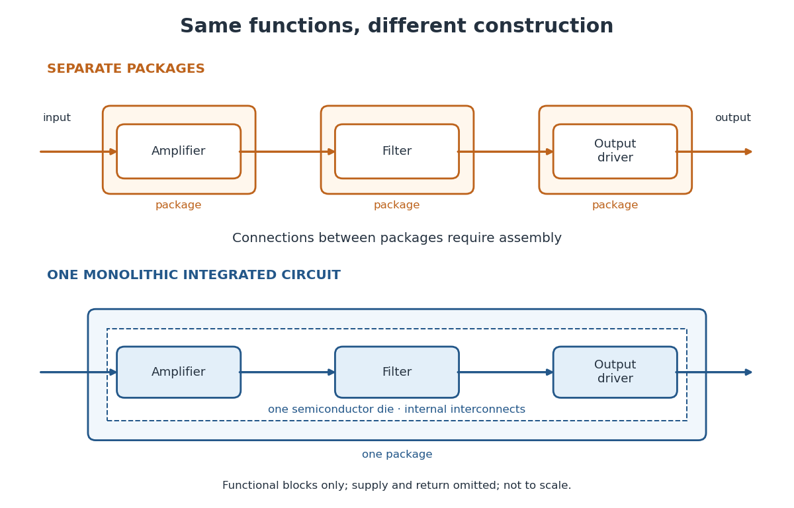

# Integrated circuit

↑ **Parent:** [Electrical circuit](electrical-circuit-split.md)  
ⓦ [Wiki](https://en.wikipedia.org/wiki/Integrated_circuit)

An [integrated circuit](integrated-circuit.md) combines interconnected [electrical circuit](electrical-circuit-split.md) elements in a fabricated structure. A [monolithic integrated circuit](monolithic-integrated-circuit.md) forms its elements in or on one piece of [semiconductor](semiconductor-split.md), rather than merely putting separately manufactured components into one enclosure. [Transistors](transistor.md) supply control in [electronic amplifiers](electronic-amplifier.md); [resistors](resistor.md) and [capacitors](capacitor.md) can supply bias and timing. [Jack St. Clair Kilby](jack-st-clair-kilby.md)'s patent describes making such functions from a common [semiconductor](semiconductor-split.md) body with compatible fabrication steps.[Description, opening statement of the invention and discussion preceding Figs. 1–5a](miniaturized-electronic-circuits-by-jack-st-clair-kilby.md)

The useful change is to fabricate connections and functions together. Shrinking an enclosure still leaves individual parts to position and join. Integration makes their relative arrangement part of a repeatable fabrication pattern. The distinction is functional as well as geometric: one small piece can implement a whole [electrical circuit](electrical-circuit-split.md), while its external terminals expose only the connections needed by its surroundings.

**[Figure 16](#image-the-same-functions-in-separate-packages-and-in-a-monolithic-integrated-circuit). The same functions in separate packages and in a monolithic integrated circuit**. Original conceptual comparison: three functions and the same [signal](signal.md) direction, with package boundaries changed. Boxes denote functions, not individual components or a wiring diagram. Internal lines in the lower panel represent [integrated circuit interconnects](integrated-circuit-interconnect.md). Supply and return connections are omitted. This is not a drawing of a historical chip or a scale comparison.

**Table of contents**

- [Discrete circuit](discrete-circuit.md)
- [Monolithic integrated circuit](monolithic-integrated-circuit.md)
- [Kilby integrated circuit demonstration](kilby-integrated-circuit-demonstration.md)
- [Planar process](planar-process.md)
- [Integrated circuit interconnect](integrated-circuit-interconnect.md)
- [Semiconductor wafer](semiconductor-wafer.md)
  - [Semiconductor die](semiconductor-die.md)
- [Poisson defect yield](poisson-defect-yield.md)
  - [Integrated circuit cost per good die](integrated-circuit-cost-per-good-die.md)

## ↑ Ancestors (5)

1. [Electrical circuit](electrical-circuit-split.md)
2. [Electromagnetism](electromagnetism-split.md)
3. [Branches of physics](branches-of-physics.md)
4. [Physics](physics-split.md)
5. [Codex Wiki](split.md)

## ← Incoming links (6)

- [CMOS](cmos.md)
- [Integrated circuit](integrated-circuit.md)
- [Jack St. Clair Kilby](jack-st-clair-kilby.md)
- [Nobel Prize in Physics in 2000](nobel-prize-in-physics-in-2000.md)
- [Semiconductor die](semiconductor-die.md)
- [Semiconductor wafer](semiconductor-wafer.md)
