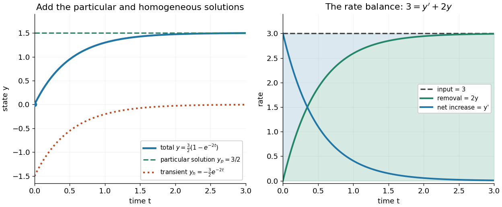
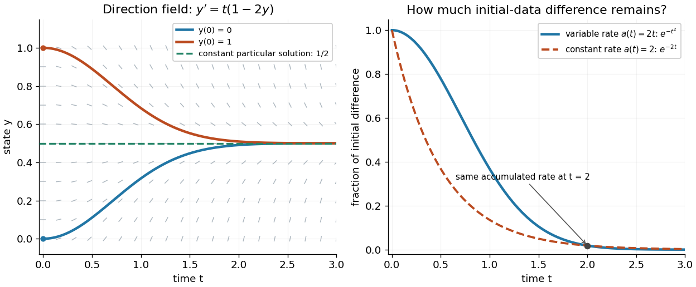

# Integrating factor

↑ **Parent:** [Linear ordinary differential equation](linear-ordinary-differential-equation-split.md)  
ⓦ [Wiki](https://en.wikipedia.org/wiki/Integrating_factor)

An [integrating factor](integrating-factor.md) is a nonzero multiplier that makes a [differential equation](differential-equation-split.md) directly integrable. For a [first-order linear differential equation](first-order-linear-differential-equation.md), it gathers the unknown [function](function-split.md) and its [derivative](derivative.md) into one [product rule](product-rule.md) expression. Suppose $a$ and $b$ are [continuous functions](continuous-function.md) on an [interval](interval-mathematics.md) containing $t_0$, and consider the [initial value problem](initial-value-problem.md)

$$
y'+a(t)y=b(t),\qquad y(t_0)=y_0.
$$

Define $A(t)=\int_{t_0}^t a(s)\,ds$ and $\mu(t)=e^{A(t)}$. The exact [solution of a differential equation](solution-of-a-differential-equation.md) throughout that [interval](interval-mathematics.md) is

$$
y(t)=e^{-A(t)}\left[y_0+\int_{t_0}^t e^{A(s)}b(s)\,ds\right].
$$

The [definite integral](definite-integral.md) fixes $\mu(t_0)=1$, so the [initial condition](initial-condition.md) appears without an extra constant to determine. If the equation originally has a coefficient multiplying $y'$, first divide by that coefficient on an [interval](interval-mathematics.md) where it is nonzero; a zero of that coefficient needs separate attention. See [OpenStax's first-order linear equations chapter](https://openstax.org/books/calculus-volume-2/pages/4-5-first-order-linear-equations) for this normalization and the [integrating factor](integrating-factor.md) procedure.

For a concrete balance, solve $y'+2y=3$ with $y(0)=0$. Here $\mu=e^{2t}$, so multiplying the entire [ordinary differential equation](ordinary-differential-equation.md) gives $(e^{2t}y)'=3e^{2t}$. Accumulating from zero to $t$ gives

$$
e^{2t}y(t)=\int_0^t3e^{2s}\,ds=\frac32(e^{2t}-1),\qquad y(t)=\frac32(1-e^{-2t}).
$$

The computed values are $y(0.5)\approx0.94818$, $y(1)\approx1.29700$ and $y(2)\approx1.47253$. Its [derivative](derivative.md) is $3e^{-2t}$, which verifies $y'+2y=3$ exactly. Interpreting $3$ as a steady input and $2y$ as proportional removal explains the shape: initially all input increases $y$, then removal catches up. The constant [particular solution](particular-solution.md) $y_p=3/2$ balances input and removal, and the [homogeneous solution](homogeneous-solution.md) $y_h=-\frac32e^{-2t}$ is the [transient response](transient-response.md) that corrects it to the [initial condition](initial-condition.md). Because this [autonomous differential equation](autonomous-system-mathematics.md) has a time-independent right-hand side, $3/2$ is also an [equilibrium point](equilibrium-point-of-a-dynamical-system.md).

**[Figure 3](#image-a-steady-input-becomes-a-constant-particular-solution-plus-a-decaying-transient). A steady input becomes a constant particular solution plus a decaying transient**.

The first panel adds the [particular solution](particular-solution.md) and [homogeneous solution](homogeneous-solution.md); the second shows the same balance in rates, $3=y'+2y$. This links the algebra to a physical accounting rule. [Newton's law of cooling](newton-s-law-of-cooling.md) has this form with $a=k$ and $b=kT_a$, while an [electrical circuit](electrical-circuit-split.md) can have a varying input. In both cases the [integrating factor](integrating-factor.md) systematically handles the input rather than requiring a guess for a [particular solution](particular-solution.md).

Variable coefficients work just as directly. For $y'+2ty=t$, $y(0)=0$, the [integrating factor](integrating-factor.md) is $e^{t^2}$, and

$$
(e^{t^2}y)'=te^{t^2},\qquad e^{t^2}y(t)=\frac12(e^{t^2}-1),\qquad y(t)=\frac12(1-e^{-t^2}).
$$

Thus $y(0.5)\approx0.11060$, $y(1)\approx0.31606$ and $y(2)\approx0.49084$. The [derivative](derivative.md) $y'=te^{-t^2}$ verifies $y'+2ty=t$, including at zero, where both coefficient and input vanish. No division by $t$ is necessary. The [general solution](general-solution.md) is $y=1/2+Ce^{-t^2}$: $1/2$ is a constant [particular solution](particular-solution.md), and $Ce^{-t^2}$ solves the associated [homogeneous linear differential equation](homogeneous-linear-differential-equation.md). Although this special [forcing term](forcing-term.md) admits a constant trajectory, this is a [nonautonomous differential equation](nonautonomous-differential-equation.md): it depends explicitly on time. Merely setting its right-hand side to zero at one instant would not establish a constant [solution of a differential equation](solution-of-a-differential-equation.md); at $t=0$ every state has zero slope.

**[Figure 4](#image-variable-rate-trajectories-share-a-constant-particular-solution-and-forget-initial-data-by-a-factor-of-exp-minus-t-squared). Variable-rate trajectories share a constant particular solution and forget initial data by a factor of exp minus t squared**.

The [direction field](direction-field.md) shows the selected trajectory leaving its initially horizontal [tangent line](tangent-line.md). For $t\geq0$, the difference between any two [solutions of a differential equation](solution-of-a-differential-equation.md) is multiplied by $e^{-t^2}$, rather than $e^{-2t}$ in the constant-rate example. This dependence on elapsed history is clearer if the exact formula is rewritten as

$$
y(t)=y_0e^{-\int_{t_0}^t a(u)\,du}+\int_{t_0}^t e^{-\int_s^t a(u)\,du}b(s)\,ds.
$$

For $t\geq t_0$, each contribution from the input at $s$ is weighted by the accumulated coefficient between $s$ and $t$. The [homogeneous solution](homogeneous-solution.md) remembers the [initial condition](initial-condition.md); the [particular solution](particular-solution.md) given by the second term accumulates the [forcing term](forcing-term.md) with zero initial value. This decomposition differs from choosing a constant [particular solution](particular-solution.md), but gives the same total. Initial-data memory tends to zero when $\int_{t_0}^t a\to+\infty$; a negative accumulated coefficient instead amplifies it. The reciprocal relation between [integrating factor](integrating-factor.md) and [homogeneous solution](homogeneous-solution.md) is developed in [MIT's notes on solutions to linear first-order equations](https://ocw.mit.edu/courses/18-03sc-differential-equations-fall-2011/539a2280949de0de6ec2d420067af6b2_MIT18_03SCF11_s5_1text.pdf).

Why does the trick work? The [fundamental theorem of calculus](fundamental-theorem-of-calculus.md) and [chain rule](chain-rule.md) give $\mu'=a\mu$. Consequently the [product rule](product-rule.md) gives

$$
(\mu y)'=\mu y'+\mu'y=\mu(y'+ay)=\mu b.
$$

Integrating this identity and dividing by the positive [exponential function](exponential-function.md) $\mu$ produces the stated formula. Any nonzero constant multiple of $\mu$ works equally well; normalization is a convenience. This is the beauty of the method: a sum involving an unknown [function](function-split.md) becomes one exact [derivative](derivative.md), leaving only an [integral](integral-split.md) of known functions. See [Oregon State's product-rule derivation](https://sites.science.oregonstate.edu/math/home/programs/undergrad/CalculusQuestStudyGuides/ode/first/linear/linear.html). The related [integrating factor for a differential one-form](integrating-factor-for-a-differential-one-form.md) extends the idea of making an expression exact beyond this linear setting.

**Table of contents**

- [Heaviside forcing in a first-order integrating-factor equation](heaviside-forcing-in-a-first-order-integrating-factor-equation.md)
- [Integrating factor for a differential one-form](integrating-factor-for-a-differential-one-form.md)
  - [Integrating factor depending on one coordinate](integrating-factor-depending-on-one-coordinate.md)
  - [Monomial integrating factor](monomial-integrating-factor.md)
- [Bounded solution selected by a terminal condition](bounded-solution-selected-by-a-terminal-condition.md)

## ↑ Ancestors (7)

1. [Linear ordinary differential equation](linear-ordinary-differential-equation-split.md)
2. [Ordinary differential equation](ordinary-differential-equation.md)
3. [Differential equation](differential-equation-split.md)
4. [Analysis](analysis-split.md)
5. [Area of mathematics](area-of-mathematics.md)
6. [Mathematics](mathematics-split.md)
7. [Codex Wiki](split.md)

## ← Incoming links (150)

- [Abel's identity](abel-s-identity.md)
- [Attenuated Radon transform](attenuated-radon-transform.md)
- [Bernoulli differential equation](bernoulli-differential-equation.md)
- [Bernoulli power substitution](bernoulli-power-substitution.md)
- [Commutator of an operator with an exponential](commutator-of-an-operator-with-an-exponential.md)
- [Consecutive first-order reaction mechanism](consecutive-first-order-reaction-mechanism.md)
- [Corotational Jeffreys fluid](corotational-jeffreys-fluid.md)
- [Discrete integrating factor](discrete-integrating-factor.md)
- [Drude current relaxation](drude-current-relaxation.md)
- [Exponential forcing response with zero initial data](exponential-forcing-response-with-zero-initial-data.md)
- [Exponential memory from tensor relaxation](exponential-memory-from-tensor-relaxation.md)
- [Hasselmann stochastic climate model](hasselmann-stochastic-climate-model.md)
- [Heaviside forcing in a first-order integrating-factor equation](heaviside-forcing-in-a-first-order-integrating-factor-equation.md)
- [Implicit factorization can reveal nonunique initial solutions](implicit-factorization-can-reveal-nonunique-initial-solutions.md)
- [Integrating factor](integrating-factor.md)
- [Integrating factor depending on one coordinate](integrating-factor-depending-on-one-coordinate.md)
- [Integrating-factor equation for a planar vector field](integrating-factor-equation-for-a-planar-vector-field.md)
- [Inverse-function linearization of a first-order equation](inverse-function-linearization-of-a-first-order-equation.md)
- [Monomial integrating factor](monomial-integrating-factor.md)
- [Monotone Jeans growth with positive cosmological constant](monotone-jeans-growth-with-positive-cosmological-constant.md)
- [Ornstein-Uhlenbeck transition distribution](ornstein-uhlenbeck-transition-distribution.md)
- [Solution](past-exam-of-the-mathematical-and-computational-biology-course-of-the-university-of-cambridge/2025/paper-2/5/d/solution.md)
- [Solution](past-exam-of-the-mathematics-course-of-the-university-of-cambridge/2001/ia/paper-2/1b/solution.md)
- [Solution](past-exam-of-the-mathematics-course-of-the-university-of-cambridge/2001/ia/paper-2/6b/solution.md)
- [Solution](past-exam-of-the-mathematics-course-of-the-university-of-cambridge/2001/ia/paper-2/7b/solution.md)
- [Solution](past-exam-of-the-mathematics-course-of-the-university-of-cambridge/2001/iii/paper-40/1/ii/solution.md)
- [Solution](past-exam-of-the-mathematics-course-of-the-university-of-cambridge/2001/iii/paper-49/3/a/solution.md)
- [Solution](past-exam-of-the-mathematics-course-of-the-university-of-cambridge/2002/iii/paper-49/3/solution.md)
- [Solution](past-exam-of-the-mathematics-course-of-the-university-of-cambridge/2002/iii/paper-53/3/a/solution.md)
- [Solution](past-exam-of-the-mathematics-course-of-the-university-of-cambridge/2003/ia/paper-2/5d/a/solution.md)
- [Solution](past-exam-of-the-mathematics-course-of-the-university-of-cambridge/2004/iii/paper-78/3/solution.md)
- [Solution](past-exam-of-the-mathematics-course-of-the-university-of-cambridge/2005/ia/paper-2/1b/solution.md)
- [Solution](past-exam-of-the-mathematics-course-of-the-university-of-cambridge/2005/ia/paper-2/8b/solution.md)
- [Solution](past-exam-of-the-mathematics-course-of-the-university-of-cambridge/2005/ib/paper-1/5e/b/solution.md)
- [Solution](past-exam-of-the-mathematics-course-of-the-university-of-cambridge/2005/iii/paper-48/1/solution.md)
- [Solution](past-exam-of-the-mathematics-course-of-the-university-of-cambridge/2005/iii/paper-67/2/f/solution.md)
- [Solution](past-exam-of-the-mathematics-course-of-the-university-of-cambridge/2005/iii/paper-78/4/solution.md)
- [Solution](past-exam-of-the-mathematics-course-of-the-university-of-cambridge/2005/iii/paper-79/5/b/solution.md)
- [Solution](past-exam-of-the-mathematics-course-of-the-university-of-cambridge/2006/iii/paper-35/4/b/solution.md)
- [Solution](past-exam-of-the-mathematics-course-of-the-university-of-cambridge/2006/iii/paper-69/3/a/solution.md)
- [Solution](past-exam-of-the-mathematics-course-of-the-university-of-cambridge/2006/iii/paper-76/5/solution.md)
- [Solution](past-exam-of-the-mathematics-course-of-the-university-of-cambridge/2007/ia/paper-2/7b/i/solution.md)
- [Solution](past-exam-of-the-mathematics-course-of-the-university-of-cambridge/2007/ia/paper-3/9a/i/solution.md)
- [Solution](past-exam-of-the-mathematics-course-of-the-university-of-cambridge/2007/iii/paper-64/3/ii/solution.md)
- [Solution](past-exam-of-the-mathematics-course-of-the-university-of-cambridge/2007/iii/paper-76/4/b/solution.md)
- [Solution](past-exam-of-the-mathematics-course-of-the-university-of-cambridge/2007/iii/paper-86/3/b/solution.md)
- [Solution](past-exam-of-the-mathematics-course-of-the-university-of-cambridge/2008/ia/paper-2/5a/iii/solution.md)
- [Solution](past-exam-of-the-mathematics-course-of-the-university-of-cambridge/2008/iii/paper-82/3/solution.md)
- [Solution](past-exam-of-the-mathematics-course-of-the-university-of-cambridge/2009/ia/paper-2/5c/solution.md)
- [Solution](past-exam-of-the-mathematics-course-of-the-university-of-cambridge/2010/ia/paper-2/7a/b/solution.md)
- [Solution](past-exam-of-the-mathematics-course-of-the-university-of-cambridge/2010/iii/paper-54/2/e/solution.md)
- [Solution](past-exam-of-the-mathematics-course-of-the-university-of-cambridge/2012/ia/paper-3/3c/solution.md)
- [Solution](past-exam-of-the-mathematics-course-of-the-university-of-cambridge/2012/iii/paper-7/4/solution.md)
- [Solution](past-exam-of-the-mathematics-course-of-the-university-of-cambridge/2013/ia/paper-2/7a/solution.md)
- [Solution](past-exam-of-the-mathematics-course-of-the-university-of-cambridge/2013/iii/paper-67/3/iii/solution.md)
- [Solution](past-exam-of-the-mathematics-course-of-the-university-of-cambridge/2014/ia/paper-2/5b/solution.md)
- [Solution](past-exam-of-the-mathematics-course-of-the-university-of-cambridge/2014/iii/paper-69/2/iii/solution.md)
- [Solution](past-exam-of-the-mathematics-course-of-the-university-of-cambridge/2015/ia/paper-2/1b/solution.md)
- [Solution](past-exam-of-the-mathematics-course-of-the-university-of-cambridge/2015/ia/paper-2/5b/solution.md)
- [Solution](past-exam-of-the-mathematics-course-of-the-university-of-cambridge/2015/iii/paper-70/1/b/solution.md)
- [Solution](past-exam-of-the-mathematics-course-of-the-university-of-cambridge/2017/ia/paper-4/4a/solution.md)
- [Solution](past-exam-of-the-mathematics-course-of-the-university-of-cambridge/2017/iii/paper-328/2/solution.md)
- [Solution](past-exam-of-the-mathematics-course-of-the-university-of-cambridge/2017/iii/paper-329/2/c/solution.md)
- [Solution](past-exam-of-the-mathematics-course-of-the-university-of-cambridge/2017/iii/paper-336/3/solution.md)
- [Solution](past-exam-of-the-mathematics-course-of-the-university-of-cambridge/2018/iii/paper-336/2/ii/solution.md)
- [Solution](past-exam-of-the-mathematics-course-of-the-university-of-cambridge/2019/iii/paper-349/2/solution.md)
- [Solution](past-exam-of-the-mathematics-course-of-the-university-of-cambridge/2020/ia/paper-1/2a/solution.md)
- [Solution](past-exam-of-the-mathematics-course-of-the-university-of-cambridge/2020/ia/paper-1/8a/solution.md)
- [Solution](past-exam-of-the-mathematics-course-of-the-university-of-cambridge/2021/ib/paper-2/3c/i/solution.md)
- [Solution](past-exam-of-the-mathematics-course-of-the-university-of-cambridge/2021/ib/paper-4/12b/solution.md)
- [Solution](past-exam-of-the-mathematics-course-of-the-university-of-cambridge/2021/ib/paper-4/16a/c/solution.md)
- [Solution](past-exam-of-the-mathematics-course-of-the-university-of-cambridge/2021/iii/paper-349/3/solution.md)
- [Solution](past-exam-of-the-mathematics-course-of-the-university-of-cambridge/2022/ii/paper-3/39c/b/iii/solution.md)
- [Solution](past-exam-of-the-mathematics-course-of-the-university-of-cambridge/2022/iii/paper-312/3/b/i/solution.md)
- [Solution](past-exam-of-the-mathematics-course-of-the-university-of-cambridge/2023/ia/paper-2/5a/a/solution.md)
- [Solution](past-exam-of-the-mathematics-course-of-the-university-of-cambridge/2023/ib/paper-4/12b/c/solution.md)
- [Solution](past-exam-of-the-mathematics-course-of-the-university-of-cambridge/2023/iii/paper-314/2/b/solution.md)
- [Solution](past-exam-of-the-mathematics-course-of-the-university-of-cambridge/2023/iii/paper-329/2/d/solution.md)
- [Solution](past-exam-of-the-mathematics-course-of-the-university-of-cambridge/2023/iii/paper-349/1/solution.md)
- [Solution](past-exam-of-the-mathematics-course-of-the-university-of-cambridge/2024/iii/paper-321/1/c/ii/solution.md)
- [Solution](past-exam-of-the-mathematics-course-of-the-university-of-cambridge/2024/iii/paper-349/1/solution.md)
- [Solution](past-exam-of-the-mathematics-course-of-the-university-of-cambridge/2024/iii/paper-356/1/e/solution.md)
- [Solution](past-exam-of-the-mathematics-course-of-the-university-of-cambridge/2025/ia/paper-2/1c/solution.md)
- [Solution](past-exam-of-the-mathematics-course-of-the-university-of-cambridge/2025/iii/paper-329/2/a/solution.md)
- [Solution](past-exam-of-the-mathematics-course-of-the-university-of-cambridge/2026/iii/paper-207/2/d/iii/solution.md)
- [Solution](past-exam-of-the-mathematics-course-of-the-year-1-of-the-natural-sciences-course-of-the-university-of-cambridge/2002/paper-1/7/a/ii/solution.md)
- [Solution](past-exam-of-the-mathematics-course-of-the-year-1-of-the-natural-sciences-course-of-the-university-of-cambridge/2003/paper-1/11/a/ii/solution.md)
- [Solution](past-exam-of-the-mathematics-course-of-the-year-1-of-the-natural-sciences-course-of-the-university-of-cambridge/2004/paper-1/11/c/solution.md)
- [Solution](past-exam-of-the-mathematics-course-of-the-year-1-of-the-natural-sciences-course-of-the-university-of-cambridge/2005/paper-1/10/a/solution.md)
- [Solution](past-exam-of-the-mathematics-course-of-the-year-1-of-the-natural-sciences-course-of-the-university-of-cambridge/2005/paper-1/9/b/solution.md)
- [Solution](past-exam-of-the-mathematics-course-of-the-year-1-of-the-natural-sciences-course-of-the-university-of-cambridge/2007/paper-1/section-b/5/b/solution.md)
- [Solution](past-exam-of-the-mathematics-course-of-the-year-1-of-the-natural-sciences-course-of-the-university-of-cambridge/2008/paper-1/16/b/i/solution.md)
- [Solution](past-exam-of-the-mathematics-course-of-the-year-1-of-the-natural-sciences-course-of-the-university-of-cambridge/2008/paper-1/16/b/ii/solution.md)
- [Solution](past-exam-of-the-mathematics-course-of-the-year-1-of-the-natural-sciences-course-of-the-university-of-cambridge/2011/paper-1/16/b/solution.md)
- [Solution](past-exam-of-the-mathematics-course-of-the-year-1-of-the-natural-sciences-course-of-the-university-of-cambridge/2011/paper-2/15/a/solution.md)
- [Solution](past-exam-of-the-mathematics-course-of-the-year-1-of-the-natural-sciences-course-of-the-university-of-cambridge/2012/paper-1/13/c/solution.md)
- [Solution](past-exam-of-the-mathematics-course-of-the-year-1-of-the-natural-sciences-course-of-the-university-of-cambridge/2013/paper-1/13/a/solution.md)
- [Solution](past-exam-of-the-mathematics-course-of-the-year-1-of-the-natural-sciences-course-of-the-university-of-cambridge/2013/paper-1/13/b/solution.md)
- [Solution](past-exam-of-the-mathematics-course-of-the-year-1-of-the-natural-sciences-course-of-the-university-of-cambridge/2013/paper-1/13/c/solution.md)
- [Solution](past-exam-of-the-mathematics-course-of-the-year-1-of-the-natural-sciences-course-of-the-university-of-cambridge/2013/paper-2/20/c/solution.md)
- [Solution](past-exam-of-the-mathematics-course-of-the-year-1-of-the-natural-sciences-course-of-the-university-of-cambridge/2014/paper-1/13/a/i/solution.md)
- [Solution](past-exam-of-the-mathematics-course-of-the-year-1-of-the-natural-sciences-course-of-the-university-of-cambridge/2014/paper-1/13/a/ii/solution.md)
- [Solution](past-exam-of-the-mathematics-course-of-the-year-1-of-the-natural-sciences-course-of-the-university-of-cambridge/2014/paper-2/14/c/solution.md)
- [Solution](past-exam-of-the-mathematics-course-of-the-year-1-of-the-natural-sciences-course-of-the-university-of-cambridge/2015/paper-2/16/a/i/solution.md)
- [Solution](past-exam-of-the-mathematics-course-of-the-year-1-of-the-natural-sciences-course-of-the-university-of-cambridge/2015/paper-2/16/a/ii/solution.md)
- [Solution](past-exam-of-the-mathematics-course-of-the-year-1-of-the-natural-sciences-course-of-the-university-of-cambridge/2015/paper-2/7/solution.md)
- [Solution](past-exam-of-the-mathematics-course-of-the-year-1-of-the-natural-sciences-course-of-the-university-of-cambridge/2016/paper-2/14/a/solution.md)
- [Solution](past-exam-of-the-mathematics-course-of-the-year-1-of-the-natural-sciences-course-of-the-university-of-cambridge/2017/paper-1/13/b/solution.md)
- [Solution](past-exam-of-the-mathematics-course-of-the-year-1-of-the-natural-sciences-course-of-the-university-of-cambridge/2017/paper-1/13/c/solution.md)
- [Solution](past-exam-of-the-mathematics-course-of-the-year-1-of-the-natural-sciences-course-of-the-university-of-cambridge/2017/paper-1/20/a/solution.md)
- [Solution](past-exam-of-the-mathematics-course-of-the-year-1-of-the-natural-sciences-course-of-the-university-of-cambridge/2017/paper-2/15/a/i/solution.md)
- [Solution](past-exam-of-the-mathematics-course-of-the-year-1-of-the-natural-sciences-course-of-the-university-of-cambridge/2017/paper-2/15/a/ii/solution.md)
- [Solution](past-exam-of-the-mathematics-course-of-the-year-1-of-the-natural-sciences-course-of-the-university-of-cambridge/2017/paper-2/20/a/ii/solution.md)
- [Solution](past-exam-of-the-mathematics-course-of-the-year-1-of-the-natural-sciences-course-of-the-university-of-cambridge/2018/paper-1/13/a/solution.md)
- [Solution](past-exam-of-the-mathematics-course-of-the-year-1-of-the-natural-sciences-course-of-the-university-of-cambridge/2018/paper-1/13/b/solution.md)
- [Solution](past-exam-of-the-mathematics-course-of-the-year-1-of-the-natural-sciences-course-of-the-university-of-cambridge/2018/paper-2/7/a/solution.md)
- [Solution](past-exam-of-the-mathematics-course-of-the-year-1-of-the-natural-sciences-course-of-the-university-of-cambridge/2019/paper-1/13/b/i/solution.md)
- [Solution](past-exam-of-the-mathematics-course-of-the-year-1-of-the-natural-sciences-course-of-the-university-of-cambridge/2019/paper-1/13/b/ii/solution.md)
- [Solution](past-exam-of-the-mathematics-course-of-the-year-1-of-the-natural-sciences-course-of-the-university-of-cambridge/2019/paper-2/3/solution.md)
- [Solution](past-exam-of-the-mathematics-course-of-the-year-1-of-the-natural-sciences-course-of-the-university-of-cambridge/2020/paper-1/13/a/i/solution.md)
- [Solution](past-exam-of-the-mathematics-course-of-the-year-1-of-the-natural-sciences-course-of-the-university-of-cambridge/2020/paper-1/13/a/ii/solution.md)
- [Solution](past-exam-of-the-mathematics-course-of-the-year-1-of-the-natural-sciences-course-of-the-university-of-cambridge/2021/paper-2/15/c/i/solution.md)
- [Solution](past-exam-of-the-mathematics-course-of-the-year-1-of-the-natural-sciences-course-of-the-university-of-cambridge/2021/paper-2/3/solution.md)
- [Solution](past-exam-of-the-mathematics-course-of-the-year-1-of-the-natural-sciences-course-of-the-university-of-cambridge/2022/paper-1/13/a/solution.md)
- [Solution](past-exam-of-the-mathematics-course-of-the-year-1-of-the-natural-sciences-course-of-the-university-of-cambridge/2022/paper-1/13/b/solution.md)
- [Solution](past-exam-of-the-mathematics-course-of-the-year-1-of-the-natural-sciences-course-of-the-university-of-cambridge/2022/paper-2/15/a/solution.md)
- [Solution](past-exam-of-the-mathematics-course-of-the-year-1-of-the-natural-sciences-course-of-the-university-of-cambridge/2023/paper-1/13/b/solution.md)
- [Solution](past-exam-of-the-mathematics-course-of-the-year-1-of-the-natural-sciences-course-of-the-university-of-cambridge/2024/paper-1/13/b/i/solution.md)
- [Solution](past-exam-of-the-mathematics-course-of-the-year-1-of-the-natural-sciences-course-of-the-university-of-cambridge/2024/paper-1/13/b/ii/solution.md)
- [Solution](past-exam-of-the-mathematics-course-of-the-year-2-of-the-natural-sciences-course-of-the-university-of-cambridge/2002/paper-1/7/a/solution.md)
- [Solution](past-exam-of-the-mathematics-course-of-the-year-2-of-the-natural-sciences-course-of-the-university-of-cambridge/2009/paper-1/8/a/solution.md)
- [Solution](past-exam-of-the-mathematics-course-of-the-year-2-of-the-natural-sciences-course-of-the-university-of-cambridge/2020/paper-1/6/a/ii/solution.md)
- [Solution](past-exam-of-the-mathematics-course-of-the-year-2-of-the-natural-sciences-course-of-the-university-of-cambridge/2021/paper-1/10/a/solution.md)
- [Solution](past-exam-of-the-mathematics-course-of-the-year-2-of-the-natural-sciences-course-of-the-university-of-cambridge/2021/paper-1/10/c/solution.md)
- [Solution](past-exam-of-the-mphil-in-nuclear-energy-course-of-the-university-of-cambridge/2019/paper-ne1/4/b/ii/solution.md)
- [Solution](past-exam-of-the-mphil-in-nuclear-energy-course-of-the-university-of-cambridge/2021/paper-ne1/4/c/solution.md)
- [Solution](past-exam-of-the-particle-astrophysics-course-of-the-university-of-cambridge/2012/paper-1/1/solution.md)
- [Solution](past-exam-of-the-physics-course-of-the-year-1-of-the-natural-sciences-course-of-the-university-of-cambridge/2022/section-b/7/c/solution.md)
- [Solution](past-exam-of-the-soft-condensed-matter-course-of-the-university-of-cambridge/2022/section-b/5/b/solution.md)
- [Solution](past-exam-of-the-soft-condensed-matter-course-of-the-university-of-cambridge/2022/section-b/5/f/solution.md)
- [Solution](past-exam-of-the-theoretical-physics-ii-course-of-the-university-of-cambridge/2012/paper-1/1/e/solution.md)
- [Projectile motion with linear drag](projectile-motion-with-linear-drag.md)
- [Projection formula for inverse attenuated Radon transform](projection-formula-for-inverse-attenuated-radon-transform.md)
- [Quadratic gas-history enrichment model](quadratic-gas-history-enrichment-model.md)
- [Quadratic profiles for nonlinear diffusion with constant loss](quadratic-profiles-for-nonlinear-diffusion-with-constant-loss.md)
- [Reciprocal Bernoulli equation with finite-time blowup](reciprocal-bernoulli-equation-with-finite-time-blowup.md)
- [Scalar integrating factor for a reaction-diffusion equation](scalar-integrating-factor-for-a-reaction-diffusion-equation.md)
- [Spectral reconstruction of an attenuated Radon transform](spectral-reconstruction-of-an-attenuated-radon-transform.md)
- [Sturm-Liouville formulation with Bessel order as eigenvalue](sturm-liouville-formulation-with-bessel-order-as-eigenvalue.md)
- [Surface-fed growth of an accreting sphere](surface-fed-growth-of-an-accreting-sphere.md)
