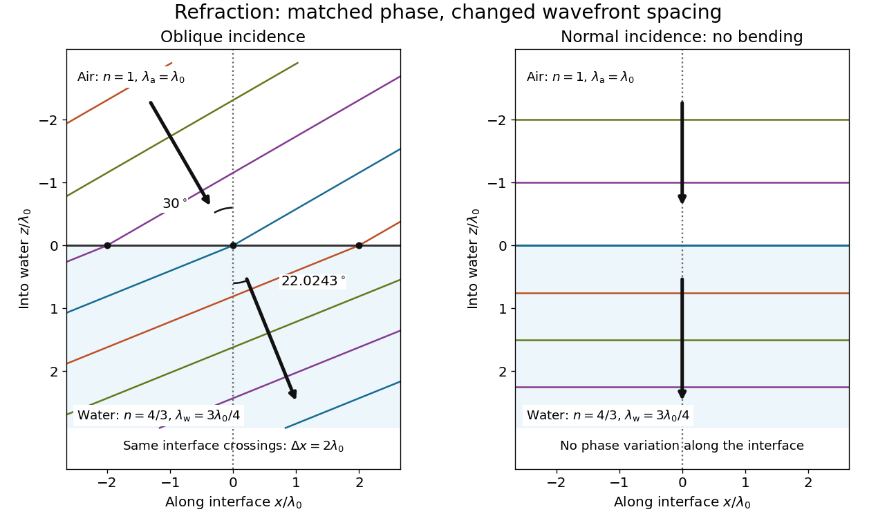

# Interface phase matching

↑ **Parent:** [Refraction](refraction.md)

At a stationary, uniform planar boundary, incident and transmitted [plane waves](plane-wave.md) have the same variation of [wave phase](phase-waves.md) along the interface and in [time](time-in-physics.md). The figure marks places where equal-[wave phase](phase-waves.md) [wavefronts](wavefront.md) meet the boundary. Although their perpendicular spacing differs, their intersections must advance along the boundary together. This is the local mechanism behind [Snell's law](snell-s-law.md).[equations 946–950: common angular frequency and matching tangential wavevector components](electromagnetism-lecture-notes-by-richard-fitzpatrick/laws-of-geometric-optics.md)

**[Figure 7](#image-wavefront-spacing-changes-while-interface-wave-phase-matches). Wavefront spacing changes while interface wave phase matches**. Original [plane wave](plane-wave.md) construction for $n_{\mathrm a}=1$, $n_{\mathrm w}=4/3$ and air incidence $30^\circ$. Both panels have equal horizontal and vertical coordinate scales in units of [vacuum](vacuum.md) [wavelength](wavelength.md) $\lambda_0$. Coloured lines join at identical interface crossings; arrows show propagation perpendicular to each [wavefront](wavefront.md). The reflected branch is omitted. At [normal incidence](normal-incidence.md), the [wavefronts](wavefront.md) stay parallel to the boundary and only their spacing changes.

For a short derivation, let $x$ run along the interface and $z$ increase into the transmitted medium. Write each [wave phase](phase-waves.md) as $\Phi_j=k_{j,x}x+k_{j,z}z-\omega_jt+\phi_j$. The electromagnetic [boundary conditions](boundary-condition.md) must hold at every $x,t$ on $z=0$; their matching requires $\omega_i=\omega_t$ and $k_{i,x}=k_{t,x}$. Constant offsets $\phi_j$ and [wave amplitudes](wave-amplitude.md) are determined separately. Since $k_{j,x}=k_j\sin\theta_j$, this gives

$$
\frac{n_i\omega}{c}\sin\theta_i=\frac{n_t\omega}{c}\sin\theta_t.
$$

For nonzero tangential [wavenumber](wavenumber.md), the spacing of equal-[wave phase](phase-waves.md) intersections along the interface is $\lambda_i/\sin\theta_i=\lambda_t/\sin\theta_t$. It is not the perpendicular [wavelength](wavelength.md). At [normal incidence](normal-incidence.md), the tangential [wavenumber](wavenumber.md) vanishes and the interface is uniform in [wave phase](phase-waves.md).[equations 951–955: $k=n\omega/c$ and Snell's law](electromagnetism-lecture-notes-by-richard-fitzpatrick/laws-of-geometric-optics.md)

## ↑ Ancestors (5)

1. [Refraction](refraction.md)
2. [Optics](optics-split.md)
3. [Branches of physics](branches-of-physics.md)
4. [Physics](physics-split.md)
5. [Codex Wiki](split.md)
