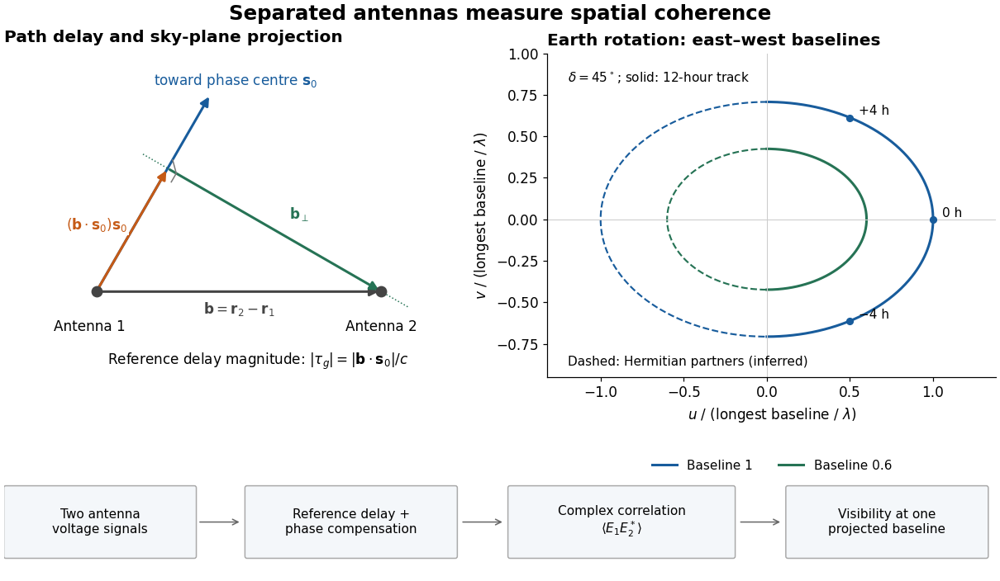

# Interferometric baseline

↑ **Parent:** [Radio interferometry](radio-interferometry.md)

An interferometric baseline is the displacement $\mathbf b=\mathbf r_2-\mathbf r_1$ between two [antennas](antenna-radio.md). For a unit [line of sight](line-of-sight.md) $\mathbf s_0$ toward the [phase centre](phase-centre.md), its projection onto the [plane of the sky](plane-of-the-sky.md) is

$$
\mathbf b_\perp=\mathbf b-(\mathbf b\cdot\mathbf s_0)\mathbf s_0,\qquad
|\tau_g|=\frac{|\mathbf b\cdot\mathbf s_0|}{c}.
$$

Here $c$ is the [speed of light](speed-of-light.md). The signed delay depends on which receiver is delayed; the geometric path difference's magnitude does not. If $\mathbf e_\theta$ is a unit tangent in the direction being imaged, the dimensionless coordinate $u=\mathbf b\cdot\mathbf e_\theta/\lambda$ is a [spatial frequency](spatial-frequency.md), measured in cycles per [radian](radian.md) of small sky offset. A single pair gives fringes of angular period $1/|u|$ along that tangent. This period specifies one measured oscillation; it does not specify a whole image's [angular resolution](angular-resolution.md) or eliminate ambiguous source arrangements.

**[Figure 17](#image-geometric-delay-projected-baseline-and-a-schematic-earth-rotation-track-original-geometry-not-telescope-data). Geometric delay, projected baseline, and a schematic Earth-rotation track; original geometry, not telescope data**.

The left panel separates the component producing the reference delay from the component measuring angular structure. The right panel shows a possible [Earth-rotation aperture synthesis](earth-rotation-aperture-synthesis.md) track, with its opposite [complex conjugate](complex-conjugate.md) track. Those opposite samples provide the symmetry required by a real brightness distribution; they are not independent extra observations.

**Table of contents**

- [Shortest-baseline angular scale](shortest-baseline-angular-scale.md)
- [Geometric delay](geometric-delay.md)
  - [Residual phase of a tracked east-west interferometer](residual-phase-of-a-tracked-east-west-interferometer.md)
- [Earth-rotation aperture synthesis](earth-rotation-aperture-synthesis.md)

## ↑ Ancestors (8)

1. [Radio interferometry](radio-interferometry.md)
2. [Aperture synthesis](aperture-synthesis.md)
3. [Radio astronomy](radio-astronomy.md)
4. [Observational astronomy](observational-astronomy.md)
5. [Astrophysics](astrophysics-split.md)
6. [Branches of physics](branches-of-physics.md)
7. [Physics](physics-split.md)
8. [Codex Wiki](split.md)

## ← Incoming links (14)

- [Aperture synthesis](aperture-synthesis.md)
- [Astronomical interferometer](astronomical-interferometer.md)
- [Complex visibility](complex-visibility.md)
- [Dirty beam](dirty-beam.md)
- [Double-slit interference](double-slit-interference.md)
- [Finite-response stellar intensity correlations](finite-response-stellar-intensity-correlations.md)
- [Solution](past-exam-of-the-frontiers-of-observational-astrophysics-course-of-the-university-of-cambridge/2014/paper-1/3/b/solution.md)
- [Solution](past-exam-of-the-optics-and-electrodynamics-course-of-the-university-of-cambridge/2022/section-a/3/solution.md)
- [Solution](past-exam-of-the-physics-a-course-of-the-university-of-cambridge/2013/paper-2/section-a/1/solution.md)
- [Primary beam](primary-beam.md)
- [Sirius intensity interferometry experiment](sirius-intensity-interferometry-experiment.md)
- [Stellar intensity interferometry](stellar-intensity-interferometry.md)
- [Synthesized beam](synthesized-beam.md)
- [Uniform-disk stellar visibility](uniform-disk-stellar-visibility.md)
