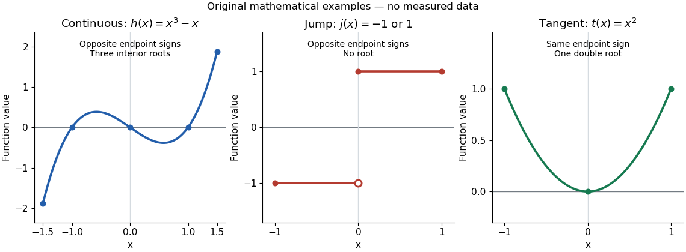

# Intermediate value theorem hypotheses and counterexamples

↑ **Parent:** [Intermediate value theorem](intermediate-value-theorem.md)

Three explicit [functions](function-split.md) separate the hypotheses from the conclusion. These are original mathematical illustrations, not measured data.

The [polynomial function](polynomial-function.md) $h(x)=x^3-x=x(x-1)(x+1)$ is a [continuous function](continuous-function.md) on $[-3/2,3/2]$, with $h(-3/2)=-15/8$ and $h(3/2)=15/8$. The [intermediate value theorem](intermediate-value-theorem.md) guarantees at least one [zero of a function](zero-of-a-function.md) in the interior, while the [polynomial factorization](factorization-of-polynomials.md) displays three: $-1,0,1$. Thus strict opposite signs do not establish uniqueness.

The everywhere-defined [function](function-split.md)

$$
j(x)=\begin{cases}-1,&-1\leq x<0,\\1,&0\leq x\leq1\end{cases}
$$

has $j(-1)=-1$ and $j(1)=1$, yet no [zero of a function](zero-of-a-function.md). Its [jump discontinuity](jump-discontinuity.md) at zero is exactly where the [continuity](continuous-function.md) hypothesis fails. A drawn vertical connector would be misleading: the [function graph](graph-of-a-function.md) contains neither the intermediate heights nor a [zero of a function](zero-of-a-function.md) at that jump. Even [continuity](continuous-function.md) only on the interior is insufficient: setting $q(x)=-1$ for $0\leq x<1$ and $q(1)=1$ gives opposite endpoint signs on $[0,1]$ with no [zero of a function](zero-of-a-function.md), because the left [one-sided limit](one-sided-limit.md) at $1$ is not $q(1)$.

The [polynomial function](polynomial-function.md) $t(x)=x^2$ on $[-1,1]$ is a [continuous function](continuous-function.md), and $t(-1)=t(1)=1$, yet $t(0)=0$. Its [root of a polynomial](root-of-a-polynomial.md) at zero has [multiplicity of a root](multiplicity-of-a-root.md) two. The [function graph](graph-of-a-function.md) touches its horizontal [tangent line](tangent-line.md) there and stays positive on both sides: existence of a [zero of a function](zero-of-a-function.md) does not require a sign change. More generally, near a real [root of a polynomial](root-of-a-polynomial.md) $r$, a [polynomial factorization](factorization-of-polynomials.md) $p(x)=(x-r)^{2m}u(x)$ with $m\geq1$ and $u(r)\neq0$ has the same sign on both sides sufficiently close to $r$, since the [continuous function](continuous-function.md) $u$ retains its sign. The [intermediate value theorem](intermediate-value-theorem.md) does not rule out values outside the range between endpoint outputs.[§2.4, Example 2.37: positive endpoint values do not exclude an interior zero; Theorem 2.11 requires continuity on the whole interval](calculus-volume-1-by-gilbert-strang-and-others.md)

**[Figure 19](#image-intermediate-value-hypotheses-three-continuous-roots-a-jump-with-no-root-and-a-double-root-without-a-sign-change). Intermediate value hypotheses: three continuous roots, a jump with no root, and a double root without a sign change**.

## ↑ Ancestors (9)

1. [Intermediate value theorem](intermediate-value-theorem.md)
2. [Continuous function](continuous-function.md)
3. [Limit of a function](limit-of-a-function.md)
4. [Calculus](calculus-split.md)
5. [Real analysis](real-analysis-split.md)
6. [Analysis](analysis-split.md)
7. [Area of mathematics](area-of-mathematics.md)
8. [Mathematics](mathematics-split.md)
9. [Codex Wiki](split.md)
