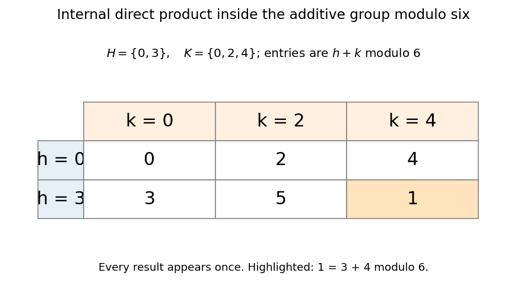

# Internal direct product theorem

↑ **Parent:** [Direct product of groups](direct-product-of-groups.md)

An internal direct product finds independent coordinates already present inside a [group](group-split.md). Let $H,K$ be [normal subgroups](normal-subgroup.md) of $G$ with

$$
H\cap K=\{e\},\qquad HK=G.
$$

Then the multiplication map

$$
\Phi:H\times K\longrightarrow G,\qquad \Phi(h,k)=hk
$$

is a [group isomorphism](group-isomorphism.md). Thus every element of $G$ has a unique factorization into one element of each subgroup. Conversely, the embedded factors $G\times\{e_H\}$ and $\{e_G\}\times H$ inside an external [direct product of groups](direct-product-of-groups.md) satisfy these conditions.

For a concrete example, take the additive [cyclic group](cyclic-group.md) $C_6=\mathbb Z/6\mathbb Z$ and its [subgroups](subgroup.md) $H=\{0,3\}$ and $K=\{0,2,4\}$. They are [normal subgroups](normal-subgroup.md) because $C_6$ is an [abelian group](abelian-group.md). Their intersection is $\{0\}$, and the sums $h+k$ give every [residue class](residue-class.md) exactly once. For instance, $1=3+4\bmod6$. The table makes the unique decomposition visible.

**[Figure 2](#image-each-element-of-c6-has-one-decomposition-as-an-element-of-the-subgroup-0-3-plus-one-of-0-2-4). Each element of C6 has one decomposition as an element of the subgroup $\{0,3\}$ plus one of $\{0,2,4\}$**.

The proof explains each hypothesis. Normality puts the [group commutator](group-commutator.md) $[h,k]=h^{-1}k^{-1}hk$ in both $H$ and $K$, so it is the [identity element](identity-element.md). Therefore the factors [commute](commuting-elements.md), and $\Phi$ preserves the [group operation](group-operation.md). The condition $HK=G$ makes it [surjective](surjective-function.md). If $hk=e$, then $h=k^{-1}$ belongs to the intersection, forcing both to be the [identity element](identity-element.md); thus its [group kernel](kernel-of-a-group-homomorphism.md) is trivial and it is [injective](injective-function.md).

Normality cannot simply be omitted. In the [symmetric group](symmetric-group.md) $S_3$, take $H=\langle(123)\rangle$ and $K=\langle(12)\rangle$. Their intersection is trivial and $HK=S_3$, but $K$ is not a [normal subgroup](normal-subgroup.md). With [permutations](permutation.md) composed right to left, $(123)(12)=(13)$ while $(12)(123)=(23)$, so the factors do not [commute](commuting-elements.md). The setwise decomposition is unique, but its multiplication map is not a [group homomorphism](group-homomorphism.md) from $H\times K$. An independent-coordinate interpretation requires the group operations to agree, not merely a bijection of the underlying sets.

## ↑ Ancestors (6)

1. [Direct product of groups](direct-product-of-groups.md)
2. [Group theory](group-theory-split.md)
3. [Algebra](algebra-split.md)
4. [Area of mathematics](area-of-mathematics.md)
5. [Mathematics](mathematics-split.md)
6. [Codex Wiki](split.md)

## ← Incoming links (4)

- [Direct product of groups](direct-product-of-groups.md)
- [Solution](past-exam-of-the-mathematics-course-of-the-university-of-cambridge/2013/ia/paper-3/1d/solution.md)
- [Solution](past-exam-of-the-mathematics-course-of-the-university-of-cambridge/2017/ia/paper-3/6e/solution.md)
- [Solution](past-exam-of-the-mathematics-course-of-the-university-of-cambridge/2018/ia/paper-3/8d/solution.md)
