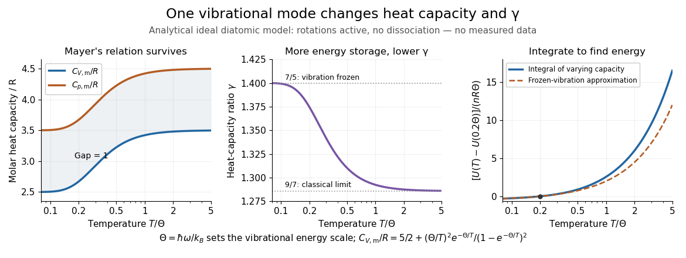

# Internal energy of an ideal gas

↑ **Parent:** [Ideal gas](ideal-gas-split.md)

For a fixed [amount of substance](amount-of-substance.md) and composition of classical [ideal gas](ideal-gas-split.md), [internal energy](internal-energy-split.md) depends only on [temperature](temperature-split.md): $U=U(T,n)$, with no independent [volume](volume-thermodynamics.md) dependence. This does not require constant [heat capacity at constant volume](heat-capacity-at-constant-volume.md). Between equilibrium endpoints,

$$
dU=C_V(T)\,dT=nC_{V,\mathrm m}(T)\,dT,
\qquad U(T_2)-U(T_1)=n\int_{T_1}^{T_2}C_{V,\mathrm m}(T)\,dT.
$$

Here $C_V$ is total [heat capacity at constant volume](heat-capacity-at-constant-volume.md), $C_{V,\mathrm m}$ is [molar heat capacity](molar-heat-capacity.md), and $U/m$ for sample [mass](mass.md) $m$ is [specific internal energy](specific-internal-energy.md), whose change is $\int_{T_1}^{T_2}c_V(T)\,dT$. These endpoint relations apply even when the intervening process is not at fixed [volume](volume-thermodynamics.md); they do not say that transferred [heat](heat-split.md) always equals $\Delta U$. With constant $C_V$, the safe statement is $U(T)=U(T_*)+C_V(T-T_*)$. Writing $U=C_VT$ additionally chooses the reference [energy](energy-split.md); it does not prove that a physical [gas](gas.md) remains classical and ideal down to zero [temperature](temperature-split.md). [Richard Feynman, Robert Leighton and Matthew Sands, §45-1: internal-energy derivatives and heat capacity](https://www.feynmanlectures.caltech.edu/I_45.html#Ch45-S1)

A thermodynamic proof outline uses the [first law of thermodynamics](first-law-of-thermodynamics-split.md) in equilibrium form, $dU=T\,dS-p\,dV$, and the [Maxwell relation](maxwell-relations.md) $(\partial S/\partial V)_T=(\partial p/\partial T)_V$:

$$
\left(\frac{\partial U}{\partial V}\right)_T
=T\left(\frac{\partial p}{\partial T}\right)_V-p
=T\frac{nR}{V}-\frac{nRT}{V}=0.
$$

The last step uses the [ideal gas law](ideal-gas-law.md) and the [molar gas constant](molar-gas-constant.md) $R$, with fixed composition and [amount of substance](amount-of-substance.md). Microscopically, separated [ideal gas](ideal-gas-split.md) particles store no intermolecular interaction [energy](energy-split.md); their translational [kinetic energy](kinetic-energy.md) and any internal molecular [energy](energy-split.md) are determined by [temperature](temperature-split.md). Negligible intermolecular interactions still allow a [molecule](molecule-split.md) to have internal vibrational [potential energy](potential-energy.md).

An original analytical model makes the distinction between an [ideal gas](ideal-gas-split.md) and constant [heat capacity](heat-capacity.md) concrete. Assume classical translation, two fully active rotational terms, and one independent [quantum harmonic oscillator](quantum-harmonic-oscillator-split.md) per diatomic [molecule](molecule-split.md), with fixed [angular frequency](angular-frequency.md) $\omega$. Define the vibrational [temperature](temperature-split.md) scale $\Theta=\hbar\omega/k_B$, using the reduced [Planck constant](planck-constant.md) $\hbar=h/(2\pi)$ and [Boltzmann constant](boltzmann-constant.md) $k_B$. Summing its thermal occupations gives

$$
\frac{U(T)-U_*}{nR}=\frac52T+\frac{\Theta}{e^{\Theta/T}-1},\qquad
\frac{C_{V,\mathrm m}(T)}{R}=\frac52+\frac{x^2e^{-x}}{(1-e^{-x})^2},\qquad x=\frac{\Theta}{T}.
$$

The constant $U_*$ includes the chosen reference and [zero-point energy](zero-point-energy.md), whose [temperature](temperature-split.md) derivative vanishes. When $T\ll\Theta$ the vibrational contribution to [heat capacity](heat-capacity.md) is exponentially small; when $T\gg\Theta$ it tends to $R$ per [mole](mole-unit.md). This model assumes rotations remain active throughout the interval and excludes dissociation, electronic excitation and [real gas](real-gas.md) corrections. Its low-$T/\Theta$ edge is not a model of rotational freezing or of an actual substance at absolute zero.[§3.4: quantum vibrational spectrum, thermal occupations and zero-point energy](statistical-physics-by-david-tong/3-quantum-gases.md)

**[Figure 4](#image-temperature-dependent-internal-energy-of-an-ideal-gas-molar-heat-capacities-and-heat-capacity-ratio-in-a-vibrational-model). Temperature-dependent internal energy of an ideal gas, molar heat capacities and heat capacity ratio in a vibrational model**. Analytical illustration with active rotations and one [quantum harmonic oscillator](quantum-harmonic-oscillator-split.md) per [molecule](molecule-split.md). Left: [Mayer's relation](mayer-s-relation.md) keeps the capacity difference equal to $R$. Middle: [heat capacity ratio](heat-capacity-ratio.md) falls from $7/5$ toward $9/7$. Right: the [internal energy](internal-energy-split.md) change from $T=0.2\Theta$ is an [integral](integral-split.md) of varying [heat capacity at constant volume](heat-capacity-at-constant-volume.md); the dashed line suppresses the vibrational contribution. No measured gas curve or material-specific vibrational frequency is implied.

For this stipulated model, heating from $T_1=0.2\Theta$ to $T_2=\Theta$ gives $\Delta U/(nR\Theta)\simeq2.57519$. Holding the frozen-vibration value $C_{V,\mathrm m}=5R/2$ throughout would give $2$, underestimating the required [internal energy](internal-energy-split.md) increase by about $22.3\%$ of the model's full value. The [integral](integral-split.md) measures all thermal storage activated along the interval. At fixed [volume](volume-thermodynamics.md) with only [heat](heat-split.md) input, this is also the supplied [heat](heat-split.md); at fixed [pressure](pressure-split.md), expansion [work](work.md) must be added through [Mayer's relation](mayer-s-relation.md).

[Joule's free-expansion experiment](joule-s-free-expansion-experiment.md) tests the independence from [volume](volume-thermodynamics.md) in a different way: an insulated rigid vessel allows [gas](gas.md) into an evacuated compartment, so no external [work](work.md) is delivered and ideally no [heat](heat-split.md) is exchanged. The [first law of thermodynamics](first-law-of-thermodynamics-split.md) gives $\Delta U=0$; positive $C_V$ then predicts equal initial and final equilibrium [temperatures](temperature-split.md) for the [ideal gas](ideal-gas-split.md). The apparatus, thermal-capacity controls and limitations of this inference are described in [Joule's free-expansion experiment](joule-s-free-expansion-experiment.md) and [temperature sensitivity of a free-expansion experiment](temperature-sensitivity-of-a-free-expansion-experiment.md). This endpoint test differs from the reversible [adiabatic expansion](adiabatic-expansion.md) of a loaded piston, which delivers [work](work.md) and lowers [internal energy](internal-energy-split.md).

## ↑ Ancestors (6)

1. [Ideal gas](ideal-gas-split.md)
2. [Thermodynamics](thermodynamics-split.md)
3. [Statistical physics](statistical-physics-split.md)
4. [Branches of physics](branches-of-physics.md)
5. [Physics](physics-split.md)
6. [Codex Wiki](split.md)

## ← Incoming links (17)

- [First law of thermodynamics](first-law-of-thermodynamics-split.md)
- [Free expansion](free-expansion.md)
- [Heat capacity](heat-capacity.md)
- [Intensive and extensive thermodynamic quantities](intensive-and-extensive-thermodynamic-quantities.md)
- [Internal energy](internal-energy-split.md)
- [Internal energy of an ideal gas](internal-energy-of-an-ideal-gas.md)
- [Isothermal expansion](isothermal-expansion.md)
- [Isothermal ideal-gas work](isothermal-ideal-gas-work.md)
- [Isothermal process](isothermal-process.md)
- [Mayer's relation](mayer-s-relation.md)
- [Solution](past-exam-of-the-mathematics-course-of-the-university-of-cambridge/2003/iii/paper-62/1/solution.md)
- [Solution](past-exam-of-the-mathematics-course-of-the-university-of-cambridge/2005/iii/paper-71/3/solution.md)
- [Solution](past-exam-of-the-mathematics-course-of-the-university-of-cambridge/2008/iii/paper-70/2/solution.md)
- [Solution](past-exam-of-the-mathematics-course-of-the-university-of-cambridge/2021/ii/paper-1/36c/a/solution.md)
- [Solution](past-exam-of-the-mathematics-course-of-the-university-of-cambridge/2023/ii/paper-4/35a/b/solution.md)
- [Quasistatic process](quasistatic-process.md)
- [Two reversible ideal-gas paths between the same states](two-reversible-ideal-gas-paths-between-the-same-states.md)
