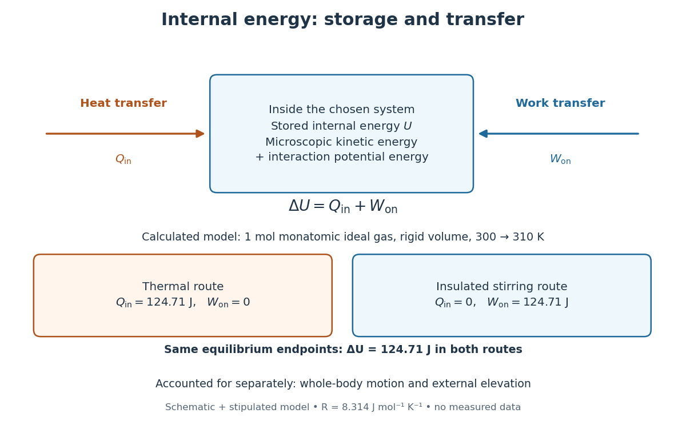

# Internal energy

↑ **Parent:** [Thermodynamics](thermodynamics-split.md)  
ⓦ [Wiki](https://en.wikipedia.org/wiki/Internal_energy)

Internal energy $U$ is the [energy](energy.md) stored in the microscopic [degrees of freedom](degree-of-freedom.md) of a [thermodynamic system](thermodynamic-system.md): random molecular [kinetic energy](kinetic-energy.md), internal molecular excitations, and interaction [potential energy](potential-energy.md). Its value requires a specified system and an [energy](energy.md) reference. In [thermodynamic equilibrium](thermodynamic-equilibrium.md), [internal energy](internal-energy.md) is a [state function](state-function.md); it records the present state, without remembering whether a previous change came from stirring, compression or [heat](heat.md) transfer. This makes [internal energy](internal-energy.md) the common accounting quantity connecting mechanical experiments to thermal ones.[§3.2, “Internal Energy”, equation 3.5 and the discussion of molecular motion](university-physics-volume-2-by-samuel-j-ling-and-others/3-2-work-heat-and-internal-energy.md)

[Heat](heat.md) and [work](work.md) describe [energy](energy.md) crossing the system boundary during a process. They are not separately stored contents of the system. For a [closed system](closed-system.md) whose bulk [kinetic energy](kinetic-energy.md) and external [potential energy](potential-energy.md) have unchanged endpoint values, the [first law of thermodynamics](first-law-of-thermodynamics.md) gives

$$
\Delta U=Q_{\rm in}+W_{\rm on}=Q_{\rm in}-W_{\rm out}.
$$

Here $Q_{\rm in}$ is positive for incoming [heat](heat.md), and $W_{\rm on}=-W_{\rm out}$ is positive for net [work](work.md) done on the system. Two routes between the same equilibrium states have the same $\Delta U$, although their [heat](heat.md) and [work](work.md) can differ. The infinitesimal notation $dU=\delta Q_{\rm in}+\delta W_{\rm on}$ distinguishes a [state function](state-function.md) change from path-dependent transfers.[§4.2, equation 4.156 and “Quasi-Static Processes”: state energy versus heat and work; Tong uses work positive inward](statistical-physics-by-david-tong/4-classical-thermodynamics.md)

For a calculated example, take one [mole](mole-unit.md) of a classical [monatomic gas](monatomic-gas.md) in the [ideal gas](ideal-gas.md) regime, at fixed [volume](volume-thermodynamics.md), from $300$ to $310\,\mathrm K$. With stipulated [molar gas constant](molar-gas-constant.md) $R=8.314\,\mathrm{J\,mol^{-1}\,K^{-1}}$, its [internal energy](internal-energy.md) change is $3nR\Delta T/2=124.71\,\mathrm J$. A purely thermal route supplies $Q_{\rm in}=124.71\,\mathrm J$ with $W_{\rm on}=0$. An ideal insulated stirring route supplies $W_{\rm on}=124.71\,\mathrm J$ with $Q_{\rm in}=0$, measured between equilibrium endpoints after the motion dies away. The same stored increment has two different transfer histories; neither history defines a separate kind of stored [energy](energy.md).

**[Figure 42](#internal-energy-storage-and-transfers). Internal energy is stored; heat and work are ways to change it**. Original schematic and calculated [ideal gas](ideal-gas.md) example with the stipulated parameters above; no experimental data. The two routes end at the same [temperature](temperature.md) and [volume](volume-thermodynamics.md). Microscopic [kinetic energy](kinetic-energy.md) and interaction [potential energy](potential-energy.md) belong inside $U$; whole-body motion and external elevation are accounted for separately under the stated convention.

The familiar [internal energy of an ideal gas](internal-energy-of-an-ideal-gas.md) is a useful special case. Neglect intermolecular interactions, hold the [amount of substance](amount-of-substance.md) $n$ and composition fixed, and suppose that $f$ independent quadratic terms per particle obey the classical [equipartition theorem](equipartition-theorem.md). Choosing the constant reference contribution as zero gives

$$
U=\frac f2nRT,\qquad C_V=\frac f2nR.
$$

Here $T$ is absolute [temperature](temperature.md), $R$ is the [molar gas constant](molar-gas-constant.md), and $C_V$ is the whole sample's [heat capacity at constant volume](heat-capacity-at-constant-volume.md). A [monatomic gas](monatomic-gas.md) has $f=3$ translational terms. A rigid diatomic [molecule](molecule.md) has $f=5$ when its two rotational terms are active and vibration is frozen; activating one [harmonic oscillator](simple-harmonic-motion.md) vibration adds two terms, one [kinetic energy](kinetic-energy.md) and one [potential energy](potential-energy.md), giving $f=7$. The counting is of quadratic contributions, so a vibrational coordinate is not just one contribution.[§§2.2.1 and 2.4, equations 2.57–2.58 and the rotation/vibration energy counting](statistical-physics-by-david-tong/2-classical-gases.md)

This constant-$f$ formula applies only over a regime with those same active terms, classical translational statistics, nonrelativistic motion and unchanged composition. Quantum freezing, [quantum degeneracy](degenerate-energy-levels.md), [chemical reactions](chemical-reaction.md) or appreciable intermolecular interactions invalidate that simple counting. More generally, at fixed amount and composition an [ideal gas](ideal-gas.md) can still have $U=U(T)$ with varying [heat capacity at constant volume](heat-capacity-at-constant-volume.md), so use $\Delta U=\int_{T_1}^{T_2}C_V(T)\,dT$. A nonzero constant reference adds $U_*$ to $fnRT/2$ without altering $\Delta U$.

**Table of contents**

- [Internal energy and system boundaries](internal-energy-and-system-boundaries.md)
- [Internal energy at constant temperature](internal-energy-at-constant-temperature.md)
- [Joule's paddle-wheel experiment](joule-s-paddle-wheel-experiment.md)
  - [Paddle-wheel calorimetry energy balance](paddle-wheel-calorimetry-energy-balance.md)
- [Specific internal energy](specific-internal-energy.md)

## ↑ Ancestors (5)

1. [Thermodynamics](thermodynamics-split.md)
2. [Statistical physics](statistical-physics-split.md)
3. [Branches of physics](branches-of-physics.md)
4. [Physics](physics-split.md)
5. [Codex Wiki](split.md)

## ← Incoming links (104)

- [Adiabatic compression](adiabatic-compression.md)
- [Adiabatic expansion](adiabatic-expansion.md)
- [Adiabatic process](adiabatic-process.md)
- [Background potential energy](background-potential-energy.md)
- [Calorimetry](calorimetry.md)
- [Canonical partition function](canonical-partition-function.md)
- [Chemical potential](chemical-potential.md)
- [Classical ideal gas in a homogeneous soft trap](classical-ideal-gas-in-a-homogeneous-soft-trap.md)
- [Dulong-Petit law](dulong-petit-law.md)
- [Einstein solid](einstein-solid.md)
- [Enthalpy](enthalpy.md)
- [Entropy](entropy.md)
- [Entropy density of a photon gas](entropy-density-of-a-photon-gas.md)
- [Entropy maximization under thermal contact](entropy-maximization-under-thermal-contact.md)
- [Equipartition theorem](equipartition-theorem.md)
- [Euler relation in thermodynamics](euler-relation-in-thermodynamics.md)
- [Finite-temperature electron equation of state](finite-temperature-electron-equation-of-state.md)
- [First law of thermodynamics](first-law-of-thermodynamics.md)
- [Fluid total-energy equation](fluid-total-energy-equation.md)
- [Free expansion](free-expansion.md)
- [Frictional heating](frictional-heating.md)
- [Gravitational energy generation in a homologously contracting ideal-gas star](gravitational-energy-generation-in-a-homologously-contracting-ideal-gas-star.md)
- [Heat](heat.md)
- [Heat capacity](heat-capacity.md)
- [Heat capacity at constant volume](heat-capacity-at-constant-volume.md)
- [Heat capacity ratio](heat-capacity-ratio.md)
- [Heat engine](heat-engine.md)
- [Heat-engine calorimetry](heat-engine-calorimetry.md)
- [Heat-pump calorimetry](heat-pump-calorimetry.md)
- [Helmholtz free energy](helmholtz-free-energy.md)
- [Homologous adiabatic stellar stability](homologous-adiabatic-stellar-stability.md)
- [Ideal gas](ideal-gas.md)
- [Ideal gas law](ideal-gas-law.md)
- [Ideal magnetohydrodynamic energy conservation](ideal-magnetohydrodynamic-energy-conservation.md)
- [Inelastic collision](inelastic-collision.md)
- [Internal energy](internal-energy.md)
- [Internal energy and system boundaries](internal-energy-and-system-boundaries.md)
- [Internal energy at constant temperature](internal-energy-at-constant-temperature.md)
- [Internal energy of an ideal gas](internal-energy-of-an-ideal-gas.md)
- [Isolated system](isolated-system.md)
- [Isothermal compressibility](isothermal-compressibility.md)
- [Isothermal expansion](isothermal-expansion.md)
- [Isothermal process](isothermal-process.md)
- [Joule heating](joule-heating.md)
- [Joule's free-expansion experiment](joule-s-free-expansion-experiment.md)
- [Kelvin-Planck statement of the second law](kelvin-planck-statement-of-the-second-law.md)
- [Kinetic friction](kinetic-friction.md)
- [Latent heat](latent-heat.md)
- [Lattice energy](lattice-energy.md)
- [Linear low-temperature heat capacity of a two-dimensional Fermi gas](linear-low-temperature-heat-capacity-of-a-two-dimensional-fermi-gas.md)
- [Maxwell relations](maxwell-relations.md)
- [Mayer's relation](mayer-s-relation.md)
- [Ohm's law](ohm-s-law.md)
- [Paddle-wheel calorimetry energy balance](paddle-wheel-calorimetry-energy-balance.md)
- [Solution](past-exam-of-the-mathematics-course-of-the-university-of-cambridge/2003/iii/paper-62/1/solution.md)
- [Solution](past-exam-of-the-mathematics-course-of-the-university-of-cambridge/2005/iii/paper-71/3/solution.md)
- [Solution](past-exam-of-the-mathematics-course-of-the-university-of-cambridge/2005/iii/paper-78/3/solution.md)
- [Solution](past-exam-of-the-mathematics-course-of-the-university-of-cambridge/2006/ib/paper-1/4b/solution.md)
- [Solution](past-exam-of-the-mathematics-course-of-the-university-of-cambridge/2007/iii/paper-65/1/a/solution.md)
- [Solution](past-exam-of-the-mathematics-course-of-the-university-of-cambridge/2007/iii/paper-65/1/d/solution.md)
- [Solution](past-exam-of-the-mathematics-course-of-the-university-of-cambridge/2008/iii/paper-84/5/a/solution.md)
- [Solution](past-exam-of-the-mathematics-course-of-the-university-of-cambridge/2014/iii/paper-54/1/a/solution.md)
- [Solution](past-exam-of-the-mathematics-course-of-the-university-of-cambridge/2014/iii/paper-55/4/solution.md)
- [Solution](past-exam-of-the-mathematics-course-of-the-university-of-cambridge/2015/iii/paper-58/2/c/solution.md)
- [Solution](past-exam-of-the-mathematics-course-of-the-university-of-cambridge/2016/ia/paper-4/9b/a/solution.md)
- [Solution](past-exam-of-the-mathematics-course-of-the-university-of-cambridge/2016/ia/paper-4/9b/b/solution.md)
- [Solution](past-exam-of-the-mathematics-course-of-the-university-of-cambridge/2016/ia/paper-4/9b/c/solution.md)
- [Solution](past-exam-of-the-mathematics-course-of-the-university-of-cambridge/2017/ii/paper-3/34d/b/i/solution.md)
- [Solution](past-exam-of-the-mathematics-course-of-the-university-of-cambridge/2017/ii/paper-3/34d/b/ii/solution.md)
- [Solution](past-exam-of-the-mathematics-course-of-the-university-of-cambridge/2017/ii/paper-4/34d/i/solution.md)
- [Solution](past-exam-of-the-mathematics-course-of-the-university-of-cambridge/2017/iii/paper-314/1/a/solution.md)
- [Solution](past-exam-of-the-mathematics-course-of-the-university-of-cambridge/2018/iii/paper-314/2/a/solution.md)
- [Solution](past-exam-of-the-mathematics-course-of-the-university-of-cambridge/2018/iii/paper-314/2/d/solution.md)
- [Solution](past-exam-of-the-mathematics-course-of-the-university-of-cambridge/2018/iii/paper-317/1/i/solution.md)
- [Solution](past-exam-of-the-mathematics-course-of-the-university-of-cambridge/2018/iii/paper-317/1/ii/solution.md)
- [Solution](past-exam-of-the-mathematics-course-of-the-university-of-cambridge/2018/iii/paper-317/1/iii/solution.md)
- [Solution](past-exam-of-the-mathematics-course-of-the-university-of-cambridge/2019/ii/paper-3/35d/solution.md)
- [Solution](past-exam-of-the-mathematics-course-of-the-university-of-cambridge/2022/ii/paper-3/35a/b/iii/solution.md)
- [Solution](past-exam-of-the-mathematics-course-of-the-university-of-cambridge/2023/ii/paper-3/35a/b/iii/solution.md)
- [Solution](past-exam-of-the-mathematics-course-of-the-university-of-cambridge/2023/ii/paper-4/39c/a/solution.md)
- [Pressure](pressure.md)
- [Quasistatic process](quasistatic-process.md)
- [Radiative cooling](radiative-cooling.md)
- [Relativistic rocket equation](relativistic-rocket-equation.md)
- [Simple compressible system](simple-compressible-system.md)
- [Specific heat capacity at constant pressure](specific-heat-capacity-at-constant-pressure.md)
- [Specific internal energy](specific-internal-energy.md)
- [State function](state-function.md)
- [Statistical physics](statistical-physics-split.md)
- [Stirling engine](stirling-engine.md)
- [Stratified mixing energy budget](stratified-mixing-energy-budget.md)
- [Surface energy](surface-energy.md)
- [Temperature](temperature.md)
- [Temperature sensitivity of a free-expansion experiment](temperature-sensitivity-of-a-free-expansion-experiment.md)
- [Thermal conduction](thermal-conduction.md)
- [Thermal diffusivity](thermal-diffusivity.md)
- [Thermal equilibration of two finite bodies](thermal-equilibration-of-two-finite-bodies.md)
- [Thermal equilibrium](thermal-equilibrium.md)
- [Thermodynamic force conjugate to an internal variable](thermodynamic-force-conjugate-to-an-internal-variable.md)
- [Thermodynamic free energy](thermodynamic-free-energy.md)
- [Thermodynamic potential](thermodynamic-potential.md)
- [Thermodynamics](thermodynamics-split.md)
- [Two-point thermometer calibration example](two-point-thermometer-calibration-example.md)
- [Zeroth law of thermodynamics](zeroth-law-of-thermodynamics.md)
