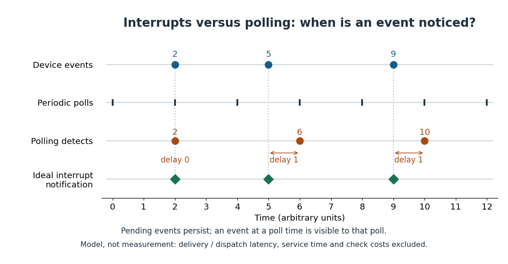

# Interrupt-driven input-output

↑ **Parent:** [Interrupt](interrupt.md)

In [interrupt-driven input-output](interrupt-driven-input-output.md), a device signals an [interrupt](interrupt.md) when attention is needed, letting the [CPU](central-processing-unit.md) avoid repeatedly checking an idle device. The [interrupt handler](interrupt-handler.md) determines what happened and arranges the required work; notification itself does not move the payload. [DMA](direct-memory-access.md) can supply that separate data-transfer mechanism.

For a toy comparison, let events occur at times $2,5,9$. Ideal [interrupt](interrupt.md) notification happens at those same times, while [polled input-output](polled-input-output.md) at $0,2,4,6,8,10,12$ detects them at $2,6,10$. The polling delays are $0,1,1$; ideal notification delays are all zero. Events are assumed to remain pending, with a simultaneous event visible to a poll. The chart is a model, not a measurement: it excludes [interrupt](interrupt.md) delivery and dispatch latency, [interrupt handler](interrupt-handler.md) service time, and polling overhead. Its zero-delay row is not a real-hardware guarantee.

**[Figure 1](#image-ideal-interrupt-notification-versus-periodic-polled-input-output-for-three-persistent-device-events). Ideal interrupt notification versus periodic polled input-output for three persistent device events**.

The useful idea is to spend attention when something changes. Sparse events can leave long stretches for useful [CPU](central-processing-unit.md) work instead of busy checks. At high event rates, repeated entry and service overhead can consume that saving. Batching notifications can reduce their frequency while delaying some events; switching to [polled input-output](polled-input-output.md) during active periods is another option. No strategy is universally faster. [Arpaci-Dusseau and Arpaci-Dusseau, OSTEP chapter 36, section 36.4: interrupt costs and coalescing](https://pages.cs.wisc.edu/~remzi/OSTEP/file-devices.pdf)

The [Linux kernel](linux-kernel.md)'s NAPI mechanism is a concrete combination: an [interrupt](interrupt.md) normally schedules event processing, which polls for work with a receive budget. Further [interrupts](interrupt.md) remain masked during that polling, and are enabled again when polling finishes. NAPI also supports busy polling; the exact processing context and configuration vary. This is a documented [Linux kernel](linux-kernel.md) design, not a requirement on every [operating system](operating-system-split.md). [Linux kernel documentation, NAPI: basic operation, datapath API, scheduling and IRQ masking](https://docs.kernel.org/networking/napi.html)

## ↑ Ancestors (4)

1. [Interrupt](interrupt.md)
2. [Operating system](operating-system-split.md)
3. [Computer science](computer-science-split.md)
4. [Codex Wiki](split.md)

## ← Incoming links (8)

- [Central processing unit](central-processing-unit.md)
- [Direct memory access](direct-memory-access.md)
- [Input-output](input-output.md)
- [Interrupt](interrupt.md)
- [Interrupt-driven input-output](interrupt-driven-input-output.md)
- [Solution](past-exam-of-the-mathematics-course-of-the-university-of-cambridge/2006/ia/paper-5/2/c/solution.md)
- [Solution](past-exam-of-the-mathematics-course-of-the-university-of-cambridge/2006/ia/paper-5/8/a/ii/solution.md)
- [Polled input-output](polled-input-output.md)
