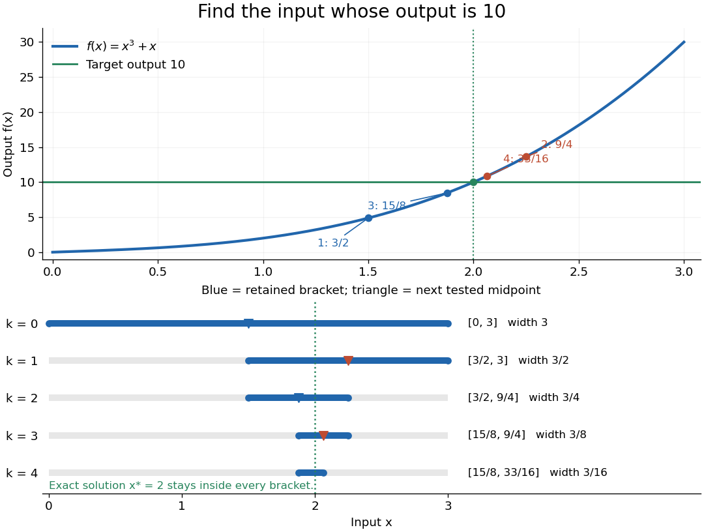
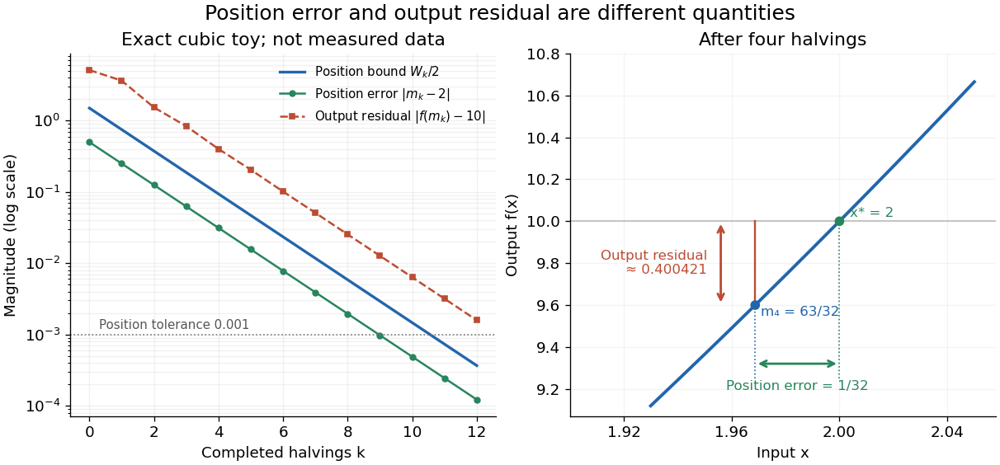

# Interval bisection

↑ **Parent:** [Numerical analysis](numerical-analysis-split.md)

[Interval bisection](interval-bisection.md) solves a target equation $f(x)=t$ by repeatedly halving a [closed interval](closed-real-interval.md) known to contain a solution. It is the [bisection method](bisection-method.md) applied to $g(x)=f(x)-t$, so the target becomes a [zero of a function](zero-of-a-function.md). This reduction from an equation to root finding is described in Demanet's notes.[Laurent Demanet, MIT 18.330, Chapter 4, §4.1, pp. 1–2, 2012](https://ocw.mit.edu/courses/18-330-introduction-to-numerical-analysis-spring-2012/5b325bfa56a599794c7196de926844b0_MIT18_330S12_Chapter4.pdf) Here the emphasis is on a [continuous](continuous-function.md) [strictly increasing function](strictly-increasing-function.md): the target identifies one input, making [interval bisection](interval-bisection.md) a way to evaluate its [inverse function](inverse-function.md) without an explicit inverse formula.

Let $f:[a_0,b_0]\to\mathbb R$ be a [continuous function](continuous-function.md), with $a_0<b_0$ and $f(a_0)\leq t\leq f(b_0)$. The [intermediate value theorem](intermediate-value-theorem.md) guarantees existence; a [strictly increasing function](strictly-increasing-function.md) also guarantees uniqueness. Check endpoint equality first. Otherwise, for the current [root bracket](root-bracket.md) $[a_k,b_k]$, evaluate its [midpoint](midpoint.md) $m_k=(a_k+b_k)/2$. If $f(m_k)<t$, retain $[m_k,b_k]$; if $f(m_k)>t$, retain $[a_k,m_k]$; if $f(m_k)=t$, return that exact solution. These comparisons preserve the target bracket. General [bisection method](bisection-method.md) needs [continuity](continuous-function.md) and opposite signs of $g$ at the endpoints, without requiring [monotonicity](monotonic-function.md) or a unique [zero of a function](zero-of-a-function.md); see [limitations of bisection](limitations-of-bisection.md).

An original dimensionless [polynomial](polynomial-split.md) example is

$$
f(x)=x^3+x,\qquad t=10,\qquad [a_0,b_0]=[0,3].
$$

Here $f(0)=0<10<30=f(3)$ and the [derivative](derivative.md) $f'(x)=3x^2+1>0$, so there is exactly one solution. In fact $x_*=2$; knowing this lets us check the computed [absolute error](absolute-error.md) independently of the guarantee. The first four halvings give the following exact [rational numbers](rational-number.md):

$$
\begin{array}{c|c|r|c}
\text{update }k&\text{tested }m_{k-1}&f(m_{k-1})-10&\text{retained }[a_k,b_k]\\\hline
1&3/2&-41/8&[3/2,3]\\
2&9/4&233/64&[3/2,9/4]\\
3&15/8&-785/512&[15/8,9/4]\\
4&33/16&3425/4096&[15/8,33/16]
\end{array}
$$

**[Figure 10](#image-finding-the-input-for-a-target-output-cubic-graph-and-four-retained-brackets). Finding the input for a target output: cubic graph and four retained brackets**.

The beauty of [interval bisection](interval-bisection.md) is that the enclosure itself supplies the certificate: one comparison removes half the possible inputs, regardless of the steepness of the [function graph](graph-of-a-function.md). In exact arithmetic, after $k$ completed halvings without exact termination, the width and the [bisection error bound](bisection-error-bound.md) for the new [midpoint](midpoint.md) are

$$
W_k=b_k-a_k=\frac{3}{2^k},\qquad |m_k-x_*|\leq\frac{W_k}{2}=\frac{3}{2^{k+1}}.
$$

The reported [midpoint](midpoint.md) after update four is $m_4=63/32$, rather than the last tested point $m_3=33/16$. Its certified [absolute error](absolute-error.md) is at most $3/32$, and its actual [absolute error](absolute-error.md) is $1/32$. For a requested position tolerance $10^{-3}$, the [bisection stopping criterion](bisection-stopping-criterion.md) requires eleven halvings: ten give $3/2048>10^{-3}$, while eleven give

$$
[a_{11},b_{11}]=[4095/2048,2049/1024],\qquad m_{11}=8193/4096,\qquad |m_{11}-2|\leq3/4096<10^{-3}.
$$

The actual [absolute error](absolute-error.md) is $1/4096$. The new [midpoint](midpoint.md) need not be evaluated to obtain this certificate.

The signed **output residual** is $r=f(m)-t$; the position [approximation error](approximation-error.md) is $m-x_*$. They answer different questions: how close is the output to the target, and how close is the input to the solution? Driscoll and Braun explain why a small residual needs information about the [derivative](derivative.md) to imply small position error.[Toby A. Driscoll and Richard J. Braun, Fundamentals of Numerical Computation, §4.1.1, Conditioning, error, and residual](https://fncbook.com/rootproblem/) For this particular [polynomial](polynomial-split.md), direct factorization gives

$$
f(m)-10=(m-2)(m^2+2m+5).
$$

Thus at $m_4=63/32$ the residual is $-13121/32768\approx-0.400421$, despite position [absolute error](absolute-error.md) $1/32=0.03125$. If a differentiable [function](function-split.md) satisfies $0<\ell\leq f'(x)\leq L$ throughout the bracket, the [mean value theorem](mean-value-theorem.md) gives the rigorous conversion

$$
\ell|m-x_*|\leq|f(m)-t|\leq L|m-x_*|.
$$

Our example permits $\ell=1$ and $L=28$ on $[0,3]$. Strict increase alone supplies no positive lower [derivative](derivative.md) bound: $f(x)=x^3$ is [strictly increasing](strictly-increasing-function.md) but $f'(0)=0$. A small residual alone is therefore not a universal position certificate; even the target equation $10^{-6}(x-2)=0$ has residual $10^{-6}$ at $x=3$, a full unit from its solution.

**[Figure 11](#image-certified-position-error-and-output-residual-measure-different-distances). Certified position error and output residual measure different distances**.

The guarantees require [continuity](continuous-function.md) and correct evaluations, not just narrowing endpoints. For the [strictly increasing function](strictly-increasing-function.md) $h(x)=x$ when $x<0$ and $h(x)=x+1$ when $x\geq0$, the target $1/2$ lies between $h(-1)$ and $h(1)$ but is never attained: a [jump discontinuity](jump-discontinuity.md) defeats the existence argument. With [floating-point arithmetic](floating-point-arithmetic-split.md) or an approximate evaluation, an incorrect comparison can discard the true solution. A certified [interval enclosure](interval-enclosure.md) of $f(m)$ wholly below or above $t$ certifies the corresponding decision; an enclosure containing $t$ is inconclusive, rather than proof of equality. If rounding makes the [midpoint](midpoint.md) equal an endpoint, report the precision limit; see [bisection stopping criterion](bisection-stopping-criterion.md) for the rounded position bound. Both figures are exact mathematical examples, not measured data.

## ↑ Ancestors (5)

1. [Numerical analysis](numerical-analysis-split.md)
2. [Analysis](analysis-split.md)
3. [Area of mathematics](area-of-mathematics.md)
4. [Mathematics](mathematics-split.md)
5. [Codex Wiki](split.md)

## ← Incoming links (3)

- [Interval bisection](interval-bisection.md)
- [Solution](past-exam-of-the-mathematics-course-of-the-university-of-cambridge/2006/iii/paper-66/3/a/solution.md)
- [Solution](past-exam-of-the-mathematics-course-of-the-university-of-cambridge/2013/iii/paper-38/1/a/solution.md)
