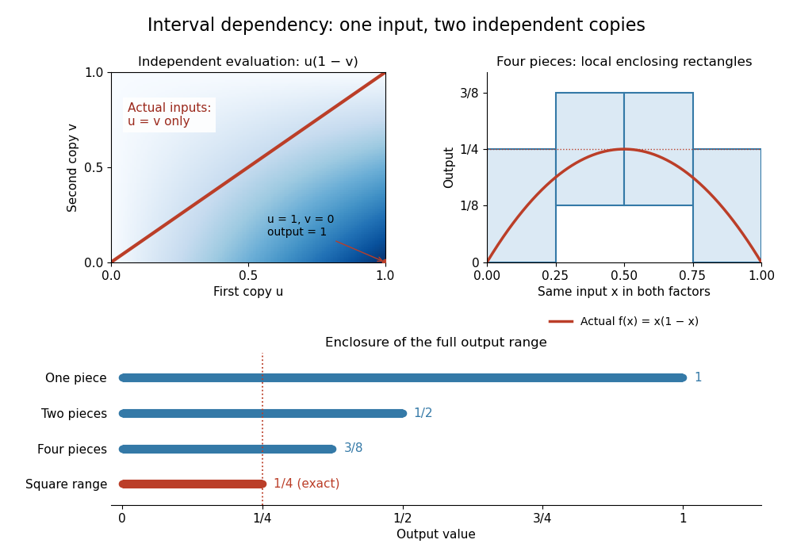

# Interval dependency problem

↑ **Parent:** [Natural interval extension](natural-interval-extension.md)

The [interval dependency problem](interval-dependency-problem.md) is the loss of relationships between repeated occurrences of the same input. For $X=[0,1]$, interval [subtraction](subtraction.md) gives $X-X=[-1,1]$: it permits $u-v$ with independent choices $u,v\in X$. But the [function](function-split.md) $x\mapsto x-x$ has actual [image of a function](image-of-a-function.md) $\{0\}=[0,0]$. Giving both operands the name $X$ does not tell an [interval arithmetic](interval-arithmetic.md) calculation to enforce $u=v$.

For the [polynomial](polynomial-split.md) $f(x)=x(1-x)$ on $X=[0,1]$, the [natural interval extension](natural-interval-extension.md) is

$$
F(X)=X([1,1]-X)=[0,1][0,1]=[0,1].
$$

This allows the impossible combination $x=1$ in the first factor and $x=0$ in the second, producing the spurious upper bound $1$. In the actual [function](function-split.md), both occurrences use the same $x$. [Completing the square](completing-the-square.md) gives $x(1-x)=1/4-(x-1/2)^2$, which lies between $0$ and $1/4$ on $[0,1]$; every value between these bounds occurs, by [continuity](continuous-function.md) and the [intermediate value theorem](intermediate-value-theorem.md). The [maximum](maximum-of-a-subset-of-a-total-order.md) $1/4$ occurs at $x=1/2$, while either endpoint gives the [minimum](minimum-of-a-subset-of-a-total-order.md) $0$.

**[Figure 4](#image-independent-interval-inputs-lose-the-diagonal-constraint-subdivision-tightens-the-enclosure-of-x-times-one-minus-x). Independent interval inputs lose the diagonal constraint; subdivision tightens the enclosure of x times one minus x**. Left: the [Cartesian product](cartesian-product.md) permits separate choices $u,v\in[0,1]$, while the actual [function](function-split.md) uses only $u=v$. Right: rectangles from four pieces contain the [polynomial](polynomial-split.md) curve. Below: one, two and four pieces give [interval enclosures](interval-enclosure.md) with upper bounds $1$, $1/2$ and $3/8$; the [interval square range](interval-square-range.md) gives the exact $1/4$.

**Table of contents**

- [Interval subdivision](interval-subdivision.md)

## ↑ Ancestors (8)

1. [Natural interval extension](natural-interval-extension.md)
2. [Interval arithmetic operations](interval-arithmetic-operations.md)
3. [Interval arithmetic](interval-arithmetic.md)
4. [Numerical analysis](numerical-analysis-split.md)
5. [Analysis](analysis-split.md)
6. [Area of mathematics](area-of-mathematics.md)
7. [Mathematics](mathematics-split.md)
8. [Codex Wiki](split.md)

## ← Incoming links (2)

- [Interval dependency problem](interval-dependency-problem.md)
- [Interval subdivision](interval-subdivision.md)
