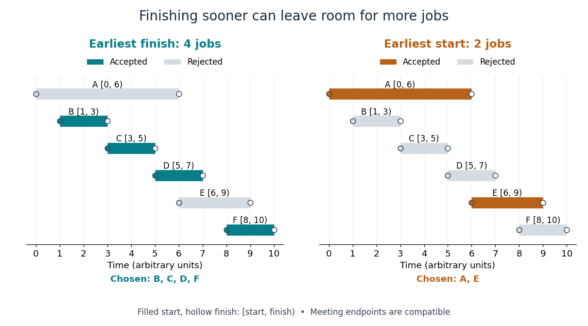

# Interval scheduling

↑ **Parent:** [Greedy algorithm](greedy-algorithm.md)  
ⓦ [Wiki](https://en.wikipedia.org/wiki/Interval_scheduling)

Given a [finite set](finite-set.md) of jobs with fixed half-open [intervals](interval-mathematics.md) $[s_i,f_i)$, where $s_i<f_i$, choose a [subset](subset.md) $S$ of [maximum](maximum-of-a-subset-of-a-total-order.md) [cardinality](cardinality.md). Each job occupies one shared resource throughout its [interval](interval-mathematics.md). A [feasible solution](feasible-point.md) has pairwise [disjoint](disjoint-sets.md) [intervals](interval-mathematics.md): for distinct selected jobs $i,j$, either $f_i\leq s_j$ or $f_j\leq s_i$. Thus a finish and the next start may coincide. Every job has value one; occupied time is not the [objective function](objective-function.md).[6.046J Design and Analysis of Algorithms, Spring 2015; Printed p. 2, Interval Scheduling: fixed requests, one resource, compatibility with endpoint equality, maximum size](6-046j-design-and-analysis-of-algorithms-spring-2015/lecture-1-introduction.md)

Consider these six original jobs, with arbitrary time units:

$$
\begin{array}{c|rrrrrr}
\text{job}&A&B&C&D&E&F\\\hline
s_i&0&1&3&5&6&8\\
f_i&6&3&5&7&9&10
\end{array}.
$$

Job $B=[1,3)$ can be followed immediately by $C=[3,5)$ and $D=[5,7)$. Job $A=[0,6)$ conflicts with all three. Starting the resource earlier is therefore not automatically beneficial: one long commitment can displace several shorter requests.

The earliest-finish [greedy algorithm](greedy-algorithm.md) uses a [sorting algorithm](sorting-algorithm.md) to put jobs in [nondecreasing](nondecreasing-function.md) finish time. Scan that order, accepting the first job and then each job whose start is at least the last accepted finish. Break finish-time ties arbitrarily; an empty [input](input-computer-science.md) returns the [empty set](empty-set.md). For these jobs, the order and decisions are

$$
\begin{array}{c|rrrrrr}
\text{finish order}&B&C&A&D&E&F\\\hline
\text{decision}&\text{take}&\text{take}&\text{skip}&\text{take}&\text{skip}&\text{take}
\end{array}.
$$

After $B,C$, job $A$ starts before the current finish five and is rejected. Accept $D$; then reject $E=[6,9)$ because six is before seven. Finally accept $F=[8,10)$. The result is $S=\{B,C,D,F\}$, with [cardinality](cardinality.md) four. Leaving $[0,1)$ idle makes room for more jobs.

By contrast, the earliest-start rule scans $A,B,C,D,E,F$. It accepts $A$, skips $B,C,D$, accepts $E$, and skips $F$. Its [feasible solution](feasible-point.md) $\{A,E\}$ contains only two jobs. Here $A$ and $E$ meet at time six and are compatible; $E$ and $F$ overlap on $[8,9)$.

**[Figure 3](#image-earliest-finish-accepts-four-jobs-earliest-start-accepts-two). Earliest finish accepts four jobs; earliest start accepts two**. The same six original [intervals](interval-mathematics.md) appear in both panels. Colored jobs are accepted and gray jobs rejected. A filled start and hollow finish depict a half-open [interval](interval-mathematics.md); jobs meeting at an endpoint are compatible.

There is also an elementary optimality certificate for this example. The four [subsets](subset.md) $\{A,B\}$, $\{C\}$, $\{D,E\}$ and $\{F\}$ form a [partition of a set](partition-of-a-set.md) of the jobs. A [feasible solution](feasible-point.md) takes at most one job from each group: $A,B$ overlap, as do $D,E$, and each other group is a [singleton](singleton-mathematics.md). Hence four is an [upper bound](upper-bound-in-a-partially-ordered-set.md), attained by $\{B,C,D,F\}$. Checking all $2^6=64$ [subsets](subset.md) gives a unique optimum of size four: $\{B,C,D,F\}$.

The earliest-finish theorem states that this [greedy algorithm](greedy-algorithm.md) maximizes job count for every finite instance of [interval scheduling](interval-scheduling.md). For the [exchange argument](exchange-argument.md), let $q$ be the first job in an optimal [feasible solution](feasible-point.md) and $g$ an earliest-finishing job. Every later selected job $j$ satisfies

$$
f_g\leq f_q\leq s_j.
$$

Replace $q$ by $g$; compatibility and [cardinality](cardinality.md) survive. The remainder must be optimal among jobs starting at or after $f_g$, or improving it would improve the whole selection. [Mathematical induction](mathematical-induction.md) on the smaller remaining instance, starting with the [empty set](empty-set.md), completes the outline.[Algorithms by Jeff Erickson; §4.2 Scheduling Classes, Lemma 4.3 and Theorem 4.4, printed pp. 163–164; endpoint equality is allowed by our half-open convention](algorithms-by-jeff-erickson/greedy-algorithms.md)

Why is the [algorithm](algorithm-split.md) fast? Once sorted, each job is examined once, using only the last accepted finish to decide compatibility. The scan takes $O(n)$ time; comparison [sorting algorithms](sorting-algorithm.md) give total [time complexity](time-complexity.md) $O(n\log n)$ for $n\geq2$, in [Big O notation](big-o-notation.md), assuming constant-cost endpoint comparisons. Already sorted [input](input-computer-science.md) needs only the $O(n)$ scan.[6.046J Design and Analysis of Algorithms, Spring 2015; Printed pp. 2–4, earliest-finish rule, compatibility and first-job exchange; scan cost follows by counting one comparison per subsequent request](6-046j-design-and-analysis-of-algorithms-spring-2015/lecture-1-introduction.md)

The reason the shortcut is correct is stronger than "finishing sooner looks good": the [exchange argument](exchange-argument.md) preserves every later job of a suitable optimum. This is the problem-specific fact that permits final decisions without exploring all [subsets](subset.md).

**Table of contents**

- [Shortest-duration interval scheduling counterexample](shortest-duration-interval-scheduling-counterexample.md)
- [Weighted interval scheduling](weighted-interval-scheduling.md)

## ↑ Ancestors (4)

1. [Greedy algorithm](greedy-algorithm.md)
2. [Algorithm](algorithm-split.md)
3. [Computer science](computer-science-split.md)
4. [Codex Wiki](split.md)

## ← Incoming links (5)

- [Exchange argument](exchange-argument.md)
- [Greedy algorithm](greedy-algorithm.md)
- [Greedy-choice property](greedy-choice-property.md)
- [Interval scheduling](interval-scheduling.md)
- [Weighted interval scheduling](weighted-interval-scheduling.md)
