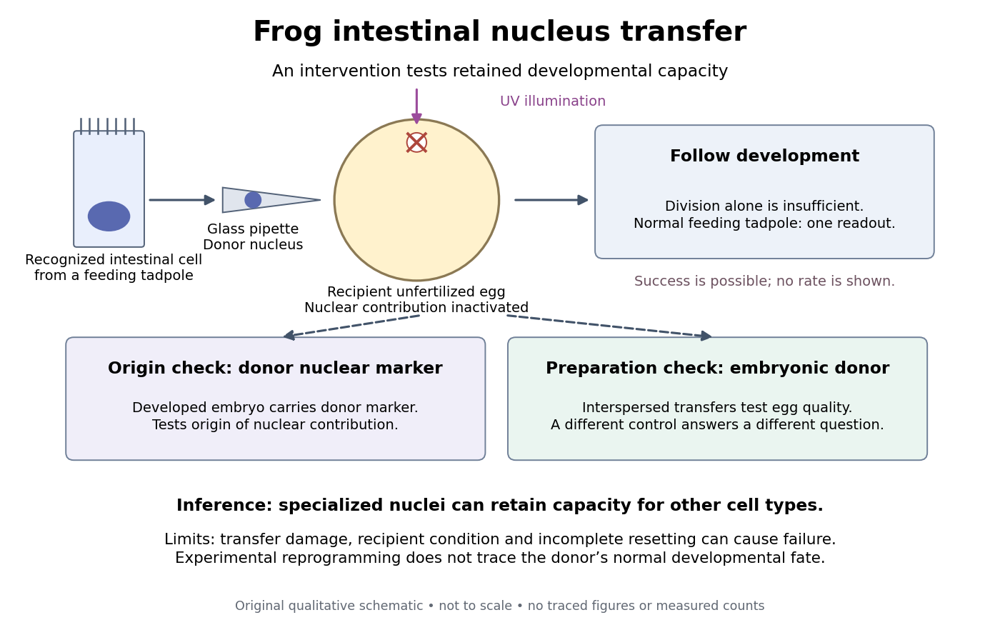

# Intestinal nucleus transfer experiment

↑ **Parent:** [Somatic cell nuclear transfer](somatic-cell-nuclear-transfer.md)

**Can a specialized donor still supply information for other cell types?** The 1962 [The Developmental Capacity of Nuclei taken from Intestinal Epithelium Cells of Feeding Tadpoles by J. B. Gurdon](https://doi.org/10.1242/dev.10.4.622) used mid-intestinal cells of feeding [Xenopus laevis](xenopus-laevis.md) tadpoles. Donors were recognized by columnar shape, basal [cell nuclei](cell-nucleus.md) and a striated absorptive border. Dissociation used Versene solution; this made individual donors accessible. The readout was subsequent development, including normal feeding tadpoles, rather than just division or survival. [Gurdon (1962), Material and Methods and Normal tadpoles; inspected primary text reproduced in the indexed Paperity preview](the-developmental-capacity-of-nuclei-taken-from-intestinal-epithelium-cells-of-feeding-tadpoles-by-j-b-gurdon.md)

**Apparatus and intervention.** A microscope with [ultraviolet](ultraviolet.md) illumination directed light at the surface region containing the unfertilized [ovum](ovum.md)'s [chromosomes](chromosome.md), inactivating the recipient nuclear contribution. Irradiation also softened the surrounding jelly so a glass micropipette could enter. The pipette delivered donor nuclear material into recipient [cytoplasm](cytoplasm.md). In the technique's validation, fertilizing irradiated eggs produced [haploid](haploid.md) embryos, supporting destruction of the maternal nuclear contribution. This is inactivation, not a diagram of surgically removing an intact [cell nucleus](cell-nucleus.md). [Gurdon, The Egg and the Nucleus: A Battle for Supremacy, The Technique of Nuclear Transfer in Xenopus; indexed authored Nobel lecture text inspected](the-egg-and-the-nucleus-a-battle-for-supremacy-by-j-b-gurdon.md)

**[Figure 4](#image-somatic-cell-nuclear-transfer-intervention-developmental-readout-and-distinct-controls). Somatic cell nuclear transfer: intervention, developmental readout and distinct controls**. Original apparatus-and-inference schematic, not a tracing of an experimental photograph. The [ultraviolet](ultraviolet.md) beam indicates inactivation of recipient nuclear material; the injection pipette supplies a donor [cell nucleus](cell-nucleus.md). Donor nuclear markers test origin; interspersed embryonic-donor transfers test recipient quality. Successful development is a possible outcome, not an asserted success rate. The figure omits exact dimensions, light dose and many technical steps.

**Controls ask different questions.** Donor [cell nuclei](cell-nucleus.md) carried a marker absent from recipients; post-[blastula](blastula.md) embryos carried that marker. The marker distinguished diploid donors with one [nucleolus](nucleolus.md) per [cell nucleus](cell-nucleus.md) from the usual two-[nucleolus](nucleolus.md) recipient background, rather than mistaking one [nucleolus](nucleolus.md) for proof of a [haploid](haploid.md) state. [Gurdon, Nobel lecture, The Technique of Nuclear Transfer in Xenopus, p. 233: one-nucleolus diploid marker and its use to establish donor nuclear origin](the-egg-and-the-nucleus-a-battle-for-supremacy-by-j-b-gurdon.md) Interspersed transfers of [blastula](blastula.md) or later embryonic [cell nuclei](cell-nucleus.md) checked variable recipient quality. A positive embryonic-donor control thus tests the preparation, while the marker tests donor origin. Abnormal development remained common. Neither control establishes universal transfer competence. [Gurdon (1962), Material and Methods (nuclear marker), Results (interspersed embryonic controls), and Normal tadpoles (abnormal outcomes); primary text inspected through the indexed preview](the-developmental-capacity-of-nuclei-taken-from-intestinal-epithelium-cells-of-feeding-tadpoles-by-j-b-gurdon.md)

**Inference and limits.** A successful marked donor demonstrates that specialization had not irreversibly removed all information required to build other cell types. Failure is less decisive: transfer damage, recipient condition and incomplete [cellular reprogramming](cellular-reprogramming.md) can also prevent development. The marker identifies nuclear origin; it is not a complete [DNA](deoxyribonucleic-acid.md) sequence comparison. The experiment tests donor nuclear potential in an altered [cytoplasm](cytoplasm.md), rather than normal donor [cell fate](cell-fate.md), a universal capacity of every donor, or development from a mature mammalian [red blood cell](red-blood-cell.md). The Nobel account also describes serial transfers through embryonic intermediates; these must not be silently combined with direct transfers into one success rate. [Nobel Assembly, Scientific background, Gurdon's nuclear-transfer experiments and serial transplantation](mature-cells-can-be-reprogrammed-to-become-pluripotent-by-nobel-assembly-at-karolinska-institutet.md)

## ↑ Ancestors (8)

1. [Somatic cell nuclear transfer](somatic-cell-nuclear-transfer.md)
2. [Cellular reprogramming](cellular-reprogramming.md)
3. [Cellular differentiation](cellular-differentiation.md)
4. [Developmental integration](developmental-integration.md)
5. [Multicellular organism](multicellular-organism.md)
6. [Organism](organism-split.md)
7. [Biology](biology-split.md)
8. [Codex Wiki](split.md)

## ← Incoming links (4)

- [Blastula](blastula.md)
- [Cell fate](cell-fate.md)
- [Terminal differentiation](terminal-differentiation.md)
- [Xenopus laevis](xenopus-laevis.md)
