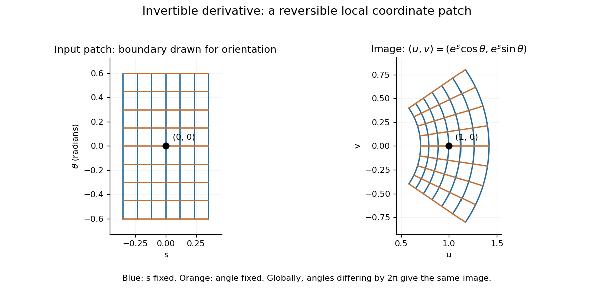

# Inverse function theorem

↑ **Parent:** [Differentiable map](differentiable-map.md)  
ⓦ [Wiki](https://en.wikipedia.org/wiki/Inverse_function_theorem)

The inverse function theorem answers a practical question: **can nearby outputs be used to recover nearby inputs uniquely and smoothly?** Its useful surprise is that a nonlinear [function](function-split.md) can be tested using its linear [derivative](derivative.md). If the first-order changes preserve all input directions, then, on a sufficiently small region, the nonlinear map can also be reversed. This is the basis for treating a nonlinear map as a [coordinate transformation](smooth-transition-map.md).

Precisely, let $f:U\to\mathbb R^n$ be [continuously differentiable](continuously-differentiable-function.md) on an [open subset](open-set.md) $U$ of [Euclidean space](euclidean-norm.md), let $a\in U$, and put $b=f(a)$. If $Df(a)$ is an [invertible linear map](invertible-linear-map.md), there are [open](open-set.md) [neighbourhoods](neighbourhood-mathematics.md) $U_0$ of $a$ and $V_0$ of $b$ such that $f:U_0\to V_0$ is a [bijection](bijection.md) with a [continuously differentiable](continuously-differentiable-function.md) [inverse function](inverse-function.md) $g$. Thus this [restriction](restriction-mathematics.md) is a [diffeomorphism](diffeomorphism.md). In coordinates the test is $\det Df(a)\ne0$, using the [Jacobian determinant](jacobian-determinant.md). The [derivative of a local inverse map](derivative-of-a-local-inverse-map.md) is obtained by inverting the [Jacobian matrix](jacobian-matrix.md), at the corresponding input. [University of Toronto MAT237: the inverse function theorem](https://www.math.utoronto.ca/courses/mat237y1/20199/notes/Chapter3/S3.3.html)

For a one-dimensional example, $f(x)=x^2$ has $f'(1)=2$. Near $x=1$, the [inverse function](inverse-function.md) is $g(y)=\sqrt y$, and the [inverse function rule](inverse-function-rule.md) gives $g'(1)=1/2$. But $x^2$ has no [inverse function](inverse-function.md) on the whole [real line](real-line.md), since $x$ and $-x$ give the same output. The theorem supplies a local [restriction](restriction-mathematics.md), not global [injectivity](injective-function.md). At zero, the derivative test fails; the nonnegative branch still has a [square root](square-root.md) inverse, but that inverse has no finite [derivative](derivative.md) at zero. [Jiří Lebl, Basic Analysis: the one-dimensional theorem and the square-root example](https://www.jirka.org/ra/html/sec_ift.html)

Here is a two-dimensional example with an invertible [derivative](derivative.md) everywhere and infinitely repeated outputs:

$$
f(s,\theta)=(e^s\cos\theta,e^s\sin\theta),\qquad
Df(s,\theta)=e^s
\begin{pmatrix}\cos\theta&-\sin\theta\\\sin\theta&\cos\theta\end{pmatrix},\qquad
\det Df=e^{2s}>0.
$$

The [exponential function](exponential-function.md) turns $s$ into a positive radius, while $\theta$ is the [angle](angle.md) in [polar coordinates](polar-coordinates.md). Restricting, for example, to $|s|<0.35$ and $|\theta|<0.6$ produces the reversible patch pictured below. On its image, with Cartesian coordinates $(u,v)$ and $u>0$, the [inverse function](inverse-function.md) is

$$
s=\frac12\log(u^2+v^2),\qquad \theta=\arctan(v/u).
$$

The [arctangent](inverse-tangent.md) selects the angle near zero. Without an angle [restriction](restriction-mathematics.md), $f(s,\theta+2\pi k)=f(s,\theta)$ for every [integer](integer.md) $k$, so there is no single global [inverse function](inverse-function.md). This map is a [local diffeomorphism](local-diffeomorphism.md) but is not [injective](injective-function.md).

**[Figure 34](#image-a-small-rectangular-coordinate-patch-maps-reversibly-to-a-curved-sector-despite-global-angle-repetition). A small rectangular coordinate patch maps reversibly to a curved sector, despite global angle repetition**.

The short proof idea is to correct a guessed input using the inverse linear response. With $A=Df(a)$, solving $f(x)=y$ is equivalent to finding a [fixed point](fixed-point.md) of

$$
T_y(x)=x+A^{-1}(y-f(x)).
$$

At $a$, the [derivative](derivative.md) $DT_y(a)=I-A^{-1}Df(a)$ vanishes. Continuity makes $T_y$ a [contraction mapping](contraction-mapping.md) on a sufficiently small [closed ball](closed-ball.md), which it maps into itself when $y$ is sufficiently close to $b$. The [contraction mapping theorem](contraction-mapping-theorem.md) then gives existence and uniqueness there. Establishing the smooth dependence on $y$ completes the inverse theorem. This explains why the nonlinearity can be tolerated: its correction has a small local slope.[§8.5: the contraction argument](basic-analysis-introduction-to-real-analysis-volume-ii-by-jiri-lebl/8-5-inverse-and-implicit-function-theorems.md)

**Table of contents**

- [Derivative of a local inverse map](derivative-of-a-local-inverse-map.md)
- [Constant rank theorem](constant-rank-theorem.md)
  - [Rank-one level curves from a characteristic differential equation](rank-one-level-curves-from-a-characteristic-differential-equation.md)
- [Local diffeomorphism](local-diffeomorphism.md)
  - [Noninjective map with constant Jacobian determinant](noninjective-map-with-constant-jacobian-determinant.md)
  - [Open map](open-map.md)
- [Implicit function theorem](implicit-function-theorem.md)
  - [Holomorphic implicit function theorem](holomorphic-implicit-function-theorem.md)
  - [Implicit differentiation](implicit-differentiation.md)
    - [Cyclic partial derivative identity](cyclic-partial-derivative-identity.md)

## ↑ Ancestors (8)

1. [Differentiable map](differentiable-map.md)
2. [Multivariable calculus](multivariable-calculus.md)
3. [Calculus](calculus-split.md)
4. [Real analysis](real-analysis-split.md)
5. [Analysis](analysis-split.md)
6. [Area of mathematics](area-of-mathematics.md)
7. [Mathematics](mathematics-split.md)
8. [Codex Wiki](split.md)

## ← Incoming links (79)

- [Constant rank theorem](constant-rank-theorem.md)
- [Cut-point dichotomy for complete Riemannian manifolds](cut-point-dichotomy-for-complete-riemannian-manifolds.md)
- [Derivative of a local inverse map](derivative-of-a-local-inverse-map.md)
- [Differential of the exponential map at zero](differential-of-the-exponential-map-at-zero.md)
- [Dimension bound for a commutative Euclidean normed algebra](dimension-bound-for-a-commutative-euclidean-normed-algebra.md)
- [Exponential map of a Lie group](exponential-map-of-a-lie-group.md)
- [Hamiltonian transitivity on a connected symplectic manifold](hamiltonian-transitivity-on-a-connected-symplectic-manifold.md)
- [Implicit function theorem](implicit-function-theorem.md)
- [Local degree of a continuous map](local-degree-of-a-continuous-map.md)
- [Local diffeomorphism](local-diffeomorphism.md)
- [Local exponential chart](local-exponential-chart.md)
- [Local extension of geodesic velocity](local-extension-of-geodesic-velocity.md)
- [Local product coordinates for a closed subgroup](local-product-coordinates-for-a-closed-subgroup.md)
- [Near-identity transformation](near-identity-transformation.md)
- [Noncharacteristic Cauchy data](noncharacteristic-cauchy-data.md)
- [Open map](open-map.md)
- [Solution](past-exam-of-the-mathematics-course-of-the-university-of-cambridge/2001/iii/paper-1/1/solution.md)
- [Solution](past-exam-of-the-mathematics-course-of-the-university-of-cambridge/2001/iii/paper-12/4/solution.md)
- [Solution](past-exam-of-the-mathematics-course-of-the-university-of-cambridge/2002/iii/paper-14/3/solution.md)
- [Solution](past-exam-of-the-mathematics-course-of-the-university-of-cambridge/2003/iii/paper-14/5/solution.md)
- [Solution](past-exam-of-the-mathematics-course-of-the-university-of-cambridge/2003/iii/paper-16/3/b/solution.md)
- [Solution](past-exam-of-the-mathematics-course-of-the-university-of-cambridge/2003/iii/paper-27/2/solution.md)
- [Solution](past-exam-of-the-mathematics-course-of-the-university-of-cambridge/2004/ib/paper-4/13f/solution.md)
- [Solution](past-exam-of-the-mathematics-course-of-the-university-of-cambridge/2004/iii/paper-14/4/solution.md)
- [Solution](past-exam-of-the-mathematics-course-of-the-university-of-cambridge/2004/iii/paper-20/1/i/solution.md)
- [Solution](past-exam-of-the-mathematics-course-of-the-university-of-cambridge/2005/ii/paper-1/24h/ii/solution.md)
- [Solution](past-exam-of-the-mathematics-course-of-the-university-of-cambridge/2005/iii/paper-15/2/solution.md)
- [Solution](past-exam-of-the-mathematics-course-of-the-university-of-cambridge/2006/ib/paper-3/13f/solution.md)
- [Solution](past-exam-of-the-mathematics-course-of-the-university-of-cambridge/2006/ii/paper-1/24h/a/solution.md)
- [Solution](past-exam-of-the-mathematics-course-of-the-university-of-cambridge/2006/ii/paper-2/24h/a/solution.md)
- [Solution](past-exam-of-the-mathematics-course-of-the-university-of-cambridge/2006/iii/paper-20/1/solution.md)
- [Solution](past-exam-of-the-mathematics-course-of-the-university-of-cambridge/2007/ii/paper-1/24h/i/solution.md)
- [Solution](past-exam-of-the-mathematics-course-of-the-university-of-cambridge/2007/ii/paper-1/29a/i/solution.md)
- [Solution](past-exam-of-the-mathematics-course-of-the-university-of-cambridge/2007/ii/paper-2/24h/iii/solution.md)
- [Solution](past-exam-of-the-mathematics-course-of-the-university-of-cambridge/2007/iii/paper-42/1/solution.md)
- [Solution](past-exam-of-the-mathematics-course-of-the-university-of-cambridge/2007/iii/paper-71/6/solution.md)
- [Solution](past-exam-of-the-mathematics-course-of-the-university-of-cambridge/2008/ii/paper-1/29c/i/solution.md)
- [Solution](past-exam-of-the-mathematics-course-of-the-university-of-cambridge/2009/iii/paper-19/1/solution.md)
- [Solution](past-exam-of-the-mathematics-course-of-the-university-of-cambridge/2010/iii/paper-1/5/c/solution.md)
- [Solution](past-exam-of-the-mathematics-course-of-the-university-of-cambridge/2010/iii/paper-15/4/b/solution.md)
- [Solution](past-exam-of-the-mathematics-course-of-the-university-of-cambridge/2011/ii/paper-1/25i/solution.md)
- [Solution](past-exam-of-the-mathematics-course-of-the-university-of-cambridge/2011/ii/paper-3/30a/a/solution.md)
- [Solution](past-exam-of-the-mathematics-course-of-the-university-of-cambridge/2012/iii/paper-19/4/solution.md)
- [Solution](past-exam-of-the-mathematics-course-of-the-university-of-cambridge/2012/iii/paper-20/1/iii/solution.md)
- [Solution](past-exam-of-the-mathematics-course-of-the-university-of-cambridge/2012/iii/paper-20/3/ii/solution.md)
- [Solution](past-exam-of-the-mathematics-course-of-the-university-of-cambridge/2012/iii/paper-55/2/solution.md)
- [Solution](past-exam-of-the-mathematics-course-of-the-university-of-cambridge/2014/iii/paper-52/1/a/solution.md)
- [Solution](past-exam-of-the-mathematics-course-of-the-university-of-cambridge/2015/iii/paper-15/1/solution.md)
- [Solution](past-exam-of-the-mathematics-course-of-the-university-of-cambridge/2015/iii/paper-17/4/solution.md)
- [Solution](past-exam-of-the-mathematics-course-of-the-university-of-cambridge/2015/iii/paper-2/6/solution.md)
- [Solution](past-exam-of-the-mathematics-course-of-the-university-of-cambridge/2015/iii/paper-5/1/3/b/solution.md)
- [Solution](past-exam-of-the-mathematics-course-of-the-university-of-cambridge/2015/iii/paper-52/1/a/solution.md)
- [Solution](past-exam-of-the-mathematics-course-of-the-university-of-cambridge/2015/iii/paper-52/4/b/iv/solution.md)
- [Solution](past-exam-of-the-mathematics-course-of-the-university-of-cambridge/2016/iii/paper-308/2/solution.md)
- [Solution](past-exam-of-the-mathematics-course-of-the-university-of-cambridge/2017/ii/paper-4/24i/solution.md)
- [Solution](past-exam-of-the-mathematics-course-of-the-university-of-cambridge/2017/iii/paper-114/2/solution.md)
- [Solution](past-exam-of-the-mathematics-course-of-the-university-of-cambridge/2017/iii/paper-131/2/solution.md)
- [Solution](past-exam-of-the-mathematics-course-of-the-university-of-cambridge/2018/ib/paper-1/11f/a/solution.md)
- [Solution](past-exam-of-the-mathematics-course-of-the-university-of-cambridge/2018/ii/paper-2/25i/a/solution.md)
- [Solution](past-exam-of-the-mathematics-course-of-the-university-of-cambridge/2019/ib/paper-2/3e/b/solution.md)
- [Solution](past-exam-of-the-mathematics-course-of-the-university-of-cambridge/2019/ii/paper-4/19i/c/iii/solution.md)
- [Solution](past-exam-of-the-mathematics-course-of-the-university-of-cambridge/2020/ib/paper-1/10e/solution.md)
- [Solution](past-exam-of-the-mathematics-course-of-the-university-of-cambridge/2021/ia/paper-1/9f/b/iv/solution.md)
- [Solution](past-exam-of-the-mathematics-course-of-the-university-of-cambridge/2021/ii/paper-3/23f/b/solution.md)
- [Solution](past-exam-of-the-mathematics-course-of-the-university-of-cambridge/2022/ib/paper-2/10g/solution.md)
- [Solution](past-exam-of-the-mathematics-course-of-the-university-of-cambridge/2022/ii/paper-2/26i/solution.md)
- [Solution](past-exam-of-the-mathematics-course-of-the-university-of-cambridge/2022/ii/paper-4/22g/c/solution.md)
- [Solution](past-exam-of-the-mathematics-course-of-the-university-of-cambridge/2023/ib/paper-3/11g/solution.md)
- [Solution](past-exam-of-the-mathematics-course-of-the-university-of-cambridge/2023/iii/paper-115/1/a/solution.md)
- [Solution](past-exam-of-the-mathematics-course-of-the-university-of-cambridge/2024/iii/paper-115/4/b/solution.md)
- [Solution](past-exam-of-the-mathematics-course-of-the-university-of-cambridge/2025/ib/paper-4/10g/solution.md)
- [Solution](past-exam-of-the-mathematics-course-of-the-university-of-cambridge/2025/iii/paper-115/4/a/solution.md)
- [Regular gauge slice](regular-gauge-slice.md)
- [Regular Lagrangian](regular-lagrangian.md)
- [Regular zero hypersurfaces have disconnected complements](regular-zero-hypersurfaces-have-disconnected-complements.md)
- [Smooth completing-square proof of the Morse lemma](smooth-completing-square-proof-of-the-morse-lemma.md)
- [Smooth submanifolds with invariant complex tangent spaces are complex](smooth-submanifolds-with-invariant-complex-tangent-spaces-are-complex.md)
- [Straightening theorem](straightening-theorem.md)
- [Tubular neighborhood theorem](tubular-neighborhood-theorem.md)
