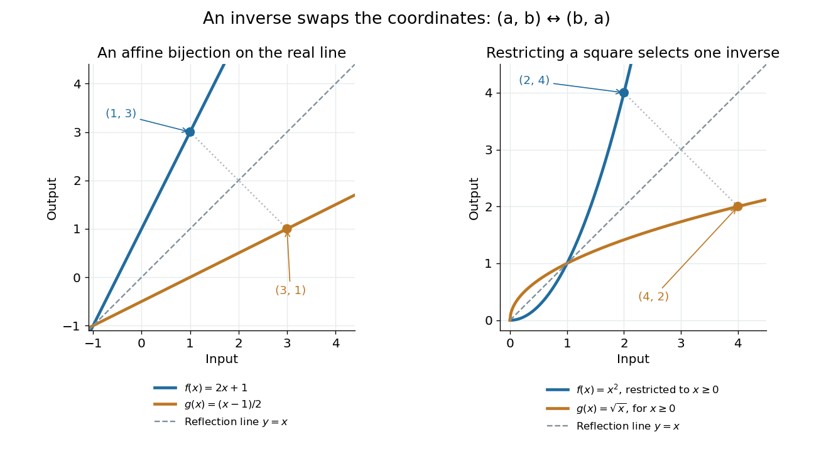

# Inverse function

↑ **Parent:** [Function](function-split.md)  
ⓦ [Wiki](https://en.wikipedia.org/wiki/Inverse_function)

An [inverse function](inverse-function.md) reverses a [bijection](bijection.md). For $f:X\to Y$, it is a [function](function-split.md) $g:Y\to X$ satisfying

$$
g\circ f=\operatorname{id}_X,\qquad f\circ g=\operatorname{id}_Y.
$$

Equivalently, $g(f(x))=x$ for all $x\in X$ and $f(g(y))=y$ for all $y\in Y$. We write $g=f^{-1}$. The superscript denotes reversal through [function composition](function-composition.md); it does not mean the pointwise [multiplicative inverse](multiplicative-inverse.md) $1/f(x)$. The [preimage](preimage.md) notation $f^{-1}(B)$ for a [set](set-split.md) $B$ is also distinct: a [preimage](preimage.md) exists even when no [inverse function](inverse-function.md) exists.

For a computed example, let $f:\mathbb R\to\mathbb R$ be $f(x)=2x+1$. Solving $y=2x+1$ for $x$ gives $g(y)=(y-1)/2$. Thus $f(1)=3$ and $g(3)=1$; direct substitution gives $g(f(x))=x$ and $f(g(y))=y$ throughout the [real line](real-line.md). In contrast, $1/f(3)=1/7$, which does not undo $f(1)=3$.

Why must $f$ be a [bijection](bijection.md)? If $f(x_1)=f(x_2)$, applying $g$ gives $x_1=x_2$, proving [injectivity](injective-function.md). For any $y\in Y$, the equation $f(g(y))=y$ supplies a source element, proving [surjectivity](surjective-function.md). Conversely, a [bijection](bijection.md) supplies exactly one predecessor for each $y$, defining a unique [inverse function](inverse-function.md). A [left inverse](left-inverse.md) or [right inverse](right-inverse.md) requires only one of the two composition identities.

For $f(x)=x^2$ on the [real line](real-line.md), the equation $f(x)=4$ has two solutions, $x=\pm2$, so its arrows cannot be reversed as one [function](function-split.md) on all inputs. The [restriction](restriction-mathematics.md) to $[0,\infty)$ removes that ambiguity. As a [bijection](bijection.md) from $[0,\infty)$ onto $[0,\infty)$, it has [inverse function](inverse-function.md) $g(y)=\sqrt y$. The identity $\sqrt{x^2}=|x|$ explains why $\sqrt{x^2}=x$ works on the restricted [domain of a function](domain-of-a-function.md) but fails for negative $x$. [OpenStax, inverse functions and domain restrictions](https://openstax.org/books/calculus-volume-1/pages/1-4-inverse-functions).

**[Figure 3](#image-an-inverse-function-swaps-the-input-and-output-coordinates). An inverse function swaps the input and output coordinates**. Left: the [function graphs](graph-of-a-function.md) of $f(x)=2x+1$ and its [inverse function](inverse-function.md) $g(x)=(x-1)/2$ are reflections across the [line](straight-line.md) $y=x$; the points $(1,3)$ and $(3,1)$ correspond. Right: the nonnegative [restriction](restriction-mathematics.md) $x\mapsto x^2$ and the [square root](square-root.md) have the same reflection relation. Their displayed portions lie in the first [quadrant](quadrant-plane-geometry.md) or on its [boundary](boundary-of-a-set.md).

More generally, $(a,b)$ lies on the [graph of a function](graph-of-a-function.md) $f$ precisely when $(b,a)$ lies on the [graph of a function](graph-of-a-function.md) of its [inverse function](inverse-function.md). This coordinate swap explains the geometric reflection and the [horizontal line test](horizontal-line-test.md). It also explains why inverse sensitivity is reciprocal locally: the [inverse function rule](inverse-function-rule.md) divides by the original [derivative](derivative.md) at the corresponding input, when that [derivative](derivative.md) is nonzero.

**Table of contents**

- [Horizontal line test](horizontal-line-test.md)
- [Inverse function rule](inverse-function-rule.md)
- [Right inverse](right-inverse.md)
  - [Right-inverse characterization of the axiom of choice](right-inverse-characterization-of-the-axiom-of-choice.md)
- [Left inverse](left-inverse.md)

## ↑ Ancestors (6)

1. [Function](function-split.md)
2. [Set theory](set-theory-split.md)
3. [Foundations of mathematics](foundations-of-mathematics-split.md)
4. [Area of mathematics](area-of-mathematics.md)
5. [Mathematics](mathematics-split.md)
6. [Codex Wiki](split.md)

## ← Incoming links (48)

- [Bijection](bijection.md)
- [Cantor-Schröder-Bernstein theorem](cantor-schroder-bernstein-theorem.md)
- [Cayley transform between the half-plane and disk](cayley-transform-between-the-half-plane-and-disk.md)
- [Cold-junction compensation](cold-junction-compensation.md)
- [Conformal automorphism of the upper half-plane](conformal-automorphism-of-the-upper-half-plane.md)
- [Cubic series reversion](cubic-series-reversion.md)
- [Cyclic permutation](cyclic-permutation.md)
- [Derivative of a local inverse map](derivative-of-a-local-inverse-map.md)
- [Differential entropy of a squared uniform variable](differential-entropy-of-a-squared-uniform-variable.md)
- [Discrete wavelet transform](discrete-wavelet-transform.md)
- [Essential range](essential-range.md)
- [Exponential function](exponential-function.md)
- [Fiber of a function](fiber-of-a-function.md)
- [Function](function-split.md)
- [Group automorphism](group-automorphism.md)
- [Horizontal line test](horizontal-line-test.md)
- [Identity function](identity-function.md)
- [Image and preimage of a function](image-and-preimage-of-a-function.md)
- [Implicit function theorem](implicit-function-theorem.md)
- [Injection-chain proof of the Cantor-Schröder-Bernstein theorem](injection-chain-proof-of-the-cantor-schroder-bernstein-theorem.md)
- [Interval bisection](interval-bisection.md)
- [Inverse Ackermann function](inverse-ackermann-function.md)
- [Inverse element](inverse-element.md)
- [Inverse error function](inverse-error-function.md)
- [Inverse function](inverse-function.md)
- [Inverse function rule](inverse-function-rule.md)
- [Inverse function theorem](inverse-function-theorem.md)
- [Local diffeomorphism](local-diffeomorphism.md)
- [Logarithm](logarithm.md)
- [Monotonic function](monotonic-function.md)
- [Natural logarithm](natural-logarithm.md)
- [Pairing function](pairing-function.md)
- [Solution](past-exam-of-the-mathematics-course-of-the-university-of-cambridge/2007/iii/paper-42/1/solution.md)
- [Solution](past-exam-of-the-mathematics-course-of-the-university-of-cambridge/2011/ia/paper-4/1e/i/solution.md)
- [Solution](past-exam-of-the-mathematics-course-of-the-university-of-cambridge/2011/ia/paper-4/1e/solution.md)
- [Solution](past-exam-of-the-mathematics-course-of-the-university-of-cambridge/2016/iii/paper-112/1/i/solution.md)
- [Solution](past-exam-of-the-mathematics-course-of-the-university-of-cambridge/2018/iii/paper-210/1/solution.md)
- [Solution](past-exam-of-the-mathematics-course-of-the-university-of-cambridge/2024/iii/paper-202/4/b/solution.md)
- [Preimage](preimage.md)
- [Primitive recursive pairing function](primitive-recursive-pairing-function.md)
- [Quantile function](quantile-function.md)
- [Restriction (mathematics)](restriction-mathematics.md)
- [Sparse-shift bijection between nonnegative and positive integers](sparse-shift-bijection-between-nonnegative-and-positive-integers.md)
- [Stereographic projection](stereographic-projection.md)
- [Strictly decreasing function](strictly-decreasing-function.md)
- [Strictly increasing function](strictly-increasing-function.md)
- [Thermometer](thermometer.md)
- [Two stereographic charts on the circle](two-stereographic-charts-on-the-circle.md)
