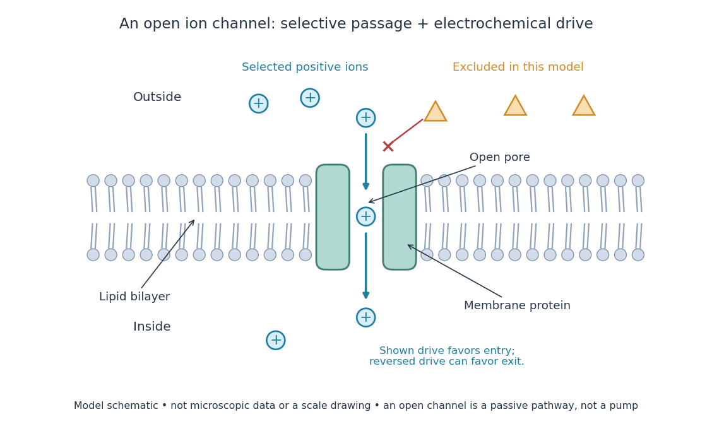

# Ion channel

↑ **Parent:** [Cell membrane](cell-membrane-split.md)  
ⓦ [Wiki](https://en.wikipedia.org/wiki/Ion_channel)

An [ion channel](ion-channel.md) is a [membrane protein](membrane-protein.md) that provides a selective pathway for [ions](ion.md) across a [cell membrane](cell-membrane-split.md). An open pore permits [passive transport](passive-transport.md) down the relevant [electrochemical gradient](electrochemical-gradient.md); it does not supply the [free energy](thermodynamic-free-energy.md) for uphill transport as a pump involved in [active transport](active-transport.md) does. Two things are needed for a net [electric current](electric-current.md): an available pathway and an [electrochemical potential](electrochemical-potential.md) difference. Opening a pore alone need not produce a net [electric current](electric-current.md). See [Ion Channels and the Electrical Properties of Membranes](molecular-biology-of-the-cell-4th-edition-by-bruce-alberts-and-others/ion-channels-and-the-electrical-properties-of-membranes.md).

The [selective permeability](selective-permeability.md) of an [ion channel](ion-channel.md) depends on interactions between its pore and the passing [ions](ion.md), not simply on a hole's diameter. Some [ion channels](ion-channel.md) strongly favor [potassium](potassium.md) over [sodium](sodium.md); others admit several kinds of positively charged [ions](ion.md). Thus selective does not necessarily mean exclusive to one [ion](ion.md) species. See [Purves et al., Neuroscience, 2nd edition (2001): molecular structure of ion channels](https://www.ncbi.nlm.nih.gov/books/NBK11123/) and the mixed-channel example in [Purves et al.: principles derived from studies of the neuromuscular junction](https://www.ncbi.nlm.nih.gov/books/NBK11013/).

**[Figure 4](#image-an-open-ion-channel-supplies-a-selective-passive-pathway). An open ion channel supplies a selective passive pathway**. Original model schematic: selected positive [ions](ion.md) can traverse a pore in a [membrane protein](membrane-protein.md), while the differently shaped particles are excluded from this modeled pore. The arrow shows one possible net direction when the corresponding [electrochemical gradient](electrochemical-gradient.md) favors entry; the pore does not enforce that direction. Shapes, particle counts and dimensions are illustrative, not physical microscopic data or a universal selectivity rule.

Gating is the opening and closing of an [ion channel](ion-channel.md)'s pathway. A [voltage-gated ion channel](voltage-gated-ion-channel.md) responds to [membrane potential](membrane-potential-split.md); an [ionotropic receptor](ionotropic-receptor.md) can respond to a bound [ligand](ligand-biochemistry.md). Gating changes the available [electrical conductance](electrical-conductance.md), while the [electrochemical gradient](electrochemical-gradient.md) supplies the drive for [passive transport](passive-transport.md). For a fixed [reversal potential](reversal-potential.md) in the simple model below, opening more identical [ion channels](ion-channel.md) increases the magnitude of the [electric current](electric-current.md) at a fixed nonzero drive, without choosing its sign independently of [membrane potential](membrane-potential-split.md). The [two-state ion-channel gating](two-state-ion-channel-gating.md) model describes how the open fraction can change. See the Alberts reference above.

For a worked approximation, hold an open population's [electrical conductance](electrical-conductance.md) at $g=10\,\mathrm{nS}$ and its [reversal potential](reversal-potential.md) at $E_{\mathrm{rev}}=-80\,\mathrm{mV}$. Use $V=V_{\mathrm{inside}}-V_{\mathrm{outside}}$ for [membrane potential](membrane-potential-split.md) and **inward-positive [conventional current](conventional-current.md)**:

$$
I_{\mathrm{in}}=g(E_{\mathrm{rev}}-V),\qquad g\geq0.
$$

At $V=-100,-80,-60\,\mathrm{mV}$, respectively, the [electric currents](electric-current.md) are $+200,0,-200\,\mathrm{pA}$, since $1\,\mathrm{nS}\times1\,\mathrm{mV}=1\,\mathrm{pA}$. Positive [electric current](electric-current.md) means net positive [electric charge](electric-charge-split.md) entering, or net negative [electric charge](electric-charge-split.md) leaving; it does not mean that every [ion](ion.md) moves inward. For a pore passing only positive [ions](ion.md), the three results mean net inward passage, no net passage, and net outward passage. These stipulated values describe an illustrative Ohmic approximation, not measured properties of a particular [ion channel](ion-channel.md); see [reversal potential](reversal-potential.md) for the current plot and limitations.

The useful connection is between a molecular gate and a controllable [electric current](electric-current.md). A [ligand](ligand-biochemistry.md) can change [electrical conductance](electrical-conductance.md) through an [ionotropic receptor](ionotropic-receptor.md), or [membrane potential](membrane-potential-split.md) can change it through a [voltage-gated ion channel](voltage-gated-ion-channel.md), connecting recognition and electrical signaling. In a historical landmark, Erwin Neher and Bert Sakmann reported currents from individual [ion channels](ion-channel.md) in frog muscle membranes in 1976. See [Neher and Sakmann, Single-channel currents recorded from membrane of denervated frog muscle fibres, Nature 260, 799–802 (1976)](https://doi.org/10.1038/260799a0).

**Table of contents**

- [GORK](gork.md)
- [SLAC1](slac1.md)
- [Mechanosensitive ion channel](mechanosensitive-ion-channel.md)
  - [MscL](mscl.md)
  - [MscS](mscs.md)
- [Channel desensitization](channel-desensitization.md)
- [Ligand-gated ion channel](ligand-gated-ion-channel.md)
- [Selectivity filter](selectivity-filter.md)
- [ATP-sensitive potassium channel](atp-sensitive-potassium-channel.md)

## ↑ Ancestors (4)

1. [Cell membrane](cell-membrane-split.md)
2. [Biological cell](biological-cell-split.md)
3. [Biology](biology-split.md)
4. [Codex Wiki](split.md)

## ← Incoming links (43)

- [Calcium microdomain](calcium-microdomain.md)
- [Cell membrane](cell-membrane-split.md)
- [Cell-surface receptor](cell-surface-receptor.md)
- [Chemical synapse](chemical-synapse.md)
- [Cytosol dialysis](cytosol-dialysis.md)
- [Facilitated diffusion](facilitated-diffusion.md)
- [G protein-coupled receptor](g-protein-coupled-receptor.md)
- [Hodgkin-Huxley model](hodgkin-huxley-model.md)
- [Independent permissive gates in an ion channel](independent-permissive-gates-in-an-ion-channel.md)
- [Inositol trisphosphate receptor](inositol-trisphosphate-receptor.md)
- [Inside-out patch](inside-out-patch.md)
- [Ion channel](ion-channel.md)
- [Ion-channel inactivation](ion-channel-inactivation.md)
- [Ionotropic receptor](ionotropic-receptor.md)
- [Membrane capacitance](membrane-capacitance.md)
- [Membrane potential](membrane-potential-split.md)
- [Membrane protein](membrane-protein.md)
- [Membrane transport](membrane-transport.md)
- [Metabotropic receptor](metabotropic-receptor.md)
- [Neuron](neuron.md)
- [NMDA receptor](nmda-receptor.md)
- [Passive dendritic cable](passive-dendritic-cable.md)
- [Passive membrane response in current clamp](passive-membrane-response-in-current-clamp.md)
- [Passive transport](passive-transport.md)
- [Solution](past-exam-of-the-biochemistry-and-molecular-biology-course-of-the-university-of-cambridge/2025/paper-1/section-d/10/solution.md)
- [Solution](past-exam-of-the-biochemistry-course-of-the-university-of-cambridge/2025/paper-1/section-i/2/solution.md)
- [Solution](past-exam-of-the-biochemistry-course-of-the-university-of-cambridge/2025/paper-1/section-ii/5/solution.md)
- [Solution](past-exam-of-the-plant-sciences-course-of-the-university-of-cambridge/2024/paper-plm1/1/solution.md)
- [Patch clamp](patch-clamp.md)
- [Phospholipid](phospholipid.md)
- [Receptor (biochemistry)](receptor-biochemistry.md)
- [Reversal potential](reversal-potential.md)
- [Seal leak current](seal-leak-current.md)
- [Shunting inhibition](shunting-inhibition.md)
- [Signal transduction](signal-transduction-split.md)
- [Single-channel current-voltage relation](single-channel-current-voltage-relation.md)
- [Single-channel recording](single-channel-recording.md)
- [Spatial summation](spatial-summation.md)
- [Synapse](synapse.md)
- [Synaptic conductance](synaptic-conductance.md)
- [Synaptic integration](synaptic-integration.md)
- [Two-state ion-channel gating](two-state-ion-channel-gating.md)
- [Whole-cell recording](whole-cell-recording.md)
