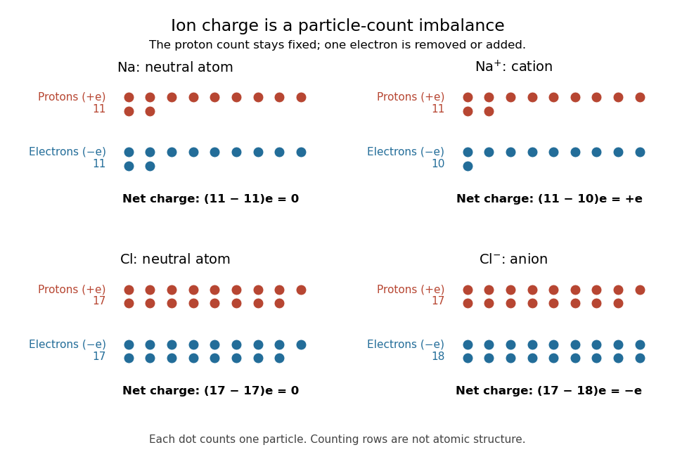

# Ion

↑ **Parent:** [Chemistry](chemistry-split.md)

An [ion](ion.md) is a [chemical atom](atom-physics.md) or a group of [chemical atoms](atom-physics.md) with a nonzero net [electric charge](electric-charge.md). A positive [ion](ion.md) is a [cation](cation.md); a negative [ion](ion.md) is an [anion](anion.md). The whole entity carries the [electric charge](electric-charge.md): a [hydronium](hydronium.md) [ion](ion.md) is a group of four [chemical atoms](atom-physics.md) with net charge $+e$. This definition agrees with [IUPAC Gold Book: ion](https://goldbook.iupac.org/terms/view/I03158).

For an ordinary [ion](ion.md) containing only [atomic nuclei](atomic-nucleus.md) and [Electrons](electron.md), let $N_p$ count all its [protons](proton.md) and $N_e$ all its [Electrons](electron.md). Each [proton](proton.md) contributes the [elementary charge](elementary-charge.md) $+e$, each [Electron](electron.md) contributes $-e$, and [neutrons](neutron.md) contribute zero. Therefore

$$
q=(N_p-N_e)e=ze,\qquad z=N_p-N_e.
$$

The signed integer $z$ is the net [electric charge](electric-charge.md) number. Removing an [Electron](electron.md) increases $z$ by one; adding an [Electron](electron.md) decreases $z$ by one. Changing the [Electron](electron.md) count leaves the [atomic number](atomic-number.md), and therefore the identity of the [chemical element](chemical-element.md), unchanged.

For example, a neutral [sodium](sodium.md) [chemical atom](atom-physics.md) has $11$ [protons](proton.md) and $11$ [Electrons](electron.md). Its [cation](cation.md) $\mathrm{Na}^+$ still has $11$ [protons](proton.md), but only $10$ [Electrons](electron.md), so $q=(11-10)e=+e$. A neutral [chlorine](chlorine.md) [chemical atom](atom-physics.md) has $17$ [protons](proton.md) and $17$ [Electrons](electron.md); its [anion](anion.md) $\mathrm{Cl}^-$ has $17$ [protons](proton.md) and $18$ [Electrons](electron.md), so $q=(17-18)e=-e$. These are particle inventories, not pictures of [atomic orbitals](atomic-orbital.md). See [2.6 Ionic and Molecular Compounds](chemistry-2e-by-paul-flowers-and-others/2-6-ionic-and-molecular-compounds.md) (§2.6: ions and ionic compounds).

**[Figure 44](#image-ion-electric-charge-bookkeeping-neutral-sodium-and-chlorine-chemical-atoms-compared-with-their-cation-and-anion). Ion electric charge bookkeeping: neutral sodium and chlorine chemical atoms compared with their cation and anion**. Every colored dot counts one [proton](proton.md) or one [Electron](electron.md). Rows are counting arrays, not spatial models of [atomic nuclei](atomic-nucleus.md) or [electron shells](electron-shell.md). The net [electric charges](electric-charge.md) are $0,+e,0,-e$.

One [sodium chloride](sodium-chloride.md) [formula unit](formula-unit.md) accounts for one $\mathrm{Na}^+$ [cation](cation.md) and one $\mathrm{Cl}^-$ [anion](anion.md), whose net [electric charges](electric-charge.md) sum to zero. Ordinary solid [sodium chloride](sodium-chloride.md) is an extended arrangement of [ions](ion.md), rather than discrete $\mathrm{NaCl}$ [molecules](molecule.md). This is a useful distinction: a neutral material can contain charged constituents, and its [chemical formula](chemical-formula.md) tells us their ratio without claiming that each pair is a separate [molecule](molecule.md).

[Ion](ion.md) bookkeeping connects [chemistry](chemistry-split.md) to [electric current](electric-current.md): moving [ions](ion.md) can transport [electric charge](electric-charge.md), while stationary [ions](ion.md) cannot supply a transport [current density](current-density.md). In [electrochemistry](electrochemistry.md), both signs of [ions](ion.md) can contribute to the same [conventional current](conventional-current.md). An [ion](ion.md) opposing a fixed [electric charge](electric-charge.md) is called a [counterion](counterion.md).

**Table of contents**

- [Cation](cation.md)
- [Anion](anion.md)
  - [Chloride](chloride.md)
  - [Permanganate](permanganate.md)
  - [Nitrate](nitrate.md)
- [Hydrogen ion](hydrogen-ion.md)
- [Hydronium](hydronium.md)
- [Hydroxide](hydroxide.md)
- [Counterion](counterion.md)

## ↑ Ancestors (2)

1. [Chemistry](chemistry-split.md)
2. [Codex Wiki](split.md)

## ← Incoming links (138)

- [Acetic acid](acetic-acid.md)
- [Acidic permanganate-iron balance](acidic-permanganate-iron-balance.md)
- [Action potential](action-potential.md)
- [Active transport](active-transport.md)
- [Adenosine triphosphate](adenosine-triphosphate.md)
- [Amount of substance](amount-of-substance.md)
- [Anion](anion.md)
- [Atomic number](atomic-number.md)
- [Base pairing](base-pairing.md)
- [Bond-dissociation energy](bond-dissociation-energy.md)
- [Born-Haber cycle](born-haber-cycle.md)
- [Buffer capacity of a monoprotic acid](buffer-capacity-of-a-monoprotic-acid.md)
- [Cathode](cathode.md)
- [Cation](cation.md)
- [Cell membrane](cell-membrane.md)
- [Charge carrier](charge-carrier.md)
- [Chemical element](chemical-element.md)
- [Chemical environment dependence of electronegativity](chemical-environment-dependence-of-electronegativity.md)
- [Chemical equation](chemical-equation.md)
- [Chemical formula](chemical-formula.md)
- [Chemical synapse](chemical-synapse.md)
- [Citrate](citrate.md)
- [Conductivity experiment on salt solutions](conductivity-experiment-on-salt-solutions.md)
- [Conductometric determination of activation energy](conductometric-determination-of-activation-energy.md)
- [Conductometric saponification assay](conductometric-saponification-assay.md)
- [Conjugate base](conjugate-base.md)
- [Coordination number](coordination-number.md)
- [Copper(II) sulfate](copper-ii-sulfate.md)
- [Counterion](counterion.md)
- [Counterion condensation](counterion-condensation.md)
- [Crystallographic defect](crystallographic-defect.md)
- [Cylindrical screening charge](cylindrical-screening-charge.md)
- [Cytosol](cytosol.md)
- [Cytosol dialysis](cytosol-dialysis.md)
- [Daniell cell](daniell-cell.md)
- [Desolvation](desolvation.md)
- [Dissociation of an ionic compound](dissociation-of-an-ionic-compound.md)
- [Dissolution](dissolution.md)
- [Electrochemical gradient](electrochemical-gradient.md)
- [Electrochemical potential](electrochemical-potential.md)
- [Electrochemistry](electrochemistry.md)
- [Electrode](electrode.md)
- [Electrolysis](electrolysis.md)
- [Electrolyte](electrolyte.md)
- [Electron affinity](electron-affinity.md)
- [Electron configuration](electron-configuration.md)
- [Electron magnetohydrodynamics](electron-magnetohydrodynamics.md)
- [Electronegativity](electronegativity.md)
- [Elementary charge](elementary-charge.md)
- [Enzyme](enzyme.md)
- [Equal-density ion-neutral Alfvén dispersion relation](equal-density-ion-neutral-alfven-dispersion-relation.md)
- [Faraday constant](faraday-constant.md)
- [Fast-time electron-MHD limit of Hall magnetohydrodynamics](fast-time-electron-mhd-limit-of-hall-magnetohydrodynamics.md)
- [Finite titrant response of a buffer](finite-titrant-response-of-a-buffer.md)
- [Formula unit](formula-unit.md)
- [Galvanic cell](galvanic-cell.md)
- [Glycine titration](glycine-titration.md)
- [Hall magnetohydrodynamics](hall-magnetohydrodynamics.md)
- [Henderson-Hasselbalch equation](henderson-hasselbalch-equation.md)
- [Heterolysis](heterolysis.md)
- [Hydration shell](hydration-shell.md)
- [Hydrochloric acid](hydrochloric-acid.md)
- [Hydronium](hydronium.md)
- [Insulin](insulin.md)
- [Ion](ion.md)
- [Ion channel](ion-channel.md)
- [Ion-dipole attraction](ion-dipole-attraction.md)
- [Ion pair](ion-pair.md)
- [Ionic bonding](ionic-bonding.md)
- [Ionic crystal](ionic-crystal.md)
- [Ionic strength](ionic-strength.md)
- [Ionotropic receptor](ionotropic-receptor.md)
- [Isotope](isotope.md)
- [Lattice energy](lattice-energy.md)
- [Lattice enthalpy from solution calorimetry](lattice-enthalpy-from-solution-calorimetry.md)
- [Lewis structure](lewis-structure.md)
- [Ligand (biochemistry)](ligand-biochemistry.md)
- [Ligand-dependent membrane phosphorylation experiment](ligand-dependent-membrane-phosphorylation-experiment.md)
- [Mass spectrograph](mass-spectrograph.md)
- [Mass spectrometry](mass-spectrometry.md)
- [Mass spectrum](mass-spectrum.md)
- [Mass-to-charge ratio](mass-to-charge-ratio.md)
- [Membrane transport](membrane-transport.md)
- [Metabotropic receptor](metabotropic-receptor.md)
- [Molecular count and amount of substance](molecular-count-and-amount-of-substance.md)
- [Molecular orbital theory](molecular-orbital-theory.md)
- [Molecularity](molecularity.md)
- [Nernst equilibrium potential](nernst-equilibrium-potential.md)
- [Nitrate](nitrate.md)
- [Nonelectrolyte](nonelectrolyte.md)
- [Oxidation state](oxidation-state.md)
- [Oxidation state sum rule](oxidation-state-sum-rule.md)
- [Passive transport](passive-transport.md)
- [Solution](past-exam-of-the-mathematics-course-of-the-university-of-cambridge/2001/iii/paper-39/1/solution.md)
- [Solution](past-exam-of-the-mathematics-course-of-the-university-of-cambridge/2001/iii/paper-39/2/solution.md)
- [Solution](past-exam-of-the-mathematics-course-of-the-university-of-cambridge/2001/iii/paper-39/3/solution.md)
- [Solution](past-exam-of-the-mathematics-course-of-the-university-of-cambridge/2004/iii/paper-63/1/solution.md)
- [Solution](past-exam-of-the-mathematics-course-of-the-university-of-cambridge/2005/iii/paper-75/1/1/solution.md)
- [Solution](past-exam-of-the-mathematics-course-of-the-university-of-cambridge/2005/iii/paper-75/1/4/solution.md)
- [Solution](past-exam-of-the-mathematics-course-of-the-university-of-cambridge/2005/iii/paper-75/1/5/solution.md)
- [Solution](past-exam-of-the-mathematics-course-of-the-university-of-cambridge/2007/iii/paper-75/1/a/solution.md)
- [Solution](past-exam-of-the-mathematics-course-of-the-university-of-cambridge/2007/iii/paper-75/1/c/solution.md)
- [Solution](past-exam-of-the-mathematics-course-of-the-university-of-cambridge/2007/iii/paper-75/2/a/solution.md)
- [Solution](past-exam-of-the-mathematics-course-of-the-university-of-cambridge/2015/iii/paper-75/1/solution.md)
- [Perforated patch recording](perforated-patch-recording.md)
- [pH](ph.md)
- [Phospholipid](phospholipid.md)
- [Photodetachment threshold](photodetachment-threshold.md)
- [Physical properties of salts](physical-properties-of-salts.md)
- [Plasma (physics)](plasma-physics.md)
- [Poisson-Boltzmann equation](poisson-boltzmann-equation.md)
- [Pump-probe spectroscopy](pump-probe-spectroscopy.md)
- [Radical (chemistry)](radical-chemistry.md)
- [Radical ion](radical-ion.md)
- [Resonance (chemistry)](resonance-chemistry.md)
- [Resonance hybrid](resonance-hybrid.md)
- [Reversal potential](reversal-potential.md)
- [Ribonucleic acid](ribonucleic-acid.md)
- [Ribozyme](ribozyme.md)
- [Rock salt structure](rock-salt-structure.md)
- [Salt bridge](salt-bridge.md)
- [Second messenger](second-messenger.md)
- [Self-ionization of water](self-ionization-of-water.md)
- [Signal amplification](signal-amplification.md)
- [Solid electrolyte](solid-electrolyte.md)
- [Solubility](solubility.md)
- [Solvation](solvation.md)
- [Solvation shell](solvation-shell.md)
- [Solvent-specific stabilization](solvent-specific-stabilization.md)
- [Spectroscopic measurement of hydration dynamics](spectroscopic-measurement-of-hydration-dynamics.md)
- [Stoichiometry of ionic compounds](stoichiometry-of-ionic-compounds.md)
- [Strong acid](strong-acid.md)
- [Strong electrolyte](strong-electrolyte.md)
- [Synapse](synapse.md)
- [Synaptic potential](synaptic-potential.md)
- [Weak acid dissociation fraction](weak-acid-dissociation-fraction.md)
- [Weak acid mass and charge balances](weak-acid-mass-and-charge-balances.md)
- [Weak electrolyte](weak-electrolyte.md)
