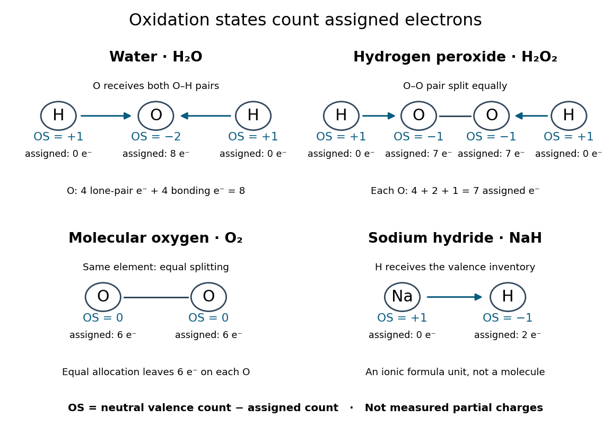

# Ionic approximation of bonds

↑ **Parent:** [Oxidation state](oxidation-state.md)

For the routine examples here, assign all bonding [Electrons](electron.md) between different [chemical elements](chemical-element.md) to the more [electronegative](electronegativity.md) partner; divide bonding [Electrons](electron.md) between identical [chemical elements](chemical-element.md) equally. Retain each [lone pair](lone-pair.md) on its original [chemical atom](atom-physics.md). Subtract the assigned [valence electron](valence-electron.md) count $N_i^{\mathrm{assigned}}$ from the neutral [chemical atom](atom-physics.md)'s [valence electron](valence-electron.md) count $v_i$. The IUPAC convention uses Allen [electronegativity](electronegativity.md), based on free-[chemical atom](atom-physics.md) [valence electron](valence-electron.md) [energies](energy.md). Close [electronegativity](electronegativity.md) comparisons and some reversibly bound [chemical compounds](chemical-compound.md) require care beyond this simple rule.[§3 and §4.1, pp. 833–834: Allen electronegativity, electron allegiance and the reversible Lewis-acid-ligand caveat; §5.5, pp. 836–837: ambiguous assignments](comprehensive-definition-of-oxidation-state-iupac-recommendations-2016-by-pavel-karen-and-others.md)

**[Figure 50](#image-oxidation-state-electron-bookkeeping). Oxidation state assignments for water, hydrogen peroxide, molecular oxygen and sodium hydride**. Original bookkeeping diagrams, not [electron density](electron-density.md) maps or measured [partial atomic charges](partial-atomic-charge.md). Arrows indicate allocation of bonding [Electrons](electron.md); an equal split is used for O–O. The [sodium hydride](sodium-hydride.md) panel represents a [formula unit](formula-unit.md) of an [ionic compound](salt-chemistry.md), not an isolated gas-phase [molecule](molecule.md).

The examples explain exceptions to memorized rules:

- [Water](water.md), $\mathrm{H{-}O{-}H}$: [oxygen](oxygen.md) receives both O–H [bond pairs](bond-pair.md) plus its two [lone pairs](lone-pair.md), giving eight assigned [valence electrons](valence-electron.md) and $6-8=-2$. Each [hydrogen](hydrogen.md) receives none, giving $1-0=+1$.
- [Hydrogen peroxide](hydrogen-peroxide.md), $\mathrm{H{-}O{-}O{-}H}$: each [oxygen](oxygen.md) receives its O–H [bond pair](bond-pair.md), one [Electron](electron.md) from O–O, and four [Electrons](electron.md) in [lone pairs](lone-pair.md). Thus each has $6-7=-1$, while each [hydrogen](hydrogen.md) remains $+1$. The O–O connection is why the usual $-2$ [oxygen](oxygen.md) shortcut fails.
- [Molecular oxygen](molecular-oxygen.md), $\mathrm{O}_2$: equal splitting of the O–O bonding [Electrons](electron.md) leaves each [oxygen](oxygen.md) assigned six [valence electrons](valence-electron.md), so each has [oxidation state](oxidation-state.md) zero.
- [Sodium hydride](sodium-hydride.md), $\mathrm{NaH}$: [hydrogen](hydrogen.md) is more [electronegative](electronegativity.md) than [sodium](sodium.md). The [formula unit](formula-unit.md) is assigned [sodium](sodium.md) $+1$ and [hydrogen](hydrogen.md) $-1$, consistent with the [hydrogen anion](hydrogen-anion.md). The usual $+1$ [hydrogen](hydrogen.md) shortcut fails here.

These drawings record allocations, not [molecular geometry](molecular-geometry.md) or a physical process of breaking the [chemical bonds](chemical-bond.md). In particular, the O–O line in the [molecular oxygen](molecular-oxygen.md) panel only marks the connection; it does not assert a complete [Lewis structure](lewis-structure.md) or [spin](spin.md) state.

## ↑ Ancestors (6)

1. [Oxidation state](oxidation-state.md)
2. [Oxidation](oxidation.md)
3. [Redox](redox.md)
4. [Chemical reaction](chemical-reaction.md)
5. [Chemistry](chemistry-split.md)
6. [Codex Wiki](split.md)

## ← Incoming links (1)

- [Oxidation state](oxidation-state.md)
