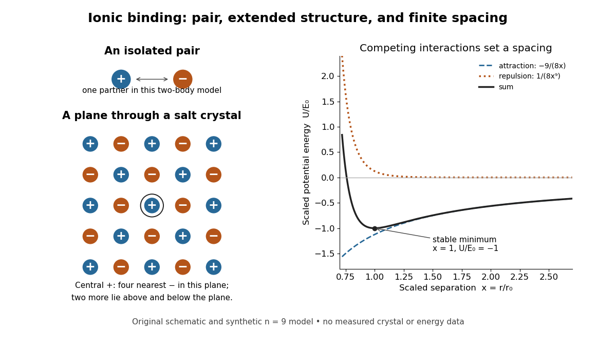
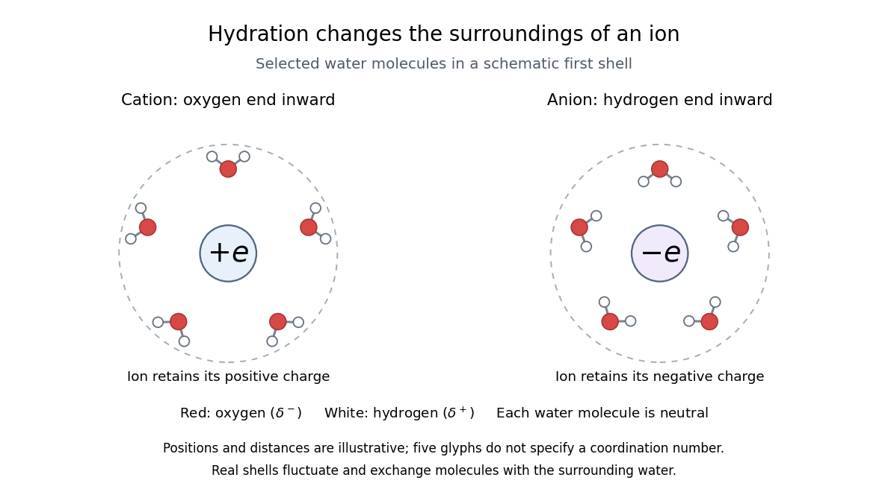

# Ionic bonding

↑ **Parent:** [Chemical bond](chemical-bond.md)  
ⓦ [Wiki](https://en.wikipedia.org/wiki/Ionic_bonding)

[Ionic bonding](ionic-bonding.md) binds oppositely charged [ions](chemistry.md#ion) through attraction governed by [electrostatics](electrostatics.md). In ordinary solid [sodium chloride](chemical-substance.md#sodium-chloride), each [cation](chemistry.md#cation) interacts with many [anions](chemistry.md#anion), and also with other [cations](chemistry.md#cation): attraction and repulsion together contribute to the binding of an extended [ionic crystal](#ionic-crystal). The [chemical formula](chemical-substance.md#chemical-formula) $\mathrm{NaCl}$ specifies equal numbers of the two kinds of [ions](chemistry.md#ion); it does not divide the [solid](thermodynamics.md#solid) into isolated two-atom [molecules](molecule.md).[§7.1, “The Formation of Ionic Compounds”, Figure 7.3](chemistry-bibliography.md#chemistry-2e-by-paul-flowers-and-others)

This distinction explains a striking combination of properties: ordinary dry [sodium chloride](chemical-substance.md#sodium-chloride) conducts [electric current](electric-charge.md#electric-current) poorly, while its molten form or a sufficiently concentrated [chemical solution](mixture.md#solution-chemistry) in [water](chemical-substance.md#water) conducts well. The [ions](chemistry.md#ion) already exist in the [solid](thermodynamics.md#solid); their ability to move through the sample changes. A [conductivity experiment on salt solutions](#conductivity-experiment-on-salt-solutions) tests this transport picture, rather than simply asserting that charged constituents must make every material conductive.

**[Figure 1](#image-ionic-crystal-pair-and-binding-energy). An isolated ion pair, a plane of an extended ionic crystal, and a synthetic potential energy model with a stable spacing**. Original schematic geometry and calculated model curves, not a measured [electron density](chemistry.md#electron-density), [diffraction](quantum-scattering.md#diffraction) pattern, or experimental [lattice energy](#lattice-energy). Four nearest neighbours are visible in the plane of the [rock salt structure](#rock-salt-structure); two more lie perpendicular to it. Disk sizes are arbitrary. The right-hand curves use the explicitly stipulated [dimensionless](physics.md#dimensionless-quantity) model below.

**Table of contents**

- [Radius ratio rule](#radius-ratio-rule)
- [Goldschmidt packing principle](#goldschmidt-packing-principle)
- [Salt (chemistry)](#salt-chemistry)
  - [Magnesium chloride](#magnesium-chloride)
  - [Zinc sulfate](#zinc-sulfate)
  - [Potassium cyanide](#potassium-cyanide)
  - [Potassium permanganate](#potassium-permanganate)
  - [Stoichiometry of ionic compounds](#stoichiometry-of-ionic-compounds)
    - [Calcium chloride](#calcium-chloride)
  - [Calcium carbonate](#calcium-carbonate)
  - [Sodium carbonate](#sodium-carbonate)
- [Ionic crystal](#ionic-crystal)
  - [Rock salt structure](#rock-salt-structure)
  - [Coordination number](#coordination-number)
    - [Tetrahedral coordination](#tetrahedral-coordination)
    - [Cubic coordination](#cubic-coordination)
- [Ion pair](#ion-pair)
  - [Contact ion pair](#contact-ion-pair)
- [Electron transfer and ionic character](#electron-transfer-and-ionic-character)
- [Electrostatic model of ionic binding](#electrostatic-model-of-ionic-binding)
  - [Madelung constant](#madelung-constant)
- [Lattice energy](#lattice-energy)
  - [Born-Haber cycle](#born-haber-cycle)
    - [Lattice enthalpy from solution calorimetry](#lattice-enthalpy-from-solution-calorimetry)
      - [Potassium chloride](#potassium-chloride)
- [Physical properties of salts](#physical-properties-of-salts)
  - [Solubility](#solubility)
    - [Solvation](#solvation)
      - [Distribution coefficient](#distribution-coefficient)
      - [Solvent cavity formation](#solvent-cavity-formation)
      - [Solvation shell](#solvation-shell)
        - [Hydration shell](#hydration-shell)
        - [Ion-dipole attraction](#ion-dipole-attraction)
        - [Spectroscopic measurement of hydration dynamics](#spectroscopic-measurement-of-hydration-dynamics)
          - [Pump-probe spectroscopy](#pump-probe-spectroscopy)
          - [Heavy water](#heavy-water)
          - [Semiheavy water](#semiheavy-water)
      - [Dissolution](#dissolution)
        - [Dissociation of an ionic compound](#dissociation-of-an-ionic-compound)
          - [Sodium perchlorate](#sodium-perchlorate)
      - [Desolvation](#desolvation)
      - [Solvation free energy](#solvation-free-energy)
        - [Solvent-specific stabilization](#solvent-specific-stabilization)
      - [Solvation thermodynamic balance](#solvation-thermodynamic-balance)
      - [Hydration of ions](#hydration-of-ions)
        - [Hydration enthalpy](#hydration-enthalpy)
  - [Conductivity experiment on salt solutions](#conductivity-experiment-on-salt-solutions)
  - [Solid electrolyte](#solid-electrolyte)
    - [Yttria-stabilized zirconia](#yttria-stabilized-zirconia)
    - [Superionic conductor](#superionic-conductor)

## Radius ratio rule

↑ **Parent:** [Ionic bonding](ionic-bonding.md)

A [hard-sphere model](euclidean-geometry.md#hard-sphere-model) relating the [radius](topology.md#radius) ratio of opposite-charge [ions](chemistry.md#ion) to a possible [coordination number](#coordination-number). For a [cube](euclidean-geometry.md#cube) of eight mutually touching [anions](chemistry.md#anion) around a touching [cation](chemistry.md#cation), $r_c/r_a=\sqrt3-1$; real bonding and coordination-dependent [radii](topology.md#radius) limit its predictive power.

## Goldschmidt packing principle

↑ **Parent:** [Ionic bonding](ionic-bonding.md)

A geometric heuristic favouring the largest [coordination number](#coordination-number) compatible with neighbouring opposite-charge [ions](chemistry.md#ion) touching the central [ion](chemistry.md#ion) without overlap. A limiting [radius ratio rule](#radius-ratio-rule) comes from additionally making the surrounding [ions](chemistry.md#ion) just touch. It is a [hard-sphere model](euclidean-geometry.md#hard-sphere-model), not an exact stability criterion.

## Salt (chemistry)

↑ **Parent:** [Ionic bonding](ionic-bonding.md)  
ⓦ [Wiki](https://en.wikipedia.org/wiki/Salt_(chemistry))

A [salt](#salt-chemistry) is an assembly of [cations](chemistry.md#cation) and [anions](chemistry.md#anion) with zero total [electric charge](electric-charge.md). Its constituents can be single [chemical atoms](physics.md#atom-physics) or groups joined internally by [covalent bonds](covalent-bond.md). Thus [ionic bonding](ionic-bonding.md) and [covalent bonds](covalent-bond.md) can occur in the same [chemical substance](chemical-substance.md), at different structural levels.[§2.6, polyatomic ions and ionic compounds](chemistry-bibliography.md#chemistry-2e-by-paul-flowers-and-others)

### Magnesium chloride

↑ **Parent:** [Salt (chemistry)](#salt-chemistry)

[Magnesium chloride](#magnesium-chloride) is an [ionic compound](#salt-chemistry) with two [chloride](chemistry.md#chloride) [anions](chemistry.md#anion) per [magnesium](chemical-substance.md#magnesium) [cation](chemistry.md#cation). Complete dissolution supplies one divalent magnesium ion and two monovalent chloride ions per formula unit. At analytical salt concentration $C$, these species contribute molar [ionic strength](mixture.md#ionic-strength) $I=\tfrac12(4C+2C)=3C$, provided additional dissolved ions are absent.

### Zinc sulfate

↑ **Parent:** [Salt (chemistry)](#salt-chemistry)  
ⓦ [Wiki](https://en.wikipedia.org/wiki/Zinc_sulfate)

### Potassium cyanide

↑ **Parent:** [Salt (chemistry)](#salt-chemistry)  
ⓦ [Wiki](https://en.wikipedia.org/wiki/Potassium_cyanide)

### Potassium permanganate

↑ **Parent:** [Salt (chemistry)](#salt-chemistry)

A [salt](#salt-chemistry) of [potassium](chemical-substance.md#potassium) [cations](chemistry.md#cation) and [permanganate](chemistry.md#permanganate) [anions](chemistry.md#anion), supplying [permanganate](chemistry.md#permanganate) in a [redox titration](chemical-reaction.md#redox-titration).

### Stoichiometry of ionic compounds

↑ **Parent:** [Salt (chemistry)](#salt-chemistry)

For a neutral [formula unit](chemical-substance.md#formula-unit), let $\nu_i$ count [ions](chemistry.md#ion) of type $i$ with [electric charge](electric-charge.md) $z_i e$, where $e$ is the [elementary charge](electric-charge.md#elementary-charge). The [stoichiometry](chemical-reaction.md#stoichiometry) must satisfy

$$
\sum_i\nu_i z_i=0.
$$

For $\mathrm{Na}^+$ and $\mathrm{Cl}^-$, the smallest positive counts are $1:1$. For $\mathrm{Ca}^{2+}$ and $\mathrm{Cl}^-$, they are $1:2$, giving [calcium chloride](#calcium-chloride) $\mathrm{CaCl_2}$: $1(2)+2(-1)=0$. The formula counts [ions](chemistry.md#ion), not the number of nearest neighbours. A [counterion](chemistry.md#counterion) is the oppositely charged partner needed to balance a charged species; its identity can change [solubility](#solubility) and other properties without changing the identity of that species.[§7.1, neutral ionic formulas and charge balance; §2.6, ionic compound examples](chemistry-bibliography.md#chemistry-2e-by-paul-flowers-and-others)

#### Calcium chloride

↑ **Parent:** [Stoichiometry of ionic compounds](#stoichiometry-of-ionic-compounds)  
ⓦ [Wiki](https://en.wikipedia.org/wiki/Calcium_chloride)

### Calcium carbonate

↑ **Parent:** [Salt (chemistry)](#salt-chemistry)

### Sodium carbonate

↑ **Parent:** [Salt (chemistry)](#salt-chemistry)

## Ionic crystal

↑ **Parent:** [Ionic bonding](ionic-bonding.md)  
ⓦ [Wiki](https://en.wikipedia.org/wiki/Ionic_crystal)

An [ionic crystal](#ionic-crystal) repeats an arrangement of [ions](chemistry.md#ion) in three dimensions. A [unit cell](quantum-scattering.md#unit-cell) describes that repetition, whereas a [formula unit](chemical-substance.md#formula-unit) describes composition. The two accounting devices answer different questions. [Coulomb's law](electrostatics.md#coulomb-s-law) is not restricted to an arbitrarily drawn line connecting one [cation](chemistry.md#cation) to one [anion](chemistry.md#anion): every [ion](chemistry.md#ion) contributes to the [electric field](electric-field.md) experienced by the others.

### Rock salt structure

↑ **Parent:** [Ionic crystal](#ionic-crystal)

The [rock salt structure](#rock-salt-structure) of ordinary [sodium chloride](chemical-substance.md#sodium-chloride) has a [coordination number](#coordination-number) of six for each kind of [ion](chemistry.md#ion): six nearest neighbours of the opposite sign surround each [ion](chemistry.md#ion) along three perpendicular directions. Its conventional cubic [unit cell](quantum-scattering.md#unit-cell) contains four [formula units](chemical-substance.md#formula-unit); sharing corner, face, and edge sites between adjacent cells must be included in that count. Sixfold local coordination is compatible with $1:1$ overall [stoichiometry](chemical-reaction.md#stoichiometry).[§7.1, Figure 7.3; §10.6, “The Structures of Ionic Crystals”, NaCl unit-cell accounting](chemistry-bibliography.md#chemistry-2e-by-paul-flowers-and-others)

The checkerboard plane in the diagram is a slice through this three-dimensional arrangement. It leaves out the two nearest neighbours above and below the plane. Repeating a complete even-by-even patch gives equal numbers of signs; the displayed odd-by-odd crop has a boundary imbalance and is not a complete neutral [ionic crystal](#ionic-crystal) or a [unit cell](quantum-scattering.md#unit-cell). Other [salts](#salt-chemistry) need not have the [rock salt structure](#rock-salt-structure) or the same [coordination number](#coordination-number).

### Coordination number

↑ **Parent:** [Ionic crystal](#ionic-crystal)

In this structural use, the [coordination number](#coordination-number) counts nearest neighbouring constituents. State which neighbours are counted and which [ionic crystal](#ionic-crystal) structure is being described; it is not an [ion](chemistry.md#ion)'s [electric charge](electric-charge.md) number.

#### Tetrahedral coordination

↑ **Parent:** [Coordination number](#coordination-number)

Four nearest neighbours at [tetrahedron](euclidean-geometry.md#tetrahedron) vertices around a central site.

#### Cubic coordination

↑ **Parent:** [Coordination number](#coordination-number)

Eight nearest neighbours at [cube](euclidean-geometry.md#cube) corners around a central site; [fluorite structure](physical-chemistry.md#fluorite-structure) [cations](chemistry.md#cation) have this arrangement.

## Ion pair

↑ **Parent:** [Ionic bonding](ionic-bonding.md)

An [ion pair](#ion-pair) is an associated [cation](chemistry.md#cation) and [anion](chemistry.md#anion). An isolated [ion pair](#ion-pair) lacks the extended neighbourhood of an [ionic crystal](#ionic-crystal). In a [chemical solution](mixture.md#solution-chemistry), [ion pairs](#ion-pair) can coexist with more widely separated [ions](chemistry.md#ion); their abundance depends on conditions. A neutral gas-phase [sodium chloride](chemical-substance.md#sodium-chloride) [molecule](molecule.md) can be treated as a discrete entity, with its own [quantum mechanics](quantum-mechanics.md) and dissociation products. That use of [molecule](molecule.md) does not describe the constituents of ordinary solid [sodium chloride](chemical-substance.md#sodium-chloride).[§8–3, distinction between vaporized NaCl pairs and separated gaseous ions](physics-bibliography.md#the-feynman-lectures-on-physics-volume-ii-by-richard-feynman-and-others)[Conductivity of Solutions by Harvard Natural Sciences Lecture Demonstrations](chemistry-bibliography.md#conductivity-of-solutions-by-harvard-natural-sciences-lecture-demonstrations)

### Contact ion pair

↑ **Parent:** [Ion pair](#ion-pair)

Oppositely charged ions remaining in direct contact without an intervening complete solvent shell. Their relative positions can bias substitution stereochemistry even when bond cleavage precedes [nucleophile](chemical-reaction.md#nucleophile) attack.

## Electron transfer and ionic character

↑ **Parent:** [Ionic bonding](ionic-bonding.md)

The bookkeeping steps $\mathrm{Na}\to\mathrm{Na}^++e^-$ and $\mathrm{Cl}+e^-\to\mathrm{Cl}^-$ conserve [electric charge](electric-charge.md) and describe the [electron](physics.md#electron) inventories of separated species. They do not establish a chronological mechanism in which a labeled [electron](physics.md#electron) jumps between two pre-existing [chemical atoms](physics.md#atom-physics) and becomes a classical object owned exclusively by one of them. In a bound material, [quantum mechanics](quantum-mechanics.md) determines the [electron density](chemistry.md#electron-density) and the total [energy](energy.md).

[Ionic bonding](ionic-bonding.md) and a [covalent bond](covalent-bond.md) are useful limiting descriptions with a continuum between them. [Electronegativity](electronegativity.md) helps anticipate unequal sharing of [electron density](chemistry.md#electron-density), but a numerical cutoff does not measure a universal fraction of [ionic bonding](ionic-bonding.md). A [partial atomic charge](chemical-bond.md#partial-atomic-charge) depends on how the [electron density](chemistry.md#electron-density) is partitioned; integer [formal charges](covalent-bond.md#formal-charge) are a bookkeeping convention. Using $\pm e$ in a point-charge model therefore does not claim that every partition of the actual [electron density](chemistry.md#electron-density) assigns exactly those values.[§30–2, “Chemical bonds in crystals”: gradations between covalent and ionic bonding](physics-bibliography.md#the-feynman-lectures-on-physics-volume-ii-by-richard-feynman-and-others)[§7.2, “Electronegativity and Bond Type”: general guide and exceptions](chemistry-bibliography.md#chemistry-2e-by-paul-flowers-and-others)

## Electrostatic model of ionic binding

↑ **Parent:** [Ionic bonding](ionic-bonding.md)

For two point [electric charges](electric-charge.md) in [vacuum](physics.md#vacuum), [Coulomb's law](electrostatics.md#coulomb-s-law) gives the interaction [potential energy](energy.md#potential-energy)

$$
U_{ij}(r_{ij})=\frac{z_i z_j e^2}{4\pi\epsilon_0 r_{ij}},
$$

with zero at infinite separation. Here $r_{ij}$ is the distance between them and $\epsilon_0$ is the [vacuum permittivity](permittivity.md#vacuum-permittivity). Opposite signs give negative [potential energy](energy.md#potential-energy) and attraction; equal signs give positive [potential energy](energy.md#potential-energy) and repulsion. For a finite collection of distinct point [electric charges](electric-charge.md), sum over $i<j$ to count each pair once. A bulk [ionic crystal](#ionic-crystal) requires the extended lattice sum, including both signs, rather than multiplying one attractive pair by the [coordination number](#coordination-number).[§8–1, equations (8.1)–(8.3); §8–3, many-neighbour lattice sum](physics-bibliography.md#the-feynman-lectures-on-physics-volume-ii-by-richard-feynman-and-others)

At short distances, overlapping [electron density](chemistry.md#electron-density) makes the simple point-charge picture inadequate. [Quantum mechanics](quantum-mechanics.md), including the [Pauli exclusion principle](tensor-product-of-quantum-systems.md#pauli-exclusion-principle), matters to the steep repulsive contribution. Pure attraction proportional to $-1/r$ would collapse as $r\to0$; it cannot set an equilibrium spacing on its own. A useful illustrative model is

$$
U(r)=-\frac{A}{r}+\frac{B}{r^n},\qquad A>0,\quad B>0,\quad n>1.
$$

Here $r$ scales an assumed fixed arrangement, $A$ packages its attractive contribution, and $B/r^n$ represents short-range repulsion. The constants have units [energy](energy.md) times length and [energy](energy.md) times length to the power $n$, respectively. This is a model, not a fitted description of a named [salt](#salt-chemistry).[§8–3, close-distance repulsion and limits of a purely electrostatic lattice calculation](physics-bibliography.md#the-feynman-lectures-on-physics-volume-ii-by-richard-feynman-and-others)

Differentiating gives $r_0=(nB/A)^{1/(n-1)}$ and $U''(r_0)=(n-1)A/r_0^3>0$, so the stationary spacing is a stable minimum. For the diagram's stipulated $n=9$, put $x=r/r_0$ and $E_0=A(1-1/n)/r_0>0$. Then

$$
\frac{U(r)}{E_0}=\frac{-9/x+1/x^9}{8},\qquad U(r_0)=-E_0.
$$

The [dimensionless](physics.md#dimensionless-quantity) curves show how competing interactions select a spacing. Their [energy](energy.md) scale and exponent are synthetic; neither is a measured [lattice energy](#lattice-energy) or a [melting](critical-phenomenon.md#melting) prediction.

### Madelung constant

↑ **Parent:** [Electrostatic model of ionic binding](#electrostatic-model-of-ionic-binding)  
ⓦ [Wiki](https://en.wikipedia.org/wiki/Madelung_constant)

The [Madelung constant](#madelung-constant), named for [Erwin Madelung](physicist.md#erwin-madelung), is a dimensionless geometrical factor in the electrostatic binding of an [ionic crystal](#ionic-crystal). For a neutral lattice of [electric charges](electric-charge.md) $\pm e$ with nearest unlike-ion distance $r_0$, [Coulomb's law](electrostatics.md#coulomb-s-law) gives the [potential energy](energy.md#potential-energy) per ion pair as $-\alpha_M e^2/(4\pi\epsilon_0r_0)$. At a positive reference site, $\alpha_M=-\sum_{j\ne0}z_jr_0/r_j$, with neighboring [electric charges](electric-charge.md) $z_je$. Both attraction and repulsion enter this lattice sum; summing with a neutral-bulk prescription is essential. Short-range overlap repulsion and other contributions must be added before inferring a stable spacing or a thermodynamic [lattice energy](#lattice-energy).

## Lattice energy

↑ **Parent:** [Ionic bonding](ionic-bonding.md)  
ⓦ [Wiki](https://en.wikipedia.org/wiki/Lattice_energy)

A [lattice energy](#lattice-energy) needs a reaction, a sign convention, and a stated amount. Using the lattice-dissociation [enthalpy](enthalpy.md) convention for [sodium chloride](chemical-substance.md#sodium-chloride),

$$
\mathrm{NaCl}(s)\longrightarrow\mathrm{Na}^+(g)+\mathrm{Cl}^-(g),\qquad
\Delta H_{\rm latt,diss}>0.
$$

The reverse lattice-formation [enthalpy](enthalpy.md) is negative with the same magnitude when initial and final states match. [Chemistry 2e](chemistry-bibliography.md#chemistry-2e-by-paul-flowers-and-others) gives $769\,\mathrm{kJ\,mol^{-1}}$ for this separation, per [mole](physics.md#mole-unit) of [sodium chloride](chemical-substance.md#sodium-chloride) [formula units](chemical-substance.md#formula-unit). This is about $7.97$ [electronvolts](electronegativity.md#electronvolt) per [formula unit](chemical-substance.md#formula-unit), not per individual [ion](chemistry.md#ion). It concerns separated gaseous [ions](chemistry.md#ion), rather than neutral [chemical atoms](physics.md#atom-physics), molten [salt](#salt-chemistry), or hydrated [ions](chemistry.md#ion) in [water](chemical-substance.md#water).[§7.5, “Ionic Bond Strength and Lattice Energy”, positive convention, reverse convention and NaCl value](chemistry-bibliography.md#chemistry-2e-by-paul-flowers-and-others)

Also distinguish an [internal energy](internal-energy.md) change from an [enthalpy](enthalpy.md) change: $H=U+pV$. A static point-charge calculation omits motion and thermal contributions. Reversing a reaction reverses its [energy](energy.md) change; replacing [internal energy](internal-energy.md) with [enthalpy](enthalpy.md) additionally changes the defined quantity. The [Born-Haber cycle](#born-haber-cycle) infers a lattice-formation [enthalpy](enthalpy.md) by combining other [enthalpies](enthalpy.md), [ionization energies](mathematical-physics.md#ionization-energy), and [electron affinities](electronegativity.md#electron-affinity). These imagined stages are a thermodynamic accounting path, not a claim about the actual sequence of a [chemical reaction](chemical-reaction.md).[§7.5, “The Born-Haber Cycle”, Figure 7.13 and Table 7.4](chemistry-bibliography.md#chemistry-2e-by-paul-flowers-and-others)

### Born-Haber cycle

↑ **Parent:** [Lattice energy](#lattice-energy)

A [Born-Haber cycle](#born-haber-cycle) uses [Hess's law](chemistry.md#hess-s-law) to infer a [lattice energy](#lattice-energy) from measurable [enthalpy](enthalpy.md) differences and isolated-species data. The motivating difficulty is that separating a [mole](physics.md#mole-unit) of an [ionic crystal](#ionic-crystal) into mutually separated gaseous [ions](chemistry.md#ion) is not a convenient direct [calorimetry](calorimetry.md) experiment. Instead, compare two accounting routes between the same elemental reference states and the same [solid](thermodynamics.md#solid). Because [enthalpy](enthalpy.md) is a [state function](thermodynamics.md#state-function), the signed differences close exactly when all inputs describe compatible states. These routes do not assert a [reaction mechanism](chemical-kinetics.md#reaction-mechanism) or a temporal sequence of [reaction intermediates](chemical-kinetics.md#reaction-intermediate).[“The Born-Haber Cycle”, Figure 7.13 and Table 7.4](chemistry-bibliography.md#chemistry-2e-by-paul-flowers-and-others/7-5-strengths-of-ionic-and-covalent-bonds)

For one [mole](physics.md#mole-unit) of [sodium chloride](chemical-substance.md#sodium-chloride) [formula units](chemical-substance.md#formula-unit), the overall formation reaction is

$$
\mathrm{Na}(s)+\tfrac12\mathrm{Cl}_2(g)\longrightarrow\mathrm{NaCl}(s),\qquad F=\Delta H_{\rm f}^{\circ}.
$$

The [stoichiometry](chemical-reaction.md#stoichiometry) requires half a [mole](physics.md#mole-unit) of diatomic [chlorine](chemical-substance.md#chlorine) [molecules](molecule.md), supplying one [mole](physics.md#mole-unit) of [chlorine](chemical-substance.md#chlorine) [chemical atoms](physics.md#atom-physics). A half coefficient counts an [amount of substance](physics.md#amount-of-substance); it does not describe half of an individual [molecule](molecule.md). Write each auxiliary [chemical reaction](chemical-reaction.md) with its own sign:

$$
\begin{aligned}
\mathrm{Na}(s)&\longrightarrow\mathrm{Na}(g) && S>0,\\
\tfrac12\mathrm{Cl}_2(g)&\longrightarrow\mathrm{Cl}(g) && B>0,\\
\mathrm{Na}(g)&\longrightarrow\mathrm{Na}^+(g)+e^-(g) && I>0,\\
\mathrm{Cl}(g)+e^-(g)&\longrightarrow\mathrm{Cl}^-(g) && A=\Delta H_{\rm attach}^{\circ}<0,\\
\mathrm{Na}^+(g)+\mathrm{Cl}^-(g)&\longrightarrow\mathrm{NaCl}(s) && L_{\rm form}<0.
\end{aligned}
$$

Here $S$ is the [sublimation](critical-phenomenon.md#sublimation) [enthalpy](enthalpy.md), $B$ the [enthalpy of atomization](chemistry.md#enthalpy-of-atomization) of [chlorine](chemical-substance.md#chlorine) per [mole](physics.md#mole-unit) of [chemical atoms](physics.md#atom-physics), and $I$ the molar ionization [enthalpy](enthalpy.md) represented by the [ionization energy](mathematical-physics.md#ionization-energy) input in elementary treatments. If the [bond-dissociation energy](chemical-bond.md#bond-dissociation-energy) table gives the compatible molar [enthalpy](enthalpy.md) for $\mathrm{Cl}_2(g)\to2\mathrm{Cl}(g)$, use half that number for $B$. Both [ions](chemistry.md#ion) in the last step are gaseous, and no aqueous [hydration of ions](#hydration-of-ions) belongs in that step.

Adding these equations cancels the gaseous [chemical atoms](physics.md#atom-physics), the gaseous [ions](chemistry.md#ion) and the free [electron](physics.md#electron), leaving precisely the overall formation reaction. Thus

$$
F=S+B+I+A+L_{\rm form},\qquad
L_{\rm diss}=-L_{\rm form}=S+B+I+A-F.
$$

The closed traversal returns from the [solid](thermodynamics.md#solid) to the elemental reference states, adding $-F$; therefore $S+B+I+A+L_{\rm form}-F=0$. Notice that the signed attachment term $A$ is negative. Substituting a positive spectroscopic [electron affinity](electronegativity.md#electron-affinity) for $A$ would reverse the attachment contribution.

**[Figure 2](#image-sodium-chloride-born-haber-enthalpy-cycle). A closed Born-Haber cycle for sodium chloride using explicitly synthetic molar enthalpies: levels represent complete material inventories, and horizontal position is bookkeeping rather than a reaction coordinate**.

The diagram deliberately uses invented, internally consistent inputs in $\mathrm{kJ\,mol^{-1}}$: $S=100$, $B=120$, $I=500$, $A=-350$ and $F=-400$. Preparation of separated gaseous [ions](chemistry.md#ion) raises the [enthalpy](enthalpy.md) by $370$, so $L_{\rm form}=-770$ and $L_{\rm diss}=+770$. The closure check is $100+120+500-350-770+400=0$. These numbers are not measured [sodium chloride](chemical-substance.md#sodium-chloride) data and do not replace the source's $769\,\mathrm{kJ\,mol^{-1}}$ example in [lattice energy](#lattice-energy). Every level retains one [sodium](chemical-substance.md#sodium) nucleus, one [chlorine](chemical-substance.md#chlorine) nucleus and zero total [electric charge](electric-charge.md); the ionization level explicitly retains the free [electron](physics.md#electron).

#### Lattice enthalpy from solution calorimetry

↑ **Parent:** [Born-Haber cycle](#born-haber-cycle)

A second indirect route makes the experimental distinction especially clear: a [calorimeter](calorimetry.md#calorimeter) can measure dissolution of a weighed [salt](#salt-chemistry) into a known amount of [water](chemical-substance.md#water), but its final [ions](chemistry.md#ion) are hydrated, not separated gaseous [ions](chemistry.md#ion). At compatible [standard states](chemical-potential.md#standard-state) and the same [temperature](temperature.md),

$$
\Delta H_{\rm sol}^{\circ}=L_{\rm diss}+\Delta H_{\rm hyd,pair}^{\circ},\qquad
L_{\rm diss}=\Delta H_{\rm sol}^{\circ}-\Delta H_{\rm hyd,pair}^{\circ}.
$$

Here the combined [hydration of ions](#hydration-of-ions) term takes one [mole](physics.md#mole-unit) each of gaseous $\mathrm{Na}^+$ and $\mathrm{Cl}^-$ to the specified aqueous reference state. Its sum suffices: dissolution [calorimetry](calorimetry.md) alone cannot independently assign single-ion [hydration of ions](#hydration-of-ions) [enthalpies](enthalpy.md), or determine $L_{\rm diss}$ without another input. A finite-[concentration](mathematical-physics.md#concentration) measurement also requires dilution corrections before it can supply $\Delta H_{\rm sol}^{\circ}$.

In a simple constant-[pressure](pressure.md) solution [calorimeter](calorimetry.md#calorimeter), an insulated vessel, stirrer and [thermometer](temperature.md#thermometer) follow the [temperature](temperature.md) change after mixing. A calibrated effective [heat capacity](heat.md#heat-capacity) $C_{\rm eff}$ converts the corrected [temperature](temperature.md) change to [heat](heat.md). With no applied heating, negligible external [heat transfer](heat.md#heat-transfer), and only pressure-volume [work](energy.md#work), the approximate molar result is

$$
\Delta H_{\rm sol}\simeq-\frac{C_{\rm eff}\Delta T}{n}.
$$

Here $n$ is the [amount of substance](physics.md#amount-of-substance) dissolved and $C_{\rm eff}$ includes the [chemical solution](mixture.md#solution-chemistry) and the vessel. Cooling means positive dissolution [enthalpy](enthalpy.md), because the dissolving sample takes [heat](heat.md) from its surroundings.[§5.2, Figures 5.11–5.13 and discussion of including solution and calorimeter heat capacities](chemistry-bibliography.md#chemistry-2e-by-paul-flowers-and-others)

An actual reference measurement used [potassium chloride](#potassium-chloride), not [sodium chloride](chemical-substance.md#sodium-chloride): a platinum-lined [calorimeter](calorimetry.md#calorimeter) with an adiabatic shield and a quartz-oscillator [thermometer](temperature.md#thermometer). Because dissolution absorbed [heat](heat.md), measured electrical heating prevented loss of shield control; the readouts were electrical input and the vessel/shield [temperature](temperature.md) record. Stirring was checked visually in a dummy vessel. The [thermometer](temperature.md#thermometer) was compared with a calibrated resistance [thermometer](temperature.md#thermometer), and electrical calibration bracketed the reaction. The reported result was $+(17.584\pm0.017)\,\mathrm{kJ\,mol^{-1}}$ at $298.15\,\mathrm K$, for one [mole](physics.md#mole-unit) of [potassium chloride](#potassium-chloride) in $500$ [moles](physics.md#mole-unit) of [water](chemical-substance.md#water).[§3 and §4: apparatus, calibration, readouts and specified dilution; inspected through indexed article text](chemistry-bibliography.md#the-enthalpy-of-solution-of-srm-1655-kcl-in-h2o-by-marthada-v-kilday)

Checks on residual [water](chemical-substance.md#water), particle size and final [concentration](mathematical-physics.md#concentration), and agreement with a second [calorimeter](calorimetry.md#calorimeter), constrained systematic errors. Imperfect shield tracking required [heat transfer](heat.md#heat-transfer) corrections. This experiment measures an [enthalpy of solution](chemistry.md#enthalpy-change-of-solution), not a direct [lattice energy](#lattice-energy); the hydration and dilution bookkeeping still has to be supplied. The full article could not be opened here; the inspected indexed text supports the stated apparatus and checks, without reconstructing its complete uncertainty budget.[§§2–4 and conclusion: moisture, particle-size and dilution studies; confirmation with an isoperibol calorimeter; full-page access blocked](chemistry-bibliography.md#the-enthalpy-of-solution-of-srm-1655-kcl-in-h2o-by-marthada-v-kilday)

##### Potassium chloride

↑ **Parent:** [Lattice enthalpy from solution calorimetry](#lattice-enthalpy-from-solution-calorimetry)  
ⓦ [Wiki](https://en.wikipedia.org/wiki/Potassium_chloride)

## Physical properties of salts

↑ **Parent:** [Ionic bonding](ionic-bonding.md)

Many [ionic crystals](#ionic-crystal) have high [melting](critical-phenomenon.md#melting) [temperatures](temperature.md) compared with small molecular [solids](thermodynamics.md#solid), because reorganizing their strongly interacting [ions](chemistry.md#ion) costs [energy](energy.md). But [melting](critical-phenomenon.md#melting) leaves a dense [liquid](thermodynamics.md#liquid) with interactions; it does not perform the complete separation defining a [lattice energy](#lattice-energy). At fixed pressure, the transition occurs when the [Gibbs free energies](thermodynamic-potential.md#gibbs-free-energy) of the [solid](thermodynamics.md#solid) and [liquid](thermodynamics.md#liquid) match. The relevant [enthalpy](enthalpy.md) and [entropy](entropy.md) differences both matter, so [lattice energy](#lattice-energy) alone is not a universal ordering of [melting](critical-phenomenon.md#melting) [temperatures](temperature.md). Strong [covalent bonds](covalent-bond.md) in extended networks can also give high [melting](critical-phenomenon.md#melting) [temperatures](temperature.md).[§10.5, “Ionic Solids” and “Covalent Network Solid”; §16.4, equations defining Gibbs free energy and its change](chemistry-bibliography.md#chemistry-2e-by-paul-flowers-and-others)

### Solubility

↑ **Parent:** [Physical properties of salts](#physical-properties-of-salts)  
ⓦ [Wiki](https://en.wikipedia.org/wiki/Solubility)

[Solubility](#solubility) specifies the amount that can remain dissolved at [chemical equilibrium](chemical-potential.md#chemical-equilibrium) under stated conditions; it is different from how quickly a sample dissolves. Separating [ions](chemistry.md#ion) from an [ionic crystal](#ionic-crystal) costs [energy](energy.md), but [solvation](#solvation) establishes new interactions with the [solvent](mixture.md#solvent). In [water](chemical-substance.md#water), [hydration of ions](#hydration-of-ions) couples charged [ions](chemistry.md#ion) to polar [water](chemical-substance.md#water) [molecules](molecule.md). The net [enthalpy](enthalpy.md) of dissolution can have either sign; [entropy](entropy.md) and [concentration](mathematical-physics.md#concentration) also enter the [Gibbs free energy](thermodynamic-potential.md#gibbs-free-energy) balance. Consequently, being a [salt](#salt-chemistry) does not guarantee high [solubility](#solubility) in [water](chemical-substance.md#water) or any other [solvent](mixture.md#solvent).[§11.1, “The Formation of Solutions”, Figure 11.4; §11.3, definition of solubility; §16.4, free energy](chemistry-bibliography.md#chemistry-2e-by-paul-flowers-and-others)

Low [solubility](#solubility) must also be distinguished from weak [electrolyte](electrochemistry.md#electrolyte) behavior. A small amount of an [ionic compound](#salt-chemistry) can dissolve essentially completely as [ions](chemistry.md#ion), giving few charge carriers because little material dissolved. Calling that a [weak electrolyte](electrochemistry.md#weak-electrolyte) solely because its [chemical solution](mixture.md#solution-chemistry) conducts poorly would conflate two different questions.[§11.2, “Ionic Electrolytes”: sparingly soluble compounds can be strong electrolytes](chemistry-bibliography.md#chemistry-2e-by-paul-flowers-and-others)

#### Solvation

↑ **Parent:** [Solubility](#solubility)  
ⓦ [Wiki](https://en.wikipedia.org/wiki/Solvation)

[Solvation](#solvation) is stabilization through interactions between a [solute](mixture.md#solute) and its [solvent](mixture.md#solvent). It involves both the [solute](mixture.md#solute)'s surroundings and reorganization of the [solvent](mixture.md#solvent): neighbors move, orientations change, and existing interactions compete with new ones. [Electric forces](electric-field.md#electric-force), [Van der Waals forces](force.md#van-der-waals-force), and specific interactions such as [hydrogen bonds](chemical-bond.md#hydrogen-bond) can contribute. [Solvation](#solvation) can also occur at groups on an insoluble material, so it does not require complete [dissolution](#dissolution).[solvation](chemistry-bibliography.md#iupac-compendium-of-chemical-terminology-gold-book-by-international-union-of-pure-and-applied-chemistry/solvation)

[Solvation](#solvation) by [water](chemical-substance.md#water) is called hydration. [Hydration of ions](#hydration-of-ions) is the charged special case, but neutral [molecules](molecule.md) such as [sucrose](chemical-substance.md#sucrose) can also interact with [water](chemical-substance.md#water) without becoming [ions](chemistry.md#ion). A hydrated [cation](chemistry.md#cation) retains its positive net [electric charge](electric-charge.md); orienting neutral [water](chemical-substance.md#water) [molecules](molecule.md) around it does not supply an extra [electron](physics.md#electron). [Dissolution](#dissolution), [desolvation](#desolvation), and [ionization](atomic-physics.md#ionization) describe different changes, as the examples below show.[Chemistry 2e by Paul Flowers and others; Opening sucrose example](chemistry-bibliography.md#chemistry-2e-by-paul-flowers-and-others/11-1-the-dissolution-process)[Chemistry 2e by Paul Flowers and others; “Ionic Electrolytes” and “Covalent Electrolytes”](chemistry-bibliography.md#chemistry-2e-by-paul-flowers-and-others/11-2-electrolytes)

The useful question is therefore not just whether a [solute](mixture.md#solute) attracts a [solvent](mixture.md#solvent), but how much the whole system gains after paying for the rearrangements. [Solvation free energy](#solvation-free-energy) describes a specified transfer into a [solvent](mixture.md#solvent); [solvation thermodynamic balance](#solvation-thermodynamic-balance) explains why even cooling during [dissolution](#dissolution) can accompany favorable mixing. The existing [solubility](#solubility) discussion concerns how much remains dissolved at [chemical equilibrium](chemical-potential.md#chemical-equilibrium).

##### Distribution coefficient

↑ **Parent:** [Solvation](#solvation)

A ratio of concentrations or activities between specified phases. State whether all [protonation](chemical-reaction.md#protonation) states are combined: a pH-dependent total distribution ratio differs from a partition coefficient for one molecular species.

##### Solvent cavity formation

↑ **Parent:** [Solvation](#solvation)

Reorganization of a solvent to accommodate a solute. Its free-energy cost competes with favourable solute–solvent interactions and depends on solute size and shape.

##### Solvation shell

↑ **Parent:** [Solvation](#solvation)

A [solvation shell](#solvation-shell) is the region of [solvent](mixture.md#solvent) constituents surrounding a [solute](mixture.md#solute), with local arrangements influenced by their interactions. The first [solvation shell](#solvation-shell) contains the closest neighbors under a stated distance or interaction criterion. A [coordination number](#coordination-number) counts those neighbors; it requires such a criterion and can fluctuate. Neither a drawn ring nor a few illustrated [molecules](molecule.md) determines a measured [coordination number](#coordination-number).

In a [liquid](thermodynamics.md#liquid), a [solvation shell](#solvation-shell) is an evolving neighborhood: [solvent](mixture.md#solvent) [molecules](molecule.md) reorient and exchange with the surroundings. Different [ions](chemistry.md#ion) can produce different local dynamics. [Spectroscopic measurement of hydration dynamics](#spectroscopic-measurement-of-hydration-dynamics) provides an experimental way to distinguish some of those environments without pretending that a shell is a fixed cage.

###### Hydration shell

↑ **Parent:** [Solvation shell](#solvation-shell)

A [hydration shell](#hydration-shell) is a [solvation shell](#solvation-shell) in [water](chemical-substance.md#water). The existing [hydration of ions](#hydration-of-ions) discussion describes preferential orientations around [cations](chemistry.md#cation) and [anions](chemistry.md#anion).

**[Figure 3](#image-hydration-shell-charge-orientation). Qualitative hydration shells: opposite orientations of polar water molecules around a cation and an anion, with each ion's net electric charge retained**. Original schematic, not measured molecular positions. Atom spacings and the dashed shell boundary are illustrative. Five selected [water](chemical-substance.md#water) glyphs in each panel do not assert a [coordination number](#coordination-number). Each [water](chemical-substance.md#water) [molecule](molecule.md) is neutral despite its [partial atomic charges](chemical-bond.md#partial-atomic-charge).

###### Ion-dipole attraction

↑ **Parent:** [Solvation shell](#solvation-shell)

An [ion-dipole attraction](#ion-dipole-attraction) couples an [ion](chemistry.md#ion)'s [electric field](electric-field.md) to a [molecule](molecule.md)'s [electric dipole moment](electrostatics.md#electric-dipole-moment). In the elementary point-[electric dipole](electrostatics.md#electric-dipole) approximation, the interaction [potential energy](energy.md#potential-energy) is $U=-\mathbf p\cdot\mathbf E$. An orientation with the [electric dipole moment](electrostatics.md#electric-dipole-moment) along the [electric field](electric-field.md) lowers this [energy](energy.md). For [water](chemical-substance.md#water), the [oxygen](chemical-substance.md#oxygen) end preferentially faces a [cation](chemistry.md#cation), and the [hydrogen](chemical-substance.md#hydrogen) end an [anion](chemistry.md#anion). At nonzero [temperature](temperature.md), fluctuations and competing [hydrogen bonds](chemical-bond.md#hydrogen-bond) prevent perfect alignment of every [molecule](molecule.md).[Chemistry 2e by Paul Flowers and others; “Ionic Electrolytes”, Figure 11.7 and its explanatory paragraph](chemistry-bibliography.md#chemistry-2e-by-paul-flowers-and-others/11-2-electrolytes)

###### Spectroscopic measurement of hydration dynamics

↑ **Parent:** [Solvation shell](#solvation-shell)

What separates a [hydration shell](#hydration-shell) from the surrounding [water](chemical-substance.md#water) experimentally? [Electrical conductivity](electric-charge.md#electrical-conductivity) addresses a different question. The documented lamp demonstration immerses metal [electrodes](electrochemistry.md#electrode) in a [chemical solution](mixture.md#solution-chemistry), rinses them between samples, and records brightness; adding [sodium chloride](chemical-substance.md#sodium-chloride) to distilled [water](chemical-substance.md#water) makes it conductive. A [water](chemical-substance.md#water) blank and dissolved [sucrose](chemical-substance.md#sucrose) comparison test whether dissolved material alone explains the signal. Fixed geometry, [temperature](temperature.md), and stated [concentrations](mathematical-physics.md#concentration) are additional proposed controls. This reveals mobile [electric charge](electric-charge.md), with limits from contamination, electrode interfaces and detection threshold; it supplies no shell positions. [Conductivity experiment on salt solutions](#conductivity-experiment-on-salt-solutions) explains the apparatus and controls in detail.[“Setting it Up” and “Comments”](chemistry-bibliography.md#conductivity-of-solutions-by-harvard-natural-sciences-lecture-demonstrations)

In the authored study [Influence of ions on the hydrogen-bond structure in liquid water by Anne Willem Omta and others](chemistry-bibliography.md#influence-of-ions-on-the-hydrogen-bond-structure-in-liquid-water-by-anne-willem-omta-and-others), [pump-probe spectroscopy](#pump-probe-spectroscopy) uses tunable mid-[infrared](optics.md#infrared) pulses traversing a sample. The probe's [wave polarization](wave.md#polarization-waves) is set at $45^{\circ}$ to the pump; after the sample, splitting and [polarizers](electromagnetic-wave.md#polarizer) select parallel and perpendicular transmission. Measuring each transmission with and without the pump gives $D_{\parallel}$ and $D_{\perp}$, the respective logarithms of the transmission ratios. Their [dimensionless](physics.md#dimensionless-quantity) [anisotropy](continuum-mechanics.md#anisotropy) is

$$
R(t)=\frac{D_{\parallel}(t)-D_{\perp}(t)}{D_{\parallel}(t)+2D_{\perp}(t)}.
$$

Its decay probes reorientation rather than merely loss of vibrational excitation. Dilute [semiheavy water](#semiheavy-water) in [heavy water](#heavy-water) separates the O–H and O–D bands. Varying the [semiheavy water](#semiheavy-water) [concentration](mathematical-physics.md#concentration) checked that transfer of excitation between nearby O–H groups did not determine the decay. These apparatus and control details are from the inspected author-uploaded article, not a new experiment.[§II, printed p. 12458, Figure 1 and equations (2)–(3); author-uploaded article text inspected](chemistry-bibliography.md#influence-of-ions-on-the-hydrogen-bond-structure-in-liquid-water-by-anne-willem-omta-and-others)

The related thesis chapter documents two O–H absorption bands in a [sodium perchlorate](#sodium-perchlorate) [chemical solution](mixture.md#solution-chemistry): approximately $3400\,\mathrm{cm^{-1}}$ for groups forming [hydrogen bonds](chemical-bond.md#hydrogen-bond) to [water](chemical-substance.md#water), and $3575\,\mathrm{cm^{-1}}$ for groups forming [hydrogen bonds](chemical-bond.md#hydrogen-bond) to the [anion](chemistry.md#anion). Selecting pump and probe bands, then a later delay window, separated their responses. The anion-associated [anisotropy](continuum-mechanics.md#anisotropy) decayed more slowly; the water-bonded component showed no resolved change in decay time across the tested [sodium perchlorate](#sodium-perchlorate) [concentrations](mathematical-physics.md#concentration). The chapter also used O–D excitation to extend observation beyond the shorter O–H vibrational lifetime. These results support distinct local dynamics rather than a permanently fixed [hydration shell](#hydration-shell). Spectral overlap, finite observation windows, and the selected [salts](#salt-chemistry) limit the inference: this does not prove that every [ion](chemistry.md#ion) leaves all distant [water](chemical-substance.md#water) properties unchanged.[§8.2 and §8.3, printed pp. 82–89, Figures 8.1–8.7; PDF text inspected, numerical decay-time OCR unreliable and not reproduced](chemistry-bibliography.md#ion-solvation-in-water-femtosecond-spectroscopy-of-hydrogen-bond-dynamics-by-michel-f-kropman/8-the-influence-of-ions-on-the-hydrogen-bond-structure-of-water)

###### Pump-probe spectroscopy

↑ **Parent:** [Spectroscopic measurement of hydration dynamics](#spectroscopic-measurement-of-hydration-dynamics)

[Pump-probe spectroscopy](#pump-probe-spectroscopy) measures a sample's response to a probe pulse at a controlled delay after an exciting pump pulse. Varying delay follows dynamics; selecting [frequency](wave.md#frequency) and [wave polarization](wave.md#polarization-waves) can distinguish different contributions. [Spectroscopic measurement of hydration dynamics](#spectroscopic-measurement-of-hydration-dynamics) is an application to [water](chemical-substance.md#water) surrounding [ions](chemistry.md#ion).

###### Heavy water

↑ **Parent:** [Spectroscopic measurement of hydration dynamics](#spectroscopic-measurement-of-hydration-dynamics)

[Heavy water](#heavy-water) replaces both ordinary [hydrogen](chemical-substance.md#hydrogen) nuclei of [water](chemical-substance.md#water) with [deuterium](chemical-substance.md#deuterium).

###### Semiheavy water

↑ **Parent:** [Spectroscopic measurement of hydration dynamics](#spectroscopic-measurement-of-hydration-dynamics)

[Semiheavy water](#semiheavy-water) contains one ordinary [hydrogen](chemical-substance.md#hydrogen) nucleus and one [deuterium](chemical-substance.md#deuterium) nucleus. Dilute [semiheavy water](#semiheavy-water) in [heavy water](#heavy-water) provides relatively isolated O–H groups for [infrared spectroscopy](chemistry.md#infrared-spectroscopy).

##### Dissolution

↑ **Parent:** [Solvation](#solvation)

[Dissolution](#dissolution) transfers material into a [chemical solution](mixture.md#solution-chemistry). It can include separation from an [ionic crystal](#ionic-crystal) and [solvation](#solvation), or dispersal of neutral [molecules](molecule.md). For [sucrose](chemical-substance.md#sucrose) and [sodium chloride](chemical-substance.md#sodium-chloride), respectively,

$$
\mathrm{C}_{12}\mathrm{H}_{22}\mathrm{O}_{11}(s)\longrightarrow\mathrm{C}_{12}\mathrm{H}_{22}\mathrm{O}_{11}(aq),\qquad
\mathrm{NaCl}(s)\longrightarrow\mathrm{Na}^{+}(aq)+\mathrm{Cl}^{-}(aq).
$$

Here $(aq)$ specifies [water](chemical-substance.md#water) as the [solvent](mixture.md#solvent); it does not specify a fixed number of attached [water](chemical-substance.md#water) [molecules](molecule.md). The neutral [sucrose](chemical-substance.md#sucrose) remains molecular. [Dissociation of an ionic compound](#dissociation-of-an-ionic-compound) separates pre-existing [ions](chemistry.md#ion) in the second example; [solvation](#solvation) stabilizes their new surroundings.[Chemistry 2e by Paul Flowers and others; Opening molecular and ionic dissolution examples](chemistry-bibliography.md#chemistry-2e-by-paul-flowers-and-others/11-1-the-dissolution-process)[Chemistry 2e by Paul Flowers and others; “Ionic Electrolytes”](chemistry-bibliography.md#chemistry-2e-by-paul-flowers-and-others/11-2-electrolytes)

[Ionization](atomic-physics.md#ionization) instead creates [ions](chemistry.md#ion) from neutral species. [Hydrogen chloride](electronegativity.md#hydrogen-chloride) reacting with [water](chemical-substance.md#water) illustrates [protonation](chemical-reaction.md#protonation) of [water](chemical-substance.md#water) rather than mere rearrangement of a [hydration shell](#hydration-shell):

$$
\mathrm{HCl}+\mathrm{H}_2\mathrm O\longrightarrow\mathrm{H}_3\mathrm O^{+}+\mathrm{Cl}^{-}.
$$

The [hydronium](chemistry.md#hydronium) and negative [ion](chemistry.md#ion) together preserve total [electric charge](electric-charge.md). [Solvation](#solvation) can influence this [chemical reaction](chemical-reaction.md), but an [ion](chemistry.md#ion)'s [solvation](#solvation) does not itself change its net [electric charge](electric-charge.md).[Chemistry 2e by Paul Flowers and others; “Covalent Electrolytes”, HCl proton-transfer example](chemistry-bibliography.md#chemistry-2e-by-paul-flowers-and-others/11-2-electrolytes)

###### Dissociation of an ionic compound

↑ **Parent:** [Dissolution](#dissolution)

[Dissociation of an ionic compound](#dissociation-of-an-ionic-compound) separates its constituent [ions](chemistry.md#ion). It differs from creating charged species by [ionization](atomic-physics.md#ionization) of neutral [molecules](molecule.md). Dissolved [ions](chemistry.md#ion) can also associate into [ion pairs](#ion-pair), so a dissociated description does not exclude all subsequent association.

###### Sodium perchlorate

↑ **Parent:** [Dissociation of an ionic compound](#dissociation-of-an-ionic-compound)

[Sodium perchlorate](#sodium-perchlorate) is the [salt](#salt-chemistry) used in the spectrally selected example of [spectroscopic measurement of hydration dynamics](#spectroscopic-measurement-of-hydration-dynamics).

##### Desolvation

↑ **Parent:** [Solvation](#solvation)

[Desolvation](#desolvation) removes some or all of the [solvent](mixture.md#solvent) environment of a species. Removing a [hydration shell](#hydration-shell) does not remove an [ion](chemistry.md#ion)'s [electric charge](electric-charge.md). Complete reversal of a specified [solvation](#solvation) transfer reverses its [Gibbs free energy](thermodynamic-potential.md#gibbs-free-energy) and [enthalpy](enthalpy.md) changes when the same states and conventions are used. Partial [desolvation](#desolvation), exchange of one [solvent](mixture.md#solvent) for another, and creation of a gaseous species have different endpoints; their costs need not match.

##### Solvation free energy

↑ **Parent:** [Solvation](#solvation)

For transfer of the same species $X$ from a gaseous reference state into a [solvent](mixture.md#solvent) $S$, define the molar [solvation free energy](#solvation-free-energy) by

$$
X(g)\longrightarrow X(S),\qquad
\Delta G_{\mathrm{solv}}^{\circ}(S)=\mu_X^{\circ}(S)-\mu_X^{\circ}(g).
$$

Here $\mu^{\circ}$ is a standard [chemical potential](chemical-potential.md). Negative [solvation free energy](#solvation-free-energy) means that transfer into the stated [solvent](mixture.md#solvent) lowers the [Gibbs free energy](thermodynamic-potential.md#gibbs-free-energy) relative to the stated gaseous reference. Include [solute](mixture.md#solute)-[solvent](mixture.md#solvent) interactions, making room in the [solvent](mixture.md#solvent), and its reorganization; counting only a favorable pair interaction omits part of the transfer.[solvation energy](chemistry-bibliography.md#iupac-compendium-of-chemical-terminology-gold-book-by-international-union-of-pure-and-applied-chemistry/solvation-energy)

State the [temperature](temperature.md), gaseous reference [pressure](pressure.md), dissolved reference [concentration](mathematical-physics.md#concentration) or other [standard state](chemical-potential.md#standard-state) convention, and species identity. Reference-state changes alter the quoted [solvation free energy](#solvation-free-energy). For example, with an ideal dilute [thermodynamic activity](chemical-potential.md#thermodynamic-activity) $a=c/c^{\circ}$, replacing $c^{\circ}$ by $\alpha c^{\circ}$ while preserving the physical [chemical potential](chemical-potential.md) requires $\mu^{\circ}$ to increase by $RT\ln\alpha$. Thus the corresponding [solvation free energy](#solvation-free-energy) increases by $RT\ln\alpha$ if the gaseous reference stays fixed. This follows directly from $\mu=\mu^{\circ}+RT\ln a$, with $R$ the [molar gas constant](ideal-gas.md#molar-gas-constant).

###### Solvent-specific stabilization

↑ **Parent:** [Solvation free energy](#solvation-free-energy)

[Solvent-specific stabilization](#solvent-specific-stabilization) means that the same species need not have the same [solvation free energy](#solvation-free-energy) in different [solvents](mixture.md#solvent). [Chemical polarity](physical-chemistry.md#chemical-polarity), [hydrogen bonds](chemical-bond.md#hydrogen-bond), and the cost of reorganizing each [solvent](mixture.md#solvent) all matter. [Water](chemical-substance.md#water) can stabilize [ions](chemistry.md#ion) by [ion-dipole attractions](#ion-dipole-attraction); a favorable isolated attraction alone still cannot decide the total [dissolution](#dissolution) balance.[solvation energy](chemistry-bibliography.md#iupac-compendium-of-chemical-terminology-gold-book-by-international-union-of-pure-and-applied-chemistry/solvation-energy)

With a common gaseous reference and compatible dissolved [standard states](chemical-potential.md#standard-state), subtraction removes that reference:

$$
\Delta G_{\mathrm{transfer}}^{\circ}(A\to B)
=\mu_X^{\circ}(B)-\mu_X^{\circ}(A)
=\Delta G_{\mathrm{solv}}^{\circ}(B)-\Delta G_{\mathrm{solv}}^{\circ}(A).
$$

A negative result favors [solvent](mixture.md#solvent) B under those reference conventions. This comparison assumes the same species $X$: if [protonation](chemical-reaction.md#protonation), [ionization](atomic-physics.md#ionization), or formation of [ion pairs](#ion-pair) changes its identity, include a [chemical equilibrium](chemical-potential.md#chemical-equilibrium) for each corresponding [chemical reaction](chemical-reaction.md).

##### Solvation thermodynamic balance

↑ **Parent:** [Solvation](#solvation)

At fixed [temperature](temperature.md) and [pressure](pressure.md), compare fully specified initial and final states using

$$
\Delta G=\Delta H-T\Delta S.
$$

The [entropy](entropy.md) change is for the whole selected system, including both [solute](mixture.md#solute) and [solvent](mixture.md#solvent). Dispersing a [solute](mixture.md#solute) can increase accessible arrangements while orienting nearby [solvent](mixture.md#solvent) [molecules](molecule.md) restricts others. One picture of an ordered [hydration shell](#hydration-shell) cannot determine the sign of the total [entropy](entropy.md) change. A negative [Gibbs free energy](thermodynamic-potential.md#gibbs-free-energy) change favors the specified process; it does not determine its [reaction rate](chemical-kinetics.md#reaction-rate).[Opening definition and Table 16.3](chemistry-bibliography.md#chemistry-2e-by-paul-flowers-and-others/16-4-free-energy)

An illustrative [enthalpy](enthalpy.md) accounting path separates [solute](mixture.md#solute) constituents, reorganizes the [solvent](mixture.md#solvent), and establishes their interactions:

$$
\Delta H=\Delta H_{\mathrm{separate}}+\Delta H_{\mathrm{reorganize}}+\Delta H_{\mathrm{interact}}.
$$

This is a chosen decomposition between compatible states, not a measured sequence. If a gaseous-ion-to-[chemical solution](mixture.md#solution-chemistry) [solvation](#solvation) term already includes [solvent](mixture.md#solvent) reorganization, do not add that reorganization a second time. [Lattice enthalpy from solution calorimetry](#lattice-enthalpy-from-solution-calorimetry) gives the alternative [Hess's law](chemistry.md#hess-s-law) route that combines lattice separation with the complete [hydration of ions](#hydration-of-ions) term.[Chemistry 2e by Paul Flowers and others; “The Formation of Solutions”, Figure 11.4](chemistry-bibliography.md#chemistry-2e-by-paul-flowers-and-others/11-1-the-dissolution-process)

**[Figure 4](#image-solvation-enthalpy-entropy-balance). Synthetic dissolution bookkeeping: solvent interactions change the enthalpy balance, while total entropy also enters the Gibbs free energy**. Original stipulated model for one [mole](physics.md#mole-unit) of a hypothetical 1:1 [salt](#salt-chemistry) at $300\,\mathrm K$, with two unspecified [solvents](mixture.md#solvent). No plotted value is a measurement or a claim about a named [chemical substance](chemical-substance.md). The accounting path is not a [reaction coordinate](chemical-kinetics.md#reaction-coordinate) or an [activation energy](chemical-kinetics.md#activation-energy).

The invented inputs are $+100$ for separation and $+20$ for [solvent](mixture.md#solvent) reorganization, in $\mathrm{kJ\,mol^{-1}}$. Interaction terms of $-150$ in [solvent](mixture.md#solvent) A and $-90$ in [solvent](mixture.md#solvent) B give $\Delta H_A=-30$ and $\Delta H_B=+30$. Stipulated total [entropy](entropy.md) changes of $-50$ and $+150\,\mathrm{J\,mol^{-1}\,K^{-1}}$ give $-T\Delta S_A=+15$ and $-T\Delta S_B=-45\,\mathrm{kJ\,mol^{-1}}$ at $300\,\mathrm K$. Both selected processes therefore have $\Delta G=-15\,\mathrm{kJ\,mol^{-1}}$. This deliberately constructed comparison shows why the signs of the [enthalpy](enthalpy.md) and [Gibbs free energy](thermodynamic-potential.md#gibbs-free-energy) changes need not agree; it does not predict either [solvent](mixture.md#solvent)'s [solubility](#solubility).

For incremental [dissolution](#dissolution) at a particular composition, the relevant [chemical potential](chemical-potential.md) difference also depends on [thermodynamic activities](chemical-potential.md#thermodynamic-activity). At [chemical equilibrium](chemical-potential.md#chemical-equilibrium) that driving difference vanishes. A quoted standard [Gibbs free energy](thermodynamic-potential.md#gibbs-free-energy) change and the finite change between arbitrary mixtures answer different questions; use compatible [standard states](chemical-potential.md#standard-state) and the [reaction quotient](chemical-potential.md#reaction-quotient) when discussing [solubility](#solubility).

The motivating [calorimetry](calorimetry.md) experiment is especially instructive. A weighed [potassium chloride](#potassium-chloride) sample dissolves in a known amount of [water](chemical-substance.md#water) in a platinum-lined, shielded [calorimeter](calorimetry.md#calorimeter); a quartz-oscillator [thermometer](temperature.md#thermometer) and measured electrical heating provide the readouts. Electrical calibration before and after the reaction, comparison with a resistance [thermometer](temperature.md#thermometer), and checks on residual [water](chemical-substance.md#water) and particle size constrain errors. The inspected authored article reports positive [enthalpy of solution](chemistry.md#enthalpy-change-of-solution) at $298.15\,\mathrm K$ for the specified dilution, despite complete [dissolution](#dissolution). This is a combined [enthalpy](enthalpy.md) balance, not an isolated [solvation free energy](#solvation-free-energy) or direct single-ion [hydration of ions](#hydration-of-ions) measurement. Shield tracking and final [concentration](mathematical-physics.md#concentration) matter; the existing [lattice enthalpy from solution calorimetry](#lattice-enthalpy-from-solution-calorimetry) discussion gives the numerical result and the conversion limits.[Abstract, §§3–4 and conclusion; inspected indexed authored text, direct PMC access challenged](chemistry-bibliography.md#the-enthalpy-of-solution-of-srm-1655-kcl-in-h2o-by-marthada-v-kilday)

##### Hydration of ions

↑ **Parent:** [Solvation](#solvation)

[Hydration of ions](#hydration-of-ions) is [solvation](#solvation) by [water](chemical-substance.md#water). The polar [water](chemical-substance.md#water) [molecules](molecule.md) orient preferentially around [cations](chemistry.md#cation) and [anions](chemistry.md#anion), though the surrounding arrangement fluctuates rather than forming a permanently fixed cage.[§11.2, Figure 11.7 and “Ionic Electrolytes”](chemistry-bibliography.md#chemistry-2e-by-paul-flowers-and-others)

###### Hydration enthalpy

↑ **Parent:** [Hydration of ions](#hydration-of-ions)

The [enthalpy](enthalpy.md) change on transferring a specified gas-phase ion to the specified aqueous [standard state](chemical-potential.md#standard-state). Charge density strongly affects the stabilization; single-ion values require a consistent convention.

### Conductivity experiment on salt solutions

↑ **Parent:** [Physical properties of salts](#physical-properties-of-salts)

How can a clear [chemical solution](mixture.md#solution-chemistry) reveal otherwise invisible mobile [ions](chemistry.md#ion)? The documented [Conductivity of Solutions by Harvard Natural Sciences Lecture Demonstrations](chemistry-bibliography.md#conductivity-of-solutions-by-harvard-natural-sciences-lecture-demonstrations) demonstration uses metal [electrodes](electrochemistry.md#electrode) enclosed in tubing, an electrical supply, and a lamp in the circuit. The protocol specifies about $150\,\mathrm{mL}$ samples in labeled $250\,\mathrm{mL}$ beakers and a separate deionized-[water](chemical-substance.md#water) rinse station. The recorded readout is lamp brightness after the [electrodes](electrochemistry.md#electrode) enter each sample; the simplified variant tests [water](chemical-substance.md#water) before and after adding [sodium chloride](chemical-substance.md#sodium-chloride). These are apparatus and procedure specifications, not new measurements reported here.[Conductivity of Solutions by Harvard Natural Sciences Lecture Demonstrations](chemistry-bibliography.md#conductivity-of-solutions-by-harvard-natural-sciences-lecture-demonstrations)

**[Figure 5](#image-salt-solution-conductivity-controls). Electrical conductivity comparisons with a lamp tester, and the opposite motions of cations and anions in an electric field**. Original circuit schematic and qualitative model outcomes, not photographs or recorded brightness data. A dark lamp means a signal below this tester's visible threshold, not identically zero [electrical conductivity](electric-charge.md#electrical-conductivity). Arrows show [drift velocities](electric-charge.md#drift-velocity) during one half-cycle of an alternating supply; both signs contribute to the same [conventional current](electric-charge.md#conventional-current). [Water](chemical-substance.md#water) [molecules](molecule.md) and [hydration of ions](#hydration-of-ions) are omitted from the microscopic panel.

The useful comparison is [water](chemical-substance.md#water), a [sucrose](chemical-substance.md#sucrose) [chemical solution](mixture.md#solution-chemistry), and a [sodium chloride](chemical-substance.md#sodium-chloride) [chemical solution](mixture.md#solution-chemistry) with the same probe geometry. A documented university account reports no visible light with [water](chemical-substance.md#water), a glowing lamp with dissolved [sodium chloride](chemical-substance.md#sodium-chloride), and a weak filament glow with its [sucrose](chemical-substance.md#sucrose) sample. The diagram summarizes the latter as little or no visible light; the precise detection threshold depends on the tester. [Sucrose](chemical-substance.md#sucrose) is a control for the idea that any dissolved material must conduct: its dispersed neutral [molecules](molecule.md) do not provide the abundant mobile [ions](chemistry.md#ion) supplied by the [salt](#salt-chemistry). This contrast is a documented teaching observation, not a numerical calibration of lamp brightness.[§11.1, sucrose dissolves as molecules; §11.2, Figure 11.6 and ionic versus nonionic charge carriers](chemistry-bibliography.md#chemistry-2e-by-paul-flowers-and-others)[Conductivity of solutions by the migration of ions](chemistry-bibliography.md#conductivity-of-solutions-by-the-migration-of-ions)

Rinsing the [electrodes](electrochemistry.md#electrode) between samples controls carryover of dissolved [ions](chemistry.md#ion), and the [water](chemical-substance.md#water) blank checks the solvent background. Repeating the blank after the [salt](#salt-chemistry) sample would test whether that rinse was effective. Additional methodological controls are fixed immersed area, electrode separation, supply setting, [temperature](temperature.md), and comparison at stated [concentrations](mathematical-physics.md#concentration). These additional controls are proposed checks, not undocumented claims about the source demonstration.

The inference is that mobile [electric charge](electric-charge.md) carriers complete the circuit. In the [chemical solution](mixture.md#solution-chemistry), an [electric field](electric-field.md) drives positive [ions](chemistry.md#ion) along the field and negative [ions](chemistry.md#ion) against it; multiplying each [drift velocity](electric-charge.md#drift-velocity) by its [electric charge](electric-charge.md) makes both contributions to [conventional current](electric-charge.md#conventional-current) point the same way. With an alternating supply the direction reverses each half-cycle. The external wires instead carry [electric current](electric-charge.md#electric-current) through [electrons](physics.md#electron). The lamp alone identifies neither the species nor an exact [electrical conductivity](electric-charge.md#electrical-conductivity).

Important limits remain. [Water](chemical-substance.md#water) has a small intrinsic population of [hydronium](chemistry.md#hydronium) and [hydroxide](chemistry.md#hydroxide), so a dark lamp does not prove absence of [ions](chemistry.md#ion). Changes in probe geometry affect measured [electrical conductance](electric-charge.md#electrical-conductance); [electrolysis](electrochemistry.md#electrolysis), electrode interfaces, contamination, and heating can also affect a real circuit. The comparison supports a transport model but does not independently measure a [coordination number](#coordination-number), a partitioned [partial atomic charge](chemical-bond.md#partial-atomic-charge), or a [lattice energy](#lattice-energy).

Nor does poor conduction by ordinary dry [sodium chloride](chemical-substance.md#sodium-chloride) establish that all [ionic crystals](#ionic-crystal) are electrical insulators. [Crystallographic defects](physical-chemistry.md#crystallographic-defect) can allow transport, and [solid electrolytes](#solid-electrolyte) can have substantial ionic [electrical conductivity](electric-charge.md#electrical-conductivity) without [melting](critical-phenomenon.md#melting). The authored abstract of [A lithium superionic conductor by Noriaki Kamaya and others](chemistry-bibliography.md#a-lithium-superionic-conductor-by-noriaki-kamaya-and-others) reports room-[temperature](temperature.md) ionic conduction in a [solid electrolyte](#solid-electrolyte); the full experimental article was not accessible here.[A lithium superionic conductor by Noriaki Kamaya and others](chemistry-bibliography.md#a-lithium-superionic-conductor-by-noriaki-kamaya-and-others)

### Solid electrolyte

↑ **Parent:** [Physical properties of salts](#physical-properties-of-salts)

A [solid electrolyte](#solid-electrolyte) carries [electric current](electric-charge.md#electric-current) through mobile [ions](chemistry.md#ion) while remaining a [solid](thermodynamics.md#solid). The distinction between ionic and electronic [electrical conductivity](electric-charge.md#electrical-conductivity) matters: different charge carriers serve different roles in [electrochemistry](electrochemistry.md).

#### Yttria-stabilized zirconia

↑ **Parent:** [Solid electrolyte](#solid-electrolyte)

Zirconia stabilized by addition of yttria. At suitable elevated [temperatures](temperature.md), [oxygen](chemical-substance.md#oxygen) vacancies allow oxide-ion transport, making the material useful in an [oxygen concentration cell](electrochemistry.md#oxygen-concentration-cell). Its oxide-ion transference number must remain sufficiently close to one for a simple ionic [Nernst equation](electrochemistry.md#nernst-equation) interpretation.

#### Superionic conductor

↑ **Parent:** [Solid electrolyte](#solid-electrolyte)

A solid with unusually rapid ionic motion while its host framework remains ordered.

## ↑ Ancestors (3)

1. [Chemical bond](chemical-bond.md)
2. [Chemistry](chemistry.md)
3. [Codex Wiki](README.md)

## ← Incoming links (8)

- [Electron affinity](electronegativity.md#electron-affinity)
- [Electron transfer and ionic character](#electron-transfer-and-ionic-character)
- [Electronegativity](electronegativity.md)
- [Ionic bonding](ionic-bonding.md)
- [Solution](past-exam-of-the-chemistry-b-course-of-the-university-of-cambridge/2025/paper-2.md#b9/a/solution)
- [Solution](past-exam-of-the-materials-science-course-of-the-university-of-cambridge/2022/paper-1.md#7/e/solution)
- [Solution](past-exam-of-the-quantum-condensed-matter-course-of-the-university-of-cambridge/2014.md#2/a/solution)
- [Salt (chemistry)](#salt-chemistry)
