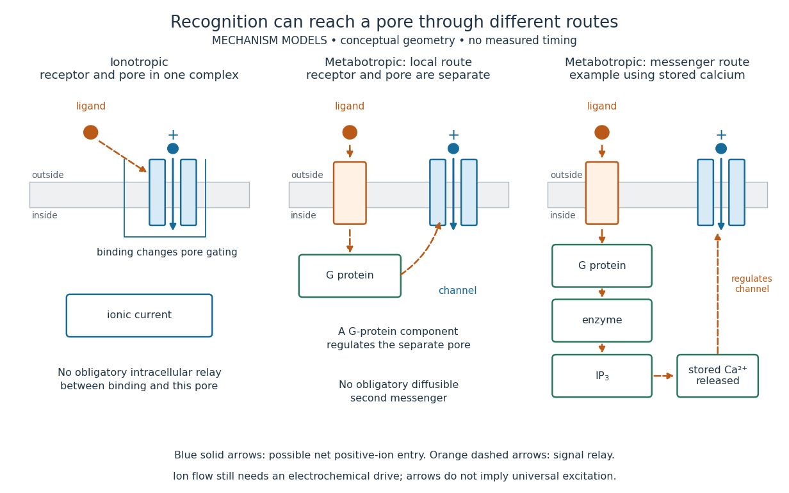

# Ionotropic receptor

↑ **Parent:** [Receptor (biochemistry)](receptor-biochemistry.md)

An [ionotropic receptor](ionotropic-receptor.md) is a [receptor](receptor-biochemistry.md) in which binding of a [ligand](ligand-biochemistry.md) directly gates an [ion channel](ion-channel.md) within the same [protein](protein.md) complex. The binding site detects the chemical signal; the pore supplies a path across the [cell membrane](cell-membrane.md). At a [chemical synapse](chemical-synapse.md), a [neurotransmitter](neurotransmitter.md) therefore changes [synaptic conductance](synaptic-conductance.md) without an obligatory intervening [G protein](g-protein.md) or [second messenger](second-messenger.md). [Two Families of Postsynaptic Receptors](neuroscience-2nd-edition-edited-by-d-purves-and-others/two-families-of-postsynaptic-receptors.md)

A familiar example is the nicotinic [acetylcholine](acetylcholine.md) [receptor](receptor-biochemistry.md) of skeletal muscle: [acetylcholine](acetylcholine.md) binding opens a pore passing [cations](cation.md), including [sodium](sodium.md) and [potassium](potassium.md). The muscarinic [acetylcholine](acetylcholine.md) [receptor](receptor-biochemistry.md) instead uses intracellular [signal transduction](signal-transduction.md); the same [neurotransmitter](neurotransmitter.md) can engage different mechanisms. Direct gating does not mean that an [ionotropic receptor](ionotropic-receptor.md) pumps [ions](ion.md): [electrochemical gradients](electrochemical-gradient.md) drive passage through the open [ion channel](ion-channel.md). Nor does “ionotropic” specify excitation. The [reversal potential](reversal-potential.md), initial [membrane potential](membrane-potential.md) and other conductances determine whether the effect favors an [action potential](action-potential.md), causes [hyperpolarization](hyperpolarization.md), or supplies [shunting inhibition](shunting-inhibition.md). [Ion Channels and the Electrical Properties of Membranes](molecular-biology-of-the-cell-4th-edition-by-bruce-alberts-and-others/ion-channels-and-the-electrical-properties-of-membranes.md)

A concrete electrical approximation separates opening from drive. Let $N$ identical [ion channels](ion-channel.md) each have open-channel [electrical conductance](electrical-conductance.md) $\gamma$ and opening [probability](probability.md) $p(t)$. At fixed [membrane potential](membrane-potential.md) $V$, with common [reversal potential](reversal-potential.md) $E_{\mathrm{rev}}$, the [expected value](expected-value.md) of inward-positive [electric current](electric-current.md) is

$$
I_{\mathrm{in}}(t)=N\gamma p(t)(E_{\mathrm{rev}}-V).
$$

For stipulated values $N=100$, $\gamma=20\,\mathrm{pS}$, $p=0.2$, $V=-60\,\mathrm{mV}$ and $E_{\mathrm{rev}}=0$, the mean open count is $20$, the population [electrical conductance](electrical-conductance.md) is $0.4\,\mathrm{nS}$ and $I_{\mathrm{in}}=24\,\mathrm{pA}$. One open [ion channel](ion-channel.md) carries $1.2\,\mathrm{pA}$. These are illustrative values, not measurements. At $V=E_{\mathrm{rev}}$, the net [electric current](electric-current.md) vanishes despite open [ion channels](ion-channel.md); neither binding nor opening alone determines the readout. The approximation omits changes in [ion](ion.md) [concentrations](concentration.md) and voltage-dependent open-channel [electrical conductance](electrical-conductance.md).

**[Figure 38](#image-direct-ionotropic-receptor-gating-and-two-routes-of-metabotropic-receptor-action). Direct ionotropic receptor gating and two routes of metabotropic receptor action**. Original mechanism cartoons, not molecular structures or measured pathways. Solid blue arrows show one possible net movement of positive [ions](ion.md) when the [electrochemical gradient](electrochemical-gradient.md) favors entry; dashed orange arrows relay a signal. In the first panel binding and pore functions belong to one [protein](protein.md) complex. In the other panels a separate [ion channel](ion-channel.md) is regulated through a [G protein](g-protein.md), either locally or through an [enzyme](enzyme.md), [inositol trisphosphate](inositol-trisphosphate.md) and stored [calcium](calcium.md). Positions, shapes and arrow lengths encode no measured distances or times.

A motivating experiment made the elementary electrical events visible. As Bert Sakmann recounts, chronically denervated frog muscle fibers had [acetylcholine](acetylcholine.md)-sensitive [receptors](receptor-biochemistry.md) spread beyond the original nerve contact. Mild [enzyme](enzyme.md) treatment exposed the [cell membrane](cell-membrane.md); a polished glass pipette sealed over a small patch to reduce background noise. Two intracellular electrodes held the local [membrane potential](membrane-potential.md) through [voltage clamp](voltage-clamp.md), while the patch pipette recorded tiny [electric currents](electric-current.md). Applying suberyldicholine, a [ligand](ligand-biochemistry.md) that activates the [acetylcholine](acetylcholine.md) [receptor](receptor-biochemistry.md) and prolongs openings, revealed abrupt, approximately rectangular current events. Their amplitudes agreed reasonably with estimates from whole-membrane current fluctuations. This established discrete opening and closing events; it did not make every [ligand](ligand-biochemistry.md) response instantaneous. Background noise and finite recording bandwidth concealed sufficiently small or brief events.[pp. 33–35](elementary-steps-in-synaptic-transmission-revealed-by-currents-through-single-ion-channels-by-bert-sakmann.md)

Recording an intact membrane patch alone does not exclude intracellular relays. Tank, Huganir, Greengard and Webb supplied a complementary isolation test in 1983: they purified nicotinic [acetylcholine](acetylcholine.md) [receptors](receptor-biochemistry.md) from an electric ray's electric organ, incorporated them into artificial [lipid](lipid.md) membranes, and fused small vesicles into larger vesicles by freezing and thawing. Sealed glass-pipette recordings from isolated membrane patches resolved functional [ion channels](ion-channel.md) with properties resembling those in muscle. Removing the intact [cytoplasm](cytoplasm.md) and its signaling machinery supports the sufficiency of the [receptor](receptor-biochemistry.md) complex for channel function; an artificial [lipid](lipid.md) environment still cannot reproduce every native regulatory interaction.[abstract](patch-recorded-single-channel-currents-of-the-purified-and-reconstituted-torpedo-acetylcholine-receptor-by-d-w-tank-and-others.md)

Direct gating supports millisecond communication at many [chemical synapses](chemical-synapse.md). Response duration also depends on [neurotransmitter clearance](neurotransmitter-clearance.md), binding and channel-state transitions. Continued [ligand](ligand-biochemistry.md) exposure can prolong activity. Classify an [ionotropic receptor](ionotropic-receptor.md) by its direct connection between recognition and pore gating, rather than a universal duration cutoff. [Two Families of Postsynaptic Receptors](neuroscience-2nd-edition-edited-by-d-purves-and-others/two-families-of-postsynaptic-receptors.md)

## ↑ Ancestors (4)

1. [Receptor (biochemistry)](receptor-biochemistry.md)
2. [Protein](protein.md)
3. [Biology](biology-split.md)
4. [Codex Wiki](split.md)

## ← Incoming links (8)

- [Acetylcholine](acetylcholine.md)
- [Chemical synapse](chemical-synapse.md)
- [Ion channel](ion-channel.md)
- [Ionotropic receptor](ionotropic-receptor.md)
- [Metabotropic receptor](metabotropic-receptor.md)
- [NMDA receptor](nmda-receptor.md)
- [Receptor (biochemistry)](receptor-biochemistry.md)
- [Voltage clamp](voltage-clamp.md)
