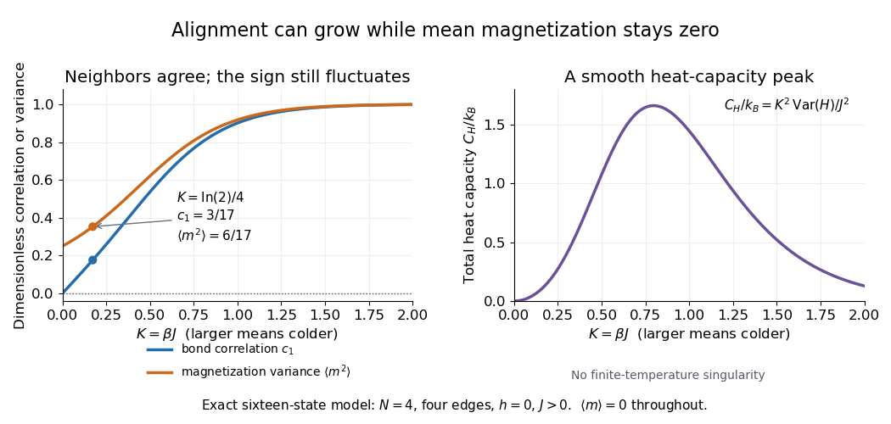

# Ising ring magnetization fluctuations

↑ **Parent:** [Four-spin Ising ring](four-spin-ising-ring.md)

Define the instantaneous [spin magnetization](spin-magnetization.md) $m=\frac14\sum_i\sigma_i$. Global reversal sends $m$ to $-m$ without changing the zero-field [energy](energy-split.md). Pairing every [microstate](microstate.md) with its reversed partner proves $\langle m\rangle=0$ at every positive [temperature](temperature-split.md), even when almost all [probability](probability.md) lies on the two fully aligned patterns. A vanishing mean does not imply weak alignment: the limiting [probability distribution](probability-distribution-split.md) is half at $m=+1$ and half at $m=-1$.

The [Ising ring magnetization fluctuations](ising-ring-magnetization-fluctuations.md) measure this distinction through [variance](variance-split.md). In the $d=0$ class, both patterns have $m^2=1$. Among the $d=2$ patterns, eight have $m^2=1/4$ and four have $m^2=0$; the two $d=4$ patterns also have $m^2=0$. Consequently

$$
\operatorname{Var}(m)=\langle m^2\rangle
=\frac{2e^{4K}+2}{Z}.
$$

It equals $6/17$ at $K=(\ln2)/4$, approaches $1/4$ for four independent fair [Ising spins](ising-spin-variable.md) at $K\to0$, and approaches $1$ as $K\to\infty$. Unlike the [energy](energy-split.md) [variance](variance-split.md), the [spin magnetization](spin-magnetization.md) [variance](variance-split.md) remains large in the low-[temperature](temperature-split.md) symmetric mixture.

**[Figure 4](#image-exact-bond-correlation-magnetization-variance-and-heat-capacity-of-the-four-spin-ising-ring). Exact bond correlation, magnetization variance and heat capacity of the four-spin Ising ring**. Original exact finite-ring calculations at $h=0$ and $J>0$, plotted against $K=\beta J$; increasing $K$ means cooling at fixed $J$. The marked point has $K=(\ln2)/4$, [Ising ring bond correlation](ising-ring-bond-correlation.md) $3/17$ and [spin magnetization](spin-magnetization.md) [variance](variance-split.md) $6/17$. These smooth curves are model predictions.

The same [thermal fluctuation](thermal-fluctuation.md) controls the field response. Allow $h$ to vary before setting it to zero; differentiating the [Boltzmann distribution](boltzmann-distribution.md) inserts $\beta\sum_i\sigma_i=4\beta m$, giving

$$
\left.\frac{\partial\langle m\rangle}{\partial h}\right|_{h=0}
=4\beta\operatorname{Var}(m).
$$

This is a spin-normalized [magnetic susceptibility](magnetic-susceptibility.md) with respect to the [energy](energy-split.md)-valued parameter $h$; conversion to physical [magnetization](magnetization.md) and [magnetic field](magnetic-field-split.md) requires the [magnetic moment](magnetic-dipole-moment.md) and sample [volume](volume.md) factors.

For finite $N$, $Z$ is a finite positive sum of [exponential functions](exponential-function.md). Its [free energy](thermodynamic-free-energy.md) $-k_BT\log Z$ is a [real analytic function](real-analytic-function.md) for $T>0$, so the smooth [heat capacity](heat-capacity.md) peak here is not a critical [phase transition](phase-transition.md). [Spontaneous magnetization](spontaneous-magnetization.md) concerns the order of limits: first a [thermodynamic limit](thermodynamic-limit.md), then removal of a symmetry-breaking field. The [four-spin Ising ring](four-spin-ising-ring.md) alone establishes neither that limit nor any two-dimensional [Ising model](ising-model.md) result.[§5.2.3, paragraph beginning with the analytic finite partition sum: phase transitions require the thermodynamic limit](statistical-physics-by-david-tong.md)

## ↑ Ancestors (7)

1. [Four-spin Ising ring](four-spin-ising-ring.md)
2. [Ising model](ising-model.md)
3. [Spin model](spin-model-split.md)
4. [Statistical physics](statistical-physics-split.md)
5. [Branches of physics](branches-of-physics.md)
6. [Physics](physics-split.md)
7. [Codex Wiki](split.md)

## ← Incoming links (1)

- [Ising ring magnetization fluctuations](ising-ring-magnetization-fluctuations.md)
