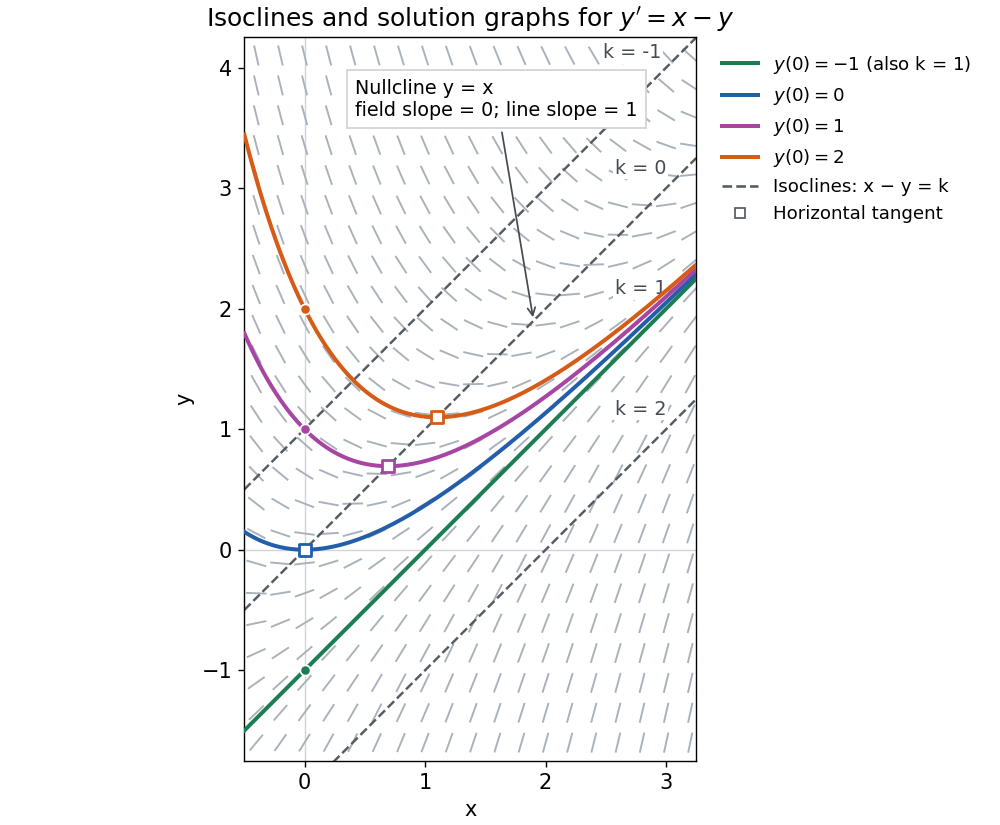

# Isocline

↑ **Parent:** [Differential equation](differential-equation-split.md)

For the first-order [ordinary differential equation](ordinary-differential-equation.md) $y'=f(x,y)$ defined on an [open subset](open-set.md) $D$ of the plane, an [isocline](isocline.md) of [slope](slope.md) $k$ is the [level set](level-set.md)

$$
\{(x,y)\in D:f(x,y)=k\}.
$$

Here $k$ is a constant. At every point of this [isocline](isocline.md), the [direction field](direction-field.md) prescribes a [tangent vector](tangent-vector.md) proportional to $(1,k)$ for a [solution of a differential equation](solution-of-a-differential-equation.md). It does not generally prescribe the [tangent line](tangent-line.md) of the [isocline](isocline.md) itself. The [level set](level-set.md) can have several components or fail to be a smooth curve, and points outside $D$ are excluded.

For example, take $y'=x-y$ on the whole plane. Its [isoclines](isocline.md) are the parallel [straight lines](straight-line.md)

$$
x-y=k,\qquad y=x-k.
$$

Each [line](straight-line.md) has [slope](slope.md) $1$, while the [direction field](direction-field.md) along it has [slope](slope.md) $k$. Thus the [isocline](isocline.md) $y=x$ carries horizontal segments even though the [line](straight-line.md) itself rises. A [function graph](graph-of-a-function.md) of a [solution of a differential equation](solution-of-a-differential-equation.md) follows the segments, rather than following this [line](straight-line.md). Only the [isocline](isocline.md) with $k=1$, namely $y=x-1$, is also a [solution of a differential equation](solution-of-a-differential-equation.md).[pp. 1–2: constant-slope loci and the example y prime equals x minus y](18-03sc-differential-equations-fall-2011/direction-fields-isoclines-integral-curves.md)

**[Figure 2](#image-isoclines-label-the-prescribed-slopes-while-exact-solution-graphs-follow-the-direction-field). Isoclines label the prescribed slopes while exact solution graphs follow the direction field**.

The [first-order linear differential equation](first-order-linear-differential-equation.md) has the exact family

$$
y(x)=x-1+Ae^{-x},\qquad y'(x)=1-Ae^{-x}=x-y(x).
$$

The [initial condition](initial-condition.md) $y(x_0)=y_0$ selects $A=(y_0-x_0+1)e^{x_0}$ and hence a unique [solution of a differential equation](solution-of-a-differential-equation.md) for every real $x$. The picture shows $y(0)=-1,0,1,2$. For $A=0$ the [solution of a differential equation](solution-of-a-differential-equation.md) stays on the $k=1$ [isocline](isocline.md); for other $A$ it moves through different [isoclines](isocline.md). These formulas check the pictured trajectories by direct [differentiation](differentiation.md), independently of how the [direction field](direction-field.md) was sampled.

The zero-slope [isocline](isocline.md) $f(x,y)=0$ is called a [nullcline](nullcline.md). Below the [nullcline](nullcline.md) $y=x$ in this example, $y'>0$; above it, $y'<0$. For $A>0$, the [solution of a differential equation](solution-of-a-differential-equation.md) meets it at $x=\log A$, where $y'=0$ and $y''=1$, a strict [local minimum](local-minimum.md). The [nullcline](nullcline.md) is therefore a useful guide to turning points, although it is not itself a [solution of a differential equation](solution-of-a-differential-equation.md). In the equivalent planar [autonomous differential equation](autonomous-system-mathematics.md) $\dot x=1$, $\dot y=x-y$, it is the [nullcline](nullcline.md) for the second component; there is no [equilibrium point](equilibrium-point-of-a-dynamical-system.md), because the first component never vanishes.

This makes [isoclines](isocline.md) useful even when no explicit [solution of a differential equation](solution-of-a-differential-equation.md) is available: organize a [direction field](direction-field.md) by common [slopes](slope.md), read where [function graphs](graph-of-a-function.md) rise or fall, and identify possible turning points on [nullclines](nullcline.md).

## ↑ Ancestors (5)

1. [Differential equation](differential-equation-split.md)
2. [Analysis](analysis-split.md)
3. [Area of mathematics](area-of-mathematics.md)
4. [Mathematics](mathematics-split.md)
5. [Codex Wiki](split.md)

## ← Incoming links (3)

- [Direction field](direction-field.md)
- [Isocline](isocline.md)
- [Solution](past-exam-of-the-mathematics-course-of-the-university-of-cambridge/2004/ia/paper-2/1b/solution.md)
