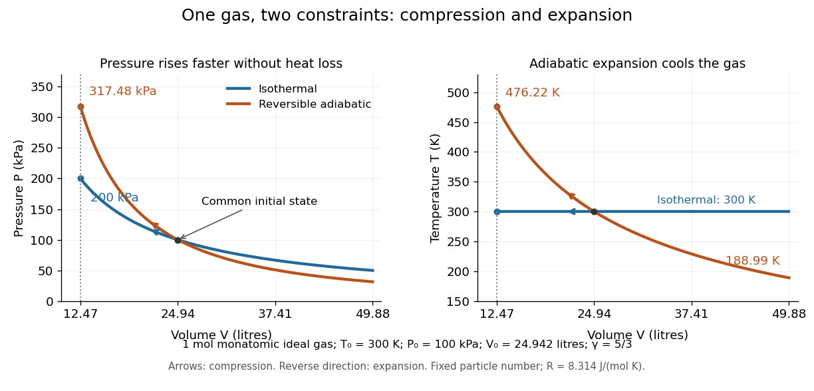

# Isothermal compressibility

↑ **Parent:** [Compressibility](compressibility.md)

Isothermal compressibility is the [compressibility](compressibility.md) measured at fixed [temperature](temperature-split.md), particle number and composition. A slowly compressed sealed piston in contact with a [thermal reservoir](heat-bath.md) can approach this constraint. For an [ideal gas](ideal-gas-split.md), differentiating $V=Nk_BT/P$ at fixed [temperature](temperature-split.md) gives $(\partial V/\partial P)_{T,N}=-V/P$, hence $\kappa_T=1/P$. A small [pressure](pressure-split.md) increase $\Delta P$ therefore gives $\Delta V/V\simeq-\Delta P/P$. For a finite change, use the whole [isothermal process](isothermal-process.md) curve $V_2/V_1=P_1/P_2$ instead.

Take one [mole](mole-unit.md) of classical [monatomic gas](monatomic-gas.md), with stipulated [molar gas constant](molar-gas-constant.md) $R=8.314\,\mathrm{J\,mol^{-1}\,K^{-1}}$, initially at $T_0=300\,\mathrm K$ and $P_0=100\,\mathrm{kPa}$. The initial [volume](volume-thermodynamics.md) is $V_0=nRT_0/P_0=0.024942\,\mathrm{m^3}$. Compressing to $V_0/2$ gives

$$
\begin{aligned}
\text{Isothermal:}\quad &P_2=2P_0=200\,\mathrm{kPa},\quad T_2=300\,\mathrm K,\\
\text{Reversible adiabatic:}\quad &P_2=2^{5/3}P_0\simeq317.48\,\mathrm{kPa},\quad
T_2=2^{2/3}T_0\simeq476.22\,\mathrm K.
\end{aligned}
$$

The [isothermal compression](isothermal-compression.md) releases [heat](heat-split.md) to the [thermal reservoir](heat-bath.md); the reversible [adiabatic compression](adiabatic-compression.md) retains the input [work](work.md) as [internal energy](internal-energy-split.md). Reversing either curve gives the corresponding expansion, with [adiabatic expansion](adiabatic-expansion.md) cooling the [gas](gas.md).

**[Figure 13](#image-an-ideal-gas-resists-reversible-adiabatic-compression-more-strongly-than-isothermal-compression). An ideal gas resists reversible adiabatic compression more strongly than isothermal compression**. Left: two [pressure](pressure-split.md)-[volume](volume-thermodynamics.md) curves through the same initial state; arrows point toward compression. Right: the corresponding [temperature](temperature-split.md) changes, including cooling during reversible [adiabatic expansion](adiabatic-expansion.md). The dotted line marks half the initial [volume](volume-thermodynamics.md). One [mole](mole-unit.md) of classical [monatomic gas](monatomic-gas.md), with $\gamma=5/3$ and the stipulated $R$ above.

The equilibrium curvature of [Gibbs free energy](gibbs-free-energy.md) provides another measurement of [isothermal compressibility](isothermal-compressibility.md):

$$
\kappa_T=-\frac1V\left(\frac{\partial^2G}{\partial P^2}\right)_{T,N}.
$$

This follows from $V=(\partial G/\partial P)_{T,N}$, with $G$ denoting [Gibbs free energy](gibbs-free-energy.md). Within a stable single [thermodynamic phase](thermodynamic-phase.md), increasing [pressure](pressure-split.md) reduces [volume](volume-thermodynamics.md) and makes this curvature negative. At [phase coexistence](phase-coexistence.md), changing the [phase fraction](phase-fraction.md) can change the [volume](volume-thermodynamics.md) at constant [temperature](temperature-split.md) and [pressure](pressure-split.md); the usual finite single-phase [isothermal compressibility](isothermal-compressibility.md) then need not exist. Near a [critical point](critical-point.md), it can diverge. [Feynman, Leighton and Sands, section 45-3: compression and phase coexistence](https://www.feynmanlectures.caltech.edu/I_45.html#Ch45-S3)

**Table of contents**

- [Critical-density compressibility of a cubic gas](critical-density-compressibility-of-a-cubic-gas.md)
- [Isothermal compressibility from chemical-potential response](isothermal-compressibility-from-chemical-potential-response.md)

## ↑ Ancestors (6)

1. [Compressibility](compressibility.md)
2. [Thermodynamics](thermodynamics-split.md)
3. [Statistical physics](statistical-physics-split.md)
4. [Branches of physics](branches-of-physics.md)
5. [Physics](physics-split.md)
6. [Codex Wiki](split.md)

## ← Incoming links (22)

- [Coefficient of thermal expansion](coefficient-of-thermal-expansion.md)
- [Compressibility](compressibility.md)
- [Compressibility factor](compressibility-factor.md)
- [Condensate compressibility in an optical lattice](condensate-compressibility-in-an-optical-lattice.md)
- [Degeneracy-pressure bulk modulus](degeneracy-pressure-bulk-modulus.md)
- [Dulong-Petit law](dulong-petit-law.md)
- [Heat-capacity and compressibility ratio identity](heat-capacity-and-compressibility-ratio-identity.md)
- [Heat-capacity difference and mechanical stability](heat-capacity-difference-and-mechanical-stability.md)
- [Isentropic compressibility](isentropic-compressibility.md)
- [Isothermal compressibility](isothermal-compressibility.md)
- [Maxwell relations](maxwell-relations.md)
- [Mayer's relation](mayer-s-relation.md)
- [Solution](past-exam-of-the-mathematics-course-of-the-university-of-cambridge/2008/ii/paper-3/34e/solution.md)
- [Solution](past-exam-of-the-physics-b-course-of-the-university-of-cambridge/2017/paper-2/section-c/c11/equations-of-state-and-transitions/solution.md)
- [Solution](past-exam-of-the-physics-b-course-of-the-university-of-cambridge/2017/paper-2/section-c/c11/phase-transition-test/solution.md)
- [Solution](past-exam-of-the-physics-b-course-of-the-university-of-cambridge/2019/paper-2/section-c/c10/solution.md)
- [Solution](past-exam-of-the-thermal-and-statistical-physics-course-of-the-university-of-cambridge/2013/paper-1/2/c/solution.md)
- [Solution](past-exam-of-the-thermal-and-statistical-physics-course-of-the-university-of-cambridge/2021/section-a/1/solution.md)
- [Van der Waals critical point](van-der-waals-critical-point.md)
- [Van der Waals isotherm](van-der-waals-isotherm.md)
- [Van der Waals liquid-gas coexistence](van-der-waals-liquid-gas-coexistence.md)
- [Van der Waals throttling model](van-der-waals-throttling-model.md)
