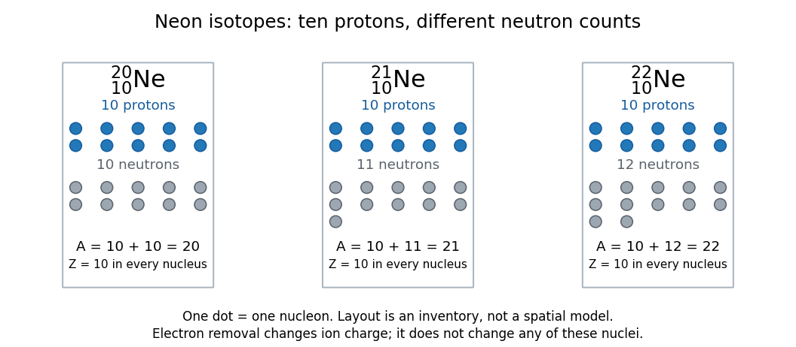

# Isotope

↑ **Parent:** [Chemical element](chemical-element.md)  
ⓦ [Wiki](https://en.wikipedia.org/wiki/Isotope)

[Isotopes](isotope.md) of a [chemical element](chemical-element.md) have the same [atomic number](atomic-number.md) $Z$, hence the same number of [protons](proton.md), but different [neutron numbers](neutron-number.md) $N$ and therefore different [mass numbers](mass-number.md) $A=Z+N$. For example, every [neon](neon.md) [atomic nucleus](atomic-nucleus.md) contains ten [protons](proton.md): [neon-20](neon-20.md), [neon-21](neon-21.md), and [neon-22](neon-22.md) contain ten, eleven, and twelve [neutrons](neutron.md), respectively. They occupy one [chemical element](chemical-element.md) box in the [periodic table](periodic-table.md), rather than three boxes.

**[Figure 85](#image-neon-isotopes-the-same-ten-protons-with-different-neutron-numbers). Neon isotopes: the same ten protons with different neutron numbers**. Every dot counts one [nucleon](nucleon.md). The arrays inventory [atomic nuclei](atomic-nucleus.md); they do not model the positions or sizes of [protons](proton.md) and [neutrons](neutron.md). The [mass numbers](mass-number.md) 20, 21, and 22 are exact counts.

Three labels answer different questions. The [chemical element](chemical-element.md) fixes $Z$; the [isotope](isotope.md) specifies which [neutron number](neutron-number.md) accompanies that $Z$; the [ion](ion.md) label specifies the net [electric charge](electric-charge.md). Neutral ${}^{22}_{10}\mathrm{Ne}$ and the [ion](ion.md) ${}^{22}_{10}\mathrm{Ne}^{+}$ both contain ten [protons](proton.md) and twelve [neutrons](neutron.md); they contain ten and nine [Electrons](electron.md), respectively. Ordinary [ionization](ionization.md) changes the [Electron](electron.md) count, leaving the [isotope](isotope.md) unchanged. Changing the [neutron number](neutron-number.md) can change [nuclear binding energy](nuclear-binding-energy.md) and the possibility of [radioactive decay](radioactive-decay.md). [Isotopic abundances](isotopic-abundance.md) can help distinguish material sources, while [radioactive decay](radioactive-decay.md) can additionally supply chronological information.

A [mass spectrum](mass-spectrum.md) makes the distinction experimentally visible: a single [chemical element](chemical-element.md) can give separate [ion](ion.md) peaks at different [mass-to-charge ratios](mass-to-charge-ratio.md). Its bulk [atomic weight](relative-atomic-mass.md) is a [weighted mean](weighted-arithmetic-mean.md) governed by [isotopic abundances](isotopic-abundance.md), rather than the location of one compulsory peak. The historical [mass spectrograph](mass-spectrograph.md) experiment and the synthetic [neon](neon.md) [mass spectrum](mass-spectrum.md) below illustrate these complementary observations.

**Table of contents**

- [Mass number](mass-number.md)
  - [Neutron number](neutron-number.md)
- [Atomic mass](atomic-mass.md)
  - [Dalton (unit)](dalton-unit.md)
  - [Nuclear mass defect](nuclear-mass-defect.md)
  - [Relative atomic mass](relative-atomic-mass.md)
    - [Standard atomic weight](standard-atomic-weight.md)
- [Isotopic abundance](isotopic-abundance.md)

## ↑ Ancestors (4)

1. [Chemical element](chemical-element.md)
2. [Chemical substance](chemical-substance.md)
3. [Chemistry](chemistry-split.md)
4. [Codex Wiki](split.md)

## ← Incoming links (26)

- [Atomic mass](atomic-mass.md)
- [Atomic number](atomic-number.md)
- [Carbon-13](carbon-13.md)
- [Chemical element](chemical-element.md)
- [DNA replication](dna-replication.md)
- [Fermionic atom antibunching](fermionic-atom-antibunching.md)
- [HCl and DCl vibrational isotope experiment](hcl-and-dcl-vibrational-isotope-experiment.md)
- [Isopycnic centrifugation](isopycnic-centrifugation.md)
- [Isotope](isotope.md)
- [Isotope scaling of diatomic vibration](isotope-scaling-of-diatomic-vibration.md)
- [Isotope shift of a linear rotor](isotope-shift-of-a-linear-rotor.md)
- [Isotopic abundance](isotopic-abundance.md)
- [Mass resolution](mass-resolution.md)
- [Mass spectrometry](mass-spectrometry.md)
- [Mass spectrum](mass-spectrum.md)
- [Mass-to-charge ratio](mass-to-charge-ratio.md)
- [Neon-20](neon-20.md)
- [Neon-21](neon-21.md)
- [Neon-22](neon-22.md)
- [Neutron number](neutron-number.md)
- [Nitrogen dissociation threshold from fragment images](nitrogen-dissociation-threshold-from-fragment-images.md)
- [Nuclide](nuclide.md)
- [Solution](past-exam-of-the-mathematics-course-of-the-university-of-cambridge/2008/iii/paper-74/4/solution.md)
- [Solution](past-exam-of-the-mathematics-course-of-the-university-of-cambridge/2010/iii/paper-69/4/solution.md)
- [Periodic table](periodic-table.md)
- [Rotational monitoring of deuterium exchange](rotational-monitoring-of-deuterium-exchange.md)
