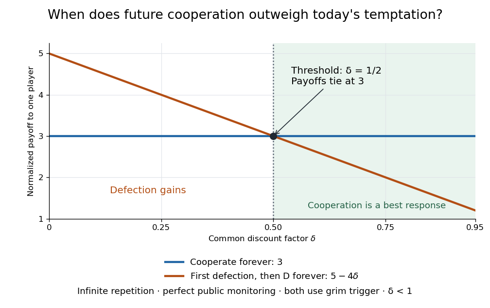

<h1 id="iterated-prisoner-s-dilemma">Iterated prisoner's dilemma</h1>

↑ **Parent:** [Prisoner's dilemma](prisoner-s-dilemma.md)

The [iterated prisoner's dilemma](iterated-prisoner-s-dilemma.md) is a [repeated game](repeated-game.md) with a [prisoner's dilemma](prisoner-s-dilemma.md) at each round. Earlier choices can change later [best responses](best-response.md): a present gain from defection may be outweighed by lost future cooperation. A [pure strategy](pure-strategy.md) now specifies an action after every possible observed history, including histories that its own prescribed play would never reach. The horizon, observations, initial actions, and [payoff](payoff.md) convention must be specified before assessing a [Nash equilibrium](nash-equilibrium.md) or [subgame perfect equilibrium](subgame-perfect-equilibrium.md).

For the following worked example, repeat the [prisoner's dilemma](prisoner-s-dilemma.md) above infinitely at rounds $t=0,1,\ldots$. Assume public perfect monitoring: after each round both players observe both actions exactly, without error. They share a [discount factor](discount-factor.md) $0\le\delta<1$ and evaluate a path of stage [payoffs](payoff.md) $u_i(t)$ using the normalized discounted [payoff](payoff.md)

$$
U_i=(1-\delta)\sum_{t=0}^{\infty}\delta^t u_i(t).
$$

The round-zero weight is one before normalization, including when $\delta=0$. A larger [discount factor](discount-factor.md) gives future [payoffs](payoff.md) more weight; the [geometric series](geometric-series.md) makes a constant stage [payoff](payoff.md) have the same normalized value. These assumptions and normalization follow [Asu Ozdaglar, MIT 6.254, lecture 15, slides 6–15](https://ocw.mit.edu/courses/6-254-game-theory-with-engineering-applications-spring-2010/5a158a7558165d0e22b5b27fcfa01713_MIT6_254S10_lec15.pdf). The numerical [payoffs](payoff.md) here are our $3,5,0,1$ example; the lecture uses a different table.

Suppose both players use [grim trigger](grim-trigger.md): play $C$ initially and while every past action of both players was $C$; after any observed $D$, play $D$ forever. With no [unilateral deviation](unilateral-deviation.md), each gets normalized [payoff](payoff.md) $3$. A first [unilateral deviation](unilateral-deviation.md) to $D$ earns $5$ now, then at most $1$ each round because the opponent switches permanently to [always defect](always-defect.md). The deviator attains that continuation [payoff](payoff.md) by choosing $D$ thereafter. At any history of mutual cooperation, the comparison is therefore

$$
U_{\mathrm{cooperate}}=3,\qquad U_{\mathrm{deviate}}=(1-\delta)5+\delta\cdot1=5-4\delta.
$$

Cooperation is a [best response](best-response.md) precisely when

$$
3\ge 5-4\delta\quad\Longleftrightarrow\quad\delta\ge\frac12.
$$

Equivalently, without normalization the [geometric series](geometric-series.md) gives

$$
V_{\mathrm{cooperate}}=\frac{3}{1-\delta},\qquad V_{\mathrm{deviate}}=5+\frac{\delta}{1-\delta}.
$$

Multiplying both unnormalized [payoffs](payoff.md) by the same positive factor $1-\delta$ leaves the [best response](best-response.md) comparison unchanged.

**[Figure 2](#image-repeated-prisoner-s-dilemma-normalized-cooperation-and-first-deviation-payoffs-cross-at-discount-factor-one-half). Repeated prisoner's dilemma: normalized cooperation and first-deviation payoffs cross at discount factor one half**.

For example, with [discount factor](discount-factor.md) $\delta=1/4$, the first [unilateral deviation](unilateral-deviation.md) gives normalized [payoff](payoff.md) $4>3$, so mutual [grim trigger](grim-trigger.md) is not a [Nash equilibrium](nash-equilibrium.md). At $\delta=3/4$, it gives $2<3$, so cooperation is preferable. At $\delta=1/2$ the two [payoffs](payoff.md) tie: the incentive to cooperate is weak, which is sufficient for a [subgame perfect equilibrium](subgame-perfect-equilibrium.md).

The punishment is credible after every history containing a defection: the opponent's [pure strategy](pure-strategy.md) then prescribes $D$ forever, and $D$ remains the stage [best response](best-response.md), earning $1$ rather than $0$. Together with the cooperative-history comparison, this establishes mutual [grim trigger](grim-trigger.md) as a [subgame perfect equilibrium](subgame-perfect-equilibrium.md) for $1/2\le\delta<1$. Delaying the first [unilateral deviation](unilateral-deviation.md) merely delays the same gain or loss; further cooperation during punishment only lowers the deviator's [payoff](payoff.md). Mutual [always defect](always-defect.md) also remains a [subgame perfect equilibrium](subgame-perfect-equilibrium.md), so patience permits cooperation without making it inevitable.

This calculation assumes an infinite horizon and $\delta<1$; it does not define a discounted [payoff](payoff.md) at $\delta=1$. With a finite, commonly known final round and positive weight on each round, [backward induction](backward-induction.md) instead gives mutual defection in every round of this stage game. Observational errors change the model too: one mistaken defection permanently activates [grim trigger](grim-trigger.md). Historical dependence, initial memories, and the [payoff](payoff.md) time convention also affect whether a cooperative rule resists or invades other [pure strategies](pure-strategy.md); the existing [reactive strategy](reactive-strategy-game-theory.md) and [Tit for tat](tit-for-tat.md) discussions concern those additional questions.

**Table of contents**

- [Grim trigger](grim-trigger.md)
- [Reactive strategy (game theory)](reactive-strategy-game-theory.md)
  - [Always defect](always-defect.md)
  - [Always cooperate](always-cooperate.md)
  - [Tit for tat](tit-for-tat.md)
    - [Tit for tat invasion of a reactive resident](tit-for-tat-invasion-of-a-reactive-resident.md)
      - [Finite-horizon invasion threshold of Tit for tat against unconditional defection](finite-horizon-invasion-threshold-of-tit-for-tat-against-unconditional-defection.md)
    - [Neutrality between Tit for tat and unconditional cooperation](neutrality-between-tit-for-tat-and-unconditional-cooperation.md)
  - [Long-run payoff of reactive strategies](long-run-payoff-of-reactive-strategies.md)

## ↑ Ancestors (6)

1. [Prisoner's dilemma](prisoner-s-dilemma.md)
2. [Game theory](game-theory-split.md)
3. [Mathematical optimization](mathematical-optimization-split.md)
4. [Area of mathematics](area-of-mathematics.md)
5. [Mathematics](mathematics-split.md)
6. [Codex Wiki](split.md)

## ← Incoming links (3)

- [Finite-horizon invasion threshold of Tit for tat against unconditional defection](finite-horizon-invasion-threshold-of-tit-for-tat-against-unconditional-defection.md)
- [Grim trigger](grim-trigger.md)
- [Iterated prisoner's dilemma](iterated-prisoner-s-dilemma.md)
