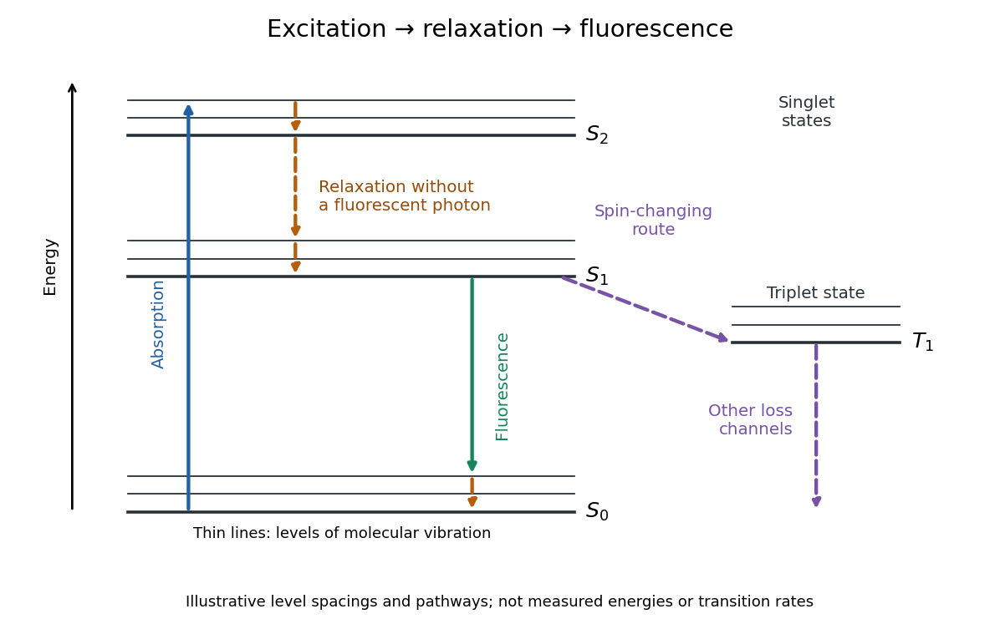

# Jablonski diagram

↑ **Parent:** [Fluorescence](fluorescence-split.md)  
ⓦ [Wiki](https://en.wikipedia.org/wiki/Jablonski_diagram)

A [Jablonski diagram](jablonski-diagram.md) arranges molecular [energy eigenstates](energy-eigenstate.md) vertically and draws arrows for changes between them. In the usual closed-shell molecular example, $S_0$ is the electronic [ground state](ground-state.md), $S_1$ and $S_2$ are electronic [excited states](excited-state.md) with [singlet state](singlet-state.md) spin, and $T_1$ has [triplet state](spin-one-half-triplet-state.md) spin. Each electronic state also has levels of [molecular vibration](molecular-vibration.md). The diagram records possible processes, not molecular paths in space.[§1.1.1, Figure 2B; §1.1.2, Figure 4: singlet and triplet levels](advanced-fluorescence-microscopy-techniques-frap-flip-flap-fret-and-flim-by-hellen-c-ishikawa-ankerhold-and-others.md)

[Photon absorption](photon-absorption.md) can populate an upper level of [molecular vibration](molecular-vibration.md) in $S_1$. Relaxation removes excess [energy](energy-split.md) without [photon emission](photon-emission.md); [fluorescence](fluorescence-split.md) commonly starts from relaxed $S_1$.[Stokes Shift in Fluorescence Spectroscopy, Figure 4 and its discussion](what-is-the-stokes-shift-by-edinburgh-instruments.md) The drawing also includes relaxation from a higher electronic [excited state](excited-state.md) and a competing spin-changing route to a [triplet state](spin-one-half-triplet-state.md).

**[Figure 1](#fluorescence-jablonski-level-processes). Molecular excitation, relaxation and fluorescence in a Jablonski diagram**. Original schematic for a usual molecular sequence. Straight coloured arrows represent [photon absorption](photon-absorption.md) and [photon emission](photon-emission.md); dashed arrows show routes without [photon emission](photon-emission.md). Vertical position indicates [energy](energy-split.md), while horizontal spacing only separates processes. The level spacings and arrows are illustrative, not measurements or a prediction of transition rates. The selected emission ends above the lowest $S_0$ level, so subsequent relaxation releases additional [energy](energy-split.md) without another fluorescent [photon](photon.md).

## ↑ Ancestors (6)

1. [Fluorescence](fluorescence-split.md)
2. [Physical optics](physical-optics-split.md)
3. [Optics](optics-split.md)
4. [Branches of physics](branches-of-physics.md)
5. [Physics](physics-split.md)
6. [Codex Wiki](split.md)

## ← Incoming links (2)

- [Fluorescence](fluorescence-split.md)
- [Jablonski diagram](jablonski-diagram.md)
