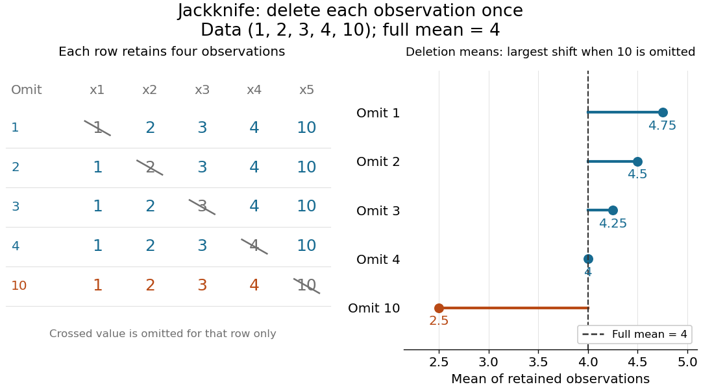

# Jackknife resampling

↑ **Parent:** [Statistical inference](statistical-inference-split.md)  
ⓦ [Wiki](https://en.wikipedia.org/wiki/Jackknife_resampling)

The delete-one form of [jackknife resampling](jackknife-resampling.md) recalculates a [statistic](statistic.md) after deleting each observation in turn. It uses one observed [statistical sample](statistical-sample.md) to investigate how sensitive an [estimator](estimator.md) is to its individual observations, and supplies both a [jackknife variance estimator](jackknife-variance-estimator.md) and [jackknife bias correction](jackknife-bias-correction.md). The calculations are deterministic once the data are fixed: no random draws are needed.

In the basic setting, $X_1,\ldots,X_n$ are [independent and identically distributed random variables](independent-and-identically-distributed-random-variables.md), with [sample size](sample-size.md) $n>1$. Let $x_1,\ldots,x_n$ be the observed values and $\widehat\theta_n=t_n(x_1,\ldots,x_n)$ a scalar [estimator](estimator.md) of an [estimand](estimand.md) $\theta$. Apply the same estimation rule to each reduced [statistical sample](statistical-sample.md), using its new [sample size](sample-size.md) $n-1$ wherever the rule requires it:

$$
\widehat\theta_{(-i)}=t_{n-1}(x_1,\ldots,x_{i-1},x_{i+1},\ldots,x_n),\qquad
i=1,\ldots,n,\qquad
\overline\theta_J=\frac1n\sum_{i=1}^n\widehat\theta_{(-i)}.
$$

Every index is deleted exactly once; an unusual value is treated by the same rule as every other value. The [mean](expected-value.md) $\overline\theta_J$ summarizes the deletion estimates. They overlap in $n-2$ observations, so they are generally not [independent random variables](independent-random-variables.md) representing fresh repetitions of the original experiment. Cosma Shalizi's [Carnegie Mellon jackknife notes, Sections 1–3 and 5](https://stat.cmu.edu/~cshalizi/490/23/2023-11-29-jackknife.pdf) explain this construction and its scaling.

For a concrete [sample mean](sample-mean.md), use the data $(1,2,3,4,10)$, whose full [sample mean](sample-mean.md) is $\overline x=4$. The five deletion [sample means](sample-mean.md), in observation order, are

$$
(\widehat\theta_{(-1)},\ldots,\widehat\theta_{(-5)})
=(4.75,4.5,4.25,4,2.5),\qquad \overline\theta_J=4.
$$

Deleting $1$ raises the [sample mean](sample-mean.md) by $0.75$, while deleting $10$ lowers the [sample mean](sample-mean.md) by $1.5$. Thus $10$ has the largest deletion effect in this [statistical sample](statistical-sample.md). This is a descriptive sensitivity calculation, not a rule for removing that observation: the full [sample mean](sample-mean.md) remains $4$.

**[Figure 1](#image-delete-each-observation-once-and-recompute-the-sample-mean). Delete each observation once and recompute the sample mean**. The left panel shows all five reduced [statistical samples](statistical-sample.md) from $(1,2,3,4,10)$; each crossed entry is omitted only for that row. The right panel shows their [sample means](sample-mean.md) against the full [sample mean](sample-mean.md) $4$. The orange row makes the deletion effect of $10$ visible.

Early literature includes M. H. Quenouille's [Approximate Tests of Correlation in Time-Series, JRSS B 11(1), 68–84 (1949)](https://academic.oup.com/jrsssb/article/11/1/68/7026551) and John W. Tukey's one-paragraph abstract [Bias and Confidence in Not-Quite Large Samples, Annals of Mathematical Statistics 29(2), 614 (1958)](https://www.jstor.org/stable/2237363), within the issue's collected abstracts. Shalizi's [historical notes and bibliography](https://stat.cmu.edu/~cshalizi/490/23/2023-11-29-jackknife.pdf) discuss the later development of [jackknife bias correction](jackknife-bias-correction.md) and the [jackknife variance estimator](jackknife-variance-estimator.md).

**Table of contents**

- [Jackknife variance estimator](jackknife-variance-estimator.md)
  - [Jackknife and bootstrap variance of a sample second moment](jackknife-and-bootstrap-variance-of-a-sample-second-moment.md)

## ↑ Ancestors (5)

1. [Statistical inference](statistical-inference-split.md)
2. [Probability and statistics](probability-and-statistics-split.md)
3. [Area of mathematics](area-of-mathematics.md)
4. [Mathematics](mathematics-split.md)
5. [Codex Wiki](split.md)

## ← Incoming links (5)

- [Jackknife bias correction](jackknife-bias-correction.md)
- [Jackknife resampling](jackknife-resampling.md)
- [Jackknife variance estimator](jackknife-variance-estimator.md)
- [Solution](past-exam-of-the-mathematics-course-of-the-university-of-cambridge/2003/iii/paper-41/6/vii/solution.md)
- [Solution](past-exam-of-the-mathematics-course-of-the-university-of-cambridge/2008/iii/paper-47/4/a/solution.md)
