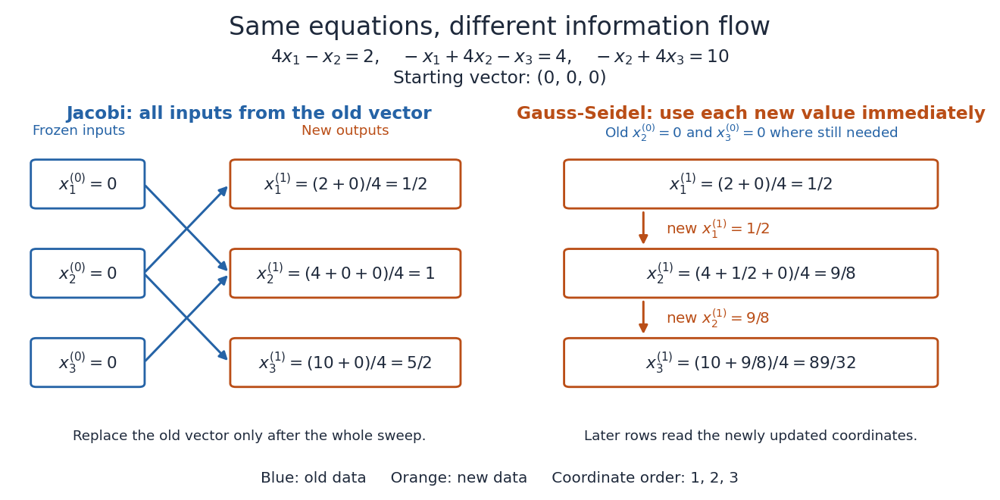

# Jacobi iteration for a three-variable tridiagonal system

↑ **Parent:** [Jacobi method](jacobi-method.md)

Consider the original [linear system](system-of-linear-equations.md) with a [symmetric matrix](symmetric-matrix.md) that is also a [tridiagonal matrix](tridiagonal-matrix.md):

$$
A=\begin{pmatrix}4&-1&0\\-1&4&-1\\0&-1&4\end{pmatrix},\qquad x_*=\begin{pmatrix}1\\2\\3\end{pmatrix},\qquad b=Ax_*=\begin{pmatrix}2\\4\\10\end{pmatrix}.
$$

Here $D=4I$ and the [Jacobi method](jacobi-method.md) reads

$$
x_1^{(k+1)}=\frac{2+x_2^{(k)}}4,\qquad x_2^{(k+1)}=\frac{4+x_1^{(k)}+x_3^{(k)}}4,\qquad x_3^{(k+1)}=\frac{10+x_2^{(k)}}4.
$$

Starting from $x^{(0)}=0$, the first three [vectors](vector.md) are

$$
x^{(1)}=\begin{pmatrix}1/2\\1\\5/2\end{pmatrix},\qquad x^{(2)}=\begin{pmatrix}3/4\\7/4\\11/4\end{pmatrix},\qquad x^{(3)}=\begin{pmatrix}15/16\\15/8\\47/16\end{pmatrix}.
$$

Every right-hand side uses superscript $k$, including the middle row, even when a new first coordinate has already been computed.

**[Figure 15](#image-simultaneous-old-to-new-component-updates-in-the-jacobi-method-compared-with-immediate-reuse-in-the-gauss-seidel-method). Simultaneous old-to-new component updates in the Jacobi method, compared with immediate reuse in the Gauss-Seidel method**.

For comparison, a first [Gauss-Seidel method](gauss-seidel-method.md) sweep in coordinate order $1,2,3$ gives

$$
x_1^{(1)}=\frac24=\frac12,\qquad x_2^{(1)}=\frac{4+1/2+0}4=\frac98,\qquad x_3^{(1)}=\frac{10+9/8}4=\frac{89}{32}.
$$

The new first coordinate enters the middle update, and the new second coordinate enters the final update. Accidentally overwriting old coordinates during a [Jacobi method](jacobi-method.md) sweep therefore changes the mathematical method.

**Table of contents**

- [Error modes of a three-variable Jacobi iteration](error-modes-of-a-three-variable-jacobi-iteration.md)

## ↑ Ancestors (8)

1. [Jacobi method](jacobi-method.md)
2. [Stationary iterative method for a linear system](stationary-iterative-method-for-a-linear-system.md)
3. [Numerical linear algebra](numerical-linear-algebra-split.md)
4. [Numerical analysis](numerical-analysis-split.md)
5. [Analysis](analysis-split.md)
6. [Area of mathematics](area-of-mathematics.md)
7. [Mathematics](mathematics-split.md)
8. [Codex Wiki](split.md)

## ← Incoming links (4)

- [Error modes of a three-variable Jacobi iteration](error-modes-of-a-three-variable-jacobi-iteration.md)
- [Jacobi convergence from strict diagonal dominance](jacobi-convergence-from-strict-diagonal-dominance.md)
- [Residual and forward error in a stationary iteration](residual-and-forward-error-in-a-stationary-iteration.md)
- [Weighted Jacobi method](weighted-jacobi-method.md)
