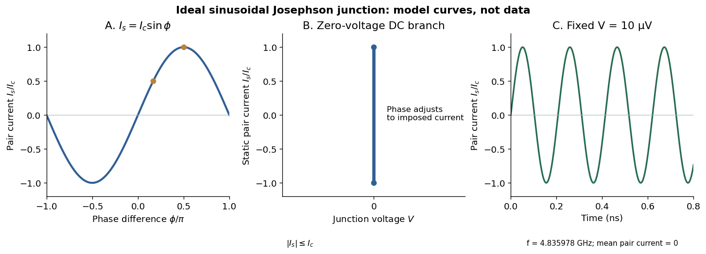

# Josephson effect

↑ **Parent:** [Josephson junction](josephson-junction.md)  
ⓦ [Wiki](https://en.wikipedia.org/wiki/Josephson_effect)

In the ideal sinusoidal [Josephson junction](josephson-junction.md), the pair [electric current](electric-current.md) and [quantum phase](quantum-phase.md) obey

$$
I_s=I_c\sin\phi,\qquad \frac{d\phi}{dt}=\frac{2e}{\hbar}V.
$$

Here $e>0$ is the magnitude of the [electron](electron.md) [electric charge](electric-charge-split.md), $\hbar=h/(2\pi)$ uses the [Planck constant](planck-constant.md), and $I_c$ is the junction's [superconducting critical current](superconducting-critical-current.md) under the specified conditions. Define the signs as follows: positive conventional [electric current](electric-current.md) flows from terminal 2 to terminal 1, and $V$ is the voltage of terminal 2 relative to terminal 1. The [Gauge-invariant Josephson phase](gauge-invariant-josephson-phase.md) below fixes the matching orientation of $\phi$. The [DC Josephson effect](dc-josephson-effect.md) and [AC Josephson effect](ac-josephson-effect.md) follow from these relations. [Josephson (1962), p. 252, predictions (i) and (ii): zero-voltage supercurrent and frequency 2eV/h](possible-new-effects-in-superconductive-tunnelling-by-brian-d-josephson.md)

**[Figure 6](#image-phase-zero-voltage-current-branch-and-voltage-driven-oscillations-of-an-ideal-josephson-junction). Phase, zero-voltage current branch and voltage-driven oscillations of an ideal Josephson junction**. Original stipulated sinusoidal model, not measured data. The middle panel shows possible static states with adjustable [quantum phase](quantum-phase.md), not a uniquely selected [electric current](electric-current.md) under ideal zero-voltage bias. The last panel shows only the pair [electric current](electric-current.md), with initial phase zero and constant $V=10\,\mathrm{\mu V}$; a quasiparticle contribution is excluded from that panel.

**Table of contents**

- [SQUID](squid.md)
  - [RF SQUID](rf-squid.md)
  - [DC SQUID](dc-squid.md)
    - [Jaklevic Josephson interference experiment](jaklevic-josephson-interference-experiment.md)
- [Gauge-invariant Josephson phase](gauge-invariant-josephson-phase.md)
- [Josephson coupling energy](josephson-coupling-energy.md)
- [DC Josephson effect](dc-josephson-effect.md)
- [AC Josephson effect](ac-josephson-effect.md)

## ↑ Ancestors (6)

1. [Josephson junction](josephson-junction.md)
2. [Superconductivity](superconductivity-split.md)
3. [Statistical physics](statistical-physics-split.md)
4. [Branches of physics](branches-of-physics.md)
5. [Physics](physics-split.md)
6. [Codex Wiki](split.md)

## ← Incoming links (9)

- [Current-biased Josephson phase dynamics](current-biased-josephson-phase-dynamics.md)
- [Formal hole count in a cuprate](formal-hole-count-in-a-cuprate.md)
- [Giaever gap experiment](giaever-gap-experiment.md)
- [High-temperature superconductivity](high-temperature-superconductivity.md)
- [Josephson junction](josephson-junction.md)
- [Nobel Prize in Physics in 1973](nobel-prize-in-physics-in-1973.md)
- [Solution](past-exam-of-the-advanced-quantum-condensed-matter-physics-course-of-the-university-of-cambridge/2015/paper-1/2/c/solution.md)
- [Solution](past-exam-of-the-superconductivity-and-quantum-coherence-course-of-the-university-of-cambridge/2013/paper-1/3/solution.md)
- [Solution](past-exam-of-the-superconductivity-and-quantum-coherence-course-of-the-university-of-cambridge/2014/paper-1/1/b/solution.md)
