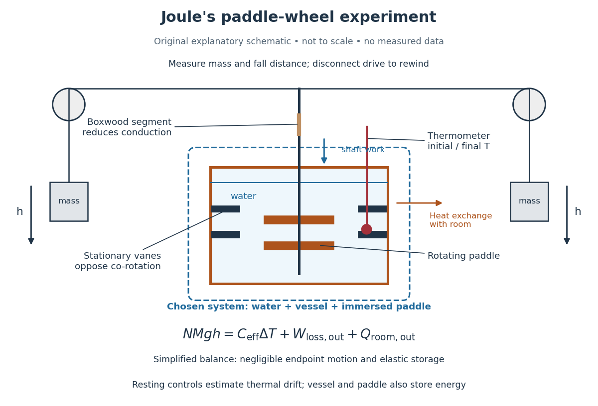

<h1 id="joule-s-paddle-wheel-experiment">Joule's paddle-wheel experiment</h1>

↑ **Parent:** [Internal energy](internal-energy-split.md)

Joule's paper [On the Mechanical Equivalent of Heat](on-the-mechanical-equivalent-of-heat-by-james-prescott-joule.md) (1850) describes a [copper](copper.md) vessel holding [water](water.md) and a brass paddle with stationary vanes. Descending [lead](lead.md) weights drove its shaft through strings and pulleys; the vanes opposed simple co-rotation. A boxwood shaft segment reduced [thermal conduction](thermal-conduction.md). He measured fall distances and initial/final [temperatures](temperature-split.md), repeating twenty descents per run and disconnecting the drive for rewinding. Calibrated [thermometers](thermometer.md) read the [water](water.md) and room.[pp. 64–66 and Plate VII: thermometer calibration, water apparatus and operating sequence](on-the-mechanical-equivalent-of-heat-by-james-prescott-joule.md)

**[Figure 2](#joule-paddle-wheel-calorimeter). Joule's paddle-wheel experiment: mechanical input and thermal readout**. Original explanatory schematic, not a scale reconstruction or a plot of measurements. The outlined system includes [water](water.md), vessel and immersed paddle, but excludes the weights and external drive. The symbolic balance separates mechanical losses outside this boundary from [heat](heat-split.md) exchange with the room. Rewinding occurs with the drive disconnected.

His matched resting trials retained the [water](water.md) amount, duration, surroundings and reading procedure, omitting paddle motion to estimate environmental [heat](heat-split.md) exchange. A screen reduced [thermal radiation](thermal-radiation.md) from his body. His calculation included the vessel and paddle [heat capacities](heat-capacity.md), external pulley/string losses, descent [kinetic energy](kinetic-energy.md) and string elasticity; it acknowledged residual vibration and sound.[pp. 66, 69–70 and 82: matched controls, apparatus water-equivalent capacity, mechanical corrections and residual losses](on-the-mechanical-equivalent-of-heat-by-james-prescott-joule.md)

The measured observable is a corrected [temperature](temperature-split.md) rise, interpreted through the participating [heat capacity](heat-capacity.md); it is not a direct view of molecular motion. The experiment tests whether measured mechanical input accounts quantitatively for thermal storage. Frictional warming by itself would establish neither the conversion factor nor the absence of [heat](heat-split.md) exchange. A modern authored demonstration at UCSB instead measures crank turns and a cylinder's [temperature](temperature-split.md) with an electrical [thermometer](thermometer.md): the apparatus differs, but again both mechanical input and thermal response must be measured. [52.33 -- Mechanical equivalent of heat](ucsb-physics-lecture-demonstrations/52-33-mechanical-equivalent-of-heat.md)

**Table of contents**

- [Paddle-wheel calorimetry energy balance](paddle-wheel-calorimetry-energy-balance.md)

## ↑ Ancestors (6)

1. [Internal energy](internal-energy-split.md)
2. [Thermodynamics](thermodynamics-split.md)
3. [Statistical physics](statistical-physics-split.md)
4. [Branches of physics](branches-of-physics.md)
5. [Physics](physics-split.md)
6. [Codex Wiki](split.md)

## ← Incoming links (6)

- [Calorimetry](calorimetry-split.md)
- [Electrical calorimetry of a resistor](electrical-calorimetry-of-a-resistor.md)
- [Internal energy and system boundaries](internal-energy-and-system-boundaries.md)
- [James Prescott Joule](james-prescott-joule.md)
- [Joule's paddle-wheel experiment](joule-s-paddle-wheel-experiment.md)
- [Mechanical input and thermal storage in a calorimeter](mechanical-input-and-thermal-storage-in-a-calorimeter.md)
