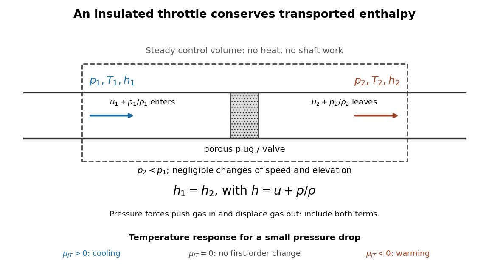

# Joule-Thomson effect

↑ **Parent:** [Enthalpy](enthalpy-split.md)  
ⓦ [Wiki](https://en.wikipedia.org/wiki/Joule–Thomson_effect)

The [Joule-Thomson effect](joule-thomson-effect.md) is the [temperature](temperature-split.md) response of a [fluid](fluid.md) flowing from higher to lower [pressure](pressure-split.md) through a valve or a plug of [porous medium](porous-medium.md), when the throttle is insulated and the other [steady-flow energy balance](steady-flow-energy-balance.md) assumptions hold. Its equilibrium endpoints have equal [specific enthalpy](specific-enthalpy.md). The [Joule-Thomson coefficient](joule-thomson-coefficient.md) determines whether a small drop cools or warms; cooling is not universal.

**[Figure 1](#joule-thomson-throttle-enthalpy-balance). Enthalpy accounting for an insulated Joule-Thomson effect throttle**. Original schematic of the [steady-flow energy balance](steady-flow-energy-balance.md), with $u$ denoting [internal energy](internal-energy-split.md) per unit [mass](mass.md). The arrows include inlet and outlet [pressure](pressure-split.md) [work](work.md). The reduced balance requires negligible bulk [kinetic energy](kinetic-energy.md) and [potential energy](potential-energy.md) changes. No particular apparatus or measured [temperature](temperature-split.md) drop is depicted.

A useful contrast is between three insulated expansions. In [free expansion](free-expansion.md) of a gas-only [closed system](closed-system.md) into a [vacuum](vacuum.md), no external [work](work.md) occurs and $U_2=U_1$; an [ideal gas](ideal-gas-split.md) returns to its initial equilibrium [temperature](temperature-split.md). In a throttle, continuous flow carries [pressure](pressure-split.md) [work](work.md) across the boundary and preserves [specific enthalpy](specific-enthalpy.md) under the stated assumptions; an [ideal gas](ideal-gas-split.md) again has no endpoint [temperature](temperature-split.md) change. In a reversible [adiabatic expansion](adiabatic-expansion.md) of a loaded [closed system](closed-system.md), the [gas](gas.md) supplies [work](work.md), loses [internal energy](internal-energy-split.md) and cools, even if it is an [ideal gas](ideal-gas-split.md). That process preserves [entropy](entropy-split.md); throttling generally produces [entropy](entropy-split.md). For a small constant-[enthalpy](enthalpy-split.md) step, $dH=T\,dS+V\,dp=0$ gives $dS=-V\,dp/T>0$ when $dp<0$ and $T,V>0$. This equilibrium comparison computes endpoint [entropy](entropy-split.md) differences without supplying a reversible path through the plug.

The effect is useful in [refrigerators](refrigerator.md) because an appropriately prepared [real gas](real-gas.md) can cool while passing through a simple valve. The inlet must lie in a suitable positive-[Joule-Thomson coefficient](joule-thomson-coefficient.md) region. The [Joule-Thomson inversion curve](joule-thomson-inversion-curve.md) makes that requirement precise; a pressure drop by itself is not a guarantee of refrigeration.

**Table of contents**

- [Measuring the Joule-Thomson effect with a porous plug](measuring-the-joule-thomson-effect-with-a-porous-plug.md)

## ↑ Ancestors (6)

1. [Enthalpy](enthalpy-split.md)
2. [Thermodynamics](thermodynamics-split.md)
3. [Statistical physics](statistical-physics-split.md)
4. [Branches of physics](branches-of-physics.md)
5. [Physics](physics-split.md)
6. [Codex Wiki](split.md)

## ← Incoming links (4)

- [Helium liquefaction](helium-liquefaction.md)
- [James Prescott Joule](james-prescott-joule.md)
- [Joule-Thomson coefficient](joule-thomson-coefficient.md)
- [Joule-Thomson effect](joule-thomson-effect.md)
