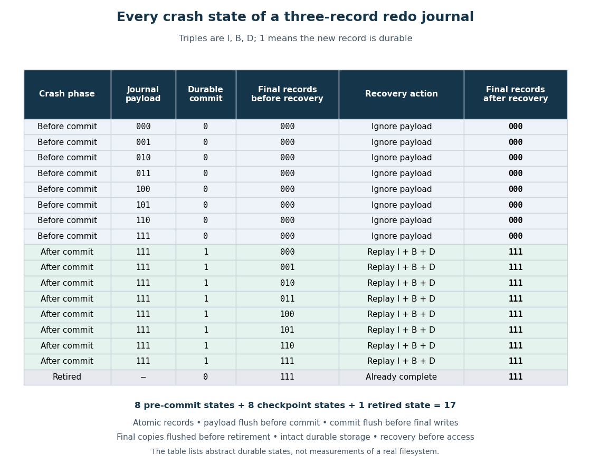

# Journal replay

↑ **Parent:** [Write-ahead logging](write-ahead-logging.md)

Reinstalling the complete new images of a committed [file-system transaction](file-system-transaction.md) after a crash. An uncommitted [journal payload](journal-payload.md) is ignored. Rewriting the same image has [idempotence](idempotence.md): repeating it gives the same contents, unlike performing "append four more [bytes](byte.md)" again. If recovery itself crashes, retaining the journal until the [journal checkpoint](journal-checkpoint.md) is durable allows the same recovery to restart.

The second diagram exhausts the small full-data model. A triple lists $I,B,D$ in that order; a [bit](bit.md) is 1 exactly when the corresponding new record has persisted. Before commit, any of the $2^3=8$ [subsets](subset.md) of [journal payload](journal-payload.md) records can be durable, while every final-location triple is `000`. After commit, the journal triple is `111`, while any of the eight final-location triples can be durable. Retirement adds one state: the live journal is gone and the final-location triple is `111`. Thus there are $8+8+1=17$ distinct abstract crash states. Waiting for a [storage flush](storage-flush.md) without another record reaching persistence does not create an additional state. Retirement is modeled as an atomic change of live-log status: old payload [bytes](byte.md) may remain physically present but are no longer part of the live journal.

**[Figure 6](#image-all-17-abstract-crash-states-recover-to-the-old-or-new-three-record-append-under-the-stated-storage-flush-and-atomic-storage-write-assumptions). All 17 abstract crash states recover to the old or new three-record append under the stated storage flush and atomic storage write assumptions**.

The short correctness argument has three cases. Before commit, final locations are unchanged. With commit, the complete [journal payload](journal-payload.md) restores `111` regardless of the current final-location [subset](subset.md). After retirement, `111` is already durable. Each of the six partial final-location triples is repairable because its journal is retained. The enumeration is exhaustive for these records and phase rules; it excludes torn records, dishonest flush completion, media corruption, journal reuse across several [file-system transactions](file-system-transaction.md) and failures of the recovery code. It is a model check, not a measured crash test of [ext4](ext4.md).

## ↑ Ancestors (6)

1. [Write-ahead logging](write-ahead-logging.md)
2. [File-system journaling](file-system-journaling.md)
3. [File system](file-system-split.md)
4. [Operating system](operating-system-split.md)
5. [Computer science](computer-science-split.md)
6. [Codex Wiki](split.md)

## ← Incoming links (3)

- [File-system crash consistency](file-system-crash-consistency.md)
- [File-system journaling](file-system-journaling.md)
- [File-system journaling mode](file-system-journaling-mode.md)
