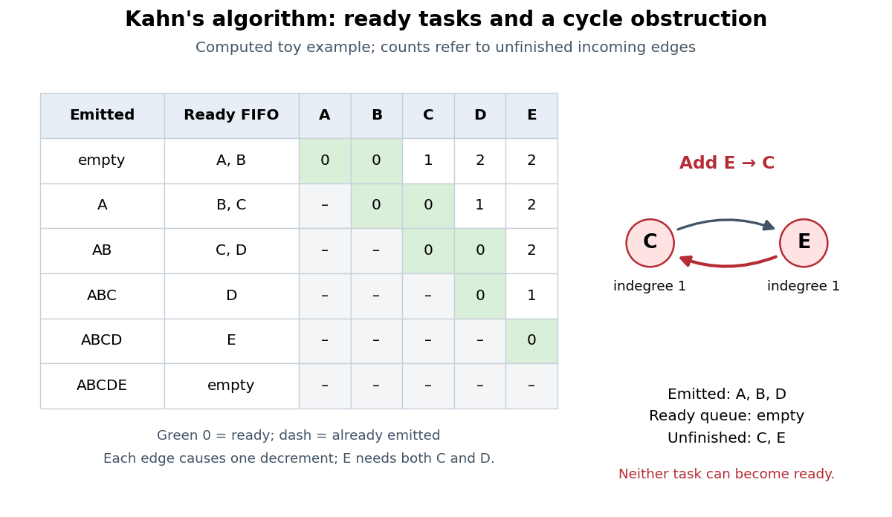

<h1 id="kahn-s-algorithm">Kahn's algorithm</h1>

↑ **Parent:** [Topological sorting](topological-sorting.md)

[Kahn's algorithm](kahn-s-algorithm.md) maintains each remaining [vertex](vertex-graph-theory.md)'s [indegree](indegree.md), the number of its unfinished incoming [directed edges](directed-edge.md), and a [FIFO queue](fifo-queue.md) of ready [vertices](vertex-graph-theory.md). Initialize the counts by scanning all [directed edges](directed-edge.md) and enqueue every [vertex](vertex-graph-theory.md) of [indegree](indegree.md) zero. Repeatedly dequeue a [vertex](vertex-graph-theory.md) $u$, append it to the output, and decrement the count of each destination $v$ in $u$'s [adjacency list](adjacency-list.md). Enqueue $v$ exactly when its count becomes zero. When the [FIFO queue](fifo-queue.md) empties, accept the output if it contains all [vertices](vertex-graph-theory.md); otherwise report a [directed cycle](directed-cycle.md). [Sedgewick and Wayne, TopologicalX: queue-based topological sorting](https://raw.githubusercontent.com/kevin-wayne/algs4/master/src/main/java/edu/princeton/cs/algs4/TopologicalX.java)

**[Figure 8](#image-computed-ready-queue-trace-and-the-obstruction-caused-by-a-reverse-dependency). Computed ready-queue trace and the obstruction caused by a reverse dependency**.

In the displayed run, initialize the [FIFO queue](fifo-queue.md) as $A,B$ and visit $A$'s destinations in the order $C,D$. Removing $A$ makes $C$ ready but leaves $D$ waiting for $B$. Removing $B$ then makes $D$ ready. Publication becomes ready only after both $C$ and $D$ are removed. The output is $ABCDE$; choosing ready [vertices](vertex-graph-theory.md) differently can produce the other [topological orders](topological-order.md). For the modified [directed graph](directed-graph.md) with $E\to C$, the same procedure emits $A,B,D$ and then stops with $C,E$ still waiting on each other.

The invariant is that each stored [indegree](indegree.md) counts incoming [directed edges](directed-edge.md) from unprocessed [vertices](vertex-graph-theory.md). A ready [vertex](vertex-graph-theory.md) therefore has every prerequisite already in the output. If the [FIFO queue](fifo-queue.md) empties with [vertices](vertex-graph-theory.md) left, every remaining [vertex](vertex-graph-theory.md) has a predecessor in the remaining [directed graph](directed-graph.md); the predecessor argument gives a [directed cycle](directed-cycle.md). The unprocessed [vertices](vertex-graph-theory.md) can also include tasks blocked downstream of a [directed cycle](directed-cycle.md), so the leftover list alone is not a list of exactly the cyclic [vertices](vertex-graph-theory.md).

With [adjacency lists](adjacency-list.md), constant-time [array](array-data-structure.md) access and counter updates, and constant-time [FIFO queue](fifo-queue.md) operations, the [time complexity](time-complexity.md) is $O(|V|+|E|)$ in [Big O notation](big-o-notation.md). Initialization scans all [vertices](vertex-graph-theory.md) and [directed edges](directed-edge.md); each [vertex](vertex-graph-theory.md) is then enqueued at most once and each outgoing [directed edge](directed-edge.md) processed at most once. Counts, ready [FIFO queue](fifo-queue.md), and output need $O(|V|)$ storage beyond the [adjacency lists](adjacency-list.md). Shifting an [array](array-data-structure.md) on every dequeue invalidates this bound. [Sedgewick and Wayne, TopologicalX: time and extra-space bounds](https://raw.githubusercontent.com/kevin-wayne/algs4/master/src/main/java/edu/princeton/cs/algs4/TopologicalX.java) [Sedgewick and Wayne, Digraph: adjacency lists and outgoing-edge iteration](https://raw.githubusercontent.com/kevin-wayne/algs4/master/src/main/java/edu/princeton/cs/algs4/Digraph.java)

The name refers to A. B. Kahn's 1962 paper "Topological sorting of large networks", published in Communications of the ACM, volume 5, issue 11, pages 558–562. Its abstract motivates [topological sorting](topological-sorting.md) through network analysis and project planning. [Kahn, Topological sorting of large networks (1962): publisher's record and abstract](https://doi.org/10.1145/368996.369025)

// Target: foundations-of-mathematics.bigb

## ↑ Ancestors (6)

1. [Topological sorting](topological-sorting.md)
2. [Directed acyclic graph](directed-acyclic-graph.md)
3. [Combinatorics](combinatorics-split.md)
4. [Area of mathematics](area-of-mathematics.md)
5. [Mathematics](mathematics-split.md)
6. [Codex Wiki](split.md)

## ← Incoming links (4)

- [Indegree](indegree.md)
- [Kahn's algorithm](kahn-s-algorithm.md)
- [Topological ordering](topological-ordering.md)
- [Topological sorting](topological-sorting.md)
