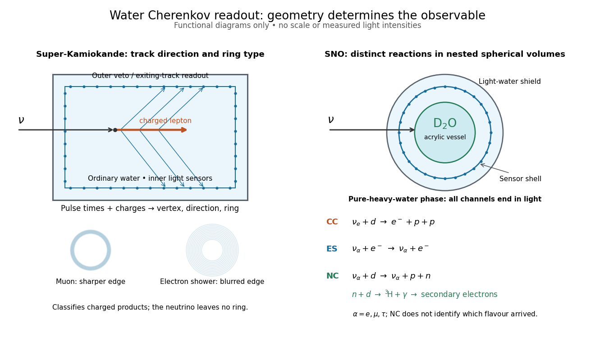

# Kajita-McDonald neutrino flavor-conversion experiments

↑ **Parent:** [Cherenkov detector](cherenkov-detector.md)

How can a detector establish that an unseen [particle](particle-physics.md) changes identity? The [Super-Kamiokande atmospheric-neutrino experiment](super-kamiokande-atmospheric-neutrino-experiment.md) compares different travel paths; the [Sudbury Neutrino Observatory](sudbury-neutrino-observatory.md) compares different interaction channels. Both infer [neutrino flavor](neutrino-flavor.md) from reaction products and calibrated responses. Their complementarity connects [particle detection](particle-detection-split.md) to [neutrino oscillation](neutrino-oscillation.md), [neutrino mass](neutrino-mass.md) and [neutrino astronomy](neutrino-astronomy.md).

[Takaaki Kajita](takaaki-kajita.md) and [Arthur B. McDonald](arthur-b-mcdonald.md) shared the 2015 physics Nobel Prize. These were collaboration achievements: [Yoichiro Suzuki](yoichiro-suzuki.md)'s [Super-Kamiokande](super-kamiokande.md) work included the [solar neutrino](solar-neutrino.md) analysis, and [George Ewan](george-ewan.md) helped establish and lead the [Sudbury Neutrino Observatory](sudbury-neutrino-observatory.md).[Research contributions of Kajita and Suzuki; shared 2015 prize](icrr%E2%80%99s-takaaki-kajita-to-share-breakthrough-prize-in-fundamental-physics-by-institute-for-cosmic-ray-research-university-of-tokyo.md)[17 December 2020: founding and joint leadership of SNO](https://www.queensu.ca/gazette/stories/queen-s-remembers-professor-emeritus-george-ewan/)

The older [Kamiokande](kamiokande.md) account explains [water Cherenkov neutrino reconstruction](water-cherenkov-neutrino-reconstruction.md); [Raymond Davis Jr.](raymond-davis-jr.md)'s [Homestake experiment](homestake-experiment.md) explains why a deficit in an [electron neutrino](electron-neutrino.md) channel alone leaves a source-versus-propagation ambiguity. Complementary channels can break that ambiguity.

**[Figure 5](#image-two-functional-routes-from-a-neutrino-interaction-to-a-recorded-light-pattern). Two functional routes from a neutrino interaction to a recorded light pattern**. Original schematics, not scale drawings or event photographs. Left: directional ring classification in [Super-Kamiokande](super-kamiokande.md). Right: the pure-[heavy water](heavy-water.md) phase of the [Sudbury Neutrino Observatory](sudbury-neutrino-observatory.md), including the indirect [neutron](neutron-split.md) channel. Sparse dots stand for [photomultipliers](photomultiplier.md).

**Table of contents**

- [Super-Kamiokande](super-kamiokande.md)
  - [Super-Kamiokande atmospheric-neutrino experiment](super-kamiokande-atmospheric-neutrino-experiment.md)
    - [Two-flavour vacuum survival model](two-flavour-vacuum-survival-model.md)
- [Sudbury Neutrino Observatory](sudbury-neutrino-observatory.md)
  - [SNO solar-neutrino flavor experiment](sno-solar-neutrino-flavor-experiment.md)
  - [Neutrino-flux sensitivity inversion](neutrino-flux-sensitivity-inversion.md)

## ↑ Ancestors (5)

1. [Cherenkov detector](cherenkov-detector.md)
2. [Particle detector](particle-detector.md)
3. [Particle detection](particle-detection-split.md)
4. [Physics](physics-split.md)
5. [Codex Wiki](split.md)
