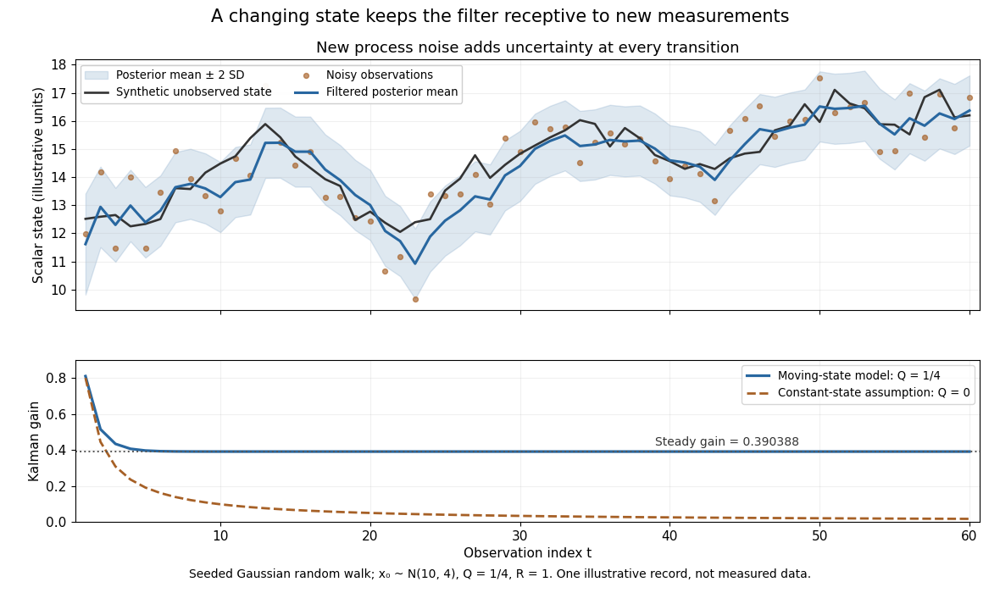

# Kalman filtering of a moving scalar state

↑ **Parent:** [Kalman filter](kalman-filter.md)

Consider a [local-level state-space model](local-level-state-space-model.md) $x_t=x_{t-1}+w_t$, $y_t=x_t+v_t$, with mutually [independent](independent-random-variables.md) centered [Gaussian](normal-distribution.md) noises of [variances](variance-split.md) $Q=1/4$ and $R=1$. Start with $x_0\sim N(10,4)$, independently of these noises. Before the first observation, the [Kalman prediction step](kalman-prediction-step.md) gives $m_1^-=10$, $P_1^-=17/4$. If $y_1=14$, the [Kalman gain](kalman-gain.md) is $17/21$, and the [posterior mean](posterior-mean.md) and [posterior variance](posterior-variance.md) become

$$
m_1=10+\frac{17}{21}(14-10)=\frac{278}{21},\qquad P_1=\frac{17}{21}.
$$

The next [Kalman prediction step](kalman-prediction-step.md) keeps the mean $m_2^-=278/21$ but adds fresh [process noise](process-noise.md) [variance](variance-split.md), giving $P_2^-=89/84$. If $y_2=12$, then

$$
K_2=\frac{89}{173},\qquad
m_2=\frac{278}{21}+\frac{89}{173}\left(12-\frac{278}{21}\right)=\frac{2180}{173},\qquad
P_2=\frac{89}{173}.
$$

Thus new uncertainty is introduced at each transition and reduced by each measurement. It does not shrink to zero merely because many measurements have arrived: the state continues to change.

**[Figure 10](#image-a-kalman-filter-follows-a-changing-scalar-state-and-retains-uncertainty-about-each-new-transition). A Kalman filter follows a changing scalar state and retains uncertainty about each new transition**. Top: one seeded synthetic [random walk](random-walk-split.md), its noisy observations and the filtered [posterior mean](posterior-mean.md), starting from $N(10,4)$ with $Q=1/4$, $R=1$. The shaded region is the mean plus or minus two posterior [standard deviations](standard-deviation.md), a pointwise conditional band under the stated model. Bottom: the [Kalman gain](kalman-gain.md) approaches its positive steady value. Setting $Q=0$ instead asserts a constant state and eventually stops adapting appreciably. This single generated record illustrates the mechanism; it is not an empirical accuracy study.

The [steady-state local-level Kalman gain](steady-state-local-level-kalman-gain.md) here is

$$
K_\infty=\frac{\sqrt{17}-1}{8}\approx0.390388.
$$

With $R=1$, the limiting [posterior variance](posterior-variance.md) has the same numerical value. By contrast, the static-state model $Q=0$ with $P_0=4$ gives $P_t=1/(t+1/4)$ and $K_t=1/(t+1/4)$. That decreasing gain is appropriate for a state that truly remains constant. Applied to the changing [random walk](random-walk-split.md), it builds confidence in the wrong model. The choice of [process noise](process-noise.md) is therefore a statement about state evolution, rather than just an instruction to make a plot look smoother.

## ↑ Ancestors (6)

1. [Kalman filter](kalman-filter.md)
2. [State estimation](state-estimation.md)
3. [Control theory](control-theory-split.md)
4. [Area of mathematics](area-of-mathematics.md)
5. [Mathematics](mathematics-split.md)
6. [Codex Wiki](split.md)
