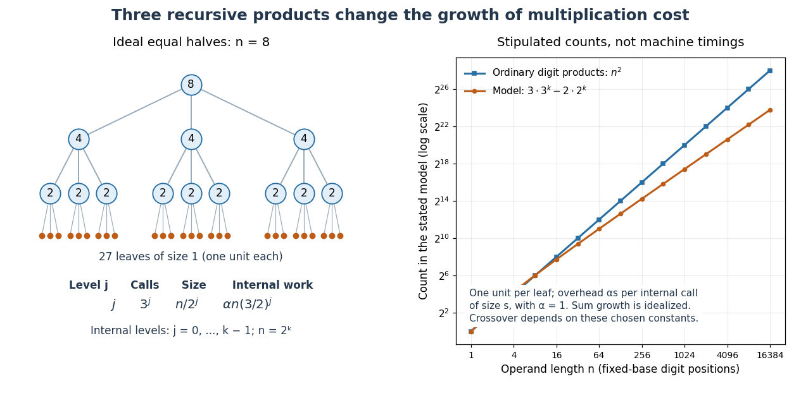

# Karatsuba digit-operation cost

↑ **Parent:** [Karatsuba multiplication](karatsuba-multiplication.md)

Count a fixed-base digit [addition](addition.md), [subtraction](subtraction.md), digit copy, or single-digit [multiplication](multiplication.md) as constant cost. Base $B$ stays fixed as $n$ grows; an entire arbitrary-length [integer](integer.md) [multiplication](multiplication.md) is not one constant-cost step. With this model, splitting, sum formation, shifts and recombination require $O(n)$ digit operations. Ordinary digit-by-digit [multiplication](multiplication.md) forms $n^2$ digit products for two $n$-position operands. The GMP base-case description uses this rectangular product arrangement.[GNU MP 6.3.0 manual, §15.1.1 Basecase Multiplication: rectangular cross-products and O(NM) cost](gnu-mp-6-3-0-manual/basecase-multiplication.md)

The ideal equal-half [recurrence relation](recurrence-relation.md) is

$$
T(n)=3T(n/2)+O(n).
$$

For $n=2^k$, level $j$ has $3^j$ calls of size $n/2^j$. If each internal call incurs exactly $\alpha$ times its size in additional digit work, that level contributes $\alpha n(3/2)^j$. There are $3^k=n^{\log_2 3}$ leaves. The [geometric series](geometric-series.md) of internal work is

$$
\alpha n\sum_{j=0}^{k-1}(3/2)^j=2\alpha(3^k-2^k).
$$

Thus fixed positive leaf cost plus this internal work grows on the order of $n^{\log_2 3}$. In [Big O notation](big-o-notation.md), $T(n)=O(n^{\log_2 3})$. Removing one of four products at every level matters much more than saving just one at the root.

**[Figure 72](#image-karatsuba-recursion-levels-and-an-explicitly-stipulated-cost-comparison). Karatsuba recursion levels and an explicitly stipulated cost comparison**. Left: the ideal equal-half [recursion](recursion-computer-science.md) for $n=8$, with three children per internal call. Right: model counts for $n=2^k$, one unit per leaf and internal overhead $\alpha s$ for size $s$ with $\alpha=1$. The resulting count is $3\cdot3^k-2\cdot2^k$, compared with $n^2$ ordinary digit products. This illustrates the [recurrence relation](recurrence-relation.md); its constants and crossover are stipulated, rather than measured execution times.

The literal sum-based implementation instead admits the upper bound

$$
T(n)\leq3T(\lceil n/2\rceil+1)+Cn
$$

for a nondecreasing worst-case cost envelope above a fixed base-case threshold. The extra digit does not change the exponent: since $\lceil n/2\rceil+1\leq n/2+3/2$, subtracting three from the size makes each child's adjusted size at most half its parent's. Stop this comparison at any fixed threshold greater than three; its [recursion](recursion-computer-science.md) depth is $\log_2 n+O(1)$ and the level-work sum is bounded by the same [geometric series](geometric-series.md) up to constant factors. Exact call counts can depend on carries, zero shortcuts and the threshold, so they need not equal the ideal $3^j$ at each depth.

## ↑ Ancestors (4)

1. [Karatsuba multiplication](karatsuba-multiplication.md)
2. [Algorithm](algorithm.md)
3. [Computer science](computer-science-split.md)
4. [Codex Wiki](split.md)

## ← Incoming links (2)

- [Karatsuba multiplication](karatsuba-multiplication.md)
- [Karatsuba practical crossover](karatsuba-practical-crossover.md)
