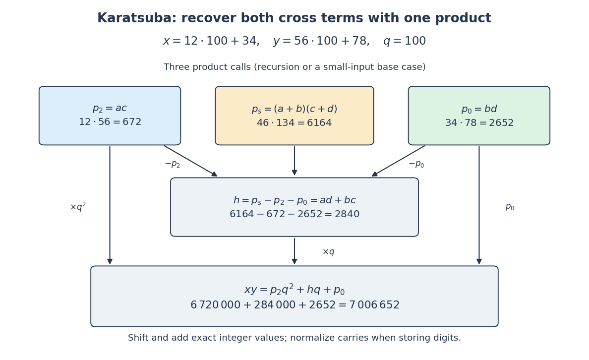

# Karatsuba three-product identity

↑ **Parent:** [Karatsuba multiplication](karatsuba-multiplication.md)

Compute exactly three smaller products,

$$
p_2=ac,\qquad p_0=bd,\qquad p_s=(a+b)(c+d).
$$

The [distributive property](distributive-property.md) gives $p_s=ac+ad+bc+bd$, so the cross coefficient is $h=p_s-p_2-p_0=ad+bc$. Recombine by

$$
xy=p_2q^2+hq+p_0,\qquad q=B^m.
$$

The saving is that $ad$ and $bc$ are never separately multiplied. Multiplying a digit block by $q$ or $q^2$ shifts its position in [positional notation](positional-notation.md); it does not require another general [integer](integer.md) [multiplication](multiplication.md). [Addition](addition.md) of the shifted results still requires [Karatsuba carry handling](karatsuba-carry-handling.md).

**[Figure 71](#image-three-products-recover-the-karatsuba-cross-coefficient). Three products recover the Karatsuba cross coefficient**. The arrows carry exact [integer](integer.md) values for the [Karatsuba worked multiplication](karatsuba-worked-multiplication.md). Only the three coloured product boxes require recursive [multiplication](multiplication.md); the lower boxes use [subtraction](subtraction.md), digit shifts and [addition](addition.md).

## ↑ Ancestors (4)

1. [Karatsuba multiplication](karatsuba-multiplication.md)
2. [Algorithm](algorithm.md)
3. [Computer science](computer-science-split.md)
4. [Codex Wiki](split.md)

## ← Incoming links (4)

- [Karatsuba carry handling](karatsuba-carry-handling.md)
- [Karatsuba multiplication](karatsuba-multiplication.md)
- [Karatsuba recursion termination](karatsuba-recursion-termination.md)
- [Karatsuba worked multiplication](karatsuba-worked-multiplication.md)
