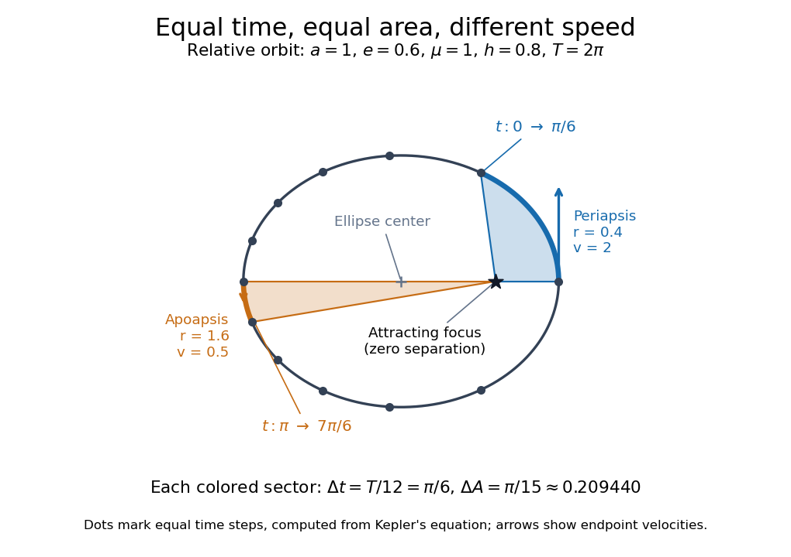

<h1 id="kepler-s-second-law">Kepler's second law</h1>

↑ **Parent:** [Kepler's laws of planetary motion](kepler-s-laws-of-planetary-motion.md)

The relative displacement of a [Kepler orbit](kepler-orbit.md) sweeps equal areas about the attracting [focus of a conic](focus-of-a-conic.md) in equal times. A short interval near [periapsis](periapsis.md) covers a wide angle at small separation; the same interval near [apoapsis](apoapsis.md) covers a narrow angle at large separation. The swept areas are equal even though the travelled distances are different. In particular, the sectors have curved [ellipse](ellipse.md) boundaries: triangles formed by joining their endpoints only approximate the swept areas for short intervals.

Let $h=|\mathbf r\times\dot{\mathbf r}|$ be the relative [specific angular momentum](specific-angular-momentum.md). The [areal velocity](areal-velocity.md) is

$$
\frac{dA}{dt}=\frac12|\mathbf r\times\dot{\mathbf r}|=\frac h2.
$$

A [central force](central-force.md) exerts zero [torque](torque.md) about its centre, so [conservation of angular momentum](conservation-of-angular-momentum.md) makes this rate constant. This explanation also applies to other [central forces](central-force.md); the [ellipse](ellipse.md) shape specifically comes from [Newtonian gravity](gravitational-acceleration.md).

In the $a=1$, $e=0.6$, $\mu=1$ example, [specific angular momentum](specific-angular-momentum.md) is $h=\sqrt{\mu a(1-e^2)}=\sqrt{0.64}=0.8$, giving [areal velocity](areal-velocity.md) $0.4$. At [periapsis](periapsis.md) and [apoapsis](apoapsis.md), the [velocity](velocity.md) is perpendicular to the relative displacement, so $h=rv$. The endpoint [speeds](speed.md) are consequently

$$
v_{\rm p}=\frac{0.8}{0.4}=2,\qquad v_{\rm a}=\frac{0.8}{1.6}=0.5.
$$

The fourfold [speed](speed.md) difference is consistent with the fourfold separation difference. Away from these endpoints, $h/r$ gives only the transverse component of [velocity](velocity.md); the full [speed](speed.md) follows from the [vis-viva equation](vis-viva-equation.md).

To actually place equal-time markers, use [Kepler's equation](kepler-s-equation.md). Write [mean anomaly](mean-anomaly.md) as $\mathcal M=nt$, with $t=0$ at [periapsis](periapsis.md) and [mean motion](mean-motion.md) $n=\sqrt{\mu/a^3}=1$. The different symbol $\mathcal M$ avoids confusing this angle with the [mass](mass.md) $M$. Solve for [eccentric anomaly](eccentric-anomaly.md) $E$ in [radians](radian.md), then compute the relative position:

$$
\mathcal M=E-e\sin E,\qquad x=a(\cos E-e),\qquad y=b\sin E.
$$

This timing procedure is explained in [NASA educational archive, How Orbital Motion is Calculated](https://pwg.gsfc.nasa.gov/stargaze/Smotion.htm).

**[Figure 3](#image-equal-time-positions-and-equal-swept-areas-on-the-relative-ellipse-with-a-1-and-e-0-6). Equal-time positions and equal swept areas on the relative ellipse with a=1 and e=0.6**.

For the first interval $0\le t\le\pi/6$, the final [eccentric anomaly](eccentric-anomaly.md) is $E\approx1.041495$. For the equal interval $\pi\le t\le7\pi/6$ starting at [apoapsis](apoapsis.md), it ends at $E\approx3.471065$. Both swept areas are $\Delta A=(h/2)\Delta t=0.4\pi/6=\pi/15\approx0.209440$, one twelfth of the entire [ellipse](ellipse.md)'s area $0.8\pi$. The diagram computes its markers from [Kepler's equation](kepler-s-equation.md), making visible how uniform time steps become uneven spatial steps.

## ↑ Ancestors (4)

1. [Kepler's laws of planetary motion](kepler-s-laws-of-planetary-motion.md)
2. [Mathematical physics](mathematical-physics.md)
3. [Physics](physics-split.md)
4. [Codex Wiki](split.md)

## ← Incoming links (11)

- [Angular momentum](angular-momentum.md)
- [Kepler's first law](kepler-s-first-law.md)
- [Kepler's laws of planetary motion](kepler-s-laws-of-planetary-motion.md)
- [Kepler's third law](kepler-s-third-law.md)
- [Orbital observations behind the area law](orbital-observations-behind-the-area-law.md)
- [Solution](past-exam-of-the-mathematics-course-of-the-university-of-cambridge/2009/ia/paper-4/4a/c/solution.md)
- [Solution](past-exam-of-the-mathematics-course-of-the-university-of-cambridge/2011/ia/paper-4/3b/solution.md)
- [Solution](past-exam-of-the-mathematics-course-of-the-university-of-cambridge/2013/ia/paper-4/9b/b/solution.md)
- [Solution](past-exam-of-the-mathematics-course-of-the-university-of-cambridge/2018/ia/paper-4/4a/solution.md)
- [Signed swept area](signed-swept-area.md)
- [Taylor's theorem](taylor-s-theorem.md)
