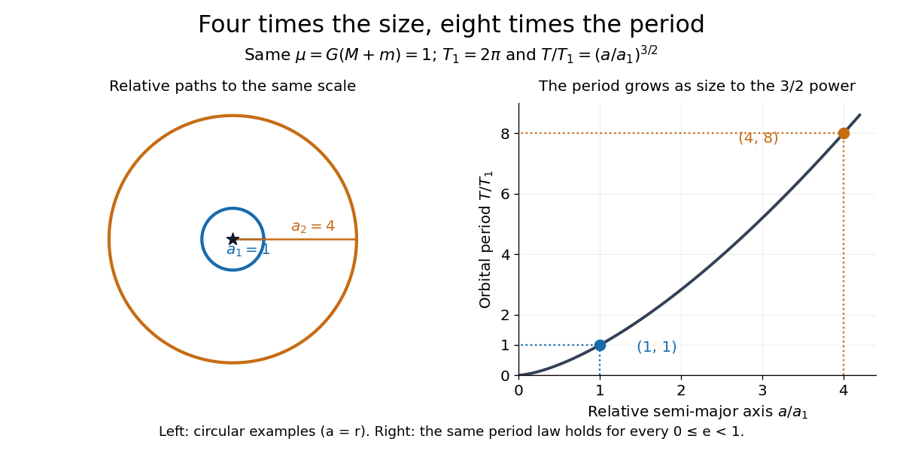

<h1 id="kepler-s-third-law">Kepler's third law</h1>

↑ **Parent:** [Kepler's laws of planetary motion](kepler-s-laws-of-planetary-motion.md)

For an isolated [two-body problem](two-body-problem.md) in [Newtonian gravity](gravitational-acceleration.md), the relative [elliptic orbit](elliptic-orbit.md)'s [orbital period](orbital-period.md) $T$ obeys

$$
T^2=\frac{4\pi^2a^3}{G(M+m)}=\frac{4\pi^2a^3}{\mu}.
$$

Here $a$ is the relative [semi-major axis](semi-major-axis.md), and $M+m$ is the sum of the two [masses](mass.md). The separation $r$ varies during an [elliptic orbit](elliptic-orbit.md), so replacing $a$ by $r$ works only for a [circular orbit](circular-orbit.md), where $r=a$. Likewise, either body's individual [semi-major axis](semi-major-axis.md) about the [centre of mass](center-of-mass.md) must first be converted to the relative one. When $m$ is negligible compared with $M$, the denominator can be approximated by $GM$.

For fixed [gravitational parameter](standard-gravitational-parameter.md), the [orbital period](orbital-period.md) depends on the [semi-major axis](semi-major-axis.md) and is independent of [orbital eccentricity](orbital-eccentricity.md). Our $a=1$, $\mu=1$ example gives $T=2\pi$ both for $e=0.6$ and for a [circular orbit](circular-orbit.md) with $e=0$. The eccentric body's rapidly changing [speed](speed.md) compensates for its different path. A compact way to see the cancellation uses [Kepler's second law](kepler-s-second-law.md): divide the [ellipse](ellipse.md)'s area $\pi ab$ by its [areal velocity](areal-velocity.md) $h/2$. With $b=a\sqrt{1-e^2}$ and [specific angular momentum](specific-angular-momentum.md) $h=\sqrt{\mu a(1-e^2)}$, the result is $2\pi\sqrt{a^3/\mu}$.

Compare two separate [Kepler orbits](kepler-orbit.md) with the same [gravitational parameter](standard-gravitational-parameter.md), $a_1=1$ and $a_2=4$:

$$
\frac{T_2}{T_1}=\left(\frac{a_2}{a_1}\right)^{3/2}=4^{3/2}=8.
$$

With $\mu=1$, their [orbital periods](orbital-period.md) are $2\pi$ and $16\pi$; measured in units of $T_1$, these are $1$ and $8$. Quadrupling the size therefore takes eight times as long to complete a circuit. This [power law](power-law.md) makes comparisons possible without first choosing physical units.

**[Figure 7](#image-quadrupling-the-relative-semi-major-axis-multiplies-the-orbital-period-by-eight-at-fixed-total-mass). Quadrupling the relative semi-major axis multiplies the orbital period by eight at fixed total mass**.

The same relation can be inverted to weigh a system: $M+m=4\pi^2a^3/(GT^2)$. An observed relative [semi-major axis](semi-major-axis.md) and [orbital period](orbital-period.md) determine the total [mass](mass.md), while additional information is needed to separate the two [masses](mass.md). This is useful for [binary stars](binary-star.md), as discussed in [NASA, Orbits and Kepler's Laws: measuring masses](https://science.nasa.gov/solar-system/orbits-and-keplers-laws/). Geometry and a clock together become a weighing instrument.

**Table of contents**

- [Last-orbit frequency of a compact binary](last-orbit-frequency-of-a-compact-binary.md)

## ↑ Ancestors (4)

1. [Kepler's laws of planetary motion](kepler-s-laws-of-planetary-motion.md)
2. [Mathematical physics](mathematical-physics-split.md)
3. [Physics](physics-split.md)
4. [Codex Wiki](split.md)

## ← Incoming links (50)

- [Binary-pulsar orbital decay](binary-pulsar-orbital-decay.md)
- [Circular-binary orbital angular momentum](circular-binary-orbital-angular-momentum.md)
- [Hohmann transfer time](hohmann-transfer-time.md)
- [Kepler's laws of planetary motion](kepler-s-laws-of-planetary-motion.md)
- [Last-orbit frequency of a compact binary](last-orbit-frequency-of-a-compact-binary.md)
- [Mass-distance degeneracy of an angular stellar orbit](mass-distance-degeneracy-of-an-angular-stellar-orbit.md)
- [Solution](past-exam-of-the-exoplanets-and-planetary-systems-course-of-the-university-of-cambridge/2015/paper-1/1/solution.md)
- [Solution](past-exam-of-the-exoplanets-and-planetary-systems-course-of-the-university-of-cambridge/2016/paper-1/1/solution.md)
- [Solution](past-exam-of-the-mathematics-course-of-the-university-of-cambridge/2001/iii/paper-37/3/solution.md)
- [Solution](past-exam-of-the-mathematics-course-of-the-university-of-cambridge/2001/iii/paper-37/4/a/solution.md)
- [Solution](past-exam-of-the-mathematics-course-of-the-university-of-cambridge/2003/iii/paper-63/3/solution.md)
- [Solution](past-exam-of-the-mathematics-course-of-the-university-of-cambridge/2004/iii/paper-63/3/solution.md)
- [Solution](past-exam-of-the-mathematics-course-of-the-university-of-cambridge/2005/iii/paper-70/4/solution.md)
- [Solution](past-exam-of-the-mathematics-course-of-the-university-of-cambridge/2006/iii/paper-71/4/solution.md)
- [Solution](past-exam-of-the-mathematics-course-of-the-university-of-cambridge/2008/iii/paper-70/4/solution.md)
- [Solution](past-exam-of-the-mathematics-course-of-the-university-of-cambridge/2009/iii/paper-63/4/a/solution.md)
- [Solution](past-exam-of-the-mathematics-course-of-the-university-of-cambridge/2010/iii/paper-61/1/solution.md)
- [Solution](past-exam-of-the-mathematics-course-of-the-university-of-cambridge/2010/iii/paper-61/2/solution.md)
- [Solution](past-exam-of-the-mathematics-course-of-the-university-of-cambridge/2011/ia/paper-4/3b/solution.md)
- [Solution](past-exam-of-the-mathematics-course-of-the-university-of-cambridge/2013/iii/paper-56/3/solution.md)
- [Solution](past-exam-of-the-mathematics-course-of-the-university-of-cambridge/2014/iii/paper-59/1/solution.md)
- [Solution](past-exam-of-the-mathematics-course-of-the-university-of-cambridge/2015/iii/paper-63/3/solution.md)
- [Solution](past-exam-of-the-mathematics-course-of-the-university-of-cambridge/2015/iii/paper-65/1/solution.md)
- [Solution](past-exam-of-the-mathematics-course-of-the-university-of-cambridge/2015/iii/paper-65/3/solution.md)
- [Solution](past-exam-of-the-mathematics-course-of-the-university-of-cambridge/2016/iii/paper-316/2/solution.md)
- [Solution](past-exam-of-the-mathematics-course-of-the-university-of-cambridge/2016/iii/paper-322/2/solution.md)
- [Solution](past-exam-of-the-mathematics-course-of-the-university-of-cambridge/2016/iii/paper-322/3/solution.md)
- [Solution](past-exam-of-the-mathematics-course-of-the-university-of-cambridge/2017/iii/paper-322/2/solution.md)
- [Solution](past-exam-of-the-mathematics-course-of-the-university-of-cambridge/2019/iii/paper-322/2/solution.md)
- [Solution](past-exam-of-the-physics-b-course-of-the-university-of-cambridge/2012/paper-2/section-a/a3/solution.md)
- [Solution](past-exam-of-the-physics-b-course-of-the-university-of-cambridge/2014/paper-2/section-a/a2/solution.md)
- [Solution](past-exam-of-the-physics-b-course-of-the-university-of-cambridge/2015/paper-1/section-c/c10/solution.md)
- [Solution](past-exam-of-the-physics-b-course-of-the-university-of-cambridge/2017/paper-1/section-c/c11/solution.md)
- [Solution](past-exam-of-the-physics-b-course-of-the-university-of-cambridge/2018/paper-2/section-b/b8/a/solution.md)
- [Solution](past-exam-of-the-physics-b-course-of-the-university-of-cambridge/2019/paper-1/section-a/a1/solution.md)
- [Solution](past-exam-of-the-physics-b-course-of-the-university-of-cambridge/2021/paper-1/section-b/b6/a/solution.md)
- [Solution](past-exam-of-the-physics-b-course-of-the-university-of-cambridge/2022/paper-1/section-a/a1/solution.md)
- [Solution](past-exam-of-the-physics-course-of-the-year-1-of-the-natural-sciences-course-of-the-university-of-cambridge/2018/section-e/15/d/solution.md)
- [Solution](past-exam-of-the-physics-course-of-the-year-1-of-the-natural-sciences-course-of-the-university-of-cambridge/2019/section-a/1/solution.md)
- [Solution](past-exam-of-the-relativity-course-of-the-university-of-cambridge/2019/section-b/b5/solution.md)
- [Period-product invariant for conservative mass transfer](period-product-invariant-for-conservative-mass-transfer.md)
- [Planet-synchronous orbit](planet-synchronous-orbit.md)
- [Projected pulsar semimajor axis](projected-pulsar-semimajor-axis.md)
- [Resonant semi-major axis](resonant-semi-major-axis.md)
- [Roche-lobe-filling period-density relation](roche-lobe-filling-period-density-relation.md)
- [Roche-lobe period-mass relation for a linear donor radius law](roche-lobe-period-mass-relation-for-a-linear-donor-radius-law.md)
- [Stellar mass determination](stellar-mass-determination.md)
- [Stellar radial-velocity semi-amplitude](stellar-radial-velocity-semi-amplitude.md)
- [Stellar radius from transit duration and a linear mass-radius relation](stellar-radius-from-transit-duration-and-a-linear-mass-radius-relation.md)
- [Transit duration of a small planet](transit-duration-of-a-small-planet.md)
