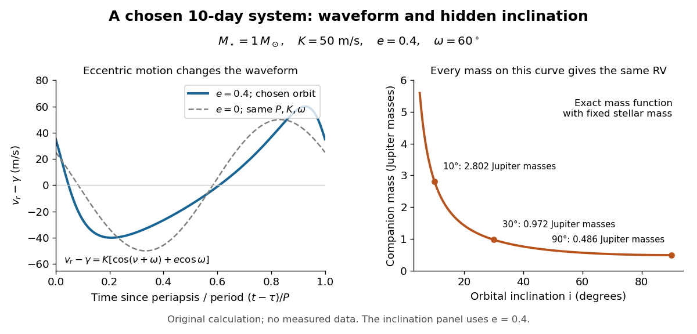

# Keplerian radial-velocity curve

↑ **Parent:** [Doppler spectroscopy](doppler-spectroscopy.md)

A repeating [Doppler shift](doppler-effect.md) contains more than an amplitude. For an isolated [two-body problem](two-body-problem.md), let $\nu$ be the [true anomaly](true-anomaly.md), $\omega_\star$ the stellar [argument of periapsis](argument-of-periapsis.md), $\tau$ the periapsis time and $\gamma$ the constant system line-of-sight [velocity](velocity.md). The companion's [argument of periapsis](argument-of-periapsis.md) differs by $\pi$ from $\omega_\star$, so mixing the two conventions reverses the orbital signal. With positive [velocity](velocity.md) for recession, choose the stellar line-of-sight coordinate positive away from the observer. [Kepler's equation](kepler-s-equation.md) supplies the clock:

$$
M=\frac{2\pi(t-\tau)}P=E-e\sin E,\qquad
\cos\nu=\frac{\cos E-e}{1-e\cos E},\qquad
\sin\nu=\frac{\sqrt{1-e^2}\sin E}{1-e\cos E}.
$$

Here $M$ is the [mean anomaly](mean-anomaly.md) and $E$ the [eccentric anomaly](eccentric-anomaly.md). The time coordinate is uniform in $M$, not in $\nu$: an eccentric [Kepler orbit](kepler-orbit.md) runs fastest near periapsis.

To derive the [velocity](velocity.md) law without guessing a sinusoid, write the stellar orbital coordinates as $X=a_\star(\cos E-e)$ and $Y=a_\star\sqrt{1-e^2}\sin E$. Project to

$$
z=(X\sin\omega_\star+Y\cos\omega_\star)\sin i,\qquad
\frac{dE}{dt}=\frac{2\pi/P}{1-e\cos E}.
$$

Differentiating $z$ and substituting the [true anomaly](true-anomaly.md) identities gives

$$
v_r-\gamma=\dot z=K[\cos(\nu+\omega_\star)+e\cos\omega_\star],\qquad
K=\frac{2\pi a_\star\sin i}{P\sqrt{1-e^2}}.
$$

The constant $e\cos\omega_\star$ term makes the time average of the orbital [velocity](velocity.md) zero: $z$ returns to its original value after one [orbital period](orbital-period.md). For $e=0$ this reduces to a sinusoid with an arbitrary phase origin; periapsis itself is then undefined. For $e>0$, the largest and smallest [velocities](velocity.md) are $\gamma+K(e\cos\omega_\star\pm1)$, so $K$ is still half the peak-to-peak range, although the extrema need not be symmetric about $\gamma$.

For an original worked example, choose $M_\star=1\,M_\odot$, $P=10$ days, $K=50\,\mathrm{m\,s^{-1}}$, $e=0.4$ and $\omega_\star=60^\circ$. Taking one day as $86400\,\mathrm s$ and $G=6.67430\times10^{-11}\,\mathrm{m^3\,kg^{-1}\,s^{-2}}$, the [binary mass function](binary-mass-function.md) is $f=1.98270\times10^{20}\,\mathrm{kg}$. Its units check directly: $[PK^3/G]=\mathrm{kg}$. With adopted [solar mass](solar-mass.md) $M_\odot=1.98847\times10^{30}\,\mathrm{kg}$ and [Jupiter mass](jupiter-mass.md) $M_J=1.89813\times10^{27}\,\mathrm{kg}$, solving the exact [binary mass function](binary-mass-function.md) gives

| [Orbital inclination](orbital-inclination.md) $i$ | Companion [mass](mass.md) $M_p/M_J$ | $90^\circ$ | $0.485930$ | $30^\circ$ | $0.972160$ | $10^\circ$ | $2.802479$ |
| --- | --- | --- | --- | --- | --- | --- | --- |

All three systems have the same chosen $P,K,e,\omega_\star,\tau$ and therefore the same [Doppler spectroscopy](doppler-spectroscopy.md) time series, despite different true [masses](mass.md). Exactly what remains fixed is $M_p\sin i/(M_\star+M_p)^{2/3}$; $M_p\sin i$ alone is only the small-companion approximation. The $90^\circ$ value is the minimum [mass](mass.md). For this example the extrema are $+60$ and $-40\,\mathrm{m\,s^{-1}}$ relative to $\gamma$, and the periapsis value is $+35\,\mathrm{m\,s^{-1}}$. This is a chosen eccentric system, not a reconstruction of 51 Pegasi b.

**[Figure 4](#image-a-chosen-eccentric-radial-velocity-curve-and-the-exact-mass-inclination-ambiguity). A chosen eccentric radial-velocity curve and the exact mass–inclination ambiguity**. The left panel compares eccentric and circular models with the same period and semi-amplitude. Every mass and inclination on the right gives the eccentric model on the left for the stated fixed stellar mass.

## ↑ Ancestors (8)

1. [Doppler spectroscopy](doppler-spectroscopy.md)
2. [Exoplanet atmospheric observatory](exoplanet-atmospheric-observatory.md)
3. [Exoplanet atmosphere](exoplanet-atmosphere.md)
4. [Exoplanet](exoplanet-split.md)
5. [Astrophysics](astrophysics-split.md)
6. [Branches of physics](branches-of-physics.md)
7. [Physics](physics-split.md)
8. [Codex Wiki](split.md)
