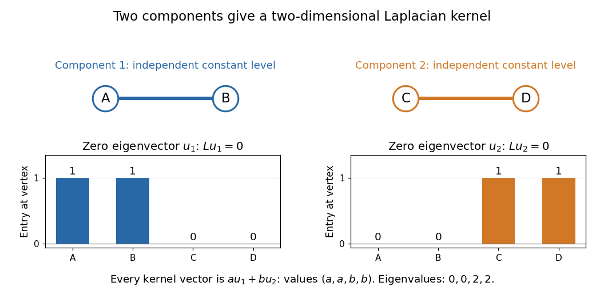

# Kernel of a graph Laplacian

↑ **Parent:** [Laplacian matrix](laplacian-matrix.md)

The [kernel](kernel-of-a-linear-map-split.md) of the [Graph Laplacian](laplacian-matrix.md) consists exactly of [vectors](vector.md) constant on each [connected component of a graph](component-graph-theory.md). Indeed, $Lx=0$ implies $x^TLx=0$, so the [Graph Laplacian quadratic form](graph-laplacian-quadratic-form.md) forces equality at the endpoints of every [edge](edge-of-a-graph.md); equality then propagates along [graph paths](path-in-a-graph.md). Conversely, these equalities make every entry of $Lx$ zero. Thus the [dimension](dimension-vector-space.md) of the [kernel](kernel-of-a-linear-map-split.md), equivalently the multiplicity of the zero [eigenvalue](eigenvalue.md), counts the [connected components of a graph](component-graph-theory.md).

For the disconnected [graph](graph-split.md) with just two [edges](edge-of-a-graph.md), $AB$ and $CD$, in order $A,B,C,D$,

$$
L=\begin{pmatrix}1&-1&0&0\\-1&1&0&0\\0&0&1&-1\\0&0&-1&1\end{pmatrix},\qquad
\ker L=\operatorname{span}\left\{\begin{pmatrix}1\\1\\0\\0\end{pmatrix},\begin{pmatrix}0\\0\\1\\1\end{pmatrix}\right\}.
$$

The two displayed [vectors](vector.md) form a [basis](basis.md) of the [kernel](kernel-of-a-linear-map-split.md). The other two [eigenvectors](eigenvector.md) $(1,-1,0,0)^T$ and $(0,0,1,-1)^T$ each have [eigenvalue](eigenvalue.md) two, so the full list of [eigenvalues](eigenvalue.md), including multiplicities, is $0,0,2,2$. Separate [connected components of a graph](component-graph-theory.md) allow independent constant levels; a single global constant is only one of these possibilities.

**[Figure 18](#image-two-disconnected-edges-give-two-independent-zero-eigenvectors). Two disconnected edges give two independent zero eigenvectors**.

## ↑ Ancestors (6)

1. [Laplacian matrix](laplacian-matrix.md)
2. [Graph theory](graph-theory-split.md)
3. [Foundations of mathematics](foundations-of-mathematics-split.md)
4. [Area of mathematics](area-of-mathematics.md)
5. [Mathematics](mathematics-split.md)
6. [Codex Wiki](split.md)

## ← Incoming links (1)

- [Diffusion on a graph](diffusion-on-a-graph.md)
