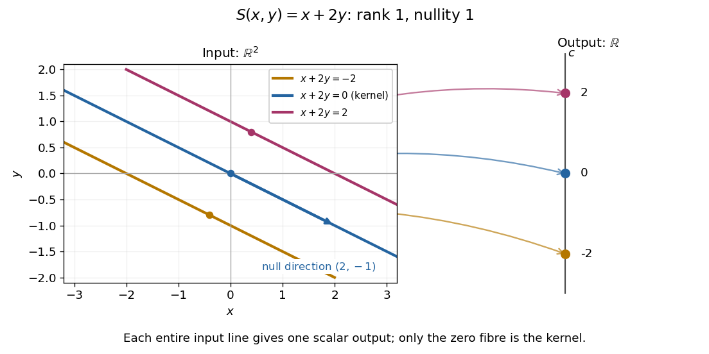
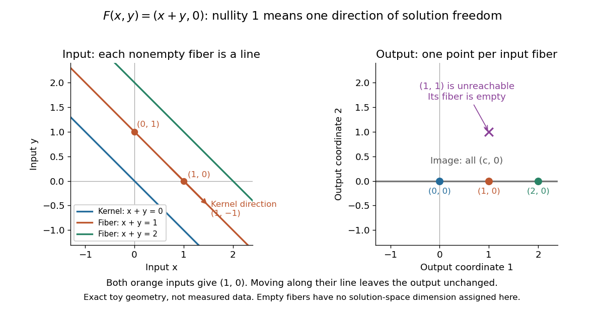
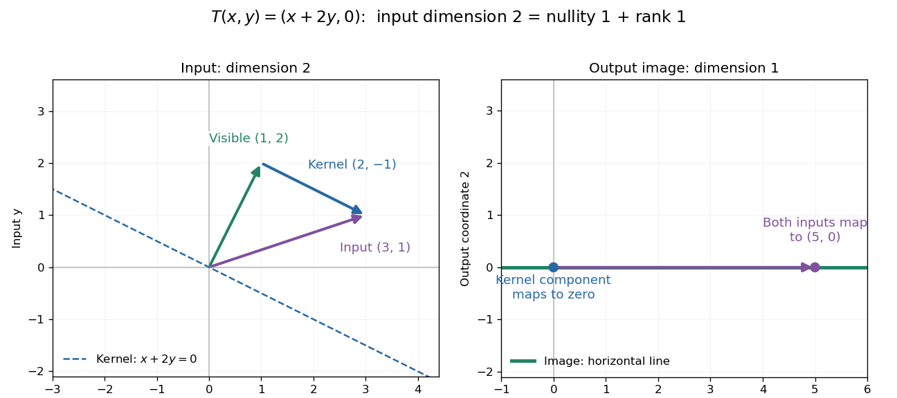

# Kernel of a linear map

↑ **Parent:** [Linear algebra](linear-algebra.md)  
ⓦ [Wiki](https://en.wikipedia.org/wiki/Kernel_of_a_linear_map)

The [kernel of a linear map](kernel-of-a-linear-map.md) $T:V\to W$ is the [vector subspace](vector-space.md#vector-subspace) of inputs sent to zero. [Linearity](vector-space.md#linearity) makes it a [vector subspace](vector-space.md#vector-subspace): if $T(v)=T(w)=0$, then $T(av+bw)=0$ for all [scalars](vector-space.md#scalar) $a,b$. A [vector](vector-space.md#vector) in the [kernel](kernel-of-a-linear-map.md) represents a change that the map cannot detect, since $T(x+v)=T(x)$ for every input $x$.

For $T:\mathbb R^3\to\mathbb R^2$ given by $T(x,y,z)=(x+y,z)$, the zero-output equations are $x+y=0$ and $z=0$. Thus

$$
\ker T=\operatorname{span}\{(1,-1,0)\}.
$$

Increasing the first input while decreasing the second by the same amount leaves the output unchanged. For the [linear functional](dual-space.md#linear-functional) $\varphi(x,y)=2x-y$, the [kernel](kernel-of-a-linear-map.md) is the [straight line](euclidean-geometry.md#straight-line) $y=2x$ shown in its diagram. A [linear map](vector-space.md#linear-map) is [injective](algebra.md#injective-function) exactly when its [kernel](kernel-of-a-linear-map.md) is the zero [vector subspace](vector-space.md#vector-subspace), because $T(v)=T(w)$ is equivalent to $T(v-w)=0$.

The [kernel](kernel-of-a-linear-map.md) describes invisible changes, rather than all inputs that produce a specified nonzero output. If $T(x_0)=b$, the corresponding [fiber of a function](function.md#fiber-of-a-function) is the [affine solution space of a linear equation](linear-algebra.md#affine-solution-space-of-a-linear-equation) $x_0+\ker T$. The difference of two inputs in that [fiber](function.md#fiber-of-a-function) belongs to the [kernel](kernel-of-a-linear-map.md); an input in that [fiber](function.md#fiber-of-a-function) need not. In particular, for $b\ne0$ the [fiber](function.md#fiber-of-a-function) cannot be a [vector subspace](vector-space.md#vector-subspace), since it does not contain the [zero vector](vector-space.md#zero-vector).[Margalit and Rabinoff, Interactive Linear Algebra, §2.4.2, Key Observation and Remark: translate the homogeneous solution set by any particular solution](mathematics-bibliography.md#interactive-linear-algebra-by-dan-margalit-and-others/solution-sets)

For the [linear functional](dual-space.md#linear-functional) $S:\mathbb R^2\to\mathbb R$, $S(x,y)=x+2y$, the [kernel](kernel-of-a-linear-map.md) is $\operatorname{span}\{(2,-1)\}$. Each [fiber](function.md#fiber-of-a-function) $S^{-1}(\{c\})$ is the parallel [straight line](euclidean-geometry.md#straight-line) $(c,0)+\operatorname{span}\{(2,-1)\}$. The input [vector space](vector-space.md) is two-dimensional, but the output is one [scalar](vector-space.md#scalar): a whole [straight line](euclidean-geometry.md#straight-line) of inputs collapses to one point of the output [real line](real-analysis.md#real-line).

**[Figure 1](#image-parallel-input-fibres-of-s-x-y-x-plus-2y-map-to-scalar-outputs). Parallel input fibres of $S(x,y)=x+2y$ map to scalar outputs**. The blue input [straight line](euclidean-geometry.md#straight-line) is the [kernel](kernel-of-a-linear-map.md); the other colored input [straight lines](euclidean-geometry.md#straight-line) are its [translations](geometry-and-topology.md#translation-geometry). The output panel is the one-dimensional [real line](real-analysis.md#real-line), drawn vertically for alignment. All displayed geometry is exact illustrative mathematics.

**Table of contents**

- [Null direction of a linear map](#null-direction-of-a-linear-map)
- [Rectangular kernel and solution-fibre example](#rectangular-kernel-and-solution-fibre-example)
- [Noninjective linear measurement](#noninjective-linear-measurement)
- [Nullity of a linear map](#nullity-of-a-linear-map)
- [Trivial kernel](#trivial-kernel)
- [Rank-nullity theorem](#rank-nullity-theorem)
  - [Equality in the rank-sum and nullity-product inequalities](#equality-in-the-rank-sum-and-nullity-product-inequalities)
  - [Kernel jump in a parameter-dependent linear map](#kernel-jump-in-a-parameter-dependent-linear-map)

## Null direction of a linear map

↑ **Parent:** [Kernel of a linear map](kernel-of-a-linear-map.md)

A [null direction of a linear map](#null-direction-of-a-linear-map) $T$ is represented by a nonzero [vector](vector-space.md#vector) $v$ in its [kernel](kernel-of-a-linear-map.md). Every [scalar multiple](vector-space.md#scalar-multiple) $tv$ is an undetectable displacement: $T(x+tv)=T(x)$. The [vector subspace](vector-space.md#vector-subspace) $\operatorname{span}\{v\}$ describes the direction independently of the chosen nonzero representative. More generally, a [basis](vector-space.md#basis) of the [kernel](kernel-of-a-linear-map.md) supplies all independent [null directions of a linear map](#null-direction-of-a-linear-map); their number is the [nullity](#nullity-of-a-linear-map). The [zero vector](vector-space.md#zero-vector) belongs to the [kernel](kernel-of-a-linear-map.md) but supplies no direction.

## Rectangular kernel and solution-fibre example

↑ **Parent:** [Kernel of a linear map](kernel-of-a-linear-map.md)

Consider the [linear map](vector-space.md#linear-map) $A:\mathbb R^3\to\mathbb R^2$ represented by the rectangular [matrix](vector-space.md#matrix)

$$
A=\begin{pmatrix}1&2&0\\0&1&1\end{pmatrix},\qquad
A\begin{pmatrix}x\\y\\z\end{pmatrix}=\begin{pmatrix}x+2y\\y+z\end{pmatrix}.
$$

To compute its [kernel](kernel-of-a-linear-map.md), solve the [homogeneous linear system](linear-algebra.md#homogeneous-linear-system) $x+2y=0$, $y+z=0$. Taking $y=t$ gives $x=-2t$, $z=-t$, so

$$
\ker A=\left\{t\begin{pmatrix}-2\\1\\-1\end{pmatrix}:t\in\mathbb R\right\},\qquad
v=\begin{pmatrix}-2\\1\\-1\end{pmatrix},\qquad Av=\begin{pmatrix}-2+2\\1-1\end{pmatrix}=0.
$$

Thus $v$ represents a [null direction of a linear map](#null-direction-of-a-linear-map): decreasing the first input by two, increasing the second by one, and decreasing the third by one changes neither output. Solving the [homogeneous linear system](linear-algebra.md#homogeneous-linear-system) is the concrete computation behind a [kernel](kernel-of-a-linear-map.md); the [column space](vector-space.md#column-space) instead decides which outputs are attainable.[Gilbert Strang, Lecture 6: Column space and nullspace, opening lecture description: the distinct roles of Ax=0 and Ax=b](mathematics-bibliography.md#linear-algebra-mit-18-06-spring-2010/lecture-6-column-space-and-nullspace)

Now prescribe the nonzero output $b=(3,2)^T$. The [linear system](linear-algebra.md#system-of-linear-equations) $Au=b$ becomes $x+2y=3$, $y+z=2$. Again take $y=t$:

$$
u=\begin{pmatrix}3-2t\\t\\2-t\end{pmatrix}
=\underbrace{\begin{pmatrix}3\\0\\2\end{pmatrix}}_{u_0}
+t\underbrace{\begin{pmatrix}-2\\1\\-1\end{pmatrix}}_{v},\qquad t\in\mathbb R.
$$

Direct substitution gives $Au_0=(3,2)^T$, and $A(u_0+tv)=Au_0+tAv=b$. Conversely, the two [linear equations](linear-algebra.md#linear-equation) force exactly this form, so no solutions have been omitted. This [fiber](function.md#fiber-of-a-function) is an [affine subspace](vector-space.md#affine-subspace) of [dimension](vector-space.md#dimension-vector-space) one in the three-dimensional input [vector space](vector-space.md). It is parallel to the [kernel](kernel-of-a-linear-map.md), but does not pass through the origin. For instance, $u_0=(3,0,2)^T$ and $u_1=(1,1,1)^T$ both give $b$, while their difference $u_1-u_0=v$ gives zero. Adding $u_0$ and $u_1$ gives output $2b$, which is another way to see that this nonzero-output [fiber](function.md#fiber-of-a-function) is not a [vector subspace](vector-space.md#vector-subspace).

**[Figure 2](#image-three-dimensional-inputs-along-one-null-direction-give-the-same-two-dimensional-output). Three-dimensional inputs along one null direction give the same two-dimensional output**. The blue [straight line](euclidean-geometry.md#straight-line) is the [kernel](kernel-of-a-linear-map.md) in the actual three-dimensional input [vector space](vector-space.md). The orange solution [straight line](euclidean-geometry.md#straight-line) is its [translation](geometry-and-topology.md#translation-geometry) by $u_0$. Three marked inputs map to the single orange output $(3,2)$ in the two-dimensional output [vector space](vector-space.md); the blue [kernel](kernel-of-a-linear-map.md) maps to zero. Finite plotted segments represent infinite [straight lines](euclidean-geometry.md#straight-line).

The first and third columns of $A$ are $(1,0)^T$ and $(0,1)^T$, a [basis](vector-space.md#basis) of the output [vector space](vector-space.md). Hence $A$ has [matrix rank](vector-space.md#matrix-rank) two and reaches every output. The [rank-nullity theorem](#rank-nullity-theorem) predicts [nullity](#nullity-of-a-linear-map) $3-2=1$ before we solve any [linear system](linear-algebra.md#system-of-linear-equations). It provides a useful completeness check: one nonzero [kernel](kernel-of-a-linear-map.md) [vector](vector-space.md#vector) already forms a [basis](vector-space.md#basis) here, so a second independent [null direction of a linear map](#null-direction-of-a-linear-map) would signal a calculation error. In general, [matrix rank](vector-space.md#matrix-rank) $r$ for an $m\times n$ [matrix](vector-space.md#matrix) leaves $n-r$ independent [kernel](kernel-of-a-linear-map.md) directions, rather than $m-r$.[Margalit and Rabinoff, Interactive Linear Algebra, §2.9, Rank Theorem: column count equals rank plus nullity](mathematics-bibliography.md#interactive-linear-algebra-by-dan-margalit-and-others/the-rank-theorem)

## Noninjective linear measurement

↑ **Parent:** [Kernel of a linear map](kernel-of-a-linear-map.md)

When a measurement model is a [linear map](vector-space.md#linear-map) $T$, its [kernel](kernel-of-a-linear-map.md) records changes that its readout cannot distinguish. For example, the [rectangular kernel and solution-fibre example](#rectangular-kernel-and-solution-fibre-example) measures only $x+2y$ and $y+z$. Even exact readouts $(3,2)$ leave the whole [fiber](function.md#fiber-of-a-function) $u_0+\ker A$ possible. Repeating either readout with greater precision cannot distinguish those inputs: their outputs agree exactly. This ambiguity follows from a nontrivial [kernel](kernel-of-a-linear-map.md), rather than from measurement error.

Additional information can remove a [null direction of a linear map](#null-direction-of-a-linear-map). In that example, adding a third [linear functional](dual-space.md#linear-functional) that reads $y$ distinguishes $u_0+tv$, because its third readout is $t$. More generally, additional [linear functionals](dual-space.md#linear-functional) $c_1,\ldots,c_k$ give unique recovery of all inputs exactly when

$$
\ker T\cap\ker c_1\cap\cdots\cap\ker c_k=\{0\}.
$$

This follows by applying the [trivial kernel](#trivial-kernel) criterion to the combined [linear map](vector-space.md#linear-map) $x\mapsto(Tx,c_1(x),\ldots,c_k(x))$. Merely adding repeated [linear equations](linear-algebra.md#linear-equation) does not meet this condition. On a finite-dimensional input [vector space](vector-space.md), each added [scalar](vector-space.md#scalar) readout can increase the [matrix rank](vector-space.md#matrix-rank) by at most one, so at least $\dim\ker T$ extra independent readouts are needed for recovery of unrestricted inputs.

Restrictions on the possible inputs can also make recovery unique. If the allowed inputs form a [set](set.md) $D$, two allowed inputs are indistinguishable exactly when their difference is in the [kernel](kernel-of-a-linear-map.md). Thus $T$ is [injective](algebra.md#injective-function) on $D$ precisely when no difference of distinct points of $D$ is a [kernel](kernel-of-a-linear-map.md) [vector](vector-space.md#vector). Such a restriction is extra information about the input; the original readout alone determines only its [fiber](function.md#fiber-of-a-function).

## Nullity of a linear map

↑ **Parent:** [Kernel of a linear map](kernel-of-a-linear-map.md)

The [nullity of a linear map](#nullity-of-a-linear-map) $T:V\to W$ is $n(T)=\dim\ker T$, the [dimension](vector-space.md#dimension-vector-space) of its [kernel](kernel-of-a-linear-map.md). It counts independent input directions that can change without changing the output. For a [finite-dimensional vector space](vector-space.md#finite-dimensional-vector-space) $V$, the [rank-nullity theorem](#rank-nullity-theorem) gives

$$
n(T)=\dim V-\operatorname{rank}T.
$$

For an $m\times n$ [matrix](vector-space.md#matrix) $A$ of [matrix rank](vector-space.md#matrix-rank) $r$, this is $n-r$, using the number of columns, not the number of rows. This dimension identity is [Sheldon Axler, Linear Algebra Done Right, fourth edition, §3B, theorem 3.21](mathematics-bibliography.md#linear-algebra-done-right-by-sheldon-axler-4th-edition).

The [nullity](#nullity-of-a-linear-map) answers a practical question about a [linear system](linear-algebra.md#system-of-linear-equations): once one input is known to produce the requested output, how much freedom remains? If $T(x_0)=b$, its [fiber of a function](function.md#fiber-of-a-function) over $b$ is

$$
\boxed{T^{-1}(\{b\})=x_0+\ker T.}
$$

Indeed, $T(x)=T(x_0)$ exactly when $T(x-x_0)=0$. Thus every nonempty [fiber](function.md#fiber-of-a-function) is an [affine subspace](vector-space.md#affine-subspace) of [dimension](vector-space.md#dimension-vector-space) $n(T)$, with the same direction space as the [kernel](kernel-of-a-linear-map.md). The [kernel](kernel-of-a-linear-map.md) itself is the [fiber](function.md#fiber-of-a-function) over zero. Outputs outside the [image of a linear map](vector-space.md#image-of-a-linear-map) have empty [fibers](function.md#fiber-of-a-function); the [nullity](#nullity-of-a-linear-map) does not guarantee existence, and we assign no solution-space [dimension](vector-space.md#dimension-vector-space) to an empty [fiber](function.md#fiber-of-a-function) here.

**[Figure 3](#image-nullity-one-gives-parallel-solution-lines-for-f-x-y-x-plus-y-0). Nullity one gives parallel solution lines for $F(x,y)=(x+y,0)$**. Each colored input [straight line](euclidean-geometry.md#straight-line) $x+y=c$ is the [fiber](function.md#fiber-of-a-function) over the corresponding output $(c,0)$. The blue line through the origin is the [kernel](kernel-of-a-linear-map.md). The orange inputs $(1,0)$ and $(0,1)$ give the same output; their difference belongs to the [kernel](kernel-of-a-linear-map.md). The output $(1,1)$ lies outside the [image of a linear map](vector-space.md#image-of-a-linear-map) and has no input. Exact toy geometry, not measured data.

In the diagram, $F:\mathbb R^2\to\mathbb R^2$ has [matrix](vector-space.md#matrix) $\begin{pmatrix}1&1\\0&0\end{pmatrix}$, [matrix rank](vector-space.md#matrix-rank) one and [nullity](#nullity-of-a-linear-map) one. Its [kernel](kernel-of-a-linear-map.md) has [basis](vector-space.md#basis) $(1,-1)$, and the full solution of $F(x,y)=(c,0)$ is $(x,y)=(c,0)+s(1,-1)$. One free [scalar](vector-space.md#scalar) moves the solution along a [straight line](euclidean-geometry.md#straight-line); the output $(c,1)$ is impossible.

The existing three-input example $T(x,y,z)=(x+y,z)$ instead has [rank](quadratic-form.md#rank-one-quadratic-form) two and [nullity](#nullity-of-a-linear-map) one. Its [image of a linear map](vector-space.md#image-of-a-linear-map) is all of $\mathbb R^2$, and

$$
T^{-1}(\{(a,b)\})=(a,0,b)+\operatorname{span}\{(1,-1,0)\}.
$$

Every output has a solution [straight line](euclidean-geometry.md#straight-line). In contrast, $U(x,y,z)=(x+y,0)$ has [rank](quadratic-form.md#rank-one-quadratic-form) one and [nullity](#nullity-of-a-linear-map) two, with [kernel](kernel-of-a-linear-map.md) [basis](vector-space.md#basis) $(1,-1,0),(0,0,1)$. Its reachable output $(a,0)$ has the solution [affine subspace](vector-space.md#affine-subspace)

$$
(x,y,z)=(a,0,0)+s(1,-1,0)+u(0,0,1),\qquad s,u\in\mathbb R,
$$

a plane, while $(a,b)$ with $b\ne0$ has no solution. These two [linear maps](vector-space.md#linear-map) have the same input and output dimensions but different freedom and reachability. Computing the [kernel](kernel-of-a-linear-map.md) separates what an output determines from what an extra constraint would have to fix. For either example, a [basis](vector-space.md#basis) of the [kernel](kernel-of-a-linear-map.md) gives one independent free [scalar](vector-space.md#scalar) per [basis vector](vector-space.md#basis-vector), which is why [nullity](#nullity-of-a-linear-map) measures freedom rather than the number of solutions.

## Trivial kernel

↑ **Parent:** [Kernel of a linear map](kernel-of-a-linear-map.md)

A [linear map](vector-space.md#linear-map) $T:V\to W$ has a trivial [kernel](kernel-of-a-linear-map.md) when $\ker T=\{0_V\}$: the [zero vector](vector-space.md#zero-vector) is the only input producing the zero output. The [kernel](kernel-of-a-linear-map.md) is a [singleton set](set.md#singleton-mathematics), not the [empty set](set.md#empty-set), because every [linear map](vector-space.md#linear-map) sends zero to zero. Equivalently, its [nullity](#nullity-of-a-linear-map) is zero and $T$ is [injective](algebra.md#injective-function). This holds even without a finite-dimensional hypothesis; see [Linear Algebra Done Right by Sheldon Axler (4th edition)](mathematics-bibliography.md#linear-algebra-done-right-by-sheldon-axler-4th-edition).

The reason this zero-output test controls all outputs is [linearity](vector-space.md#linearity):

$$
T(v)=T(w)\iff T(v-w)=0\iff v-w\in\ker T.
$$

With a [trivial kernel](#trivial-kernel), equal outputs force equal inputs. Therefore every equation $T(x)=b$ has at most one solution. Existence is a separate question: $b$ must belong to the [image of a linear map](vector-space.md#image-of-a-linear-map). In the [fiber](function.md#fiber-of-a-function) description under [nullity](#nullity-of-a-linear-map), $x_0+\{0\}$ is just the single point $x_0$.

For example, the [linear map](vector-space.md#linear-map) $J:\mathbb R^2\to\mathbb R^3$, $J(x,y)=(x,y,0)$, has [trivial kernel](#trivial-kernel) and [full column rank](vector-space.md#full-column-rank):

$$
J=\begin{pmatrix}1&0\\0&1\\0&0\end{pmatrix},\qquad
\ker J=\{0\},\qquad\operatorname{rank}J=2.
$$

The output $(3,4,0)$ comes from exactly $(3,4)$, while $(3,4,1)$ is unreachable. Conversely, $P:\mathbb R^3\to\mathbb R^2$, $P(x,y,z)=(x,y)$, is [surjective](algebra.md#surjective-function) and has [full row rank](vector-space.md#full-row-rank), but its [kernel](kernel-of-a-linear-map.md) is $\operatorname{span}\{(0,0,1)\}$: every output $(a,b)$ comes from the solution [straight line](euclidean-geometry.md#straight-line) $(a,b,s)$.

For an $m\times n$ [matrix](vector-space.md#matrix), a [trivial kernel](#trivial-kernel) is equivalent to [matrix rank](vector-space.md#matrix-rank) $n$ and [linear independence](vector-space.md#linear-independence) of its columns. It can therefore occur only if $n\leq m$. If $m=n$, the [rank-nullity theorem](#rank-nullity-theorem) also forces [surjectivity](algebra.md#surjective-function), giving an [invertible matrix](linear-algebra.md#invertible-matrix); if $m>n$, the example $J$ shows why unique recovery of reachable inputs does not imply that every output is reachable. Finally, a [trivial kernel](#trivial-kernel) guarantees exact uniqueness without guaranteeing numerical stability: the [singular matrix](linear-algebra.md#singular-matrix) example $A(t)$ has [trivial kernel](#trivial-kernel) for every $t\ne0$, even as its [condition number](quadratic-form.md#condition-number) grows without bound when $t$ approaches zero.

## Rank-nullity theorem

↑ **Parent:** [Kernel of a linear map](kernel-of-a-linear-map.md)  
ⓦ [Wiki](https://en.wikipedia.org/wiki/Rank-nullity_theorem)

The [rank-nullity theorem](#rank-nullity-theorem) accounts for the input dimensions of a [linear map](vector-space.md#linear-map): the number of independent invisible input directions plus the number of independent reachable output directions equals the input [dimension](vector-space.md#dimension-vector-space). For $T:V\to W$ over a [field](algebra.md#field), with finite-dimensional [domain of a function](function.md#domain-of-a-function) $V$,

$$
\boxed{\dim V=\dim\ker T+\dim\operatorname{im}T.}
$$

Here $\dim\ker T$ is the [nullity](#nullity-of-a-linear-map), and $\dim\operatorname{im}T$ is the [rank of a linear map](vector-space.md#rank-of-a-linear-map). The [kernel](kernel-of-a-linear-map.md) lives in the input [vector space](vector-space.md), while the [image of a linear map](vector-space.md#image-of-a-linear-map) lives in the output [vector space](vector-space.md). For an $m$-by-$n$ [matrix](vector-space.md#matrix) of [matrix rank](vector-space.md#matrix-rank) $r$, the formula is $n=(n-r)+r$: the number of columns counts input coordinates. [Sheldon Axler, Linear Algebra Done Right, fourth edition, §3B: fundamental theorem of linear maps](mathematics-bibliography.md#linear-algebra-done-right-by-sheldon-axler-4th-edition)

For a computed example over the [real numbers](arithmetic.md#real-number), take

$$
A=\begin{pmatrix}1&2\\0&0\end{pmatrix},\qquad
T(x,y)=A\begin{pmatrix}x\\y\end{pmatrix}=(x+2y,0).
$$

The [kernel](kernel-of-a-linear-map.md) is $\operatorname{span}\{(-2,1)\}$ and the [image of a linear map](vector-space.md#image-of-a-linear-map) is $\operatorname{span}\{(1,0)\}$. Each has [dimension](vector-space.md#dimension-vector-space) one, so the two input dimensions split as $2=1+1$. The [vector](vector-space.md#vector) $(3,1)$ can be written

$$
(3,1)=(1,2)+(2,-1),\qquad
T(1,2)=(5,0),\qquad T(2,-1)=(0,0).
$$

The second summand is undetectable: $T(3,1)=T(1,2)$. The picture uses the standard [dot product](inner-product.md#dot-product) to choose a visible direction perpendicular to the [kernel](kernel-of-a-linear-map.md); this is a convenient geometric choice, not an extra hypothesis of the [rank-nullity theorem](#rank-nullity-theorem).

**[Figure 4](#image-two-input-dimensions-split-into-one-visible-direction-and-one-kernel-direction). Two input dimensions split into one visible direction and one kernel direction**. For $T(x,y)=(x+2y,0)$, the input $(3,1)$ splits into $(1,2)$ and $(2,-1)$. Both $(3,1)$ and $(1,2)$ map to $(5,0)$, while the [kernel](kernel-of-a-linear-map.md) component maps to zero. The horizontal output line is the entire [image of a linear map](vector-space.md#image-of-a-linear-map).

This explains a practical tradeoff in a [linear system](linear-algebra.md#system-of-linear-equations). If $T(x_0)=b$, every other input with output $b$ is $x_0+k$ for $k\in\ker T$. The [nullity](#nullity-of-a-linear-map) therefore counts independent freedom in an existing solution; the [rank](quadratic-form.md#rank-one-quadratic-form) counts independent reachable output directions. In the example, $T(x,y)=(3,0)$ has all solutions $(x,y)=(3-2t,t)$, while $T(x,y)=(3,1)$ has none. The [cokernel](linear-algebra.md#cokernel) records this failure of reachability.

For an $m$-by-$n$ [matrix](vector-space.md#matrix), [injectivity](algebra.md#injective-function) requires [matrix rank](vector-space.md#matrix-rank) $n$, and [surjectivity](algebra.md#surjective-function) requires [matrix rank](vector-space.md#matrix-rank) $m$. When $m\ne n$, these conditions differ. For example, $B:\mathbb R^3\to\mathbb R^2$ with $B(x,y,z)=(x+2y,0)$ has [rank](quadratic-form.md#rank-one-quadratic-form) one and [nullity](#nullity-of-a-linear-map) two, because $\ker B=\operatorname{span}\{(-2,1,0),(0,0,1)\}$. The input accounting is $3=2+1$, although only one of two output directions is reached.

Proof outline: extend a [basis](vector-space.md#basis) $k_1,\ldots,k_q$ of the [kernel](kernel-of-a-linear-map.md) to a [basis](vector-space.md#basis) $k_1,\ldots,k_q,v_1,\ldots,v_r$ of $V$. Every output is a [linear combination](vector-space.md#linear-combination) of $T(v_1),\ldots,T(v_r)$ because the $k_i$ vanish under $T$. If a [linear combination](vector-space.md#linear-combination) of the $T(v_j)$ is zero, the corresponding combination of the $v_j$ lies in the [kernel](kernel-of-a-linear-map.md); [linear independence](vector-space.md#linear-independence) of the full [basis](vector-space.md#basis) forces all its coefficients to vanish. Thus the added [basis vectors](vector-space.md#basis-vector) give a [basis](vector-space.md#basis) of the [image of a linear map](vector-space.md#image-of-a-linear-map). Counting them proves the formula.

### Equality in the rank-sum and nullity-product inequalities

↑ **Parent:** [Rank-nullity theorem](#rank-nullity-theorem)

For [endomorphisms](algebra.md#endomorphism) $S,T$ of a finite-dimensional space of [dimension](vector-space.md#dimension-vector-space) $d$, $r(S+T)\le r(S)+r(T)$ and $n(ST)\le n(S)+n(T)$. If both equalities hold, the first gives $r(S)+r(T)\le d$, while the second gives $2d-r(S)-r(T)\le d$. Thus the [rank](quadratic-form.md#rank-one-quadratic-form) sum is $d$, $S+T$ is an [isomorphism](algebra.md#isomorphism), and $ST=0$. Conversely, $ST=0$ implies $\operatorname{im}T\subseteq\ker S$ and hence [rank](quadratic-form.md#rank-one-quadratic-form) sum at most $d$, whereas invertibility of $S+T$ gives [rank](quadratic-form.md#rank-one-quadratic-form) sum at least $d$. This proves both equalities.

### Kernel jump in a parameter-dependent linear map

↑ **Parent:** [Rank-nullity theorem](#rank-nullity-theorem)

For a matrix whose entries depend on a parameter, a nonzero maximal minor certifies a fixed [matrix rank](vector-space.md#matrix-rank) away from its zeros. At a zero, other minors must still be checked: one vanishing minor does not itself imply a rank drop. Once the [matrix rank](vector-space.md#matrix-rank) is determined, the [rank-nullity theorem](#rank-nullity-theorem) gives the dimension of the [kernel of a linear map](kernel-of-a-linear-map.md). Exceptional parameters can then be solved separately to exhibit the additional [kernel of a linear map](kernel-of-a-linear-map.md) directions.

## ↑ Ancestors (5)

1. [Linear algebra](linear-algebra.md)
2. [Algebra](algebra.md)
3. [Area of mathematics](mathematics.md#area-of-mathematics)
4. [Mathematics](mathematics.md)
5. [Codex Wiki](README.md)

## ← Incoming links (68)

- [Affine space of solutions of the Hodge Poisson equation](differential-form.md#affine-space-of-solutions-of-the-hodge-poisson-equation)
- [Columns partition for finite-sums systems](ramsey-theory.md#columns-partition-for-finite-sums-systems)
- [Continuous dual space](continuous-dual-space.md)
- [Critical value](differential-geometry.md#critical-value)
- [Determinant](multilinear-algebra.md#determinant)
- [Even-weight subcode of a binary linear code](coding-theory.md#even-weight-subcode-of-a-binary-linear-code)
- [Factor base](number-theory.md#factor-base)
- [Fixed-frequency nonradiating source](physics.md#fixed-frequency-nonradiating-source)
- [Geometric Hahn-Banach theorem for radially open sets](functional-analysis.md#geometric-hahn-banach-theorem-for-radially-open-sets)
- [Ground-state degeneracy](quantum-mechanics.md#ground-state-degeneracy)
- [Homogeneous linear differential equation](differential-equation.md#homogeneous-linear-differential-equation)
- [Homogeneous linear system](linear-algebra.md#homogeneous-linear-system)
- [Image criterion for a matrix factorization](linear-algebra.md#image-criterion-for-a-matrix-factorization)
- [Inner product adapted to an idempotent linear map](vector-space.md#inner-product-adapted-to-an-idempotent-linear-map)
- [Kernel (algebra)](algebra.md#kernel-algebra)
- [Kernel jump in a parameter-dependent linear map](#kernel-jump-in-a-parameter-dependent-linear-map)
- [Kernel of a linear map](kernel-of-a-linear-map.md)
- [Level sets of a positive semidefinite quadratic form](quadratic-form.md#level-sets-of-a-positive-semidefinite-quadratic-form)
- [Linear differential equation](differential-equation.md#linear-differential-equation)
- [Linear functional](dual-space.md#linear-functional)
- [Maximum-support vector in a finite-dimensional subspace](numerical-analysis.md#maximum-support-vector-in-a-finite-dimensional-subspace)
- [Normal matrices have equal adjoint norms](linear-operator-theory.md#normal-matrices-have-equal-adjoint-norms)
- [Normal modes of an equilateral spring triangle](lagrangian-mechanics.md#normal-modes-of-an-equilateral-spring-triangle)
- [Nullity of real N=1 supercharges](supersymmetry.md#nullity-of-real-n-1-supercharges)
- [Orthogonal projection matrix](inner-product.md#orthogonal-projection-matrix)
- [Orthogonality to the image of a matrix](vector-space.md#orthogonality-to-the-image-of-a-matrix)
- [Solution](past-exam-of-the-mathematics-course-of-the-university-of-cambridge/2001/ia/paper-1.md#5c/solution)
- [Solution](past-exam-of-the-mathematics-course-of-the-university-of-cambridge/2001/iii/paper-51.md#1/b/solution)
- [Solution](past-exam-of-the-mathematics-course-of-the-university-of-cambridge/2002/iii/paper-30.md#2/solution)
- [Solution](past-exam-of-the-mathematics-course-of-the-university-of-cambridge/2003/ia/paper-1.md#2d/solution)
- [Solution](past-exam-of-the-mathematics-course-of-the-university-of-cambridge/2003/ia/paper-1.md#6a/solution)
- [Solution](past-exam-of-the-mathematics-course-of-the-university-of-cambridge/2003/ib/paper-3.md#19g/a/solution)
- [Solution](past-exam-of-the-mathematics-course-of-the-university-of-cambridge/2005/ia/paper-3.md#11a/solution)
- [Solution](past-exam-of-the-mathematics-course-of-the-university-of-cambridge/2006/iii/paper-85.md#4/a/solution)
- [Solution](past-exam-of-the-mathematics-course-of-the-university-of-cambridge/2008/ia/paper-3.md#2e/solution)
- [Solution](past-exam-of-the-mathematics-course-of-the-university-of-cambridge/2009/ib/paper-1.md#1g/1/solution)
- [Solution](past-exam-of-the-mathematics-course-of-the-university-of-cambridge/2010/ia/paper-1.md#7b/iv/solution)
- [Solution](past-exam-of-the-mathematics-course-of-the-university-of-cambridge/2010/iii/paper-6.md#1/solution)
- [Solution](past-exam-of-the-mathematics-course-of-the-university-of-cambridge/2011/ia/paper-1.md#6a/b/solution)
- [Solution](past-exam-of-the-mathematics-course-of-the-university-of-cambridge/2011/ia/paper-1.md#7b/b/solution)
- [Solution](past-exam-of-the-mathematics-course-of-the-university-of-cambridge/2011/ia/paper-1.md#7b/c/solution)
- [Solution](past-exam-of-the-mathematics-course-of-the-university-of-cambridge/2012/iii/paper-15.md#1/a/solution)
- [Solution](past-exam-of-the-mathematics-course-of-the-university-of-cambridge/2014/ia/paper-1.md#6a/ii/solution)
- [Solution](past-exam-of-the-mathematics-course-of-the-university-of-cambridge/2014/ib/paper-2.md#1g/solution)
- [Solution](past-exam-of-the-mathematics-course-of-the-university-of-cambridge/2015/ia/paper-1.md#6c/i/solution)
- [Solution](past-exam-of-the-mathematics-course-of-the-university-of-cambridge/2015/ia/paper-1.md#6c/ii/solution)
- [Solution](past-exam-of-the-mathematics-course-of-the-university-of-cambridge/2015/iii/paper-12.md#5/solution)
- [Solution](past-exam-of-the-mathematics-course-of-the-university-of-cambridge/2015/iii/paper-3.md#3/b/i/solution)
- [Solution](past-exam-of-the-mathematics-course-of-the-university-of-cambridge/2015/iii/paper-76.md#3/b/solution)
- [Solution](past-exam-of-the-mathematics-course-of-the-university-of-cambridge/2016/ia/paper-1.md#8c/a/solution)
- [Solution](past-exam-of-the-mathematics-course-of-the-university-of-cambridge/2016/ia/paper-1.md#8c/b/solution)
- [Solution](past-exam-of-the-mathematics-course-of-the-university-of-cambridge/2016/iii/paper-335.md#2/c/solution)
- [Solution](past-exam-of-the-mathematics-course-of-the-university-of-cambridge/2016/iii/paper-335.md#3/a/solution)
- [Solution](past-exam-of-the-mathematics-course-of-the-university-of-cambridge/2017/ib/paper-2.md#1f/solution)
- [Solution](past-exam-of-the-mathematics-course-of-the-university-of-cambridge/2017/iii/paper-129.md#3/solution)
- [Solution](past-exam-of-the-mathematics-course-of-the-university-of-cambridge/2021/ia/paper-1.md#8b/a/solution)
- [Solution](past-exam-of-the-mathematics-course-of-the-university-of-cambridge/2021/ib/paper-4.md#8e/a/solution)
- [Solution](past-exam-of-the-mathematics-course-of-the-university-of-cambridge/2024/iii/paper-343.md#4/a/solution)
- [Solution](past-exam-of-the-mathematics-course-of-the-year-1-of-the-natural-sciences-course-of-the-university-of-cambridge/2007/paper-1.md#section-b/8/b/i/solution)
- [Solution](past-exam-of-the-mathematics-course-of-the-year-1-of-the-natural-sciences-course-of-the-university-of-cambridge/2012/paper-1.md#11/a/solution)
- [Solution](past-exam-of-the-mathematics-course-of-the-year-1-of-the-natural-sciences-course-of-the-university-of-cambridge/2014/paper-1.md#11/d/solution)
- [Solution](past-exam-of-the-mathematics-course-of-the-year-1-of-the-natural-sciences-course-of-the-university-of-cambridge/2016/paper-1.md#14/a/iv/solution)
- [Solution](past-exam-of-the-mathematics-course-of-the-year-1-of-the-natural-sciences-course-of-the-university-of-cambridge/2017/paper-1.md#18/c/solution)
- [Solution](past-exam-of-the-mathematics-course-of-the-year-2-of-the-natural-sciences-course-of-the-university-of-cambridge/2010/paper-2.md#7/solution)
- [Projection (linear algebra)](vector-space.md#projection-linear-algebra)
- [Sylvester matrix](polynomial.md#sylvester-matrix)
- [Tangent plane](tangent-vector.md#tangent-plane)
- [Trace of an idempotent equals its rank](vector-space.md#trace-of-an-idempotent-equals-its-rank)
