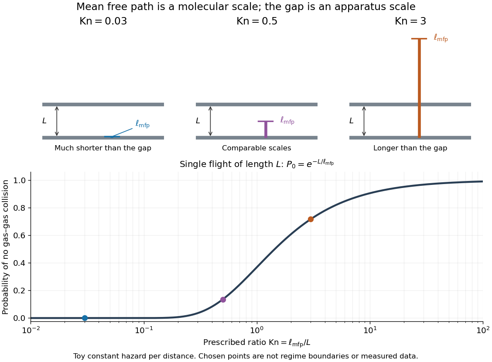
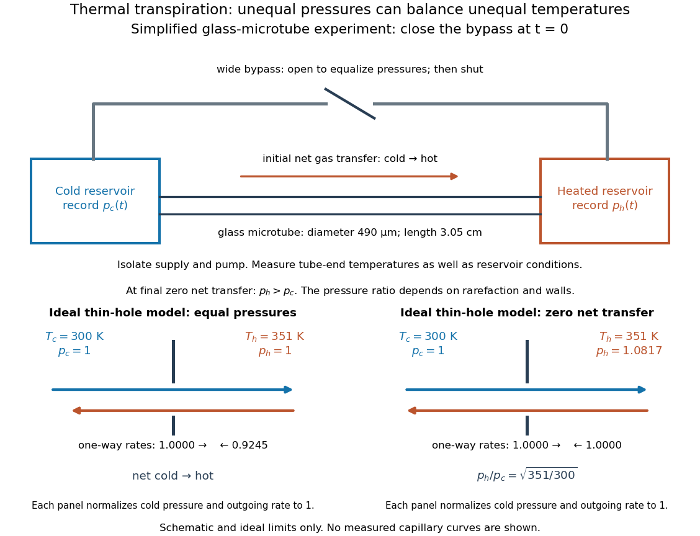

# Kinetic theory

↑ **Parent:** [Statistical physics](statistical-physics.md)

Kinetic theory describes many-particle systems through a distribution on [phase space](hamiltonian-mechanics.md#phase-space), retaining both position and [velocity](classical-mechanics.md#velocity). In the number-density convention, $f(t,\mathbf x,\mathbf v)\,d^3x\,d^3v$ is the expected number of particles in a small position–[velocity](classical-mechanics.md#velocity) region. For identical particles of [mass](classical-mechanics.md#mass) $m$, its [integrals](integral.md) give the [number density](statistical-physics.md#number-density) $n$ and bulk [velocity](classical-mechanics.md#velocity) $\mathbf u$:

$$
n(t,\mathbf x)=\int_{\mathbb R^3}f\,d^3v,\qquad n\mathbf u=\int_{\mathbb R^3}\mathbf v f\,d^3v.
$$

This $f$ is not normalized to one: its [integral](integral.md) over the whole [phase space](hamiltonian-mechanics.md#phase-space) gives the total expected particle number. Transport moves particles along trajectories, while [collision](classical-mechanics.md#collision) or [diffusion](thermodynamics.md#diffusion) terms change the distribution. The [Boltzmann equation](boltzmann-equation.md), [Hamiltonian Liouville equation](#hamiltonian-liouville-equation) and [Fokker-Planck equation](probability-theory.md#fokker-planck-equation) describe different physical assumptions, rather than interchangeable collision laws.

An [ideal gas](ideal-gas.md) is a motivating example: the [pressure](pressure.md) on a wall comes from microscopic [momentum](momentum.md) transfers, even when the bulk [velocity](classical-mechanics.md#velocity) is zero. The [Maxwell-Boltzmann velocity distribution](quantum-ideal-gas-statistics.md#maxwell-boltzmann-velocity-distribution) separates this random molecular motion from bulk motion; see [ideal gas pressure from wall collisions](ideal-gas.md#ideal-gas-pressure-from-wall-collisions). The attractive feature of [kinetic theory](kinetic-theory.md) is that a distribution can describe two opposing populations where one average [velocity](classical-mechanics.md#velocity) hides almost everything. It also tells us when averaging into a [continuum approximation](continuum-mechanics.md#continuum-approximation) loses essential information: compare the intermolecular [mean free path](ideal-gas.md#mean-free-path) with the apparatus scale using the [Knudsen number](#knudsen-number). [Richard Fitzpatrick, Kinetic Theory: fundamental assumptions and wall pressure](https://farside.ph.utexas.edu/teaching/355/Surveyhtml/node212.html)

**Table of contents**

- [Compression work from molecular impacts](#compression-work-from-molecular-impacts)
  - [First-order collision-flux approximation for a slow piston](#first-order-collision-flux-approximation-for-a-slow-piston)
- [Angularly resolved molecular arrival flux](#angularly-resolved-molecular-arrival-flux)
- [Gas impingement flux](#gas-impingement-flux)
- [Kinetic estimates of gas transport coefficients](#kinetic-estimates-of-gas-transport-coefficients)
- [Thermal motion](#thermal-motion)
- [Speed distribution](#speed-distribution)
- [Boltzmann-Grad limit](#boltzmann-grad-limit)
- [Knudsen number](#knudsen-number)
  - [Rarefied gas flow approximations](#rarefied-gas-flow-approximations)
    - [Knudsen layer](#knudsen-layer)
    - [Free molecular flow](#free-molecular-flow)
- [Effusion](#effusion)
  - [Effusive molecular energy flux](#effusive-molecular-energy-flux)
  - [Planar effusion flux](#planar-effusion-flux)
  - [Collisionless effusion](#collisionless-effusion)
  - [Effusive cooling](#effusive-cooling)
  - [Two-vessel effusive mixing](#two-vessel-effusive-mixing)
- [Thermal transpiration](#thermal-transpiration)
  - [Closed-vessel thermal transpiration](#closed-vessel-thermal-transpiration)
  - [Thermal transpiration experiment with a glass microtube](#thermal-transpiration-experiment-with-a-glass-microtube)
    - [Capacitance diaphragm gauge](#capacitance-diaphragm-gauge)
- [Molecular chaos for the Boltzmann equation](#molecular-chaos-for-the-boltzmann-equation)
- [Unordered-pair collision rate](#unordered-pair-collision-rate)
- [Kac model](#kac-model)
  - [Relative entropy in Kac's model](#relative-entropy-in-kac-s-model)
    - [Kac entropy production](#kac-entropy-production)
  - [Kac chaos](#kac-chaos)
  - [Kac master equation](#kac-master-equation)
    - [Kac marginal evolution equation](#kac-marginal-evolution-equation)
  - [Kac collision operator](#kac-collision-operator)
    - [Dirichlet form of the Kac collision operator](#dirichlet-form-of-the-kac-collision-operator)
      - [Radial kernel of the Kac collision operator](#radial-kernel-of-the-kac-collision-operator)
- [Free-transport phase mixing](#free-transport-phase-mixing)
  - [Uniform phase-mixing bound from velocity derivatives](#uniform-phase-mixing-bound-from-velocity-derivatives)
- [Mean velocity of a kinetic distribution](#mean-velocity-of-a-kinetic-distribution)
- [Hamiltonian Liouville equation](#hamiltonian-liouville-equation)
  - [Hyperbolic characteristic flow for an inverted oscillator](#hyperbolic-characteristic-flow-for-an-inverted-oscillator)
  - [Invariant-source secular growth in Hamiltonian transport](#invariant-source-secular-growth-in-hamiltonian-transport)
  - [Finite-time Lp bound for Hamiltonian transport](#finite-time-lp-bound-for-hamiltonian-transport)
    - [Spatially nonintegrable forcing in transport](#spatially-nonintegrable-forcing-in-transport)
  - [Duhamel formula for Hamiltonian transport](#duhamel-formula-for-hamiltonian-transport)
- [Vlasov equation](#vlasov-equation)

## Compression work from molecular impacts

↑ **Parent:** [Kinetic theory](kinetic-theory.md)

For a slowly advancing piston in an isotropic gas, multiplying the stationary molecular arrival flux by the first-order energy gain $2muv_x$ gives $dU/dt=pSu=-p\,dV/dt$. This is the microscopic form of adiabatic compression work. Higher-order terms matter for fast piston motion.

### First-order collision-flux approximation for a slow piston

↑ **Parent:** [Compression work from molecular impacts](#compression-work-from-molecular-impacts)

## Angularly resolved molecular arrival flux

↑ **Parent:** [Kinetic theory](kinetic-theory.md)

For isotropic velocity directions and normalized speed density $f(v)$, the number arriving at a plane per unit area and time is $d\Gamma=\tfrac12nf(v)v\cos\theta\sin\theta\,d\theta\,dv$, over the incoming hemisphere. The cosine weights the normal speed, and the sine comes from solid angle.

## Gas impingement flux

↑ **Parent:** [Kinetic theory](kinetic-theory.md)

The number of gas molecules striking unit surface area per unit time. For an ideal gas in thermal equilibrium, $J=P/\sqrt{2\pi m k_BT}$. A deposited monolayer additionally depends on site density, [sticking coefficient](physical-chemistry.md#sticking-coefficient) and [desorption](physical-chemistry.md#desorption).

## Kinetic estimates of gas transport coefficients

↑ **Parent:** [Kinetic theory](kinetic-theory.md)

In a dilute [gas](thermodynamics.md#gas) whose [mean free path](ideal-gas.md#mean-free-path) $\lambda$ is short compared with macroscopic gradient lengths, [particles](physics.md#particle-physics) carry properties from their previous [collisions](classical-mechanics.md#collision) over distances of order $\lambda$. A first-gradient isotropic estimate gives a transported flux $-n\overline v\lambda\nabla a/3$ for a property $a$ carried per [particle](physics.md#particle-physics). Applying this reasoning to species abundance, directed [momentum](momentum.md) $mu_x$ and thermal [energy](energy.md) with per-particle [heat capacity](heat.md#heat-capacity) $c_v$ gives [diffusivity](brownian-motion.md#diffusion-coefficient) $D\sim\overline v\lambda/3$, [dynamic viscosity](dynamic-viscosity.md) $\eta\sim nm\overline v\lambda/3$ and [thermal conductivity](heat.md#thermal-conductivity) $\kappa\sim nc_v\overline v\lambda/3$. These numerical prefactors are estimates, not exact collision-integral results.

For a constant hard-sphere diameter $d$, $\lambda\propto1/(nd^2)$ and $\overline v\propto\sqrt{T/m}$. Consequently $\eta\propto\sqrt{mT}/d^2$, $\kappa\propto c_v\sqrt{T/m}/d^2$ and $D\propto\sqrt{T/m}/(nd^2)$. At fixed [pressure](pressure.md) the last scales as $T^{3/2}/p$. The near pressure-independence of [viscosity](dynamic-viscosity.md) and [thermal conductivity](heat.md#thermal-conductivity) applies only while gas-gas [collisions](classical-mechanics.md#collision), rather than apparatus walls, determine the [mean free path](ideal-gas.md#mean-free-path). Temperature-dependent cross-sections and internal molecular excitations change the simple [power laws](analysis.md#power-law).

## Thermal motion

↑ **Parent:** [Kinetic theory](kinetic-theory.md)

Thermal motion is microscopic random motion associated with a system's [temperature](temperature.md); [Brownian motion](brownian-motion.md) makes its effects on larger suspended grains visible.

## Speed distribution

↑ **Parent:** [Kinetic theory](kinetic-theory.md)

A [speed distribution](#speed-distribution) is the [probability distribution](probability-distribution.md) of the magnitude of [velocity](classical-mechanics.md#velocity). When it has a [probability density function](continuous-probability-distribution.md#probability-density-function) $f$, the fraction of particles with [speeds](classical-mechanics.md#speed) between $v$ and $v+dv$ is $f(v)\,dv$, and $\int_0^\infty f(v)\,dv=1$. The [Maxwell speed distribution](quantum-ideal-gas-statistics.md#maxwell-speed-distribution) describes an equilibrium [ideal gas](ideal-gas.md); the [effusive beam speed distribution](physics.md#effusive-beam-speed-distribution) weights that population by its rate of arrival.

## Boltzmann-Grad limit

↑ **Parent:** [Kinetic theory](kinetic-theory.md)

For $N$ hard particles in a fixed macroscopic volume, shrink their diameter $a$ while keeping $Na^{d-1}$ of order one. The occupied volume fraction tends to zero, but the [mean free path](ideal-gas.md#mean-free-path) stays macroscopic. Deriving the [Boltzmann equation](boltzmann-equation.md) in this dilute limit requires control of recollisions and propagation of an incoming independence hypothesis related to [molecular chaos for the Boltzmann equation](#molecular-chaos-for-the-boltzmann-equation). Its validity is not an automatic all-time consequence of small particle size.

## Knudsen number

↑ **Parent:** [Kinetic theory](kinetic-theory.md)

The [Knudsen number](#knudsen-number) is the [dimensionless](physics.md#dimensionless-quantity) ratio of an intermolecular [mean free path](ideal-gas.md#mean-free-path) $\ell_{\mathrm{mfp}}$ to a specified characteristic length $L$ of the apparatus or flow. The [mean free path](ideal-gas.md#mean-free-path) measures the distance travelled between gas–gas [collisions](classical-mechanics.md#collision); $L$ measures the distance over which boundaries or macroscopic conditions matter. Wall encounters must not be counted as gas–gas [collisions](classical-mechanics.md#collision) in this comparison: doing so would hide the very wall-dominated behavior we want to detect. The same gas can therefore have a small [Knudsen number](#knudsen-number) in a large vessel and a large [Knudsen number](#knudsen-number) in a tiny opening.

For a dilute [hard-sphere gas](statistical-physics.md#hard-sphere-gas) of identical molecular diameter $d$ in [thermal equilibrium](thermal-equilibrium.md), use the convention

$$
\ell_{\mathrm{mfp}}=\frac{1}{\sqrt2\,n\pi d^2}=\frac{k_BT}{\sqrt2\,\pi d^2p},\qquad \mathrm{Kn}=\frac{k_BT}{\sqrt2\,\pi d^2pL}.
$$

Here $n$ is the [number density](statistical-physics.md#number-density), $p$ the [pressure](pressure.md), $T$ the absolute [temperature](temperature.md), and $k_B$ the [Boltzmann constant](thermodynamics.md#boltzmann-constant); the second equality uses the [ideal gas law](ideal-gas.md#ideal-gas-law). The [collision cross-section](classical-mechanics.md#collision-cross-section) is $\pi d^2$, and the $\sqrt2$ accounts for both partners moving with independent equilibrium [velocities](classical-mechanics.md#velocity). Mixtures and velocity-dependent [collision cross-sections](classical-mechanics.md#collision-cross-section) require a stated molecular model and [mean free path](ideal-gas.md#mean-free-path) convention; the displayed expression is not an exact formula for every real gas. [Fitzpatrick, Mean Free Path, equations 5.209–5.219](https://farside.ph.utexas.edu/teaching/355/Surveyhtml/node219.html) [Steve T. Paik, Is the mean free path the mean of a distribution?, dilute hard-sphere equilibrium convention](https://arxiv.org/abs/1309.1197)

As a numerical toy example, choose $T=300\,\mathrm K$ and $d=0.37\,\mathrm{nm}$, without claiming that this is a measured molecular diameter for a particular gas. The formula gives $\ell_{\mathrm{mfp}}\simeq68.1\,\mathrm{nm}$ at $p=10^5\,\mathrm{Pa}$. It yields $\mathrm{Kn}\simeq6.81\times10^{-6}$ for a $1\,\mathrm{cm}$ vessel but $\mathrm{Kn}\simeq0.681$ for a $100\,\mathrm{nm}$ gap. At $p=1\,\mathrm{Pa}$ the same toy gas has $\ell_{\mathrm{mfp}}\simeq6.81\,\mathrm{mm}$, comparable to the centimetre vessel. Reducing either [pressure](pressure.md) or apparatus size can thus expose molecular transport.

Choose $L$ for the question being asked: a tube diameter compares the [mean free path](ideal-gas.md#mean-free-path) with wall separation, while tube length describes a different geometric scale. For a positive macroscopic field $q$, a local gradient scale can instead be $L_q=|q|/|\nabla q|$, where its [gradient](multivariable-calculus.md#gradient) is nonzero. A large vessel can contain a thin region with a large local [Knudsen number](#knudsen-number). Small geometric [Knudsen number](#knudsen-number) alone does not guarantee a slowly varying near-equilibrium flow. The time, [velocity](classical-mechanics.md#velocity) and space scalings must also be stated when the [Knudsen number](#knudsen-number) appears as a coefficient in a [Boltzmann equation](boltzmann-equation.md). [NASA, Comparison Between DSMC and CFD for Hypersonic Planetary Entry Simulations (2023), local gradient-length breakdown analysis](https://ntrs.nasa.gov/citations/20230013741)

**[Figure 1](#image-mean-free-path-versus-apparatus-scale-with-a-fixed-rate-single-flight-toy-model). Mean free path versus apparatus scale, with a fixed-rate single-flight toy model**. The three chosen ratios are examples, not regime boundaries. The curve assumes a constant collision hazard per distance and plots $\exp(-L/\ell_{\mathrm{mfp}})$; it is neither measured gas data nor the full free-path distribution of an equilibrium hard-sphere gas.

### Rarefied gas flow approximations

↑ **Parent:** [Knudsen number](#knudsen-number)

For $\mathrm{Kn}\ll1$, frequent gas–gas [collisions](classical-mechanics.md#collision) can establish a local [Maxwellian](boltzmann-equation.md#local-maxwellian) before macroscopic conditions change appreciably. Under this additional near-equilibrium assumption, the [hydrodynamic limit of the Boltzmann equation](boltzmann-equation.md#hydrodynamic-limit-of-the-boltzmann-equation) motivates a [continuum approximation](continuum-mechanics.md#continuum-approximation) with [Navier-Stokes equations](viscous-fluid-flow.md#navier-stokes-equation) and heat conduction. A [no-slip boundary condition](viscous-fluid-flow.md#no-slip-boundary-condition) is a leading wall approximation, not a statement about individual molecular [velocities](classical-mechanics.md#velocity).

With a small but finite [Knudsen number](#knudsen-number), a useful slip approximation retains continuum bulk equations and corrects wall [velocity](classical-mechanics.md#velocity) and [temperature](temperature.md). A [Navier slip boundary condition](fluid-mechanics.md#navier-slip-boundary-condition) can represent the leading tangential [velocity](classical-mechanics.md#velocity) correction, but its [slip length](fluid-mechanics.md#slip-length) must come from the relevant gas–wall interaction model. A nearby [Knudsen layer](#knudsen-layer) still requires kinetic treatment if its detailed structure is wanted. Slip corrections are perturbations; extending them into order-one [Knudsen numbers](#knudsen-number) has no general accuracy guarantee. At order-one [Knudsen number](#knudsen-number), wall and intermolecular [collisions](classical-mechanics.md#collision) both matter; this transitional situation calls for a [kinetic theory](kinetic-theory.md) model. At $\mathrm{Kn}\gg1$, [free molecular flow](#free-molecular-flow) becomes a useful limiting approximation. These are scale comparisons, with accuracy depending on geometry, flow conditions and the observable, rather than universal sharp numerical boundaries. [Frank G. Collins (1985), Low Density Gas Dynamic Wall Boundary Conditions, introduction](https://ntrs.nasa.gov/api/citations/19860015045/downloads/19860015045.pdf#page=3)

#### Knudsen layer

↑ **Parent:** [Rarefied gas flow approximations](#rarefied-gas-flow-approximations)  
ⓦ [Wiki](https://en.wikipedia.org/wiki/Knudsen_layer)

A [Knudsen layer](#knudsen-layer) is the gas region adjoining a boundary where the molecular distribution departs from the bulk near-equilibrium description over distances of order a few [mean free paths](ideal-gas.md#mean-free-path). Continuum slip and jump conditions describe an effective boundary for the outer solution; they do not resolve this layer. [Rosner and Papadopoulos (1996), Jump, Slip, and Creep Boundary Conditions at Nonequilibrium Gas/Solid Interfaces](https://doi.org/10.1021/ie9600351)

#### Free molecular flow

↑ **Parent:** [Rarefied gas flow approximations](#rarefied-gas-flow-approximations)  
ⓦ [Wiki](https://en.wikipedia.org/wiki/Free_molecular_flow)

In [free molecular flow](#free-molecular-flow), gas–gas [collisions](classical-mechanics.md#collision) are negligible over the trajectories relevant to the observable. Molecules still encounter walls, whose scattering of [momentum](momentum.md) and [energy](energy.md) must be modeled. In a long narrow tube, $\ell_{\mathrm{mfp}}$ exceeding the diameter does not by itself prove that every complete transmission path is collision-free: repeated wall reflections can create much longer paths. The approximation must be checked against those paths as well as the width. [Fitzpatrick, Molecular Flow, wall encounters in a long tube](https://farside.ph.utexas.edu/teaching/355/Surveyhtml/node223.html)

## Effusion

↑ **Parent:** [Kinetic theory](kinetic-theory.md)  
ⓦ [Wiki](https://en.wikipedia.org/wiki/Effusion)

[Effusion](#effusion) is molecular passage through a small opening whose dimensions, including its thickness, are much smaller than the intermolecular [mean free path](ideal-gas.md#mean-free-path). For an equilibrium [ideal gas](ideal-gas.md), the one-way particle rate through a thin hole of area $A$ is $\dot N=A p/\sqrt{2\pi m k_BT}$. This weights molecules by their wall-normal [velocity](classical-mechanics.md#velocity), rather than just counting all molecules in the reservoir. [Fitzpatrick, Molecular Effusion, equations 5.284–5.285](https://farside.ph.utexas.edu/teaching/355/Surveyhtml/node224.html)

### Effusive molecular energy flux

↑ **Parent:** [Effusion](#effusion)

An equilibrium Maxwell-Boltzmann gas has number flux $n\overline v/4$ onto a plane. Molecules crossing the plane are weighted by their positive normal [velocity](classical-mechanics.md#velocity), so their mean translational [kinetic energy](energy.md#kinetic-energy) is $2k_BT$, rather than the bulk value $3k_BT/2$. The translational [energy](energy.md) flux is therefore $F_E=n\overline v k_BT/2$. Internal degrees of freedom contribute their mean [energy](energy.md) per crossing molecule when independent of translational [velocity](classical-mechanics.md#velocity).

### Planar effusion flux

↑ **Parent:** [Effusion](#effusion)

For an isotropic two-dimensional [velocity](classical-mechanics.md#velocity) distribution, a straight opening of width $w$ in a region of number per [area](differential-geometry.md#surface-area) $n_2$ loses particles at the displayed rate. The angular integral is $\int_{-\pi/2}^{\pi/2}\cos\theta\,d\theta/(2\pi)=1/\pi$. At fixed equilibrium [kinetic energy](energy.md#kinetic-energy) the [speed distribution](#speed-distribution) scales as $m^{-1/2}$, so the rate has the same scaling. A fixed second moment alone does not determine the first moment without a distribution assumption.

### Collisionless effusion

↑ **Parent:** [Effusion](#effusion)

During [collisionless effusion](#collisionless-effusion), selective loss changes the distribution of surviving particle velocities without collision-driven relaxation to a new [Maxwell-Boltzmann distribution](quantum-ideal-gas-statistics.md#maxwell-boltzmann-distribution). The loss law depends on flight paths and on the wall-reflection rule. Speed-dependent depletion and, for specular walls, directional structure can remain.

### Effusive cooling

↑ **Parent:** [Effusion](#effusion)

If a classical monatomic gas re-equilibrates by collisions while losing atoms by [effusion](#effusion), the escaping atoms carry mean [kinetic energy](energy.md#kinetic-energy) $2k_BT$. Without wall heating, [conservation of energy](mathematical-physics.md#conservation-of-energy) gives $d(3Nk_BT/2)=2k_BT\,dN$ and therefore $T\propto N^{1/3}$. This assumes a fixed container [volume](thermodynamics.md#volume-thermodynamics) and a small aperture in the molecular-flow regime.

### Two-vessel effusive mixing

↑ **Parent:** [Effusion](#effusion)

For a species $s$ in two well-mixed vessels of equal [volume](thermodynamics.md#volume-thermodynamics) $V$ joined by a thin opening of [area](differential-geometry.md#surface-area) $A_h$, the [effusion](#effusion) law gives $\dot n_{s,L}=-(A_h/4V)(\overline v_{s,L}n_{s,L}-\overline v_{s,R}n_{s,R})$. Each species' total inventory is conserved. With fixed [temperatures](temperature.md) and total density sum $n_{s,L}+n_{s,R}=n_{s,\Sigma}$, the left density relaxes exponentially with [time](classical-mechanics.md#time-in-physics) constant $\tau_s=4V/[A_h(\overline v_{s,L}+\overline v_{s,R})]$ to $n_{s,L}^{\infty}=n_{s,\Sigma}\sqrt{T_R}/(\sqrt{T_L}+\sqrt{T_R})$.

At equal [temperatures](temperature.md), $\tau_s=2V/(A_h\overline v_s)\propto\sqrt{m_s}$, and initially separated species mix at different rates. At unequal [temperatures](temperature.md), the final density ratio is $n_{s,L}/n_{s,R}=\sqrt{T_R/T_L}$ for every species, while the partial-pressure ratio is $p_{s,L}/p_{s,R}=\sqrt{T_L/T_R}$. The mass-independent final ratios do not imply mass-independent transient rates. Maintaining different [temperatures](temperature.md) requires external [heat](heat.md) exchange even after net [particle](physics.md#particle-physics) transfer vanishes.

## Thermal transpiration

↑ **Parent:** [Kinetic theory](kinetic-theory.md)  
ⓦ [Wiki](https://en.wikipedia.org/wiki/Thermal_transpiration)

[Thermal transpiration](#thermal-transpiration) is gas transport driven by an imposed [temperature](temperature.md) difference in a rarefied connection. Gas can move from cold to hot even when the two end [pressures](pressure.md) start equal. If the reservoirs are closed, redistribution builds a counteracting [pressure](pressure.md) difference until the net transfer stops. This final stationary state is not global [thermal equilibrium](thermal-equilibrium.md): the two [temperatures](temperature.md) remain different. It explains why a heated pressure sensor can read a different [pressure](pressure.md) from the vessel to which it is connected. The correction depends on gas, connection geometry and molecular interaction with its surfaces. [Daudé, Elandaloussi and Janssen (2014), thermal-transpiration corrections for diaphragm gauges, introduction](https://arxiv.org/html/1308.6794)

The simple molecular limit is beautiful: equal opposing particle rates need not mean equal [pressures](pressure.md). Consider [effusion](#effusion) through a thin hole connecting two locally equilibrated reservoirs of the same gas, at $T_h>T_c$. Equating their one-way rates gives

$$
\frac{p_c}{\sqrt{T_c}}=\frac{p_h}{\sqrt{T_h}},\qquad \frac{p_h}{p_c}=\sqrt{\frac{T_h}{T_c}}.
$$

At equal [pressure](pressure.md), the hotter reservoir has lower [number density](statistical-physics.md#number-density); its faster molecules do not fully compensate for that reduction in outgoing particle rate. With $T_c=300\,\mathrm K$ and $T_h=351\,\mathrm K$, the ideal zero-transfer ratio is $\sqrt{351/300}\simeq1.0817$. The hydrodynamic, zero-flow limit instead has equal [pressures](pressure.md) when other forces are absent. These are limiting models, not an interpolation formula for a glass capillary. [Fitzpatrick, Molecular Effusion, equations 5.286–5.287](https://farside.ph.utexas.edu/teaching/355/Surveyhtml/node224.html) In a real tube, incomplete exchange of molecular [energy](energy.md) with the wall can alter the limiting ratio; a [Knudsen number](#knudsen-number) does not specify that exchange. [Daudé, Elandaloussi and Janssen, §I, limitations of the ideal Knudsen pressure ratio](https://arxiv.org/html/1308.6794)

### Closed-vessel thermal transpiration

↑ **Parent:** [Thermal transpiration](#thermal-transpiration)

Two equal sealed vessels of fixed [volume](thermodynamics.md#volume-thermodynamics), initially at $T_0,p_0$, exchange an [ideal gas](ideal-gas.md) through a thin effusive opening. Hold one at $T_1$ and the other at $T_0$, with both interiors locally thermalized. Zero net [particle](physics.md#particle-physics) transfer gives $p_h/\sqrt{T_1}=p_c/\sqrt{T_0}$. Writing $q=\sqrt{T_1/T_0}$, conservation of total [particle number](physics.md#particle-number) gives $p_h=2p_0q^2/(1+q)$ and $p_c=2p_0q/(1+q)$. Thus $\Delta p=2p_0q(q-1)/(1+q)$. The alternative $p_c=p_0$, $\Delta p=p_0(q-1)$ requires a cold reservoir whose [pressure](pressure.md) is externally held fixed; it is not the closed equal-volume problem.

### Thermal transpiration experiment with a glass microtube

↑ **Parent:** [Thermal transpiration](#thermal-transpiration)

Rojas Cardenas, Graur, Perrier and Méolans studied [thermal transpiration](#thermal-transpiration) in [helium](chemical-substance.md#helium) using a glass microtube of diameter $490\pm1\,\mathrm{\mu m}$ and length $3.05\pm0.01\,\mathrm{cm}$ in their 2012 experiment. They heated one reservoir, leaving the other near room [temperature](temperature.md), and measured tube-end [temperatures](temperature.md) of $300$ and $351\,\mathrm K$. Three contact [thermometers](temperature.md#thermometer) and an infrared camera checked the thermal conditions; the hot reservoir was warmer than the adjacent tube end, so heater [temperature](temperature.md) was not an adequate substitute for tube-end [temperature](temperature.md). Two [capacitance diaphragm gauges](#capacitance-diaphragm-gauge) recorded the reservoir [pressures](pressure.md); a third gauge supported calibration. [Rojas Cardenas et al. (2012), An Experimental and Numerical Study of the Final Zero-Flow Thermal Transpiration Stage, §2.1](https://www.jstage.jst.go.jp/article/jtst/7/3/7_437/_pdf/-char/en#page=4)

**[Figure 2](#image-thermal-transpiration-measurement-geometry-and-an-ideal-effusion-comparison). Thermal-transpiration measurement geometry and an ideal effusion comparison**. The upper panel is a simplified apparatus schematic, not a reproduction of the experimental hardware. The lower panels compare one-way rates in a thin-hole toy model with $T_c=300\,\mathrm K$ and $T_h=351\,\mathrm K$; they are not measured capillary data.

Their earlier 2011 paper explains the measurement sequence. A wide bypass links the reservoirs in parallel with the microtube. After isolating the gas supply and pump, keep the bypass open to equalize [pressures](pressure.md) with the [temperature](temperature.md) difference already established. Closing the bypass defines $t=0$. The hot-side [pressure](pressure.md) rises and the cold-side [pressure](pressure.md) falls; ultimately their slopes approach zero at unequal [pressures](pressure.md). Repeating at different initial [pressures](pressure.md) changes the degree of rarefaction without changing the microtube. The 2011 study also compared [helium](chemical-substance.md#helium) and [nitrogen](chemical-substance.md#nitrogen) and imposed [temperature](temperature.md) differences of $50$, $60$ and $70\,\mathrm K$. [Rojas Cardenas et al. (2011), Thermal transpiration flow: A circular cross-section microtube submitted to a temperature gradient, measurement sequence](https://doi.org/10.1063/1.3561744)

The quantities to record are both $p_c(t)$ and $p_h(t)$, the reservoir volumes, and the [temperatures](temperature.md) relevant to their particle inventories. In an idealized reservoir of fixed volume $V_i$ and uniform fixed [temperature](temperature.md) $T_i$, the [ideal gas law](ideal-gas.md#ideal-gas-law) gives $\dot N_i=[V_i/(k_BT_i)]\dot p_i$, so opposite inventory changes test particle conservation. If [temperature](temperature.md) changes, differentiation instead gives $\dot N_i=(V_i/k_B)[\dot p_i/T_i-p_i\dot T_i/T_i^2]$: a thermal drift can imitate particle transfer. The authors' 2011 presentation explicitly checks this thermal correction when extracting an initial [mass flow rate](fluid-mechanics.md#mass-flow-rate) from the pressure slope. [Rojas et al., IUVSTA 2011 presentation, mass-flow extraction and thermal correction](https://www.itep.kit.edu/downloads/12_Rojas.pdf#page=25)

The 2012 paper compares the final [pressure](pressure.md) ratio across near-free-molecular through slip conditions with a kinetic model and empirical corrections. It does not establish the thin-hole square-root law at every measured [pressure](pressure.md). [Rojas Cardenas et al. (2012), abstract and comparison of final pressure ratios](https://www.jstage.jst.go.jp/article/jtst/7/3/7_437/_pdf/-char/en) For a replication, useful additional controls follow from the interpretation: remove the [temperature](temperature.md) difference to test the null signal; reverse it to test the direction; check gauge zero offsets and leaks; and wait for stable [temperatures](temperature.md) before closing the bypass. These are suggested controls, not claims that the cited paper performed each one. A reproducible pressure split at zero net transfer makes the failure of a single continuum wall model observable, while the [Knudsen number](#knudsen-number) organizes which molecular and apparatus scales are competing.

#### Capacitance diaphragm gauge

↑ **Parent:** [Thermal transpiration experiment with a glass microtube](#thermal-transpiration-experiment-with-a-glass-microtube)

A [capacitance diaphragm gauge](#capacitance-diaphragm-gauge) senses [pressure](pressure.md) through deflection of a diaphragm that changes a [capacitor](electromagnetism.md#capacitor)'s [capacitance](electromagnetism.md#capacitance). Its head can have a different [temperature](temperature.md) from the vessel being measured, allowing [thermal transpiration](#thermal-transpiration) in the connecting tube to change the head [pressure](pressure.md). [Daudé, Elandaloussi and Janssen, §I, diaphragm-gauge principle and thermal-transpiration effect](https://arxiv.org/html/1308.6794)

## Molecular chaos for the Boltzmann equation

↑ **Parent:** [Kinetic theory](kinetic-theory.md)

The incoming two-particle distribution at a collision is approximated by the product of one-particle distributions. This closes the binary collision term into the quadratic [nonlinear Boltzmann collision operator](boltzmann-equation.md#nonlinear-boltzmann-collision-operator). It does not assert exact independence after collisions: outgoing pairs can be correlated, and time reversal generally converts those correlations into incoming correlations. A rigorous kinetic limit needs propagation and convergence estimates rather than a bare independence assertion.

## Unordered-pair collision rate

↑ **Parent:** [Kinetic theory](kinetic-theory.md)

For a dilute phase-mixed population, an identical-species [collision](classical-mechanics.md#collision) rate counts unordered pairs: $\Gamma_{ii}=K_{ii}N_i(N_i-1)/2$. Different species have rate $\Gamma_{ij}=K_{ij}N_iN_j$. Here $K_{ij}=\langle\sigma_{ij}v_{ij}\rangle/V$ uses the [collision cross-section](classical-mechanics.md#collision-cross-section) and relative speed. Destroying both identical particles gives $\dot N_i=-2\Gamma_{ii}$, not $-\Gamma_{ii}$. This distinction prevents inconsistent factors when using one kinetic kernel for several particle sizes.

## Kac model

↑ **Parent:** [Kinetic theory](kinetic-theory.md)

This many-particle stochastic collision model rotates one uniformly selected velocity pair by a uniformly selected angle, conserving the sum of squared velocities. Its normalized angular averaging is the [Kac collision operator](#kac-collision-operator), and its continuous-time evolution is the [Kac master equation](#kac-master-equation). In this version velocities range over $\mathbb R^N$ and initial energy is not restricted to one sphere; the evolution preserves the initial energy distribution.

<h3 id="relative-entropy-in-kac-s-model">Relative entropy in Kac's model</h3>

↑ **Parent:** [Kac model](#kac-model)

Use $\gamma_N=(2\pi)^{-N/2}e^{-|v|^2/2}$ as the reference probability density. The [relative entropy](f-divergence.md#kullback-leibler-divergence) is nonnegative by writing $F=\gamma_Nu$ and integrating $u\log u-u+1$. Its expansion is $\int F\log F+(N/2)\log(2\pi)+(1/2)\int|v|^2F$. Equality holds only at $F=\gamma_N$, whereas other radial densities may still be stationary for the [Kac master equation](#kac-master-equation).

#### Kac entropy production

↑ **Parent:** [Relative entropy in Kac's model](#relative-entropy-in-kac-s-model)

For the [Kac master equation](#kac-master-equation) and finite differentiable entropy, mass and energy conservation remove the non-logarithmic entropy terms. Symmetrizing each pair rotation then gives $D_N(F)=[2\pi(N-1)]^{-1}\sum_{i<j}\int\int(F\circ R_{ij,\theta}-F)\log((F\circ R_{ij,\theta})/F)\,dv\,d\theta$. The integrand is nonnegative by monotonicity of the logarithm, with the usual extended convention at zeros. Zero dissipation corresponds to radiality; it need not imply zero relative entropy.

### Kac chaos

↑ **Parent:** [Kac model](#kac-model)

A permutation-symmetric sequence of probability laws is chaotic with one-particle law $f$ when, for every fixed $k$, its $k$-coordinate [marginal distributions](probability-distribution.md#marginal-distribution) converge weakly to the product law $f^{\otimes k}$ as $N\to\infty$. This is an asymptotic independence condition, not a consequence of symmetry alone. A rigorous kinetic limit also requires propagation of this property under the dynamics and sufficient convergence to pass collision [integrals](integral.md).

### Kac master equation

↑ **Parent:** [Kac model](#kac-model)

The jump process with total collision rate $N$ and normalized pair-angle operator $Q$ evolves by $\partial_tF_N=N(Q-I)F_N$. It preserves mass and the total squared velocity. Its one-coordinate distribution satisfies the [Kac marginal evolution equation](#kac-marginal-evolution-equation), and its Gaussian [relative entropy in Kac's model](#relative-entropy-in-kac-s-model) decreases at the rate given by [Kac entropy production](#kac-entropy-production).

#### Kac marginal evolution equation

↑ **Parent:** [Kac master equation](#kac-master-equation)

For a permutation-symmetric density in the [Kac master equation](#kac-master-equation), integrate over all but the first velocity. Collisions among integrated coordinates cancel. The $N-1$ pairs containing the first coordinate give equal terms, with coefficient $N(N-1)/(2\pi\binom N2)=1/\pi$. The resulting exact evolution depends on the two-coordinate [marginal distribution](probability-distribution.md#marginal-distribution); it is not a closed equation for the first marginal without additional asymptotic independence.

### Kac collision operator

↑ **Parent:** [Kac model](#kac-model)

For $N\geq2$, $U_{ij,\theta}F=F\circ R_{ij,\theta}$ uses the genuine two-coordinate rotation $(v_i,v_j)\mapsto(v_i\cos\theta+v_j\sin\theta,-v_i\sin\theta+v_j\cos\theta)$. Average it uniformly over angles and pairs to obtain $Q$. Rotation invariance of [Lebesgue measure](measure-theory.md#lebesgue-measure) makes $Q$ a bounded [self-adjoint operator](linear-operator-theory.md#self-adjoint-operator) of [norm](normed-vector-space.md#norm) one on $L^2(\mathbb R^N)$. Each pair average is an [orthogonal projection](hilbert-space.md#orthogonal-projection), but their full average is not in general a projection.

#### Dirichlet form of the Kac collision operator

↑ **Parent:** [Kac collision operator](#kac-collision-operator)

For the [Kac collision operator](#kac-collision-operator), expanding the squared [Hilbert space](hilbert-space.md) [norm](normed-vector-space.md#norm) gives $\langle F,(I-Q)F\rangle=(4\pi\binom N2)^{-1}\sum_{i<j}\int_0^{2\pi}\int_{\mathbb R^N}|F(R_{ij,\theta}v)-F(v)|^2dv\,d\theta$. The nonnegative form measures failure of invariance under the pair rotations. It vanishes precisely on the [radial kernel of the Kac collision operator](#radial-kernel-of-the-kac-collision-operator).

##### Radial kernel of the Kac collision operator

↑ **Parent:** [Dirichlet form of the Kac collision operator](#dirichlet-form-of-the-kac-collision-operator)

Zero [Dirichlet form of the Kac collision operator](#dirichlet-form-of-the-kac-collision-operator) forces invariance under every pair rotation; strong continuity upgrades almost every angle to every angle. Coordinate-plane rotations generate the [special orthogonal group](linear-algebra.md#special-orthogonal-group), whose action is transitive on each sphere for $N\geq2$. Averaging over normalized [Haar measure](measure.md#haar-measure) therefore identifies the invariant $L^2$ functions with [radial functions](partial-differential-equation.md#radial-function). Conversely radial functions are fixed by every pair rotation.

## Free-transport phase mixing

↑ **Parent:** [Kinetic theory](kinetic-theory.md)

On the unit-period spatial circle, free streaming has solution $f_t(x,v)=f_0(x-tv,v)$. With Fourier phase $e^{-2\pi i(kx+\xi v)}$, its mixed [Fourier transform](fourier-transform.md) is $\widehat f_t(k,\xi)=\widehat f_0(k,\xi+kt)$. A nonzero spatial mode of the velocity-integrated density therefore samples increasingly large velocity frequencies. The conserved spatial zero mode remains, while extra velocity regularity supplies quantitative decay of the other modes.

### Uniform phase-mixing bound from velocity derivatives

↑ **Parent:** [Free-transport phase mixing](#free-transport-phase-mixing)

For $m\geq2$ integrable weak velocity derivatives on a unit-period spatial circle, the [Fourier transform of a derivative](fourier-analysis.md#fourier-transform-of-a-derivative) gives $|\widehat f_0(k,kt)|\leq\|\partial_v^mf_0\|_1/(2\pi|kt|)^m$ for $k\ne0$. Summing these modes uses $\sum_{k\ne0}|k|^{-m}=2\zeta(m)$. The resulting absolute Fourier summability gives the displayed uniform bound for the continuous representative of the density. For $m=1$ the same summation diverges, so this argument needs additional input.

## Mean velocity of a kinetic distribution

↑ **Parent:** [Kinetic theory](kinetic-theory.md)

The mass-normalized first velocity moment of a distribution on [phase space](hamiltonian-mechanics.md#phase-space). For a velocity-only distribution, omit the position integral. Nonzero finite [mass](classical-mechanics.md#mass) and a finite first moment are required. For a probability distribution this is its [expected value](expected-value.md); its unnormalized counterpart is the [momentum](momentum.md).

## Hamiltonian Liouville equation

↑ **Parent:** [Kinetic theory](kinetic-theory.md)

Transport a phase-space density along [Hamilton's equations](hamiltonian-mechanics.md#hamilton-s-equations). The [Hamiltonian vector field](symplectic-geometry.md#hamiltonian-vector-field) is $b=(\nabla_vH,-\nabla_xH)$ and the equation is $\partial_tf+b\cdot\nabla_{x,v}f=h$. Its zero [divergence](multivariable-calculus.md#divergence) gives volume-preserving transport. For $h=0$, the density is constant along characteristics; a source is integrated by the [Duhamel formula for Hamiltonian transport](#duhamel-formula-for-hamiltonian-transport). This is distinct from the elliptic Liouville equation.

### Hyperbolic characteristic flow for an inverted oscillator

↑ **Parent:** [Hamiltonian Liouville equation](#hamiltonian-liouville-equation)

The [Hamiltonian](hamiltonian-mechanics.md#hamiltonian) $(v^2-x^2)/2$ gives $\dot x=v$, $\dot v=x$. Its [characteristic flow map](transport-equation.md#characteristic-flow-map) is multiplication by $A_t$, with $A_tA_s=A_{t+s}$ and determinant one. The backward map is $A_{-t}$. This expanding-contracting linear flow preserves phase-space [Lebesgue measure](measure-theory.md#lebesgue-measure) and every finite-$p$ [integral](integral.md) of a transported density, despite stretching its level sets.

### Invariant-source secular growth in Hamiltonian transport

↑ **Parent:** [Hamiltonian Liouville equation](#hamiltonian-liouville-equation)

If $f_0=0$ and a nonzero time-independent source is invariant along the [Hamiltonian flow](hamiltonian-mechanics.md#hamiltonian-flow), then the [Duhamel formula for Hamiltonian transport](#duhamel-formula-for-hamiltonian-transport) gives $f_t=t h$. For the nonzero-frequency oscillator, $h=e^{-H_\omega}$ is smooth and belongs to all finite [Lp spaces](measure-theory.md#lp-space), yet its resulting solution has infinite space-time norm on $(0,\infty)$.

### Finite-time Lp bound for Hamiltonian transport

↑ **Parent:** [Hamiltonian Liouville equation](#hamiltonian-liouville-equation)

The [Duhamel formula for Hamiltonian transport](#duhamel-formula-for-hamiltonian-transport), [phase space](hamiltonian-mechanics.md#phase-space) preservation and [Minkowski integral inequality](functional-analysis.md#minkowski-integral-inequality) give the displayed bound. A time-independent source in an [Lp space](measure-theory.md#lp-space) yields finite space-time norm on every bounded interval; it need not yield integrability on infinite time.

#### Spatially nonintegrable forcing in transport

↑ **Parent:** [Finite-time Lp bound for Hamiltonian transport](#finite-time-lp-bound-for-hamiltonian-transport)

Smooth forcing need not be integrable in phase space. For the [hyperbolic characteristic flow for an inverted oscillator](#hyperbolic-characteristic-flow-for-an-inverted-oscillator), the source $x^2+v^2$ accumulates as $q_t=\tfrac12\sinh(2t)(x^2+v^2)-(\cosh(2t)-1)xv$. Its smallest quadratic-form eigenvalue is $(1-e^{-2t})/2>0$ for $t>0$. Starting with a nonnegative integrable [Gaussian function](calculus.md#gaussian-function), the solution is therefore unbounded and outside every finite [Lp space](measure-theory.md#lp-space) at positive times. Locally time-integrable $L^p$ forcing prevents this failure by the [Minkowski integral inequality](functional-analysis.md#minkowski-integral-inequality).

### Duhamel formula for Hamiltonian transport

↑ **Parent:** [Hamiltonian Liouville equation](#hamiltonian-liouville-equation)

For a complete invertible [Hamiltonian flow](hamiltonian-mechanics.md#hamiltonian-flow) $\Phi(t,s)$, integrate the source along the backward characteristic ending at $z$ at time $t$. The displayed formula solves the [Hamiltonian Liouville equation](#hamiltonian-liouville-equation). Volume preservation makes each composition with $\Phi(s,t)$ an [isometry](riemannian-geometry.md#isometry) of [Lp spaces](measure-theory.md#lp-space).

## Vlasov equation

↑ **Parent:** [Kinetic theory](kinetic-theory.md)  
ⓦ [Wiki](https://en.wikipedia.org/wiki/Vlasov_equation)

The [Vlasov equation](#vlasov-equation) describes collisionless evolution of a phase-space [distribution function](probability-distribution.md#cumulative-distribution-function) in a self-consistent force field: $\partial_t f+\mathbf v\cdot\nabla_xf+\mathbf F\cdot\nabla_pf=0$. The force can be electromagnetic or gravitational; the [Collisionless dark-matter Vlasov equation](large-scale-structure-of-the-universe.md#collisionless-dark-matter-vlasov-equation) is the cosmological gravitational specialization.

## ↑ Ancestors (4)

1. [Statistical physics](statistical-physics.md)
2. [Branches of physics](physics.md#branches-of-physics)
3. [Physics](physics.md)
4. [Codex Wiki](README.md)

## ← Incoming links (9)

- [Brownian motion](brownian-motion.md)
- [Drude model](electric-charge.md#drude-model)
- [Ideal gas](ideal-gas.md)
- [Kinetic theory](kinetic-theory.md)
- [Solution](past-exam-of-the-physics-a-course-of-the-university-of-cambridge/2022/paper-2.md#section-a/5/solution)
- [Solution](past-exam-of-the-quantum-condensed-matter-course-of-the-university-of-cambridge/2021.md#section-b/5/b/solution)
- [Perrin sedimentation experiment](brownian-motion.md#perrin-sedimentation-experiment)
- [Rarefied gas flow approximations](#rarefied-gas-flow-approximations)
- [Wiedemann-Franz law](heat.md#wiedemann-franz-law)
